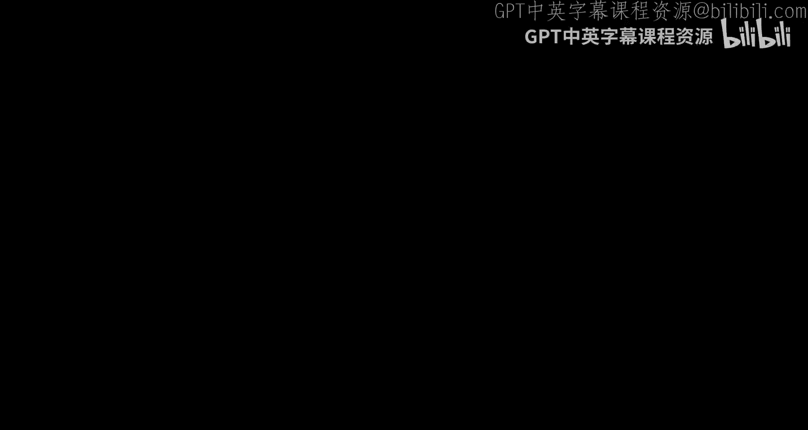
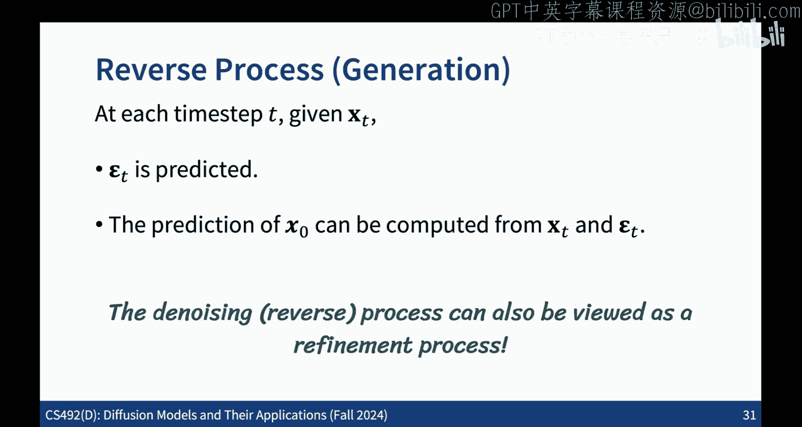
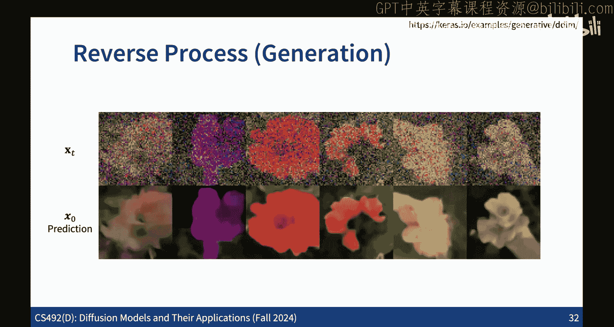
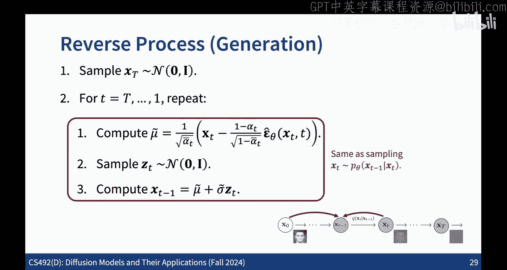
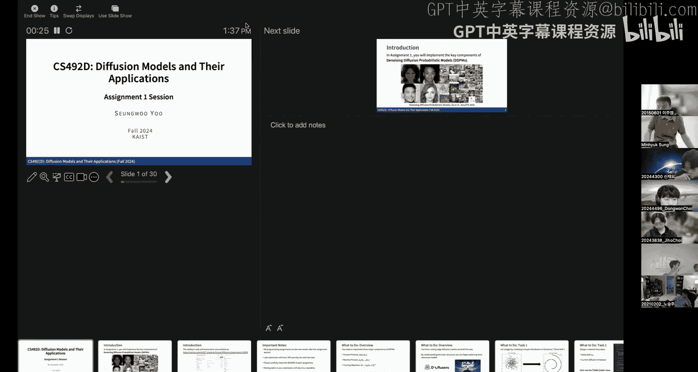
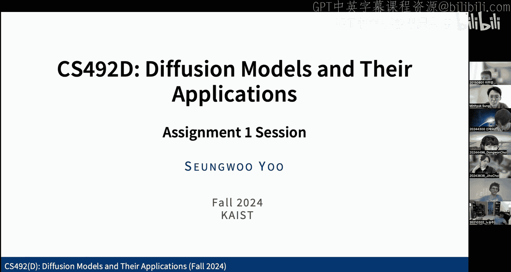

# KAIST《扩散模型和应用｜CS492(D) Diffusion Models and Their Applications (Fall 2024)》中英字幕 - P3：Lecture 04_ Denoising Diffusion Probabilistic Models 2 (KAIST CS492D, Fall 2024) - GPT中英字幕课程资源 - BV1mwpUzREqX

So we basically discussed some basic idea about the DDPM last time and also we have seen the long de derivation about de formulation。

 basically how exactly the formulation is like derived right and the plan for today is that we are going to see not about just like how we derive the formulations but how we can exactly implement this model so after the long derivation actually you're going to see that actually the implementation like this model is surprisingly simple so it's actually very simple so you just need to like implement implement that just field lines of the code in the Python that you're going see that it starts to work so we're gonna see that。

So like some brief wrap up the things that we discussed last time。

 so we are basically seeing this kind of the ideas about like the generated models。

 so this is basically all about basically learning some kind of the data distribution。

 but since we cannot actually sample from the data distribution we are basically mapping seeing some kind of mapping from the late distribution to the data distribution。

😊，So the mapping from the latent distribution to the DR distribution is also called the likelihood。

 the conditional the distribution， which is basically represented with the decoder or the rely processing in the division models。

😊，And we're going to help help the otherer kind of the mapping from the data distribution to the latent piece。

 which is basically our the posterior the distribution。

 so typically we say that the latent distribution is our prior distribution。

 we are starting sampling from the prior distribution and then mapping this to the data distribution。

 which is like going back to going to the margin distribution and then we are having this kind of relationship between the data and the latent the distributions。

😊，诶。And there are some kind of the key features in the diffusion models。

 So we started from the again and then Be and like moving to the diffusion models， right。

 So there are some kind of the key aspects in the diffusion models。

 The first thing is that we are basically having some sequential processes both for the forward process and also the reverse process。

 So basically when you see the mapping from the data distribution to the latent distribution。

 we are having some kind of the sequence of the latent variabless and having some kind of the sequential mapping process like this。

 So this is kind of one of the key features。And the second thing especially the division model is that we are not going to learn the full process。

 So this is kind of like predefined， so we are not going to have any kind of the variational reformform for this kind of default the transitional distribution。

 but we're going to predeefine these full process。 we only learn the labor process。

 So that's also kind of the key features with the variation of division models。

And the third thing is that especially different models。

 we are going to match the dimensions of the all the latent variables with the input data。

 So there' is nothing in terms I think some dimension reduction of something something。

 So all the basically the data the points and also the latent variables are basically having the same dimensions。

 So these are the key features。😊，And especially for these like denoging diff progress models。

 the model， which is called the DDP， we are having some more specific kind of some key aspects。

 The first thing is that we are considering the fault and reverse processes。

 especially the microcobi on the processes， which means that like when you sample the X T。

 we only care about basically X t minus-1 some kind of the the latent variable that we sample in the previous term。

So the everyday latent variable has the dependencies only with the one that has been sampling in the previous test。

 So if we see this kind of some conditional distribution sampling X T conditioned by the X t minus on the x0 we can easily drop the x0 because like we know that X T only depends on the X t minus-1。

 but not the x0。 this is only for the DPM model。 and we're gonna also see the case of the non micro the cases in the next D lecture。

And the second thing is that we are specifically defining this food transitional distribution in this way。

 so we are handling basically some kind of the better T here which is some kind of de and based on this kind of some time dependent de of the better T we are the defining the the the traditionalal distribution as kind of the Gaussian form like this。

 so this is basically our definition in this specific case。😊。

And we can also choose the like disparity as we want。

 we can basically consider like learning thisparity。

 basically optimizing thisparity over the training。

 we can set some kind of the constant number for the verity as well in your the first assignment we will see the case that we are linearly increasing disparity over the time the domain and we can also consider like some other kind of the cases for the verity。

😊，And one thing that I missed last time is that it's also important to have some kind of the very small number for the B。

 So when you have some kind of very small number for the variety。

 then we can basically guarantee that the river step can be also modeled as the Gausian this。

 So this is kind of the one one of the key things in design of the DP。😊。

So there are some kind of the key， some conditional distribution that you need to remember to implement the DDPM also to follow some the rest of the part of the course。

So the conditional distribution sampling X T from the Xt minus-1 is basically defined in this way。

This is like what we define right and based on the definition。

 we can also basically derive deformation for this something that we call the fourth jump。

 so even when you want to sample Xt not from the X t minus1 but from the x0。

 we can sample using another de Gaussian distribution。😊。

So this is like what we was deitalized last time， right？And based on these two。

 what we can also see is that even we can sample X t minus-1。

 not the X T from both the X t and the x0。 So for this conditional the distribution。

 we can see that this is also derived into the de Gaussian form with some kind of some complex form of the mean and the the variance there。

So you don't need to like remember all the things like you can just like download these slides for this formulation the only key thing is that the mean is basically computed as some kind of linear combination of the Xt and the XO。

😊，So we are if we have the X T and the x0， then based on that， we can compute the mean X R here。

 right？And the other way around is the same。 Like we have the X T and the mean。

 then you can also compute the x0 well we are basically having those kind of the linear formulation for the mean here。

😊，喂。So these are like three main kind of conditional distributions that you need to remember to basically implement the D pin。

Yeah， and so also in terms of defining the mean here。

 So this is kind of one of the key distributions that we are going to see。

 especially in the lose function in the elbow function right。

 so the distribution of sampling x t minus x minus1 from the conditioned by the X T and the x0。

 So in this case we can compute the mean of this Gaussion using this formulation and instead of that like what we can do is that now we can see the xt it' kind of sample from the x0 using some kind of standard the normal the sample epsilon t here。

 So we can see that like this xt is sampled based on this Gaussion So you could basically sample xt from the Gaussian distribution that we can basically see that this xt is basically another linear combination of the x0 and the epsilon T here' the epsilon t is basically sample from the unique Gaussian distribution。

So which means that if we have the information about like the Epsilon t here。

 then we can replace the role of the x0 in this formulation with the Epsilon t。

 so what we are going to do is that if we have the formulation of the epsilon t so basically the meaning of like this epsilon T is basically the unique gaussian sample that has been used to sample from the xt from the x0。

😊，So what we are going to do is that we are not going to store the information of the X0。

 but we are going to store the information of the epsilon T to replace X0 in this formulation。😊。

So basically， we are just seeing like some different ways in terms like how we can calculate the mean of theussian distribution。

 right？😊，Good。可以。Yeah， so what we can see is that if we have the Xt and one of those things。

 either the mean or the X0 or the Epsilon t， if you have one of those things。

 that you can convert like one to the other。So what we have seen in the previous slide is that if we have the X T and the X U based on there。

 you can compute the mean， right。😊，If you also have the Xt and the epsilent T， then based on that。

 you goes compete mean。😊，The other way around these those the same。

 right So if you have the X T and the epsilon， you also could the compute the x0 and also the other way the same right and also for the x0 and the epsilon T。

 So if you have like one of those two in in these three d variables， then you can compute the other。

 So these are just simple some kind of linear combinations。😊。

So we are having these three quantities in this relationship so we can compute the other based on one of the variabless here。

😊，咦。😊，So you would need to remember this because we're going to see like how we can utilize this information in our network training。

So these are some kind of the key aspects in the DDPN and we see how we're going using this information in to minimize all the elbow function。

 So also what I mentioned in the last lecture， I mean also only the previous lectures is that like training the general models like is all about basically minimizing the negative elbow So basically how we gonna basically minimize the negative low about and after the long long derivation。

 what we could see is that this the negative elbow function now can be decompposed into the three terms。

And one have like reconstructing det and the prior the matching term and the den matching term。

 So we are not going to see so any details in terms like how we can derive these threes。

 But the key things in this elbow function is that for the first term。

 the reconstructionconstruct de to。 This is exactly the same term that we have seen in the Be。

 So we can basically minimize the loss function in the same way way that as we have done in the B E case。

😊，And also the thing is that typically even we can ignore this loss function because like this is like very small theion of like this entire the loss function because like we are having this big giant the loss function。

 which is like even summing up over all the times that D T。

 so this is of like the most dominating the determining the loss function。😊。

So practically even we can ignore like implementing these records of the。

 so you're going to ignore this。The second thing is that this prior matching term cons to zero without doing any optimization。

 so as you can see in the lowest term， there is nothing to be optimized because we predefined the forward process。

 right？So actually by our the definition of the default process。

 if we increase the time step of like adding the noise in the process。

 then we can say that this decay key dirgence like naturally basically goes down to zoom。😊。

The by definition of our default process。 So that's the way that how we define our default process so we can also ignore this lo。

😊，So this is basically the good thing of the like the digital model and from the definition of the DDPM。

😊，What we can see is that we only need to care about like this last de lowest term which is the denoing matching tongue。

 so this is basically all about basically minimizing the care divergence between these two conditional distributions。

 so this is basically what we are going to do in the DDPMD model。😊。

So this is the main focus in terms of like design the lowest function。

And then now we can see this is kind of some expectedvalue from here。😊，So yeah。

 because like we are taking some over the time the T。

 So we can see that this is basically expected value over not only for the X T which sample from the X U and also over the time T as well。

 So we are basically having some kind of the expected value of the key intelligenceence between these two the the conditional distributions。

😊，So we are going to minimizeニ this。So the key thing here is basically how we are going to compute that KlD diverers。

And before that， what we need to do is that we know how this distribution right how the deform like this distribution is basically derived。

 that's what what we have done in the previous slide and this is basically the variation of deform that we need to learn so we are going to make a variation of deform over like this distribution in a way that we can basically find a good distribution that can minimize this loss function so we are going to find some kind of the distribution here that can basically the piece that are there that can basically match the distribution that we are competing for the Q case there。

😊，So how we are going to define the variation of the form of that the likelihood of the distribution。

The thing is that what we have seen in the previous the slide is that we can directly compute the variance the variance of the Gaussian distribution。

 the only thing that we need to know is basically the mean。

 or the variance can be computed directly from the all parameterss that we already have。😊。

So we can use exactly the same the variance。The only thing that we need to do is basically just predicting the mean。

So this is basically the part where the neural network that comes in。

 So we're going to use a neural network that can basically predict the mean of that distribution using the input of the X T and also the times step T。

So this is basically what we need to do， we're going to make some kind of the smooth neural network。

 which is taking the Xt and the T， the times the t as the input and predicting the mean of that the poster distribution。

😊，So this is like all we need to do in your implementation with the daily PM。

But as we have seen in the previous slide， instead like predicting the mean here that we can consider like predicting the other things。

😊，For example， like we can consider predicting the X0 in a way that we can just say compute the mean based on the X T and the X0。

So this is just like another way。 So there are like three cases。

 really the options that we can choose in terms like defining the variation before。

 so we can consider having the neural network， which is not directly predicting the mean。😊。

But just' predicting the x zero here in a way that we can compute the mean of that distribution。

So this is the case that we are just having the X zero predictor。😊，At every time step。

Just like on the option， right。And the third option would be basically heading the Epsilent T predictor。

We also have seen that in the previous slide， if we know the X T and the Epsilon T。

 then based on that， we can also compete timing， right？

So instead of like having the mean predictor or the x0 predictor。

 now we can have the Epson T predictor to compute the mean here。So here。

 the key thing is that like whatever we have， like whether we have some mean prediction or the X zero prediction or the Epson T prediction。

 we can compute the other things based on the information that we have So it's just like matter of like changing the variables here in terms like what we are going to predict。

😊，Not making some kind of the big difference in D the training but still making some small difference so yeah so we can consider these three options like one is directly predicting the mean of that distribution and the other option is to predict the x0 and then competing mean based on that and having the Eson t predictor and competing mean based on that like three options。

😊，You can see like this might look kind of complicated but this is just like nothing but just like changing the variables we are just like either taking the mean or the x the efficiency at some kind of the variables that we are going to predict using the neural net then based on that we can compute the other so it's just like metal like just doing some very simple de calculationpo in your code。

😊，あれこえちゃそうです。I'm going to explain that。So yeah， so based on this， like one of the the predictors。

 So how we are we are exactly going to minimize this。

 So this is kind of the main part in the training。 right。

 So also what we have seen in the previous lecture is that this scale the diversity system can be rewritten into this very simple the L2 loss。

So this is I think basically just like minimizing this kind of the al difference between the ground truth。

 some kind of the mean that we know with some kind of the mean that we are going to predict。

Where we can also define L to the the loss for the x0。

 where we can define the L to loss for the Epson0。 So here also the the thing is that there is like nothing changed。

 Like everything is basically just like mini the L to loss。

 except for that we are just like having some different ways。

So the only things when you change the predictor is basically just like changing the weight。

in the lowest functions。So these are only things that we need to change and even better thing is that in practice there's no theory here。

 but in practice what we can say is that even we can just like ignore the weight。

 you just need to minimize the Lta loss， I mean this is just some practical kind of things I mean there's not low theory here but if you implement your linear network even when you basically just like ignore de weight term it still works well。

😊，So even we are going to ignore all the weight times here。

 then you can see that all the loss function here becomes like identical in terms of just like minimizing the out loads。

Which means like it sounds like whether you have the mean predictor a predictor is T predictor。

 everything is the same。😊，Right， everything is the same。

So it's like just up to you can choose any any of like those kind of objects。喂。

So typically what we can see in many kind of some pretri。

 some diffusion model is basically we can see some cases like having the X zero predictor。😊。

But most of the cases actually， we can see the like Epson T predictor。

 So the only reason like why we might want to use the Epson T predictor is that we know that all the Epson value heres are basically the standard normal disance。

And if you have any experience in the neural net sum training。

 then you will know that like data normalization is the key part to improve the quality of the outputs of the predictions。

So what you can see is that since all the each and T or these1 normal samples。

 these are really well normalized and skilled thevalue。

 everything is basically like normalized in terms of having the zero mean and having the unit de variance。

 right。😊，So you can see actually， this is kind of the case that we are having some good normalization of the data that we are going to predict。

So that's the typical and practicalctic reason in terms of why we can have some kind of the better performance with the Eson T predictor。

😊，Very practical， but in terms of de formulation， there's nothing different in terms of like which critical features。

😊，嗯，没。So in the your the first assignment， the problem might be about implementing this。

 using the Epson T predictor， but I also recommend you to try to use the other predictor。

 implementing the other predictor and see how much makes some kind of difference in terms of the performance。

可以。So yeah， So here the things that So now we are going to see that this is basically the lowest function。

😊，And given the loss function。 So how exactly we are going to train our the E T predictor。

So this is kind of key parts。 and you see actually， this is like really simple。 I mean。

 basically it's all about basically minimizing that expected value。

 expected value over the time step the T and also the X T， which is sampled from the X zero right。😊。

So what we are going to do is that we are first going to sample the X0。

 sampling X0 basically means that we are just taking some random input data。

 some random real image or something that is basically some kind of given data， right？

So we are basically taking any random the aule。 So in the image generation。

 the aule can be some kind of the given one of the real images， right。And then based on that。

 we're going to also sample the time step T， which is basically choosing any the time step there。

And then also sampling in the unique Ocean sample。And based on that we can now compute the X T。

 so basically here the meaning of like computing the Xt。

 is we are sampling Xt from that you know the condition of the distribution。

 so we can see that basically the meaning of like these two。

 three floor steps is basically sampling the Xt from the given X zero。Right。

So this is the repprimeration trick that we have seen in previous lectures。

 so what you can do in terms of having some kind of the arbitrary Gaussian distribution is that we first basically sample any of the standard deor dis sample and then compute this really the mean individuals so this is basically nothing but basically reas samplingmbling Xt from the X。

😊，And based on that， now we have all the information about the Epsson T and the Xt and the T。

 and we can just like run the back propagation through the L there。

So the meaning of this is that from starting from the x0 there。

 we basically do some kind of the fold jump to the xt with some arbitrary3D times step t and also the standard the normal dis sample here。

And then we will be able to basically and then we're going to get the Xt here， right？😊。

And now we are basically doing some kind of the reverse engineering in terms like this thing like what is the Epson T that has been used to jump from the X U to the X T without the information of the X U。

 but by only seeing the X T and the times T。So we jumped from the x0 to the xt。

 we did some kind of this standard de normal sample eps T here。

And now we are basically forgetting the information of the X U。 We don't know about the X U。

 We only know about the X T， and we want to predict the Epsilon D T that has been used for jumping from the X U to the X T by only seeing the X T。

Simply speaking， or this is basically what we are going to do。

 and then we have running the back propagation through the values。😊。

And this is actually not exactly just like memorizing the epsilent T that has been used from the X to the Xt because actually we are not minimizing this just like L loss for this case。

 but actually we are minimizing the expected value。😊，So which means that for any of the XT。

 actually there can be some multiple x0。That could result in like jumping to that specific xt。

 So which means that no， for each of the like single the xt， there could be multiple x0。

That could lead to that XT jumping， right， which means that also there teams a multiple epson T。

That also LED to that no X， right， So we are basically mini the expected value basically just like finding some kind of the mean of like those kind of things。

So there is not exactly about like memorizing the exact epson T。

 but basically minimizing that expected value。So it's not the thing。But as you can see。

 like D is like just。Really just like few lines of the code in the Python just like everything here is just like the one line。

 you just need to take like one input data and there's like sampling tape。

 This is something you can just like have some uniform sampling the long in the Pyth search and also the normal sampling is just like one line of thecode and just like calculating this and running the spectrum so you can see that this is like really simple kind of things in terms like implementation。

😊，So this is kind of some very magical things of the DM in terms of that de derivation was very long。

 we have seen lots of things in deform， but at the end like it turns out that we are basically having some very simple dis code in terms of making some training code of the D。

😊，We will see that actually this implementation is much simpler than the or degree。😊。

So once we basically train our basically the Epson T predictor based on that how we can basically run the labor process in talk and things and kind of generation。

I mean， the reverse process is basically nothing but basically sequentially sampling the XT from the previous test。

😊，So what we going to do is that we note that our prior distribution is this1 normal distribution。

So from this the prior distribution， this standard there。

 we're going to first sample the x capital T there。

And then we are sequentially sampling X T X T minus1 from the each of the X T。So this is okay。

 basically nothing but basically sampling the Xt， so xt minus some1 there from the Xt here。😊。

And for that， what we are doing is that we are first calculating the mean and also sampling another the standard the norm the sample there。

 and then basically using the reparitation tree in terms of calculating the X minus。😊。

It's like repeating this process given the amount of time steps。

Then we're gonna get some kind of results so they're making some kind of realistic detail。可以。😊。

So these are basically。Kind of be some algorithm that you will need to implement in the。So yeah。

 the long story short the key thing is that while des like lots of deterios。

 you're going to say that actually the implementation the the training and de generation is like way simpler than the formulations that we have seen。

😊，Yeah， so heres one of the key things is that we are having the epsilon predict there。

And as I said in the previous slide， if we have the xt and the Epson T the prediction of the Epson T。

 based on that we can also have the prediction of the x0 as well。

 it's just matter like it' calculating the x0 from the xt and the Epson t。But actually。

 you need to see that actually x0 is something that we want to eventually get right So over the reverse process。

 starting from the x capital T， we are going down to the x0。

 So x0 is something that we really want to predict at the end， right。

What we are seeing here is that actually what we are doing every time step is specifically having some kind of the prediction of the XO that we want to see at the end。

So what you can see from this is actually this whole process can be seen as kind of some denoing the process。

 but it can be also seen as basically defining the prediction of the X。😊，So every step。

 we are going to have some prediction of the x zero。

 but we are going to refine this x zero in a way that we can get some better X zero。😊。

So I think this figure slide might be showing some kind of the clear picture of like what we are doing so these is does be some kind of the images of the X T you can see that we are starting from something the pure noise and then deducting some kind of noise in terms of just making some more realistic images。

The first rule is basically some visual I of the xt。Makes sense。

 starting from the pure Gausian noise and basically making it like denoicing it into some more realistic image。

😊，And this is nothing but just like calculating the X from the prediction of the epsilon T and the Xt。

😊，So it's just metal of like just like calculating this ex de prediction from the Xt and the extent T that we predicted。

So if you just like calculate this， you're gonna see that actually is basically making some kind of the realistic images。

 starting from some kind of some blur images， but making it more like some fine images so you can see that actually this process the whole process can be seen as like actually we are predicting the x0 every step or we are just like refining this X zero in terms of getting some kind of the better quality of the output so since we are having some kind of the loss of these steps to improve this quality we can get some kind of the better results than some kind of the one that de generation like the。

😊，We're going get into some more details about like what's the meaning of like this DDPM and also how we can even like make it faster in the next lecture。

 but these are some kind of some the basic ideas like some kind of the recipe that you can just like use to implement the the the DDPM。

😊，Any places on this？

W we sample T from uniform distribution because like if we go back to the lowest function here。

我 very谁。Yeah， so the loss function here was basically taking the storm over the times the key。

two from the two to the okay， right， So we just like converted this into the some expected billion。

 So this is the case like when youre basically having the sample the T in some uniform this because we are taking this sum over the all time time。

So yeah， it comes from the definition of like this theknow technology。那两个。

So I guess you might have some better ideas like all the things while you implement this DP yourself and the first assignment will be basically sorry。

Yeah， I'm going just like switch the session but the first assignment will be basically implementing this DPM for the two cases like one is will be basically simple some 2 d point generation and the other task might will be the image generation so our key will explain the details about the first assessment。

😊，Now，'s one second。 Let me just。

s you啲。Okay。

そ。Yeah。Okay， so can people on the Zoom side hear my voice is okay， is the only okay？

