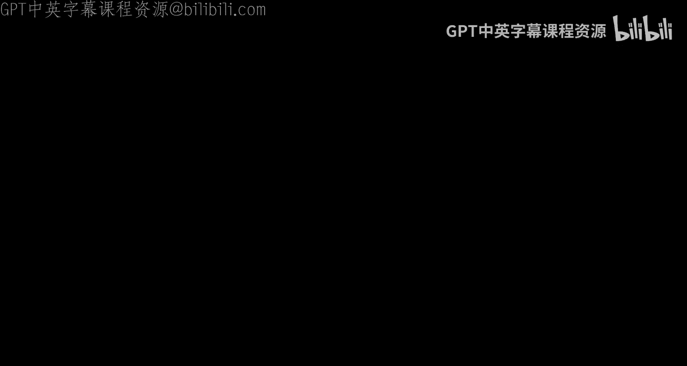
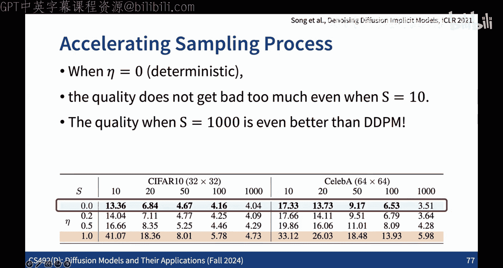

# KAIST《扩散模型和应用｜CS492(D) Diffusion Models and Their Applications (Fall 2024)》中英字幕 - P4：Lecture 05_ Denoising Diffusion Implicit Models 1 (KAIST CS492D, Fall 2024).zh_e - GPT中英字幕课程资源 - BV1mwpUzREqX

哦。So yeah let's get started so today we are going to briefly recap the things that we discuss for the DD and we're going to move on to the other digital models。

So last time we last week we started to discuss the basic ideas about the division models。

 which was basically having some of the some key characteristics。

 the first one is that we are defining both the four and the processes as kind of some kind of the the processes and also the thing is that the four processes is not learned about kind of some predefined some kind of the processes and also we started to basically dimension of the latent variables and also the input is kind of the that this is kind of some characteristics and specifically for the D and what we have seen is that we specifically define the full the processes that the markov on the processes and also the full transitional distribution was defined into these specific form into these Gaussian the distribution so the meaning of this was basically that we are gradually adding some kind of the noise into the data points while we are increasing the variance。

The Gaussian distribution so this was basically the key characteristics of the DPM and today we are also going to start to basically discuss some kind of the non microbi processes as well。

And once we basically define this like both transitional distribution in this way。

 then now we could also divide the other two conditional distribution。

 which was the personal one basically the full jump basically sampling the XT directly from the data point okay X0。

 another the Gaussian distribution。And also the other deco conditional distribution。

 exling xt minus1 by conditioned by the Xt and the X2 was also defined into another de Gausian distribution。

So introduce this before。And we also introduced the form of the excellentps T visual a specific noise that has been used to sample the X T from the X0 and the mean over like this specific the posteror distribution could be also derived basically defined。

 not only using the X T and the X0， but also using the X T and the excellentps T。

So the goal of basically the training within neural network was to basically match thispar of the likelihood distribution to be the same with the distribution in the previous slide。

 so in terms of that there could be basically three the different ways in terms of trained in neural network。

The first way was to basically make a mean predictionor。

 which is directly predicting the mean of specific the duration of this distribution。

And the other way around was basically not actually predicting the mean。

 but actually predicting the X， the original the data point。

 and then basically computing the mean using both the X T and the prediction of the X U here。

And the other way around also， so not directly predicting the XO。

 but also predicting the epson key in terms of that now we can also compute the mean using the post the X T and the predicted epson key So there be this these three different ways that we can make somebody the DD and the model in terms like changing your network。

And the interesting thing is that whatever the predictor that we have are all the loss function basically coming from the elbow。

 the formulation。Basically came down with this kind of specific very simple the L the loss function。

 So that is basically giving some kind of the one of the key advantage of the DP and also the digital models in terms of that we're having some very simple the train the loss function。

So everything does become on some kind of the L tool loans like this。

So in the first assignment the goal was physically to implement the noise predictor。

 it could be basically having some kind of the other predictors like X predictor and the mean predictor。

 and also I recommend you to try to basically modify the goal of the assignment1 in terms of like switching the predictor into the X X zero predictor and the mean predictor and see what happens in practice。

 But theoretically， these three are like all identical things， but in practice。

 there can be some kind of some differences in terms of the performance So you can check that out yourself。

So as you can see the loss function here is specative point as kind of the expected value over the time T and also the X U and the Xt sampled from the this specific distribution。

So what we can do in terms of a twin dinner network was basically just like minimizing the expected value。

That we are sampling the X0 here and also sampling T here and also sampling the X T from the specific the posteror distribution and basically running the back propagation through the L to the loss function in terms of like minimizing the specific loss function。

And in the generation day time， the procedure also was kind of simple in terms of that we are starting from like sampling from the prior distribution。

 which is the standard de Gaussian distribution， and over time now we are sampling the XT from the variation of the likelihood food distribution。

Letly by copying the mean from the noise prediction and also like sampling the X team and in this way。

So these sort will be what we discussed in the last week。

And so this is also what you need to do or you need to implement it in the process segment。

And here one quick quiz is that so in this slide we are basically seeing like how we can completely mean of this the likelihood the distribution from the given the XT and the prediction of the noise here。

 right？Then like instead like the mean here， can you also compute the prediction of the x0 from the given the X T and the prediction of the noise？

Can you quickly basically derive the formalation which is computing the X0 not D me from the given the X T and the Eson it。

So let me give you like couple problems。Yeah， so as most people also post the answer in this slide。

 the answer is this， right？So if you don't know how exactly we can derive this。

 I recommend you to check out the details in the DDPM slides again and these are the key formulations that we're going keep dealing with in the rest of the O entire so we're going to keep seeing this kind of the these formulations of the DDP and the DDI am in the all the other lectures so if you are not sure exactly how we can derive these kind of things you will need to check out the more details with DDPM。

对。And yeah so what we can also see as kind of our diversity process is like kind of this So we are basically for each of this step。

 we are having the xt which is the noiseisy the data point and given this like we are predicting the epsilon which is the noise and based on that we are first predicting the x0。

 which is kind of the best prediction of the final data point from the given the Xt the noiseis data point and we are not strictly taking this we are basically using this information to compute the mean of the likelihood distribution and sampling the xt minus1 and predicting this process and from this like what we can see is that this is kind of the process is basically we are basically defining our prediction of the X0 over time so as we also have seen in the previous lecture we can see that the prediction of the x0。

 we will be basically gradually improved over time through this kind of the denois the process。

So it matters basically interesting toize this prediction to XU every step in the assignment one terms to like seeing that the SU is specifically defined every step。

Yeah， and before we move on to the next the topic also one important question that we might also need to discuss at this point might be this so from the next week we're gonna to also discuss some kind of more the practical ideas in terms of how we can train these di models with the billions of images so really in the internet we're gonna have some like more the billions of images and the question might be that how we can also train the di model we billions of images but also the other question might be that like if we have really like tons of the internet scale of the images that do we really need to generate the data using the di models maybe we can just directly sample one of the images that we have in our the training data one of the advantages like having this kind of de generated model in in terms of like directly using one of the images in the internet。

So this is also like important question you need to think about。

 so let's quickly think about like this question for another decoup of bis。

Yeah as you most of you are posting the good answers。

 there can be still like a bunch of your advantages in terms like having the different degen models。

 so basically like one of the advantage like having thegen model is that we don't need to basically help all the the billionions of images in our this basically we train the noise predictor and the predictors that we discussed that will be the case that the neural network is basically encoding the information of the entire data distribution that means that our network basically has the information about the billion images and basically compressing that all the information into the neural so in terms that we are compressing all the information to the neural there can be some kind of advantages in terms of the efficiency and chemical。

And also the thing is that our models will be able to produce some of the images that are not really presenting in our the training data they are basically not exactly the same but still some kind of the realistic the plot of the images so in terms of we don't need to rebuild the images in our the training data so we can basically some of product protect the privacy issues or some kind of copyright of the information that we are having in our the training data while making another some kind of the realistic some of the images or some kind of data points so in terms of the privacy and the copyright issues there totill some of the rep like having our the some models and also from the next week。

 we going to also start to discuss some kind of the conditional setup like the text image generation or something to image generation or something for those kind of the conditional the setup like directly using some of the samples in the our the training data we will become solving the retrieevval the problem so given the query。

Information what should be kind of the output that we need to basically retrieve from our kind of the the given the data set。

So comparing to this kind of like solving this kind of rettriev the problem。

 basically our the conditional genetic models will be more efficient in terms of we can basically easily generate some kind of the new data points from the K condition we're going to also start to discuss these kind of the conditional the models from the next week。

So but also this also shows that depending on the applications。

 there can be some of the cases that we don't need to actually train a genetic models。

 it can be actually better to solve some kind of subtri problems in some specific situations so depending on the applications that you are dealing with which you might need to also consider whether it's really kind of be good to have agene models where you can also consider directly using some of the samples in the given the data set so this is also kind of important point in terms of like how we going utilize these kind of ideas of the genetic models。

Okay， so now let's quickly move on to these the twoD topics so for today we are going to discuss the two topics like one is about like the the connection between the DDPM and also the school based models that we are going to discuss for today and we are going to discuss another the different models which is the denoizing the input models which is for the DDIN。

So let's move on to the core based models。So before we discuss these core based models。

 what's the score what's meaning of the square， so the meaning of this score in the statistics is quite not the kind of the things that we are saying basically here this score means that is the gradient of the log likelihood of the function with respect to the data points so we have some kind of the PDF they probability density function for the data points like this。

 if we take the gradient so the look of the probability the density function。

 basically taking the gradient with respect data points then this becomes of the score so this is the meaning of the core so and we're going to use this for meaning of the rest des in this query so please keep in mind of the meaning of the definition of this score and so we're going to see how this score is related to like what we have discussed so square in this square。

So what we are going to see is that so were going to first see how we can compute this core of this specific probably the distribution。

 the posterior the distribution， which is about the fourth jump right sampling the Xt from the X so given this kind of the posteror distribution for the forward process how we can define the core function so this is the first thing and the second thing is that we're going to see how this core is related to basically the noise that we are predicting neural neural network。

 so actually we can directly calculate this core because we know that this distribution is have this kind of the form of the Gaussian distribution so given the definition of the Gaussian distribution。

 actually we can directly compute the gradient of the log of the P then we can see that the core becomes like this form so you can see that this is the formal like taking the log of the P。

F the distribution， if they take the gradient over this that we can basically this。

So this is okay nothing based on the definitions that we have seen。And from this。

 like what we can also see is that from our definition of the epsilon T。

 which of this gig the noise that I can use to sample thep from the x0。

 now we can see that this square function over like this specific distribution actually becomes like the same with the noise but scaled by this scaling vector。

So you will basically need to remember this kind of the relationship between the core of this distribution and also the epsilon T here。

嗯。So from this actually， what we can see is that like no。

 we are basically trained the noise predictor for the GDPDPM and now we can interpret the meaning of the noise predictor is basically predicting this core function or basically the posterior distribution the scaling factor。

 so we don't obviously have this kind of scaling factor but we are basically predicting this epson T directly。

 but we can consider that actually the predicting the epson T is basically identical with basically predicting this core of like this probably the distribution of to the scale vector。

So we're going to basically see this kind of a relationship in those various directors。And also。

Is this clear any questions on this？And also the interesting thing is that we can derive the same formulation using the tD formula。

 so2weD formula is basically basically some kind of the interesting de formula in terms like showing that。

 so let's think about the case that we are having some kind of the probably the density function。

 which is known as like the Gaussian distribution。好。What's the。So yeah。

 there let me some kind of the updating the slide， I will also eat the you know the slice after the lecture。

So yeah， but the meaning of the t formula in English is that so let's think about that we are having a de Gaussian distribution。

 but we don't know the meanme of that distribution the only information that we know about that the Gausian distribution is that the fact that that distribution is a Gausian distribution unless we also know the various。

And some of the samples that are taking samples from that distribution。

 but let's say we don't mean OD distribution。Then the question is that given the samples and the variances。

 how we can also get some kind of the expected value that mean of the distribution。

So what the T this formula is is that if we only have these samples and the information about the variance。

 given this information， we can have the expected value of the mean into this formulation。

So basically， if we only have the samples and then the variance here。

 then we can calculate the expected value in this one。

We some kind of de variation and if we have this kind of thet de formula that we can derive the same kind of formulation that shows the relationship between this core and the epson T here using this kind of thetus formula here。

So what we can see is that we know that the mean of that distribution should be this， right？

So the expected value of the is basically known as it like this。And from the Ts formula。

 we can see that this should be same with this formulation。Which is involving this core here。

And basically if we write this formulation， then now we can derive the same formulation showing the relationship between this core of this function。

 probably the density function， and also the influencelu T here。So from this。

 we can see that the noise prediction is the same as predicting the core of this posterior distribution。

就边。don't know mean it so we can obviously completely。是。

This is basically showing the the relationship between the score function and the other parts of the。

你 comes here。So we can also get into like how we can also compute the score for some kind of the given distribution。

So yeah， this is basically about basicallys some kind of the relationship between the samples and the variances and the score that can be used to basically compute the spectrum variable limits。

So here the question might be also like why do we care about this core so what's de meaning like having some kind of the information about this core function so that's kind of one of the main things that we are going to discuss today so let's recall like what we have discussed the lecture tool so what we discussed the lecture two is that it we basically have the information about the distribution like probably the density function for the distribution then we can sample from it from sample from the distribution so we have discussed some kind of some techniques that we can use in terms of sampling some of the data points or from the given probably distribution。

And here the interesting thing is that if we have the information of this core function。

Not exactly about the PDF or the the distribution， but without basically knowing some kind of the information about the probability distribution。

 even just using this core function， we can still directly sample the points from given the distribution without having explicit the PDF the function。

So that's kind of the technique， which is called the Laanggaand D dynamicss。

 which is coming from the physics。And the basic idea about the lungs about the dynamics is very simple。

So the way that we are sampling the data points even without knowing probably the distribution。

 but only using the score function is basically this way。So there are basically some several steps。

 but you can say that the basic idea is that we are sampling some of the data points from some kind of the prior distribution。

 which is typically also the standard de Gaussian distribution。

And starting from some of the samples from the prior distribution。

 we can simply iterate this process， you can see that this is basically nothing but you know from each of the data points。

 we are adding some kind of be core with some kind of thes and we' also basically adding some kind of the perturbation with the standard desion noise here。

And what is basically guaranteed in this formulation is that when the waste of this core is getting close to zero and you previously iterates this process for the almost like infinitefin data time。

 then we can see that the data points will basically converge into the one of the data points of the original the data distribution。

So this is basically the procedure of the lungibility dynamics。

So you can see that this is kind of like some very interesting way that we can sample the data points even without having the information about the probability distribution。

 but only this core function。It is great。So you can see that actually this is kind of similar。

 like what we are doing in the reverse process of the DDPM。

 but we can also clearly see some kind of the connections between the DDPM and this procedure。

And this is the some of the animation like showing some kind of like how it's actually the data points are basically moving to the some kind of distribution you can see that the at the very in this stage the points are basically almost like uniform is sampled over the space and as time goes on you can see that the points are basically moving towards to the some high density regions in here and here。

I time here was。Doess the weight time change over the steps no so it also depends like what sort of the waiting time that we use。

 but yeah we can vary dislike wait thumb or we can also use some kind of some constant the on here。哦。

 but。When you see basically the connection with this to the GDPPM that we can see that how this is changed。

So in terms of like also including the information of probably the density distribution。

 what we can do is that we can basically trained a neural network that can predict this core so one of the ways that we can include the information of the data distribution is to basically having this kind of core prediction the network which can be trained in this way。

 so in the case that when we can basically directly calculate this core here we can train in neural network that is basically minimizing this L to the loss with some kind of the while basically calculating this kind of the loss is kind of expected value by sampling the points given the data distribution。

So we can think about like making a sort cooperation network by taking this as kind of loose function right。

Orいで clip。So we can see that this is also kind of similar with the noise practitioner natural。

So here the question might be is that how we can exactly compute this query here， right？

So let's say we only have some kind of samples of the data distribution。

 but we don't know the information about the the exactly about the data distribution。

And given this kind of situation， how we can exactly compute this score。

So obviously for those kind of the cases， like we when we only have the data samples。

 we cannot directly compute this core here， right？So what we are going to do is that we are going to have some kind of slightly per up the data description。

嗯。So let's say we are having this kind of the so this Q x is basically our original data distribution now which will be denoted as the Q x zero here and we are going to basically approximate this data distribution as kind of the mixture of the Gaussians。

So what we can see is that now we are not directly taking the Q x0 as kind of Ga distribution。

 but basically slightly perturbing each of the x0 with some kind of de Gaussian on here。

 which is basically the case that we are taking the Gaussian distribution at some kind of the combvolution deco in terms of making slightly some corrupted distribution。

So this is kind of the one of the the visualization that we are having some kind of the three points here and adding some kind of the Gaussian。

 some of the perturbation here in terms like making slightly decruped the distribution。

And we can also easily sample from this kind of the the modified the distribution。

So the simple way that we can sample from this kind of the modified distribution is basically sampling from the XO。

 which is basically taking any of the random samples that we have and then we can add some kind of de perturbation like this then this will become the way that we are sampling from the Q XT here。

It is clean。So let's think about it now we are training this core prediction network with this kind of the slightly modified distribution。

And then we're going to have this kind of the objective function， the loss function here。

 and after some kind of the derivation， actually what we can see is that this becomes identical with basically predicting the noise for this kind of the conditional the distribution or the poster distribution。

 example Xt from the X with some kind of the derivation。

And now what we can see is that now training this core the prediction network here becomes the same as kind of the predicting the noise that we are basically predicting reaching the noise prediction。

 the network in the GDPDP。So now we can see that this is not just kind of like similar with the reverse process or kind of the noise the network in the DPM。

 but actually it becomes identical once that give me some kind of the of the data distribution。

I is clear。So this is like coming from some kind of the relationship that we have seen between this core here and the Hon T here。

So then here the question is that how are we going to basically choose the kind of the variance for the perturbation so we can consider like the controlling these variance here。

So if we basically have some very small d errorss here。

 the the advantage would be best state that we are not croping the distribution that much basically I have some kind of the distribution which is basically close to the original the data distribution。

Also in against。Yeah， but here basicallysk one down side is that Bisk we are having the most function like this。

So as you can see， we are sampling the data point X from the original data distribution and basically for those samples。

 we are basically minimizing these L to loss。So if we have this kind of some kind of the data distribution that has some kind of the high density in this region and the low density in this region。

 then what we're going to have is kind of the output is that we're going to have some very few samples that are samplesd from these kind of the lowden regions and since we're going to have some very very few samples in these regions we are not going to basically train this kind of the thecoration network but many times for those regions but mostly the the samples will be constant on these kind of the high density regions right。

Which means that our prediction for this core in these like low testing regions will be not that accurate because we are not going to have many examples in these regions。

So that's kind of the downside like we you have the small barriers here。

 most of these samples will be saturated on the high density regions。

 which means that we are not going to have some kind of the good prediction for this core in the low dense regions。

So to avoid this kind of issue， what we can do is that we can simply just like increase the variance here in terms of having some more like the blurry distributions over the space。

Then we can basically avoid having some kind of be dense regions。

 having some kind of bemo or like some kind of uniform like some kind of samples already in space。😊。

But obviously in this case， the problem is that we're going to have some kind of the more the corruption。

 like more the perturbation from the original the data distribution。

 so the score that we are predicting may not be also not that close to the score of the original data distribution。

So LG have some kind of the more the blur some kind of distribution like this。

 we're going to basically avoid having some kind of low density region regions。

 the income of that we are having some kind of the more accurate the predictions of the score in the lower density regions。

 but the prediction in the high score high the density regions will also get inaccurate。

So as you can see there are some kind of deproic cause。

 so as we basically have some kind of dis smallor variance in the perturbation。

 our the core prediction will become more accurate in the high dense regions。

 but the core prediction becomes we will become less accurate in the low dense regions but compared to this as we basically increase the variances in the perturbation what we're going to see is that our the prediction of the will get more accurate in the low dense regions but less accurate in the high dense regions so basically we're having this kind of de proic cause。

So what we typically do as kind of a solution for this is that we are varying the barriers over time。

So over the time of some about the dynamics the procedure。

 what we can do is that we can start from some kind of the high variance here in terms of that we can also have some kind of the good prediction in the low dense regions as you can see here。

 but after the few steps we gonna see that the samples are like more concentrated on the high dense regions and now we will need to have some kind of the better predictions of the score in the highd regions then we are decreasing the variance over time in terms of that now we can get some kind of discourse in the high density regions and basically making the samples to better follow given the original data distribution。

So this is the keyD technique， which is called the annual the long dynamics in terms of that we are gradually decreasing the annually the variance due de perturbation in terms of that starting from the higher de perturbation and going into some kind of lower perturbation。

And you can see that actually， this is exactly the same with like what we are also doing in the livers defeat processing the DDDM。

So if you make words like what you have done the forward process in the reverse process in the DDPM in the reverse process。

 we started from some kind of some kind of the high kind of variance of the perturbation and going down to some kind of the low the variance of the perturbation and the forward process is the opposite reverses basically gradually adding some kind of the noise from kind of small perturbation to the larger de perturbation。

 you can see that the reverses of like this becomes exactly the same with the for process of the DDPM。

So again， like at the beginning of the longev dynamics we are starting from the large de here in terms of that we can have some kind of the predictions of squared in the entire space in a way that the samples can the closer the high density regions and once we basically see that the samples can closer to the high density regions。

 now we want to get some kind of predictions of this course in this kind of high de density regions。

 then now we are gradually decreasing the sigma T here in the variance of the deportation in terms of that we can get some kind of the os of the long dynamics。

So as you can see now we want to basically predict this core while basically bur the variance of de perturbation here。

 right？So it means that now we need to predict score for the multiplergs of on part of the data distributions。

 which means that now we will need to predict score for the varying time key here。

 now which becomes exactly the same with the lowest function that we have seen for the noise predictor for the KP。

So we can see that now this coreb model that we are discussing based on the annual deligibility dynamics is basically exactly the same that we have done in the DDPM。

 which means that the DDPM can be interpreted， delivers process with the DDPM can be interpreted as kind of like the process of learning the annual delig dynamics。

In this screen。So yeah， you can see that this is like just another way to understand the DDP deliver process and also the port process。

So the food process of the DPM now can be seen as kind of like gradually adding some kind of the some perturbation while increasing the variance here。

 right？Or if this is a clear thing we reportport the process。So any questions on this？

So also one of the questions here might be that so how many steps of the iteration that we need to do right so as also we have seen in the slide of the language D dynamics as we basically decrease the rate pump or the the score and also repeat the same process more times we're going to get some kind of the better sort of the approximation of the original the data distribution。

 which means that also in the DDPM as we have some the more the time steps。

 we're going to get some kind of the better the quality of the generation。

So we can consider like having some kind of infinite the numberity times of the creations。

 then that becomes some kind of the process that we are running this kind of process in the continuously time domain。

Oh。How they the variance so yeah scheduling the variance will be basically scheduling the better term in the DDPM so now you will be able to see the connection between the formulations between the score based models and the DDPM de formulation so the variance term the score base model was basically de as the betterta in the DDPM we also have discussed like how we can schedule the better right。

Youing some so in the assignment one you you basically need to vary the developed on using some linear function and you can also contribute some kind of cos function other。

哎に会ち做です。Yeah， so if we basically have some like infinitefin the number of the times for the iteration that becomes the kind of the things that we are running this kind of process in the continuously time domain。

 so we are not going to get into some more details about this and but we're going to come back to this point after some of the other lectures but basically the rapidly is speaking basically in the continuously time domain like solving this kind of the en the language dynamics actually become the same and we solving this kind of stochastic differential equation so we can also discuss some kind of connection between like the DDP and the models we solving this kind of stochastic differential equation。

So and also， what he can say is that not only the for process。

 but also the reverse process is also correlatedmd with another these stochastic de equations。

And the DDPM actually basically basically can be considered as basically some sort of the discretization of the time domain of the SDED formulations。

So which means that we can escape around the process and the reverse process by just directly evolving the SDD formulations。

 and that's also what we are going to discuss after the mid debate。

Okay so we are not going to get into some more details for this。

 but we will get back to this point by solving the SDE after some of the lectures。哦。

It's clear any questions。Yeah， so this was about some like seeing the connection between the DDPM and the core based models。

Is there also some connection to the transport maps between the deter yes。

 so these cans are seen as kind of the optimal transport basically finding some kind of some kind of some mapping between the some given the pro distribution to the data distribution obviously this is a case like solving the optimal transport the problem so you can also get into this point after some of the lectures。

But。Any other questions？So as you can see there are lots of some kind of theory and many interesting way to interpret the same division model into the different angle well。

So we're going to also see another kind of aspect like seeing the DDPN into the different examples here in the DDIM。

So here the kind of one of the main motivation to c TT IM is that so we have seen some kind of the three different types of the models like one was the N and the other ones basically PE and so now we are discussing the digital models。

And some of the pro concept of like this model is that Dan was basically good at basically some kind of high quality samples and also basically basically pressed in terms of sampling。

 but there has been some kind of demo collapsed dishes in the again pipeline。

And the advantage of D is that it does not have that much of the mod collection and also it can also produce this samples quite quickly。

 but the quality of the output is not that good。 So that's kind of downside of D。

The good thing of basically the defeat model is that now you can produce some very high quality samples without suffering from some kind of any mod collapse kind of issues。

 but the down of the di model is that basically the time for de generation is much longer with some kind of the default kind of neural network of the then and the because we need to run the noise prediction not only once。

 but we need to iterate this kind of noise prediction multiple times typically D implementation。

 the samples of in the time domain is basically the 1000。

 which means that we need to iterate this kind of the sample in the process 1000 time。

We should be very slow so here the kind of the motivation is that how we can best speed out it's kind of re process in terms obviously generating the samples more quickly while still maintaining the good quality of the output。

 so that's the motivation of the DDI。不理解。So for then now we're going to start to see some kind of the another kind of diusion models。

 which is specifically not using the Markcoian the process。

 so one of the key features of the DDP was that basically we are defining the good and the reverse processes and specifically the microcobiian processes right。

And here the question is， can you also make some kind of nonmark beyond the and diversity processes？

So you we get back to the DPM。The process was defined like this basically we started from the x0 like we are sampling the x1 from the x0 and also sampling the x2 from the x1 repeating this kind of the process with the predefined default the traditionalal distribution here。

 which is conditional distribution sampling X T from the X t minus1。

Now we are going to switch the port process in this one。So as you can see here。

 the menu like this is basically that we are not having some kind of the microcobiian the process。

 but this is kind of slightly weird process in terms of that why we are basically running this in the way。

 the sampling becomes like the first sampling like x capital T from the X。

 which is basically some kind of the on the output that we want to see and sampling all the kind of intermediate de latent available to the Xt in the kind of reverse manner。

 basically's say sampling the Xt minus1 from the both the Xt and the x So you can see that even for the fourth process。

 the sampling becomes kind of the reverse manner like starting from the x capital T。

 sampling the each of the x t minus-1 from both the Xt and the X。はい。

So this is kind of our the new food process， which is defined with this specific the conditional distribution sampling Xt minus as well from the XT and the XU。

哎。So then here the question might be still， so how should we define this specific distribution？

So as we have done software far， we are also going to use the Gaussian distribution。

 So let's define this specific， the conditional distribution as another the Gaussian distribution。

Which is also taking the linear function for the mean。

 which the linear function is taking these two conditions。

So now we have these kind of the two conditions here。

 making some kind of some fine function in terms of like having this kind of the linear waste and some kind of the concept here。

So then we can define the linear function at three months。

 but how should they also define this kind of be here。

 the waste for the omega 0 and omega T and the P， so there can be some multiple ways that we can define the specific the conditional distribution。

But we are going to somehow define this specific distribution in a way that we can still make sure that this sort of distribution remains the same as the D PM。

So this is basically the key idea of the dD DDIM。So in the DPM。

 we basically have seen that full chunk the posterory distribution， something the X from the XU。

 was defined into basically deusian form right this right。

So the basic idea of the DIM is that while we are basically switching before the process。

 we are going to define this distribution in a way that we can maintain this postory distribution to remain the same。

So how we can do that。So。Baically we are going to use some kind of the induction the idea。

 So the induction we can see that So lets assume that this the the poster distribution from the like the x to the x T is defined into this。

Then how should we define that these kind of 3D parameters in terms of that the post distribution for the Xt minus1 also is defined in this way？

So if we can basically define the these three puners for this specific case for the times step T。

 then from the induction， we can basically assume that like for only times the T。

 the fourth jump distribution is defined into discussion。

So let's think about like how were going define derive this So basically。

 we first need to see the connection between this you know the conditional distribution with these kind of the two poster distributions we the X T and the X t minus1。

And from the marginalization， we can see that the distribution with the X t minus1 is now defined into this form right。

 So this is nothing but just like simply marginalization taking the X T and the X t minus-1 here or taking the X T as the condition here。

So if you basically ignoreor the x zero here， then you can see that this is exactly the same form of de marginalization。

 nothing special。That we have seen like extra three years。

And Id like to show some like also one interesting kind of thing without some kind of the probe here。

 what we can also derive is that if we have like one some kind of the prior distribution。

Its kind of Gausian from here and also another some kind of the delightful distribution another the Ga from here then this kind of the you know the marginal distribution now can have another the Gaussian distribution in this form。

 right。So this is basically known fact without the proof and you can also check out some kind of these reference where like how we can exactly define this。

 but you can basically this is basically not complicated it into like having just like  three0 these distributions。

So basically using these two facts like we are having this kind of like theform of the marginalization and having this kind of form of like having the Gaussian distribution here。

 can you also describe these poster distribution for the x t minus1 with respect to the omega0 and the omega t and the B and from this since we know these Gaussian distribution once we basically represent these with respect to the D three parameters now we can define basically these three parameters into the other parameters that we have。

So using these two key facts， let's try to basically derive these two things。So I'll give you like。

10 minutes to basically try to solve this problem， so if you didn't download the slides yet I recommend download the slides and check out these two key des in the previous slide。

so if we move on to be the answer for those questions。

 so you can basically try to solve these problems using the hints in the previous slide and you can see that now this distribution is now also can be described into this form。

Basically having like terms and then based on the fact that like the mean and the variance way now can derive the omega0 and the ome T here we can see thatピ speak0 and theomega T and the ome0 this way from this now we can。

If we can see that if we define this conditional distribution into this form。

 then we can basically see that the distribution for the first jump remains the same with the DP。

So this is kind of like interesting effect。 So basically， if we define the the distribution。

 example the X T minus from the X T and the X U into this space form。

Then also the interesting thing is that whatever the variances that we have here。

 so without like any kind of dependency we need some kind of the definitions of the variance here。

 whatever numbers that we have for the the variance。

 we can see that specific form of this kind of the posteral distribution basically guarantees that the distribution for the code jump remains the same as the did game。

So basically the difference with the DDPM and the DDIM is that in the DDPM。

 we defined sport the transitional distribution sampling the X T from the X T minus-1。

And based on the definition of like this， now we could derive these two distributions。

 like these two the posterity distributions。The difference between the TTp and and the EIM is that now we are not defining default transitional distribution。

 but we first define this distribution， the x minus1 sampling x minus1 the x T and the x0。

 and based on the definition of like this now we can derive the distribution of like the port jump and the port transitional distribution。

And the thing is that if weeine this distribution， as shown in the previous slide。

 then the fourth job distribution remains the same with GDPPM。So this is kind of interesting to。

And also kind of the thing is that， as I mentioned in the previous slide。

 we can set any of the various here， which means that we can also set zero for the variance。

So if place set zero project barriers， this means that this becomes like just sampling the mean every time。

So there is no any kind of stochastic we already sample the in here。

So that can be critical the way that we can make the reverse process as kind of kind of not the stochastic process。

 but as kind of the deterministic process。So the thing is that if we start to basically define the distribution in this way。

 then we can now consider making thes processes kind of like deterministic。

So let's get into some more dictate here。So the thing is that even any basically change the quality processing that way。

 or theel function basically remains unchanged from the DDPM。

 so which means that we can still try to basically learn this kind of the variation of the likelihood for this region while minimizing the same loss function。

SテD的 game。So what we are also going to do is that we are also going to either predict mean word X or the noise noise for the likelihood distributionip。

The question here is that can。So if you go back to paper slide by just downloading slide yourself。

AM in T was prettyified， but computer then just what T you。Yes。

 so that's kind of the difference in the DDPM case， sigma T was kind of the predefined。

 And now we can consider like the varying sigma T as you want。

So that's kind of the interesting part of the DDIM。So in the data I am。

 but also the thing is that we can still basically run the reverse process by running the same type of de variation of the likelihood distribution and even the loss function to train this kind of parameters for the likelihood the duration of the distribution is the same。

So the answers for the quizzs will be posted， I will update the slides after the lecture。

 obviously I'm not posting the answers before the lecture。

So basically the thing is that while we are basically changing the fors and wvers the processes。

 we can use the same noise predictor we seeing mean predictor or the same X predictor。

 so that's basically a very interesting fact so even when you basically switch the D model we process from DDPM and the DDIM we can still use the noise predictor which will trained for the DDPM。

We can be directly applied for the DDIM the reverse process。

 so which means that whenever we want to use the DDPM or the DDIM。

 actually we can use the same the noise predictor which is trained to using the lowest function in the previous slide。

But while we are basically having the same the de predictor。

 basically the reverse process and the process， the forward process processing are that changed。

So in the D I did the PM in theverse process， the fourth process was like this So basically this the conditional distribution sampling the X minus1 the x T and x0 was defined in this way。

So and the objective dysfunction function was in the training was to basically match the likelihood distribution with this kind of the conditional distribution。

 which means that you have the noise predictor from this we get the kind of the best prediction of the X0 here and based on the xt and the X0 we compute the mean of this distribution like this and based on that we can make sample from the specific de Gaussian distribution right？

And now we are switching this into the or distribution the GDIM。

So we are having another discussion distribution for the same distribution here。😊。

And then using same same the noise prediction network here and then get some kind of prediction of the X zero here and then compute the mean of this distribution and then basically use the this mean and the given the variance to sample the x t minus1。

So you can see that the only difference is basically switching this distribution into this distribution。

 while basically using the mean completely mean using the same den predictor。Does it make sense。

So there what's the meaning was like having this speed I。Actually。

 the interesting thing is that this DDIM was basically a generalization of the DDPM so actually we can make the DDIM to be the same with the DDPM by setting the variances piece to be the same variances the DDPM so it depends on which barriers that we set in the perturbation we set but if we set this barriers to be the same with the variance of DDPM。

 then we can see that actually all of the special case of the DDIM becomes of the DDPM。

So for this specific case， that we set the variance to be the same with the variance in DDPN。

 we can see that now the DDIM operates as some kind of the microovbi the process。

 but by basically setting some kind of the different barriers here。

 we can make the DDIM process as kind of the nonmicov the process。Itで good。

So now we consider like DDPM， DDIM or not kind of different in different models。

 where we can consider like DDIM as kind of some is it like generalization or the DDPM the process。

So which means that now we parameterize this variance sma T as kind of like this form。

 then we can consider either making the deliverance process as kind of like deterministic process by setting this to be0 so you we go back to the reverse process with the DIM we can basically have this kind of process like adding this kind of the Gaussian noise with kind of the by taking the variance as kind of de right。

So if we make this to be 0。 then there is not some some kind of perturbation that we are adding in the process。

 but we already take the mean， right。So which means that once we basically start from any kind of x capital T。

 the final the output X zero that we're gonna to get through the it process will remain the same because there is nothing that we are adding some kind of some sort of the some noise here。

So which means that the reverse process becomes deterministic， but given the same x capital D。

 we can always get kind the same x0， right？Or we can make this data in process to be the same by setting this parameter to be one。

So this is also a lot of dis special case that we're having making the DD IM to be the same with the DDP。

 right？And then why we are also talking about the DI So we were actually talking about some kind of the percent points of the diff models The downside of the di model was that we basically need to it the processor in which is taking lot of the time。

So here the question is that how we can also reduce its kind of the computation time。

So we can actually consider like skipping some of the time steps in our the reverse process。

 basically having some kind of the intervaltroverts in our the time domain and jumping over some kind of some time steps。

And we can So this is kind of the case of the neighbors process with the first con the time steps。

AndInstead of that， we can consider having some kind of a subence of the time steps like taking some of the some intervals and the samples of the time domain and then running the reverse process with this kind of the sub of the time domain and even when we run the reverse process in this way。

 till the elbow the objective function we remain the same which means that we can still use the same the noise predictor for this kind of subsequent of the time domains。

Obviously the thing is that as we basically decreased in normal day time steps。

 the quality of the outputs will basically get worse。

 The thing is that E pre also make it difficult process as kind of the deterministic process。

 we can see that we can see the results that the quality degradation becomes like mitigated even when basically decreased in normal day time steps。

So let me quickly go over into these kind of some results here。

 so what we are basically in this table is that we are seeing the kind of the API discourse that you also need to report in your the assignment。

 which if it's going normal is better so as we see the lower score which means that the quality of the output is better right？

And we are getting all the results basically while basically varying the stochity。

 basically the waste for the parameters， for the variance。

 and also the number of the times that here。And what we are seeing is that when this at is one。

 this is the same case with the DP right， So in the DPM case as we decrease the normally times test from the 1000 to the 10 we can see that app ID D basically increases a lot。

 which means that the quality of the output becomes really bad。

But if we make the generation the process to be basically making this at to be0。

 then you can see that even when you basically decrease normally time steps from the10 to 10。

 actually the applied does not increase that much compared to the D PMM case。

So which means that we can still like consider decreasing the number of the time steps while still maintaining some kind of better quality of the outputs and the thing is that when you use the like the full time step like 1000。

 even the quality is still kind of like better then the case of the GDPP。So like long story short。

 the conclusion is that if we want to basically do some kind of the faster generation。

 while basically achieving still kind of good quality to the opposing the generation。

 what they can do is that we can consider not using the DDPM but using the DDIM while basically making the process to be close to the deterministic the process。

 like decreasing the parameters the waste for the stochastic for the variance。

And we can see that D I is basically some kind of detail wide。

That's also what you mis me to implement in the SMM2。Any questions on this？

So in this coming Wednesday， we're going to get into some more details about the DDI in and also our TA will also explain more about the assignment too。

So also the Wednesday session will be hybrid recession。

 so please come join the online session in the end of the building。So I will see you on Wednesday。嗯。

Hi， professorsor， can you see the question I've written in the zoom， please。Okay please。

The fact that using the subs of T doesn't the so it we make the deter process like why the quality gets better so there is no some kind of theoretical guarantees it's more about some kind of some experimental kind of the empirical outputs but we' going also discuss some more details about this when you also discuss these stochastic diversity equations。

What is the cause of the using the deterministic rigorous process I mean yeah there is no cause of the using the deterministic rigorous process so actually in most of the cases it's better to make it that's kind of more deterministic so you're going to also get into some more details about this。

Any other questions？So if you have any other questions， please post the questions on this slide。

So an RC on Wednesday。はい。

