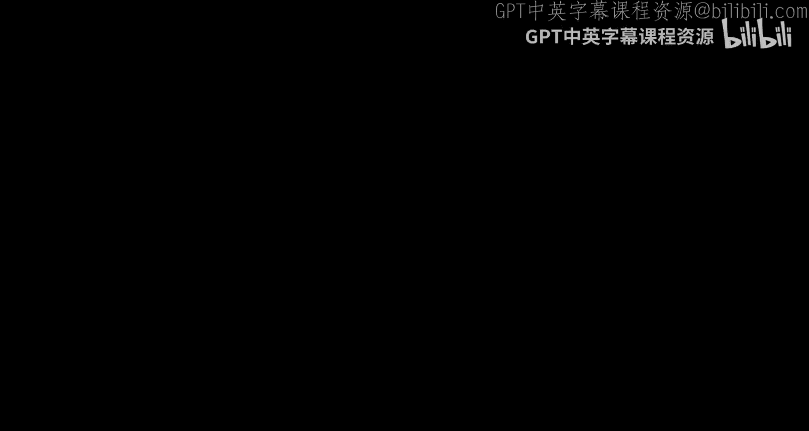
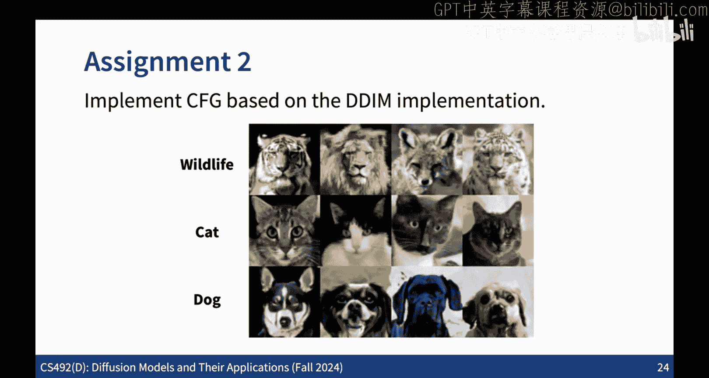
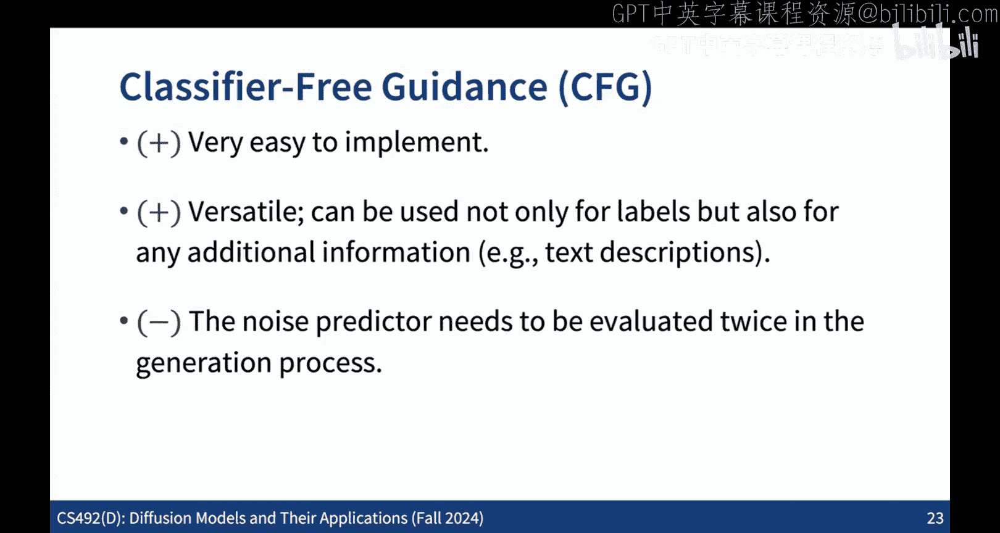
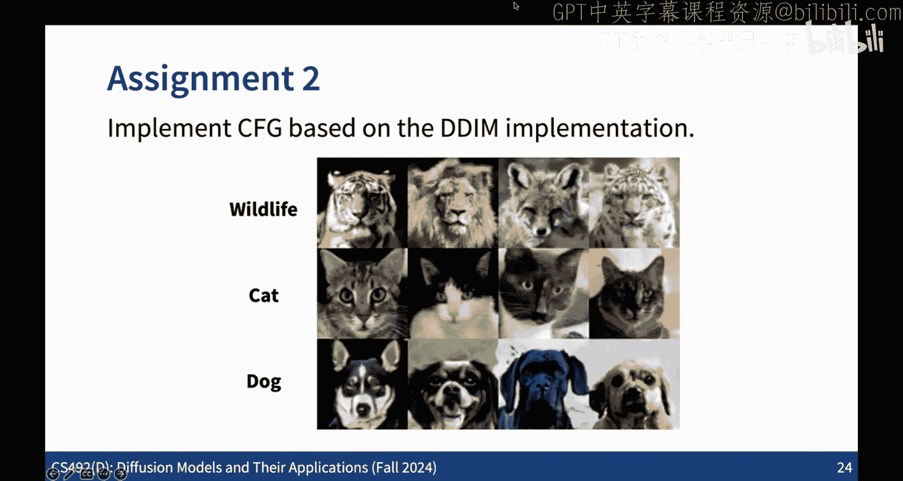

# KAIST《扩散模型和应用｜CS492(D) Diffusion Models and Their Applications (Fall 2024)》中英字幕 - P5：Lecture 06_ Denoising Diffusion Implicit Models 2 (KAIST CS492D, Fall 2024).zh_e - GPT中英字幕课程资源 - BV1mwpUzREqX

So yeah so we started to discuss the idea of the DDIM which was basically the generalization of the DDPM。

 so surprisingly why we are basically making lots of the changes in the forward process at the end like what we are seeing is that there is basically nothing we need to do it is even just like using the same the noise predictor even you don't need to predict up training the noise predictor again we be the new default forward process and you can just directly use the noise predictor of the DDPM to run the reverse process of the DDIM。

And even the reverse process of the DDPM and the DDIM are basically the same except for that we are having different distribution for this the posterior distribution for the cases that we are sampling the xt minus-1 from the Xt and the x0 so basically what we are doing for the DDPM is that given each of the noisy data point to Xt from the noise prediction we first get the best the prediction of the x0 for each of this step。

 so which is basically having some kind of kind of some blur the final the output， the images。😊。

And based on that like we are basically calculating the mean of this specific mean of that the likelihood for the distribution and based on that we are basically sampling from the de right。

 so these are basically the procedure that you also need to implement in the DDPM the assignment。

And what we are seeing is that in the DDIM， we are also basically doing the same thing。

 basically having the same type of the deal the distribution for the reverse the process。

 but the only thing is that the Gaussian distribution， the mean and the variance。

 these two are basically changed。😊，So here still we can basically compute the prediction of the x0 from the xt and the equivalent de prediction。

 but now the mean is basically changed into this formulation and based on that we can also still sample from the Gaussian。

 so the only difference is that we are basically changing only the one line there will be really like one line change of the code in the same well we see is basically having different the mean and the variance here。

Then obviously like this is basically some kind of the explanation like how exactly we are completing the mean here right so given the Xt and the epsilon prediction we first get the output of the X0 the prediction which is the output3 is formula that we also discussed last time and getting the mean as well and obviously we can consider like skipping like the computation of the X0 so from the relationship across the Xt and the X0 and the eps T that we keep discussing we can also directly compute the mean from the Xt and the epsilon there so we can I recommend you to also try to derive those things yourself and see how exactly these formulations are basically derived so in the DDPM we could basically directly complete the mean using the Xt and the epsilon here and we can do the same thing in the DDIM as well the only thing is that now the mean computation becomes slightly more complicated but still basically moving the Xt and the noise prediction to complete the mean here。

😊，So check out like how exactly these formulations are basically derived so without basically deriving those things yourself but that will be just like implementing the code based on the sort of code that you don't understand right then actually there will be some challenges in terms of understanding the lectures on the left of the the class so I recommend you to basically also try to derive those things yourself。

😊，So also the thing is that yeah， the thing is that you can also you also need to see like how exactly DDPM and DDIM are basically related to each other。

 as we also discussed last time， DDIM is basically generalization of the DDPM and we can see that actually we pre the variance into this form。

 then we can see that DDPM also become the special case of the DDIM and also then the DDIM also becomes the microcobi on the process。

 not the nonmiccobial the process。So we discussed this ideal like this controlling thistochacastic。

 so depending on how we set the variance， we can make it to be the same as the DDPM and also the very interesting part here is that now we can make the holy universe process as kind of the deterministic the process。

 so there is nothing basically sampling the noise here。So we pre it like this sigma to be0。

 then we can just strictly use this mean。😊，Which means that once you basically sample the x capital T。

 the sample from the prior distribution， the final output that will not get the X0 will be determined from the initial sample of the x capital T so the mapping from the x capital T and the X0 is basically determined is's not basically changed over time through this kind of stochastic。

So that is basically the way that we can basically have some kind of the mapping between the x capital t to the x0。

 whichs making whole process to be vitaminous。😊，And the things that we didn't discuss last time was so we know that the minimum value of the variance is the residual right so that's the case that we are making the whole process to be deterinated that what's the kind of the maximum value of the sigma T here。

So the thing is that if we go back to the formulationlation over like this posterior distribution。

 then we can see that we are just having this stone right。

 the root of like1 minus the upper the bar t minus1 and the minus the the the variance here。

So if we basically set the number which is greater than this。

 then this basically becomes some kind of invalid deform right so from this formulation we can see that the maximum value of the sigma t becomes the root of the1 minus the alpha power t minus1 so this is basically showing the kind of range in terms of how we can control the stochastic so if we set the sigma here into this value。

 then we are basically having the full stochity making the most like stochastic kind of the cases the reverse process if we set this to be0 then it becomes deterministic so basically changing the stochastic。

😊，Yeah， and also what we also discussed last time is that we cannot now consider accelerating the reverse process as we discussed last time the kind of the drawback of the differential model is that it's kind of the tradeoff basically as we have some kind of the more it process we are seeing that we are gradually denoing the data point and getting some kind of the more realistic the data points at the end。

 basically one way that we can basically boost stop this kind of computation is to skip some of the time step。

 basically having some kind of the time in total in terms of reducing the number of the time steps in the reverse process。

 but as we basically decrease the number of these steps we do not get the results which is basically not exactly following the data distribution that we learned so that would be the case that the output is basically slightly devi from the original data distribution which is basically getting some kind of slightly the overall quality of the outputs but the interesting some kind of observation empiricalably is that as we make this kind of reverse process to be more。

😊，in the DDI and de formulation we can see that actually the quality decor with the fair number of the time steps becomes like mitigated so actually I also don't know whether this is kind of like some kind of approved kind of things or but my understanding was basically that this is more about some impliccal observations you can also test this out in the December2 as well。

😊，So yeah， so this is basically the summary for the DDIM。

 so basically we can see that DDIM is the generalization of the DDPM。

 so which also means that DDPM is a like special case， the DDIM。😊。

And also the really good thing of the DDIM is that you don't need to train the noise predictor basically the separated the noise predictor so once you basically have the pretrained the noise predictor for the DDPM that you can just directly use that for the DDI in the reverse process so this is really the important effects about the DDIM so which means that in the second assignment you can consider using the noise predictor that you' trained for the first assignment to run the reverse process of the DDIM in the second assignment so this is what you need to do in the second assignment。

And also the reverse prosthetic becomes deterministic when the variance becomes zero。

 and this is a very important part in so the quality integration we the number of the type steps becomes mitigated when the variance is small。

😊，So this is the table that we have seen last time so basically these the proctor deta here is basically showing some kind of stochastic from the full deterministic to the full detochastic right and we are also decreasing the time step from the 1000 to 10 here so obviously like as we decrease number of the time steps we are seeing that the output the quality of the output they generated the images are basically getting the Earth。

So these are the FD squares which means that the higher is better。

 so as we basically get some kind of the higher the FD square。

 which means that the quality of the image is worse and we are decreasing when you decrease number of time steps。

 we are seeing that the FD increases a lot when it's like the stochastic decay case when it's the DDPM but in the DDIM the deterministic decay case。

 even when you basically set the time steps to be the10。

 the increase of the APID is not that significant compared to the case of the DDPM and even we are getting even better results for the deterministic case when the time step is the 100。

So this is kind of the recap of the DDIM that we discussed last time and the things that you will need to do and also our detail will explain about the assignment two is that2 is basically nothing but but changing your the DDPM code that you implemented in the assignment1 into the DDIM。

Which means that before you start the assignment two。

 you will first need to finish your assignment one。

 so there's the dependency between the one and two， but the two will be easier than the one right？

Yeah， so so that's why we are extending the deadline for the assignment one。

 So so before you start the assignment2 please like finish implementing the DDP code in the assignment one。

 and based on that， you can start the assignment2。😊。

So and also the thing is that this code for the assignment one and two will be also used for the assignment six and7。

 so there is also the dependencies between cross step so it means that you need to really have some good code for the DDP and the DDI am here。

Any questions about DD？可以。嗯。Oh yeah， so the assignment2 will be quite simple。

 but I recommend you to really play with the deco and see whether the stochastic really basically you affects this kind of the quality degradation。

 the mitigation of the quality degradation when you basically decrease the time steps。😊，嗯。

Will we discuss like the FIDs form the other kinds of evaluation metrics in yeah。

 it's a really good point。I will try to。Introduce those metrics sometime in yeah next class or some yeah yeah。

 that's a really good question。 So actually kind of one of the challenges for the research will be the models is basically how we are going to evaluate assess the quality of the output So there have been some kind of the ideas for thatD is also one of the ideas for that。

 but nothing is perfect there are many kind of issues in terms of which metric is really good and bad So everyone is basically using the FD the insert distance for the evaluation of the di models and different models but you will see that actually this is also not that kind of the best metric So yeah this is really good points。

 I will also try to introduce those kind of the metrics in the class。Any questions。

So don't be upset when you get some kind of the bad API。

 while we are basically creating some kind of criteria the assignment to be the APII。

 but actually FI is not giving some kind of B。😊，Big meaning for your digital models so that's why also we set the bar for the F with some of some kind of ems。

Any other questions？So actually the plan for these class is that so we discuss some kind of the very basics about diffusion models like DDp and DDI and those things they like very basic things to basically discuss many other kind of things so from the next week what we are going to do is that we will now going to switch the gear a little bit and we will start to discuss the more kind of like applications of the diffion models basically what we can do not just only we like generating images but more than that so you're gonna discuss some kind of the more the applications and more the practical kind of things in terms like how we can also train the diffion model with the billions of the images so the typically diffusion models that we can see like this table diffusion mid journey like those things are basically trained with the。

😊，B。5。7 billions of images is literally like billions of images so that's why we are also getting some kind of the very very high quality of the output so we are going to going to see discuss like some kind of basic ideas in terms like how we can train the division models we these kind of like tons of images and based on those kind of pretrain divisionff models what we can do in many kind of applications so we are going to discuss those kind of applications for like next like few weeks and after that we are going to come back to more like theoretical kind of aspect in terms of like how we can also improve the speed of the computation and how we can also get some kind of better quality of the images by just slightly changing the formulations in the diff models。

So it does's keep play。え。So speaking to that， actually。

 what we are going to especially discuss from the next week is about some conditional generation。😊。

So what we have discussed offer was basically just like pure image generation。

 like whatever images that we have， but what if we have some kind of the input that we have so like let's say we want to generate not any kind of the random images but the dog images。

😊，But we might also want to generate some kind of cat images or like human images。

 whatever kind of images when you have this kind of some sort of input which is basically giving some kind of condition for the outputpost that we want to generate so how we can basically make convert our division model into some kind of the conditional division model so this is like one topic that we are going to discuss from the next week and this is also the parts of the second assignment so I'm going to very briefly into this idea for today and then we're going to also give some more of the details from the index demand decrease。

😊，So here the question is that let's say we are having some kind of be some image delays like dog like cat。

 whatever kind of things so given this kind of condition how we can escape make some kind of images that is like based on this kind of condition so you will see that's that no it's basically me of like we are injecting this kind of input into our the the predictor and there can be like tones of the way in terms of how we can exactly have this kind of like sorry。

😊，Additional input。So it's basically really kind of the implementation kind of issues in terms of like how we can make our the neural network predicting the noise to take not only the XT。

 but also some kind of the extract input， which becomes our the condition。

 so in this case that would be basically image labels。

 but they can be also some kind of the text description or the images where it can be some kind of be some condition of the images or the sketches。

 the depths， whatever kind of things so it's the matter of like how we are exactly implementing this kind of some noise prediction of the network。

And one some kind of simple idea is that even you can train our the noise prediction the network in terms of that it can take either it can basically choose taking the condition or not taking the condition。

So we can consider having both the conditional digital models which is taking the image label as kind of input and making some unconditional di models。

 which is generating any arbitrary images so how we can combine this kind of the two di models like conditional and the unconditional cases and the very simple the practical idea so you can see that these are just like practical things is that like we are basically into some kind of the null label so it's like made of like what you choose as kind of null label right for example。

 like if we are having the like 10 image labels then we can basically index them from the like one to three per to the 10 right and we can set the zero as kind of some the null label so if we basically put the0 it's kind of out the condition then this is the case that we want to generate like any of the kind of images but for the cases like when you set some kind of specific the index of the label then we want to generate that specific images in that class So that's kind of like very simple the idea in terms of combining some kind of the condition。

😊，Dpiion models and the unconditional divisionion models。Please。😊。

And one also kind of extension of this is that we can think about like of enhancing the condition that we have so let's say like we can control like how much the output of the images to look like like the dog for example so we want to make some like more like dog images so you see like what's the meaning of like making some more dogggy like the images here but basically we can think about like extrapolating basically the to the noise which is basically predicted with the condition and predicted we the nu condition and then you be basically extrapolate these kind of the two noise we can consider basically you know enhancing the condition that we want to basically put。

😊，So if you see this formulation， the first parts is basically the noise that we are predicting with our condition d here and this is basically the noise that we are predicting without any condition。

 basically just we are feeding the nerve the nu the label there and if we basically do some kind of the extrapolation from this to from the nerve the condition into the image label that we have that we are basically inencing the condition more。

 so in terms of getting the like this so what we are seeing is that if we set this like the w to be0 we go back to the formulation here。

 if the w is basically0， then we are just purely using this right？No enhancement。

 just strictly using the noise with the predictive the condition。Then you can see that basically。

 yeah， it looks like the dog here I know that it's the specific the species of the dog。

 like balamus or something， I don't exactly name of the dos。

 but you can see that it looks like the that specific kind of the species of the dog here。

 but is there are some kind of like some dev variations。😊。

So it's not really basically aligned with the condition that we are providing。

 but basically as we enhance the condition more and more and more by increasing theW here。

 basically it's like pushing more into this noise so we are basically increasing theW here in terms of that we are increasing this noise from the noise that we are predicting with the nerve condition we can see the results that we are basically getting the results。

 which is like。😊，Really getting that specific the types of the dog。

 So that's basically very practical the idea in terms like enencing the condition in terms of some conditional degeneration。

So I didn't explain like what's the meaning of like having this kind of the deformation so we're going to get into more details like in terms like what's the meaning like this actually the meaning is so that that kind of be special here。

 but we're going to also discuss more about basically how we can make some kind of the conditional division models in many kind of different aspects next week。

😊，So the good thing of like the simple idea which is called the classify free guidance you're going also see like why is it called the classifiedify free guidance but basically kind of some kind the advantage like having these idea is that it's very easy to implement it just like matter of like having the no the label for the unconditional case and just by doing some kind of the Easter deation so it's very easy to implement and also the thing is that it can be applied to any types of the condition it doesn't need to be some kind of the text the labels the image labels but it can be some kind of the text description it can be some kind of some conditional images like this catches whatever kind of things it can be even sound for like sound to image generation for any kind of cases so we're gonna also see some of the applications in terms of how where we can apply this idea for some conditional degeneration。

😊，The only downside is that now it takes like more time in the reverse process because like we need to predict the noise twice for the conditional case and the unconditional case。

 so which means that we need to like run the feed of the neural network for twice so this basically will increase the computation time in the reverse process。

 so these are the processing coins of some conditional generation。

So also the one of the part of the second assignment will be also extending your D DDI implementation in terms like incorporating this condition in a way that you can basically produce the images we like these three classes。

 the wildfire， cat and the docs， and we're going also provide the data for that。

So this is about the second assignment。cus by the need to items。

Why is it classified Yeah so this is one of the things that we were going to discuss next week so before we discuss this idea we're gonna discuss the idea of the like classifier guidance so when you have some kind of some classifier of all the images how we can utilize these kind of classifier for like to improve the quality of the image generation so that was the first idea and even that idea was not about really some kind of some conditional generation that was actually more about like improving the quality of the output images and that idea can it's been extended to this case which is not having any classifier so that's why it's called the classifier free guidance without any kind of classifier even you can basically improve the quality of the images why also basically enabling this kind of some conditional generation so this was like very simple the practical idea without kind of some theoretical guarantees but yeah very practical ideas and all this kind。

The text to image generation， the di models and table division。

 those things are basically implemented with this kind of piece idea。

 so you see that this is really the basic idea， but there are also many other kind of some kind of interesting ideas in terms of incorporating the conditions in many different cases。

😊，Any other questions？

嗯。So yeah， so as you can see the assignment two will be about basically converting your DDPN port into DDIM。

 just like running the DDM delivers process and also implementing the CFG this conditional generation in terms of taking these three types the image labels that will be the assignment2。

Go questions。SoThere is no question that our team will take over this。Its costy。

This secondcon assignment。

