# KAIST《扩散模型和应用｜CS492(D) Diffusion Models and Their Applications (Fall 2024)》中英字幕 - P6：Lecture 07_ CFG _ Latent Diffusion _ControlNet _ LoRA (KAIST CS492D, Fall 2024). - GPT中英字幕课程资源 - BV1mwpUzREqX

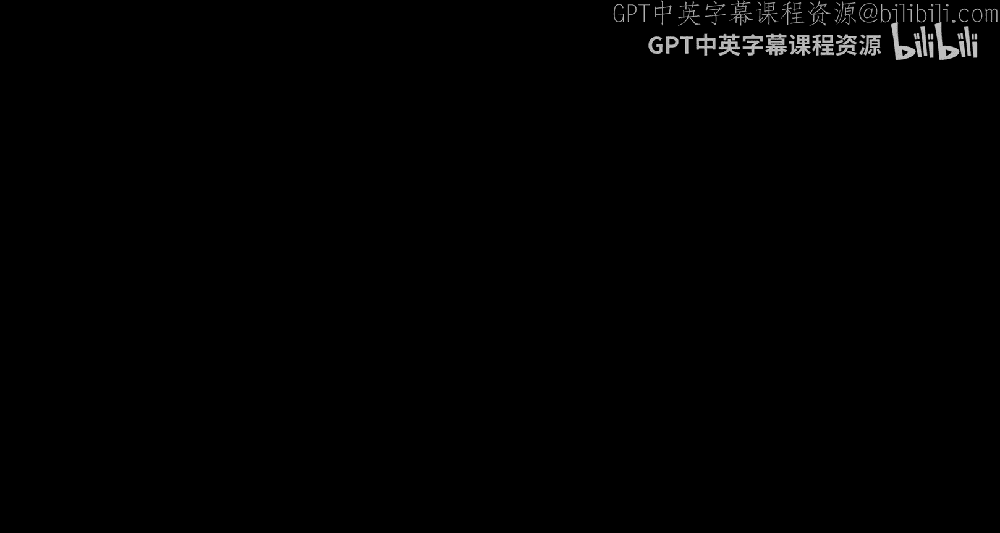

Okay so welcome back so this course we have so far discussed the basic idea about the models including some the DDPM and the DDIN and also we have the assignments in terms of like how to implement these things with some kind of simple toy setup with some kind of 2D points and very small set of images and from today we are going to switch the gear a little bit in terms like discussing more practical ideas in terms like how we can really implement the di models for the very large scale data set and how we can also apply these like degen models not only for some typical de generationt but for some special cases like conditional generation personal idea and also being other cases so the two that we are going to discuss for today are more like the practical ideas more about some kind of implementation and some them may not be based on any kind of theory so you can be relaxed and just like see some kind of the basic ideas there and you want to also go quickly。

through like all points of the ideas in terms like how we can make some kind of the conditional generation do some conditional generation personalization and many other things and also what we are going to discuss in the session for the As3 is more about basically how we can play with some kind of the pretrained division model not the one that you implementing the previous assignments。

 but some kind of the wellknow thepre model like the table division and how we can use that for so many of the applications。

So like one the two big questions that we are going to discuss for today。

 especially the first one is that how we can use some kind of the extra information in the generation。

 So for many kind of the types of the data for example like the images there can be some kind of like accompanying some sort of the extra information for example we might have some kind of the class labels for the images where there can be some kind of the text descriptions for the images as well So here like one key question is that how we can like further utilize this kind of the extra information coming with this kind of the images that we have in terms of like improving the quality in the generation and how we can also turn the division model into the conditional generation is the first question。

And the second question is that now we are also going to see some kind of the pretrained diion model which is trained with some literally like billions of images and how we can basically utilize these kind of depretrained models in terms of some other DD tasks by fine tuning given the di models。

 so we can also very briefly discuss these kind of ideas for today。

So these are the topics that we are going to discuss for today and if perhaps have some also the additional time。

 we're going to also discuss some more like the Giro applications as well。

So last time we briefly discussed the idea of the classify free guidance。

 but today we're also going to get into some more details for that while starting with the classifier guidance first。

So the basic idea about the classified guidance is that as I mentioned in the previous slide。

 given that we are having some kind of the extra information。

 so especially for the images we can assume that for many of some images the data there can be some kind of the class label information like these are the images of the airplane like these are images of the dock so when you have this kind of the class label the information how we can use this information to improve the quality of the images and for that the basic idea is to basically utilize the classifier for the kind of the images。

So here basically the basic assumption is that we are basically having the pairs alligator。

 basically having a image and the cr table and they can be also image in some text description for so many other things。

 so in this case like what we want to do is that we want to basically model the joint distribution of this kind of two items images and also the labels which can be represented into this form basically having the PST are multiplied by the P Y condition by Xt。

So how we can model this of joint distribution and for that。

 basically what we have seen last time is that basically the eps the noise that we are predicting using linear neural network is basically related to this core function in this phone。

So basically we can have this kind of formulationulation connecting the noise that we are predicting with the score here so like what we are basically playing with here is basically like all about predicting the score in the basically diff in the process so for now let's simplify the notation in this way in terms of that the Eson T is basically connected to the gradient so below the probability of the Xt here。

So in terms like modeling the joint distribution of the XT and the Y。

 what we just need to do is basically how we can basically get this core information piece。

And given the information that we had in the previous slides。

 now we can decompose this cor like the joint distribution into this term。

 which means that now we need to update this score， not just takinging the influence here。

 but actually into this form。So you can see that given this core function。

 now we are having that these come as kind of down the new score。

 which means that we need to basically have some kind of be able to calculate some kind of offset that is basically add to basically the noise that we are pretty doing that。

So basically here， the idea is that the question is that how we can get this information。

So if we can calculate this core for this specific conditional distribution。

 we can basically let some kind of be rectified the noise where they kind of the joint distribution。

So then which means that we should be able to basically model this probability， like given the XT。

 what the label or the effects of the XT。So what is such kind of linear neural network that can predict the class label from the given the kind of noiseisy image here？

So this is basically the classification of the network， right？

So the role of basically the classificationification of the network is taking some kind of images the input。

 and then basically predicting the class label， which is for that specific input the image。

So once you specific train the classifier， we can see that actually the classification of the network is basically modeling this specific conditional distribution。

 given the XT predicting the probability for of the class label。Right。

So which means that we just need to have another declassification network that can provide the information of this specific probability。

 so we can think about like having another declassification the network， taking the noise data。

 the XT as the input， and then predicting the probability for of the labels。

And then update the news in this book。This is me are basically completing the gradient of the classifier here。

So this is like very simple idea in terms of like how we can model the joint the distribution in terms of having anau neural network。

 which is the classifier here。And also as we discussed last time。

 like we can do some kind of the enhancements of the condition in terms of that we are having this kind of some parameter like the omega here。

 which is greater than the one in terms of like we are enforcing the condition more in terms of the kind of the guidance or the noise。

So here the question might be that what's the meaning of like having this like the weighted omega here。

 right if we rewrite this formulation into this form。

SK be writing this formation into the form of de noise again。

That what we can see is that actually this turns out that we are basically cultculating this curve move like this joint distribution。

So can you see like how we able driving this formulation again？

So the meaning like this is that actually we are sampling from this joint distribution。

 which is basically decomposing to this， but instead of like sampling from here。

 the joint distribution like Xt and D Y， now we are sampling from this specific distribution。

So there is basically no any kind of like meaning of like having this distribution。

 but and it's like what you can see is that we are basically know amplifying some kind of the large probability from this conditional distribution。

So which means that we really want to sample the X， the image。

 which is really classified into this spec spec label。

So how we can basically generate some kind of images that can be really basically classified into this specific label。

 not being confused into the other big labels。So basically by amplifying this conditional distribution。

 what we can get is that we can mistake get some kind of the higher fidelity。

 basically meaning that we can really produce images that really look like that they' specific class labels。

 but probably we might lose some kind of the diversity。

So that's basically the meaning of that we are having that the weight dysfunction function in this formulation in terms of that now it turns out to sample from like this specific distribution。

So this is kind of the same thing that we have seen in the CFG case in the last lecture。

 and we are also going to get back to this point。So the kind of thing is that now no the advantage like having the classifier the guidance is that in this way we can actually improve the quality of the generation。

 but also the good thing is that now we can make some kind of the conditional generation。

 so given that when you have some kind of labels for the images like representing it SDDY here we can basically generate on some of the images that can be classified into that specific label。

 so we are basically making some kind of the conditional generative the model which is taking the classable as the input。

The downside is that this also requires to have the another the network。

 which is theclassification of the network and also it may not work that well when we have some tons of the labels。

 like for example， like what if we have the like 1000 dec labels where more than even the 1000 like 10。

000 and more than that， then the also the quality of decclassification will not be that good。

So they're basically moivates to basically introduce another degree to have some this kind of some the conditional genetic models。

So this is basically the idea that we discussed last time。

 which is not to have on adult the neural network， but using the same network both for the unconditional and the conditional cases。

So here the idea is that we are basically somehow modifying our the noise prediction the neural network in terms so that we can take some kind of the external input。

 which is the condition here。So that can be click label or some kind of the text this picture or the images or many other things。

So we are going to also discuss some more details in terms of how we can modify the noise prediction network to incorporate some kind of the extraordinary condition。

But here the thing is that we are making a single network both for the conditioner and the unconditional case by basicallyly introducing some kind of the null label。

 so the null label can be anything that you define for example if you have the class labels like zero can be null label and some kind of the other the integers can be the labels for the other the classes。

 so it's matter like how we define the null label。And the feeding the low label here this screen means that we are not providing any condition。

 so that's the unconditionary case。And we also discussed the idea of like the condition enhancement as well。

 so as we basically had the the parameter of the omega in the crifier the guidance case。

 we can also think about basically doing some kind of the expolation between these two by having this kind of the omega here in terms of as the modifying the noise as well。

 like having the noise of the conditional case and the noise of the unconditional case。

Then you might have some big question about like， why is this like exion？

Deformation doesn't look like desktop ovation though。

Can you guess like why this is basically extrapolation？So if it pick up like extrapolation。

 then deform should be。Like something formulation of the intercoation， right？

Any tests like why this turns out to be extrapolation？

So yeah we can think about this actually the easy way that we can see like know how it basically becomes like extrapolation is basically changing the parameter in this way。

 so instead of taking the omega here if we introduce like lambda which is basically one plus the omega。

Then what you can see is that now it really becomes the form of the interpolation。

 right intercalolating this， the conditional the noise with the unconditional noise。

So if the lambda was in the range from the zero to one。

 then this will be some kind of the interpoation， right？

But now we are MSP making this lambda to be one or greater than1 because like omega is like0 or greater than zero。

 so which means that now this form becomes the extrapolation between these two。

So this can be also really returned into the form that we are starting from the unconditional noise and basically you know adding some kind of the difference between the conditional noise and the unconditional noise with some kind of the weight。

Makes sense。So in terms of that， we can see that actually this is indeed basically doing some kind of extrapolation between the two thes。

And also， what's the connection between this we classifier the guidance？

So what we can also additionally see is that if we also like re write the same formulation。

 basically having done like having this kind of the extra term kind of the difference between these two into the formal gain noise again。

 then we get basically this kind of formulation。So I'd like to recommend you to check this out yourself after the lecture。

 as Peter just said， rewriting only deform。And from this。

 like what we can see is that if we we multiply the PY， the Department of theY to the Rda here。

 which is the constant and apply the base the rule here， then we can get into this one。

Which is exactly the same probability distribution that we have seen in the classify the guidance case。

So after like writing all deform， what we can see is that actually this becomes the same。

 especially sampling from this specific distribution。

 which is basically the same case that we are having the omega here。

 actually it does not omega this Lada in our case。So what we can see is that even without like having theclassification the network。

 we are basically doing the same thing， we declassifier the guidance。

 so this is like why this basically idea is called the classify free guidance。

 basically doing the same thing， but without having the classificationification of the network by basically having the noise prediction network that hits basically the condition as the expert input。

So you can see that these tribes play exactly the same in probably like sampling from the same distribution。

And this is also the image that we have seen in previous lecture in terms like as we increase the weight for the conditioning from the0 to the4 here。

 we can see that we are seeing some the images of specific the dot here。

 so you can see that we are losing some diversity， but generating the images that is really aligned to that specific class of the images。

So the assignment two is also basically about implementing these like classified free guidance and I recommend you to basically play weight the weight in terms of what you get as kind of the final of。

And there is basically the trade of importance over like basically the fidelity and the diversity。

 as we increase the weight， we get some kind of the really good images that are basically really aligned to the that specific condition。

 but we are also losing some diversity。So we can play with the weight in terms like that we get the best results in terms of the diversity and the we。

So this is also the result that has been showing in this paper in terms of that if we use the class free classifier classifier guidance and we get this FID and as we play we need weight and the class free guidance。

 sometimes like we get the bad results when we especially W0。

 so w is0 means that there is no guidance， it's typically DDIM。

 or if we start to basically increases the W that we can get some kind of best result which is even better than the classifier the guidance。

So the good thing over like this idea is that you see that actually this is really easy to implement。

 so that's why we are adding this to the P72， just below basically having another sort of encoder for the condition to be fed into the neural network。

And also it's really versatile so for the classifier the guidance case the input should be really kind of some place labels because like we need to basically train the classification network for here the input condition can be really anything it can be like text description it can be images where many other things so in terms of that we can easily incorporate many different types of the conditions this seems basically more the versatile the model than classifier the guidance。

The only the downside is that basically in the generation the process。

 we need to predict the noise twice because we need to have the noise for the conditional case and the noise for the unconditional case。

 so they can be kind of the one downside。And question on this？

So you will see that actually this is really practical the idea that you can see many digital models。

 literally like most of the all the digital models that are released to the public are basically using this idea for some types of the condition。

So most of the image models are actually taking some of the text description as the input。

 so most different models are basically the text to image model it's called the Titoy model and this is the state of the art the Ti model actually there can be somewhere seem like new models almost like every day so this is like one of the most famous the Titoy model which is this table di version3 you can see really nice quality of the images generated from the old the text so here the text is very small but the first one is basically detailed pen and in movie a massive complex aan space shape from in the middle of the nowhere。

So you can see that the output image is really capturing some all the kind of descriptions as they given us the input。

And also like having the text in the image is most like one of the very challenging piece。

 so it's a photo away bare wearing in your suit and。

T in the river in the middle of the forest holding a sign that says I can vary it and only basically take this text I can vary in the sign here very surprising。

So for those kind of the very recent the key file models， the Queify guidance。

 Queify free guidance is basically used as some kind of the basic deco component。

So you'll see that actually this is really， really basic technique for many of these。It be the矛公。

Like another example of like the text image generation。So these are also very interesting images。

 unusual kind of images。That错。

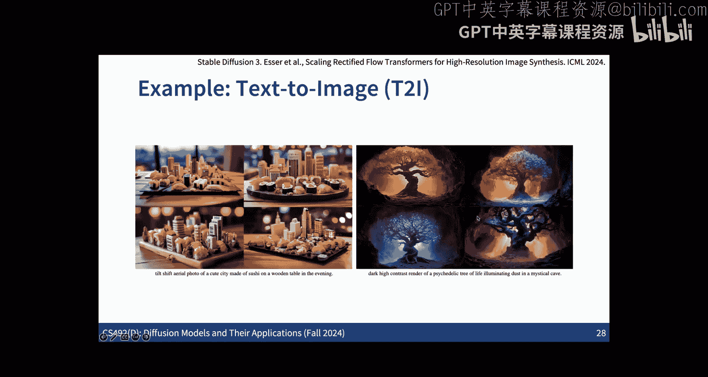

But there some more images。Yeah。Yeah， and also you can see some kind of the variation as well。

 like from the even the same de， we are seeing some kind of the small variations in the output。

So you see that actually the CFG so the clarify free guidance like CFT is just a very common technique for the P5D models and can be also used for the many image to image de generation as well。

 So this is like like one example using the CFG for the like image conditioned image generation。

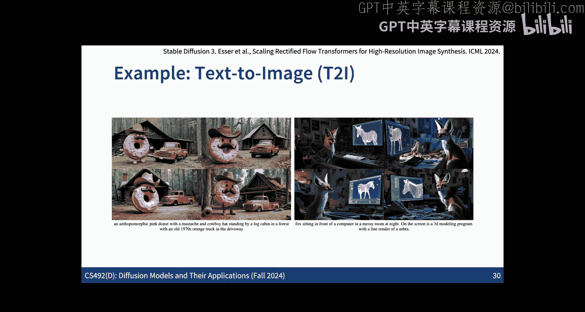

So there are also lots of some kind of the models that are not using the CFG for the image conditioning。

 but the other ways， but this is one example I'm using the CFG for the image to image model。

 which is taking not only the prompt here but some kind of some input image here in terms of making some of the changes of input image following the description。

 so like add the fire works to this kind to the I tile here。

And make this ja out of the letter so we are  eimating this can to change this。

So for those kinds of the conditional cases， like the CJ is also used。

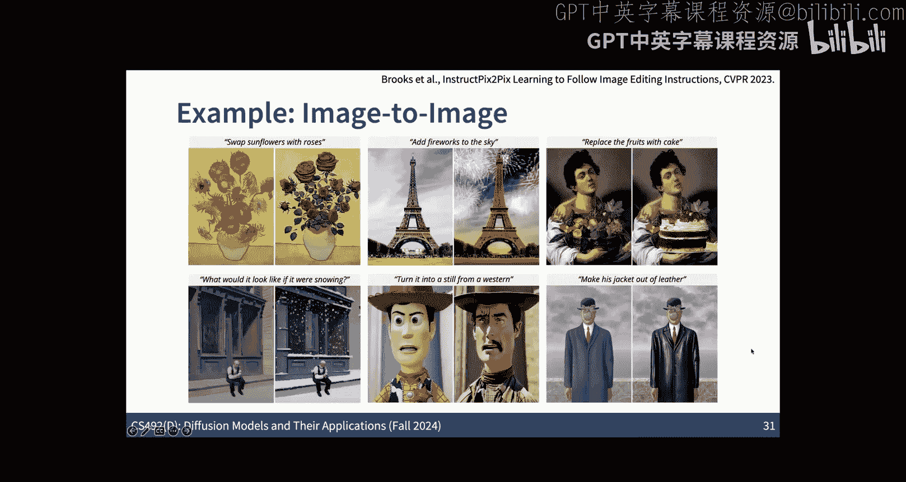

This is another like famous example， which is basically currently generating the images of the object from different view。

 so when you have the image of the object and also some kind of description about the new the camera。

 the angle by just taking these two information， the digital model is basically generating some kind of the image of the same object from a different view。

So for those cases， basically we will need to basically take the input image and disconnect collect the camera information as the input。

And this extra information is fed into the neural network into the CG idea。

So those are also the examples using the CFfG and there are actually quite many。

 not only for the generation， but also the3 de generation there are also kind of examples using the CFfG。

And this is also kind of interesting example that we are generatingrating the shapes of the two hands and for those kind of cases like we can generate like one hand conditioned by the other hand。

And this might be also example that we are now generating even the images from the audio input。

I'm not sure whether is hearing these sounds， but let me check。嗯。Let me share this something。

Can you hear this首。Yes。So it's the sound of some kind of nature。

 then we are generating those kind of images。把这里这个。将呢啲上面。ま全然そ。你识一分で。So yeah。

 for those kind of the examples， like an application we can consider a incentive。

So it's very common technicalling。So speakingking to the CFG。

 also the interesting kind of way to utilize this technique is to basically have the negative prompt。

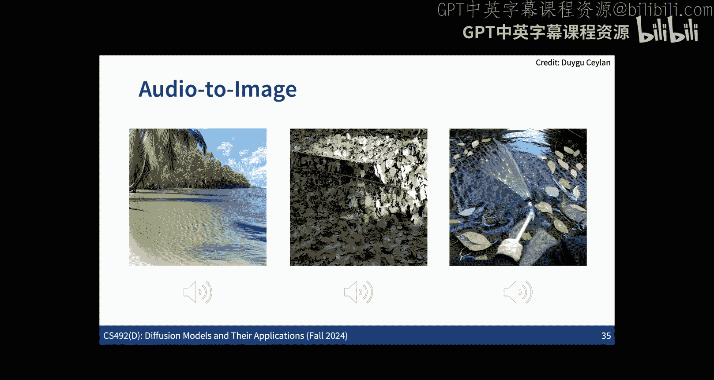

So these are also some of the examples like making some images of the portrait of the Jbi Act。

 I don't know， but what they dismiss about making some kind of the most images。

And we want to enhance some factors in the genetic images。

 not only the kind of things that has been described in the given the text prompt but something else。

 for example， like I want to make this character to be more like the female or I'd like to make this character be more like the male。

 then what we can do is that we can introduce some kind of the negative prompt in terms of basically reducing this factor from the genetic images here。

So this is like the example， when we kept the male as the prompt making some more like female images and also when they kept the female as kind of negative prompt in making some more like male images。

So simply what we can do is that we can basically instead of of using the nerve prompt in terms of enhancingcing the given the prompt。

 we can replace this like nerve prompt into the another some kind of negative prompt。

 having the positive prompt and the negative prompt in terms of basically enforcing world into this case。

So if you play with some kind of the pretraint some kind of diffusion models。

 like what we typically do in terms of the prompt engineering in the positive prompt we can say like high quality。

 like high resolution， like clear images， whatever some kind of some positive diverse。

 and the negative prompt， you can put something like the blurry images， like low quality。

 low resolution， whatever things including some kind of the negative demeanor。

So by basically playing with these kind of prompt by doing some kind of the prompt engineering in this case。

 having basically both the positive and the negative prompts。

 we can get some kind of the more some kind of the better results in terms of that following some kind of the some users kind of the kind of like。

Basically the line here is there。So these are some very practical ideas in terms and making some kind of conditional generation。

Do you have any questions on this？So what we are going to do in the assignment three is that you will basically need to play with these some pre models and see what happens when you put these kinds of some kind of prompts into the pre2 models。

And for them we're going to briefly discuss the IW the latent diffus。

 so the thing is that like when you see some kind of the pretraind models。

 these are the cases which are trained with the literallyly billions of images。

 so these are really the cases that we are getting the old images almost like all images in the internet and using this information to train a single the of the models。

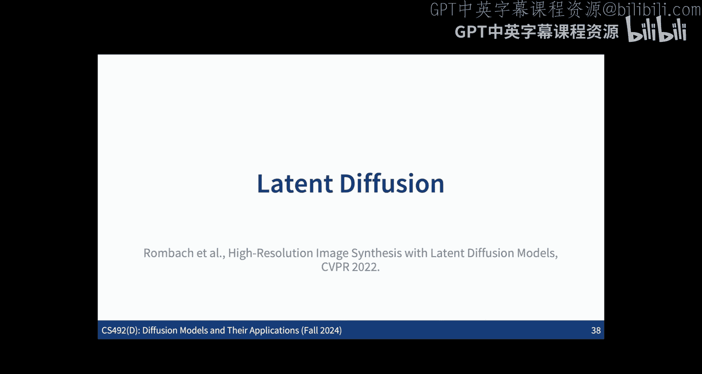

So here the question is that how can you really like scale up in terms ofque individual models that can trained with billions of images in a way that we can really produce like all the like imable and possible images using the single model？

😊，Also in terms of the resolution， now the images that you are generating in or the assignment to vary over the resolution。

 the image like 30 to 60 or those kind of things。

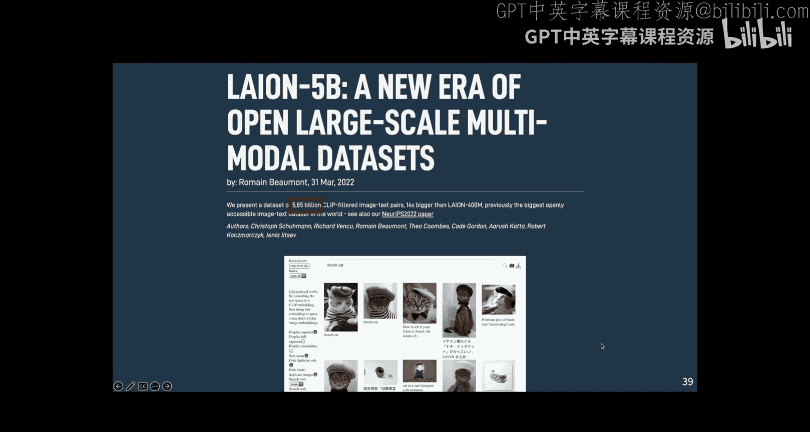

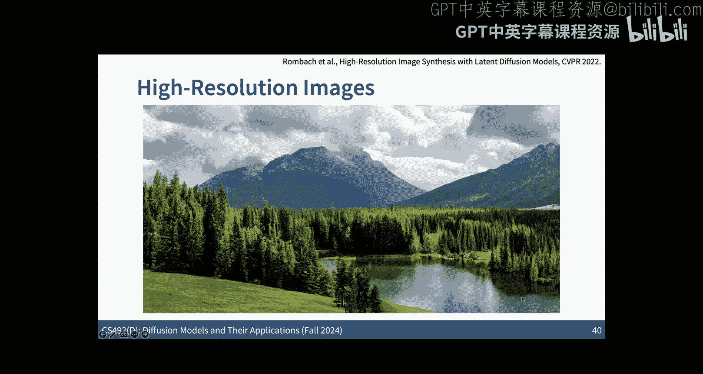

But if we want to generate some kind of the high regulation images like this。

What sort of different model should you use？So there are basically the challenges in terms of how we can scale up the training data set and also how we can scale up the resolution of the images as well。

And what happens is that if we start to train a division model for these kind of the very largeqLP images and also with the very high resolution images。

 what will happen is that we will need to use tons of the GPUs。

 so now you are using a single GPU prior assignment。

 but for typically trained for training some kind of be very largeqLD division model。

 we will need to basically have like single GPU and training for the hundreds of days were either having the hundreds of GPPs to be trained to train this model in a few days。

And not only for the training， but also for the generation。

 if we especially like fully with the very high resolution images， it do take like this。

 so what is basically known for some research papers is that if we want to generate some kind of 50。

000 images for some higher re cases， it do basically take like some days like five days for that。

So here the question is that how can you make some kind of the more efficient differential model that can more effectively handle some large scale images and also higher resolution images？

But the very basic idea that people are all using for many the public digital models is to basically utilizing kind of the image compression。

So in terms like the compressing images， the idea that we also discussed in the second lecture is to use a auto encoder。

So what we are also going to do is that we are first going to basically compress the images into the much lower resolution low dimension or some kind of data in terms of that。

 for example， if we have the 512 by the 512 the resolution of the images。

 we are compressing all these images into the 64 by 64 while also changing the dimension of the pixel from the3 to 4。

So it means that we are taking the RGB images into the fact by defect fact images as input。

And we basically between the auto inverr in terms of the delay here becomes another the 2D image。

 but it's kind of some sort of the feature image， some kind of four channel image。

 we don't know the meaning of each of the channel， but just like having the four channels while decreasing the resolution from the 512 by 5 12 into the 64 by 64。

So the whole idea is that we first trained this onto encoder in terms of compressing all the data。

So we are having some pretrain in quarter， big quarter and images。

And then the whole the mood prediction the network is basically trained in the latent space of that specific to encoder。

And typically in the only OD models， like people just use the unit architecture for this kind of the prediction。

And we also want to discuss some kind of the the models， which is not using the unit。

 but the transverse。But also basically some kind of the characteristics of like this kind of the model is that we are having some the bunch of some kind of the attention of the models。

 so if you have learned about the attention models it's basically utilizing that specific the idea here。

And also the way that we are incorporating some kind of the expert condition for the CFG is basically also having some kind of the extra encoder for each of the input。

 so for the text input we can some kind of text encoder or some image input it can be another the image encoder。

 whatever kind of the encoder for each specific time of the conditioning。

And then we have fading this information into the cross attention tension em。

So way that we arecaping the expert information is that when you have this kind of the close attention the module。

 we are completing the quality value as kind of the output of the unit layer in the noise prediction the network。

 and then we are calculating the key and value as the output of the input condition they encoder。

So that's very typical the idea in terms of like the combining the information of some the noise image。

 which is basically fed to the input to the noise pre the network and also some extra deco conditioning information。

And you see that actually this attention model， which is basically having this self potential and also close attention as well。

The attention modules in this kind of the noise prediction network has some kind of very interesting kind of some kind of characteristics that can be used in the many applications。

So what actually we are going to discuss in our the gas structure。

 which will be happening next Thursday is that our the gas structure will discuss some kind of the very interesting ideas in terms like utilizing these kind of potential layers in the unit in a way that we can basically do some kind of the loss of the image editing or some kind of conditional generations。

So those are簡 things。And we are not going to get into some more details about all these kind of architectures。

 but because it might be better for you to basically try yourself to run the quotes and also see the details of the code。

So there are also tons of kind of the library and any kind of some public de implementing this kind of latent diffusion the idea。

 one of the famous libraries we will be dislike diffuss。

 and we are also going to use these library diffuss in our the assignment 3。

So I also recommend you to start to play with these library the and see making some many interesting images using that。

嗯。Any questions？Our Jpeg image is not already de compressed highly。

 so the difference with the JpeG is that JPG I mean you can consider using the JPG but here basically the idea is that we are decreasing the dimension of the data into some kind of the specific the lower dimension kind of things so actually the key is to decrease the resolution not just basically decreasing the quality kind of things so in terms of that actually we can consider using the auto encoder that can effectively fact decrease the dimension。

Yeah。Any other questions？But this is also basically very practical the idea in terms of that if you also play with some kind of the highdiary data for your the course project。

 if you feel that the data that you are dealing with is basically having some high dimensionary kind of things that you can consider basically decreasing the dimension first by training some kind of two encoder and then running the division models in the latent space。

 so just like very practical the idea。So using the latent diffusion now we can get some really high quality results in terms of decreasing the MI so without the latent diffusion still we could get like 4。

59 kind of things and after using the latent diffusion we can further decrease the MI。

Any questions on this？そう。Speaking to the FI， we also discussed like whats the meaning of the F。

 like what we have done in the assessment 182 were all about basically competing the FD。

RightSo app IDD is basically some kind of the very the most famous kind of the way to basically measure the quality of thegene images。

 so that is being used in the older cases in terms of evaluatingrating some new image generated models。

Well we can also see that this is not the kind of the perfect metric in any kind of the aspect。

 but if we typically see the meaning of the FID actually to understand the FID we first need to discuss the the border stain the distance。

 which is also known as the flat jet distance and where the Earth's moves distance so that's why we are basically having the flat inception the distance。

 actually the definition is not exactly a perfect thing， but we interchanging the terms in this way。

So the meaning of the the people per sustained distance is that given that we are having the two marginal distribution in the new and the new here。

We are basically finding is kind of a joint distribution combining these two in a way that we are minimizing the expected value of the distances like moving one point to the other。

Either whether we are using some kind of some pin here for the distance。

So it might be good electrical meaning to understand like what this means。

 so if we want to only understand the meaning like this， we can see some kind of some discrete setup。

So indeed this piece， let's think about that we are having this kind of the 1 d kind of distribution with some kind of the specific bins here。

So let's say this is kind of some sort of be some can be like some probability distribution where any kind of distribution dimension mess over the one dimensional space with some kind of bins here。

And what we want to do is that we want to basically measure the difference between this distribution and the other distribution here in terms of like how much we need to move some kind of the mess from the space to the other kind of point。

So let's say like we basically let me do something here。Yeah。

 so let's say we are basically making some changes from the first distribution to make it to be the same with the second distribution in a way that we are moving things like let's say we are moving this to here。

I'm also moving this。For here。😊，And also we move this blueprint into here。

 so we are basically moving this some kind of the dust or some kind of the mass in each of the beam into some other the closedd bin in terms of that the first one becomes the same with the seconded distribution。

When we clean up these things。嗯，不行。응 뭐。So the question is that what's the kind of the minimum cost in terms of like moving the dust in a way that we can match the first distribution into the second distribution？

So the cost over like the transformation is actually calculated as the sum of the mass that we are moving for each of the bin。

 multiplied by the distance of the bin。So as you basically move the dust further into the very far beans。

 that is like taking more costs， right？So we are basically defining the course in terms like the mass。

 multiply the distance and summing or like all this kind of cost and see what's the kind of the optimal way in terms like moving all this kind of the mass to other points in terms of matching this two。

So if we find this kind of like optimal way to basically match this kind of the two distribution。

 then the cost for that becomes basically the distance。

 measuring the distance between the two distributions。

And here the point is that we tend to the same thing。

 not only for this kind of some discrete distribution。

 but also for some kind of the continuous distribution that is defined as the probability distributions。

So that's the basic idea， there are actually tons of many other things that we can discuss here。

 but here basically one kind of thing is that if we have like the two distributions as the normal distributions which are defined with the mean and the barriers here。

And the two persons in distance taking the PS the2 here is basically defined into this specific form。

 which is basically very easy to calculate。So what we can see is like it's kind of the somewhere here is that。

 given these kind of2 the normal distributions， we can easily compute the processing distance between these two into this formulation。

So that's the basic idea。So what we are doing in terms of defining the fracture insert distance is that we are defined measuring the fracture distance。

 the two person staying distance between the distribution of the real images and the distributions of the generated images。

And then how we define the distribution is that we are basically putting all those images into some kind of the latent space。

 specifically we are using the latent space of the inception B3 network。

 which is basically famous the network， for the classification which was introduced in 2015。

And then basically mapping all the images into the latest space like this specific network and basically modeling all the distributions。

 each of the distribution has the normal distribution。And calculating this formulation。

So this is basically like one way that we can measure the difference between the distributions of the like real images and the distributions of the fake images。

E cream。Yeah， then there will be lots of the questions in Thomas like why we are using the inception with3 network。

 like why just don't you use some other network for that and why do we also model the all the distributions as the normal distributions while the distributions will be more complex。

 way more complex than the normal distributions， right？

So you can see that actually this measure is not that kind of the perfect measure for the basically metric in like measuring the quality of the generations。

There's a lots of issues， obviously like it doesn't make sense that we are modeling all these like distributions as the normal distributions。

😊，And also here one big question， might be then like would be good to really use the latent space of the insert&3 network。

Basically， what we also expect to see is that if we have some kind of these similar images that look similar into like human eyes。

 these images should be metped with some similar points into latent space， right？

So the similarity in terms of the perception of images should be basically the same into some kind of some distance metrics in the news space。

Here the question is that is it really true actually there are lots of the research which is showing some kind of the problems of the FID like one of the research that has been introduced in the like 2022 is that so that the plate here is like we are having some kind of the a set of the images。

And then just like compressing all these images within the Jpe format。

 like having the like 75% of like the preserving images。

Then you can see that like the reptmost image is the raw input images。

the input image and they write most image， the compressed image using the J pack。

And can you tell the difference between B and this？Yeah。

 I can a personally tell any difference between these two from the human perception。

 I think there's no difference between this and this English。

But what happens is that you we basically map all the row images and also the like Jpe compress images into inception delete latent this piece and measure the app ID。

 that you can see that the app ID becomes like 20。So the FI that we have seen in the case of like the delaynt diffusion was like four World five。

 right？But now it becomes like 20， which means that the latest space of the insert network may not be the best place to capture the similarity across images。

 like one example of showing some kind of the problem of theD。Any questions on this？

Yeah one question Jim said is that in this table division they are not using the O2 encoder but using the variation O encoder for the compression yeah that's true actually I basically skip this kind of like detail。

 but the thing is that actually they are using some kind of not the O encoder but having the KLD diversionent term in terms like regularizing the distributions of the latent variables in the latent space。

So the gooding of the variation of the auto encoder is that it's not basically just like auto encoding all the data。

 but also basically enforcing that all the a variables in the latent space to be basically follow some kind of the prior distribution。

 which is the this standard de normal distribution。So in terms of that。

 we can basically better basically compress all the data in terms of like having the all latent images to be distributed following the Gaussian distribution。

That basically makes the training of the knowledge prediction to be more like stable。

So that's the kind of like the idea that we can think of is kind of some sort of the data。

 the augmentation or like data data de normalmalization。

 so basically when you normalize all the input data in the neural training we can typically get some kind of the better result。

 so the way that we are normalizing the input data into the noise pre network is to regularize the latent variables when we basically train the auto encoder so that's the reason like why we are using the variation of encoder instead of the typical the O encoder having some kind of regularization in terms of that all the latent variables to be distributed following the Gaussian the unique Gaussian distribution。

So there are also basically some kind of trade trade op in terms of the like accuracy of the reconstruction and also deregization。

So as we basically enforce more in terms of like recognizing more in terms of like for the latentency variables。

 we're going to lose some kind of the accuracy in the Oum coding the construction。

So which means that we need to play well in terms like having some kind of the right parameters for the key dirgence term in terms like not losing the a matching the reconstruction between encoding。

😊，Any니 other 걸쳐쳤싼었는데？可以。OhSo these are basically the basic idea about basically making some latent I'm measuring FID。

😊，So now we're also going to discuss some of the ideas in terms like how we can play with kind of some pre traineded digital model。

So what actually we are going to do in the 73 is using the model which is called this table di。

 which is trained with the billions of images。Now， how can you use these kind of like p models for many other cases？

Let's see， like for example， I think about some kind of the conditional degeneration the case。

 which can be basically implemented with CFG。

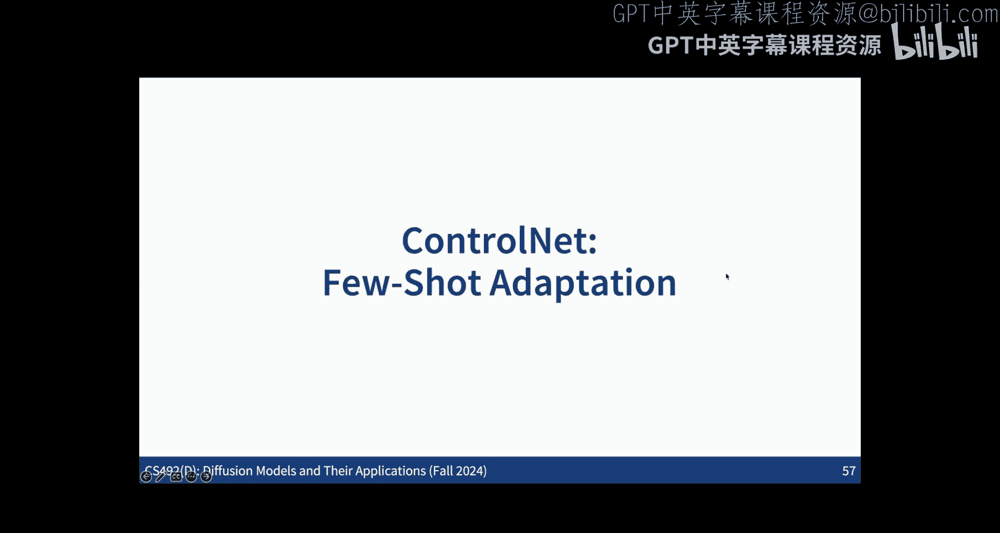

But here the question is that， as I said， like no， the typical unconditional the model is trained with the billions with the images。

And here the question is that if you want to make some kind of the conditional model。

Should he also have another the billions of the pairs of images？

So these are some examples that we are generating images from these some sketches or some kind of edge images or some kind of the some post map like this。

So there are many other kind of examples， like making some images from the depthims or some norm map。

 so we're going to also get into that。Or all those kind of some conditional degeneration cases。

 if we need to basically collect like billions of the pairs of them。

That will take lots of the cost right and for most of the cases。

 even it won't be possible to collect billions of such kind ofs to make a single division model。

But the thing is that while we do not have the billion of the pairs of the input and the output。

 we have the billion of the output， the sometimes the realistic interface。

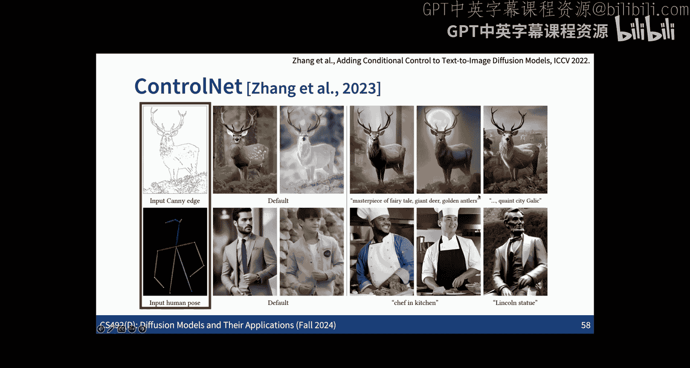

So here the basic idea is that can I somehow convert a pretrained the di model。

 which is trained with the billions images into some kind of the image condition the model while just having relatively way smaller the size of the input output the pairs。

 for example， like 100，000。So let's say like we have the division model trained with the 5 billion images。

 and we are having the 100，000 di pairs， the input and the outputs like this sketch to the image and where to be pose to the human body images。

Then how can you convert the unconditional division model effectively into a conditional model？

So that's the idea of the control net， this is specifically the case like when the whos the input and the output service the images that can be applied to the 3D and many other kind of cases。

 but basically this is the case like when the input and the output service theyre having the same form specifically images in this case。

So this is like very practical the idea， there's no theory here。

 it's like all about as the have implement kind of things。😊。

And here the basic idea is that we're obviously using some kind of defined tuning approach。

So let's say like we are not training the neural network。

 the which prediction they network from scratch， but we start from the pretrained in which prediction they network。

And then we fine tune like further training this difficult model in using some kind of the few relative like images。

But also the thing is that we are not changing the neural des。

 there will be lots of delays with some kind of des， we are not changing them。

 but we are introducing some kind of the additional some kind of allowable des like additional delays into the network and then we only tune those kind of some extra des so that's the idea of what defined the approaches and that that we used in the many。

 many tones of the applications。So specifically for the control net。

 let's see the kind of the architecture of the network without any kind of details like what we are going to see is that so the left hand part here is basically the union architecture that we have seen in the previous slide。

When what we want to do is that we are taking the extra input， which is the condition image， right？

And we need to somehow process the condition input right so in terms of processing the condition image。

 we are fully revering the basically parameters of the pretrain in neural network to process the extra condition here。

So here the question is that how we can basically fully best university the information in the pretrain network to process the extra the input here。

So here， the question is that what's the input to the original knowledge page of the network？

What wass the input to the original the region of the network？

Let's briefly just break careful about us the input and the output for the。Everyone is wrong here。

 that's the input to the neural network is the Xt， which is the latent image。

 which is also the noise image。And the output is the noise Epsilon T， right。

So input is the latent image， the noise image， and the output is basically the noise。

And in the latent diff case， everything basically works in the latent space。

 so input also becomes the noise image in the latent space。

And also the output becomes the noise in that latent space。Right。

So in the formulation of the DDP and the DDIN， the input in your network was basically XT and also the time T do you remember that the Iilon the was taking the XT as the input which is noiseisy image。

 the latent space， that also the time T here。And as the output we happens basically getting the epsilon T。

 which is basically the noise in the noise prediction， right？😊，So basically's。

 we are having this kind of the architecture， which is taking the noise image in the latent space that's kind of the input here。

And and we want to basically fully delay this information to process the extra input。

 which is another the image， but not the noise image， but it's basically the conditioning image here。

 right？So what do you do is that let's say like we are not going to touch any part of the existing the neural network。

 any parameters of the existing neural network， so this full network is frozen。

So we are not touching this。But we are going to like copy the half of this。

 the encoding part of the neural network to process the additional the conditional image here。

So we it's not just like copying the architecture， but were also copying all the neural parameters in terms of that it can immediately start to process any input the data here。

And the output code of be encoding here is this case model that combined into the layers the codingding parts with some kind of themo which is called the geocom。

So this is the page guide。So what is the geocomvol here this means？Your compositionvol is。

 nothing but if we're having only the two parameters like any kind of the input here。

 so which see typically the image， some kind of into some resolution。

 we are having some kind of the two like the parameters like one is this killing factor and the other one is basically some kind of the option。

So for every single pixel， we have a see scaling and also adding the offset using these kind of like shared parameterss of the A and P。

So you can see that like this like single module is like very light module having just two parameters like A and B。

And we are basically having this kind of a bunch of the GicomulD layers into some of the parts and also while we are basically copying the neural parameterss here from the network。

 the pretrainD network， we basically allow to basically modify the numbers here。

Modify the parameters near the here， while they're freezing the parameters in this bird。

So you can see that the only kind of parameters that we are tuning is on the right hand side。

So the half of the parametersers here especially kind of this is the biggest part。

 which is that we are copying from the original network。

 while basically we are having some very few parametersors for the zero conversion here。

Just two numbers， A and B。谁。😊，And let's see basically how we are basically connecting this kind of the network so we can basically for let's say for each of the case here。

 like for each of the intermediate layers here， we can simplify like all this kind of architecture into this form。

 so this is the video network that we have as kind we have as kind like pretrained kind of part。

So we are not going to necessarily touch this part。Here。

And we are copying the exactly the same network here。

 also with the arch kind of the parameters as well。

And then we are having basically zerocomvol before these parts and also after this part。谁？😊。

So check this up from the input the condition see here。

 we are heading the zero compositionvolition here， this part。

 which corresponds to this like first zero comb。And then this output is added to the x here。

 fed into the same network。The copied neural network， which becomes like this full part。

And this whole part is also fell into the geo conclusionvol， making like this whole part。

And then the output is now as kind of offset to the original linear network。So check this out。

 or we are basically copying the neural network here while basically having the two zerocom neural network。

死。😊，So here the all key idea is that the way that we are basically fully utilizing the pretrain linear neural network here in or the trainable copy is that at the very beginning。

 it becomes the same that we are not having any condition。

So what we want to do is that we want to gradually basically fine tune this kind of the incoding part in terms of that it can basically incorporate starting from basically the original input X here and it's slowly like switching to incorporating not only X。

 but also C as well。So our recall is that at the very beginningkin。

 we make the neural network tool is they just process the access the input。

Then we know that like the network will open well well with the same the input X here because like this network was trained so basically hit the noise image data or the XT here。

 not the conditional image。And also in these part， in terms like the adding the output over here is the same。

 we want to start defining to me in terms of that it becomes the same not having this condition。

 but just directly feeding the output of like this original network。

And then we are gradually basically mixing the output from this kind of the additional depart in terms of that we can basically fine tuned in neural network startinging from the orange or the input and basically blending some kind of new input condition。

So in detail， what this fiscal means is that let's see so let's say this is the conditional image and this is the noise image in here。

 right？And the role of the first zero completionvolution is that I mentioned that this geo completionvol is like two parameters and the APB are basically initialized into the zero。

So let's say like this like A and P of be0， then what does this mean is that at the very beginning。

 there is no effect to the sea here。So the output digital of convol will become zero。See。😊。

Because like this A and P or basically zero， right？This means that at the very beginning。

 we do with the the that we are directly just fitting these x into this network， right？

And this network was trained to basically take this X the noise input as noise image as the input。

 right？So it basically knows like how to basically take this as kind of input。

But as we basically find 2 neural network， we're going to slightly adjust this A1 and B1 in terms of that the output of the geocor becomes not zero。

 but something coming from the conditioning。And then we're going to slowly basically fine tune our the encoding part in terms of that now we can incorporate not only the x here but something that this basically given from the condition from the geocomp。

 right？So that's the basic idea in terms of that we are slowly basically blending the information coming from the conditioning in terms of the value is starting from the case that we are not taking any information from the condition。

Makes sense。So again， like we are starting this training in terms of at the very beginning。

 we are not taking any information from the condition because like the output of the geocom will become zero。

And just like quickly taking the excess input。But overtrain。

 this A1 and the P1 will be adjusted in terms of data we are slowly feeding some of the information from the condition here into this kind encoding part。

Mix sense。😊，And it's also the same in terms of when you feed plenty information of the output of this like extra branch into the original branch。

So also in this case， we are having the drill combulion again here。

 which means that at the very beginning。This the whole output like this extra branch will become zero because like this a2 entityp to these parameters are initialized into the zero。

So the very beginning， there is no effects of this kind additional debrich。

 we're going to detect the results that we are directly feeding to access the input and just like taking the output of this original network。

But over the training， if we also slowly like audit these two parameters。

 there will be some kind of effect of like having this kind of the new branch。

Adding some kind of information coming from this geocon to the original difference。

 adding some kind of offset here in terms of that the network is basically fine tuneed properly to basically blend these kind of two hours。

So that's the whole idea of like having the geocomvolution。

 that's we are having the very small number of the parameters that is basically initialized from zero in terms of at the very beginning it becomes the same we basically not taking any kind of the condition。

But basically slowly basically taking some information from the conditioning。

 basically these two small des and also the the parameterss copied from the original D network in terms that we can slowly basically fine tune this kind of the extra encoder for the condition。

So this is basically very practical idea in terms like implementation in a way that we can basically incorporate some kind of be new condition。

And basically the good thing is that this idea can be basically used for any kind of image conditioning。

 so as you can see these are all different types of the commissioning like the sketches and the normal maps and the depth map and also the X maps and also kind of layout out many kind of things for all the different types of images and we can basically use these kind of ideas and also we can fine tune the actually different with some relatively like very small the normal images which only the 100000 images without having the five billions we can still get a very good quality of the images。

So let me briefly basically share like what we can get with the idea of the control net switched by screen。

这是。

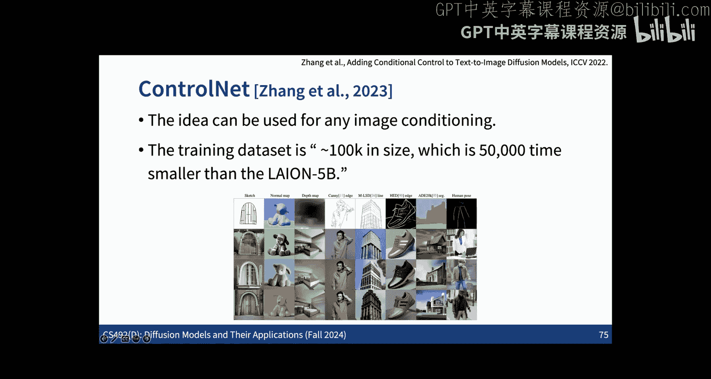

So this is basically people repasory the control that the ordinary the inventor。

So you can I recommend you to really just play with this and also the assignment three maybe basically just like were just working on this kind of code。

So these are some of the examples that we are taking these catch with some E map as the input and making some aligned images with some kind of variations。

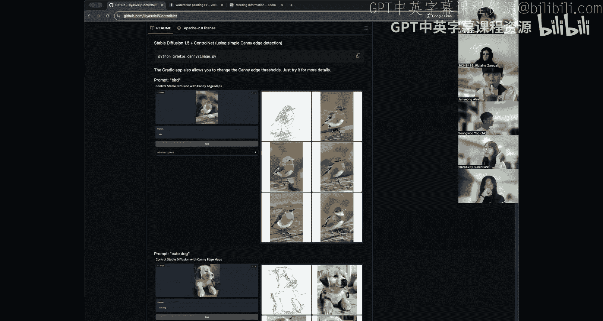

嗯。More sketches and this kind of some more like some sort drawing things。

 making some of the real listing images。

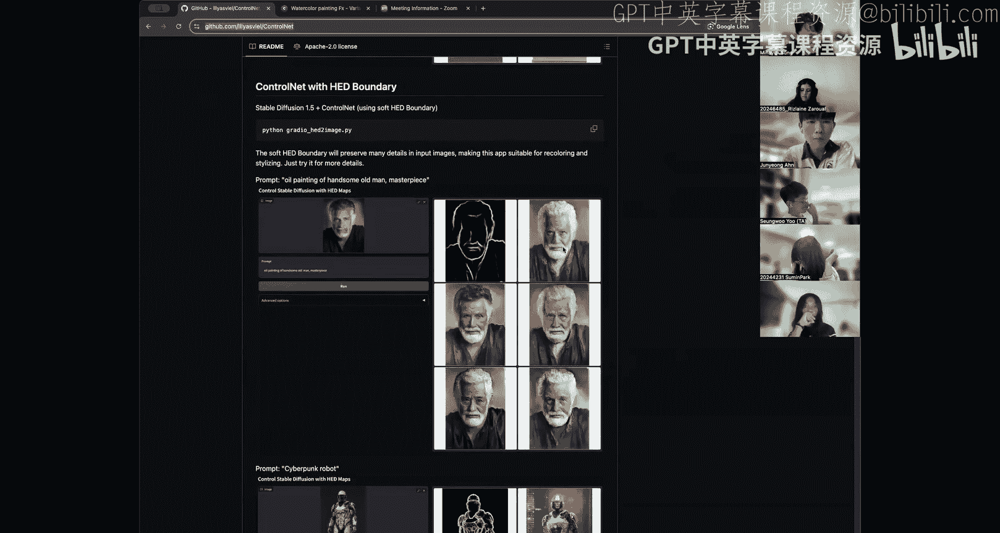

And it can be really some kind of be some some some doodling。

 some real quality sketching so get some images。

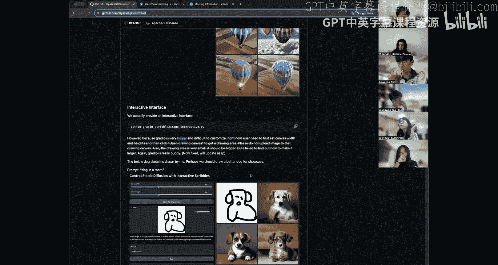

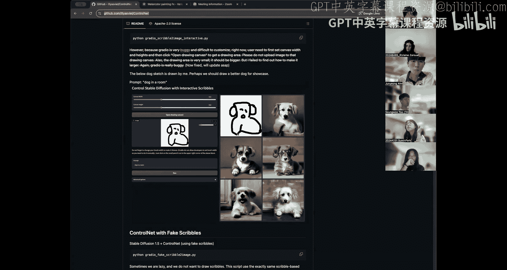

Also for this kind of some human pose information we can make some kind of the images as well。

 so these are also some of the examples that we are taking the pose from the input image using some other network like extracting the post and then making some other kind of the human characters with some kind of the new text description the astronaut on the moon。

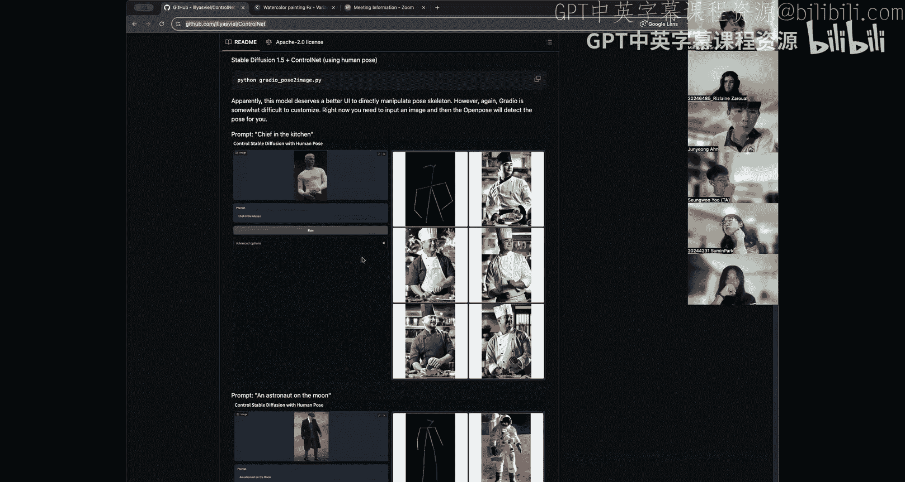

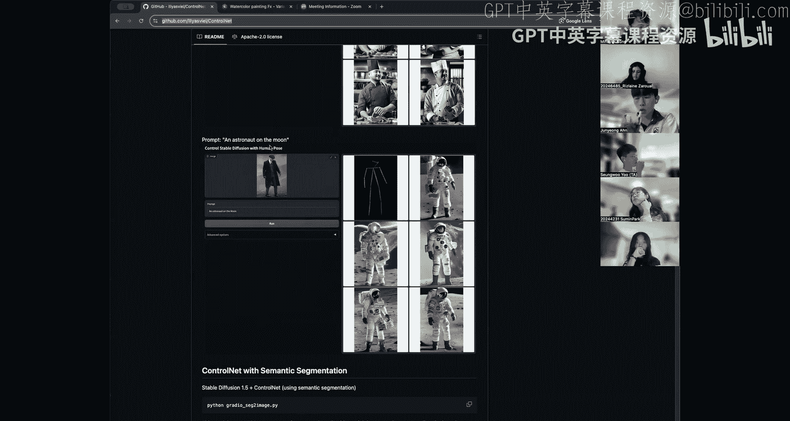

And these can be also cases like taking this kind of some layout images or some segmentation map as the input。

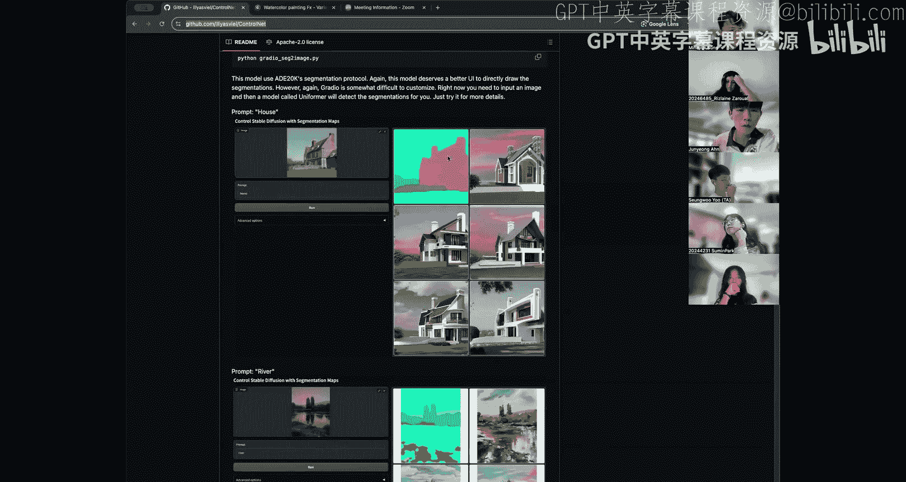

And also some depths in it as well。So I would recommend you to basically check out these。

 so these are very practical ideas without any kind of theory so more about some kind of the implementation some ideas。

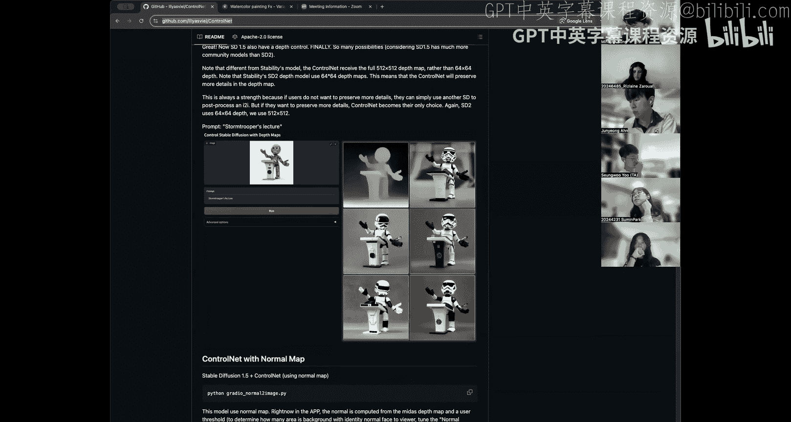

And these are some kind of the compare regions with the other cases。

 so if we do not use any kind of like digital geocomvolution， we get the worst quality。

 so even when you basically copy the inputding parts but without using the geocomvolution。

 we can also data results which is not converging that well。

 but actually when we make some kind of some lighter the architecture with the geocomvolution and we can actually get even better the quality images like this。

So this is like one idea in terms of basically making converting some kind of the unconditional diffusion model。

 especially the diffusion model into the conditional diffusion models。

 and there can be also many other ideas， especially the control networks works well when the conditioning images are kind of like aligned with the output that we want to see。

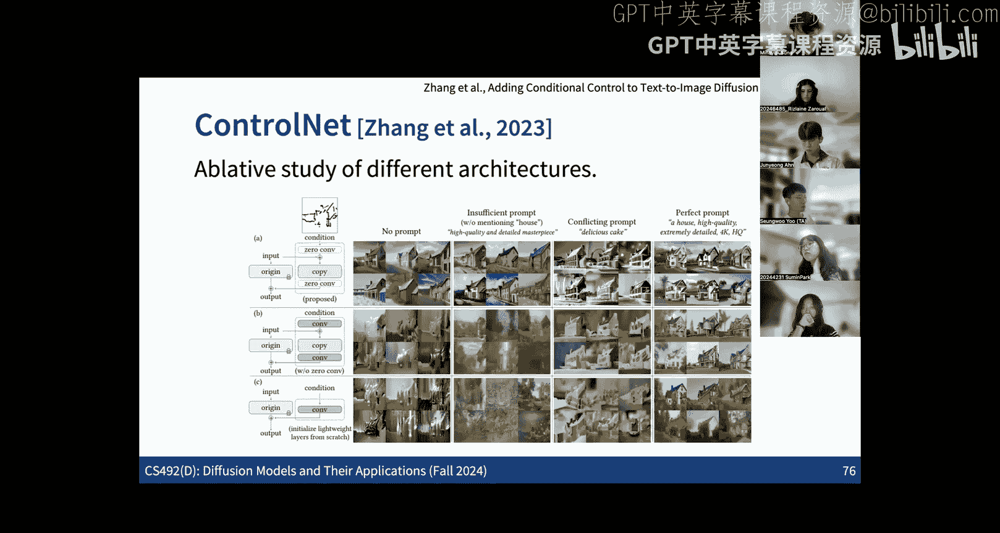

But what if we have some kind of the more like weaker some information。

 like just having some kind of bony boxes like this？

So bounding boxes are basically not giving some kind of some detailed information about the outputs for those kind of cases。

 we can also consider making some kind of another taking another some kind of the fine tuning approach。

 like one of the well-know example is this like collisionleg which is not using the same idea of the geoconvolution。

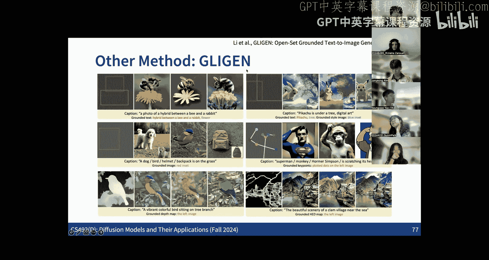

But also introducing some kind of the extra module which is called gated selfat。

 is basically the same in terms of like hitting some kind of defined fine tu approach。

 starting from the pretrain model， creating all the parameterss there and adding some kind of the extra delays or the modules and only basically fine tuning these parametersors with some kind of the extra training the data。

So using this kind of the way， it's basically whenever is some kind of fine approach in terms of that now we can better incorporate with some kind of some other types of the condition。

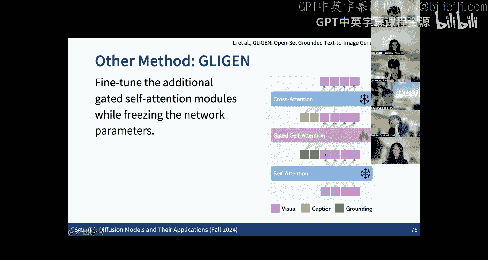

And you can actually check out actually tones of the ideas。

 being some kind of fine tuning in terms of converting some kind of the unconditional model into the conditionitional model。

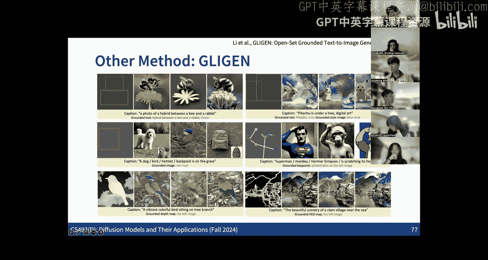

Any questions on this？Yeah， so C should be image with the same dimension yes。

 so there's also kind of be some kind of the restrictions of the control that in terms of the the conditioning image should be the also the same type of the data。

 which is the image in this case and also the dimension should be exactly the same because like the idea is that we are id the encoding part of the pretrained the noise description did not work。

走 the十个分。Any other questions？And should see go through the O to encoder before general composition。

 yes， because if we want to basically match dimension for the latent diffion case。

 like we also need to basically map the into the same latent space。

And is it shared or along the values relevant noise Yeah。

 so the A and the P are basically shared among the all the elements in the images。

 So that's why we call this kind of theory know you know the。The coalvol were each。

So geocom is basically cool as like beheading the one by one comb。

 which is the the nothingingmobil basically using the same killing and opposite parameters for every single v pixelix in the input input。

Any other questions on this？So before we end the two days lecture。

 let me just quickly read about the ideas about the personalization。

 so this is that about any kind of technical things you're going also say that this is basically nothing but just like having another some kind of fine training。

But basically what we want to do in terms like the personalization is that let's say we want to basically personalize our the individual models in terms of the。

 let's say like I want to generate the portrait images with all the different detection descriptions by making the portrait images like myself。

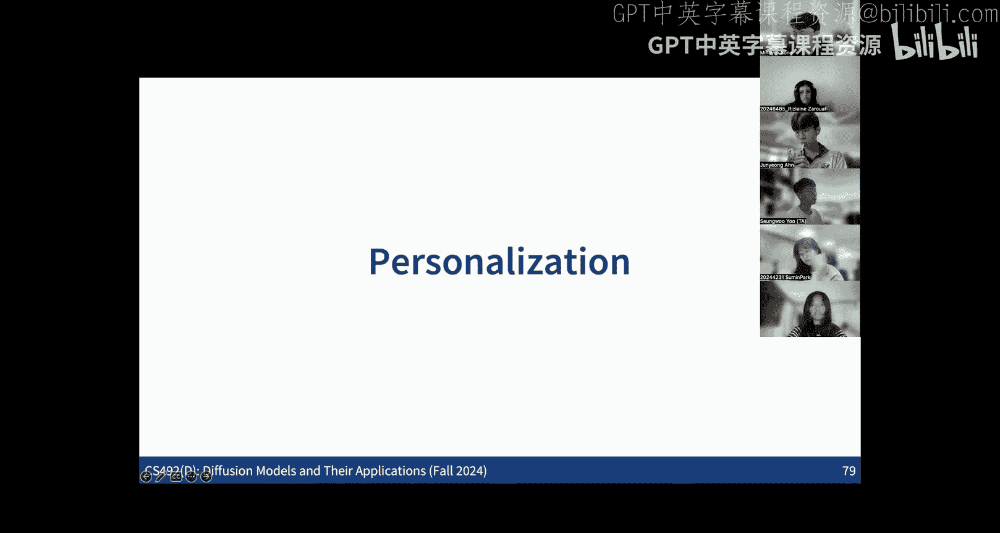

For all the kiss。So then how can we make our the pretrained multi model in terms of that it's like personalized into the some specific the objects。

 so here the objective comes like me or something else。

Where I also want to make some kind of the images of the like the same deep backpack that I have。

 so then how can you also make the diff model to basically understand like what's basically my backpack and basically making the backpack for all the different kind of the descriptions。

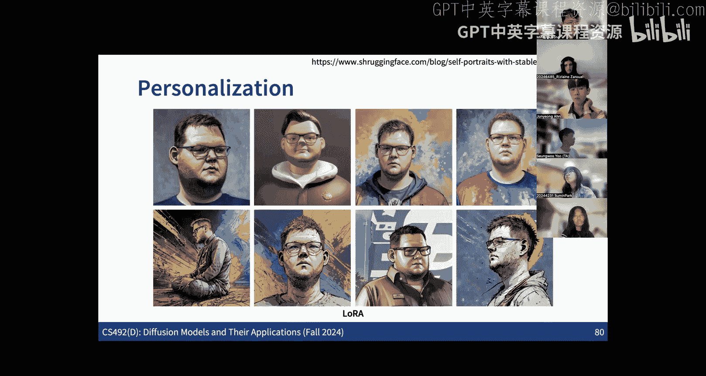

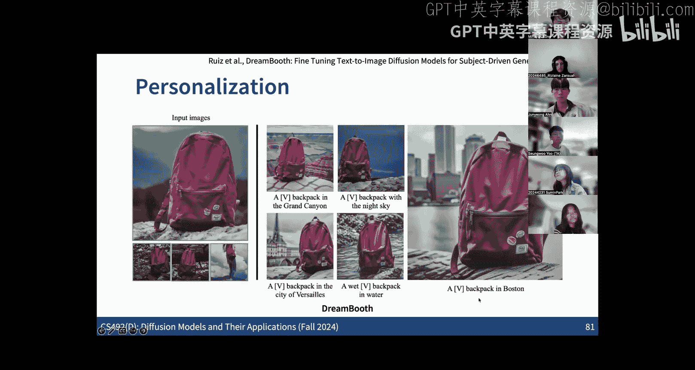

So for those kinds of things we can also consider using the same the finening the approach。

 which means that given the unconditional， given some kind of reritriment di model。

 we are fine it while basically f all the kind of parameterss in the given the neural network。

 while basically making some kind of the extra the branch。

 so it's basically the same might the control。But the only difference process is that now we are not taking some kind of additional input for the same input。

 we are still making or another some kind of the extra the here。

 which is also kind of running in parallel with the layer in the preprint the network。

So we can really think of obviously readily basically copying each of the layer while phrasing this just like only fine in this part。

But then the problem is that we're going to basically double the number of parameters right。

 so that's not what we want to do， we want to basically minimize the number of the new parameters in terms of that we can convertverge in which way faster from the new small set of the images。

So in terms of like， decreasing the normal depros， actually what we can do is that so let's say like we are having some kind of a single the NLP layer here。

 right？With some kind of the DD major input and also the D major of the output。

Then like one single DMD layer， actually can be considered as basically having some kind of a linear function。

 like multiplying this like D by D matrix plus some kind of applyinging some kind of activation function here。

 right？So this means that we are having the D by D parameterss in this specific linear layer。

 and we want to basically decrease the number of the parameterss while basically approximating this matrix as much as possible。

So in terms of that， like what we are doing is that we are basically like approximating this like D by D matrix。

 that's kind of the multiplication of the two like very thin imagesrices。

 which are basically row rankrices。So instead of having the D by D matrix。

 now we are multiplying like D by R matrix multiplyied by the R by D。

 while this R is per say way smaller than d。So we can think like this is kind of like some approximation of this kind of the very big matrix into the very two thin matrices。

And these kind of de de multiplplication can be considered as kind of actually having the two linear layers。

 while basically having some very low dimension or some kind of the intermediate delete latent variables here。

So instead of having like one single the giant， the linear the layer here。

 we are basically introducing like two small linear layers while having the bottle layer in the intermediate delay on the variables。

So this is basically the idea in terms of actually decreasing the number of the where basically making this kind of some additional the parallel of the bridge。

So basically by having these kind of the 2 d layers。

 we can basically find basically introduce some of a few number of some kind of the neural parameters and then fine tune this network in terms of that it basically now overfied into some specific object or specific types of the images。

So I also show some of the examples for this。

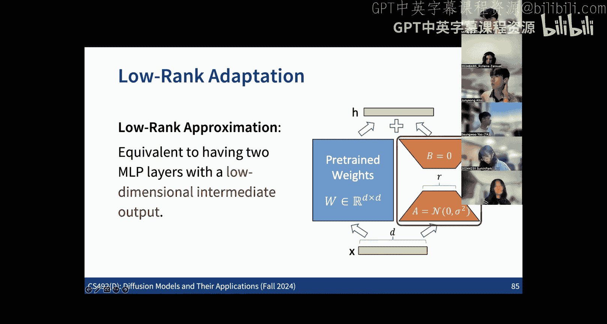

哦，你嗰见。So the thing is that this idea or basically having fine tune the network for some specific style of images or some specific objective of the images is very common。

 so even now this is the website， which is the market of this kind of fine tune models。

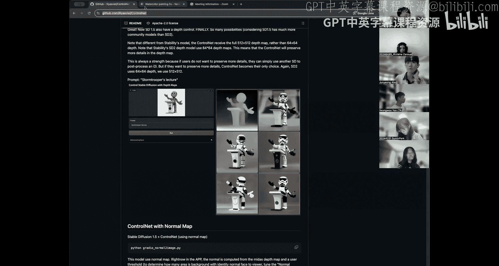

So you can basically buy some kind of some diff model fine tuned diff models。

 each of us fine tuned into some specific style， so for example I think we yeah so we can have some kind of some fine tune models。

 especiallys play for some kind of dec drawings here。我。I don。

Some like some animation images like this where some kind of some animation images talking here or some kind of neo sign images like this。

So those are all the cases that people basically fine tuned some existing some typically stable division into some kind of images in some specific style or having some kind of specific objects。

And you can easily download those kinds of data on fine tune models in terms of that you can basically generate some kind of images in some specific styles。

So these can be basically used to generate some kind of reps or make some kind of lot of kind of things。

So is you can see that this is usually basically very common idea in terms like doing some kind of personalization for the some free division models。

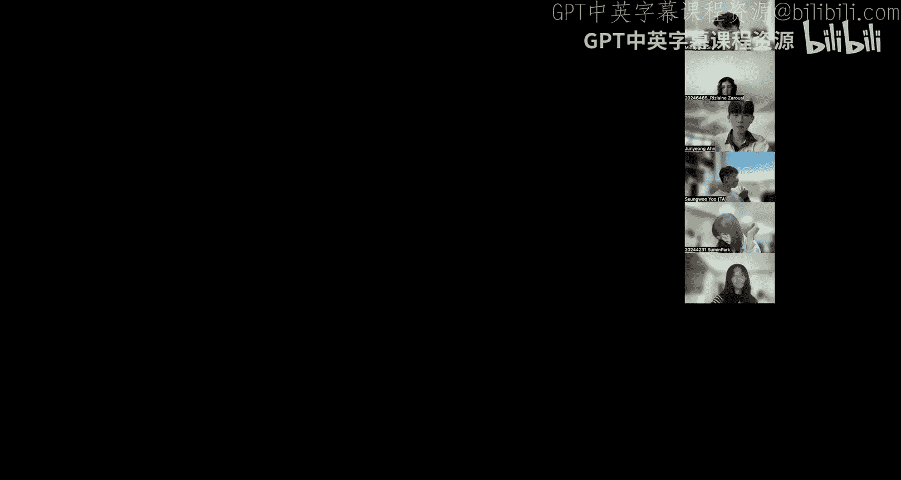

So let me stop here， we are also having some more slides on some kind of Georgia applications。

 but maybe I can continue those things in the next lecture。So as I said。

 like we are not going to have the lecture on this like coming Wednesday。

 but we're going to have the session period of Se three next Monday at the same time。

 so please also join the applying session as well。And then after that。

 we're going to have the gas lecture next Thursday at the 4 pm and we're going to also continue the other applications in the week after next week。

If you have any questions on this， please feel free to leave the questions on the slideboard space。

Okay。😊，So I will see you next Monday。Thank you。喂。

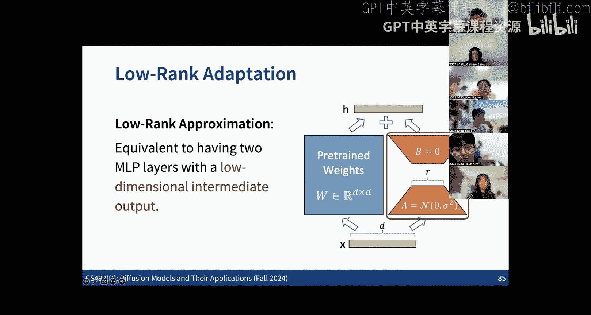