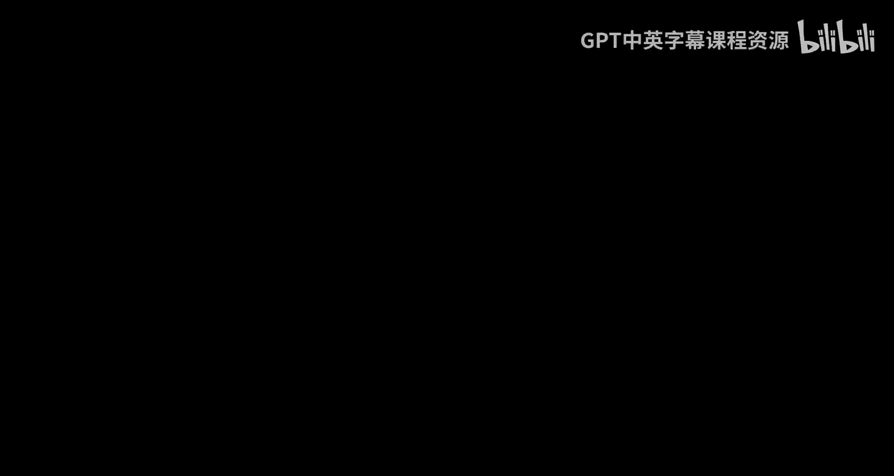
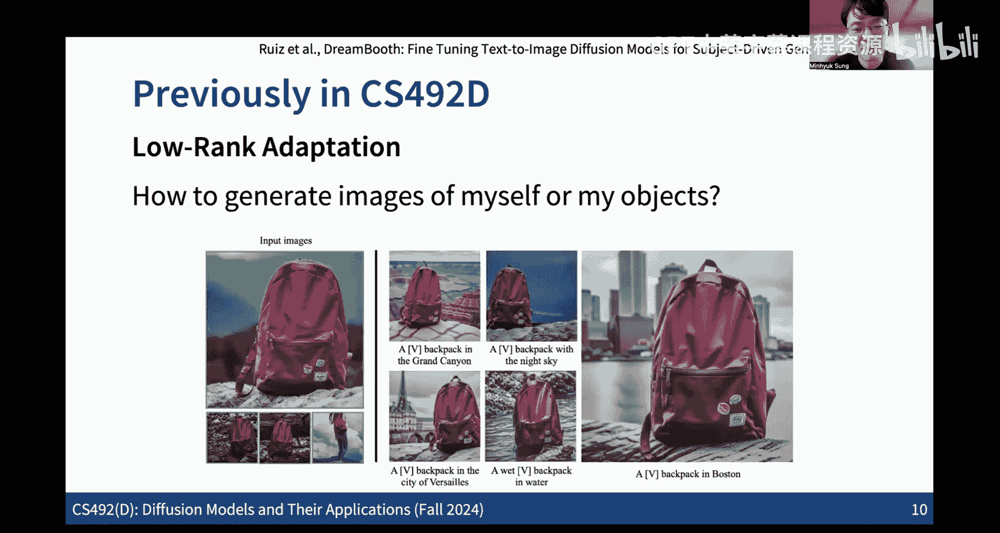
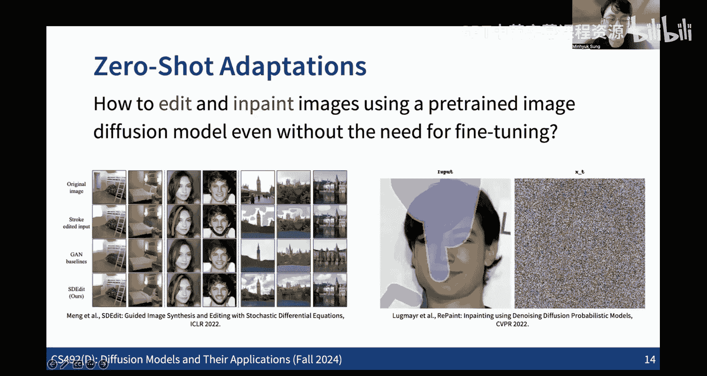
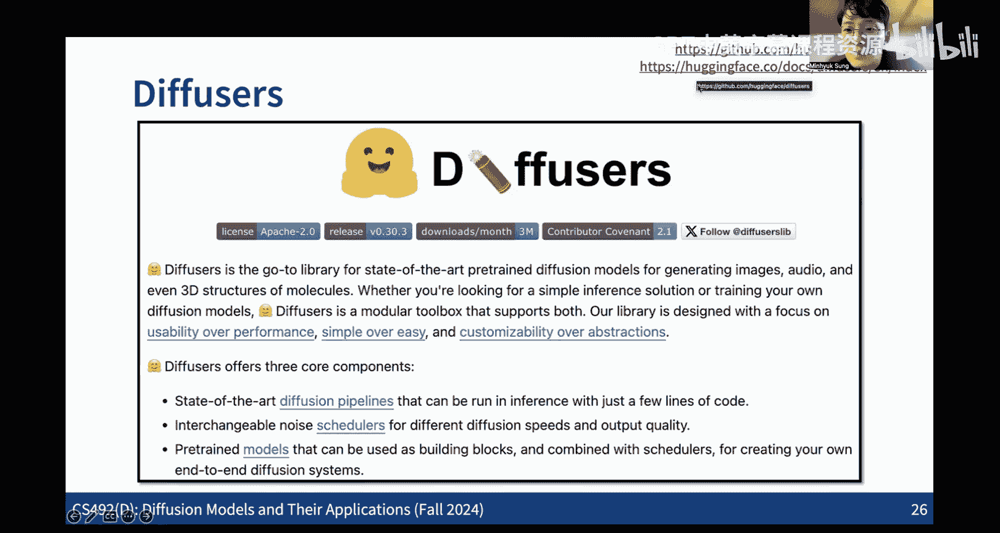

# KAIST《扩散模型和应用｜CS492(D) Diffusion Models and Their Applications (Fall 2024)》中英字幕 - P7：Lecture 08_ Zero-Shot Applications (KAIST CS492D, Fall 2024).zh_en - GPT中英字幕课程资源 - BV1mwpUzREqX

Okay， so welcome back to the6492D diffusion models and their applications。

 so last time we started to discuss more kind of some application the ideas in terms like how we can utilize some kind of the pretrained diffusion models for some kind of the editing or some conditional generation these setups and also how we can basically enhance some kind of diion models in terms of that it can also take some kind of some extra information like some kind of conditions to generate some kind of something So for example。

 if we want to generate some kind of the images that are aligned with some kind of the text or the labels then how we can basically make this kind of the conditional model using the network was basically the idea that we are discussing last time。

So we mainly discuss like to simple the ideas， which was the first one was the classifier the guidance。

 which is just assuming that now we're having some kind of the pairs of the image and also the classable corresponding to each of the images and here the question is that how we can also improve the quality of the generation by utilizing this kind of some extra information coming with some kind of the data set we want to generate where those kind of the cases like what we could do was that from this kind of the noise prediction the we could basically decomp the noise deformation into the two terms and the last one is basically improving basically the information from the coming from the given the class labels。

For this kind of the to model this core function， for this specific conditional distribution。

 we could consider basically training a classifier in terms like calculating the second term。哦，就起不。😔。

For the complex schedule the case structure where will find the case recording so the case structure will be also recorded and also the recording will be posted on the same the web page。

 so you can also join the same Zoo link everything will be the same with the regular directors。

So it you also have some kind of the conflicts with the gas structure。

 just like send a message to me what our it is。And also the kind of the data downside of the classify the guidance was that it basically requires to train a X D network。

 which is the classification the network， and also this can be also applied to the only for the cases like when the extra input is the class tables right。

So the idea that was basically invented to basically improve the classify the guidance was theclassify free guidance。

 which is basically not making any kind of the extra linear neural network。

 but basically having our the previously network to be able to basically take some kind of the extra input。

And we also basically could enhance the given the condition in terms of basically doing some kind of the extrapolation in terms of that we are trained the knowledge prediction network both with the input the condition Y here and also introducing some kind of the null label。

 which is the unconditional case， so by basically having this kind of the like some linear deco combination with some kind of the weights。

 the omega here， we could basically enhance this kind of the given the condition。

And the interesting thing was that this idea now can be applied not only for the class tables。

 but for the many other cases， like whether the input is the text description or some kind of the other images where even the audio for many other kind of things。

 we could consider using this simple the idea like utilizing theG the classify free guidance。

So you might also notice that some of the our the course projects are also about some sort of the conditional generations for those kind of cases。

 the easiest way to basically convert， making some kind of the divisionff model would be basically utilizing this idea。

 the classify free guidance， while there can be many other ideas that we can also make some kind of the better data divisionff model。

And then also in terms of like having some kind of efficient linear neural net that can handle some very high imageary the data。

 the idea was basically also using the latent di， which is basically like mapping all gig given data set into the latent space and also the learning our training or the node predictor in that specific the latent space。

So we can also say that like all the kind of the well-know the pre image diffusion models and also the video diffion models are typically the latent diff the models。

 which is basically doing some kind of dimension reduction of the data into some kind of the low dimension general de latent space。

So for those kinds of cases that we could also consider basically incorporating some kind of the input condition and in terms of like the way that we are basically feeding this like they condition the input into the neural network。

 we can consider basically utilizing the cross attention the model in terms like computing the query key and the value especially the key and the values from our the given the input condition。

 so these are basically some kind of the design choices of the neural the basically the implementation but also what we are going to see in the next gas structure is basically how we can utilize this kind of some attention information for many kind of some applications。

 so we're going to get into that into the next the gas structure。

And then we also started to discuss some kind of the ideas about some fine tuning based models。

 like one of the example was basically the control net。

 so this was the case that like how we can convert a preclaimed。

 the unconditional diffion model into the conditional diff model。

 especially when the case was basically where basically the all the outputs and also the input conditions are both the images。

So for those kinds of cases， like when you have a preprint unconitional， the image diffion model。

 which has been trained with the like5 billion images。

 how we can basically convert this into the conditional model by having like way smaller this cable of the data set。

 like 100 k， the input and the output repairs。😊，And the idea for that is basically like utilizing the information。

 the knowledge basically learned by the pretrain the encoder in terms of that we are also having the extra the encoder for the conditional input while basically copying everything from the pre the encodeding encoder the network and in terms of doing some sort of defined fine tuning with the small number of the parameters。

 we also discussed the idea of the geoconvolution， so by basically having this kind of like geoconvolution post for the input and the output of the each of the layer。

 we could basically have some very few number of the parameters that can help us to basically gradually like making the neural network to be adapted to conditional the input。

So this was specifically basic idea， like you're utilizinging these some some you know pre train models based on some like fine tuning。

With the conditional degeneration。And also similar idea could be applied for some kind of some personal identity cases。

 like if we want to generate some kind of images that is basically somehow making the images into them specific this style we basically making the images increase some of the specific object or something。

 then how we can basically personalize the pre deficiency models。

And for that， we could also consider using the idea of the low length the adaptation。

 which is kind of similar with the control in terms of that we are making some kind of the extra deep branch。

 but which is not the case of like taking so any kind of the additional deep condition。

 basically taking the same input and also making the same output。😊。

And also the height of the lower rank， the adaptation was to basically having some kind of the bottleneck layers in the middle of some kind of the extra deep branch in terms of that we are shrinking the dimension of some kind of the data in the intermediate kind of variables in terms of that we can also reduce the number of the parameters in the neural network while basically making the fine tuning to be more efficient。

So these are all the ideas。And the assignment three will be basically about like you know implementing some part of like those things and also like playing with some kind of pretried artificial models for the some conditional generation and also the personalization。

Andに quiteそです。so before we start the session for the assignment3。

 Id like to briefly just like wrap up the things that we couldn't discuss last time。

 which was about some kind of like Gi the applications。

 so the Con net and the R was some kind of the ideas about like fine tuning some pre division models for some specific applications。

But here are the thing is that even without like doing any kind of fine tuning。

 can you also utilize the pretrain digital models for the editing where some kind of in painting kind of be tasks。

So basically here what we want to do is basically that we are having some kind of the condition。

 which is like for example， like let's say， like we are having some kind of these strokes thrown with some kind of the over some kind of images。

😊，So let's say where on the left hand side， the first row is basically some kind of the input image。

And we are adding some kind of a stroke， like in terms of that for the first one。

 we want to remove the doors here。And we also want to completely color the hairs a little bit in the second column。

Basically adding some kind of the usual input in terms of that we are kind of like breaking the real ideal images。

 so once we basically add these kind of like strokes。

 then the images become like unrealistic in terms of that were having some kind of these strokes。

 but basically giving some kind of the guidance in terms of that now we want to basically color the part of the hairs into the yellow where basically we want to remove some kind of the parts images into the specific color basically giving some kind of the the guidance into the images。

😊，And here the question is that how we can convert this kind of the slightly like unrealistic images with some kind of user inputs into the closest the realistic images that youve shown in the last row。

😊，So these are some kind of the examples of the image editing。

 and we are also going to see many other techniques that can do kind of the same thing。

 So what we are also going to discuss for the last week the next week will be about basically solving some kind of the inverse problems。

 and we're gonna also get into the ideas for that。And the rust right the one is very about the in painting。

 which is the case that we are having some kind of the mask over the images that we want to basically fill the part。

 so let's say like we are having some kind of the input image and we are basically having these specific region。

 and we want to basically generate the images for this specific region。

 the foreground region that we say while basically preservibing the background region。

 the information in the other divisions。Then we're going to see that we are making some kind of the another some realistic images。

 which is preserving the parts that are not basically included in the mask。

 or basically making some of the changes in the fullground region。😊。

So this is a basically example of the in painting。So those are basically some of the applications that we can basically try to solve using some kind of pret models without doing any kind of defined tune。

And the idea is like very simple， so we're going to start this kind of like very simple idea for today this lecture。

😊，And from the next week， we're going to get into slightly more like some kind of advanced the techniques that is not just like tuning in some kind of some the neural architecture for the neural net but more about basically utilizing the diffusion process in the diffusion models。

😊，So the the basic idea for the editing on the left hand side is like actually it's like just very simple。

 it's just connectinging but basically so yeah， these are some kind of the more examples that we are also having this took the paintings。

 the first rule is basically the input。😊。

So we are starting from here to from the first rule and making some more the realistic images that are close to those kind of the unrealistic images。

And the idea for that is actually extremely simple so it's nothing but basically we are just like performing the full process。

 basically perturbing the given images a little bit by with some kind of the small amount of the time step。

😊，And basically， running the reverse process again from the de of images。

So if we think about individual models， like these are all about basically like you know。

 adding some kind of noise。into the realistic images in a way that like all the images are basically mapped to the samples of the unique gaus and the distribution and then running the denoaging process again in terms of mapping back to the original data point and here basically the simple idea there's basically without any kind of the theory for that is that we can basically consider adding some kind of deep noise into the realistic images and then basically mapping this back to the realistic images by just like running the reverse process。

😊，So what we can basically absorb it is that depending on the times of like basically adding the noise。

We can see some kind of de trade of。Yeah basicallyically what this means is that actually basically as some kind of the noise with some kind of the larger amount of the time step in the food process and also the running the reverse process for like the longer time。

 or basically we're going to get some kind of the more realistic images。

So you like think about the basically default default process that we discussed last time。

 you basically run the process for the entire the time step， whatever images that you have。

 all the images will be mapped to the points， the data points of the unique Gausian and all basically the points of the samples from the unique Gausian distribution will be mapped to some of the realistic images。

😊，So if you want to basically get some kind of the more realistic images that we can consider basically adding the noise in the fourth process the more with some basically the longer the time steps and basically also running the reverses process back to the basically the longer the time step。

😊，Then the downside is that the output that we're going to get we will be like。

 you know very far from the kind of input that we are having。

So those are some kind of examples that the leftmost one， this image is basically the input image。😊。

actually basically as some kind of the noise for the longer amount of the time step and also running the reverse process okay。

 we're going to get completely different images like this。

But actually you previously run the port and the reverse process。

 not the full amount of the time step， but basically just like few amount of the time step。

 like the half of the whole the range， then what you can get is that we are still kind of getting some sort of the real images。

 which is still also close to the input image， the condition image。

So we can basically play with some kind of the amount of the time step in terms of that we can get still kind of some realistic images while the output is not like being like debated more from some kind of input here。

😊，also the thing is that if the time step is like too small。

 that then what we typically also get is that the output also becomes like unrealistic。

 so it's basically not making some kind of the big changes。

 so the output still becomes like some unrealistic images while the output is like much more closer to the input。

😊，So in terms of like all those things that we can consider basically depicting some right amount of the time step in terms of that we are making some realistic images and also while making the output to be kind of close to the input image。

quite chance on thisす。I don't kind the question about noise prediction reduce is applied not for the network。

 but typically is also applied for each of the layer for basically not having some it also depends on like how we also but the typical idea for the is basically not just like having the。

Like basically having that module not for the entire the network。

 but for each of the layer So if you think about the basically we are having the like one basically linear layer in the neural net which input dimension is like n and also the output dimension is basically M then it might be so it's kind of the same that we are basically multiplying n by m matrix into the input the n dimension and the vector and then we are applying some kind of the activation the function right。

So here the idea is that n by M matrix might be kind of like two big matrix。

 so we are basically decomposing these like the big matrix into the basically very two shallow the networks with some kind of the intermediate。

 some kind of device， which is basically the。😊，So that's basically the idea that we are basically reducing the number of the parameters for each of the layer we basically making some kind of the extra deep branch。

Let's say mix this。见度。Yeah， and also any questions for this like S？Yeah。

 so this essay is actually quite simple the idea obviously also there is no theoretical guarantees in terms like how much we can get some kind of the realistic images and wireless basically how the output will be close the input images so but this is like very practical the ideas in terms of that we can do some kind of like this kind of di process are starting from some kind of the slightly unrealistic images and so basically performing the foot and the reverse processes in terms of that we are finding some kind of the closest the realistic data point coming from from the basically the input。

 the unrealistic the data point。😊，So as I said， like there's no guarantee in terms of like how the output will be close to the input and how the output will be realistic but we can just like play with that in terms of like doing this kind of thing so there's a very practical idea。

😊，And one more thing that we can also discuss for today is basically about like in painting。

 so let's say like as I mentioned in the previous slide。

 we are basically filling the region that we call it the foreground which is basically like indicated we the mask here。

😊，A wire basically preservibing the outside region。

So the right hand side is like another example that we are basically prejuding the hair parts where basically filling the left part and also the most of the part of the face。

Then we are basically filling the fullground region with some kind of the new phase or basically pre with the other parts。

For those kind of tasks like how we can basically use the pretraining def model without doing any kind of defined tuning。

 obviously we can also consider using some kind of the ideas like the control net or the many other things。

 but actually even without like doing the fine tuning we can also basically do this kind of in painting。

So the idea for this is also quite straightforward， but this can be slightly more de complicated。

So basically here the idea for the in painting is that we are basically you know。

 combining both the food process and the the reverse process。

It's kind of like the weird and also there's no theoretical guarantee for it here。

 but basically what we can do is that let's say we are basically running this kind of like de reverse process for the fullground region。

😊，So let's say the second row here is kind of the same the typical de reverse process we are starting from the x capital T。

 the unique Gaussian de noiseis， and then we are basically graduing the denoing every step。

But what we are doing is that when we are basically sampling the x t minus1 from the given the xt。

 so this is basically the like the one step deno， right？Sampling X t -1 from the X T。

 but we are not strictly taking this like X T -1。 But what we do is that so the fore ground is basically being the deno from the x capital T。

 right。For the background， like what we can see is that it's the case that we are basically having some kind of the known the add zero the final the output。

 right？😊，So basically what we eventually want to get is that with the final output the XO。

 the output image will， we hope that the output image basically matches basically the background region with the given input image。

 right？So we can consider that this is kind of the x0 for the background region。

So every step of the denoizing， that when you basically sample the x t minus-1 from the Xt for the foreground region。

 now what we do for the background region is that we also run the fold process。

Starting from the x0 from the given input to the x t minus1。

So we are basically getting the same the X t minus- one sample at the time step t minus-1。

 but the foreground region， basically what we do is that we are sampling the X t minus-1 from the X T。

 particularly running the like one step denoing。😊，But for the background return。

 what we do is that we are running the food process sampling from the x0 to the x t minus-1。😊。

Basically making some kind of the two different kind of the noise images at the time step t minus1。

 but one is coming from the basically the x capital T， which is being like the deno every step。😊。

And the other one is basically coming from the X zero。

 which is given it's kind of the condition of the input。

And what do do is that we are now basically composing this kind of like two different the x minus-1 using the given the mask。

 so for the full round background reason， we are basically taking this image。

 which is like being like the full the processed。And for the fullground region。

 we are taking the images， which is like coming from the deno。😊。

So that this composition becomes our the next step， the X minus1。

So this is kind of like interesting the idea in terms of like how we can also combine the fold process and the universe process for each of the part of the images in terms of that we basically enforce the background region to be like preserved while basically making some kind of the realisticistic images for the fulleground region。

So what we can see is that since we are already dis sampling the X t minus1 from the input the X0 S the T decrease。

T decreases into the time zero。 were gonna see that the there will be not be kind of be changes in the foreground region。

 because like this X t minus1 is is in the background region because like X t minus-1 is basically always be being sampled from the given the X0。

So in this way， we can basically preserve the background region to be basically the same with the given input while still basically running in some kind of denoing process for the foreground region。

So yeah， again， it's like starting from the the foreground region。

 we are starting from the x capital T and each of the times that we are basically denoging like one step in terms of getting the x t minus1。

Well the background region now we are basically running the full process from starting from the Xule in a way that now we can get the x t minus1 for the background。

And then doing some kind of the the composition based on the mask that we have。

And that becomes our the final D X minus1 and basically repeat this process again。

And you might also ask the question like no how we can guarantee that this kind of the composition like2 x minus-1 we will be basically we will make some kind of the some norm soonest images with some kind of the same the noise image or the same object。

 So obviously there is no such kind of guarantee so which means that actually this kind of the in painting process can be broken So I also strongly recommend you to try to implement this yourself and see what you get。

 So for most of the cases， actually it kind of like works well naturally but you will see that there can be some failure cases because of the fact that we are doing some kind of the composition of the X minus-1 here。

And the the composition can be some kind of some very random， arbitrary。

 Some bad sample of the X minus1。 for those kind of cases， we get some kind of debated。

 very de poor the outputs。So the reason why this is called the repaint is that actually you can do some kind of the replay as well。

 so once you basically run this kind of the kind of the denoing process if someone find that the denoging the deno inputs or the XT is basically not just like being good then we can basically run the process again in terms like going back to some kind of the larger time step and doing this kind of the process again so there are some kind of the engineering tricks in terms like improving quality。

But in any case like this is kind of interesting idea in terms of that by combining the forward process output and also delivers process output。

 we can do some kind of the some in paintingting kind of things。😊。

Uing this kind of the pretrain digital models， even without doing any fine tuning。

 any kind of modification into some given the noise presentation network。

 but by just modifying this kind of the deno in the process。

So these are quite surprising the outputposts in terms of that we are having some very random day mask。

 like really just like taking the mask with the mask of the face and making some kind of images like this。

😊，And also very randoms here， and this might be kind of be some extremely cases which is it's not in painting。

 but it's more about the out painting now， basically defilling the outside region。

And we can actually get some very randomly results， like making some very diverse outputs。

 and this is the case like building the help of the images。行。So yeah。

 so these are some kind of diversity some kind of the applications of the geo the applications and these are also using some just like combining some kind of broad and university processes。

 the next week， we're going to also discuss some more examples。

 doing some kind of the geo applications， which is not just like playing with some kind of the neural architecture where we like combining the the university processes。

 but which will be more about basically really modifying the denoing process itself in terms of like doing some kind of the other tasks。

😊，Okay， so do you have any other questions on this？So if there is no more question。

W if the side of the mask area enlarges。As T increases。

 I think it could be more natural Oh I see yeah， I don't know。

 So we also I haven't seen any kind of the examples that we are dynamically change the kind of the mask regions over the diff the denoging the process。

 but this can be quite interesting。 So yeah， we can see like what happens basically know dynamically basically enlarge over the decrease size of the mask regions。

 So that can also interesting some kind of the some experiments that we can train a good question。

Any other questions。Cool， so if you have more questions on this please let us know on this slide and today what we are going to do is that we are going to discuss the assignment3。

 which will be the case that we are switching the gear now so these will be basically some kind of cases which is like focusing more on the applications so what we are going to do is that we are now going to start to use some kind of the pretrained division models and especially going based on the library which is called the diuss which is basically some kind of library that we can use some kind of pretrained division models like the table division。

So our T， Yu will explain about the assignment3。即啊温色噶。

