# KAIST《扩散模型和应用｜CS492(D) Diffusion Models and Their Applications (Fall 2024)》中英字幕 - P8：Lecture 09_ DDIM Inversion _ Score Distillation 1 (KAIST CS492D, Fall 2024).zh_e - GPT中英字幕课程资源 - BV1mwpUzREqX

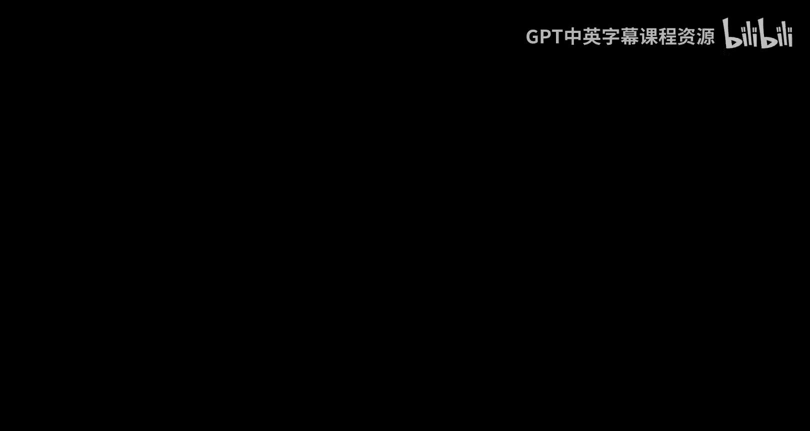

Okay， so today we are going to briefly discuss the idea of the DTN inversion。

 which has been briefly also discussed in the previous gas structure by orR。

 and then we're going to move on to some kind of a new topic， which is about the core distillation。

So in the last lecture given by the U so she has discussed like lots of some kind of interesting ideas in terms of like how we can utilize the attention the maps which is obtained from the patron image vision models for so many kind of the image editing and some manipulation the tasks and doing her director we also briefly discuss the idea of the DTI and in without like having some kind of the Louis of details for that so I'm going to briefly discuss this topic the detail in Bur and then we're going to move on to the next topic。

So before that actually， let me briefly recall like what we have discussed for the DDIM。

 so for the DDIM basically we had this kind of the deco distribution sampling the X t minus1 from the Xt and the x0 and based on that we could basically derive some kind of the denoing the process which is basically we sampling the X t minus1 every time right。

So in terms of just reminding some kind of the page idea there。

 So how could they also derive the formulation of the prediction of the X0。

 given the X T and and its basically the each of the prediction it set that here。

Let's briefly recall the things that we discussed for the DDIM。

So yeah any many as many people posted。Yeah， this was the formulation。 D the推 this formulation文。

So the process that we had discussed last time was basically given the X T using the noise prediction the network。

 we get the prediction of the final the X0 like this and based on that we compute the mean of this specific distribution and then sampling the x t minus1 based on the information of the Xt and the X0 right。

So we keep repeating this process in terms of that we are basically running the denoing。

And one of this special case of the DDIM was that we could basically make this process as the deterministic。

 which was the case that we are making the barriers of these distribution to be0。

 So if we set the sigma t to be0 for all t then what we get is that this process becomes like deterministic。

 So it's not basically sampling the X t minus-1 anymore。

 but we are basically directly calculating the X t minus-1 from the Xt。

So we can first compute x0 by t， which is the predict of the x0 for the given the xt and based on that we can also calculate the xt minus1。

And then if we see this two， then we can also rewrite the formulation of the x t minus1 with respect to the X T and the epson T here。

 right， So can you also briefly rewrite the X t minus1 with respect to the X T and the epsilon here。

It's like making this to be kind of like one line de。It we weren get the same result with this。

So here， basically， what we can see is that given the X T。

Using the Epsilon the prediction network here， we can directly compute X minus-1 in this specific case of the deterministic sampling。

 when the variance is basically0 right。So we basically repeat this computation。

 then since this like epsilon prediction network is kind of like fixed。

 So what we can see is that the mapping from the x capital T to the X is basically be fixed。

 So which means that if we sample any kind of the x capital T at the very beginning of the reverse process from the unique gausian the distribution that we're gonna say that x0 is basically determined。

 which means that how many times like you around the process。

 obviously were going get the same result from the same X T to the same x。

So this is not the case for the DDPM or so for the case like when the variance is not zero right。

 so if we have some kind of the nongebars， then we're going to see some kind of the sub variation。

 even when it starts from the same x k P， which is making the process to be moretochastic right。

So the question of the DDM the inversion is that so since we know the that there is some kind of de fixed mapping from the x capital t to the x0。

 can you also find the kind of inverse mapping from the x0 to the x capital T。

 So what the x capital T that resulted in risk producing the x0 from it。

 So that's the question of the DD and the inversion。Okay。

 the thing is that while the calculation from the x0 to d from the xt is is kind of simple in terms of the renewal the deformation。

 actually the inverse problem is basically not that straightforward because like that we are having the kind of epi prediction。

for the DDM the image actually， there are some kind of bunch of the weight in terms of how we can get some kind of the more accurate immerse mapping from the X to the x capital T。

 but will be kind of the simple， the ideas that has been the known as kind of working well in practice。

 especially like when you assume that the time step interval of the time steps is very small we can simply basically approximate the difference between the X T plus1 minus the X T。

 using the formulation for the X t minus1 minus Xt。So as you can see。

 like from as we have seen the formulation of the X T minus1 from the X T。

 now we can basically have the formulation taking the difference between the X T minus1 to the X T into this formulation。

 right？So the simple kind of idea in terms like approximating the。

 the difference between the Xt plus1 and the Xt is basically simply basically replacing all the t minus1 here into the t plus1 in terms of now we are approximating this difference into this specific deform。

So which means that since now we can calculate the difference between the xt plus1 to the xt。

 we can basically run the inverse of the reverse process right so we can start from the x0 and then we can calculate like x1 x2 all the way to the xt t by using basically this difference between the xt plus1 minus the xt right？

This is kind of like one of the example that we are running the inversion from the x0 to the x capital t and the running the generation again using the x0 to the x k T。

 you can see that now we got some kind of the results which is like almost perfectly reconstructing the original image from the x capital T we basically produce using the inversion of process。

But basically the assumption only works well when we basically use basically very small the interval for the time steps。

 so which means that as we basically decrease the number of the time steps。

 which is basically increasing the integral between the time steps。

 we're going to get some kind of results that the generation from the capital T is not perfectly basically reproducing the results of the original the x0 so this is the results when the number of times step is basically the。

So this is like the basic idea for the KTMD inversion。

 which is actually having some loss of some kind of the applications。

So one of the applications for the DDM the image is basically the image editing as also were mentioned in basically the test lecture last time So one of the idea for the image editing is that let's say like we are having a image and some kind of the description for this specific the image then what we can do is that we can press run the DDM image using some kind of the given the prompt for the original the input image and then now we are running basically the reverse process。

 the denoing the process， not using the same the prompt but using another the different prompt So in this kind of the condition of the setup we can basically produce some kind of the different images from the same the capital T but using the different text prompt So this is the example that we are running inverse of basically the denoing process using the given the text prompt for the original input image and then we are changing the prompt in a way that we are basically。

some kind of the new image。 So this is kind of the result so like doing some kind of the image editing。

So using this kind of the DDM， the inversion on the technique。

 we can do some kind of the image editing without any fine tuning or any kind of the training or digital network。

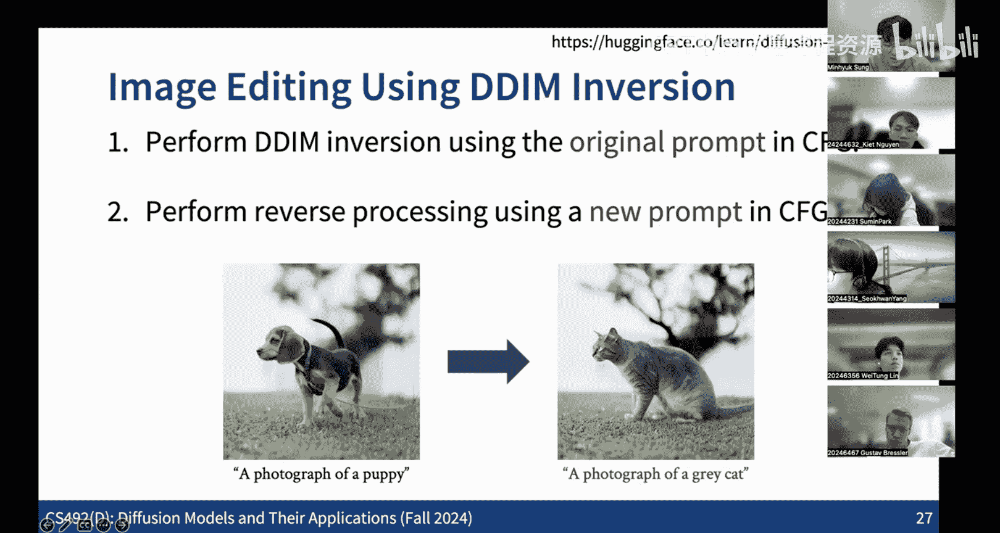

This is also kind of interesting example that we are having a photograph of a face running the imversion and then they're running the deno again with some kind of the different prompt interesting you can see some kind of the results that we are making some comedy images which is basically quite similar with the input image while we're basically making the character to where the sunglasses here and also basically changing the face like this。

So this is some kind of the example， like doing some kind of the image editing using the DTM data version。

So you can try those things yourself using this table equation in this link。

 so there are also lots of the examples in terms of the implementation Decode for the data in version。

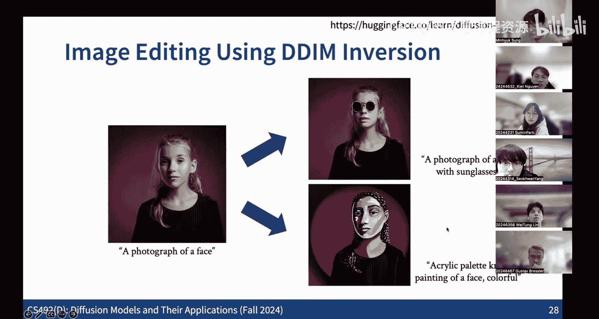

And one some kind of practical aspects， this is like just really practical kind of things is that actually some kind of thing is that if you run the imversion and also the generation again using the high CFG weight then actually you get some kind of the poor result so this is kind of the case like when you basically run the imversion and the reverse process again using the CFG weight of the 7。

5 so as you can see the output is not perfectly basically reproducing the input image in this case。

But the thing is that if they want to really get some kind of the dramatically changes in the image editing using some kind of the new text prompt。

 we need to use the highest CGED weights， both for the inversion and de generation。

So here the question is that how can you still use some kind of the high safety weight where they gain some kind of the good quality of the reconstruction of the input image in the in process？

So for that， some very practical idea， which is known as kind of the nerve text inversion。

 is that we are still basically running the inversion with the low safety weight。

 like the weight becomes like one in this case。So if you use basically the low s weight。

 then we're going to get some kind of the good quality of the reconstruction through the emerge。

So let's say like the latent the variables， like the from the x1 to the x the capital T that we obtained through this kind of the low se weight as kind of some sort of the P but the variables that we want to match。

And here the idea is that we are still running the emerge with the highest safety weight。

 like the W becomes like 7。5， while basically enforcing all the latent variables that we are getting。

 the highest the safety weight becomes almost the same with the P but the variables that we obtained in this process while obtain some kind of parameters。

So let's say like this X1 star is kind of done the latent the variables that we obtained with the low se weight。

 and let's say this is kind of the latent variables that we obtained with the high se of the weight。

So we are basically in some kind of some sort of the tuning of the parameters in terms of that these two becomes the same。

And then here the question is what is some kind of the parameters that we are going to tune in this case。

 so we can basically tune many things， we can basically just like tune the noise prediction the network not the entire network。

 well the many other things， but the idea that the people are the propporting in these case is that instead of like the tuning the entire languagewi prediction the network。

 we only tune the nerve text to the prompt。So we discussed in the that there will be some kind of the no text。

 some kind of the problem problem which is as some kind of the the case for the unconditionally the case。

 right？So by just only tuning this kind of in text prompt while basically matching these two。

 we can somehow try to basically the trajectory obtained by the high CD debate here to be the same with the trajectory that we are obtaining with the low s debate。

So this is kind of the example that when we simply just use the high slope the weight for the inversese and degeneration the process。

 we get this kind of the different outputs。But we we still use the high s the weight wirelessly optimizing the nu text prompt that we get some kind of the results。

 which is like way closer to the input image in this case。Does it make sense。

So these are also some kind of comparisons but course some different ways to ob things some kind of imversion so compared to the so this is kind of the case that we are running the D im with the high safety weight without doing doing any kind of defined fine tuning so you can see that now the output looks kind of close to the input image but still having some different colors in the world on the backside right。

But if we basically fine tune the another text prompt。

 we get some kind of the much closer results with the image。

So does this mean we need to tune the neural text prompt for every image， yes。

 so you basically need to tune the neural text prompt for every single image that you get。

So this is good question。But once you basically find Q& the Nor text prompt for the given the input image。

 you can get some kind of much better results in terms of doing some sort of the editing。

 so those are all the examples that we are running basically the in D inversion with the high sample weight for the given the input image and basically applying some kind of the new the prompt in terms of that we are getting some kind of different the editing the outputs like this。

Here's also some more examples。So there are lots of the actually there are also more ways to doing this kind of the DDMD inversion and also there are also lots of the applications for D DDM in version。

 so youre can to also see some of the examples in the at the end of like this lecture。

So this is also like one of the examples like doing some kind of the geo image reading。

 So without doing any kind of the so obviously like this is the case that we are involving some kind of defined fine tuning of the north text prompt but after doing some like small defined tuning。

 you can get some kind of results that we are doing some kind of the bunch of some kind of image manipulations。

えに会長さんです。Okay， so then let me move on to the main topic for the two days lecture。

 which is about this core disc。So this is like more important topic for today So actually what we have discussed class for was mostly about some kind of like playing with some kind of images right so while the diffion models were not only for the models only for the images that actually di models can be applied to the many different types of the data so we also have seen a bunch of the examples in the first lecture of this class like this can be also applied to the image generation can be applied for the molecular structure generation or this can be also applied for the human motion generation so there can be lots of the applications of the diff models symptoms like making some generated models where the bunch of the modalities of the data。

So what we are going to typically see especially see for today is that we are going to see some kind of examples for this 3D generation。

So there has been lots of some kind of the examples so like applying the division models will be3 de generation。

 so as you can see here know there are some kind of the works so like making some kind of the some kind of the point cloud here or making some kind of the box here。

And after doing this kind of some bunch of the iterations like making some new different models。

 actually we could get some like quite good quality these 3D outputs in terms of producing those things using the different models。

 so these are also one of the examples of like different model the outputs producing some kind of the 3D shapes and as you can see the output is kind of good in terms of like you know capturing some fine details in the 3D gig like having some all the thin the parts or some kind of structures in the 3D shapes。

But the problem is not in the kind of the technique of like in terms of how we implemented lipid models。

 but actually the challenges are not only in the techniques of the different models。

 but actually some kind of the deficiency of the data。

So when you basically consider like using the digital models in terms like making agent models for some kind of the new types of the data。

 the issue is that there are not that kind of like many scale， like the large scale kind of the data。

 So especially like when you compare the scale of the data with the scale of the image data for the image data that we have seen in the previous lecture。

 there are like。You know， very large Q the data set。

 like having some billions of the kind of thes of the text and images。

 the one of the development kind of the data set for the image was basically Le on。

 which has been public so far， but which is now not basically prohibited to use some kind of some some kind of commercial purposes。

But for this data set， we are having like 5。8 billions of the pairs of the text1 images。

 but the biggest kind of the data set for the 3D， the known kind of data set for the 3D。

 is still kind of the 10 million， which is basically like way similarly scale compared to some kind of the image data set。

So this is kind of like some kind of the lack of some kind of the large scaled data is basically kind of the problem in terms of like making genetic models that can really produce very diverse some kind of the outputs。

So when it comes to like producing this kind of some sort of the imaginable some3 chips。

 like if we think of like making some kind of the look like wearing a sweater and the ghost like eating a day hamburger。

 those are not some kind of something that we can expect to see some kind of the 3D models in some kind of the online with posts。

 So these are really some kind of something that we can imagine。

 Well it's really hard to expect and we're gonna have some these kind of examples in some kind of the given on 3D model the data。

But if could basically consider like way bigger the data， like some billions of images。

 then there are must these kind of some very interesting some kind of samples there。

So here the question is that like even without like having some this kind of the large scaled data set that can cover like all the diversity。

 all these 3D shapes， how can we make some kind of some sort of the generated model that can produce like very diverse some 3D shapes？

And here the idea is that without basically relying on having some kind of the large scaled 3D data。

 what we are going to do is that we are going to some kind of like do some kind of some distillation of the knowledge from the image digital models。

 so what does this mean is that we are going to basically extract some information that has been learned by the image digital model in terms of like not only producing some of the images but some other types of the individual content which can be 3D or some kind of the vector images or some kind of the manufacturers。

 panamas， many other things。So here the question is that how can you basically extract some of the knowledge learned by the pretri immediate video models to produce many other things。

 so this is kind of the main topic that we are going to discuss today。Yeah。

 so these are some examples and for that I'm going to very briefly start to basically introduce some kind of the basic ideas for the three data construction。

 so this is kind of the be in terms like seeing like how we can do some kind of the3 de generation。

So the basic idea for the 3D reconstruction for the multi view images is specifically that we are having some kind of the collection of the images that are basically seeing some kind of showing some same 3D object for the 3D scene。

And they're also taken from the all different view points and basically reconstructing this3D information like this。

So I guess many of you might hear about the technique called the nerve。

 so this is the the basic technique， which is doing this kind of the3D construction from the multi view images。

So as you can see， the output looks very good， so this was kind like very recent the advances in terms like achieving this kind of the high quality rated construct the outputs from the multiple images。

And I guess some of you might also know about the technique called the Ga split。

 but this is like technique， which is also doing some kind of reconstruction from the multiple images。

So the video now you are watching is not some kind of the video taken from the real scene。

 but this is kind of some kind of the synthetic video which is like obtained by exploring some kind of the reconstructed 3D scenes。

 so if I play this again like you playing some kind of video game now we are basically moving around some kind of some reconstructed 3D scenes so you can see that there are some kind of some black parts the pop which is basically unreconstructed some kind of re in the 3D。

But you can see that now it really looks like we are navigating these 3D scenes right。

 because this is really the process that we are rendering these 3D scenes into every single the camera def frame into the real time and the quality also looks very good right？

So this is a kind of like what would be very surprising technique that we can do this kind of the like very fine accurate 3D construction from by just taking some multibu images。

For those kinds of 3D reconstruction there has been like lots of the others for that。

 so if you are also interested in some more details for those kinds of 3D reconstructioncon techniques I also also teach the other course which is the much known for 3D data so you can also check out that course to learn more the details I'm also going to teach the same course next spring semesters ago so know take that course。

But without basically discussing any details about the 3D reconstruction。

 the basic kind of thing is that we are going to have some kind of some 3D representation so also there can be some multiple options for that but basically still like want of well known the examples for the 3D representation。

 we will be basically this the nerve which is basically having the implicit representation。

 so in this case like we are not having any kind of some explicit information。

 but what we can get is that if we basically want to query any of the point in the 3D space。

 let's say like we are basically shooting a into the 3D space for any point over the rate。

We can basically retrieve the information of the RGB color or some kind of the dense key or give some kind of the3D the occupancy from each of the point by basically feeding the point information into the neural network and then basically getting this output as kind of some output of the neural network。

 So it means that the all rate information is basically encoded into the neural network。

 So the3D information is basically represented as kind of the neural network the function So this is the case that we're having some kind of the imp representation。

Or we can also consider having some kind of the more explicit representation。

 so this is the another case that we are representing the entire 3D scene as some kind of the correction of some kind of some blocks here right so those blocks are called the Gaussian display split some split kind of things by having this kind of some Gaussian display we can basically convert this kind of some explicit representation into this kind of defined images through the process that we call the rendering。

So these are some kind of examples in terms of that we are having some kind of the some representations okay 3D。

 so which means that we are having some kind of the parameters that we can represent some kind of the 3D object that is3 they say。

And then for those kind of process， typically we going to also have the process。

 which is called the rendering。So rendering this specific process。

 then we are having some kind of 3D scene here， which is represented as the data here and then mapping these 3D scene into the image from the specific viewpoint C here。

So if you took the Comp graphics course， is there anyone who took the Comp graphics course？So yes。

 how many of you took the compared or X course people？Yes so。

Let's raise your hand if you took the compact course before。

So if you took the computer graphics course like the。

 you see that actually the computer graphics is like all about doing some kind of the rendering。

 you know， how we can best to some kind of the projection of this 3D into 2D。

So we're going to basically assume that there is some kind of the given the rendering function。

 which is basically some kind of the differential the function mapping the 3D representation into the two imagess from the specific viewpoint。

So given this kind of some 3D representation and also the rendering function。

 what we can see as kind of some sort of the 3D reconstruction process is that 3D reconstruction is basically is some kind of the optimization the process that we try to match the render imagess into the given damages。

So they say like we're having some kind of the end number of the view points here for each of the view points。

 we're having some kind of the some given images， right？

And what we do is that every time like for each of the viewpoint。

 we basically render the3 same into the image and try to basically match this。

 render the image into the given image by minimizing this like L to loss。

And then we are running the back prop through the 3D representation here in terms of that we are minimizing these loss for the MA single reviewpoint。

So you know very high analysis this is kind of be everything about this 3D construction。

 nothing but just like you know rendering the 3D representation into the of the viewpoint。

 minimizing the outs and running the back through the 3D representation。

So this is basically debate reconstruction， while there are con details in terms like how we can exactly do this。

But the high level ideal is very simple， right？Renders releasing into the 2D images。

 match the images into the given image and running back through the 3D presentation， right？

So given this kind of the page idea for the 3D construction。

 obviously there are lots of the challenges right， and one of the challenges like people basically the investigating was basically how can we basically reduce the number of images to get some kind of the accurate 3D dataconing output？

So the thing is that obviously like any when you have some kind of the more number of the images from like very different kind of view view points。

 we will be able to get some kind of the more accurate outputs， right？

But here the question is that even if some very few number of images。

 like when you just take like 10 images， like five images or the three images。

 like when you have some very small number of images for the same object or the syn。

 how can you still get some kind of the good quality of the3 data construction？

So that's kind of like one of the questions in with construction。So actually。

 the obvious thing is that you create some like very small number of the images。

 it may not be sufficient to get some kind of the good 3D re of the outputs for those kind of the cases。

 because we will need to use some kind of the expert information。

So here the question is what sort of the extra information that we can use so one of the ideas in terms of building some kind of the extra information is to use this kind of the text image model so one of the kind of the representative example for the text image model will be clear。

So I guess also many of you might hear about the clip。

 but clip is some kind of one of the the foundation model。

 which is just the linking texts and the image。

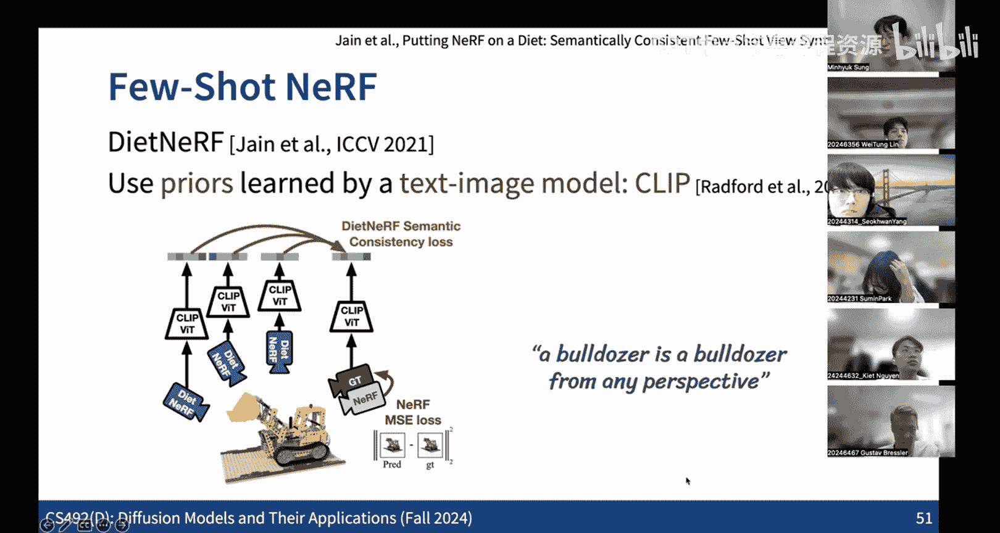

So the role of the is that E has some a pair of the text。Some text description and also the image。

 then the clip Gis can give some kind of score in terms like how how well these twoically aligned each other。

So this is an example that we are having a text of the a beautiful painting of a dog riding a doping and we are having the image for that and clip is basically giving the kind of score the alignment between these two texts and the image。

And the idea for this kind of the alignment is like extremely simple。

 basically what we are doing is that it's connectinging。

 but having some kind of the encoders both for the image and the text separately。

 so the role of the encoders is that they are basically mapping the given the image and the text into the latent space。

 which is basically the hyperspee space。

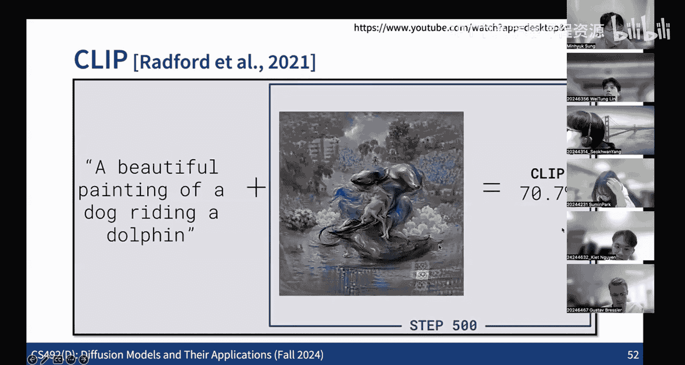

So you can think about that there are some kind of the imageaginary。

 some kind of the sphere in the height image space。

 and then we are mapping both the image and the text into that the latent space。

And what we want to do is that we want to see that the distance over the latent space become some kind of the similarity between the gi text and the image so as basically the distance is basically closer in the latent space。

 which means that these tribe basically align more。As the distance is basically far。

 these two are basically not aligned， so we are basically encoding basically those the text and images into the lakent space in a way that the distance in the space can give some information about the basically the alignment between these two。

The clip has been basically defined in this way using like 400 millions of the text image pairs。

 so this is basically like very well on the validation model giving some kind of dis similarity between the text and images this way。

So basically what we can do in terms of using this clip as some kind of the extra information in the kind of the3 data construction。

So in addition to basically measuring some kind of the out lawsaws for given images from these specific viewpoints。

 what we can do is that basically we know that these objection may be， right？

So we are not only basically minimizing the l close between the rendered image and the given image。

 but we also basically maximizing the alignment between the text build and the render images。

So let's say like we render the images from render this video objecting to some kind of the random view points and then we can now measure the distance between the rendered image with the text prompt we have。

 right？Then we can also consider like maximizing this kind of the alignment。

 basically minimizing the distance in the clip embedding space as kind of some kind of the extra loss function。

So this can be basically one of the ways that we can utilize this kind of clip the embedding space in terms of basically improving3D construction。

 especially like when you have a very small number of the input images。It is clear。

Also one thing what we can do is that we can measure not only the text text to image distance。

 but we can also consider measuring the image to image distance as well。

So when we basically do not have any kind of text description for the object that we are reconstructing。

 we can just like measure the distance between the image that we have from some other thepoint with some kind of image that has been rendered into the different viewpoint。

But here the thing is that since clip has been trained to basically give some kind of the alignment between the texts and the image。

Basically know from whatever kind of viewpoint we render this video object basically the bulldoer will the bullooer right so whether basically we render the bulleter from the front viewpoint where we render the bullet from the side viewpoint。

 basically those images will be the images for the bulldoer。

So we can still measure basically any distance between the rendered images from the different viewpoints in terms of basically checking whether those are all the images basically representing the sample do。

 right？So the idea for that is that even without having any kind of the text description。

 we just like render the images from the any arbitrary2 viewpoints and basically map those images and also the given images which are basically from the different viewpoints and checking whether they are basically at the same the point the clip embedding space in terms of basically minimizing the clip distance。

To check that whether the is representing the same object。

So this is basically one of the ideas in terms of like we are utilizing the clip， the text image。

 the foundation， the model where is created the construction。Make sense。

So this is like the case of like the field at the3 reconstruction and the interesting thing is that we can go into the more extreme case。

The more extreme cases is that now we can consider the case that there's no image input。

Without having any kind of the input image， let's think about that we only have some kind of a text prompt。

 some kind of description of the object that we want to recon。

Then without basically minimizing any L2 loss between the rendered image and the given image。

 we can only basically minimize the clip distance between the rendered image and the given the text prompt。

So this is actually the same the process of the 3D reconstruction。

 but we only change the basically loss function。The loss function is that that the L to loss。

 but basically the clip distance between the render image and the given the text form。

So by minimizing this row function， now we can do some kind of the 3D reconstruction without any input images。

 but just read some kind of tapepoint。Then now we can see that this is not a reconstruction anymore。

 now this becomes a 3D generation because there is no image information， right？

So these are some of the examples like doing some3D generation in this way。

 so as you can see the apple looks some kind of interesting like this is not very realistic but we are seeing some kind of really interesting examples like so this is like one of this was like one of the famous examples like a art chair in the shape of the avocado they can get those kind of results。

So as you can see， the output is not very realistic。

 but we are getting some kind of something in terms of getting some security outputs。

And this has been this was the first example like making some 3D generation models without having any 3D information。

 but only using the 4D information， so we only use the text image the foundation model do some kind of the 3D generation。

 right？So this was kind of some kind of the background in terms of being sub3 generation using 20 priors。

Then here， the question is that instead of using the clip。

Can you also use some kind of pre traineded image digital models for the same task？と、デースス会ドメイト。

So this is kind of interesting because like the basically the diffusion model is basically some sort of degene model。

So the role of the generate model， especially like for example。

 that probably text to image generation， is basically taking the text as the input and then generating image as the output。

But here basically what we need is basically not a de generator， but basically a discriminator。

 as we also have discussed in the again， the role of the discriminator is not producing the image as the output but taking both like texts and the image as the input and giving some kind of score of the alignment。

 right？So basically their roles are basically not the same。

 the role of the generator is like producing the image as the output。

 but the role of this this is taking the image as the input and then getting some kind of this query alignment。

So here the question is that how can you convert the pret image feature model as some kind of of the disk related in terms of that we can utilize this kind of core in this three data consortium？

So this becomes a task for the 3D generation using the quicktrain image different model。

In this school。So we're going to basically discuss the idea in terms of how we can basically convert to a quick individual model that the discminator。

 so this is the idea which is called core distill disling。Absolutely， the idea is quite simple。

 but were going to also discuss some more details for that。So here basically。

 the idea is that how can you reverse a pretde visual model to measure the alignment between the rendered image and the given the text point？

And for that， we got to basically see the basically the lowest function of the DDPM， the DDIM again。

 So if put see the DDPM and DDM， the lowest function， it looks like this。

And we can basically instantly having the X T here。

 we can basically compute the X T from the given the x0 some kind using some default jump here。

 right？So what we can basically assume is that if the training of the digital model has converged。

 then we obviously like the loss will the real the data point， real image， the x0 will be close to0。

 right？While basically the loss for the fake image。

 the unrealistic image for the X U will be will not be close to zero。So here。

 the very basic idea is that we are using the lowest function this as some kind of the measurement of the alignment between the given the image and the given the kind of text prompt。

So now instead of having some kind of L to loss or the distance。

 we are going to calculate the gradient really back prop in this way。

 which is particularly nothing but just like taking the gradient for loss function that we has used in the digital model training。

So let's see this like step by step， So basically this is basically nothing but exactly the same process when they did the PMD training。

So what you can see is that we are basically having some kind of the rendering of this rate representation from the specific viewpoint see here。

 so this becomes this and this becomes the same with the X here， right？

Once you have the x0 here we're going basically perform some kind of the for jump by adding some kind of the noise right so now we can see that this entire part becomes the xt which is the output of the for jump from the x0 here right？

And then we are going to basically predict the amount of the noise that we added using the noise presentation network here。

And then we are calculating the als between these two and the running the propag all the way to the 3D representation data here。

So you can see that this is basically nothing， but we are just using the same the loss function that we has used for the di model training as some kind of the measure of the alignment between the given the rendered image and the text prompt I here。

So this is it， I mean this is really very simple the idea。

 but one very practical thing here that you can actually ignore for many of the cases is that the people who originally like introduced this idea has proposed to basically simplify this competition in terms like reducing the amount of the memory to be used。

So if we basically see this kind of the the gradient of the al toolss here。

 then we can basically decompose these into the chain rule。

 basically having some kind of the multiple decocomp of the competing the gradient， right？

And you can see that actually this is the part that we are completing the Jacobian。

 basically the gradient of the with Xt fully the knowledge prediction on the network。

And since this function， the prediction the network is basically basically a large function with lots of kind of parameters。

 Actually， this competition is will basically take some time。 Actually。

 it will actually take some kind of the loss of some kind of the GPU memory。

So practically what we can do is that we can basically ignore the computation of like this part and people have shown that like when you also omit the competition like this noise predictor the Jacoban。

 it still works well while basically using much less kind of the GPU the memory。

So this is the the final version in terms of like you know the gradient that we are calculating for the propag。

But as you can see， like this is basically nothing。

 but we're actually calculating the back propplication from the loss function that we have used for the divisionff model of the training。

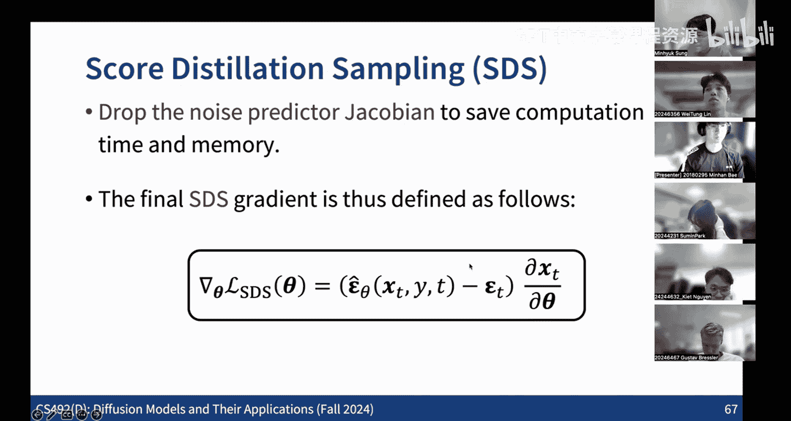

And this is some kind of the results like you know。

 showing the kind of the effectiveness of like dropping the noise the predictor the Jacob。

So this is kind of the original version， like not using the Jacobion of the noise prediction network。

Looks okay。 and when you also use the Jacobian， there is no big difference。

 so you can also play with this like how much basically dropping the noise prediction the Jacobian is still affecting the final the outputs but actually when we tested those kind of cases。

 actually what we found is that this kind of giving some kind of similar the outputs and also the competition is time is kind ofly similar。

 but when you start to compute during the noise prediction the Jacobian it starts to take some kind of the more the and the memory So this of kind of practical issue like why we are not basically calculating the noise prediction the Jacobbian。

Other than that， actually， you can see that the is basically nothing but using the lowest function of the different model the training as kind of the measurement took the alignment for the texting image。

 right。

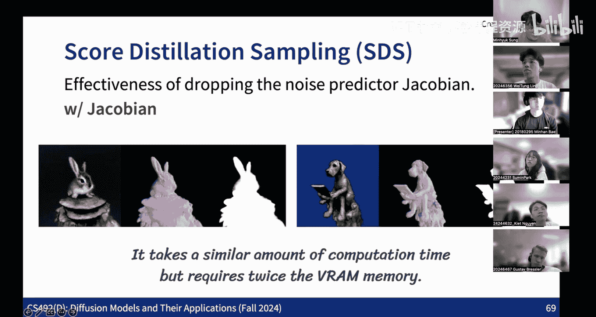

And why is it called the core dist disse， so this is basically an example that we are distilling the knowledge learned by deing the division the model into the form of the score right？

Or we basically use some kind of the information of this score to basically see whether we rendered the image from the 3D presentation looks realistic or that。

So in this way， basically we can generate some kind of data， not only this really。

 but many other things。So actually， also this is kind of a special case that we are basically to some kind of some visual contents that can be rendered into images。

And as you can see， this idea can be used， but only for this 3D representation。

 but actually for many other things that can be basically mapped to the image， right？

But the reason like why we are not running the reverse process about running this core disillation dis samplingling is that because the output that we are generating is not represented into the form that we used for the difficult model training。

So for the division model training， we have used the images which are represented as some kind of the per pixel the colors。

So we can use the same idea of like score distillation sampling for the image generation as well。

But this is kind of like the special case that the images are not represented as some kind of the poor pixeld colors。

 but some kind of the 3D representation that are basically mapped to the images through the rendering the process。

 right？So for those kind of cases， like we cannot directly。

 there is some kind of some such kind of Sw representation because our division model has not been trained to produce those types of the data。

 right？But we just basically have some kind of the mapping from the output that we want to get into the images。

 which is basically something that digital model can generate。

For those kind of cases like we can consider basically applying the score dis dis samplingling in terms of them now we are doing some kind of dis samplingling。

 not through the reverse process， but just like itatively applying the grade and decent through the representation。

So you can think about those kind of some applications in terms of like you are having some kind of a pre-trained diion model which was trained to produce some specific types of the data。

 but you want to there something else， which is like not the same the type or same representationation。

 but they can be basically map to the data into the form that we know using some kind of some rendering the pipeline。

 so rendering the function， and this function is basically differentiable for those kind of cases like we can consider not making a diffusion model dedicated to for that specific types of the data。

 but using this core distilling sampling in terms of like distilling the knowledge learned from the pretraind model to produce some different types of the data。

So this is kind of some of the examples， yeah， some examples of like 3D generation the S pipeline。

So yeah you can see the good thing is that without like having some very large killd 3D data set。

 having all the diversity we like we go to like eating the hamburger or many other things。

 now we can produce those kind of things because our image diffusion model which has been trained with the five billions of images have can cover these level of the diversity so this is kind of the good thing in terms that we are distilling the knowledge from the very big the division models。

So more examples of this related construction。So as I said。

 like this idea of like school dislate and sampling。

 which can be applied the many other types of individual contents while basically using the same some image division models like the table division。

So this is like one of the example that we are now generating the back parametersym。

 which can be also rendered into some kind of some rest images as well。

And also this can be applied not only for the 3D generation also for the 4 de generation。

 3D plus some kind of emotion， as you can see here。

And this is also one of the examples of I doing some sort of the3D machine。

 so for the cases that we have some sort of the3D meshes like this。

We can do some kind of visual interactive， some editing like this like just pulling some of the parts of three objects。

 which will basically break these three shapes like this。

And then we can define this kind ofform using the SDS with some kind of pretrain image division model in terms of that the rendering also becomes more realistic like this。

So the part of the fourth assignment will be about basically implementing this kind of this core2 sampling for some of the some simple applications。

 but I also strongly recommend you to basically check out this library。

 which is basically providing everything about the using the SDS for the 3D generation and course to play with that in terms of doing some 3D generation over many other things using this idea。

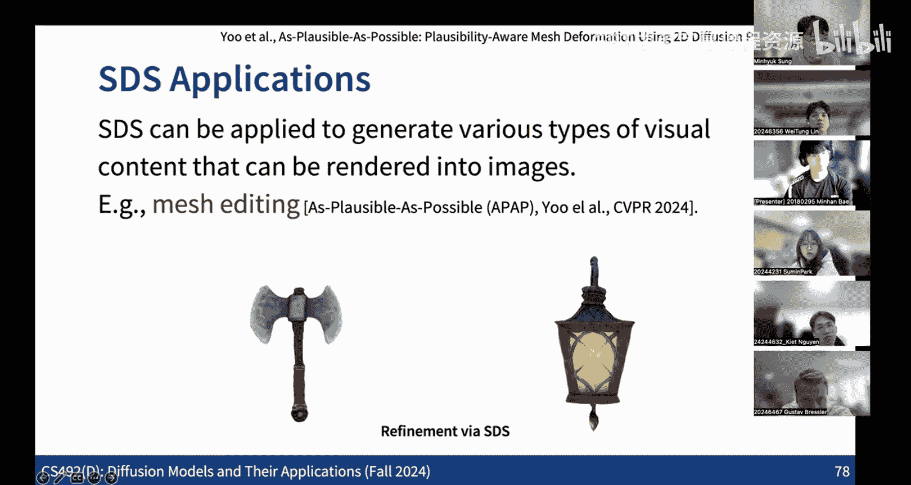

But there are also some kind of be some limitations of this idea。

Here you see based on kind the failure cases， when you only use the 2 3D reconstructioncon de generation。

Any thoughts。

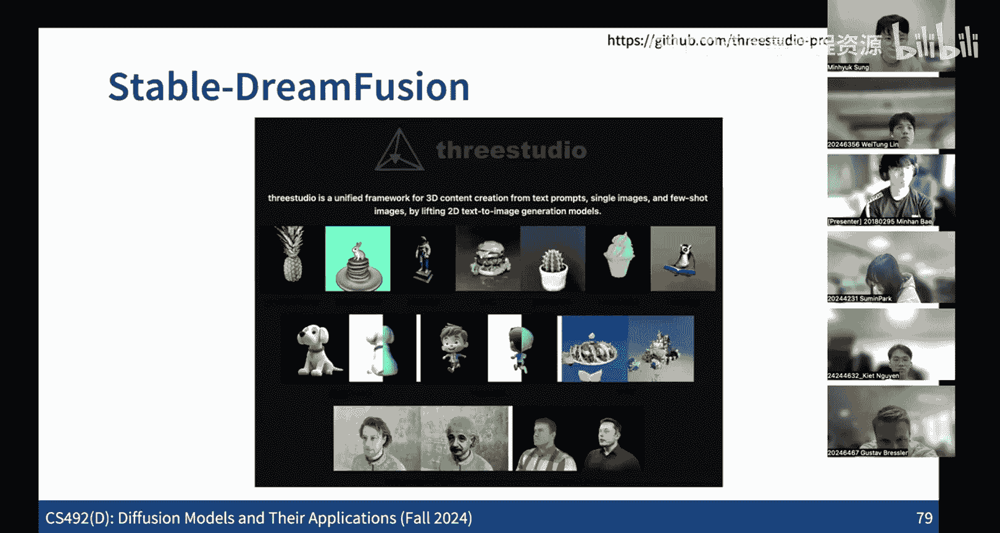

So these are some of the examples of the creative generations using the two images。

Can you know say some kind bit。Various cases using late subsidy generation using put priors。

So these are one of the very well known failure cases in terms of that while the output looks kind of okay for each of the specific view。

 it please start to do some kind of the the see the3D from the different views。

 we can see that the output。Doesn't make sense in terms of that we are hitting some multiple faces with this squirrel here。

 right？Also， same for the pikach丘。And it was a here， right？Havinging some kind of the multily faces。

 so these are some of the examples that we are seeing some kind of some realisticistic some sort of the images in some extent for many specific views。

 but if we start to see all the 3D objects from different views。

 then we can see that if the outputs are not consistent not basically making sense in terms of that we are having some kind of the multi faces from different views。

So this is the problem which is called the Yaos problem like having some multiple spaces different use and this is basically happening because like there is basically no priors for the 3D shapes themselves。

 but it's more obviously using the 2D priors we only have the information but the 2D images。

 so it tends to make some kind of the realistic images for each of the abuse but when you see the 3D outputs the output may not be realistic as you can see here so this means that when it somehow consider in terms of combining not only basically using some kind of the image information but also using the 3D information to get some kind of the more realistic these 3D shapes as well。

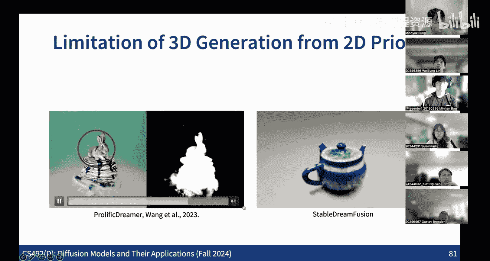

And another some kind of di failureial cases on the SDS is basically in the norm。

 there are actually many of the examples that it failed to basically conge into some kind of the op。

So especially like when you use some kind of the low seD weight like this。

 you get basically empty kind of sense， so in terms of like improving the convergence of some this kind of iterative some kind of updated skin。

 what we need to do is that actually we need to increase the seG weight up to very high number so when you use basically very high the seD weight it becomes much easier to get some kind of some convergent kind of outcomes like this。

But using some kind of the high s weight also means that we are losing the diversity we basically increase the high safety basically increase the safety weight。

 whatever kind of the the sit point we use because we are getting some kind of the almost the same outputs so there is basically some kind of the some trade off in terms of like as we increase the high safety weight to get some kind of the better the convert the outputs we going to also lose some kind of the diversity。

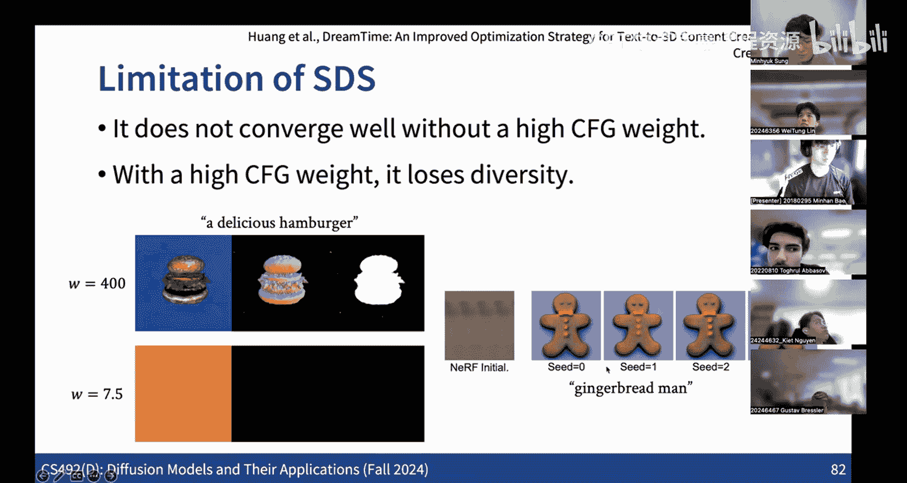

So there also has been lots of the ideas in terms of improving the SDS。

 like also one of the ideas of like improving the SDS is basically not using the random noise Excelency here。

 but we are also using some kind of the dedicated the random noise here in terms of basically creating theora here。

So the if I just briefly explained this idea， it basically nothing。

 but now generating these3D things， not the only single one， but multiple3D things like this。

So while basically generating some multiple 3D objects here。

 we are not only basically updating those things using the SKD laws。

 but we also fine tune den British network usingOla here。

And then we are replacing the epsilon T here into this some kind of the epsilon that we are predicting using the rule in terms of the this will basically give some kind of the better idea in terms of what we need to update in the3 presentation。

So you can also check out those kind of the ideas and actually there are some kind of the more interesting thing in terms of how we can connect the DDM the reverse process with the SDS so we're going get into more details about the connection between the DDM reverse process and the SDS next Wednesday and also we can extend this idea of like this sampling not only for the generation but also for the editing as well。

 so we're going to also get into the idea of like how we can extend this idea for the editing in the next Wednesday。

So this is it for today any questions on this？Okay， then I'll see you next Wednesday。唔叫。

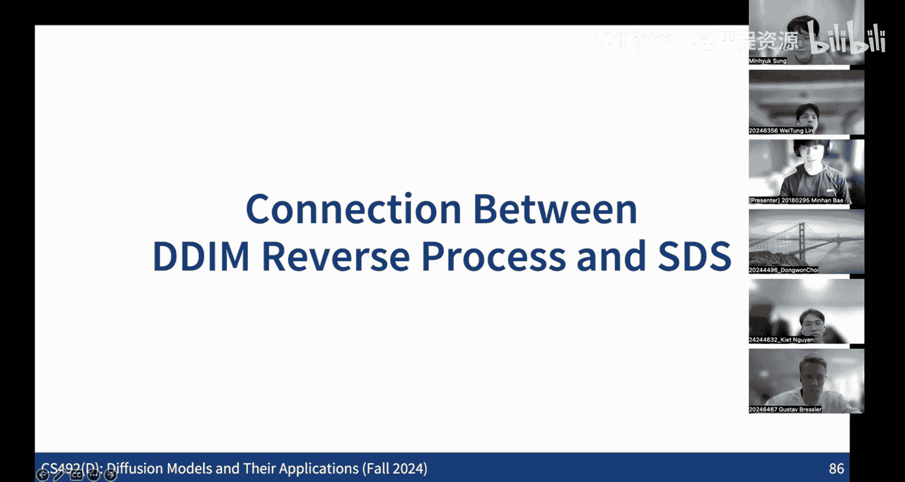