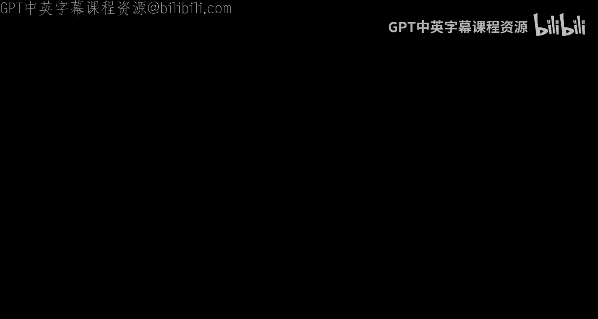
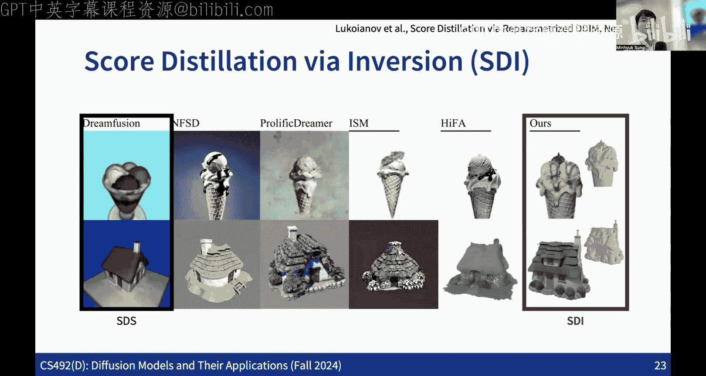
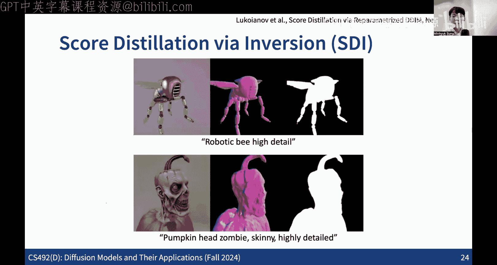
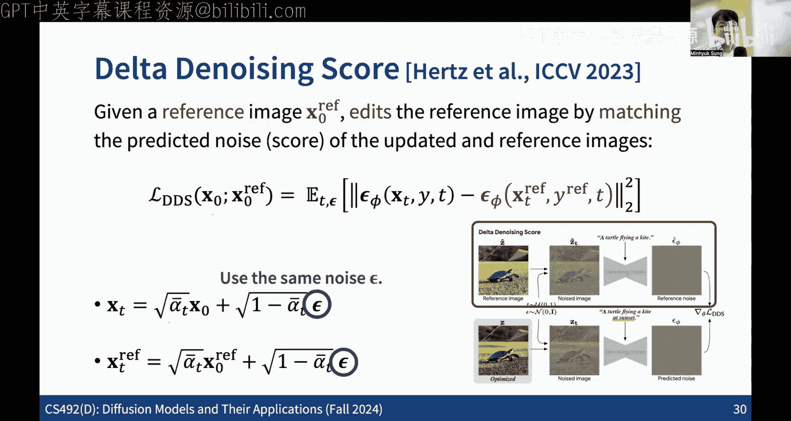
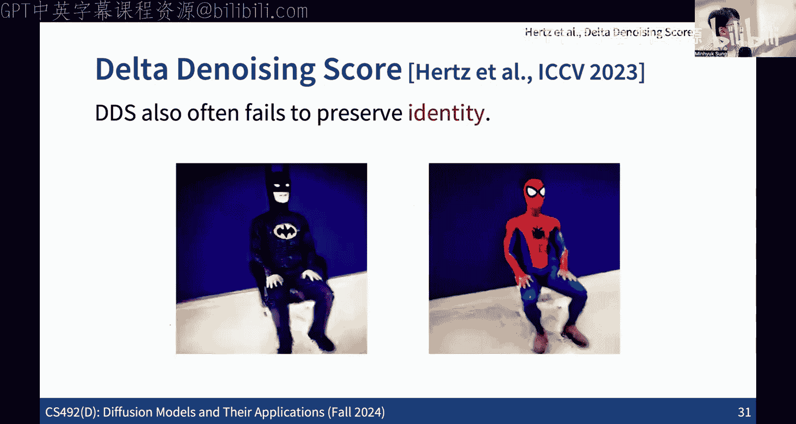
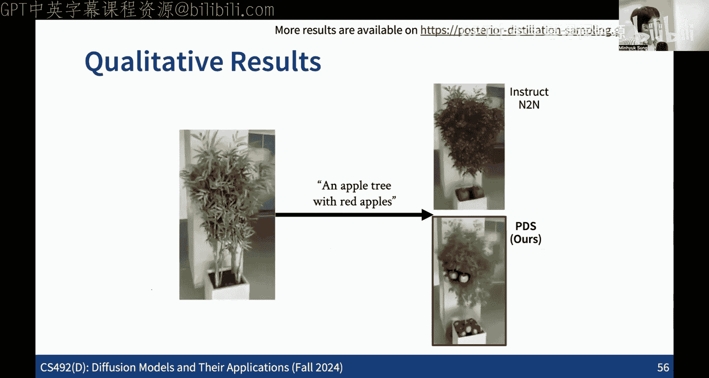
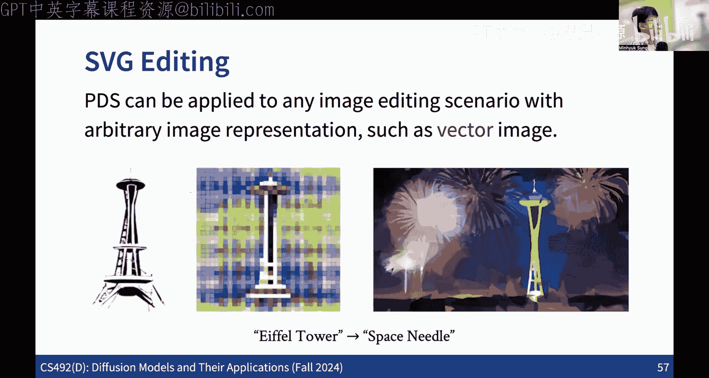
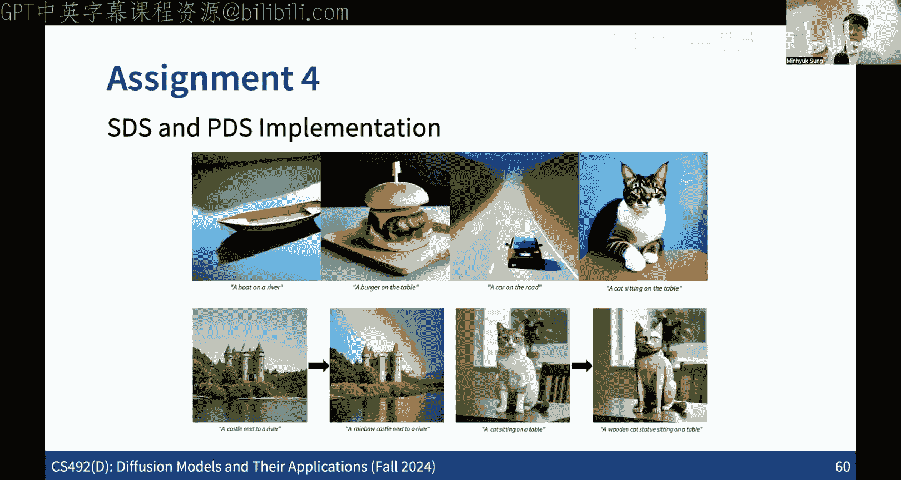
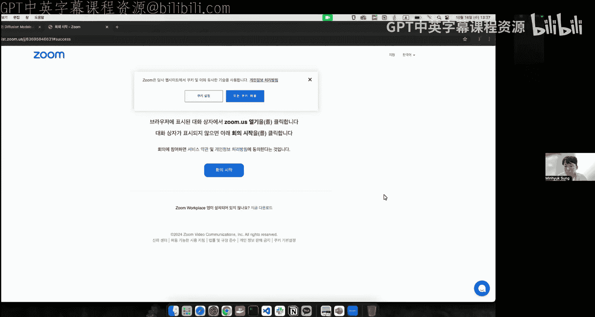
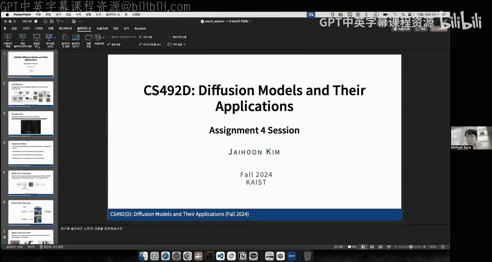

# KAIST《扩散模型和应用｜CS492(D) Diffusion Models and Their Applications (Fall 2024)》中英字幕 - P9：Lecture 10_ Score Distillation 2 (KAIST CS492D, Fall 2024).zh_en - GPT中英字幕课程资源 - BV1mwpUzREqX

Yes。

To here the basic idea of this core digital sampling was to basically about how we can do some kind of the 3D reconstruction。

 but without having any images but by defining some kind of the object function using the pre diff model here the basic idea was kind of like simple which is basically just using some kind of given the loss function or be diff model in a way that we can measure some kind of the alignment between the rendered images and given the text So while the loss function looks like complicated the idea was kind of like very straightforward in terms of that we have some kind of the rendering of the 3D object and as you can see。

 so this is the case that we can generate many other things So anything that can be mapped into the images that can be rendered into images can be generated in this way so we are having some kind of the rendering function G there and based on that we are doing some kind of the word jump gaining the X and based on that we basically predict the。

Ifpsilon the noise that we added for the default jump and see the discrepancy between the edit that we added and also the we predicted using the noise prediction the network。

So using this kind of simple idea， we could make some kind of the very nice some kind of the 3D shapes like this。

 So those are kind of very interesting。 The outputs and some kind of the the some details was that basically we are basically dropping the noise prediction the network the Jacobia in terms of that we can reduce the computation the time。

 So this was kind of some small kind of the details。😊。

So it turns out that we are basically having this loss function right。

 so we are having that simply loss function in terms of that we are having the Xt。

 which is the noise image， which is coming from some kind of the input image that doesn't need to be some kind of some represented with the pixel color but something that can be least rendered from the other thing。

 And then when you have some kind of input text， we are basically measuring some alignment to the given kind of input text。

 So this was kind of like very straightforward idea in terms of like we are using the loss function of the pretrain image feature model to generate many other things。

😊，And we also discuss like why we are using this kind of the way instead of like running the reverse process because the things that we are going to generate is not represented you know in terms of the kind of the images that we used for the differential model training so for the division model training we are basically using the images that are represented some kind of the per pixel the colors and now we are basically generating something this is not directly the images but that can be mapped the images through some kind of the differentiable function so for those kind of the cases we are basically using this kind of the idea doing some kind of iterate to the update using the grade decent。

Simple idea and today what we are going to discuss briefly is basically about how exactly this idea of the SDS is basically related to the reverse process and also how we can try to improve the idea of the SDS so these to domain。

😊，Can someone help to close the item。Okay you。So actually here。

 the question is that we know that the diffusion model has been basically designed in a way to the colgen things through the reverse process。

 but the SS basically looks very different right， But here。

 the question is like how different these two are。 So that's basically things that we are going to briefly see。

😊，So let me just like recall the things that we discussed for the DDIM which was basically sampling the X T minus-1 based on this conditional distribution that we have seen multiple times。

 so I guess now you should be familiar with those formation right so and I just I can say that。😊。

Keep seeing this for all the rest of directors。 You really need to remember this way。 So basically。

 the idea was that like given the x T the deno in this step。

 we are doing some kind of the having some prediction， the final the image， the X geo。

 And based on that we calculate the mean of this no posterior distribution。

 And then sampling the unique gaus the noise。 And based on that， we are sampling the X T minus right。

 So this was the D D I the formulation right。😊，And also the characteristic of the DDIM was that we could basically vary the variance there。

 so we could make it as kind of the deterministic the samplingling the process and we can also increase the variance in terms of adding some more thisto testing。

 right？😊，So let's think about the one extreme case。

 like make it like more like having some kind of the maximum variance。

 So we have discussed the classical length making determin sampling。

 So let's go to the opposite making like having some full de variance。

 which is the case that we are setting the sigma t to be the same with like root like one minus the R of t muscle right。

😊，So in this case， we are basically having the full variance because like we are having this term。

 so the maximum the number for the sigma T will become this。😊，So in this case。

 like we can see that now we don't need to calculate this tongue， so we are taking out that term。

 right？Then now the the process become the same with this。 so simply like given the X T。

 we can basically compute the prediction of the X0 and based on that。

 we can directly just example the x t minus1 in this formulation。

So this is like very straightforward， right？So what we have done in the SDS is that we are basically having some sort of the proxy summary representation for the x0 by T so we choose basically some kind of prediction of the x0 every time step right so we are basically encoding this information into the 3D so that is basically the idea like learning the back propagation right so we are basically heading this like the prediction of the x0 updating this information to the 3D presentation projecting back through the rendering and doing some kind of the updating right。

So in this sense， let's think about that now we are having some kind of this proxy variable there。

 which is basically the place where we're going to basically encode the information of the x0 by T every time。

😊，So what we do here is that it's basically nothing but having these parts。

 So we are now competing the x U by the t minus1 here from basically the information of the x t minus1 here。

😊，And this information is basically updated to our some proxy variable based data there that will be some 3D representation and DC is basically projected again into the x0 by T in the next D times step so you can see that this is basically nothing but we are basically calculating this first and updating this information to the some proxy things representation and projecting this back again here。

😊，Then now you can see this looks a little bit more like similar with the SD process。

 we are having some kind of the projection。And then doing some kind of the some fool jump。Oh here。

And based on that， we also basically update the x0 by t with the x0 by t minus1 and basically also feeding this information to update the data here。

Kind of similarity S is the process。Can you see some kind of beオ videos this。

And also like one difference with the S guess is that in the denoing the process。

 we are gradually decreasing the times the t to the capital t to the1。

 but you could really make this to be taking this to be basically randomly sampling the time T。

The一 committees。So what we are basically making some kind of difference from the DDIMD reverse process is that first we are making this to be having some of the maximum variance。

Like one special case of the DDIm D D noing， and then we are basically not just directly taking the x0 t but basically updating this information to the setta through the grade descent and then project back this again to the image。

 just like sending the information from the 2 d to 3D through the grade descent and then project this back to the 2D again and then just like having some kind of the random sample of the time T。

😊，Then actually， now we can see that this becomes exactly the same with the SDS。😊。

So the only kind of the difference that we are basically seeing my is that why we are basically having this。

 so this is basically not the same the loss function that we have seen in the SD case way。

 but while basically we are having this kind of the objective function actually this loss function is kind of the same with basically minimizing the epsilon here。

😊，So the only kind of difference here is that we are basically changing this sort of the innotation for the noise from the epsilon to the z here。

 the same kind of the Gausian， the noise， unique Gaussian， the noise。

 but basically minimizing this loss function becomes like identical we basically minimizing this up to the scale when you basically just like derive the only formulation。

😊，So what this basically means is that this whole pipeline becomes exactly the same with the SDS and the difference that we are making from the denoging process to the DDIM is that first we are basically taking the maximum variances。

 making one special case in the denoging the process and second。

 instead of like directly taking the X0 by T， the prediction of the X0。

 we are basically updating this information to some kind of some proxy presentation which is the 3D case in the 3D generation the case and putting this back again。

 just like having this kind of some kind of the feedback the process。

 sending 2D to 3D and the 3D to 2D again。And then somehow we are having some kind of random time step instead of decreasing the time step。

😊，So we can see some kind of the connection between the real denoing the process that we have used to generate the original images with the SDS。

 which was used to produce something else like the3Ds over the many other things。

So these are some kind of the interesting connection between the SDS and the deno in the process。

いですく。So I recommend you to basically check out some more details after the director so that you can have some better ideas like what we are basically doing here。

Well so basically one interesting defect is that here。

 basically we have seen the denoing process from the perspective of the X T。

 so we are having some kind of the noisy Xt and then using the X0 by T is some kind of some some sort of de proxy in terms of that we have some kind of the prediction of the X0。

😊，In a way that we can sample X T minus1。 So everything was from the perspective。

 from the X T denoging the X T every time， right。But here we can see that the framework is from the we can see this framework as from the perspective from the exba。

😊，So we are starting from some kind of some bad prediction of the x0。

And then updating the X over time。 So the， the bad prediction at the times the T is like x0 by T。

And over time， we are basically updating these through the x0 by t minus1 and t minus-2。 Basically。

 we can also see that all the process from the perspective from the x T。

 basically in terms of that we are refining the prediction of the X。😊。

That's also something that we discussed for the DDP and DDIN， right？So basically same process。

 except for the fact that we are having some kind of the some process that we are updating from the 2 d to 3D and projecting back and somehow we are having some kind of the random time step。

 not decreasing the time step。😊，So here， like one quick question on might piece that then would it be possible to somehow make it SDS to be closer to the deging process in a way that we can basically really mimic the kind of the dinoging process in the SDS kind of the framework and also get some kind of the better results。

 right？So one thing that we can do is that why do we need to like randomly sample the times1 T。

 Why don't we just like decrease the times1， then needle becomes like much similar with did know in the process。

😊，And also the other question is that why should we really use some kind of the so this is the SD。

 the algorithm， Why also should we use some kind of the maximum de variance， So in the DDM。

 the process， actually we could see that kind of the interesting the characteristic is that we can control the variance。

 actually we could also get some kind of the better the results when we make it more like deterministic。

😊，So we could actually consider not having the maximum variance。

 but actually having zero variance making liketoministic。😊，So we can try that， right。

 So what happens like if we just like make the sigma T to be 0。That term will be canceled up。

 also that will will be canceled and we don't need to sample this ZT right。

 because this term is basically not edit there， right。

So this is we talking but we are basically changing the variance from the maximum variance to zero。

Inno way that get some kind of better results，The big is this formulation。

Then can you see like what will happen， like if we have like this framework？😊。

What's the problem if we have like this framework？Instead of having their maximum de。Any kiss。

Kind of the hint is that now we are basically seeing the whole denotging the process。

From the not from the perspective from the X T， but from the perspective of the X robot T， right。

And all the information is basically encoded into the setup。😊。

So Zeta is basically the some representation that we are basically updating all the information。

 right？😊，So basically here the problem is that we are not generating just like some typical images。

 we consider generating some 3D or the many other things while basically also changing the viewpoint there。

 right？We are basically changing the viewpoint here every time。

Which means that so the way that we are obtaining the x0 by T is because like we are updating all the information to thezeta which is the sD representation。

 and every time we are basically project this back to achieve the x00 T。

But there is no actually way to compute the Xt。Because we are not updating the X every time。

 and also we're going to switch the viewpoint every time。

So Xt is not the information that we are maintaining every step。

 so if we change the viewpoint and also the time step。

 then we won't be able to basically calculate the Xt。So that's kind of thing。

 So we are basically having all the framework seeing this framework from the perspective from the X robot T。

😊，Some kind of the output that we are going to basically refine every step。

And this information is basically encoded in the Zeta， which is the 3D representation。😊。

So basically there is no point that we are basically maintaining the information of the Xt。

 so while we are basically calculating the xt minus1 here。

 these basically x t minus-1 will not be used in the next step because if we change the viewpoint。

So that kind of thing， so we are basically changing the viewpoint every time in a way that we cannot really basically maintain this like XT information。

So this is kind of the problem if we start to not to use the maximum variance but use the some zero variance or some non maximum basically the variance。

 so you can see like this kind of the framework the and see like what is really happening here。

So then what should you do， I pretty really want to use the like zero variances in this case。

Actually， we discussed the solution for that last time。Any kiss。Inversion， yeah so。

We discuss the idea like it depends how we can get the X T from the X0， right？

So we are since we are having the not the xt， but some kind of the prediction of the x0 at the times step T。

 what we do is that we run the inversion， which will be basically obviously time consuming right。

 but we are just taking some more time in terms of getting the X T here and basically running the whole pipeline with some kind of the zero variances in a way that we make it to be similar to the DTI and the the determinist sampling。

And also while will be creating the time step as well。

So this can be like one idea in terms of that we are making the whole the SDSP process to get closer to the original the DTI and the determinist sampling。

W seeing this kind of some analogy between these two。

So while we basically started to discuss the idea of the SDS。

 just that like using the lowest function of the diff model to replace the L to loss for the like image alignment。

 actually we can derive all these kind of things in terms of actually this was kind of related to the denno in the process and we could actually make it more related by making some these kind of some small changes in the SDD framework。

So I guess this would be kind of interesting to see like how this process is kind of like related to the origin thenoging process。

😊，So this is kind of really recent work， I mean it's research work actually it really has been like into this like a few months ago。

 so I guess you might also want to check out some more details for that。😊。

But these are some kind of comparison actually there have been lots of the attempts in terms like how you're going improve the SDS in terms of the deformation and compared to the 3D output that we are getting with the SDS。

 we can see that we can get some kind of the way more realistic results with the SDI。

 which is involving the emergencyency process， but obviously it theyll take more time。😊。

Because we are having the inverse process， emergencyency process every step。

And some more realistic results throughD SDDI。Any questions thoughts on this？

So this was kind of some interesting， some kind of connection between the denoging process and the SDS。

 so I also recommend you to check out some more details for that。And for the rest of the part。

 I'm going to go quickly with about some kind of the idea for like extending the SD idea for the editing。

 not for the generation。

So what we we talk about the editing， basically this is basically setup that we are not generating something from scratch。

 but let's think about the case that we have something like we have some this kind of the flamingo image and let's say we want to change this image to a flamingo with some kind of the rural sating in the city。

😊，낸 마시실이도。Obviously we can consider like starting from this image and running the SDS with this kind new prompt right is normal right we are not starting from some kind of the random the noise starting from the some kind of given input image and running the SDS multiple times and let's say what we get and this is basically the output that we are getting。

😊，With the thing is that while the output is really aligned with the text prompted that we have。

 you can see that it is basically not preservibing anything from the E image。

 so just like making totally new image， not doing some kind of the editing from the given image based on the prompt that we have。

😊，So here the quick question is how we can do some kind of the not the generation but editing in terms of that we preserve some kind of the information from the given input the as much as possible。

😊，So for that， actually， there are some kind of attempts in terms of making some kind of modification to the SS。

😊，So one of the idea was basically this idea like the delta denoting score。

 so here the idea is that we are having some kind of the reference image。😊。

And we want to basically start from there in terms of that we are making some of the changes with some kind of the new prompt。

So let's say this is kind of the prompt describing the original image。

 and this is kind of the new prompt that is basically making some of the changes from the given the images。

😊，So for that， like one of the simple the idea was that。

 you know if we recall like what we have done for the SDS。

 SDS was basically comparing with some kind of the Epsilon T which chose some kind of the random noise that we added with some kind of the noise that we are predicting using the noise pretty at the network。

 right？😊，So here basically one small device that we are making is that we are not comparing the noise predicted using the neural network with some kind of noise that we added。

 but we are basically running the full jump booth for the image that we are generating and also for the image that we are taking as the reference。

And then predicting the noise for both of them and comparing this two。

So the only difference that we are making is that we are replacing this part from some kind of the random noise that we are adding to some kind of the noise that we are also predicting from the reference image。

 So for the fourth jump we are basically using the same the amount of the some the standard the Gaussian the noise。

And then running the first4 both of the images and then comparing these two。

So these was some kind of some small demo modificationification in terms like intended to make some kind of the editing the outputs。

But the thing is that actually， the results was not very good。

 So this was the case that we are converting the human image into the semiconductor characters and youll see that actually we are losing all the information。

 right。😊。

And sometimes it also like fails like this。We have the model here the model there。😊，嗯。Yeah。

So and also in terms of doing some kind of editing for the 3D scene。

 there was a more like straightforward way， nothing doing about some kind of diff things。

 but here the simple idea is that since we are having some kind of the multiple images for the 3D construction。

 what equal also do is that we are basically replacing images like one by one。😊。

So there is also some kind of the image translation， some diffion model。

 which is basically like doing some kind of image editing for the image space and what we do is that we are replacing like one of the images。

😊，Opdating the 3D representation and then protecting this back and also like updating one of the kind of the replacing one of the images and just repeating this kind of process。

 So very kind of like engineering the idea。 So doing nothing with the division。

So this was kind of the effective and very simple idea in terms of that we can make some kind of on those kind of changes。

 so with this kind of very simple idea you can see that it's making some kind of all different outputs。

😊，But the downside is that it cannot make some kind of it can make some kind of some appearance changes。

 like changing the color and make some kind of textures。

 but not really changing the pulse or the emotion of the human body here so we wanted to make this man to like raising his arms but we are not any kind of these changes so for those levels of kind of the changes。

 it's really hard to make some kind of the editing the opposts。

So here the question is that how we can also modify the aesthetic formulation in terms of that we can make some kind of bigger changes。

 like raising the arms or some adding some the balloons or some， yeah。

 changing some key characters like this。So yeah， so this is kind of the calls for the editing。

So the simple you I just like give some kind of the basic idea for this is that if you also record the DDPM the process。

 so indeed if you go back to the DDPM the process， this was like all about basically sampling the XT minus1 so there should be xT minus1 here right based on the posterior distribution。

😊，We are basically involving some kind of the multiple steps like completing the noise and based on that we calculate the2D X。

😊，And then we compute mean and also sample the and sampling the x as one， right？

So basically having this kind of the multi process， calculating the noise， competing to。

 completing mean of the conditional the distribution， sampling the GT and getting the xt minus1。😊。

And the idea for the SDS and the DDS was basically comparing this， like， I mean， this epsilon。

 which was basically used for some kind of force jump。

But also the other kind of the important information that determines some kind of the trajectory over denoing the process is basically this GT。

😊，So you can see that the DDPM the process GT is kind of some kind of the noise that we are adding for thistoity right so depending on like how we sample the GT that we also determine some kind of the trajectory that we are making in terms of the sampling all the latent variables like XT to the Xt minus-1 or the way to the X0 right。

So actually we can see that this GT also basically makes some kind of the determines some the shape of the trajectory。

 and we can also consider like not comparing the Epsilent T。

 but the GT here in terms of that that also gives some kind of information for the trajectory of the denoging the process。

😊，So basically here， the simple idea is that instead of comparing the Epsilon T。

 now we are basically changing the formulation in terms of that we are comparing this kind of ZT basically gaining some kind of the Xt and the XT minus here。

😊，And also we are basically running the four jump twice in this case with some kind of the same thisal noise there。

So you can also check out some more details about this formulation。

 but if we see like what's the kind of the meaning or like what we're going to get from this kind of change of the formulation is that so this is kind of like very simple the setup that shows some kind of the difference between the SDS and the DDS and the PDFS so let's see this case。

😊，So what it can say is that we are having some kind of the distribution of the 2D points。

So let's think about that we are having some kind of the points in the 2D space。

 those are basically our data distribution。😊，And we are having some kind of 2D points in the the secure the space while basically having the the points。

 the upper part with the label one。Rable the red and also the the points on the bottom part have some kind of the label of the blue。

So let's think about the CFg setup， we are having some kind of the distribution of the data points with some kind of two labels like one is the red and the other one is big blue。

😊，So what it's some kind of the editing they set up。 like we can think about that。

 Let's think about like we are taking the red point。😊。

It's kind of like one of the already data points。And we want to change this label to be blue。

So let's think about this that set up right so instead of the text prompt now were having the class labels and we only have the two classes red and the blue。

😊，And let's think about that we are taking one of the red points and we want to change this the point to become blue point。

😊，Which means that like the that point should go down to the one of the point in the blue region。

 right？Over time， still some kind of degradecent。And here the question like what will happen if we use the either SDS or the the EDS and the PS。

😊，So if we use the SDS， what we typically get is that whatever point we start from from the red region。

 we are getting into the same bullet point。So which is kind of good in the generation the perspective because we are getting the blue point right。

 but we are seeing that we are basically converging to the same point， no the diversity。

 which means that whatever point we have， we're going to lose all the information from the given the points and getting to like the same point。

😊，So from the editing perspective， actually it's not good because like we are already like getting the same output。

 which means that we are losinging the information from the given the data point。😊。

So there's the results we did S this。If we use the DDS。

 it's kind of good in terms of that now we are getting some like all different outputs。😊。

So depending on which point you are already starting from you're going to get some kind of the different results。

 so which is good， the downside is that it's just like going too far from the given the right points。

 which means that it will basically make some kind of the big changes from the given the data point。

😊，So the desired output will be like this。So we are basically moving all the right points to some kind of the blue region while basically making some minimal changes。

 so this is really something that we want to see right。

 we still want to get some kind of all different the blue points from the different right points while making some small the smallest kind of changes。

😊，So that's basically what we get by changing the formulation of the SDS。Makes sense。So yeah。

 so then you're gonna say like why basically this formulation basically works actually some more detail is that it pretty just like derive some kind of the more details of that formulation。

 actually you're gonna say that this is basically nothing but just like combining the DDS the comparing the epsilon while basically also comparing the x0 X0 is basically the final the output image that we're gonna get So from by adding this term basically we are preservibing some kind of the information from the given image more while basically having this kind of the guidance。

 which is comparing the epsilon T。 So you can check out some more details in terms like how the formulation comparing the Gt is dering to this form So so some kind of detail is that depending on how we control the weights for these two terms we're gonna also get some different results。

 So depending basically the blending weights of like these two low function also matters in terms of the final the outputs。

😊，So those are some results， like basically comparing to this on previous method。

 like we're making some of the changes here。Ma our T into the 스파 on。

Making us a daily dead plan to be like， all right， like this。

And also yeah this is also the planter we can see down there like the building so as we also have seen the case for the SDS basically all this kind of the idea about the core dissillation can be applied not only for the some 3D generation。

 but also for the many other things so this is also an example that we are applying those kind of things for the some vector images。

 so we are starting from the Eill tower to the space needle in the Seattlettle。😊。

So in the vector images， so you can think about like applying those ideas for many of the types of the data that can be rendered into the images and also you can think about like applying this idea not only for the image diion model but also for some kind of some audio di model or some video diion model for many other things。

 I know that there are quite many attempts to apply those idea for the some music generation in terms of combining some kind of the multiple。

 some kind of image components。

YeahSo this was kind of a quick introduction about both the SDS and the PDFS and obviously the first assignment will be about implementing the SDS and the PDF using the table diffusion。

 so actually our the original goal was typically basically implementing these things for really doing some 3D generation。

 but then we also need to discuss about some kind of more graphics kind of thing so we're gonna not going to discuss those things and the assignment will be about doing some kind of the image generation and image editing but not using the reverse process but using the SDS and the PD deform and I also recommend you to while doing the assignment4 the interesting thing would be basically really comparing the reverse process and the SDSD process and see how we can make this to be more similar to each other in terms of getting some kind of the better results。

Any questions on this？嗯。Okay， so then our team will to use talk about the the session。

Okay。

