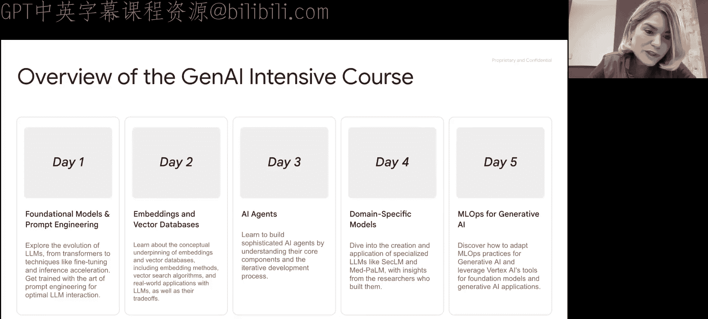
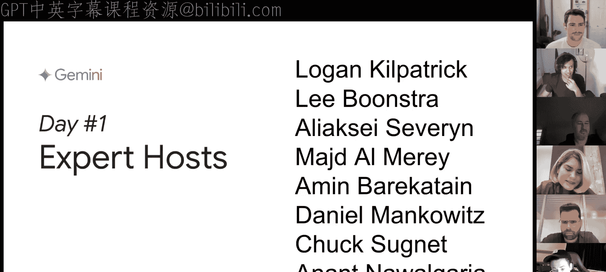
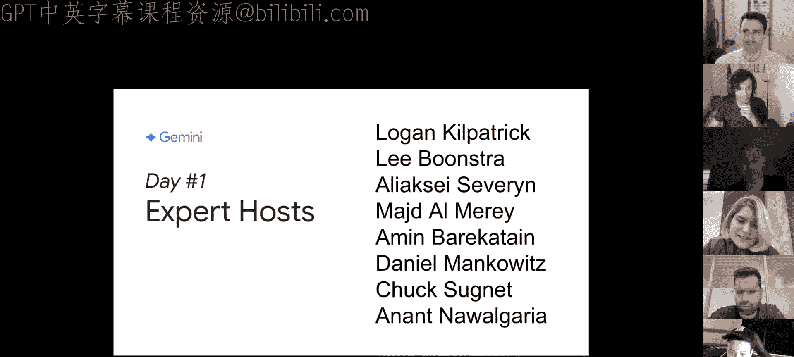
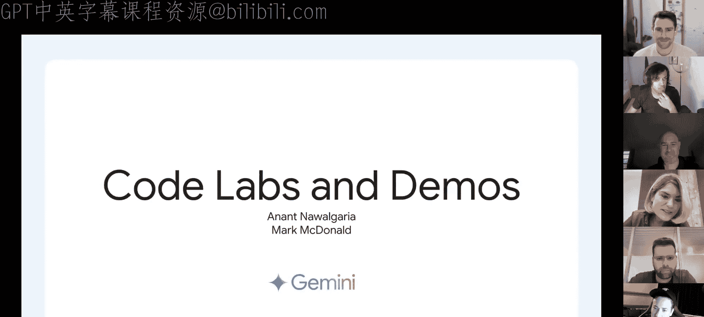
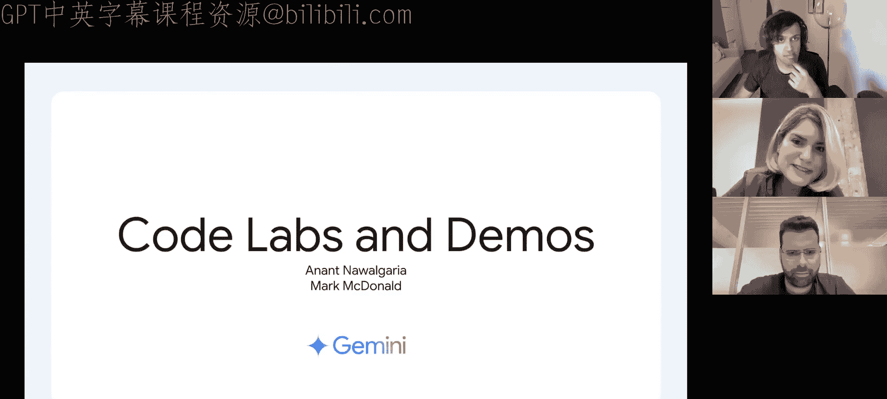
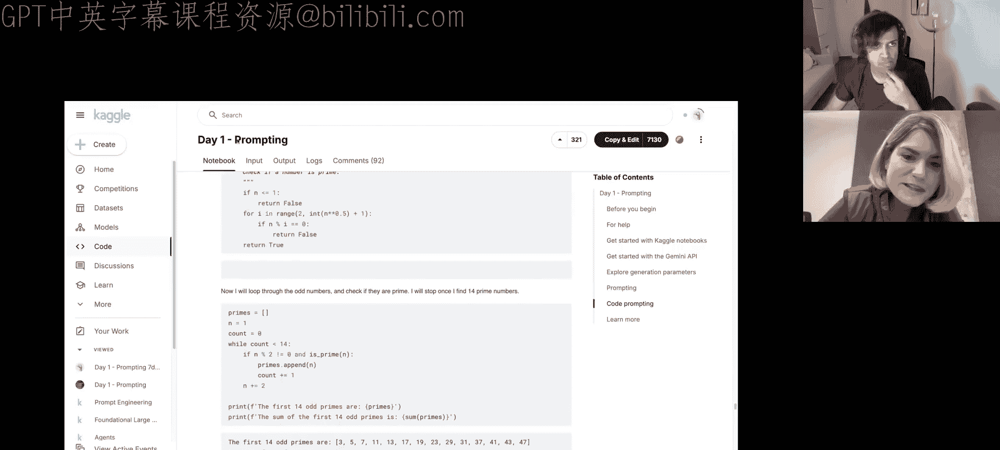
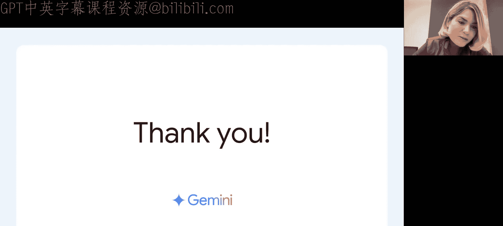

# Kaggle&Gemini《生成式AI五天快速课程｜5-Day Gen AI Intensive Course  Kaggle》deepseek翻译 - P1：Day 1 - GPT中英字幕课程资源 - BV1tUmYYKEUs

Hi there， everyone。 Welcome to the very first day of the CAle generative AI intensiveive course。

 a five day course being delivered virtually so that you can learn everything there is to know about generative AI and how to use it in your AI applications Today。

 we have a bunch of really great guest speakers that are going to be talking all about foundational models as well as prompt engineering and even though we had a couple of snags on the live stream earlier this morning。

 we've packaged up to the video altogether such that you'll be able to have a really。

 really nice experience walking through both an overview of the course Q andA a brief overview of some of our code labs and then also finally our pop quiz towards the end of this series So this fiveday course on generative AI with Google by Cagle will give you daily assignments in the form of white papers and podcasts that you'll be asked to listen。

😊，And two these assets explain the what and how of how all of the generative AI generative A models。

 tools like vector databases， agents， how all of these different different techniques and different techniques and tools work together and the accompanying coab notebooks are intended to show you how to use it both our generative AI As as well as other assets。

 like open source tools that you might use with them。

 we've also got a great discord channel for you to discuss and to kind of brainstorm ideas。

 and to also get direct direct ability to engage in Q&A with our guest speakers。

 we're hoping that you'll take this moment to kind of deep dive into all of the content that we've created and to learn some of the fundamental important and kind of top of mind concepts around。

teech with generative models so as I mentioned， this is a five day program over the course of November 11th through November 15th today is our very first day and it will be discussing all about foundational models and prompt engineering so with that and without further ado。

 let's get started with our Q and A for this very first day。

Greetings and welcome everyone we're excited to have you today for our first day in our generative AI intensivetenive course sponsored by Cagle and the Gemini team we have a lot to cover today so I'm going to get right into it everything from answering the great questions that you've been asking on Discord to having some exciting guest speakers can talk about what they've been working on also walking through some collabs and some demos and then finally a pop quiz so really excited to have you here today we've been really energized by the great questions that you've been adding on discord and I'm excited to see just how much everyone is caring about learning more learning more about large language models。

 multimodal models and generative AI at large my name is Paige I'll be your host for this week and I am joined by many of my colleagues here today and hopefully hopefully we' be doing some interest。

a little bit laterSo this fiveday generative AI intensive course has a combination of daily assignments。

 the Discord threads that we've been that we've been discussing as well as these live Q&A sessions will have them five days a week from November 11 to November 15 and it covers everything from foundational models and prompt engineering to embeddings and vector databases AI agents。

 domain specific models and even MLOs for how you can maintain these model systems over time today is all about foundational models and prompt engineering and so we have many many folks on the call who have been doing this as their day job for the past many years and who are kind of experts to help answer your questions as you cover all of the great readings and the chat threads and the discussions each each day so with that I am going to get into it and the interest of time to make sure that we have we have ample space to discuss。

all of your questions， this Q&A segment will be a continuation of all of the things that you've been seeing on Discord。

 and I want to make sure to thank our wonderful generative AI discourse moderators Pollong cause Mark。

 Eric， Iwin， Miles and many of the other folks that have been kind of diving in and helping make sure to emoji thank them and also also text thank them。

 I know that they've been busy and working in every single time zone。

 the Sun never sleeps on generative AI。So with that day number one。

 our expert host panel includes Logan Kilpatrick， who's the product lead for AI Studio， Lee Boonetra。

 Alexi Severin， Majid Amin Barakton， Daniel Mankoitz， Chuck and Anant。

 and I'm excited to have everyone here today， as an example。

 we have folks that have worked on reinforcement learning with human feedback。

 people who have been working on people who have been working on the Gemini app model inference。

 making it performance and efficient technical directors from the Office of our CTO。

 and even more and with that I'm going to go ahead and start with our first question to Logan。

 good to see you Logan， how are you doing？I'm doing awesome。

 I'm excited to both hear the questions from folks。

 but also hear some of the questions for some of the other。

Paampists excellent very cool and the ML developer team has been shipping so much just recently。

 it feels like every day I log on to linkednkedIn or to Twitter or X or whatever it's called now it seems like there have been new product releases tell me which features you're most excited about and which which have already launched or about to launch。

Yeah， that's a great question I think the two that are top of mind right now about two weeks ago we landed grounding with Google search which is really exciting so I think this will surely be a topic of conversation over the next five days but LLMs and hallucination and grounding and RA grounding with Google search is a way to sort of tap into the search In that Google has and bring some of that information to ground answers rather ground questions that users of LLMs have so super super interesting there's yeah if you just Google search grounding with Google you'll find some of the links across the developer side。

 the enterprise side。So excited about that， happy to talk more about it， the other thing is。

Friday we landed Open AI compatibility which I'm super excited so for developers who are already using the Open AI SDKs and libraries you can now try out the Gemini models using those SDKs and libraries by only changing like three lines of code or something like that so I'm excited to sort of reduce the friction for developers who are excited about using Gemini and yeah hopefully we'll hear a bunch of great feedback about that launch as well Excel I personally have been really really jazzed for the open AI API compatibility it's been really really straightforward to convert notebooks that might have been preferring the open AI APIs to just using Gemini and to be able to compare and contrast between the two so those are definitely too exciting things that have come out and I encourage everyone to take a look at the open AI compatibility and then also the search grounding features within AI studio I think it's especially cool that you can use search grounding with even some of our smaller。

Like Jim and I 1。5 flash and Jim and I 1。58B I've been loving both of those for my projects。

 especially things requiring you know code execution or super fast inference tell me a little bit about those two flash series of models and how you can do so much so quickly with a very small cost footprint。

Yeah， so we landed after a bunch of work internally。

 we landed the flash AP model which is the smallest sort of Gemini hosted model that exists 8 billion parameter model and really pushes sort of the envelope of you know compute intelligence per dollar I think we've seen a bunch of those tweets page you and I have been once putting those out but it's like23 cents per million tokens。

 if you're using cash tokens， it's 1 cent per million tokens so just like an absolute。

An absolute crazy amount of intelligence that you can get for a couple of cents and I think the sort of interesting thread of why those small models are interesting to me is because a lot of the know frontier use cases of AI are actually bounded by cost and token costs so like there's a lot of things like the developers actually inherently have a disincentive to build because it's like you are paying the more AI。

The more AI you build into something， the more you pay。

 and I think flashlashAP is like a great example sort of pushing the frontier of trying to like remove that barrier so that developers could actually just build the things that they're excited about and not need to sort of worry about you know the incremental amount of costs that they take on。

Yeah amazing and then one last question and then we're going to bring in some more folks to discuss especially the production applications of generative AI you know Deepminds multimodal models I' thinking particularly of Imagine and VO for video generation Leria for music generation。

 they unlock some really interesting new applications。

 especially when coupled with the Gemini models， what has been your favorite application for these kind of multimodal output scenarios and and how do you think about coupling those with the Gemini APIs。

Yeah， that's a really good question。I think the。It is so hard to create rather， I think。

Text as sort of like an output mechanism for models。

 I think like you know developers have found the interesting things to do with text like you know you build chat apps。

 you sort of process data， you do a bunch of stuff。

 It does feel like we're actually still pretty early in this like what are the real actual production use cases of multimodal output creation both in image video and others I feel like we just like haven't there hasn't been as much ubiquitous access to those models and thus like developers haven't had enough time to really build interesting things I think the thing that I'm personally excited about is actually like comparing or rather bringing text to life using those things I think there's just like a lot of text in the world and humans in a lot of cases are inherently visual and I think if it's possible and we sort of saw this with notebookM actually as an example if you can take a bunch of written content and bring it to life in audio form it actually makes the experience like10x better in some context。

And I can imagine you know the sort of I'm not on the Nope Galen team so this isn't actually a product vision for them。

 but you know you bring to life sort of the huge corpus of text documents you have in the form of a video instead of just like an audio composition I think that's like that's a crazy future world to live in and I think it is going to be models like imagine in video that actually enabled that mission to come to fruit so it's going be it's going to be exciting and I see your lights just turned off folks who don't know the Google offices's turn off all the time so it's a normal occurrence Yes and and I love that use case as well about how you can sort of bring life to text documents or even to things like GiHub code bases through video through audio through images I think my favorite use case so far has been doing book trailers so taking in taking in a PDF book automatically you know segmenting it into into different。

and into different prompts and then creating a short video to describe the book I love it and and would love to see love to see more of that vein so thank you so much this is this has been wonderful I am going to pull up pull up our next question which is all about reinforcement learning with human feedback and I'm going to bring bring on stage Alexxi Alexi you're correct me if I'm wrong。

 you're our lead or RLHF for the for the Gemini app is that correct？Correct excellent。

 thank you and I'm really curious to learn more about how the Gemini app is using RLHF to help improve its responses how does that process work how do you sort of use user feedback to improve the models over time or to improve your app experiences over time？

😊，Yeah， so I mean， it's a very big topic， so maybe it makes sense to say a few words on a high level how the LLMs are fine tuned。

So like the de facto recipe today for post training state of the art LLMs is to do it in two steps。

 SFT and RHF， SFT is supervised fine tuning where we use demonstration data。And， I mean。

 typically to get good results， this data needs to be of extremely high quality， and it's most often。

Produced by human experts， so it's quite expensive to get。

ARe Che is a powerful technique for aligning models to human preferences。Yeah。

 think of like making responses safer， more helpful or factually correct。

And it's a bit more complicated than SFT， but in brief。

 we use a collection of input prompts to generate responses from the model that we're trying to find tune and then use another model called rewardword model to analyze responses that are bad and reward the good ones。

And this reward model can be fine tuned on different types of preference data。

 so typically it's human preference data， this is what a relationshiplish stands for like human reinforcement learning with human feedback。

And this data can be collected from human expert raters。

 just like SFT data or it can also come from user feedback so people like users interacting with Gemini chatbot on the desktop or their mobile so the thumb thumbs down interactions that we do with the models actually actually lead to better performance over time。

 is that what you're saying？Yeah， it helps us to produce models that are perceived as more helpful to our users so this is kind of one of the primary mechanisms to align our models to human preferences amazing that's really exciting to hear and I know folks have been learning all about RLHF and all about improving models with things like human feedback through the course of their readings next the next question is from one of our folks at Google so I've been wondering since large language models learn from massive sources of data do large language models simply interpolate within their training data or can they go beyond to make new discoveries and A mean about how about you answer that I think and then also welcome back I believe I to work at Google Deepmind did not you started。

Your own company is that correct？No， actually I used to work at DeepPo but now I'm work for a new company called Quadrupture so yeah I switch industry actually and is that in the finance industry and quantitative quantitative research quantitative research these days you can basically apply AI in any application and finance has been also very very interesting application very。

 very cool so tell me tell me about the models making new discoveries have you have that is the case or are they just next token predictors Yeah yeah I mean that's like a philosophical and interesting question but I believe the answer to this question is yes。

 the models can definitely go beyond their training data and the technique that's will let them do that is available search basically so the first example。

😊，we saw that was the work called Fse that we did in Deep end of like 23 and in Fse we basically used an LLM to search in the space of Python programming language for let's say a very hard problem like an NP problem NP hard problem and the way it worked was that we basically paired a large language model with the efficient let's say evaluator that would provide feedback on how good each solution is and then with an iterative algorithm it managed to discover new solutions where some open problems in computeruter science and mathematics so the core idea was that the LLM would basically propose let's say solutions like a piece of code for a particular problem and then the evaluator would give some scores on how good that solution is and then there was an evolutionary algorithm that would select the best solutions that the LLM discovered so far it would present it。

The LLM and it would basically ask it to make it better so in some ways it was doing best shot prompting like a automatic way of prompting the LLM we would just show it good solutions。

 we ask them to make better the LLM comes up with something new we would show it again and asked it to make it better and these sort of process repeated about hundred thousands of times and then the quote that starts with is something like a return zero and it would like evolved into something very interesting and complicated that would actually result in some new let's say solutions for open problems and because this basically solutions has never discovered by humans before it kind of shows that the LLM discovered something new that wasn't in stream data and this concept has been like basically studied a lot like in the history of AI and recent examples recently it has become very popular in the modern LLMs and it's referred to by for example test time compute or inference scaling。

Other terminologies and the way it works is that like you can basically when you ask a question for the LLM。

 you allow the LLM to think and the LLM would basically generate multiple scenarios and generates like chains of reasonings and then it has a mechanism to understand that okay which one is more likely and then it would just iteratively repeat this process and by simulating different possibilities it basically search at inference time and by searching at inference it can manage to like basically discover something new because it can bootsrap its own knowledge。

Very cool and and that makes me that makes me think that we've only just begun to tap into the kinds of things that large language models will be able to accomplish or to achieve really。

 really excited to see what the next couple years old。Exactly。

 like I think like Richard puts it the best way we have like in the bitter lesson that like we have two techniques that basically scale infinitely。

 the first one is like learning which sort of be cracked by like you know large amount of data and just like like the first let's say generations of models we saw and then the next technique is search and I think we are at the moment where people are starting to scale search and throwing compute at inference time and that's going to unlock a whole lot of new capabilities especially for like reasoning capabilities and that's going to be very exciting Excel。

😊，Thank you so much I I think this also leads is a great lead to our next question which was from our Discord app and I think this is for Magjid our inference lead for the Gemini app Yeah excellent so this question is really is really all about can larger language models be used to train smaller ones can we take some of this knowledge that might have been obtained from a larger model and use it to improve smaller models things that kind of like the models that we embed within many of the product surfaces at Google what are your thoughts about that Yeah absolutely yeah absolutely we can and it's a very good question this technique is called distillation it's a very popular inference optimization technique and the main idea as you said。

You would take the knowledge from a very large model that might be too expensive to serve but has very good quality and then you would distill that knowledge into a smaller model that can retain a good amount of that knowledge and quality of the big model but is at a size that you can serve so yeah like I said it's a technique called distillation lots of active research and practice in distillation there are multiple types that you can distill knowledge from a larger model to a smaller model one of them is called data distillation where you use the larger model to generate a lot of synthetic training data for the smaller model and then you just train the smaller model than that another way we can do this is more finegrained where we try to align the token distribution for the smaller LLM to be closer to the larger model and that's what we would call knowledge distillation and we talk about those types in the white paper that we're publishing with this class as well and the third type that I would mention is called on policy distillation where。

Kind of going back to your discussion with Alexa on RLHF we would be able to use the same reinforcement learning framework。

 but in this case we would use the teacher model which is the larger model to effectively score output from the smaller model and use those scores to train and align the smaller model to the larger model so yeah distill has multiple types they're all used in practice based on the use case and based on what we need and actually I think in Demo's class one of those cases will be presented as well。

 I think one of the authors for the Geco paper which uses LLMs to to produce much better embedding models using LLM so you would use the LLM to essentially produce query query the queries for passages and then you would train the embedding models on that and you would get a much much better performance I think it was something like 7x better for those embedding models of the same size using distillation and I think Jhu Lee who's the author on that paper will be present in the。

Victorors and embedding classes tomorrow。Very cool I think what you just discussed will also be very helpful for the folks in our first pop quiz which should be coming up towards the end of the hour so I hope everybody was paying attention all about the great ways that you can use distillation to improve smaller models and mechanisms mechanisms to improve to improve models at large thank you so much and next question I believe this is for you and not what are some approaches to evaluating large models you know we've got we've got these models that have been created some larger versions。

 some smaller versions how do you pick which one that you should use for a given task？

Good question page And yes， thanks for the community for asking this。 and just heads up。

 we be covering evaluation of large language models in more detail on day5。

 we even have somebody from Deep Min who be who would be presenting their research on it and yeah。

 so diving straight into question。 So theres evaluating large language models isn't an easy task because it depends on the task evaluating and what you mean by evaluation。

 there's， of course， classical natural language metrics like Bla Rouge scores which you can use and this is one of the ways you can do it where you have reference like a golden truth ground truth when you can see what the LLM generated and then you can compare the the generated response with the human curated ground truth and you can see how to what extent it matches the ground truth response。

 Now that is classical way to do it however， given the complexity of tasks Lms are used then。😊。

Not always have such a ground truth that even when you do on certain tasks， you can， for example。

 summarization， there is multiple ways to write a summary and all of them might be valid。

 but the ground truth would be just one such instance So it would not be a valid way to evaluate such cases as well。

 So what we can also do is use LLM as alterators where you where you kind of have an LLM evaluate an LLM。

😊，And evaluate how good the response of the generated by the model was and you can do this in a pointwise fashion in a pairwise fashion phrase you can just say okay here's the response here's my prompt how well on the score of one to5 do I does this response score and is why is that the case or in a pairwise fashion you compare two responses and say okay tell me for this prompt which one is the better response and it says okay response the left one is better because whatever reasoning and we actually have that available so you can use that right away and our vertex suite through a vertex AI generative AI evaluation service。

 you can try LLM based alterator evaluation as well as computational metrics like Roe and La which use a reference point you can try that out today。

😊，Absolutely and I've also seen some pretty impressive open source libraries doing auto rating and evaluations as well have been really delighted with Prompfu。

 which also has the Gemini API support and the some of the other offerings so great to know that there are vertex AI options as well as open source libraries to go about doing these evaluations。

 whether they're human rated or autoeu。Very cool。Exllent next question from red 365 can someone please explain why for the first chain of thought prompt it's also explaining step by step instead of answering that directly Lee I see you nodding do you want to go ahead and take this question Yeah yeah I can talk a little bit about that because I had similar yeah examples in the white paper that I wrote。

And so first of all， for the folks on the call， like a chain of thought plain thought of caught prompting。

That's a prompting technique where you try to let the LLM generate intermediate steps and typically you can do that by providing examples on how to reason and you don't take the example as what's in the co。

 you try to come up with another example that it has similar reasoning techniques。

And yeah then you see if it will then showcase the steps now this particular question and thank you everyone for participating in the COab I saw some people saying like hey because in the question you had to first type in an example where we did do not use prompting and then afterwards we will show in the example and an example where we use chain of thought prompting so you could see the difference but the problem was that some people are already solved the intermediate steps in the first first example while it shouldn't it's very difficult nowadays with models that get so good。

 you know our models are so good like we cannot showcase these flaws anymore。😊。

But you might be able to reproduce it by either often maybe just resubmitting the question。

 it might help also just to change the top K top B。

or temperature so you get more variance in the outputs and I saw also in the chat some folks saying that switching to the older Gemini models will showcase how you can showcase the flaw and then later you can fix it with chain of thoughts so that's cool stuff。

Very cool。 I love I love kind of the detailed description of of chain of thought in and of itself and then also how you can see it expressed as model outputs。

 This is very， very cool and personally I' found especially for things like like coding tasks chain of thought prompting or asking the model to explain its reasoning has been very。

 very powerful and has usually led to significantly better results。

 so this is this is very cool Yeah the next question from Uung Hue。😊。

I is something like Enum mode in a fine tune model designed to return Enum values and Daniel it's great to see you by the way I welcome back for folks on the call Daniel and I used to work together deepmind and now now I believe you have started your own company or you're still in stealth mode for your company so won't I won't give spoilers but it's great to have you would you like to answer this question Yeah sure yeah nice to see you as old age and yeah thanks for having having me yeah and I think that in terms of Enam mode I mean it very much depends on what you're trying to do so if you're fine tuning your model and you wanted to output enums this depends a lot on how you structure your data so for example if you have three different Enum values that you'd like to output。

You would structure your inputs as the question or task that you want to provide to your LLM and then the output would be one of the enM values。

 whichever one is most relevant to the question or task that you ask the LLM to provide a output on and so you can fine tune LLMs like that and generate to prepare your data sets with these inputs as being the task of questions and the outputs being the enums and also you know LLMs are also sometimes very good outs of the box in dealing with enums so you can also say to an LLM something like these are the different types of classifications that you can choose or enums that you can choose choose the appropriate one for the question that we're asking so suggestion would be to also try at zero shot and if not you can create these fine tuned datasets。

I think there was a question about related to notebook LLM that was along these lines page Oh yes。

 I believe the question that you were referring to was from Gtriniva。

 which is all about all about notebook LM， how it was built， how it was created， I' really。

 really loved experimenting with it as well as the illuminate kind of automatic podcast generator for any arbitrary data types。

for notebookLM， interestingly enough and this was shared by Josh Woodward at a recent event。

 it's not using a fine-tuned version of Gemini it's just using Gemini 1。5 Pro and 1。

5 flash with the addition of some special techniques and some secret sauce especially around retrieval and around kind of careful prompting and design of the system so notebookLM is not relying on a dedicated fine-tuned example of Gemini it's just using the same Gemini 1。

5 models that folks are experimenting with for your assignments so that's a great way to get inspired in that you know the tools that you're building with are the same tools that folks are using to enrich AI applications at Google which is very cool。

Beautiful， just， just wanted to point out we noticed there is some freezes sometimes happening from the community on the on the live stream。

 And we also be， we also got feedback that you like us to cover some of the course。

 like White paper overviews。 We will be covering that later in the call as well。😊。

And let us all speak loud so everybody can hear。

行。Excellent and with that I am going to go ahead and thank our presenters for thank our presenters again for a kind of answering all of the community questions make sure to reach out to connect with them on LinkedIn to learn more about their work or to follow follow the papers that they've been writing and virtual virtual round of applause I know that Riverside not does not support emoji reactions but thank you all so much for your time has this has been really wonderful and a great way to learn more about all of the great content for day one of our generative AI intensive course so thank you for being here with that I'm going to go ahead and move to our next session which is all about code labbs and demos for many of the great many of the great code examples that are included in the course I'm going to stop sharing and then a not I believe you you have。

😊。

Some notebooks that you want to walk through， is that correct？

Yes， that is correct and let me。I believe that everybody on the live stream。

 I believe the freezing might be happening due to the live chat。

 so try try turning off the live chat that might help cool let me share my screen。Alright。

 so hi everyone。 I would today I'll be going through the coab with you for this session。

 And before I do that， however， for those of you who are joining the live stream for the first time without going through the podcast or the white paperper Let me just take a step back and give you a quick overview of what the first day was about。

 So you might have received two white papers and corresponding notebook LM podcasts and they talk about basically the first white Pa about foundational models talks walks you through okay what are LLMs how are they the fundamental component of how they what makes them So the transformer architecture which inspired this whole revolution with LMs。

😊，And then it goes into how do you train LLMs like fine tuning techniques through fine tuning as well as reinforcement learning using human feedback and other things。

 then we briefly talk about the parameters which are important for LLMs and prompt engineering like decoding type parameters which will also be covering shortly in this collab。

 so things like temperature top P top K etc， the way the LLM constructor response and then we talk about prompt engineering briefly。

 and then we have a whole white paper written by my col who which is on the call earlier。

 which talks about prompt engineering techniques， which is the second white paper that you might have received。

And then in the first white paper we then go ahead and talk about how to accelerate inference of LLMs which my colleague matched here just talked about through techniques like quantization distillation and specative decoding as well as others and then we talk about okay now that you learned how LLM such built。

 tuned， trained well accelerated during inference time as well as how you can utilize them through prompt engineering。

 then we talk about through applications in various fields of LLMs， how you can utilize them。

 so that's a nutshell of what your day one curriculum was about of and this collab here kind of tries to walk you through how you can utilize that that was the how when this is how you can like how you can put this to use and that's what we are going to see right now。

So my colleague Mark Mark McDonald who had created this he's not here in the call today。

 but like to give a shelter to him as well and yes let's get started so under this card we saw lot questions around phone verification for internet access so hope you've gotten that done that's important and you've received that in your instructions as well but feel free to let us know in case you have any more questions and you might have already seen how to add tile secrets。

 which is important to the Gemini when you get the Gemini API key you can add that as a tile secret and then programmatically retrieve it in the coab in order to utilize our APIs this is important so those of you who haven't started the coab yet I hope you've gone ahead and done this and then in the beginning part of the coab will be installing the SDK the gen AISSK from AI studio and then we be。

Retrieving our API key through Kagggle secrets in order to utilize our Gemini API。

And then we'll be going ahead and going ahead and running our first prompt where we use our Gemini API to just do a single turn prompting where we just give a prompt in and respond out in this case I always love it that people can simplify things for me So explain AI to me like I'm a kid I love this response and Gemini we use our Gemini 1。

5 flash model which is as page host discussed earlier that this is one of the fastest models out there and yeah and not only can you generate response you can also format them to make it look nice right and then we the second part of the coab and the subsequent part of the coab。

 we go beyond single turn interaction and we kind of see how you can make a conversational interface with Gemini a chat interface So you see here that we send a chat message to Geminis and telling our name My name is whatever and then we ask them and。

Model response its a response。 And then we send another message asking completely different question。

 And later on we query the model and say， do you remember what my name is。

 So because in this chat interface of Gemini， it keeps memory it keeps history internally。

 keeps record of what was discussed earlier and what his response was So it remembers the name correctly。

 And so this is how you can utilize in conversational applications utilize Gemini and conversational applications and can be very useful while implementing LMs in production。

😊，Moving on So since LM the world of LLMs is moving quite fast and theyll be like we have a lot of models coming out and you can also you might have also trained your own models or tuned your own models。

 So this is how this section talks about how you can kind of list the models that you have at your disposal and you can see how you can list them the various kinds of models and you can also get more information about a certain particular model。

 For instance， that we use the Gemin91。5 flash， the 001 version， the first version of Gemin91。

5 flash it has an input token limit the context window of1 million output of 8000 and the default values you can see here as well for generating a response Now talking about generating a response for those of you who haven't read the right paper yet let me give you a high level overview。

 So LMs work by generating tokens at each step by。😊，So given the input prompt。

 it we look at the input prompt and generate the next most likely token and each of those tokens are selected from all the possible tokens it could generate that it was trained on but each one of them have an associated probability score given the past sequence which was generated and the system works by sampling by seeing okay looking at the probability scores of each token at each step and choosing a token based on those probability scores so the generation step there's a lot you can do to influence the output response and that's what we are going to briefly be looking at here today。

 but please look into the white paper and the podcast for more details of how it works one parameter is would it be possible to zoom in a little to zoom in a little bit on the code this is great I love I love seeing I love seeing kind of the ways that you can。

Interact with the models and then also kind of inspect and see which models are available are available to use I also frequently like to do if I'm not sure which version of flash or version of Pro is the latest you can do Gemini1。

5 flash latest and it ends up grabbing just the most recent version exactly thank you for zooming in literally as well as conceptually thanks for that and yes thanks page for pointing that out and yeah so once you've figured out which model you'd like to use this lot you can do a generation time one of the parameters is output length you can kind of cap how big or how large your output the number of tokens is generated by the response are present in the response of the LLM and just something to keep in mind is you can cap it you can say okay I would only 200 I only won my response with 200 tokens max。

Could be lesser， but it does not stlistically change it does not stylistically force the LM to fit its response meaningfully within that restraint so that what that means maybe it's more obvious with an example。

 let's say you asked the LLM to make a 1000 word essay those of you the co lab you might have say in this example you asked it a 1000 word essay and that's much more than 200 tokens so it's not going to magically reduce the compress the essay into 200 tokens so you can see here it stops mid sentence。

And that's the thing。 so it can reduce and it can reduce the cost because you're a that if you use a paid version。

 can you built by the amount of tokens you generate as well。

 one of the factors and you can reduce the cost and you can kind of force your LM to limit the output land。

 but you cannot it doesn't make the response meaningful always， so you have to keep that in mind。

And you might want to do some prompt engineering and change the prompt if you want to actually generate meaningful short responses。

 So like， write a short poem， and this would fit within 200 trokens for sure。Now moving on。

 we discussed earlier how LM generates how LM generates its response by taking sampling probabilistically each step by step the tokens based on how likely the token is at how likely all the tokens are at each step Now one of the things that can influence the probability and change the quality of the response。

 not just the length is temperature think of temperature as as a way to influence the probabilities and lower temperature means the token with the most tokens with higher probabilitybabilities get even higher probabilities of being selected and the lower ones get even lower and a higher temperature means more or less all of the the gap between the best tokens and the worst tokens are is narrowed so basically what that means is a lower temperature ensures that or increases the probability that you will get kind of similar output。

 even if you're at the LLM repeatedly and a higher temperature。

Gives a bit more diversity or creativity and randomness to the output。

 Let's look at that with an example。 let's say we prompt the LLM to pick a random color We ask the random color and answer in a single word。

 but if you see here with a higher temperature value of 2。

0 the colors are different in we loop through it three times or and the colors are multiple times and the colors are different each time but if we have temperature fixed at zero then the color is purple every time so it's the same so the variability is reduced when you keep the temperature low。

😊，Talking about temperature that was on insert the probabilities。

 but what about across all tokens right but what about selecting the limiting the amount of tokens we select from not just modifying the probabilities but limiting and filtering kind of the top well performingforming tokens and then selecting from within them that's exactly what top K and top P does and they kind top K and top P in interest of time I won't go into detail。

 but they basically limit the the kind of the third space at each step from which the tokens are selected。

 you can use top K and top P parameters in conjunction with temperature and is this is something you can play along way to see if it matches what you would like to see。

Now briefly covering prompting the various prompt techniques which you also see in the second half of the code lab and we have sent a white paper around prompt engineering as well so if youd like to dive deep go have a look at the white paper or at least listen to the podcast one of the most basic techniques is how people know prompting zeroshot where you basically give LLM and instruction。

 say you wanted to classify movie reviews into three buckets positive neutral negative you give the review and you ask for the sentiment Not here you are just giving it an instruction and you're giving your input but you're not giving it more directions or examples or even explain what positive neutral negative means for you。

And it will work in some cases， but in other cases it might not that's good to keep in mind and also remember that you're asking the LLM to generate positive。

 neutral or negative as a free text field， but you might want to restrict that to like make sure that the output that comes out is definitely one of positive neutral and negative and you don't have to it doesn't generate anything else in addition to that So this is where you can use our inner mode where you can especially in problems which are very well structured such as classification problems where you want the output to be restricted to what you a certain format or certain set of words。

 this can be very useful where we use the same example。

 but this time we have limited the output space to exactly positive neutral negative you see here that here it was positive with stars around it and here you do not have that you have what we told it to output。

😊，Now we talked about earlier around giving an instruction and just asking like asking the LLM to generate an answer。

 but we can go beyond that， we can give an example or even multiple examples of input and output to the LLM and it helps it understand by example。

 and that helps improve performance in certain use cases you would see an example here。

And then you see here that giving a few examples of what the response should look like helps reason and generate better responses。

Now we can control the structure to a more granular extent of LLMs and this is what you see in this part of the coab in JSON mode where you can ask the LLM to output Wellform JSON structure。

 and this can be very useful， especially when used for coding and programmatical purposes when you want a well form data structure in a downstream task。

😊，And there was a question on chain of thought moving on to more prompt editing techniques like that。

 So chain of thought as La answered earlier， is a technique which instead of just asking an LLM to give you an answer it ask basically Licocytes a reasoning process you ask the LLM to reason about it and maybe even give examples about the reasoning steps and that helps improved performance on certain tasks which benefit from this reasoning reasoning intermediary steps For example。

 here we are talking about when I was four years old my partner was three times my age now I'm 20 how old is my partner and we asked the LLM to return the answer immediately Now you see here it gives you the incorrect answer because we asked it to give the answer immediately while the model could have benefited from the reasoning steps intermediary reasoning steps So that's where now we try and ask the model to think step by step。

😊，And it managed to come up with De answer and it does so by explaining it kind of does a calculation and uses that logic inabilityity reasoning steps to arrive at the answer you can go beyond this you can even give it examples so few short chain of thought where you kind of give it examples and then write the reasoning of how the output was arrived at and it can make it even more powerful for certain tasks。

Talking about reasoning， we have another powerful technique which is discussed in the White paper and we see that here reason and Act so developed by Google' to reactact framework was is one where you can we don't just ask the LLM with a single response to give us an answer we have the LLM is a multistep workflow where the LLM does searching it kind of it thinks about we have it interleave taught action and observation steps so we give it a prompt。

 we ask it to think about it and then take an action。

 maybe call some tools and technique tools like maybe even APIs and SDKs which will be going into more detail in the agents day three session and then see the response it got from say database。

 reason about the response then take a further action and so on and so forth this is a very powerful technique which can then implemented properly can be very powerful in applications which require multistep multistep workflows。

😊，And yes， going on to our last section， so here we saw how you can use LMs from also text don LMs like Ge for generating code so we see here that it can be used for generate code directly。

 but you can also see that you can use it for you can have the LLM not only write code but also execute code by using some of our tools。

 for example， code execution tool where it figures out okay which to answer a certain prompt you might need to do some calculations or execute some code and it can do so it can write that code and execute it behind the seedss and give you the response as well。

😊，And I just want to be being mindful of time， it looks like we are at time and it also sounds like there have been some AV issues with folks on the live stream so just want to just want to say thank you everybody to attending we will make sure to post we will make sure to post a video without any of the live stream kind of technical difficulties on YouTube so folks can watch and can see and we'll also be sharing the popquiz immediately afterwards。

 thank you so much everybody for dialing in and to all of to all of our great questions and answersers thank you a not for presenting for presenting the notebooks we look forward to seeing you tomorrow I really appreciate you really appreciate your time Thank you。

And see you tomorrow。than you系。

All right everyone Now it's time to put what you've learned to the test We're going to have our first pop quiz for Dayton one all about foundational models and prompt engineering so get out your pens。

 your pencils， your paper or just something to quickly jot down your answers the next six questions will test your learning comprehension both for the white papers that were part of the homework reading as well as everything that you've heard in the Q&A today and our code labs so with that I'm going to go ahead and get started with this first question which gem and I configuration setting controls the degree of randomness and the selection of the next predicted token we would discuss this a little bit in the code lab。

 but hopefully you are paying attention so I'm going to give you a couple of seconds to think about your answer and to show the multiple choice options we have temperature which is value A top K which is value B top P which。

Vue C and output token count， which is value D， which one of these。

 which Gemini configuration setting controls the degree of randomness and the selection of the next predicted token。

Hopefully you're getting your final answer。And I am going to count down to show the answer in five。

 four。3。2，1。Hopefully you'll all picked temperature and temperature is that sort of knob that you can dial that control to the randomness and the selection of the next predicted token for your model。

Beautiful， I hope you got it right， and if not make sure to go back and refer to the reading as well as the code labs to to help build that knowledge base。

So question number two， which of the following is not a technique used to accelerate inference in large language models？

Some options that we have， we have quantization for value A， distillation for value B。

 flash attention for value C， and fine tuning for value D。

 this was covered a little bit in some of the Q&A as well as the White paper readings。

 which of the following is not a technique used to accelerate inference and large language models。

I'm going to count down five。four。3。Two one， and hopefully everybody picked fine tuning。

 fine tuning is not a technique used to accelerate inferences in large language models。Next question。

 which of the following is a unique characteristic of the Gemini family of large language models。

 something that Gemini possesses that other large language models do not we're going to show the answer。

 So number one， Gemini models were the first to introduce the concept of unsupervised pre training。

Vue B， Geini models can support multimodal inputs。Value C， Geini models are decoder only。

 or value D Gemini models can support a context window of up to 2 million tokens。

 which of the following is a unique characteristic of the Gemini model family。

I'm going to start counting down， remember this is something that Gemini can do that other models cannot。

Couning down five， four。3。2，1。Hopefully everybody picked D Gemini does have a 2 million token context window for Gemini 1。

5 Pro， which is significantly longer than other models available today on the market。

 so if you miss this make sure to go back and refer to our white papers as well as to experiment with the Gemini models in AI studio。

Question number four， how does reinforcement learning from human feedback improve large language models and remember that section of the Q&A with our great guest speakers from the Gemini app？

So value A by training the model on a massive data set of unlabeled text。

 value B by using a reward model to incentivize the generation of human preferred responses。

 value C by reducing the number of parameters in the model for faster inference or value D by converting the model into a current neural network or an R&N for improved performance。

 how does RLHF improve large language models？So think about what your answer will be。

 remember also the white papers and the great Q&A conversation that we had a little bit earlier。5。😔。

For。3。2。😔，One， hopefully everybody picked B， which is reinforcement learning with human feedback uses a reward model to incentivize the generation of human preferred responses。

 so as you're getting feedback from your users， all of that is going back into the model to help improve it over time。

Question number5 we' almost to the end which technique enhances an LLM's reasoning abilities by prompting it to produce intermediate reasoning steps leading to more accurate answers This you should remember from your code lab as well as from the reading so value A is zero shot prompting value B step back prompting value C self-consistent prompting or value D chain of thought prompting which one enhances an LLM's reasoning abilities by producing intermediate reasoning steps。

And count down 5。Bor。3。2。😔，1。D chain of thought prompting and hopefully everybody will go back and experiment with this I found it to be really really useful for especially for a kind of complex tasks or things that would require the model to write code chain of thought prompting usually usually helps quite a bit for this and final question and I will say this is a tough one you'll have to have been reading very。

 very carefully the white papers and all of your homework assignments What is the minimum GPU memory needed for inference on a 3 billion parameter model using standard float precision。

Is it value A，3 gigabytes， value B， 6 gigabytes， value C 12 gigabytes or value D 24 gigabytes。

 and this is related to your reading， I will say that if you have hardware targets that are a little bit different。

 some of these values might also be a little bit different and it might depend on how you've in quantized your model so if it's in four versus int8。

 but I'm going to start counting down five。4。Three， two， one。C12 gigabytes， if you got this right。

 I am extremely impressed。 This was easy to miss and is also something that is that is really。

 really increasingly important as we're starting to get smaller models available for inference so with that thank you so much for attending today for learning for the great questions that you've been asking on Discord we're excited to see you come back tomorrow and make sure that you tally up your answers for the pop quizzes so you can see how you how you've been improving over time really hope you enjoyed learning more about foundational models in prompt engineering and tomorrow we will see you back bright and early for vector databases and embeddings till next time and thank you again。

😊。

