# Kaggle&Gemini《生成式AI五天快速课程｜5-Day Gen AI Intensive Course  Kaggle》deepseek翻译 - P2：Day 2 Livestream with Paige Bailey – 5-Day Gen AI Intensive Course  _ Kaggle.zh_ - GPT中英字幕课程资源 - BV1tUmYYKEUs

Greetings everyone and welcome back， it is great to have you here for this second day of our generative AI intensive course a collaboration between Cagle and the Gemini team today we're going to talk all about embeddings and vector databases hopefully we're excited to see all of the great discussion that happened yesterday around foundational models and prompt engineering techniques and we have a great kind of set of sessions here today where we'll be walking through some code labs doing a Q&A with some of the people who are building these tools and features for Google and then also a pop quiz at the end so make sure to pay attention this fiveday generative AI intensive course which is sponsored by Cagle and by the Gemini team also includes a Discord channel to discuss our live streams and to engage with the guest speakers in community and Q&A so make sure to to log in to ask your questions and they might just be selected for a future day。

😊。

As you're reading your assignments and kind of learning more about all of the great content be sure to check out all of our coabs that you can run online as Cagggel kernels as well as engaging with some of the white papers that we've been sharing and as mentioned this is day number two of our generative AI intensive course hopefully you've read the embeddings and vector databases paper you've explored some of the code labs and aO we be showing you some of these coming up very soon and you'll also be learning about the conceptual underpinnings of embeddings and vector databases and how they can be used to bring kind of specialist data and really exciting production techniques into your large language model apps so with that I am going to go ahead and turn it over to aO who is going to be walking through some of the amazing kind of curriculum review and code labs that we have planned for day two so aO。

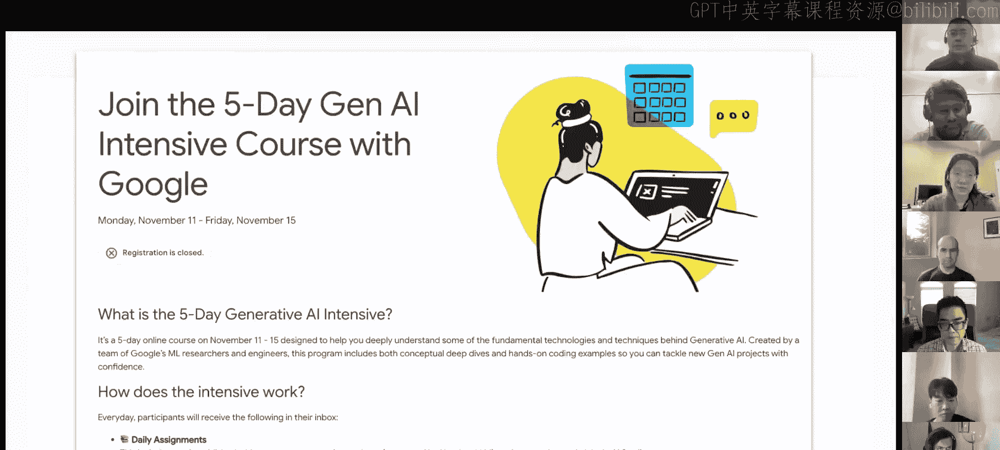

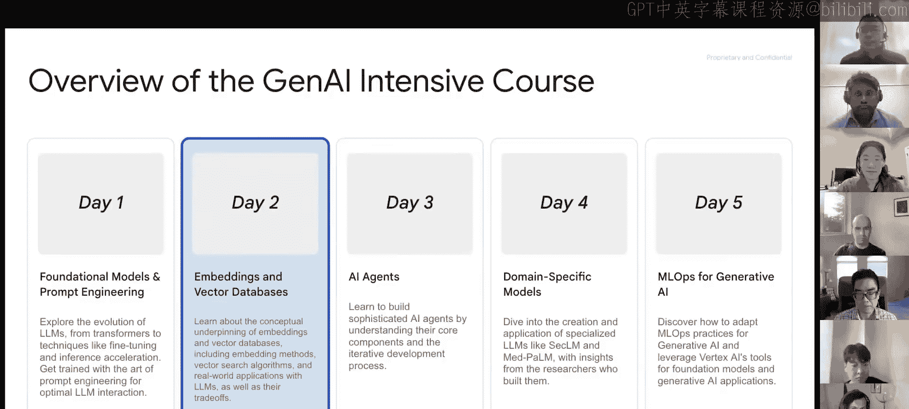

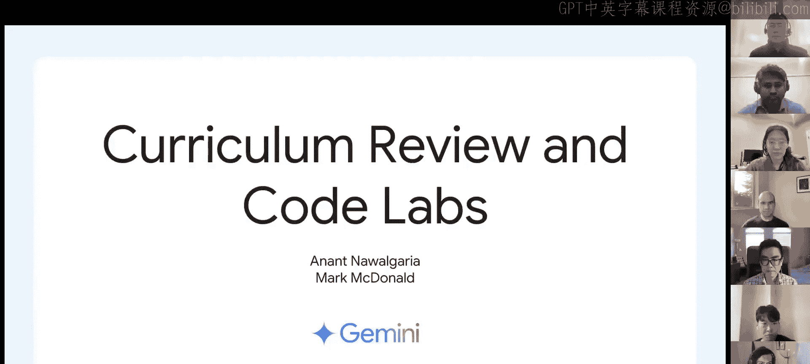

And not take it away。Thanks thanks page so welcome everyone So before I get started with the code lab just wanted to walk you through some of the content that you have read through in the whitete papers as well as maybe the podcast if you had the time to go through it but so you might have seen in the whitete paper that starts off with exploiting what is embeddings and the different kinds of embeddings so in the realm of machine learning。

 we often grapple with different diverse data types text images。

 audio and more and often many applications can benefit from representing these objects of different data types in a compact fixed numerical representation which captures the semantic meaning and relationships between them and that's essentially what embeddings are in nutshell so we are basically transforming complex data into semantic numerical vectors that can be used for downstream tasks we also looked at in the whitete paper that different types of embedding。

😊，text image and multimodal embeddings as well as structured data and graph embeddings and then we also dived into the various algorithms and approaches that can be used to create。

 train and use these embeddings as well as their corresponding tradeoffs now after that once we have the embeddings in order to use it for a downunstream application。

 it is important to have an efficient way to search through hundreds of thousands of millions of embeddings give a query and find the most semantically similar one but do so in a very time and costefficient manner and that's where approximate nearest neighbor algorithms come into play and we looked at how embeddings can like the various metric can be used to compare embeddings to see like judge similarity which embeddings are similar to one another so example if king is similar to queen in the contextual sense more than king is similar to a car。

😊，That's something we should be able to compare and find out and to do this at scale approximate nearest neighbor algorithms such as hierarchical navigable small world。

 as well as scan come into play which can help you with this then after that we looked at the various vector stores and vector databases that can be used which implement these approximate nearest neighbor algorithms at scale and the various operational considerations and how to manage these in production。

😊，Then after that we concluded the white paper by looking at some of the applications of embeddings for example。

 by using a preend embedding representation of various objects and adding a small layer on top to benefit from the rich representations and leverage that instead sort of training from scratch and use it for classification tasks we also looked at how embeddings can be used for recommendation problems as well as ranking problems and many others。

 so having said that that's a great segue to our coab in which I'll be walking you through some of these。

😊，Let us get started。So your first coab for this day for day two was one where we where you build a document Q&A system using RaG and ChromaDB Now what is RAG right retrieval augmented generation it has three parts and it addresses the very important limitation of LLMs which is that LLMs are often limited to the knowledge they're trained on and often do not have access to the latest dynamic information unless you provide using systems like these and even if they do have accesses to the knowledge providing this the most relevant information and latest information in and the prompt itself can help improve the performance and reduce hallucinations so RaG system has three stages the first one is embedding and indexing the various documents in the database as well as embedding the query and then the retrieval stage comes afterwards where you take the query embedding and look at all the documents in your data。

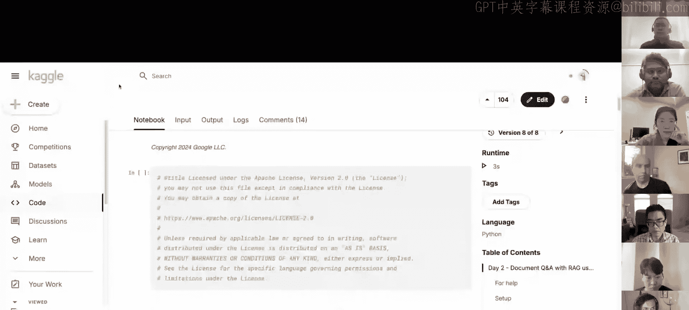

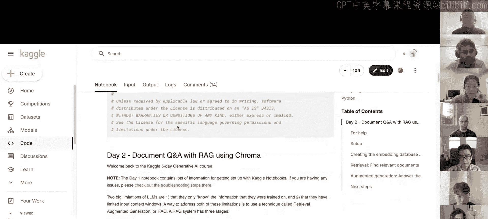

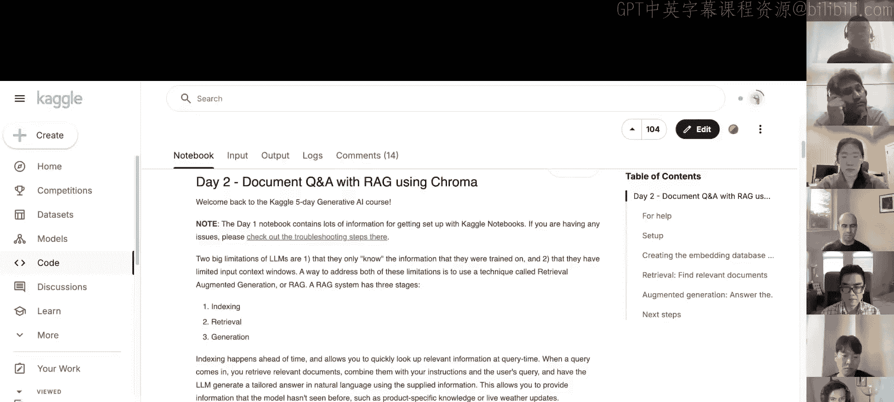

base and say， okay， which ones are the most similar documents。

 the most relevant documents that my LLM should have access to in order to give me the most appropriate answer。

 and then the generation part， like provide this as part of the prompt。

 the most relevant context and documents and generate the answer。😊。

So in this particular collab we built a simple toy rag system， let's look at how we did that。

 so we installed the necessary libraries as we have done in the previous collabs as well。

 retrieved the API keys from the Kag secrets to call Gemini API。😊。

And then we explore the various available models， so here we look at the embedding models available。

 so like text embedding models which we will be using for the RAG system。😊。

Then we create a small toy data consisting of three documents。

 which we will be using as our database for this coab。😊，After that。

 we create a function to take a document and embed it using the embedding API。

 and in this case we are using the text embedding 004 embedding API and we make this function which can be called to embed a given document。

😊，Then once we have the data set defined and the embedding function defined。

 use we basically initialize ChromaDB， Chroma database and use this function to add the documents and it automatically embeds them since we are referencing the embedding function which we defined above。

 so it's adding the documents and indexing them in memory using the embedding function to make sure it indexes the embedded version of the documents。

 not the raw documents。😊，Then we confirmed that the documents were indeed added to the vector DB。

 and then here we see if the semantic search with the vector DB is actually working。

 so we give a query and we created the database and we find the most similar result and that seems to be correct。

 given the context of the three sample documents he provided it。

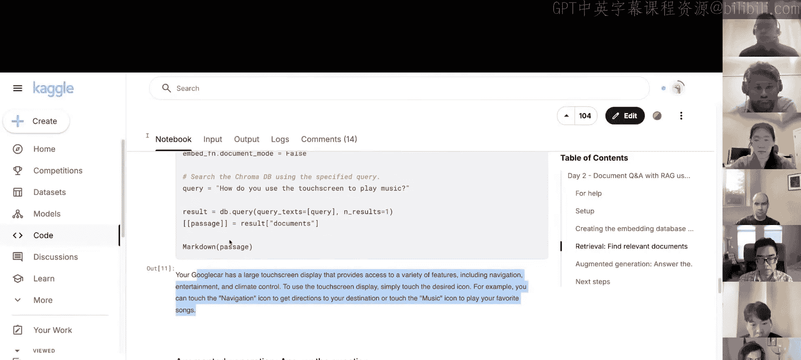

And then we use that， we use the retrieve result as context to an LLM here in this section。

 where we use it as we expand the prompt using that sample retrieved document and we use it to generate the answer。

So congratulations， if you've reached here， you'vet even understood it。

 you've built a retchievval augmented generation app。😊。

Now moving on to the second collab for the day， here we see how embeddings can be used to understand similarity between various documents in this case we'll be working particularly with text embeddings。

 but you can also use multimodal embeddings。😊。

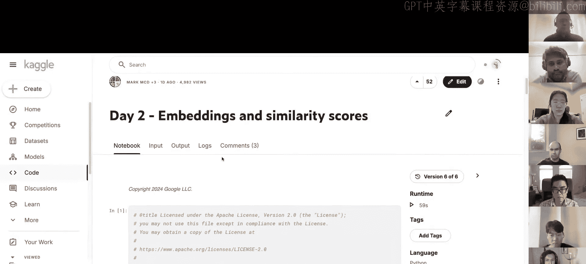

So similar startup with the Kago secret to retrieve the API key and initialize Gemini。😊。

We also then kind of explore the models which are available to us for embeddings。

And then here's the important bit， which will help you understand here we define the various text documents。

 sample text documents。😊，Wwhich we want to compare with one another and find okay for each one of the documents。

 how similar is it like semantically from a meaning perspective to the other document in this list which is what we will be doing here and so we see we do a semantic similarity and map the heat maps from each document to every other document so in this heat map you see something very interesting one the lighter shades refer to very highity semantic similarity one darker shades refer to lower semantic similarity and you can see that the sentence the quick brown fox jumps over the lazy dog is most similar to itself you can see here this is the most similar to itself and but it least similar to documents which are completely random like Lompsson etc you can see that it kind of。

😊。

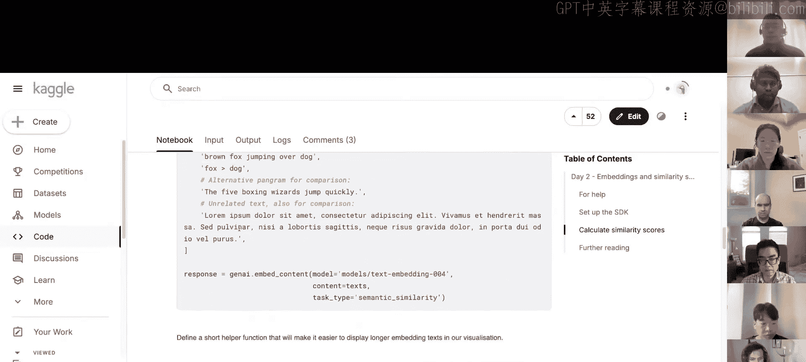

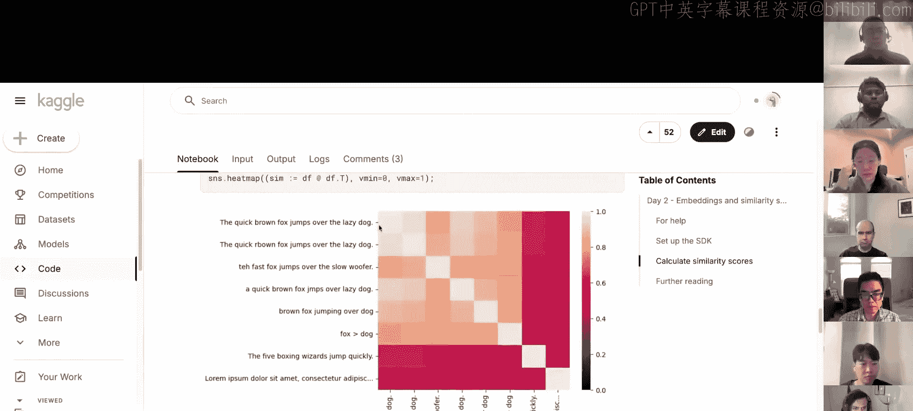

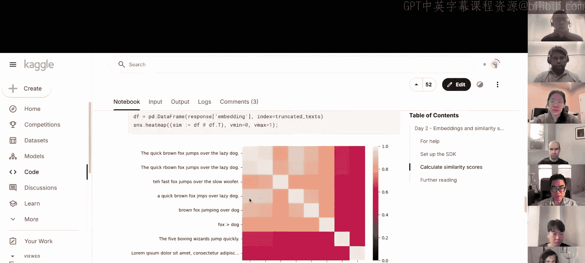

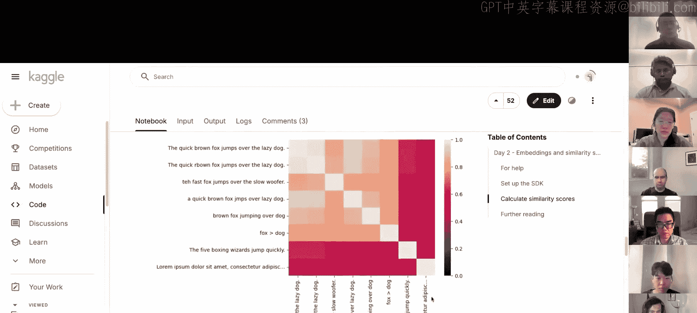

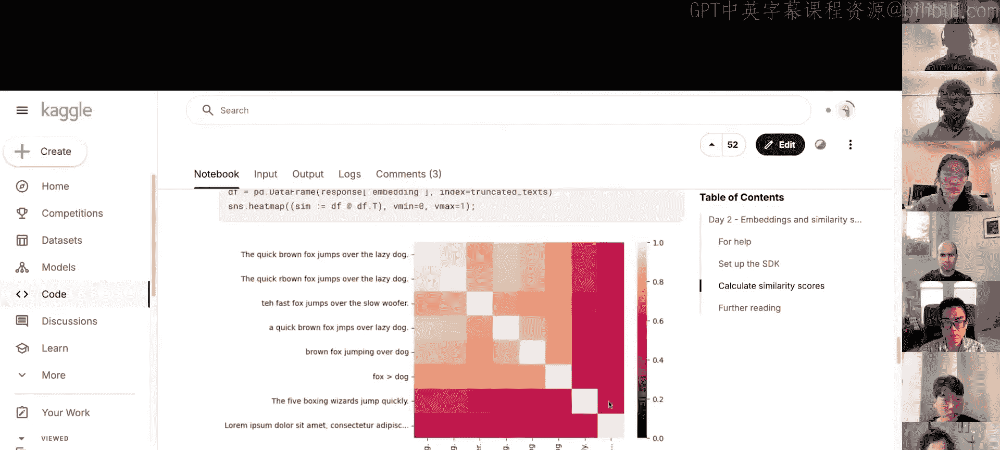

Makes sense that is it。 it is the case。And if you look at the exact similarity scores here。

 the document， the quick brown fox jumps over the lazy dog， it's most similar， of course， to itself。

 because it's the exact same sentence。😊。

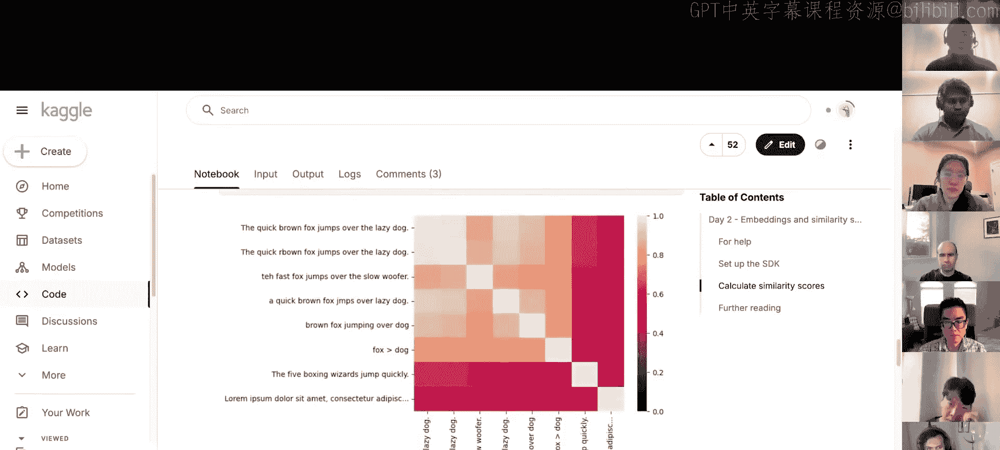

But it's second more similar to just a slightly misspelled version of the same document because the meaning kind of still remains the same just as given a small typo here。

 and then you can see that it third more similar document also kind of implies the same meaning and so on and so forth and this is kind of how a human would also rank it and the semantic similarities captured very well using by embedding these documents you can use this for various purposes such as clustering。

 ranking retrieval systems， etc。😊。

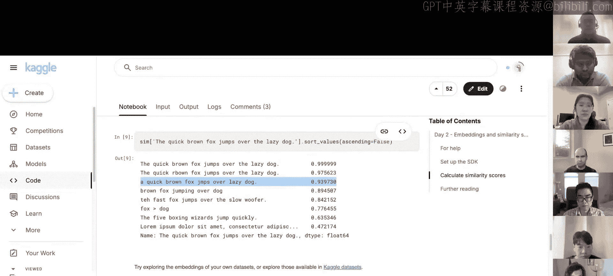

Now。If you let's go on to the third code lab now here's a slightly different use case of embeddings the first two talked about retrieval using semantic similarity of documents。

 this one talks about how you can use embeddings as a rich representation to bootstrap your further downstream models and utilizes rich representation as a very informative source so that you do not need a lot of data or very complex models and can already leverage the information within this embedding。

😊。

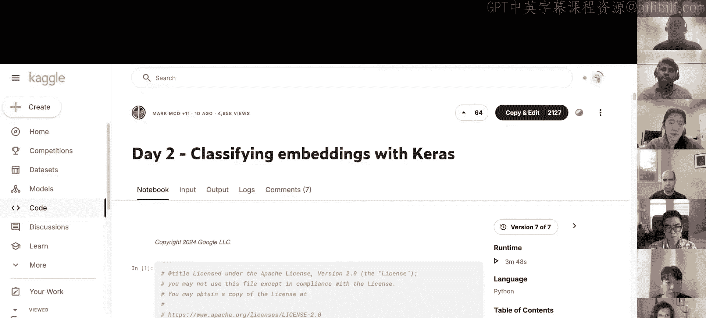

So in this coab， we would start off with using prechain embeddings that can that can help help classify news group posts with a small K model added on top the KS model in question would not be trained on raw text data from scratch。

 but be leveraging these embeddings as a source and adding a couple of。😊，More layers on top。

 which can help greatly be very data efficient and learn how to classify the new group posts into various categories。

So we start off as usual， with initializing and retrieving the API key， initializing Gemini with it。

😊，And then we look at the news group text data where we have a lot of news group posts across several topics。

 and our aim is to make a model which can take the text content of a news group post and classify into one of the topics some of them I mentioned here。

😊，So I'll be skip us this one。And we in this cell， we pre process the news group posts to clean it a bit。

And then we make a train and test split for the post。

 so we would like to train it on the news group posts and existing class labels or the category labels and then learn how to predict class or target labels for new news group posts where the class label is unknown and see how it performs in the test set。

So。this is all preprocesing and yeah so here's the most important bit creating the embeddings and using that for a downstream model so in this case because we' will be performing a classification task we would be let's use the classification task category for the embeddings you can use various different categories depending on the task here're doing and then we we define functions to create embeddings here and then we create the embeddings out of the training and test data sets。

😊，And then in this section we add a couple of dense K layers。

 also dense layers using the KRRA framework and where we take the embedded inputs and pass it through a couple of layers and then the model learns how to classify this to the new respective news group target categories。

😊，So keep in mind that here we are not learning from scratchs。

 we are taking the embeddings as an input， hence the model does not need much as much data and it does not need as much depth and complexity。

😊，And by doing so， we'd see we train the model here。😊。

In doing so we can see that the validation accuracy is improving quite quickly in just seven epochs even with limited data and it manages to achieve quite a good accuracy with very little data because we started we bootstrappped it with embedded representations and not raw text so this is something which can really help you especially if you have limited data and hopefully it was clear and yeah thank you and off to your page。

😊。

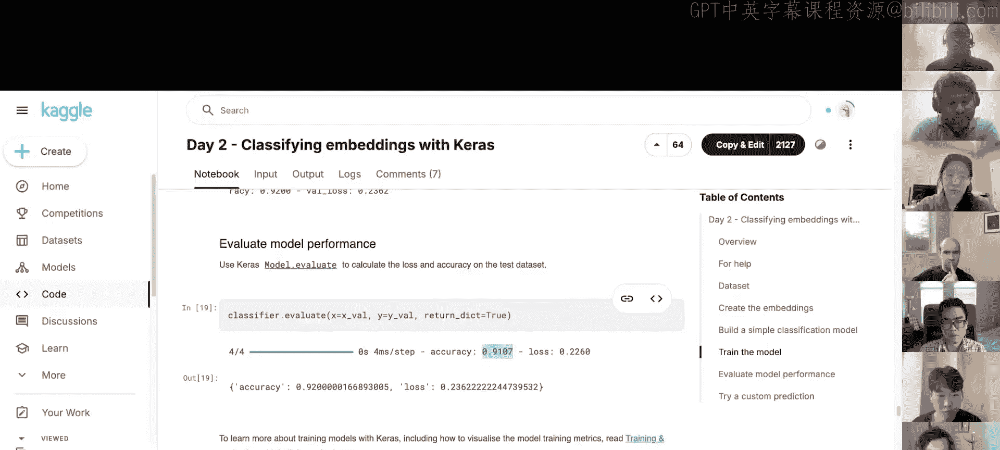

Awesome， thank you so much for walking through those great notebooks and thank you thank you to Mark McDonald as well for kind of creating them for making them available and for giving students the ability to kind of get in and to sort of start understanding how embedding some vector databases work thank you also to the open source teams behind Chroma and behind Carris really excited to see some of those tools used used with the curriculum as well so let me go back to our slide deck。

😊，And it looks like it's time to get started with our Q&A so the question and answer session is brought to you for you by you all of the great questions that you've been asking in Discord will be used to kind of to kind of create questions for our Q&A session I also want to make sure to thank our generative AI course moderators。

 Polong Ca Mark， Eric， Erwin and Miles who have been answering your questions in realtime on Discord and also helping people get unstuck from some of the things that might have been a little bit challenging with some of the assignments so please virtual round of applause for all of our great course moderators and a great great and warm welcome to all of our expert hosts here for day two we have many folks from Deepmind as well as from our Google Cloud AI teams Oid Alllan。

 Shaochi Genhook Yan。

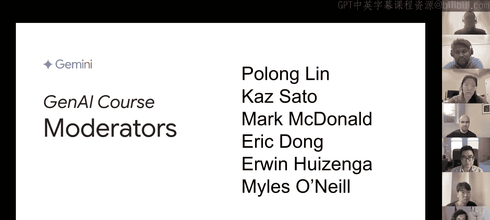

FTar and Anant， wonderful to have you here today and thank you for taking the time to answer questions for our students and with that I'm going to go ahead and get started with our first question as a reminder if you would like for your questions to be answered。

 make sure to add them in the Discord as you're going through the course assignments each day。😊。

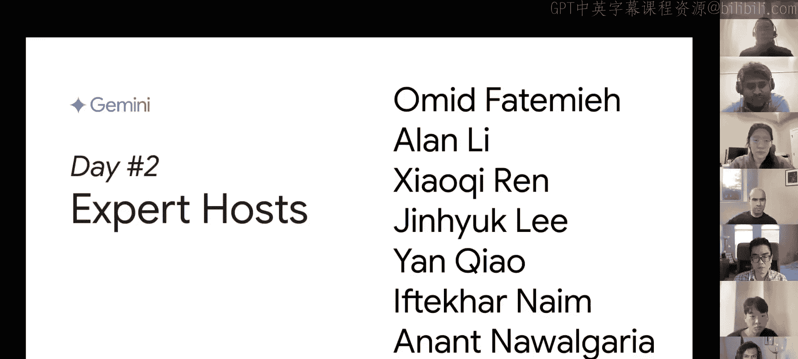

So first of all， for Alan and for Janon， tell me a little bit about vector databases and embeddings。

 what are they and why are they useful？Sure， I will start with an introduction of the embeddings and then I'll hand over to Alan to talk about vector databases。

So embeddings in numerical vectors。We use these embedding models。

 embedding models are machine learned models that convert real world objects such as text。

 image and video to embeddings， and these models are trained so that the geometric distance or the similarity of the embeddings reflect the real world similarity of their object that they represent。

In manydding models can be used in recommendation systems， semantic search， classification， rag。

 and many other applications。Google's vertex AI platform offers。

Two classes of pre traininging value models。Textingbe models and multimodal menu models。

Text embedding models allows you to convert plain text to embeddings。 while multimodal ones。

 they work with image， audio and video input， and in addition to textual input。

So to use these models， you simply enable Vertex AI or GCP project and send request to Vertex endpoint。

We also support customizing these models using your own data。

Vor database are storage solutions that specialize in managing these embedding vectors。

 now I I'll hand over to Alan to talk more about those vector databases。Thanks Yan， my name is Alan。

 I'm part of Google Cloud databases and the lead for LoDB semantic search。

 and now that we know vector embeddings captured the semantic meaning of unstructured data。

 vector search is the operation that given a set of stored embeddings and a query embedding finds the nearest neighbors to that query that is the most similar items to that query vector search can be done by computing the distance between the query against every stored embedding。

 and this is called exact nearest neighbors search。

But imagine how slow this operation would be if there are a billion stored vectors that we need to compute the distance for。

 so vector databases speed up vector search through approximate nearest neighbor search。

 which gives highly accurate but approximate answers while doing orders of magnitude less work。

And there are a number of approximate nearest neighbor algorithms in the industry。

 and they typically fall into two broad categories， G base， the most popular being HNSW。And Tbase。

 and one state of the art treebase algorithm is Google scan algorithm。

 And this is based on 12 plus years of Google research。

 and it's used internally inside Google at Google scale in products like Google search， YouTube， ads。

 photos。 And we've incorporated the scan algorithm natively in multiple Google Cloud products。

 including Alloy Db， Cloud Spner， or managed MysqL， BigQury and vertex vector search。Awesome。

 so it sounds like embeddings and vector databases are very quick ways for you to understand how similar certain kinds of data might be to one another and we have many different managed service options for embeddings that are offered through Google Cloud also through the Gemini developer APIs as well as you can kind of use open source tools like Chroma and other vector databases in order to do the work and to store to store all of the embeddings that you create for your projects A thank you thank you so much and then next question what are the tradeoffs speaking of open source vector DBs what are the tradeoffs between using an open source vector database versus a proprietary one like of the some of the managed services that were just being mentioned on Google Cloud Oit to do you want to go ahead and take that question。

Yes， thank you so hi everyone， my name is Omit and I'm part of Google Cloud's BigQury where I lead the AIML and search areas。

So this is a great question。I'd say the trade offs are similar to how the trade offs are in other。

Other areas of technology， so to be more specific， so the open source vector databases may be more favorable for aspects such as cost。

 flexibility， customizability， community support， and also potentially avoiding vendor locking。

However， oftentimes that needs to be balanced with things such as higher maintenance cost。

Higher management costs and complexity。And potentials for fragmentation down the road and along the way。

 kind of limited support options。Now with the proprietary vector database。

 it is kind of the essentially the flip side of that right。

 so they often have an edge in terms of ES of use as a more managed service support and more advanced features and stability。

But the downsides can be cost potential for vendor lock in in some cases。

 and limited customization flexibility and。Sometimes transparency。Now， this being said。

 I would also actually like to draw your attention to the increasingly powerful vector search and indexing capabilities。

That are being added across various general purpose databases。

And data analytics and warehouse platforms。And these are being added as first class citizens。

 as Alan mentioned。So。You know， basically， and by the way。

 this is this spans both open source and proprietary proprietary worlds。 But， you know， for example。

 you know， you can think of the PG vector extensions for Postgres and in the case of Google Cloud。

 you know， for。Database on database warehouses， we have LEDDB， Spanner and BigQury。

 all of them adding very strong capabilities as first class citizens。So。Now。

 the advantage of looking into this option is that， you know。

 they would help avoid data duplication across two databases。 So you'll have just one database as。

Source of truth and you'll continue to benefit from decades of work that have gone into building these highly advanced capabilities into these general purpose database on data warehouses。

And essentially， you use them as a single source of truth。And the， you know， you。You know。

 you use the added AI and vector capabilities which you know keep growing very fast。

 So that's also another option I wanted to bring up as part of the answer to this question。

and that's that's amazing to hear that instead of having for instead of users having to figure out should I use a vector database or should I use a more traditional database。

 these kinds of features are being added in cross-pollininated across both so you don't have to you don't have to have data duplication and you don't have to understand you know which kind of tool or technique you should be using you can just kind of adopt those features within things like Postgres which most folks already have experience using very very cool Thank you that's great to hear and then also so next question this is this is for techar do you think new features and capabilities like gemminize longer context windows which are now up to2 million tokens in context and Google's recently released search grounding will reduce the need for vector databases or these。

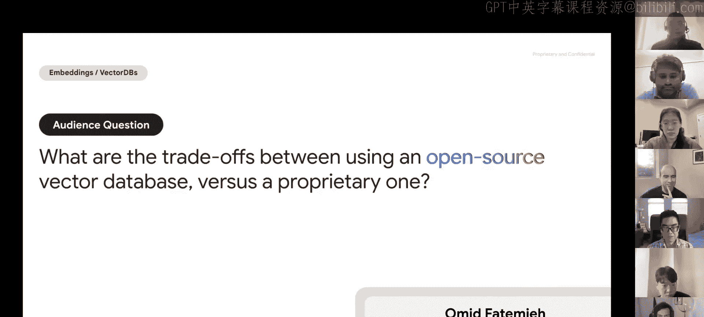

Or are these kind of features and tools complementary to each other？

Thank you Paige Hi I'm Ehaer I'm from Google Deep Minine and thank you for this great question I will start by explain the question and explaining a little bit so there are two new technologies that are mentioned one is long context windows as Gemini and other language models can support more and more tokens as part of the input and the other technology is search grounding where we recently released the capability to issue a web search and ground any answer and validative if that is correct or incorrect so first let's talk about the longer context window of course it's really exciting that we can scale to much longer context but still we are not ready to actually do that at a very large scale for several reasons first we currently support a few million tokens but most realistic databases or corpus they're much larger we often need billions or trillions of tokens Also it's really computationally expensive。

SaTo do like run the full LLM over a massive amount of tokens。

 whereas as Janan and Alan explained vector DBs are extremely efficient so they can retrieve from billions of items very quickly and finally we saw that as we put more and more irrelevant content in the context then the LLM's reasoning capability starts to degrade so it's often more useful for us to first use the vector DB and retrieve the most relevant documents or content and then perform reasoning on thing which are actually relevant to user question so in that way actually vector DBs are a really exciting and complementary technique to the new long context language model capabilities because now the initial retrieval stage that doesn't have to be extremely precise instead we can focus on the recall。

lotss of relevant documents put that in context and then LLM can reason over that large amount of context I just wanted to to say really quickly that I love that I love that pattern that you just described of being able to use vector databases and retrieval to figure out what is the most effective information that you go into the context window in order to help support your outputs I think I think that's something that's been under exploreplored to date and I really love that you called it out。

Yeah I'm super excited and also it's helping us to think a bit differently in the past we would like have very limited context so we would focus too much on the precision of the retrieval whereas now we can be more reoriented because we can support slightly more amount of tokens in the context but then throw a larger net get all the relevant content and then reason over it there is another part of the question about search grounding I would just very briefly mention that search grounding allows us to ground to the web all the public information but often we want to do search or do grounding on our private information like our personal data or in a companys proprietary private corpus and for that we still need vector databases because public search will not have access to those private data。

😊，Yeah， absolutely and I know that Google Cloud has implemented a feature that is not just search grounding but also grounding on arbitrary data that might be hosted in GCS so I think that I think that you're right。

 you know there will always be a place for both you know retrieval to get the most pertinent information and then also the ability to kind of search search over the web to be able to find the most recent information。

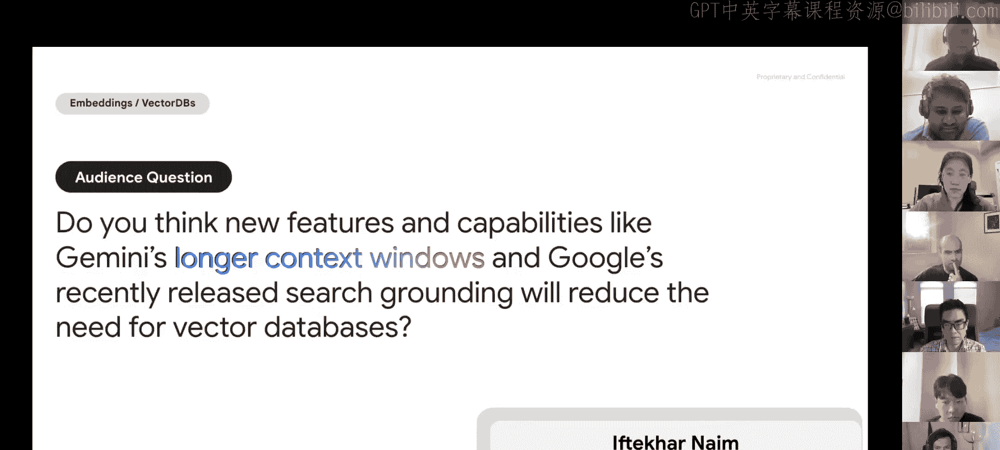

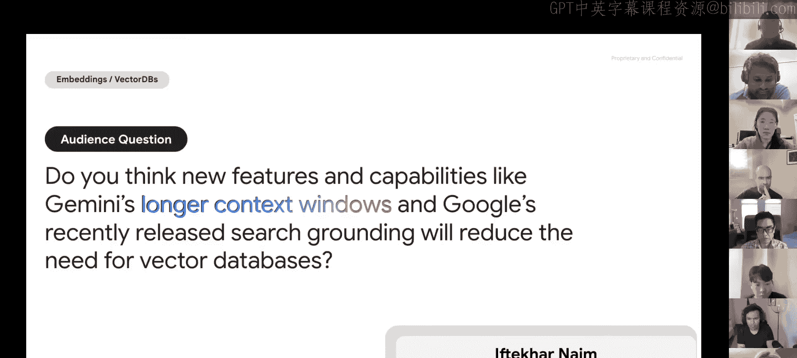

Cool so next question， what are the fundamental challenges and opportunities for vector databases Alan。

 would you like to take this one Sure， thanks Paige so speaking from the perspective of building a vector search index natively within an operational database so from an operational database customer perspective this is a system of record for these users where they expect transactional semantics。

 strong consistency fast transactional operations and data that spans memory and disk one interesting challenge that we've been working on has been how to achieve the same performance of specialized vector database systems that don't have the same constraints as one example of an innovation the alloyDB team has implemented。

cus underlying buffer page format in order to leverage scans low level optimizations and other opportunities that I see that apply to vector databases in general are in the areas of improving usability and performance when vector search is only one part of the application logic。

So for example， vector search with filtering is a well-known challenge where it may be more efficient to do post filtertering or prefiltering operation depending on the filtering condition and the user's intent is clear return to nearest neighbors to me that passes the filtering condition。

 right now a lot of the systems need the user to specify。

 okay I want to apply the filter after the vector search or vice versa。

 but the vector search databases should be able to automatically figure this out。

 figure out the actual filtering operation that will give。

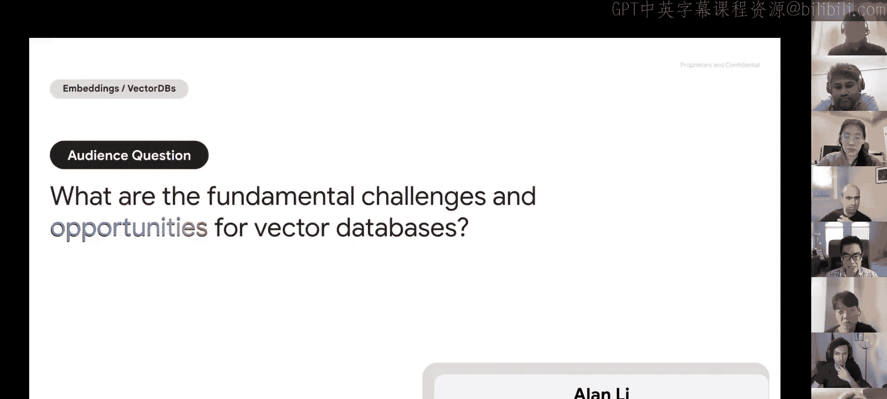

The best performance without the user needing to specify that。

 And this extends out to combining with other application logic like joins。

 aggregation and tech search。I love what you just called out about introducing these AI capabilities into traditional databases and then also improving the developer experience for them。

 I think that that will bring a lot more capabilities to folks without necessarily making folks learn how to use use new tools or techniques and I'm really excited to see what everybody builds as well as the new improvements that are coming into products in GCP into open source databases。

 so this is very， very cool。Thank you thank you for that great answer。

And next question so so we've been talking a lot about you know what happens when everything goes right when we're able to find the most relevant documents or kind of data assets and then use them as part of our projects either by taking in the information and using it with the extended context windows or by using it directly within the databases what happens if retrieval if retrieval augmented generation doesn't retrieve your relevant documents or your relevant data assets。

 what can you do and Shaoq do you to do you want to start。Oh， yes。 thanks page。 Yeah So it's。

 it's not uncommon that a rack systems when they retrieve the document for specific query。

 If the document previously is not like embedded in the corpus or the corpus doesn't have relevant informations。

 So irrelevant documents may be retrieved as the top neighbors for the query。 And so in that case。

 I think it's rely very heavily on the like the back and larger models。 factuality capability。

 to understand whether the retrieved documents can or cannot answer the question。

 And there are like other methodologies， we can make sure like the rack systems can can still function well when the nonre documents are retrieved。

 So I will pass and end to introduce about the agent。Yes， thank you， Zki。 So yes， as Zki mentioned。

 its you can tune embeddings like you can kind of make sure that the model can understand and the rag system works well because when the search part works well of RA。

 the retrieval， then you can improve the generation as well， if the relevant documents are improved。

😊，But what you can also do is make instead of just doing simple rag system where you kind of use embeddings and then vector databases to find the most relevant set of documents and then like five or10 or so such documents and then using those documents in your prompt for generation。

 you can use an agentic system where you an AI agent kind of figures out okay based on the query and the prompt。

 it calls various it takes various different steps， it can call vector databases。

 different ones or it can also take different steps such as use grounding services and various different tools and techniques in order to retrieve the most relevant documents and then supply that so instead of a static process of go ahead。

 find me the top five most relevant documents and feed that it figures it's a dynamic process where it takes a steps tools use a bunch of tools and。

echnology and figures out how to how to provide the most relevant content for the prompt。 So we。

 by the way， on the next day， day three， well be covering the topic of agents in more detail。

 I'm super excited about this。😊，Excellent， so it sounds like there are many different there are many different things that people can do in order to kind of improve the likelihood of getting the right answer the most relevant answers for their RAG approaches so this is great and I am I'm sure that a lot of people are excited about day number three's content and getting to be handson with creating their own agents and using them to solve problems so see excited to talk about that tomorrow。

And then next question， the mainstream of LLMs are decoder models。

 how can we train an embedding model from a decoder only model backbone FTar。

 do you want to take this one as well？Yeah this question is a bit technical but it's also very exciting and interesting so typically the traditional large language models they are decoder only and what we mean by decoder only is that they are trained in a way that the task is to predict always the next word or the next token and the model can only look at all those words or tokens that came before it。

 so it cannot look at ahead of the token like say words that come after the token so this is like a unidirectional left to right causal attention and this is very efficient we can do lots of optimization during training assuming that this attention is just one directionional and we don't have to look ahead and as a result this is being adopted more and more for LLM training however。

 for encoded style task for example， if we want to create and embedding。😊。

a piece of text it actually helps us if we can have like bidirectional attention that means every word can look at all the words that came before it and all the words that came after it and for this actually if you look at the state of the art most recent embedding models they are all starts by initializing from decoder only large language models but then they are farther adapted or more trained to learn to do bidirectional attention that means pay attention both to words before it and the words after it and that improves the embedding model quality so in short actually the state of the art embedding models do use bidirectional attention something like encoder style models but they are usually initialized from the decoder only bagbos and then some additional training happens to make them really strong encoders。

Excellent， thank you for that great description and if folks want to learn more about this。

 where would be the best places for them to go look。

 do you have any favorite papers or textbooks that could go that they could go to learn more？

I think of course， there is the classic paper about transformers that explains the attention really well and the BRT paper which shows the advantage of bidirectional attention of a transformer based encoders。

 but there are also a few recent papers， one I can mention from NVDdia where they explain in depth how they are adapting decoder only models for encoders。

 but there are many other similar work both inside Google and externally。Excellent。

 and we can make sure to add those paper recommendations to the YouTube video for folks to be able to go and to take a look at you thank you for that great discussion。

And then our final question before we head into the pop quiz。

 so hopefully everybody has been paying attention Jujug after all of this discussion。

 does this mean that conventional methods for creating embeddings will become obsolete you know。

 I think we were discussing a little bit around kind of these multimodal techniques do you have any any perspective on whether conventional methods might need to change or evolve based on all of the all of the questions and all of the insights that we've been discussing here today。

Yeah， so my name is Xli。 so there's a small typo。 It's not you， but J IN。 but anyway。

 I think the conventional method， if you're talking about the OCR related technique where you extract the text first from like a P DF and then converting it to like a text embedding model。

 I think there's a good chance that the future embedding models that recognizes like text from it from an image might be able to capture that into the inspector representations。

I think the current status of the multimod embeddings are not accurate enough to capture all the like the。

The exact text in the image image， so I would say for maybe next year or so we might need to combine both methods to take the advantages from the platforms。

Excellent， and I apologize for the typo if folks want to learn more about Jen H's research。

 we will make sure to add a kind of a link to Google Scholar as well in the YouTube notes。Awesome。

 and now without further ado， we are going into P quiz territory so the pop quiz is just five or six questions after the end of every day to kind of test your comprehension both of the podcasts。

 the papers that you've been reading as well as the Q&A discussion that we've had with all of our all of our subject matter experts here today so get out your pins。

 your pencils just something to write down write down your answers and we'll be walking through each one of the questions in real time so make sure to get these to get these questions answered first off what modalities can be converted into embeddings we discuss this a little bit in in the Q&A session and you should have read a little bit about it in the white papers as well for modalities that can be converted into embeddings a image be video。

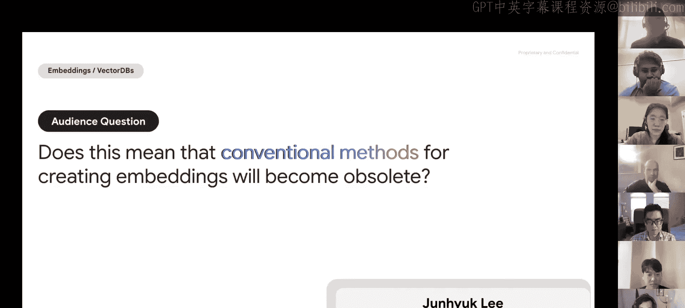

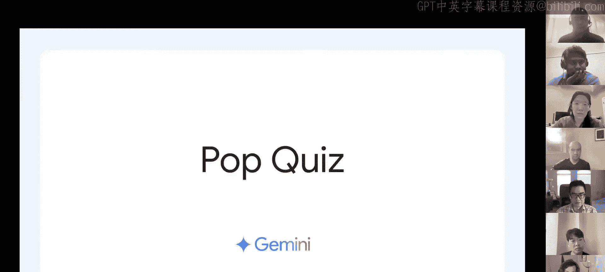

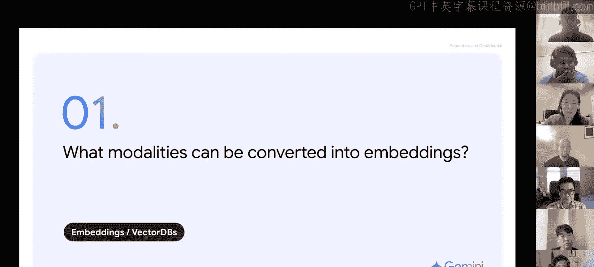

C text or D， all of the above， all of the above could be turned into into embeddings I'm going to give you a few moments to pick your answer and count down five。

f。3，2。One， hopefully everybody picked D all of the above， you know as we were discussing before。

 we can have text only embeddings， but we can also have multimodal embeddings that encompass image。

 video， text， audio， kind of all of the modalities that you can think of so definitely explore embeddings not just for text but also for other use cases。

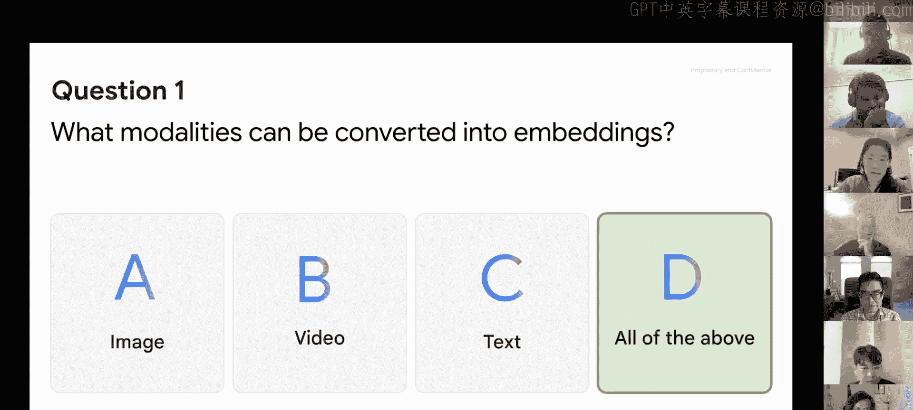

Question number two， which of the following is a major advantage of scan over other approximate nearest neighbors search algorithms we discuss this a little bit in the Q&A。

 especially during the questions to Alan and Tion about vector DBs and databases so get out your pins in your pencils and think about think about the best answer number A it is open source and widely available B。

 it is designed for high dimensionional data and has excellent speed accuracy tradeoffs C scan only returns exact matches or D。

 it is based on a simple hashing technique and has low computational overhead。

 which is the best answer and again I'm going to do a countdown backwards from55。

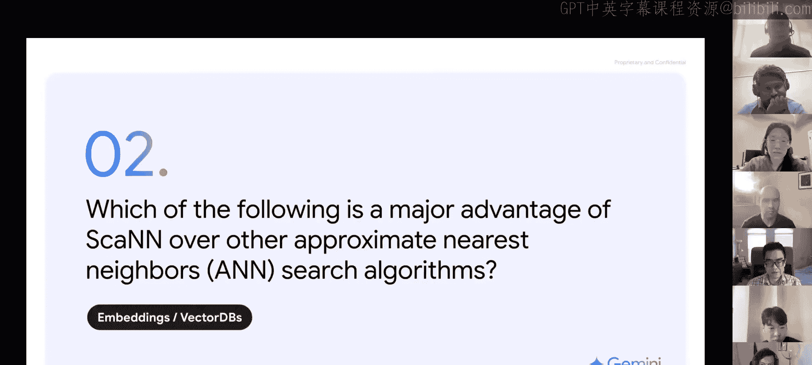

for。ree。跳。When。Hopefully everybody picked B scan is designed for high dimensionional data and has excellent speed accuracy tradeoffs。

 that's part of the reason why we care so deeply about it at Google because we need to care about things being fast and being scalable so hopefully everybody got the question number two correct。

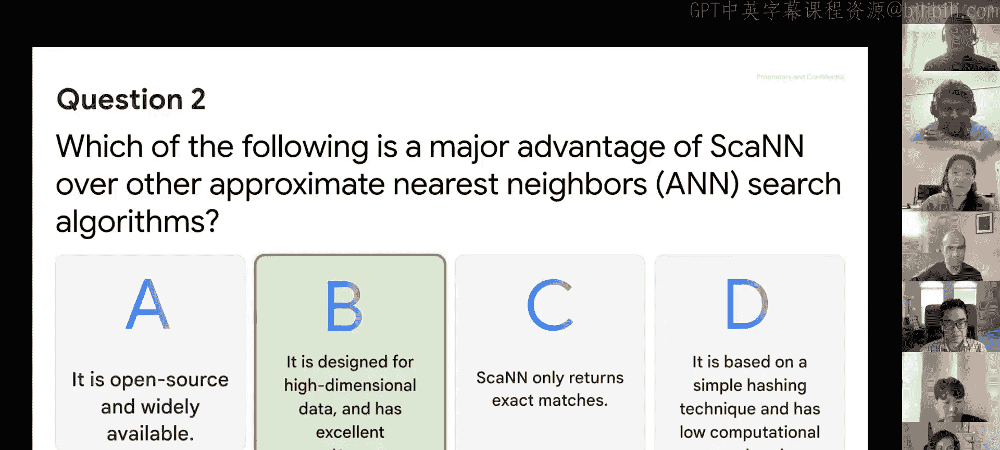

Number three， what are some of the major weaknesses of bag of words models for generating document embeddings this hopefully you you got to see a little bit in the white paper as well as maybe in some of the code labs。

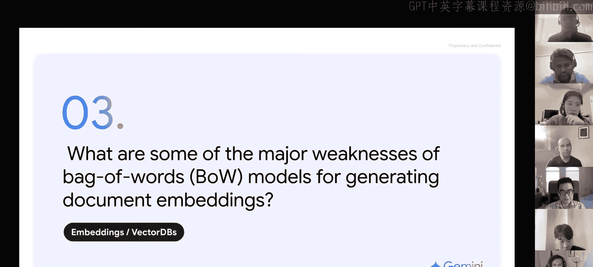

But value A， they ignore word ordering and semantic meetings， B。

 they are computationally expensive and require large amounts of data， C。

 they can't be used for semantic search or topic discovery or D。

 theyre only effective for short documents and fail to capture long range dependencies。

 What are some of the major weaknesses of bag of words models。

I feel like I should have jeopardy music， but five， four， three， two， one。

Hopefully everybody picked A， they ignore word ordering and semantic meanings the next question。

 which of the following is a common challenge when using embeddings for search and how can it be addressed？

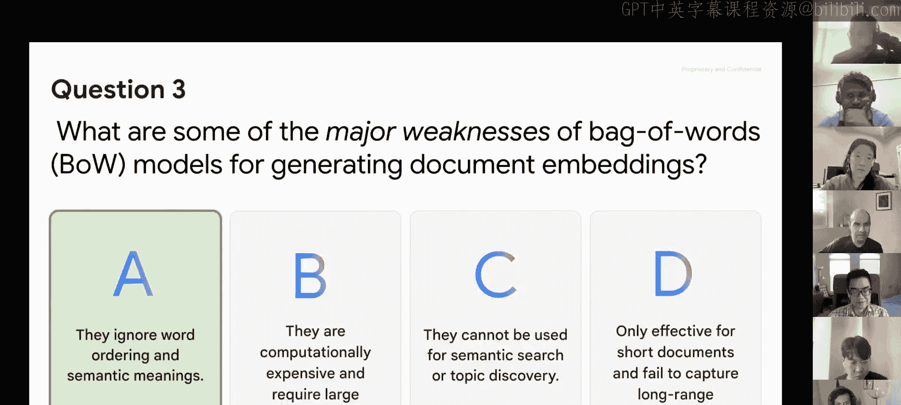

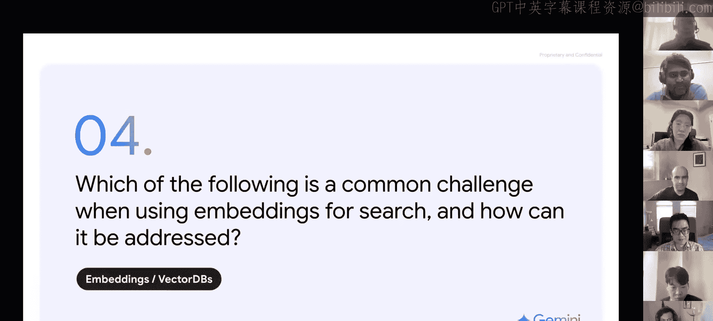

Is it that embeddings cannot handle large dataset sets and you should use a smaller dataset in order to address it is it that embeddings are always superior to traditional search and there's no need to address that challenge is it that embeddings might not capture literal information well in which case you need to augment and combine with full text search or is it that embeddings change too frequently and so you should just try to prevent updates which of the following is the is the correct answer Think about it in five。

4。3。Two and one it's that embeddings might not capture literal information very well。

 and so if you do use it and combine it with full text search like some of the techniques that we are discussing today。

 then you will be able to get much more accurate results and hopefully be able to build stronger and more robust systems。

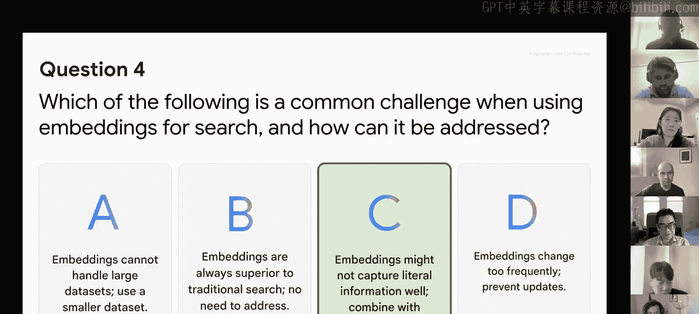

And then final question， what is the primary advantage of using locality sensitive hashing for vector search？

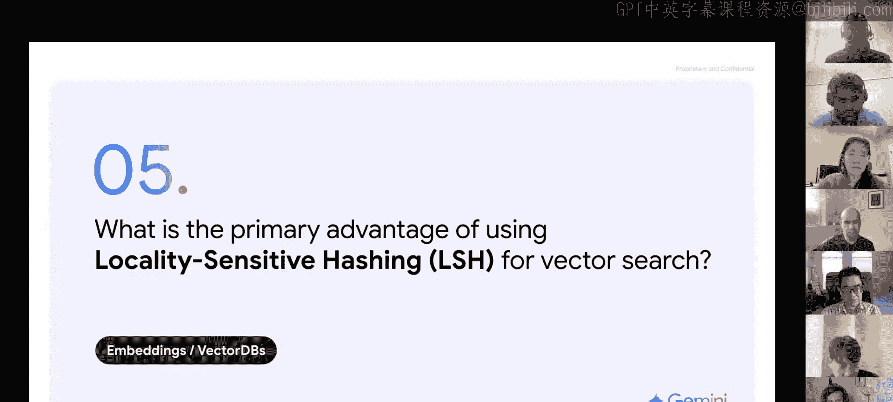

Is it that A it guarantees finding the exact nearest neighbors B that it reduces the search space by grouping similar items into hash buckets C is it that the only method that works for high dimensionional vectors or D is it that it always provides the best tradeoff between speed and accuracy what is the primary advantage of using locality sensitive hashing。

Hopefully everybody was paying attention in the white papers and5，4，3。

21 and it is that it reduces the search space by grouping similar items into hash buckets so as I mentioned everybody make sure that you write down the quiz if you missed a question make sure to review and to refer back to those items in the code labs and in the white papers and also make sure for tomorrow to add all of your great questions in the Discord about agents so that perhaps our subject matter experts can answer them answer them in real time so thank you again so much for attending attending the second day of the generative AI intensive course I want to give a big round of applause to all of our to all of our subject matter experts for answering the questions for coming today and for sharing their knowledge。

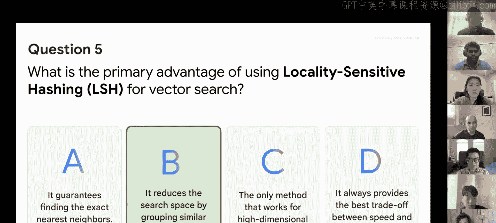

We'll see you back bright and early or whatever your time zone might be for date number three where we'll be discussing agents。

 so all the best and thank you for participating。

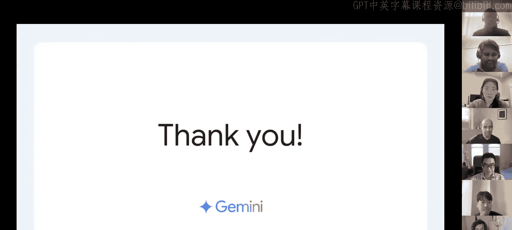

