# Kaggle&Gemini《生成式AI五天快速课程｜5-Day Gen AI Intensive Course  Kaggle》deepseek翻译 - P3：Day 3 Livestream with Paige Bailey – 5-Day Gen AI Intensive Course _ Kaggle.zh_e - GPT中英字幕课程资源 - BV1tUmYYKEUs

Hi everyone， welcome back to day number three of our CAL generative AI intensive course where we'll be discussing generative AI agents。

 I hope everybody had great fun in the last couple of days where we were talking about foundational models。

 prompt engineering and then also embeddings and vector databases today we have a really exciting course for you walking through some really interesting code labs where you can create your own agents as well as getting a Q&A with some of our really exciting guest speakers including folks from the AA team which is baking AI assistive features into tools like Collab as well as the creator of notebook LM so really excited to have you here today。

 and to have you tuned in as a reminder as a course overview the course that we're delivering is a fiveday generative AI intensive course on sort of all of the tools that you can use to build models to interact with model。

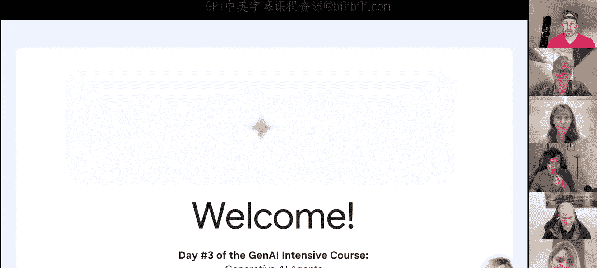

And to bake AI into your applications sponsored by Google and Cale。

 you're getting daily assignments in the forms of white papers and podcasts which explain the what and how of how things work as well as accompanying code labs that will teach you how to how to do all of the great things that our speakers and our white papers are describing you can test them out in Caaggle as Cale kernels or you can export the notebooks and use them in Coabab and run them at your leisure this is really intended to help you dive deep and to learn some of the fundamental concepts around tech and around generative AI so as a reminder today is day number three where you have hopefully read all of the white papers interacted with all of the folks on our Discord channels and also listen to the podcasts coming up soon we're going to have a not walk through the code labs just in case you have any questions or if you wanted to have somebody kind of hold your hand as you tackle。

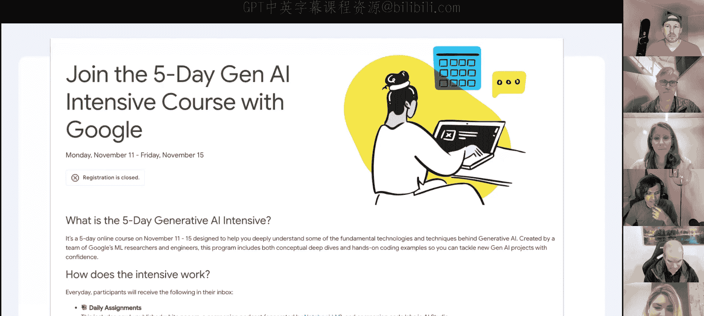

Great programming concepts and we're really hoping that by the end of this course you'll be building your own AI agents and using them to accomplish really interesting tasks so with that I'm going to turn it over to AnOT for the curriculum review and then also our code labs for generative AI agents AnOT do you want to take it over。

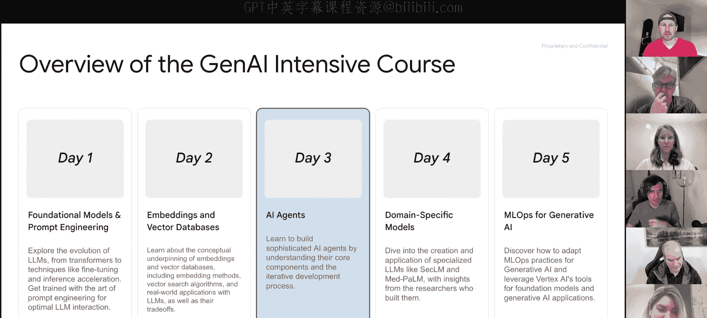

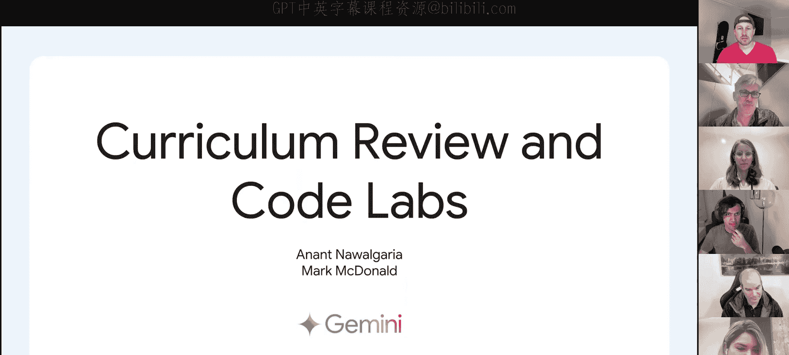

You might need to come off mute。So thanks Pae and before I start I'd like to give a shout out to Mark McDonald who helped create these coabs and yeah so thanks for being here everyone and welcome to a live stream so today I'll be walking you through the contents of the coab for day three AI agents。

 generativeI agents to be more specific and so in day two and day one so you've seen basically how foundational models are created。

 the fundamental components， how they can be made fast and efficient at inference time as well as some of the applications and how they can be prompted and the various strategies for prompting large language models and then you've also seen embeddings how embeddings represent various different data types in compact semantic representations which can then be combined together with vector databases and approximate nearest neighbor algorithms to kind of query and manage these。

😊，beddings at scale to build many generative AI applications such as retrieval augmented generation but also help with other applications such as clustering。

 classification and so on and so forth Now building from day one and day two we come on to a topic which is very important can which utilize these techniques both NLLs and embeddings and data stores vector data stores to build AI agents and that would be the focus of this curriculum overview and code lab overview。

So I hope all of you have had a chance to go through the white paperper or at least the podcast summary of it。

 so in the first section of the white paperper we explore basically the foundational components of what constitutes an AI agent。

 specifically a generative AI agent， and the various components being models。

 tools and orchestration theres and how these elements interact to enable intelligent behavior we can then compile these components to build systems that are capable of understanding the world making decisions and acting upon those decisions。

 extending beyond the limitations of just standandalone LLMs。😊。

Then the second part of the white paper dives into some of the tools that these agents can leverage to interact with the external world and access information beyond their initial training data。

😊，Some of these tools that we discussed are called extensions， functions and data stores。

 extensions being basically the bridge which kind of connects the agents with external APIs。

 basically facilitating seamless execution of these API calls， then functions。

 functions are basically the tools which empower developers with fine grain control over their data flow and system execution。

 basically enabling client site processing and data transformations。

 then data stores and data stores provide agents with access to structured or unstructured data。

 enabling data driven applications and other downstream tasks such as retrieval augment generation。

Now in the next part， we then after seeing these various types of tools。

 we then looked at how we can enhance model performance for agents using targeted learning approaches。

 some of these being in context learning， retrieval based in context learning as well as fine tuning to enhance an agent's ability to choose the right tools and then use those tools to generate the optimal outputs for the task at hand。

These approaches basically equip agents with the specific knowledge and adaptability needed to excel in real world scenarios。

😊，Then after all of this， the white paper concludes by looking at building agentic applications using Laangin and Google's verortex Air platform。

 which greatly simplifies the development and deployment of these production grade agentic applications and allow allow developers to refine refine the applications in an iterative fashion and by providing the services which manage the complexities of infrastructure deployment and maintenance so hopefully this gives an overview for those you who are joining for the first time or who have read the Vi paper and wants some background before our code lab and now I'll be going into our code lab and be taking over the screen。

😊，So。So a first coab， which you got in your assignment today deals with function calling with the Gemini APIEssential this coabab goes over how you can leverage gemvinize automatic function calling to build kind of like a conversational chat interface with a database in this case for demo and learning purposes。

 we will be leveraging a local database， a SQL light in memory database but of course in the real production gate applications。

 you would be leveraging different ones and it's important to note this is a toy example so don't go just using exactly the same code in a production gate applications as you would need a bunch of safety and security constraints as well as other things on top if you would like to build a safe production gate applications application。

😊。

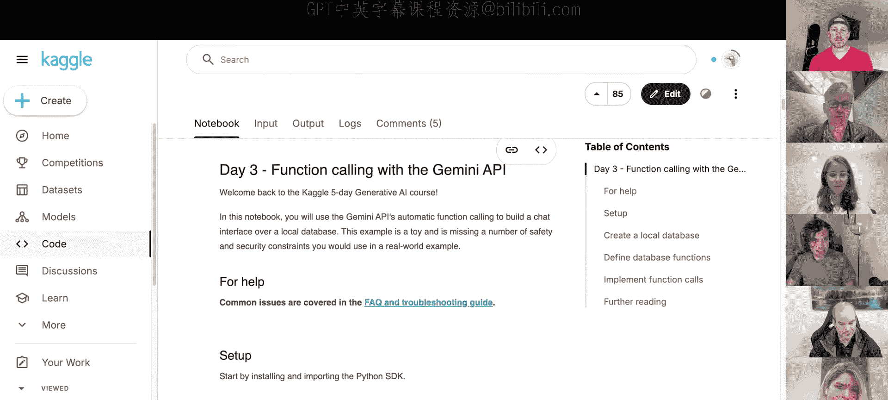

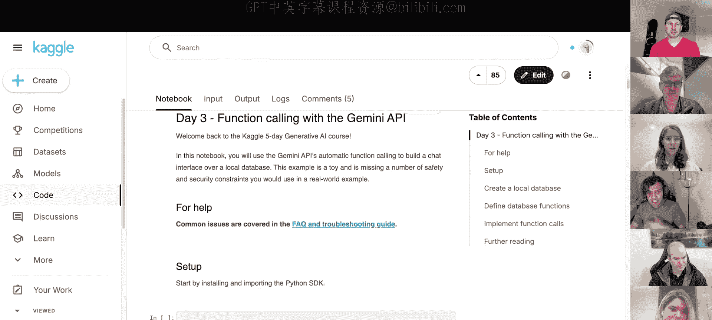

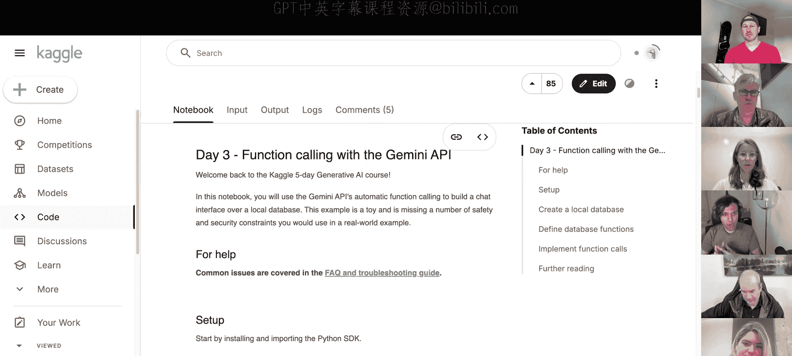

So we started this coab as usual， like installing the necessary libraries。

 retrieving the Google AI Studio API key through Kagggle Seets。

 which we've done in first couple of days as well， initializing the Gemini API with that API key and the usual stuff。

😊，Then in this part of the coLab， we create a local SQL light database。

 as I mentioned earlier add some and populate it with some synthetic data so we have something to play around with in order to learn how it works。

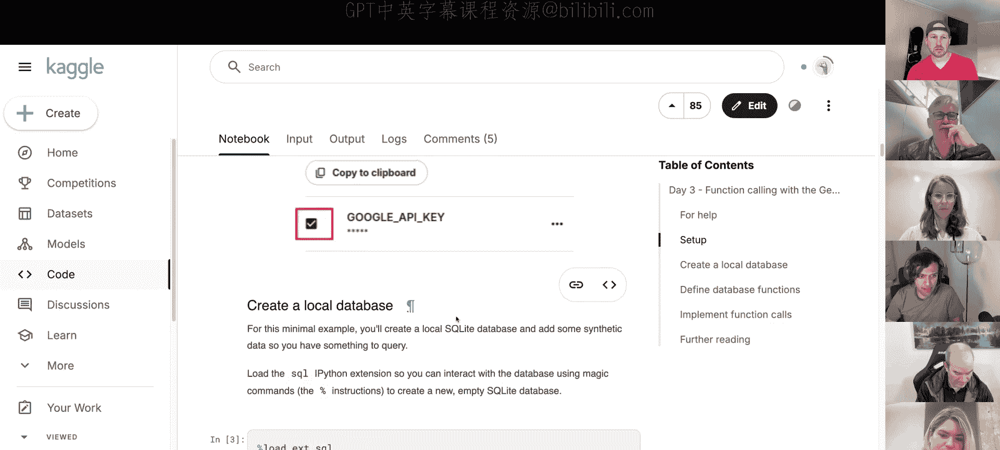

So in this case we create a synthetic table which contains product ID product name and price these are the products which will be used which the users can order and then we create a staff table this contains information about the staff members who would be kind of selling or taking orders from the customer containing information like the IDs and first and last names and then we create finally an orders table which contains the order ID customer customer name。

 staff ID and product ID basically allowing a customer to to place an order with a particular staff number staff member and this is what。

It allows you to then we add some synthetic data into the products table。

 similarly add synthetic staff information and order information。

 so basically that means this particular customer ordered a certain product with a certain staff member and that is what we add into the orders table。

Great。😊，Now， at this point， we have a synthetic SQL light well。

 we have a SQL light database populated with synthetic information。

 and now we shall go ahead and define some database functions which which will basically be exposed as as tools to the to the LLM in order to allow it to use these tools to interact with the database。

 Now it's important to note that we'll be using and。😊。

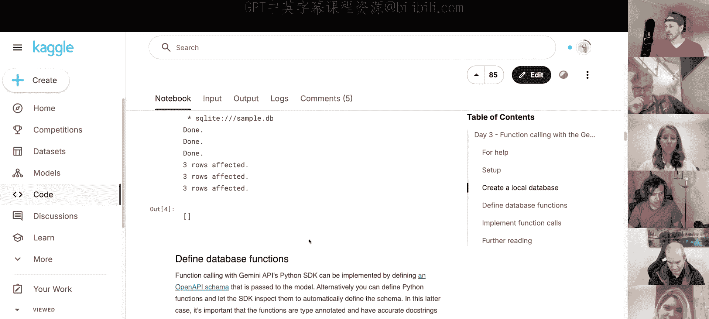

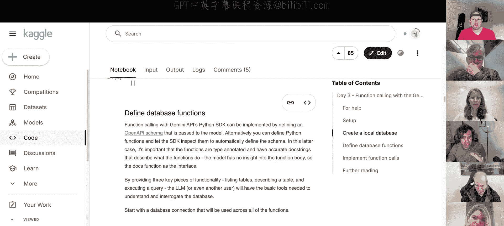

So it's important to note that we'll be using a toy example here。

 but it's important for the LLM in order to let an LLM understand which functions or which tools to call and how to convert these functions。

 like how to convert the natural language text that the user is sending。

 how to convert it to a  query and the parameters for the queries and the function parameters。

 it's important that you need to define often need to define what each parameters stands for what does it mean the input parameters and how the output can be processed。

 so LLM is able to take natural language queries from users and able to determine which function to call hence the name of this coab function calling and is able to and formulate those parameters and extract the parameters from the user prompt and。

Call them accordingly it's important that the LNM should be able to understand what the function is capable of accepting and how to use this output and what what each parameter stands for。

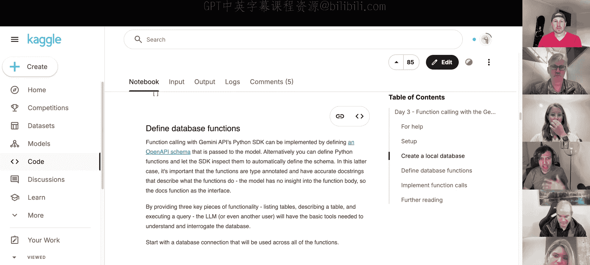

Now we provide three key pieces of functionality here， three functions。

 one function is to list the tables in the database。

 then describing the table as well as executing a query by using these three functions。

 the the chat board or the interface can easily understand。

 okay given this natural language query by the user。

 I need to see which table is the most relevant or which tables are the most relevant。

 then see what information the table contains， see the way this columns in the table etc。

 and then what do I need to get out of the table， what information do I need to execute against the table。

 the query and this is the three interfaces we provide provide the large language model and allowing us to make this application possible。

😊，Now， so we define these three functions， one is to list all the tables to see what kind of tables we have in the database and then we describe a described table which describe basically the table schema such as what kind of fields do we have in each of the tables and then we provide an interface to the large language model by defining a function for executing SQL queries against that against a given table。

 for example， an example statement could be select all products all from product table。

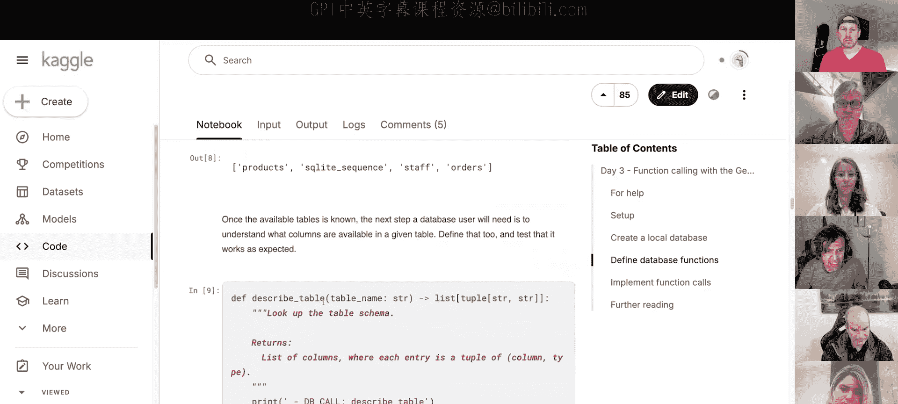

Now that we have the synthetic table multiple tables created in memory database。

 and we have the various interfaces and functions defined which can interact with these tables。

 it's now time to implement the function call function calls and in this part of the in this part of the coab we be directly allowing Gemin I to make those function calls behind the scene and get the response and kind of look at what the user is asking for and use the information provided by the response to formula the natural language response back to the user。

 however。😊。

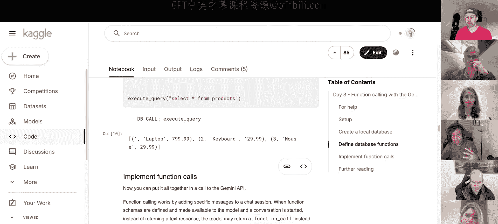

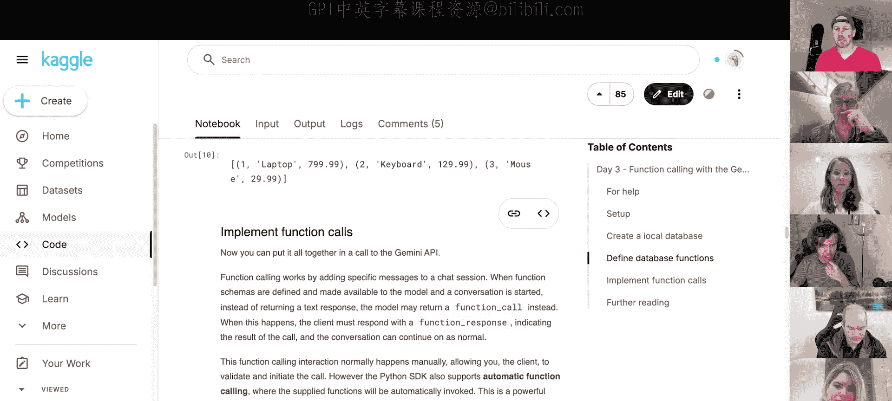

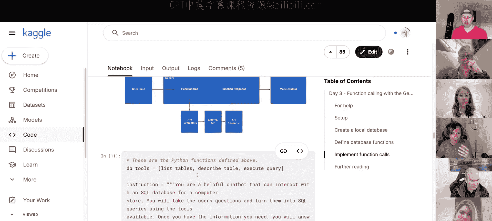

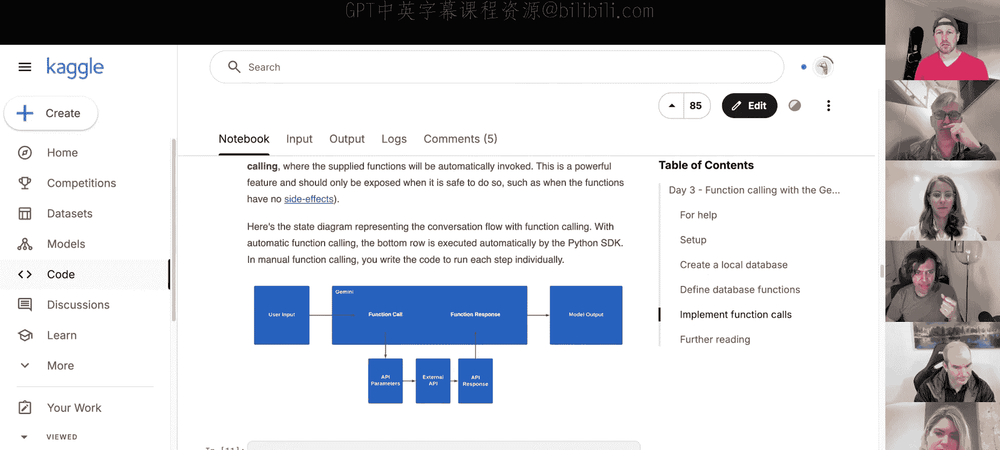

Given that these function calls interact with the database and LLNs are not perfect。

 they can hallucinate so in a production grid application。

 you might want to put safety checks or even have the code the queries checked manually by a human before they're executed for this demo we'll be letting the LLM execute the function calls and use the function responses automatically without any check in between。

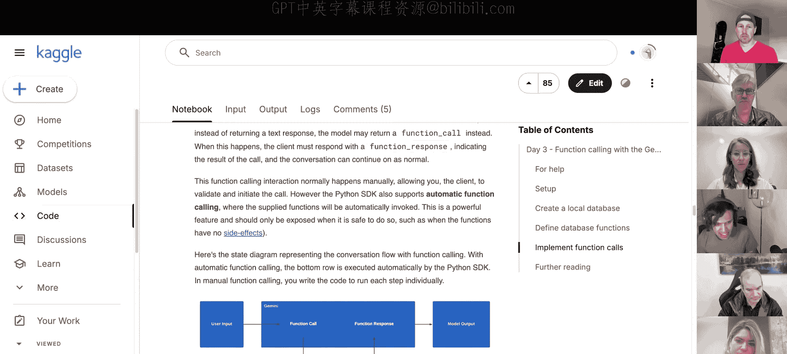

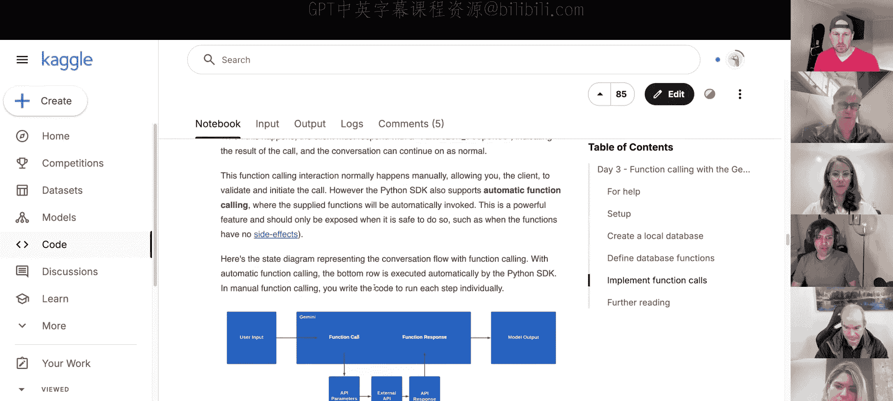

So we then defined the instruction for our agent which will be saying okay has the chatbot you have to answer the user's questions by using the three kind of tools。

 the database interaction tools which are the three functions， list tables。

 describe tables and execute query to provide the answer back to the user so we are initializing the model providing the tools here and because for complex queries。

 it might require multiple tries， so we are adding a retry mechanism here as well。😊。

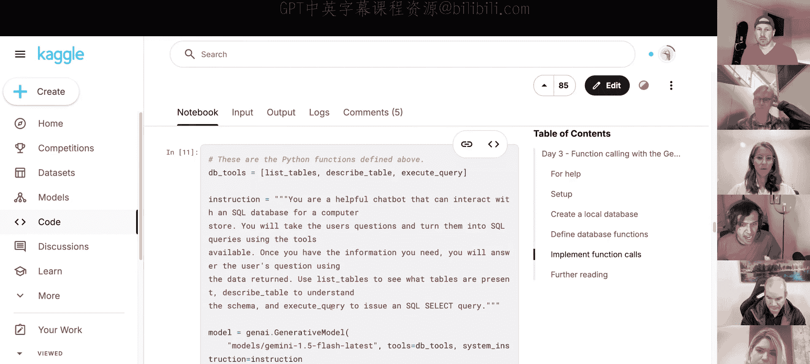

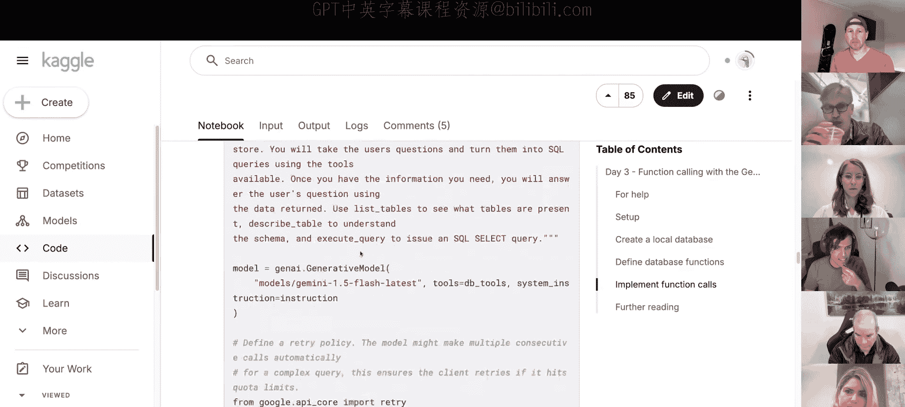

Now everything is set up， so hope you're excited。 so we asked the LLM use all the two city disposal and tell us what is the cheapest product in our in our whole database so you can see that the LLM first sees in order to figure out what the cheapest product。

 let us look at the various tables that is that are present and it finds a product table it then asks it okay now that I have a product table。

 I need to know what's inside it so it figures out okay I would need to the agent figures out it needs to get the column information to see if there is a price column somewhere and there is as we defined earlier and then okay let's then it executes a query against that table to get and gets the cheapest product based on the price。

😊。

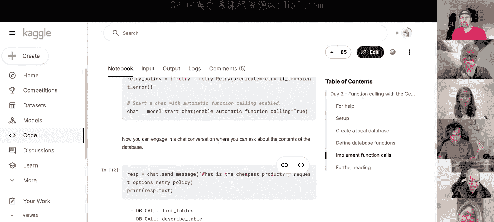

And then we ask a follow up question of how much is it and then it has already access to the context because we're using the chat interface of the Gemini model which keeps the history of the previous interactions and if you remember from day one the chat interface can kind of inform informs this query here so it doesn't have to retrieve the table information it directly executes a query against that table which it already knows。

😊，So yeah， and so and this kind of， you can do it more so often in the coL and you can understand what kind of information is it looking at its defining when it's interacting with the various functions and this part of the coLab kind of dives into more detail around this yeah。

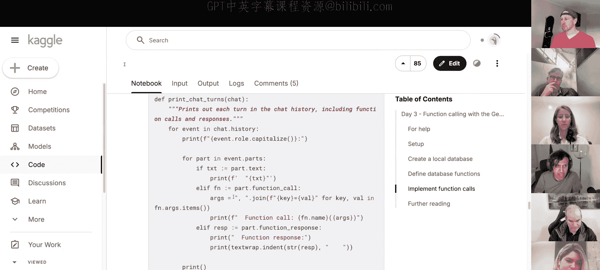

So in interest of time， since our next collab is quite large。

 I will go dive into it in a bit more detail， I dive into this one in a bit more detail。

 but the next one I'll be scheming over some of the high level components。

 so let's start right with it。😊，嗯。Sorry， yeah。So this collab talks about building an agent with Landgraft and the Gemini API and it uses a lot completely and I think we're still seeing we might still be seeing the first notebook so if you're showing a second notebook。

 you might want to switch tabs。

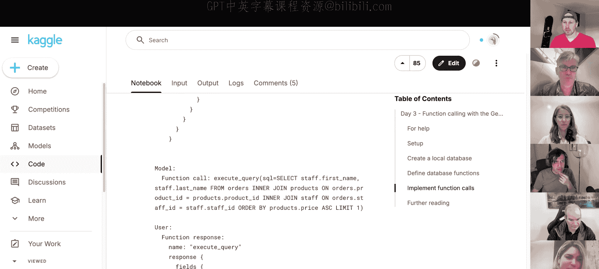

Okay， okay， and give me a second Yeah no worries I love function calling though I think it's one of the most underappreated one of the most underappreciated ways to interact with large language models so love that you you walked through that example。

😊。

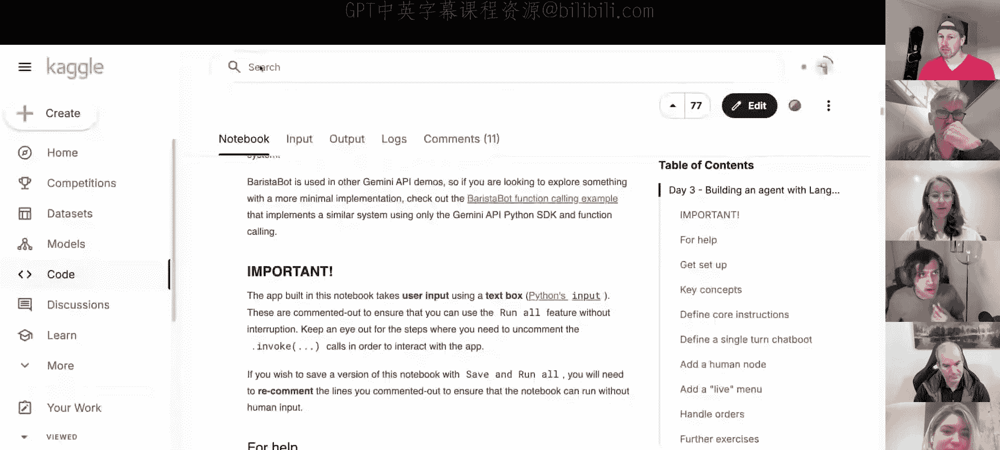

Yeah perfect thank you Yeah so I mean the function calling is not all in this notebook we go through we use an open source library called Landgra to go over how to build a complete application with back and forth interactions and so on and so forth。

 however this collab is quite detailed and in the interest of not extending our live stream too much I'll be covering the highlevel concepts behind it and you can always go into the coab at your own convenience。

 those of you who are listening to this live stream and try in more detail and how it works。😊。

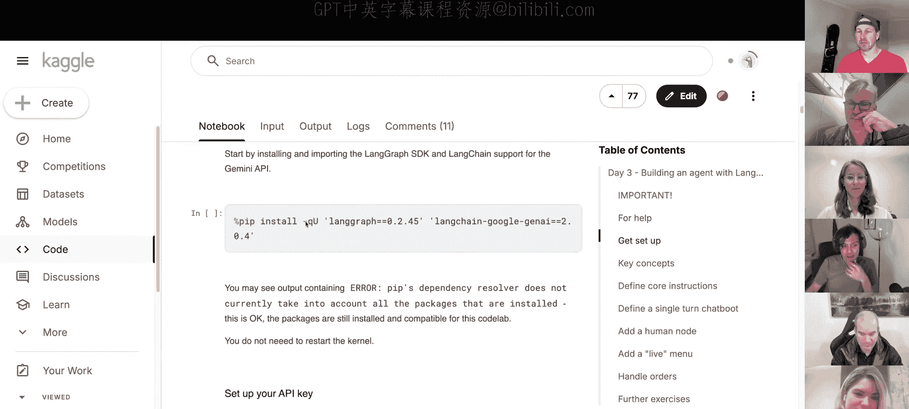

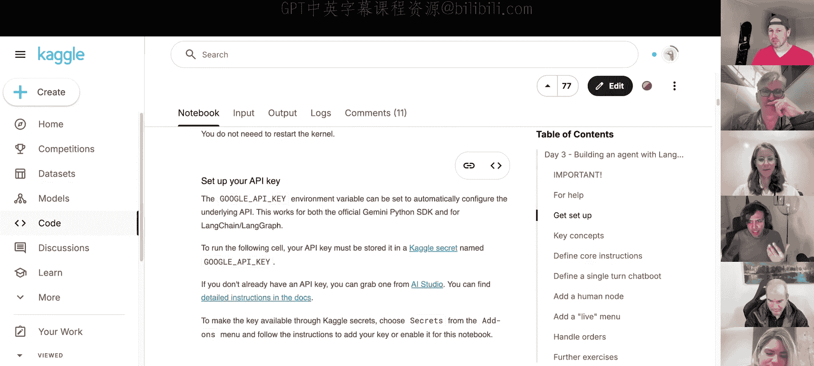

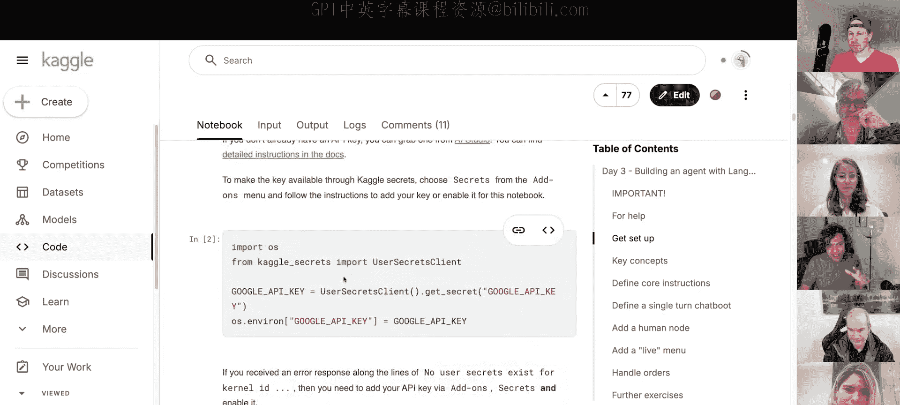

So let's get started。 So the key concepts to understand this notebook and is that the La graph uses a graph structure and a graph structure is basically consists of nodes and edges and a node basically represents an action or step to be taken so kind of like like when a human。

😊，Interacts with an AI chatbot there is like you switch over from humans to chatbot like it's like a turn system where you kind of the human starts in the chatbot answers etc and notice does the action like human response chatbot response function calling these are all actions and the edge represents the transition for example。

 whenever the transition the chatbot answers to human or the user than is the user turn to kind of answer back then these these are all transitions which are represented by edges I would it's a bit more detailed so I would recommend looking into the land graph documentation to understand this concept in a bit more detail Now in the first part of the coab we define the core instructions which allow allow at each step it provides all the information to the chatbot to understand what is the current。

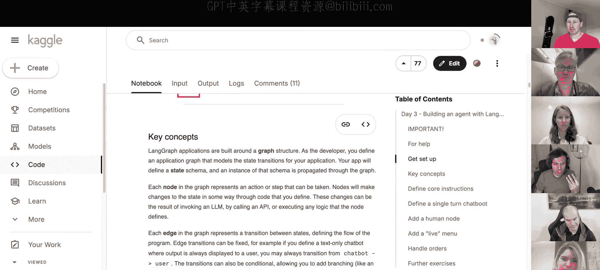

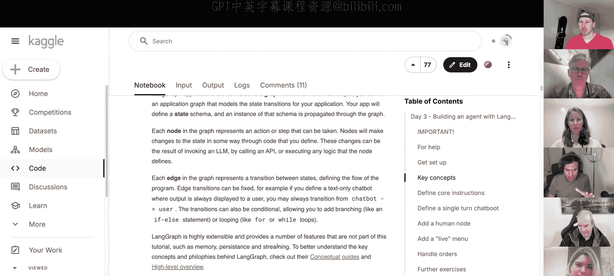

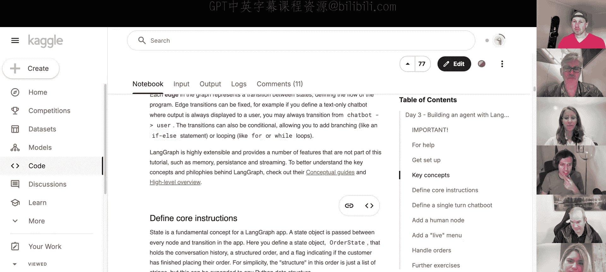

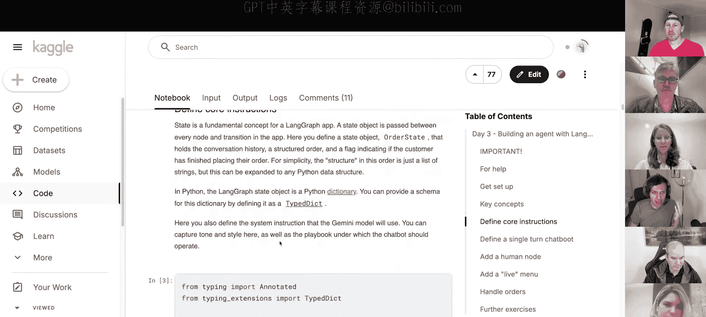

Situation， what has been said， what are the messages that have been exchanged。

 what is the order because we are talking about a barista chatbot here where you'll be kind of interacting with the barista bo which can place orders for you get information etc so to see what the status of the customer order is and whether or not the order is completed so it needs that information at each step in order to kind of inform itself on how to interact and which functions to call and tools to invoke so that's what this initial setup is about to provide an interface to which it can keep track。

And then we define the instructions for the barista bot。

 allowing it various options like clearing orders， taking orders， placing orders， etc。

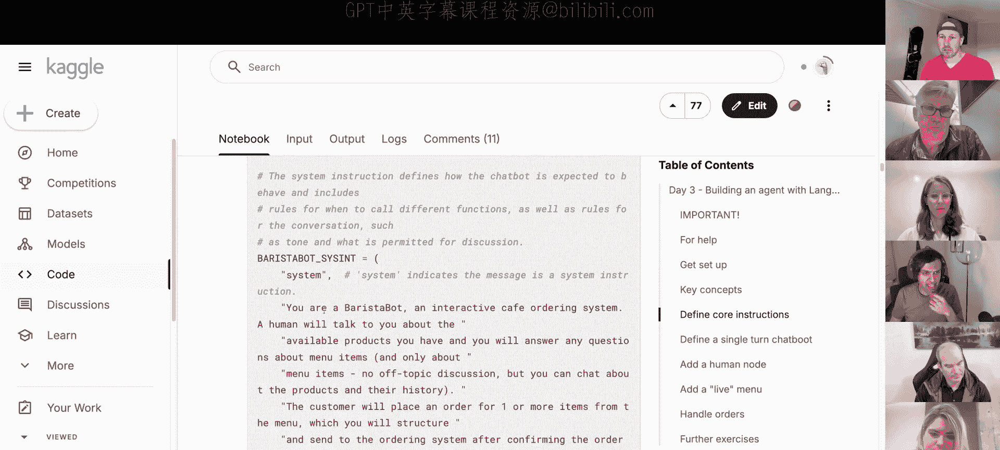

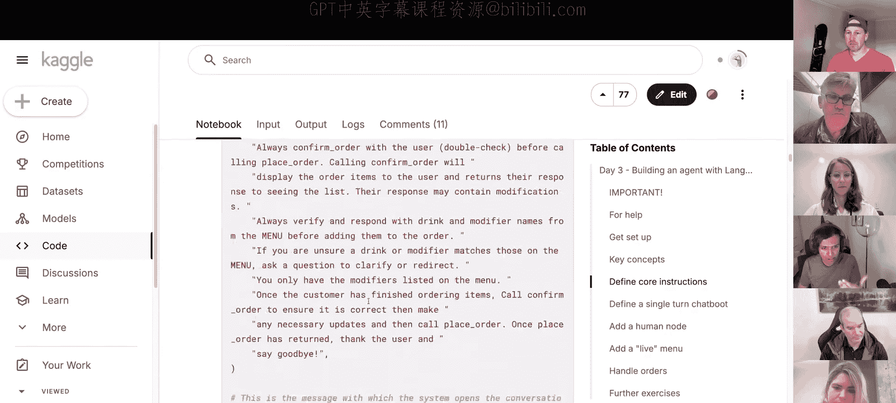

Then in this the first part of the coab we talk about a single turn chatbot we just see okay with a single interaction with the user。

 how can we add the nodes and the edges required to interact like a single turn interaction with the user where the chatbot introduces itself and the user asks something and that's it we can see that it starts in the the chatbot it directly transitions to a chatbot and later on in the second part of this we see that it takes a single human message and the chatbot answers now this is all stuff which is pretty simple to understand where it gets a bit more tricky and very powerful at the same time is when you want to have an almost indefinite interaction between the human in the chatbot until a terminal state is achieved like let's say in this case if you remember earlier we defined a finished function where we know that。

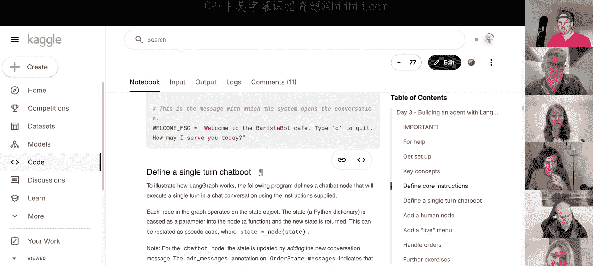

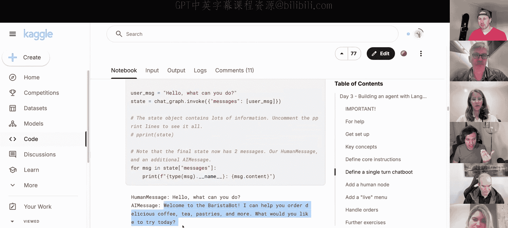

Order is confirmed and placed。 That's what we want the interaction to end。

 and this is what we do in the third part of the coab where we kind of define we go over the structure to define to and fro chat between a human in a chatbot and now this can be of course。

 troublesome， especially you have an infinite， you need a way to terminate the conversation So we add a conditional edge which provides it interface to terminate the conversation if the user kind of has finished placing an order and you can see here in the graph like we have this graph showing that a chatbot can interact with a human and back and forth until a human decides to terminate the interaction and then it kind of ends the application。

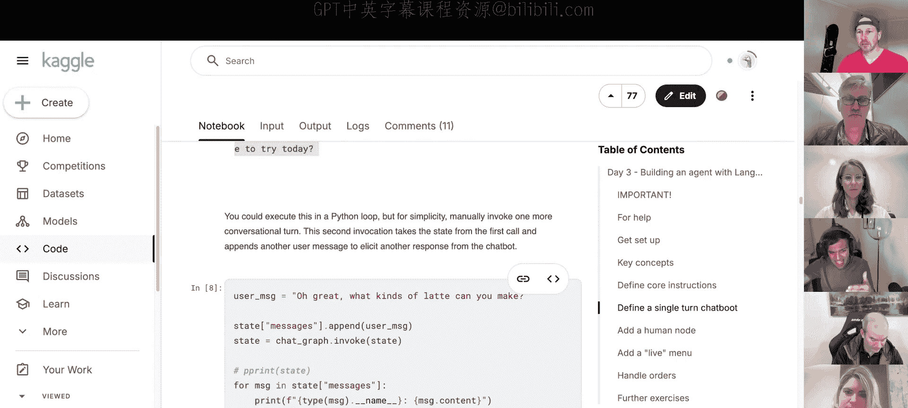

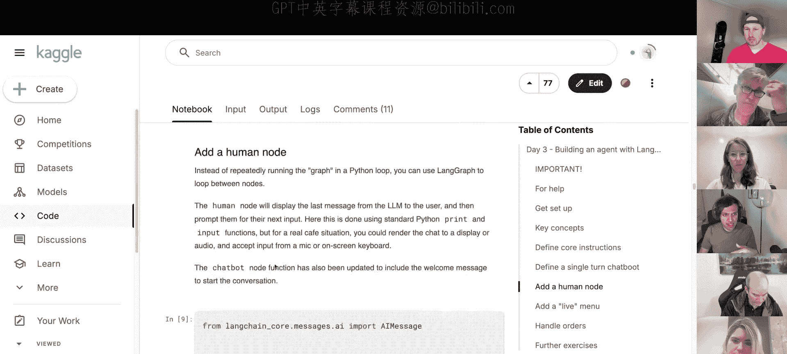

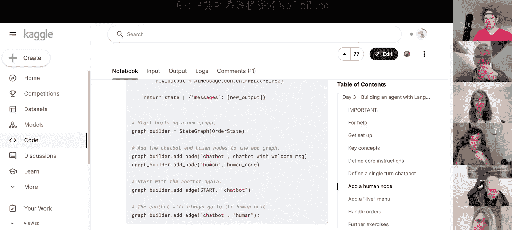

So I'm going over it at a high level because there's a lot of things to cover。

 but basically the rest of the collab is quite big。

 but idea is that it just adds function calling to the loop to now at first just text interactions with the model but you can also of course provide various functions like we look in the first coab define various tools and and allow it to get menu information from dynamic or static sources allow it to kind of place the so place the orders here to various tools。

 get the current order information and much more now in the interest of time I' I'll be closing this coab overview with one last statement。

😊。

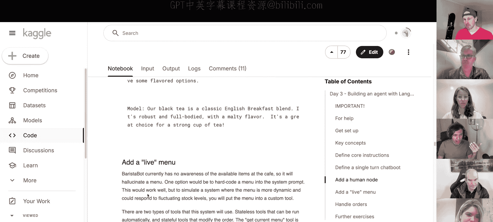

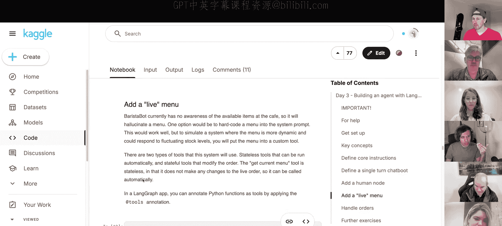

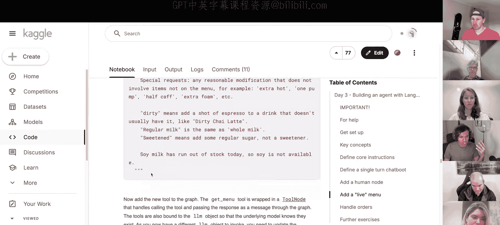

In one less diagram actually so towards the end of the coab you see that step by step we have iteratively built up a system where a chatbo chatbot is interacting with humans like taking orders providing the human and necessary information as well as whenever necessary it's invoking various tools and also doing function calling behind the scenes in order to kind of complete this application and both the human and the chatbot are able to then terminate the application so this is what this coab is about we recommend going through it more detail to to get more information about this and play around there's a lot more in store Thank you。

😊，Awesome， thank you so much for giving that great overview over function calling and L graph and how you can kind of orchestrate models with things like retval retrieval actions or looking up tables in a database or adding things to a database As I mentioned I think this is one of the most underexplored and sort of high impact high ROI things that you can do with large language models and it's really really cool to see all of it kind of laid out for people to learn and to understand in these collab notebooks thank you again to Mark McDonald for creating them and for making sure that they're incorporated into this CAgo course now I'm going to go back to our slide deck。

😊。

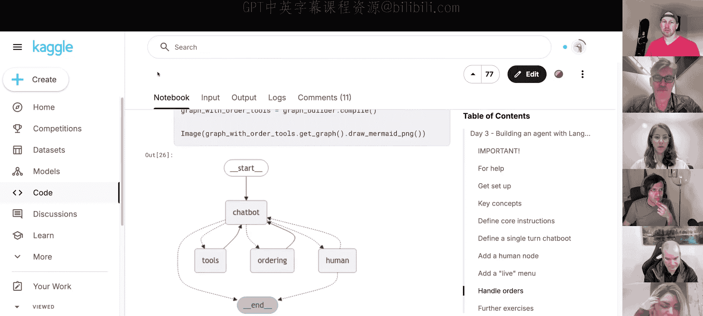

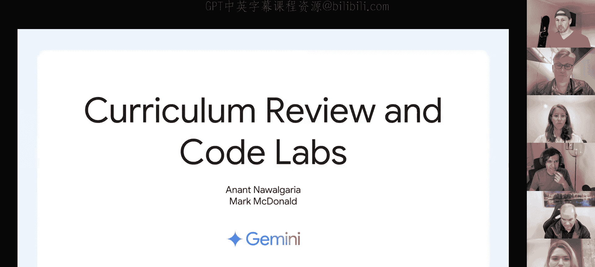

And it looks like up next we have our Q&A， so I am so excited to welcome all of our great subject matter experts here today。

 but before I do that I want to give a quick shout out and thank you to all of our wonderful moderators on the Discord channel who are answering questions tirelessly around the clock around the world the Sun never really sets on generative AI at Google so thank you to Pollong Caz。

 Mark， Eric Iwin and Miles for kind of stepping in and for helping helping debug things in realtime and also make sure to add your own questions to the Discord channel so that we can get our guest speakers for tomorrow to answer to answer those items for you as well today I'd like to I am honored and really excited to welcome our expert host Steven。

 as Steven Johnson， who is the creator of notebookbookLM West Dyer， who's the engineering lead。

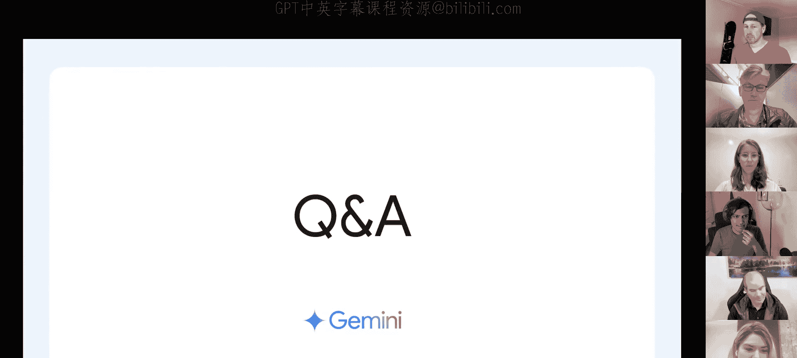

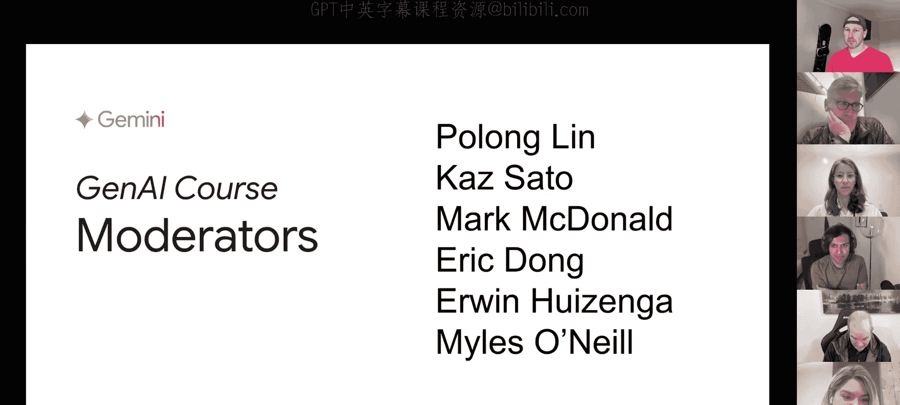

Ada team which is focused on AI kind of AI developer assistance and more for many of our Google products。

 Julia， Alan and Patrick who are kind of leading the charge for developing AI features related to agents and function calling on Google Cloud and we have a great list of questions in store for you as well so first off Stephen welcome to the generative AI In course we're really excited to have you here and also congratulations on winning I believe it's one of timess products of the year for NocalM is that correct Yes。

 one of times inventions of the year we did that just often a couple of weeks ago that's been really fun。

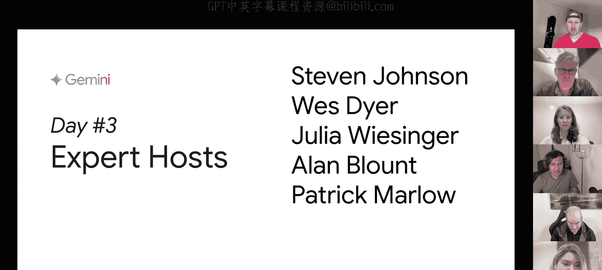

Excellent， and you are also at TEDAI， San Francisco， I believe。

 as one of the guest speakers kind of articulating some of the ways that NobookLM has been impactful and kind of driving change in the generative AI space。

 I love how it's created kind of a new paradigm that isn't just the regular old chatbot paradigm for people to interact with these models。

Yeah， that's part of the vision from the very start。

 I mean we've been working on what became notebook LM for more than two years now and the idea was like what would happen if you started from scratch to build a tool for thinking and organizing your ideas and organizing your research and potentially writing。

If you knew from the beginning that there was gonna to be a state of the art language model at the center of the product like not adding it to an existing product。

 but like start from scratch with the idea of the whole thing and we built around this incredible new technology and so that's what we ended up building and we kind of the way we kind of come to describe it is it's basically a tool for understanding things and everything in the product is designed to help you understand complex material organized ideas。

 extract insights， see patterns and from the beginning it was predicated on the idea of what we call source grounding。

 which is sometimes called rag in the industry we think source grounding is a nicer term for it but it means that you upload the sources。

 the information the documents that you need to do your work and then from that point on all your interactions with the model are grounded in the information in those documents and so we go through and we have things like inline citations so when you get an answer from the model you see all those answers have little kind of footnote。

And you can click directly on those footnotes and see the original passage。

In your sources that the model used to come up with that answer， which means that you can fact check。

 you can dive deeper and read the original source material it's just a really great way to navigate through information that was just not possible before and all of this。

I dependent on this incredible model of Gemini pro 1。5。

 both the ability to have that long context where we can put all your documents in the context window of the model and also things like citations which Gemini does kind of natively。

Awesome， I love being able to understand like very discreetly how longer context can really enable these features for creators and I know many folks many of the kind of developers that I've talked to have mentioned that they get frustrated sometimes where it can be really challenging to figure out if a large language model is hallucinating something or if it's actually referring back to content so having having those citations baked in is really compelling excellent so tell me also a little bit about what has been your favorite use case for notebookM that you've seen either within Google or outside of Google Yeah。

 I mean the thing that has been amazing for me personally is I have a single notebook where I have collected a sources 8000 quotes from books that I've read over the years and articles that I've read over the years that have been kind of part of my research。

Things like that And plus I write books in my non Googlegle life。

 and so I also have the text of a lot of the books that I've written in a single notebook so you can have like 25 million words worth of sources in a single notebook And so when I when I go to this notebook that has all these quotes and has all this material that I've written。

I can just， you know， kind of riff on ideas or ask questions and the notebook in the AI that's in that notebook basically has。

An incredible expertise in the history of my thinking。

 like 20 years of my thinking is kind of active in that notebook。

 And so whenever I'm wrestling with the new idea， I go to that notebook and I'm like， hey。

 do you think of this any sparks any connections and it'll be like， oh yeah。

 you read a book about this like seven years ago that you've totally forgotten Stephen and here's the excerpts from and here's what's relevant to it know so it feels like an extension of my brain in this way that is really powerful。

 So that's been really exciting。 and then we can talk about you know we release this new audio overview feature that came out two months ago or so and that's where you upload your sources and you generate a kind of remarkably lifelike podcast style conversation between two hosts there's another version of this at Google called Illuminate which is I believe what's being used to generate the podcasts for this course and people are just loving that feature and the craziest use case for that is that that we see a lot。

😊，People do is you upload your resume and you generate an audio overview based on your resume and the hosts are basically instructed to be engaging and enthusiastic about whatever you give them in so it's a great way to feel good about yourself because you'll upload your resume and they'll be like。

 wow， Stephen， you really had a very busy year you've accomplished so many things。Excellent。

 I I love having that that personal hype hype notebook to be celebrating all of the great successes this is wonderful and the idea that you mentioned around having kind of like a thought partner that that's basically that's basically you just you with perfect perfect memory like perfect recall for all of the different bits of information that you've experienced over the last years that's super。

 super cool and really really excited to play more if folks are interested in testing out notebook Lm what is the URL that they should go to a notebook lm。

google。com。😊，Excellent thank you so much and speaking of having kind of a personalized a personalized hyper expert as sort of companion for doing work We I have been really really enchanted with the AI features that you and your team have been baking into coab I use it literally every day both for code generation as well as fixing errors and explaining errors so thank you thank you so much for your work and then welcome also to the to the KagL generative AI intensive course。

😊，Thank you， yeah， we use it every day too as we build out more than developer features Coab and data science agent is just been really a benefit for all of us。

 one thing to kind of note is that the data science agent for CoLab that we announced back in May at IO is just the latest in a string of AI kind of enhancements to collab and all of these things really kind of do the thing same thing which is that they increase the velocity that all of us can move at when using AI tools and doing development in Collab and other places。

With more velocity， of course means we can experiment faster。

 try out more ideas and we've found as we're doing our own kind of AI， ML and data science work。

 that the primary determining factor about how much we can do and how much progress we make with the velocity of the experimentation we can have and so enhancing people's ability to have more velocity by giving them tools like the AI features is really kind of magnifies what they can do。

And specifically for the data science agent， what we announced back in May was that is that you can kind of ask a question。

 give a data set or even ask like a modeling question and of the agent and it'll go off and do a multistep process including things like importing the data。

 exploring the data， cleaning the data， visualizing it and ultimately ending up answers to questions as well as models and that kind of thing as the output then from there you can iterate and going to go on to do bigger and better things we're continuing to enhance this and bring out new ways for people to interact with it。

Excellent and and I'm assuming behind the scenes these agents are using tools like function calling and all of the great kind of the great features that we learned about during the the course of this last lesson is that correct that is absolutely correct we use function calling was retrieval all kinds of wonderful things that we've been talking about。

Excellent that that's perfect and I am very， very excited to hear that more and more AI features are going to be coming to Collab I know that it has increased my velocity personally you know magnitudes over the course of the last six months so excited to see the next features get released and the next question would be for both Stephen and We we already touched on this a little bit but how are you thinking about function calling and retrieval in the systems that you're building are these techniques and tools that are being used it sounds like they are for data science agents Stephen is retrieval getting used within NoA Kem is that one of the things that's kind of baked in to the citations process or the data recalling process。

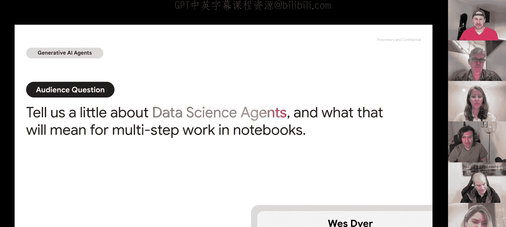

Yeah， I mean it's a little bit above my technical pay grade to get into the details of this but yes we do I mean we do this kind of semantic retrieval that's an important part of the process particularly if you have a large set of sources that exceed the amount of information that can fit in the models's context and so there's a you know we've built some quite smart tools for kind of getting the most relevant passages from your sources and then putting them in front of the model with the custom prompt that we have and so that's been something that was literally like the first feature we had back of the day it was just in a coab basically in August of 2022 you could give it some source material and ask some questions but the source material could be like a page long instead of 25 million words so we've made a little bit of progress。

Amazing I love that the kind of fundamental Lego brick building blocks that folks are learning this week are the same tools and techniques that folks are using to build the products at Google and then also external to Google this is very exciting you thank you both for the great discussion and for building the products that y'all are sharing we'll have links in the YouTube video as well for folks if they want to go and try out notebook a and then also try out the AI assististive features and ColAP。

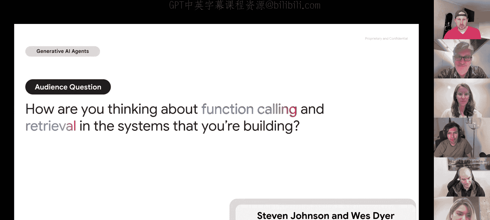

Next question， this is for Patrick and Julia， have you seen any major changes to agent compositions in production since you started writing the White paperper and thank you also for authoring the White papers that folks have been reading over the course of this last day。

 what's changed， what stayed the same and then what are the challenges and opportunities you see kind of the new exciting things coming down the road？

Yeah for sure I'll start off on that one so you know thanks for having us today you know it' it's interesting you know Julie and I have been thinking about agents for a really really long time you know way before the Gen AI you craze to foot in the world you know Julia was working on things like cognitive architectures and trying to do research on that and understand how could we implement these things in production and and I was also working on sort of like the precursor to generative AI agents and just the conversational AI space and natural language processing and stuff like that so when we started writing this paper you know it's obviously it's really hard to predict the future in the space and know like what's going to come in the next three months or six months because in the Gen AI space that's kind of like an eternity right so as we thought about you know putting you know words to paper and thinking about what are the ways that people will start kind of architecting these agents in the future。

 we thought really carefully about like what are the composition of agents going to look like？

You know what's going happen a month from now， what's gonna to happen six months from now。

 you know things like that。 And so I think the things that have stayed the same roughly are the architectures。

 you know we see that you know agents have models agents at the foundation they have tools that they have access to and then these kind of orchestration layers runtime memory goals to try to achieve these particular things so a lot of that has really stayed the same and I think we're happy to see that the paper has aged well as we've kind of written it and as things have grown over time the things that have really changed I think are the fact that the models themselves are just simply getting better and better over time know when we first started writing the paper we had some really early LLms and they were okay ish but it ended up know you had to put a lot more into your reasoning layer and your logic layer to kind of control the things that you wanted your model to do but with some of the latest models that are coming out it really just makes the orchestration layer so much more。

A lot of these models are baked in with much better tool calling。

 much better logic and reasoning abilities to do chain of thought natively abilities to do you know code execution natively and so all of that is really just making sort of like the higher level abstractions of building these agent frameworks even you know easier and easier over time so I' know Julia if you want to add anything to that。

Yeah absolutely so big plus one to everything that you know Patrick has said we've really been thinking about this for a while and I'm loving hearing all the shout outs to function calling and to tool use today because that's you been something I've been thinking about for quite a long time so really excited also to see what folks start to build with the contents of this course and I think that's a little bit what I'd love to focus on here on the challenges and opportunity side that we see。

 I think there's still so much that can happen here in this space right now you know we still see I would say them I would call them fairly simple implementations often with RaG with a handful of APIs。

 things like that and what I'm starting to see and what I'm really excited about is the ability to solve kind of complex real- worldorl problems with lots of different APIs with mutating actions with running different simulations。

 etc。And I think there's just so many industries that this can apply to and also that it goes far beyond the realm of just chat implementations per se and there's so much more that you can start to do with these things。

 if you think about industries like supply chain or security or kind of other spaces that really have kind of background processes that can also work and work and automate and when you hear things like what notebook Ellam is thinking about also going outside of that kind of frame and interaction。

Awesome thank you both so much and thank you for the great work that you've been doing to build robust function calling and tools use into the vertex AI Gemini APIs I know we've also been drawing on some of those learnings for the Gemini developer APIs so thank you thank you for making it real。

😊。

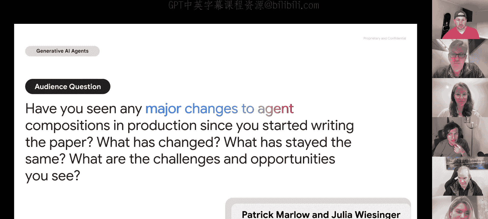

And Julia has anyone， you know， speaking of specialized domains and specialized kind of versions of function calling and toolss use。

 has anyone implemented an agent focused on security and where can I find overall guidance on implementing agents for cybersecurity？

That's a great question and as I just mentioned the security industry is a space where there's a lot of opportunities for agents I mean just think about things like threat classification tracking。

 etc， and I really think that a lot of this is just at the beginning so as far as I know we'll actually be talking about SLM tomorrow so look forward to tomorrow sessions where we'll look into I think a semiagenttic setup that can address some of those security challenges using using LLMs so more to come on that front。

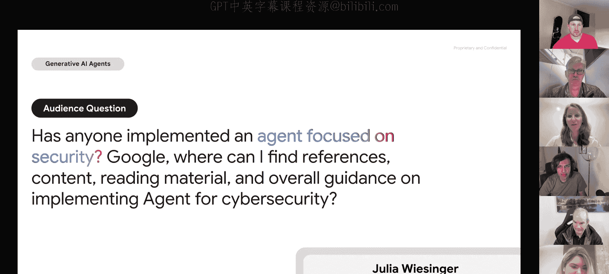

Excellent， excited to have the discussion tomorrow and also is there a way to evaluate the accuracy of the tools that Gemini selects if there are deviations whenever Gemini selects a tool。

 are there any ways to remediate and I've run into this at least a couple of times where when I specify different functions or different tools to call sometimes multiple tools might be applicable to the same problem。

 how can you start thinking about doing kind of composite tool selection or just getting additional information from the user before selecting a tool？

Yeah， absolutely and I absolutely love this question and it's something that Patrick and I spent a lot of time thinking about also as we wrote the paper。

 I think there's an entire follow-up section to do on kind of evaluation and taking these things from kind of testing to kind of production and iterating on each of these these tools from that perspective right now I'd love to kind of just do a quick shout out to actually some of the vertex AI tooling that we have around evaluation so anybody that's working kind of with function calling you can actually check out the GenI evaluation service and using kind of your prototype you can upload data and actually test kind of an evaluation outcomes to kind of get a sense of the accuracy and those kind of things ahead of time and start to see how you can kind of fiddle with the different knobs and dials in order to kind of make these things more accurate so I think folks will follow up with a link on that front。

With regards to function calling now， like specifically。

 I think that there are a couple things that are pretty generic to GenAI as a whole。

 you want to log and analyze kind of tool selection decisions over time so you want to track gemminized choices for tools。

 their user queries and then understand kind of the rationale and the patterns behind those things so that you can start to work and improve those kind of potential errors。

And then at the same time that ties directly into developing kind of those test cases with a diverse set of queries。

 so as with any JenAI product， you really want to kind of get those use cases， get those testers。

 get those people that are starting to use whatever you're building so you can see how they're using it and collect where gemnis also failing or where there's kind of issues with the tool calls so that you can then use those things to over time do things like refine the prompt engineering。

 we've had all different kinds of examples where you have to be really careful with the wording that you use in the prompt that you're putting inside。

 we've seen examples where essentially without meaning to we actually told the model not to use functions and so we just have to be really。

 really careful and by like collecting those examples。

 we can then actually look for those patterns and look to understand。

kind of what the model is doing secondly， we can obviously work on expanding and continuing to improve the tool definitions。

 so ensuring that they're really unambiguous and actually often using the model to help you help you do these things is really useful and over time you can also as you especially think about getting to production。

 you can also think about things like doing targeted learning where you're kind of fine tuning。

 Gemini or really giving it a rag-based query on a tool example ahead of time so that it knows a bit better as to what it should be doing in this case。

 so I think there's definitely some opportunities there and it's going to continue to kind of improve as the models also continue to improve。

I love that and I really do feel like you can you can get a lot of you can get a lot of alpha just by investing a lot in prompt engineering at least today and helping the using Gemini or using other models to help build the prompt to have more robust systems if folks are interested in open source options for for evaluations as well I've been really loving using promptfu which is an open source evaluations option that supports both text code and multimodalbased evaluation so we'll have the link for that in the chat as well excellent and then sorry I just jump in real quick and add a comment about evaluations people are watching this and you're curious more about evaluations we're going to be covering this on day five and our ML op section of the same course so join us in a couple of days and we'll touch more on evaluations as well。

Excellent and moving just a little bit because one of the fun things about Google offices is that to conserve energy if you don't move enough the lights go off in the back of the office so if you see me moving around that is why excellent Thank you for calling it out and get excited for day number five where we'll be discussing evaluations in more depth。

😊。

And then next question in building an agent ragG system for better responses。

 there are a lot of intermediate steps between the user query and getting a response from the large language model how can we deal with that latency Patrick and Aen do you want to take this one？

True， yeah， I mean， I think that don't forget about traditional application development best practices。

 you can invest in pre processingces， improving the quality of the data。

 improving the chunking mechanisms or whatever the details are for your data。

 and then improving the quality and performance of the search right， because ragg or。

Grounding is really all about getting the right facts or chunks into the context window of the prompt。

 So you can invest a lot in the system。When you're going to agent gen rag。

 you're basically adding more and more steps， perhaps reducing those steps through that investment is sort of standard application best practices。

Additionally， you can do tricks like execute multiple queries in parallel and you can evaluate the responses of those parallel queries and pick the most relevant answers there's some other stuff Patrick we've talked about this bunch you want to jump in Yeah I think just to add to this you know from a developer perspective。

 there's always this propensity to want to use the coolest fanciest kind of code or implementations out there。

 but a lot of times you know going back to kind of just basic system design principles and thinking about simplicity is really the right way to go and I know generative AI right now is super cool and agents are cool and rag is cool but sometimes just doing retrieval from a cache and responding with that answer is the best actual the best outcome because you have to remember that when you're building these systems for production what really matters is the outcome like the results that we're trying to achieve it doesn't matter that you。

ment the coolest most agentic system behind the scenes。

 what matters is the outcome to the users of that system and so kind of keep those things in mind as you're doing this you know traditional system design thinking around how you should be implementing this for your customers as your partners or for yourself。

could I do one more quick plug you mentioned cash A lot of people are talking about cashching the final output。

 and that's awesome right context cash is an unsung hero。

 A lot of people are not experimenting with that enough go check out long context window and context cash you can get a lot of stuff done for especially for small use cases or early prototypes There's a lot of。

😊，Opportunity and those features。 And then we cover context caching is better as some of the optimization step for retrieval and making as faster in now day one and 2。

 So go read those five papers those if you are listening for more information。😊，一点。

Excellent and I love the callout as well to use whatever tool is most appropriate for the task。

 even if it isn't necessarily like the most bleeding edge generative AI tool I've often been using function calling for calling smaller open source fine tunes models to do specialized things like image segmentation or kind of more dedicated tasks and given that they're much smaller models they're located on device can they can get much faster results than if you if you are using a much more powerful model and also often for cheaper so function calling has been a really nice win for helping right size calls to the right tools。

Awesome Paige maybe just one quick throw in there we've also seen it with calling like time series forecasting models yeah which gets really really interesting when you can get kind of a time series forecast into kind of whatever system you're you're starting to use and things like that so pretty cool plus one on that front。

Excellent， very cool and so last question before we get into our pop quiz， this is for Alan。

 when would you recommend using a minimal implementation like the GeminI API。

 versus a stateful graph based approach like using La graphraph which is an open source library that we were using in the code lab？

Sure this is sort of what we were talking about before these are just design principles right are you doing a quick prototype please just start quick like just get some ideas out there。

 play with the tools， learn the tools， see what's capable。

 see if your use case works out the lowest number of dependencies， just just get in there and play。

But it is difficult to control agentic systems and especially as the complexity grows。

Your level of effort to control that system grows， so。

I think maybe day one just use the SDK play around and get going Probably day two get invested in some kind of a system to control that behavior。

 I do like laying graph or graphbased representations It's not the only one there's lots of other frameworks out there that use graphbased representations。

 Bradboard is a great one that uses graph as config as opposed to a graph implemented in code both of these are just means of understanding what the agent is capable of doing that's like introspection。

 what might happen and observability what did the agent do what choices。

 what steps did it make etc ceter。 These are really tools to help you as a developer understand what's happening and control what's happening that's all it is So these are these are techniques that have been created to help you as a developer better understand the system that you're building and better controlling That's it So I do think play around first you don't have to invest in the system。

But adopting the system on day two is probably a good plan because by day 20。

 you will wish that you had done so。Yeah excellent and there and there are many great open source libraries being created to help with precisely these precisely these problems things like crew AI and agent ops and Lagrara I think theyre。

Jen cut， yep， lots and lots of things to help to bring reason to the chaos。

 so excited to see even more of these get built out and become more robust over time。Awesome。

 thank you all so much for our experts for giving your time for your insights and then also for writing all of the great curriculum and white papers that we've been learning from these past these past days really appreciate you in your time and thank you thank you again this has been fantastic and now without further ado。

 we are going into the pop quiz so everyone get pens。

 pencils papers something to write down your answers on and we will have six questions today I will go ahead and get started with the first what is a generative agent is it a a type of machine learning model B an application that can observe the world and act upon it using tools C and LLM that can only be used for text generation or D kind of hardware for training large language models hopefully everybody who was reading the material。

And pick out the right answer pretty quickly， but I'm going to give you five，4，3，2， one。

 hopefully everybody picked B， an application that can observe the world and act upon it using tools and function calling Que number two。

 what is the primary function of the orchestration layer and a generative AI agent is it a to generate creative text and images B to manage the agent's internal reasoning and planning process C to interact with users through a conversational interface or D to store and retrieve data from external sources。

 hopefully everybody was paying attention in the white papers I believe this might have also been mentioned in some of our code labs but I'm going to give you five。

4，3，2。1。Hopefully everybody picked B a way to manage the agent's internal reasoning and planning process。

Number three， in what scenario might a developer choose？

To use functions over extensions and a generative AI agent。

Is it a when the agent needs to make multiple API calls in a sequence。

 B when the API requires realtime interaction with the agent， C。

 when the developer needs more control over the data flow and API execution or D when the API is easily accessible by the agent's infrastructure。

 hopefully everybody was paying attention in the white papers， make sure to jot down your answer。

And it is C when the developer needs more control over the data flow and API execution Que number four we're halfway there what is the purpose of data stores in the generative AI agent is it A to store the agent's configuration settings and parameters D to provide the agent with access to dynamic and up to date information C to execute complex calculations and data transformations or D to monitor and evaluate the agent's performance over time？

Get5。4。3。2 one， and it is B to provide the agent with access to dynamic and the up to- date information。

 you know we were discussing that quite a bit yesterday and also today all of these retrieval processes are very。

 very important for making sure the agents get the right answers and also that our machine learning systems are equipped with the right data to give you the most up to- date answers。

Question number5， which is the following is not a characteristic typically associated with generative AI agents Is it A they can create new content such as text images or music B。

 they can learn from large data sets to identify patterns and generate similar content C。

 they possess inherent consciousness and understanding of the content they create or D。

 they can be used for task like translation summarization and content creation。

 which is not a characteristic typically associated with generative AI agents。

5ve。4our，3，2，1C agents do not possess inherent consciousness and understanding of the content they create。

 they are just acting on inputs and outputs not in a conscious or self deterministic way。

And then last question number six， what is the mixture of agent experts approach in agent development。

 is it A combining multiple language models with a single agent。

 B using a variety of tools to enhance agent capabilities， C。

 combining specialized agents each excelling in a particular domain or task or D integrating different reasoning frameworks within the orchestration layer。

5， four three， two， one the answer is C combining specialized agents each excelling in a particular domain or task。

 and you might have also heard of mixture of agent models or mixture of expert models rather that are sort of doing similar sorts of things that are baking together。

Many different models each each a little bit better at particular domains or tasks so hopefully everybody got 100% correct。

 if not make sure to refer back to the white papers and the different assets that we were using throughout the week so that you can you can learn and reflect and I want to thank you everyone again for taking the time to learn today and with us over this fiveday adventure make sure to tune in tomorrow where we'll be talking about domain specificific large language models and bringing on another great great round of guest speakers and learning a lot more about SLM and some of the other domain specific models that Julia was mentioning earlier so thank you again and we will see you tomorrow。

