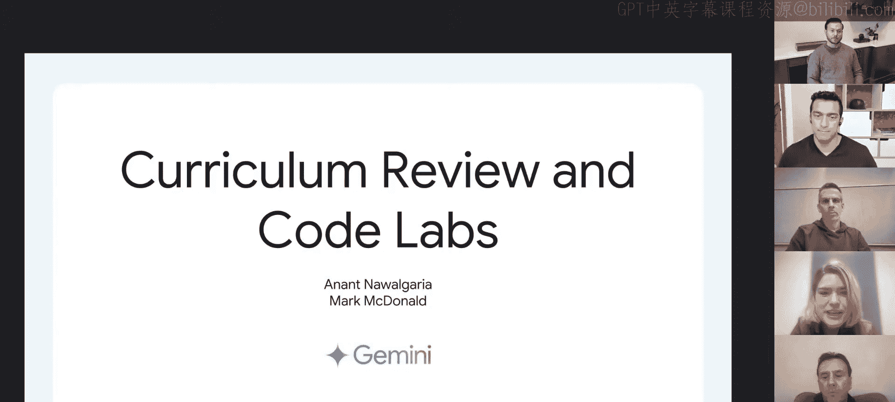
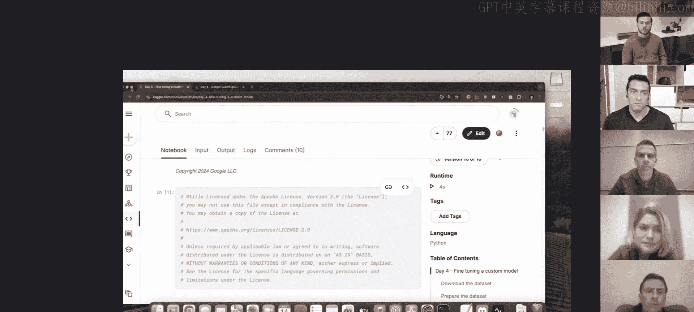
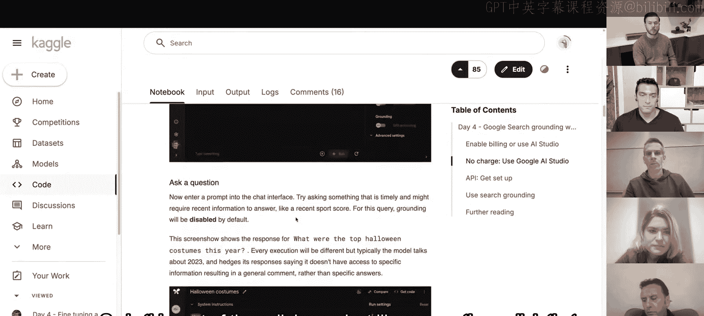
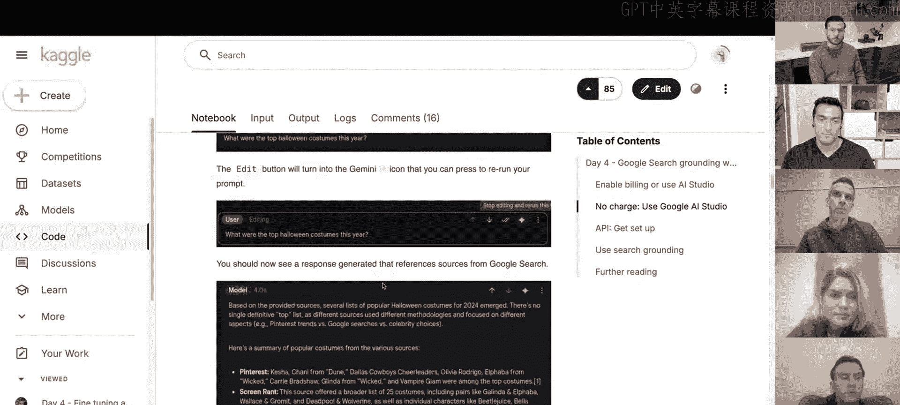
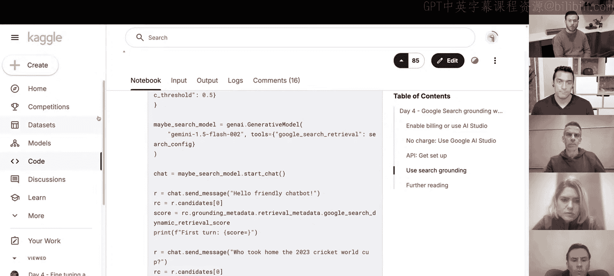

# Kaggle&Gemini《生成式AI五天快速课程｜5-Day Gen AI Intensive Course  Kaggle》deepseek翻译 - P4：Day 4 Livestream with Paige Bailey – 5-Day Gen AI Intensive Course _ Kaggle.zh_e - GPT中英字幕课程资源 - BV1tUmYYKEUs

Welcome everyone to our fourth day of the CaL generative AI intensivetenive course。

 which is all about domainspecific large language models and how you can fine tune and customize large language models to be exactly right for your use cases My name is Paige and I'm really excited to be here today to get to introduce you to all of our expert question answers and also to have walk through through all of our code labs and our coabs for generative AI intensive courses just as a reminder for our course overview this is a fiveday generative AI intensive course with Google sponsored by Caggle and the Gemini team we are on date number four and this course includes a collection of daily assignments so some podcasts and some white papers that I hope you had a chance to walk through some Discord discussion so a place where you can ask questions get them answered and also perhaps even have them answered by one of our expert hosts live as one as one of our daily videos。

And also a lot of additional resources for you to go to look at to learn more today as I mentioned。

 we're going to be learning all about fine tuning domainspecific LLMs so being able to take a new data use it with something like Laura fine tuning or a different approach to make a large language model especially effective for your use case and we'll be walking through some code labs in a few short moments that demonstrate how to do this so tomorrow we'll be going into MLOs for generative AI but today we're going to be learning all about SLM meedPm and have some insights from their very researchers who built them so with that I am going to go ahead and introduce AnN who will be walking through the curriculum review and also our code labs with a special thank you to Mark McDonald who helped who helped build them and create the content so Anant do you want to go ahead。

Share your screen and start walking folks through the walking folks through the code。

Yeah but before we do that page， I wanted to welcome everyone and before we start off on the code lab。

 I wanted to quickly give you a recap of what we are going to be covering today the code lab the white paper behind it as well as the quick recap of the previous days and how it all fits together so as you might have if you've been following through day one。

 day one we covered foundational models， how they built。

 trained the applications etc and on day two we looked at embeddings and how you can represent complex objects in a compact semantic space and how they can bequeted and managed that scale and yesterday in day three。

 we looked at how both of them come together to can come together make dynamic agents which allow LLMs to be used for applications where they need to dynamically refer to different sources use tools and function calling in order to achieve tasks which are not directly。

😊，Sable through LLms alone。And now today you might have read the white paper on descend around around domainspec models。

 specifically in the security and healthcare domain and they kind of combined the concepts we learned on the previous days and that's what we diving into today and the code labs will be about so we began the white paper by exploring the challenges faced in healthcare by imagining the complexity of diagnosing a patient accurately where you need to consider all of their sentence medical history and test results this requiress often a deep understanding not only medical concepts but also the ability to retrieve relevant information and reasoning skills to arrive at the correct conclusion right so we then discussed how MLM tackles this highlighting its journey through passing the US medical licensing exam to its。

For real world clinical impacts such as assisting doctors with various tasks such as diagnosis and treatment planning。

 we also touched upon the crucial need for long form answers。

 understanding medical records and engaging in basically what becomes of natural dialogues with patients。

 not just robotic mechanical ones。😊，Then in the white paperper。

 we shifted gears to cybersecurity where we explored how practitioners are constantly battling what we call the three Ts threats。

 toil and talent。 So to elaborate further imagine a security analyst just sifting through mountains of alerts trying to identify real attacks from harmless anomalies This is essentially the reality behind toil in cybersecurity。

 And if you add to that the constant evolution of cyber threats and global shortage of skilled professionals you have basically a recipe for burnout and vulnerability。

 So in this part of the white paper， we delved into how secLm heads by analyzing malicious code。

 automating alert triage and even generating reports from free up human analysts to focus on more strategic and important tasks that they would be required for。

 and we also explored in this white paper the unique features of both and secLm that make them so effective as。

😊，As well as MePM， we discussed also that how these specialized language models are trained on vast amounts of medical and cybersecurity data。

 enabling them to understand the nuances of their domains。

 we also examined how they leverage planning and reasoning frameworks to break down complex tasks into small manageable steps。

 much like how we as humans would human experts would。😊，And towards the end。

 we touched upon responsible deployment of these powerful AI models in real world settings and emphasize the importance of how evaluation and basically to address potential biases and also ensuring that they IU safely and ethically to improve patient care and strengthen cybersecurity defenses so hopefully that give you a good overview of the content that we covered in this white paper and let us now jump into the cos and see how how it all fits together in the wider scheme of things。

😊，So give me one second。

Okay。Hope everybody can see my screen。So the first coab。Both are around。

Sorry so was on Google search grounding and this collab basically talks about how you can use grounding techniques such as Google search grounding to improve the accuracy and reduce hallation for large language models in the secLM side of things grounding is used as well。

 so you'll hear more about that or read it in the white paper later。

So in this part of the coab just like every other coab that we have gone through before。

 we start off by initializing sorry this part of the co first start off by seeing how the AI studio side of things work so if if you use the UI and AI studio you can also try out grounding there through the user interface but well be focusing more on the API side of things。

 so just like every other coab we are initializing installing the respective libraries retrieving the Google AI Studio API key through Ca secrets importing the essay say libraries as well。

And then comes to interesting parts。 So first we explore the various models available to us because for this collab we are really be using the standard models that we have in the previous days。

 however we'll be augmenting them with grounding so specifically Google search grounding where the through the interface to the SDK interface will be。

😊，Ally grounding the responses on Google search， hence improving and improving the not only the quality。

 but also be getting sources and citations from Google search to kind of understand which parts of the answer can be attributed to which search results。

So if you've tried it out， you would see that like Taylor Swift。

 like if you asked when and where is a Taylor Swift's next concept。

 this is often something that requires dynamic and realtime information in the tool we looked at how Ra can help provide this So providing dynamic and realtime information is something because LLMs are trained that is still a certain point in time and they might not have the latest information。

 and if you ask the model it can give you a response。

 either an incorrect response or mention that it doesn't have real time information and point you to various sources。

 however， that is not the answer probably that you are looking for So moving on in the part after that enable we give it a tool like tools which was discussed yesterday in the agents chapter you might remember that we are giving it a tool called Google search retrieval and then repeating the same question and you would see then it manages to come up with a specific more accurate answer。

😊，AndBut having the answer is good， but how would you know you can trust the answer based on actual sources and that's where you can dive deeper into the metadata provided by this service and you can see they gives you various links and results based on the query you ask as well as you can also getting not only the links which were you to generate the answer。

 the sources but you can also see which parts， I mean depending on which question you ask which parts was were used for generating the sources for generating the sources and which part of the answer you can attribute it to as well。

So this is what essentially this coab is primarily about about generating grounded text and getting citations for certain segments of the output answers。

 and this is essentially what majorly this coab covers。

 Now that was static grounding where we kind kind of ask the model to ground every answer in Google search results。

 but they might be scenarios where you want to strategically ground the results based on if it requires grounding or not。

 So the answers to the model is unable to answer properly or appropriately based without grounding you probably don't want to differ to grounding for。

 and this is where like you can kind of supply the model with the threshold and the model then automatically manages to like redirect to the grounding service or not based on how confident it is in its answer。

 So that is essentially what。😊，Part of the coab is about so using grounding to to improve reduce hallucinations and improve the quality of your results。

 if you have the second NM part of things in the white paper use grounding and you can utilize it in your applications as well。

Give me。So moving on to the other coab， which talks about fine tuning a custom model and this part of the coab talks about fine tuning a custom model。

 and it does so by by。

Using parametermeter efficient fine tuning techniques like what you learned on the first day。

 where you can fine tune the Gemini module on your own corpus and it can help it perform better on unseen tasks。

So we start off by initializing the API key， as usual， in importing it through the KaL secrets。

 exploring the various available models。😊，And now just like we we saw on day 2。

 we're using the same news groups text data set， which contains over 18000。😊。

News group posts on 20 topics and we'll be be well be classifying the news group posts into various categories。

 It's essentially a classification problem based on their on their text。

 So just like the second day we will be preparing the will be cleaning cleaning the data to remove any obvious signals of the category。

 the the news news post belongs to to make it be relevant fairly and yeah that's the same as the day two data。

 And then we'll be sampling certain rows for training and also for testing。 Remember。

 parameter efficient fine tuning is very data efficient。

 So you do not need as many rows as you did for the bedding model is even more data efficient。

 So we only keep 50 rows for training。 That's also one of the things youd like to highlight here。

 and then we。😊，Keep some for testing as well。Now， in order to understand how fine tuning can help improve performance。

 it's good to have a baseline to see how the model would behave or what the classification performance would be with zero short classification before fine tuning。

 So this is what we do in this part of the coab where we we have the model do zero short classification by asking it from which news group does the following message originate。

 And give it a few options and and we do a bit more prompt engineering here to make it more like specific and but however。

 either way， as you can see here。 and we the accuracy is only around。😊，In 18。75%。

 that is without parameter efficient fine tuning now if we repeat the same process， but after tuning。

 if we repeat the same evaluation process， but after fine tuning。

 the model on input output pairs examples is 50 examples we took which contain like news group posts and their respective categories。

 you can see that the evaluation。Evaluation of the model evaluation classification performance of the model improve significantly and this can be a major advantage。

 especially in scenarios where your tasks are not exactly something the model has seen before。😊。

Now you can of course， improve performance with prompt engineering as well as you've seen in the first day。

 so I would recommend play around and you can see that later。😊，Now， moving ahead。

 there is another advantage to parameter efficient fine tuning， which is not often site。

 which you'll also see in this part of the coab， which is that it can be used to reduce the amount of tokens generated and especially since when you use the paid version of these APIs you charged on both the length of the input as well as the generated output it helps to reduce the length of length of both sides。

 especially because you could influence the output input output length quite a lot and because we trained or parameter efficient trained the model to be very well let's say size efficient in its input mapping from its input to output。

 because we do not need additional prompt engineering on the input side。

 we can see that we saved quite a lot on the token because the inputs were shorter and hence you spent less on the input size。

So yeah， that would be all please take away my screen share page。😊，POh yes。

 I think the I think you're you have to stop sharing your screen and not unfortunately I can't I can't take it away for you。

Okay， there we go Excel good job I the I loved the code labs。

 I especially love this new search grounding feature I think it's going to be really helpful for everyone who wants to incorporate kind of more grounded up-to-date current information with Gemini and it's as easy as just making one modification like one line change and a function so this is very。

 very cool to see I think people can test it out today and AI studio which is great and then also VR As though I do believe there might be a paid tier associated with the As so that is fantastic Thank you so much all right and now it's time for our Q&A with our expert hosts from the MPm and secondM teams really excited to have everyone here today to talk a little bit about how they've been using fine- tuneuned LLM specifically for their customers and for their use cases but before we get into the Q&A I want to give a special shout out to all of our generative AI。

Course moderators to Pollong Cause， Mark， Eric Irwin Miles and Gem who have been tirelessly answering questions in the Discord chat as well as answering questions on YouTube and on Cagel specifically related to the course content the Sun never really sleeps on the Gemini and generative AI teams at Google and I'm sure you all have experienced that as you've been asking questions on Discord so thanks so much virtual round of applause to all of our expert our expert moderators and now we're going to get into our day for our day for guests for Scott。

 Christopher Umesh and Antonio folks from places as varied at Google as Health AI with the MedPalm work as well as SLM doing AI is applied to security domains and then also our office of the cloud CTO so really excited to have everyone here today and thank you so much for taking the time to come in and to talk to all of our generative AI intensive course learners。

About what you've been working on， I'm going to start with our first question。

 which is for Ush and for Scott， tell me a little bit about large language models for security。

 what are they and why are they useful？Yeah， great happy to be here Just a quick little bit of background for me。

 I run the data science research team in Google Cloud security that builds SeM and I've actually been working in this space of MLL applied to security here for going on 2022 years now so Ive seen quite the progression LOMs is definitely like an interesting new area for us so this question is like very much pertinent and very top of mind for the entire field honestly and so you know I think probably the way to start is to think about well like what makes cybersecurity a little bit different than some of the other sort of typical business areas where an LOM would be applied。

I think the first thing to note is that in cybersecurity it's not one big monolithic thing。

 there's actually tons of different tasks that people perform on a day- to- day basis to do cybersecurity work。

 everything from doing binary code analysis and malware analysis to triaging alerts to you know doing more DevOs style administration of your network and so you know the tools。

 the data that's being used， the sheer diversity of different tools and data。

 you know really make this kind of。Interesting in that you don't really get this like overwhelming momentum of data of public data available as you would in a lot of other cases for LOms。

 Another kind of confounding factor here is that a lot of that data is typically considered to be highly sensitive by organizations security is normally people's you know right next to health and PI is pretty much right right there on the list of things that they don't want to have revealed publicly。

 which again， further reduces the potential for what's available publicly for us And then the last thing is that you know if you think about a lot of the tasks that threat researchers and malware analysts do。

 they oftentimes border like right on the edge of what you might call safety mechanisms in the more general sense。

 right so if you're doing malware analysis or you're trying to develop a plan for red teaming your network。

 those seem an awful lot like things that would trigger a safety。And they often do。

 And so the combination of all these things taken together means that， you know。

 it's really hard for a generalist model to really have an expert level of understanding and reasoning about all this variety of data such that it really covers all these customer needs that you might have。

So that kind of is the motivation behind it you know you know what it is specifically you can kind of think about starting at one of these foundational models。

 but we have a continued pretraining task where we kind of feed it more special specialized expert level books and documents about cybersecurity to just kind of build its vocabulary in that space and then we have a bunch of very specific fine tuning tasks so we do full parameter fine tuning but these instruction tuning type of tasks are very much pointed at these areas where the generalist model is unlikely to have seen or be exposed to things so like for instance analyzing very longform security alerts and really truly understanding you know not just from inferring what the keys and values are but actually truly understanding what's happening in the alert once that's done we have an human alignment process which again is a really interesting thought because when you're you have such a diverse。

Area as cybersecurity， there's lots of different humans with lots of different interests in what they want the model to actually be providing to them so like a threat analyst might be different than a security operations analyst。

And then finally， we often leverage fine tuning， as aO had mentioned， you。

 we use Lauraura based fine tuning to do basically specialization towards either specific customer environments or tasks that maybe are particularly out of distribution for the core models and kind of need a little more extra reinforcement somehow。

You knowI think they're particularly useful because frankly。

 even though the generalist models might be able to get you there。

 you know they might be able to provide an answer in a lot of cases。

 the rate of hallucination for those answers tends to be higher than if you're just use a specialized model and in some cases it just simply cannot actually perform the tasks at all in any sort of reasonable way like we have you know a number of specialized domain specific languages query languages that you know is very very important to pull new data using and unfortunately because they're poorly represented in sort of the public internet。

 the models simply don't really know what to do like oftentimes will just spit out SQL but you can't use SQL in these instances you have to have the specialized language So that's I think sort of the what and the why of using it I will say here though that one last bit is that I think a lot of people think of LOMs as like memorization machines like let's pack as much information。

And as we can and that's actually the opposite of what our thought process is We actually are very much focused on it performing tasks on data rather than it memorizing something and the reason for that is you know as Ananot mentioned in his intro was you know threats evolve on a daily basis so you could easily imagine how this is going to totally blow up in our face if we try to like。

Give it the most latest information on threats every single day will be basically retraining an LLM every 24 hours in order to try to make it relevant and that's clearly not my viable option。

That's wonderful， I love that you call out how the pretraining data kind of the information that the base models are trained on is really。

 really sort of security use cases are underrepresented。

 which means that the model as part of its pretraining process never learns how to do those kinds of tasks or if it does learn。

 it might learn only kind of the most sort of remedial 100101 level steps as opposed to to the more detailed like enterprise grade security kind of challenges that y'all are trying to tackle or only the most important you know the most well used or popular tools that are out there and ignoring the very long tail of things that people have in their environment。

Excellent， so so next for the next question， let's go to let's take a sort of turn to the healthcare space Chris。

 how are you thinking about benchmarks like Med QA and when will we reach 100% on Med QA。Thanks Pa。

 hi I'm Chris， I'm working in Google Research on Health AI and for as you've seen in the White papers。

 basically a couple of years ago， we published our first medical model MedP。

 which was the first model to achieve a passing mark on MeQA and MeedQA just for context。

 is basically a multiple choice test that is similar to questions taken by medical students for the license exam。

It is a few sentences describing a scenario， a patient with a couple of lab values or a couple of symptoms and so on。

 and then three to five options on what the right answer is。 and then just。

Many 1 hundred0 questions of those， and then you get a benchmark overall。

And the big upside of the benchmark is that this was attempted for many decades。

 so we have a good comparison across many technology evolutions on how good or not good technology was able to get there。

 like 10%，20% correct and so on。And if you look forward to a year or two ago。

 it reached the passing bar， it reached the expert level bar。

 and if you look like today a couple of models， including Gemini， for instance。

 are achieving the 90% wage of answers。The big downside is it's a little bit of an artificial scenario。

 like the patient information is very compressed， while， for instance， in reality。

 a patient information is like a full health record of many years and met images and lab values and so on。

And secondly， it's multiple choice， which is easy to compare。

 so it's very good to evaluate it automatically， but it's not very realistic。

 like most doctors don't have multiple choice available when they look at the real case。

So are we going to be 100% on benchmarks like MQA， probably somebodys going to get there。

I would attach some questions so whether it memorized how to answer test questions。

 whether how to really reason understand medical knowledge。

But what I really anticipate is going to happen more and more is that we are moving on once a benchmark reached a 90% bar。

 that we're moving on to more sophisticated or a benchmarks or benchmarks that are much closer to reality So for instance。

 if you look at the papers of the last year from our group。

 you saw like many more medical imaging tasks or you saw like hard case challenges where you see a full patient scenario and you need to come up with a diagnosis or treatment recommendation for the sake of understanding whether the models could do those kind of tasks。

So that's my real hope that we're moving on to more and more complex benchmarks and sophisticated benchmarks。

 and I assume Me UA， yeah somebody will reach 10%， but I don't see that as a very important milestone anymore as such。

I love that you call out that we need better benchmarks。

 especially for these highly highly specialized expert tasks。

 because to your point the multiple choice questions。

 it would be beautiful if life was as simple as a multiple choice question answering test。

 but and fortunate you know the world is a little bit more complex for that。

 so I hope folks listening today are inspired to create better medical benchmarks for large language models。

 especially especially things that are a bit more complex than multiple choice Q&A。Awesome。

So next question， this is for Antonio， welcome Antonio is one of the leads in our Google Cloud Office of the CTO Antonio what are the tradeoffs that you've seen between general purpose and fine tuneund models or is it that fine tuneed models are eventually just going to have all of their knowledge baked into the base models themselves？

Well， thanks for the question well perhaps first I introduce myself。

 I work for office of the CTO an organization in cloud。

And all my life I was working in AI before working in Cloud I was working in search。

 I went to check when was my first paper in search was 27 years ago， so a long， long time ago。

 a lot of changes in AI in this period， well in the last three。

 four years I would say that we saw a number of models， always increasing in size。

And today the situation is that we have models that are very large and able to deal with complex queries。

 very complex prompts， for instance， Gemini Pro is such a model and we have models that are more efficient。

Still able to deal with complex queries， but more efficient from the point of your latency from the point of your cost。

 and so there is a need to balance and take tradeoffs in these models and people are normally looking at you know when they make these trade offs they look at different dimensions。

Including， for instance， the quality of the answer， the cost of serving the answer。

 the speed I mean the laency。And there is a need to very frequently to simultaneously optimize these multiple dimensions。

 so the reason why there is an interest in specific domain models is because you can not have some good gains with model smaller but specialize it in particular in particular domains。

And so for instance， security and medicine are two examples， but there are many other examples。

The good news is that today there are a broad range of tools that we can use to do this you can start with fine tuning there were discussions about fine tuning earlier and today and also in the previous days where you essentially take a moder is already trainer then you adopt this model to a specific domain providing some example in the specific domain。

This is if you think about this， this is a form of semit adaptation you were mentioning before that。

 you know， find is happening at a specific moment in time。

 so it's this a snapshot of what the situation up to that particular point。

Sometimes this works really， very well， there are situations where you want to have more dynamic information。

And so perhaps some information is provided in context。

When you do inference for or when you submit the prompt。

 and there are techniques like retrieval augmentation of based on search can help a lot。Or also。

 you know， in context learning where you provide this additional information prompt time。

 perhaps using。Techniques like caching to improve the efficiency reduce the cost。

I would say that there are multiple options to optimize and really depends on the specific use case。

 but I see a balance between these these different dimensions happening more and more。Yeah。Awesome。

 thank you thank you for the great answer I agree that I'm just going to reshare my slide deck really quick。

 I agree that the fine tuning fine tuning for large language models can get significant gains that maybe maybe you might not be able to get just by using the base model so lots of options for fine tuning both offered through Google Cloud as well as open source frameworks like Unsloth so hopefully that will get addressed。

😊，Next question kind of related for Christopher to answer is will a single superior model solve all health problems。

 this seems like an ambitious goal even for large language models and for generative AI。

Yeah all health problems is a very broad scope but the way I like to think about it is to take a little bit of a perspective before Chei so if you just zoom out over the last couple of hundred years。

 clinical studies did not exist a couple of hundred years ago。

 vaccines did not exist a couple of hundred years ago。

 regular visits for for preemptive care did not exist a couple of hundred years ago。

 so many things that we are using nowadays in modern healthcare did not exist in the past and had to be invented。

And when I hear about people thinking about using Jen in healthcare。

 I hear a good chunk of use cases where they basically try to make something more efficient or make something better。

 like use this and this to help the doctor， write to reply to the patient faster。

 use this and that for the patient to help them educate themselves better。

 use this for a medical imaging tasks and so on。AndThose are all good and I think it will improve things but what I'm waiting for is both the scientific discoveries。

 but also the different pathways of care that are possible now that would not have been possible before models like Gemini or Gemini metPM So this is really the big step in healthcare that I anticipate to happen in the next 10 years we'm really hoping for a lot of innovations and and inventions to come along will healthcare be solved at that time。

 no that's a journey for lifetime but it will get closer so but my short message is incremental improvements and efficiency improvements are important but they are not the only thing we can do and thinking different as in what is possible now that was impossible to think about in the past those are the things we need to explore。

I love it and that's very inspiring it also seems it seems to hint that we're just at the beginning of this journey and that we still have a lot of untapped opportunity for people to apply AI and the healthcare domain as well as to many other specialized domains so really really excited to see what the next few years hold。

嗯。Next question， another one for security， it's inherently an adversarial field。

 does the adversarial nature change your strategies for where and how you deploy large language models for security purposes and how has this changed over time。

 you know you mentioned， I believe Scott that you had started doing this a couple of decades ago。

 how has the sort of perspective on where large language models do their inference changed over time？

Yeah， that's that's a good question。 Yeah I'll give Umeher a chance to respond as well。

 but you know I think the big thing is that you know a couple decades ago。

 no one even saw the adversarial you know sort of vulnerability that M could provide right I think I guess now it's like 15。

12 years ago something like that， some of the first evasion papers came out and people realize that oh wow。

 this is actually possible to just get around all of this M that we're using and I think you know to some degree that LLms are an extension of that right it's a new a new attack surface so to speak that we now have to continue monitoring and kind of look out for how we incorporate into our tool chain。

Yeah， I'll add to what Scott said。If you build any kind of application。

 you have to think about security。And whenever you take dependencies on external sources of things。

 then you need to consider， you know where is that coming from。

 what's the likelihood that it could be compromised or malicious and that includes things like if you include open source libraries in your code。

Right？It includes if you're taking input from a user that might be trying to do something bad to your system。

 you have to sanitize the input and use it carefully and correctly。

All those same principles still apply。In this world。

 it's just that there's new and different ways that people are going to exploit them。 So。

 for example， you know， maybe it's not the open source well。

 it might also be the open source code that you're using。

 but the data that goes into training a model very often is sourced from external places right because you can't generate enough just。

In yourself to get the results that you want。And so you have to be very careful about you know。

 cleaning that data， ensuring its accuracy， ensuring it meets your safety standards and so forth。

The runtime part also exists right so in the same way that people could try to craft kind of malicious inputs to systems。

 you think about things like SQL injection as a classic attack of that kind where you're injecting something which you know downstream will end up in a SQL query and someone wasn't careful and now you're able to kind of change the query to be what you want to do away from what the application author wanted to do。

The analog of that roughly is prompt injection in the world of LLMs and it's just that instead of being SQL。

 it's natural language and what's particularly challenging about that is both the user input language is natural language and the programming language of the LLMs also natural language and so when they come together it can be hard to isolate one from the other and ensure that it's doing what you want。

 considering this user input but not in the wrong way。

And you know there's no fundamental fix for this yet， people are trying lots of techniques。

 they're trying to make it more resistant to these things by training away some of it and by just doing sort of heuristic scanning of inputs does this look suspicious。

 right but other techniques that we're employing inside the system such as decomposing a problem into smaller parts？

Where many of the maybe that user input only goes to like one of those subcomps。

And if you can say confine that particular input to that subcomponent and the output of the component is something more like structured data。

 like what is the likelihood of this being militias zero to1， let's just say as an example。

Then you've effectively confined the impact of that input to just it can affect this number and of course you'd like the number to still be correct。

 but at the worst it'll be the wrong number， but when you look at the broader analysis that the system is performing。

 it's not going to affect like the overall plan and the instructions that are actually getting executed。

 right which is the kind of thing that in general， a prompt injection can do。And so， you know。

 we're actually looking at a variety of these kinds of techniques and it's in an area of very active research。

I love the sort of example that you gave of using models almost help with to help with the defensive testing of hey。

 you know here's an input from a user， does this input look malicious or not and then also decomposing the higher level tasks into steps to reduce the likelihood that if there is something malicious that it would impact the entire system as opposed to just a small part that's really interesting。

 and I think it points towards how people need to completely rethink how they architect systems in this new world of large language models。

Very， very cool。So next question this is for Christopher。

 what are the ethical considerations when creating specialized large language models for sensitive fields like healthcare and how can you ensure that patient privacy and data security are maintained during training and also deployment so you know especially if you're working with things that might be usually interfaced with as arrest API as opposed to kind of co-located locally ons site at a hospital。

 how are you all thinking about that？Yeah， so for the answers are I will answer training and deployment separately quickly so for deployment there's in many countries local regulation you can rely on where you're serving infrastructure simply has to be compliant with that so US for example has the HIPA framework and Google Cloud infrastructure is compliant with that so that ensures that the data privacy for the patient data or other data as well is handled appropriately doing serving time as you might use the data as part of your pump and so on。

For training， we usually use the identified data or synthetic data。

 so again there are standards per entry on what this precisely means。

 but you can see the basics are obviously you know no names， state shifting and stuff like that。

And that is for two reasons， one is because it makes a lot of sense from a patient privacy perspective。

 but the second thing is also there's something about data hygiene。

 like the more detailed individual data you have in your training mixture。

 the more likely the model might pick up not only the channel patterns but also random oballs that lower your performance of the model。

So deing the wide level of abstraction， not only with identification。

 but also with proper education and so on is crucial for model performance and also crucial for making sure that no personal data leaks into the model itself。

Awesome that's great to hear and I love the call out towards some of the additional security best practices that Google Cloud employs for making things hipIA compliant and making sure that you know data is encrypted in transit and all of that good stuff。

 excellent。Next question， also for our SLM team， what do you think is the most effective use of large language models in solving security problems and why what has been some of your favorite use cases for AI and the security domain？

What don't I start and then Scott can pick it up as well？

I think Scott really touched on a key point earlier， which is。

We see LLMs really unlocking the ability to perform security tasks。

Like that procedural knowledge that we can teach it being even more powerful than kind of the you know factual knowledge that the thing might have because in any case you can't rely on the factual knowledge that you think in LLM as anyway。

 right you need to ground it in something authoritative if you want that thing to be taken as true。

 you have to say it right there in the prompt to have a high confidence right and you want to make sure that it's not relying on potentially you know hallucinated information as well。

And so we take a very strong grounding approach to anything factual。

And what we really are seeing is that there's whole workflows where， you know， we're like， okay。

 what is a person doing all the time that they would rather not be doing right that we think one of these systems could do。

 and maybe actually we could do 70% of it。We have kind of good data sources。

 we have some historical examples， we have some code。

 regular deterministic code that can do a lot of it， but there's some key part that it can't do。

Right， like you know， render some aggregate judgment among multiple things。

 figuring out how to use the tools that we already have available effectively。

Being able to do that iteratively until you reach a point where you're ready to make a judgment。

Those kinds of capabilities are pretty hard to write in regular code。

And so I think we're really seeing a big improvement there。

 another one is definitely in the area of code， you know， code analysis。

 I think Scott alluded to for analyzing potentially malicious things。

 it' already proving to be very effective。And then for cogeneration that's another one of those big missing blocks right。

 so I say every year someone has the idea of oh we already know that people have all these potential misconfigurations in their cloud deployments like they've overpermissioned some account。

We should just fix it for them。Okay， but the problem is that actual fix means you have to generate a pull request to modify a terraform file that's in the customer environment somewhere。

And that is just not a thing we were easily able to do because everyone writes theirterform a little bit differently and it needs to be a contextual change that has a certain impact。

But with the abdomen of LLMs， that is something that we now believe we're going to be able to do and so that's very transformative even though it's like in some that's one block。

Out of the whole thing， it's what makes that end to end thing possible。

Yeah I was just Ill just add in like my view of it is very much that the LLM is sort of your substrate right it is the thing that's the connectedive tissue among all of these diverse systems that exist inside of security because that level of diversity is exactly what causes all the pain for most actual humans the fact that you have to swivel between that system and that system or that data silo and you need to find a way to get it to merge with that data silo and it's exactly what LOMs are great at leveraging the APIs and the tools that are available to them and being able to combine all this heterogeneous data in a way that's coherent and reasonable given enough prior experience with exactly what Umesh was saying like this procedural knowledge about what exactly you should be looking for and what it means for your final determination。

And I think it's also important to point out that when we refer to customers for Google Cloud。

 we need whole organizations， whole companies and so just knowing that the models are able to flexibly you change and modify their outputs and their recommendations at the company level is really really huge as opposed to having to have dedicated heuristics and rules made for each particular company。

 so that's huge， this is also a nice tie in to our next question。

 which is what is still one major gap that you see in large language model capabilities that make it that is vital for success in the security domain but is a place where the models just aren't there yet and we've touched on this a little bit throughout the duration of the chat but would love would love to get your perspective explicitly Yeah now this is a really good question because you。

Anybody who's worked in the security domain， you'll probably come to realize that most people who work in cybersecurity are by their very nature incredibly skeptical about everything right like unless there's clear proof that something has happened you know they're always like I should go look into this further it's actually been one of the most difficult points of getting M broadly speaking into this space is this idea of explainability and can you trust it and how do I verify and I think LOms just add a new dimension to this right So we mentioned this idea of citations or like grounding and that's certainly one way of thinking about it right it certainly goes partway in my opinion the problem is that with grounding in a lot of cases and especially in the way it's usually used in citations is that human almost has to do almost as much work as they probably had to do to start with to verify all the things especially for highly technical fields right so like if I'm site。

All of these， you know， threat actor reports or different reports that are coming out from Mandy and or other organizations then like。

I either have to trust that in fact， this statement that it being cited is there and it is the implication of what's in the report or I need to go back and just basically read the report myself in which case how much time am I really saving So I think there's definitely like a broad gap here which is like how do you shortcut some of that stuff How do you make it so that even in a space where you know it's hard to validate or verify in some ways we can minimize that amount of time for verification or even do things like provide a really deep understanding like a confidence score。

 I know a lot of people think of like log likelihoods but that's not really quite it because that's just your probability of producing a particular output token sequence What I'm saying is like can you actually bake in your confidence in the underlying grounding data your confidence in the reasoning that you applied in the same way that a human analyst would do these sorts of things and I think that's the gap。

😊，Or if we can make that change， that that's going to unlock a tremendous amount of value for customers and users of these systems。

Yeah， I mean Scott gave a fantastic big picture answer。

 I'll give maybe a slightly smaller picture answer as well in terms of capabilities so I again just to refer to what Scott said in his previous answer。

The ability to stitch together tools， data sources。

 APIs to pull everything that's relevant and then render judgment is absolutely critical to solving most security problems。

And today， tool use by LLMs is still fairly rudimentary and takes a lot of kind of hand tuning to get it to use those tools effectively。

Right it's not a case where you can say here's the API， here's some examples， you know。

 go use these things effectively， and that is particularly acute because in many cases the API services that we're dealing with are very wide。

Meaning， the schemas that are used to describe information can have hundreds or thousands of fields。

 and each one of them can have some semantic meaning。And a lot of the stuff that we've seen in。

 you know， tool use by LMs today is like very， I would say very simple rudimentary APIs where it's like three parameters。

 their strings， you get back a sort of simple answer。

And even that has proven difficult to integrate across APIs in a way that doesn't require a lot of handcrafting for each one。

I feel like if we could crack that nut。And。In a scalable way， just start handing tools。

 pre existingisting tools to an LLM and it could actually understand and use them。

 that would be game changing。so that is something that folks on this course have been learning about a little bit earlier in the week about function calling and tools use and learning just how challenging it can be to get models to use tools reliably and to know which tool to use and when。

So I think this is another inspiration that in addition to better benchmarks and EVs for the medical domain。

 hopefully folks are starting to think about better EVs for tools use and for function calling as well。

 especially for composite tools use and function calling。

Excellent well thank you thank you both so much and our final question for Christopher all about MedPalm I saw the MedP evaluation White paper on diagnosing depression and PTSD using client interviews as the basis for its assessments。

 how has this work evolved since then and it has been I remember when the meed Palmm paper first came out it's been a while and a while in the large language model space translates to almost like an eternity。

 how have things evolved since MedPalm Chris yeah that paper I think was like middle of last year so if I remember correctly so for context test scenario was you take like a transcript of a patient doctor conversation？

And you asked given the transcript， what is the likely diagnosis and it performed decent。

 I'm sure by now it performs much better。But the way again。

 similar to the answer with the MQA question， it's all about expanding the scope and moving to a harder task here。

 so for instance， from a transcript to a diagnosis it's not an easy solved task yet but it's getting much better than it was like a year or two ago but ultimately what matters for patients is not really I mean it's also to get the correct diagnosis。

 but what really matters is that the patient is going to do the best next thing for the health so that is not only knowing the right diagnosis and giving the right recommendation but also helping the patient understand so that are more likely to do what is best for them incorporating the life situation and everything else so we started research along the lines as well here。

 that's a research system Army AMIE which you can find more about where we try to evolve。

Lamps not only to take a transcript and come to conclusion。

 but also to beat the chat partner in the transcript and again all of this is really early explorations like even if the model performs well。

 there's still the question of demonstrating it in real life environments and clinical studies in a safe way that you can see how it really makes a real patience affecting a positive way and so on。

 so we are still in early part of that journey。But yeah。

 it's exciting and I can't wait to see what's going to happen next。

I love how patient- focusedcused you are about you know we're using these really powerful models but at the end of the day the thing that matters most is whether or not it made an impact that was positive in people's lives so on that on that really hopeful and happy note thank you all so much for coming and for being our experts as part of this Q&A I hope everybody really loved learning more about Med Pullman about SM and all of the great work that's been happening and our fine-tuned model domain at Google and virtual round of applause for all of our guests with that I think it's time to go into the next segment of of our presentation today which is the pop quiz so we will start that just now and say goodbye to to all of our great all of our great guests。

Thanks， y'all。

All right everyone， hopefully you are paying attention during our Q&A and when you are reading the white papers and walking through the code labs。

 it is time for our pop quiz all about domainspecific large language models especially meed palmm and secondLM so number one。

 what is the primary goal of menLM and the medical field is it to replace doctors with AI systems for more efficient patient care。

 is it to develop AI models capable of diagnosing and treating diseases without human intervention is it to improve health outcomes by making advanced AI technology available to healthcare professionals or is it to create a universal AI system that can answer any medical question with 100% accuracy。

 hopefully everyone was paying attention during Christopher's answers and54321 the answer is C to improve health outcomes by making advanced AI technology available to healthcare professionals it is not。

Designed to diagnose and treat diseases without human intervention it is specifically designed as a tool to help medical professionals as they're treating patients and help patients with their outcomes so hopefully everybody got that answer correct next question get out your pens and pencils and paper to get ready to write down your answer what is the significance of ensemble refinement otherwise known as ER in MeedPalm V2 this was part of one of our white paper so hopefully everybody was paying attention is it to allow the model to learn from patient data is it to improve the model's ability to generate multiple choice questions is it to help the model identify medical images or is it to enhance the model's reasoning and answer refinement by conditioning it on multiple generated reason pathways。

5。4，3，2，1， The answer is D。 It enhances the model's reasoning and answer refinement by conditioning it on multiple generated reason pathways。

 Hopefully everybody got this answer correct， And if you did not refer back to the white paper specifically focused on medPalm Quetion number three。

 what is the innovative approach used by Sm to address security challenges。

 Is it a to develop a highly complex AI model with trillions of parameters for superior performance。

 Is it B to replace human security analysts with fully autonomous AI agents。

 Is it C to combine large language models， authoritative data sources and a flexible planning framework or is it D to create a global database of all known cyber threats for realtime threat detection What is the innovative approach used by Sm that you heard about from Uash and Scott。

 and everybody jot on their answer。I'm going to show the answer in 5，4，3，2，1。

 the answer is C to combine large language models， authoritative data sources。

 and a flexible planning framework to get the best results for security use cases。

Question number four， how does SLM address the challenge of limited publicly available security data is it a by collecting and storing sensitive user data for central model training is it by B developing specialized LLMs trained on cyberse specific content and tasks is it C by relying solely on open source security data for model training or D by generating synthetic security data to augment limited public data we're going to show the answer in five4321 the answer is B。

 it develops specialized LLMs trained on cybersecur specific content and tasks。

 it does not train on user data and it does not generate synthetic data to augment public data。

 it just trains on the specific kinds of use cases that folks in the cyberse domain might be interested in and with that I hope everybody really enjoyed the section I certainly did specifically focused on medical and security domain。

specific large language models hopefully you learned a lot and I am really。

 really excited about tomorrow being our fifth and final day for the generative AI intensive course on CAle you know we've learned this week all about prompting about using large language models to solve specific tasks about function calling and retrieval and about using vector databases to help ground ground models outputs today we learned about fine tuning and about domainspec models and tomorrow we're going to learn all about evals and about ML ops for the generative models space so really excited and hope to see you there make sure to do your podcast listens your white paper reads and to ask all of your questions on Discord and you might get your question featured in one of our videos Thank you so much and have a great rest of your day。

