# Kaggle&Gemini《生成式AI五天快速课程｜5-Day Gen AI Intensive Course  Kaggle》deepseek翻译 - P5：Day 5 Livestream with Paige Bailey – 5-Day Gen AI Intensive Course _ Kaggle.zh_e - GPT中英字幕课程资源 - BV1tUmYYKEUs

Awesome， welcome back to our fifth and final day of the Caggel generative AI Intenive course sponsored by Google and featuring many of the great products that we have in our ML developer team。

 including the Gemini APIs， AI studio and a lot more across Google Cloud we have been so excited to see the interest from all of you over the course of the last five days as you learned about foundation models。

 prompting foundation models， vector databases， embeddings， fine tuning models。

 agents and today our fifth and final day， how you actually put these systems into production and maintain them over time I have heard that there have been so many folks stress testing our infrastructure that there might have been some issues with latency both in terms of the As as well as with our fine tuning features so if you've been experiencing any delays with fine tuning never fear this is just due to the large number of folks who have enrolled in the course pinging the services at the same time so if you do。

runun into delays today make sure to try out you know next week or perhaps a little bit later we should have those wrinkles ironed out so thank you again for attending it is meant the world to all of the organizers。

 the authors of the White papers the people creating the code labs and more and we're really excited to have this final session for you today where we'll be discussing ML ops for generative AI so welcome as I mentioned before my name is Paige I work on our ML developer team helping support things like Coab。

 the Gemini APIpis AI studio Caggle and more and am overjoyed today to get to share some of the code labs that the teams have been working on as well as to welcome our expert hosts to answer all of your great questions from the Discord so with that just as a reminder this is the fifth and final day of our generative AI intensive course each day you have daily assignments including White Pa readings podcasts that you can listen。

that are overviews of the White Paper， some code labs that are intended for you to walk through them to kind of learn in a handson capacity how to use all of the great products that we mention。

 a Discord channel to discuss and to ask questions and to engage with our course instructors and then also some really interesting kind of daily videos like today where we will walk through walk through your questions and kind of give voiceovers to some of that great content this is sponsored by CAGL and has been a beautiful collaboration between the Cagel team Gemini APIpis and also many other teams throughout Albet including our vertex AI and cloud AI teams who are represented here today and again this is our fifth and final day covering MLOs and generative AI today we will be first kind of going through the Code labs in the curriculum review so the white papers in the podcasts that hopefully you listen to then we'll be doing a Q&A all about。

MLOs with generative AI and then finally we'll be walking through a pop quiz where you will be testing out all of the things that you learned and hopefully hopefully kind of getting some insights into things that might be a little bit tricky more easy to miss in the White Pa so I hope you pay attention make sure to pay attention in the Q&A as well and with that Im going to turn it over to Anant and to Alia who are going to be walking through the curriculum review and also our coder review so Anant Aya do want to take it away。

Thank you Pageige， so I'll begin with the curriculum overview and hand it over to Eliya for the code overview so welcome everyone and just heads up as Paige mentioned for those of you are encountering some delays in in the day four code La we've also made and shared a bonus coab for you so until until there is less people tuning at the same time you can try out a bonus collab shared on Disc and we will shared it further as well。

😊，Great， so moving on to giving you a curriculum overview of what you discussed so far。

 so a brief recap on day one we discussed foundational models how they created。

 tuned prompt engineering， how they can be prompted to achieve task optimal outcomes then on day two we moved on to to topic of embeddings and vector stores to see how data can be represented of various different data types in compact semantical representations which can be que and managed at scale using techniques like vector search and in in vector databases and how these two can be combined together with more advanced prompt techniques in day three together with techniques like AI function calling etc。

 to build complex agents， generative AI agents which can call upon various databases vectors databases。

 etc to solve tax tasks which。😊，A complex in nature and require various different tapping into various different data sources and techniques and building on from the first two three days in day four yesterday。

 you saw the topic of domainspec LLMs like M L and S LMs which talked about how they utilize the techniques like RaG agents and prompt engineering to and more to build domainspec models specializedize for cybersecurity and healthcare and today we'll be discussing a topic of building all the models and databases and techniques putting it all together in a production ready system so that you can actually take all of these great techniques。

 models， methods and actually make use of it in a production environment and all the consideration that needs to be taken for that。

 So and hopefully you had。😊，Moment to look at the white paper and。

 and just give you a brief overview of the white paper。 So in the white paper you that you read。

 you we discussed a few core concepts。 We discussed of how。Sorry。

 well be bringing how to bring Gen projects from prototypes to production focusing on using MLOs on Vertex AI。

 and it started off by focusing on things like discovery and basically how do you effectively select the correct foundational model from the many options available with different strengths and weaknesses and tradeoffs that we have to consider including performance costs and more？

😊，Then we moved on to the next section which was around developing。

 evaluating and experimenting with these models， which focuses on iterative development and basically rigorous evaluation of end to end generative AI applications in here we also established a robust framework for evaluating these geneI applications and end to end applications of these models including task and business specific metrics using various evaluation methods which we'll be discussing later on as well like side by side evaluation and more。

😊，And we also then looked at how in the development phase we use various techniques that we discussed in the previous days。

 such as prompt engineering， RAG， agent B systems， and integrate all of these techniques together in a package which allows robust experimenti tracking versioning evaluation and more to allow developers to build these systems to iterate reliably。

😊，The next section after that we looked at deployment and deployment covers it kind of takes a page from DevOs and extends it to GenAI and covers basically the deployment aspects of JenAI。

 which also includes continuous integration， continuous delivery and tailored to specific challenges large language models and multimodal models as well。

😊，After that， we looked at one very important metric that was also applicable to deployment of predictive models but especially complex when applied to large language models which includes monitoring and logging so things like drift detectionduction when the prompts drift away or prompts or the outputs shift away from the intended distribution as well as continuous evaluation to make sure that the application that your building is performing as' supposed to in production and finally in the last part。

 we looked at governance， basically it's a cross-cutting practice that refers to all the activities that aimed at establishing control。

 accountability and trans over the development and deployment process。😊，Now。

Now if you looked at various stages of what's considered， but what should be considered in MLOs。

 let's now shift over to a practical demonstration using an end to end starter pack for GenI showcasing how it simplifies building and deploying GI applications on Google Cloud so you've gotten the link for that in the email if not please check your email and hopefully you've had time to go through it but I'll hand it over to my colleague Ilia for and going to the demo Ia off to you thanks a lot so as part of this part I'm going to share my screen so I will explain a little bit about the background of the starter pack which is essentially a resource you can use for reducing timeto production and seeing an example on how you can build production ready GenI applications and implementing practice some of the techniques we mentioned on the White paperper。

Why we are creating this starter pack， so we are creating it because we realize that。

Prototyping is typically a。Easy part when it comes to building Gen application， however。

 the last mile， the part that you will require to get to production is actually a really tricky one。

 and so we notice there are some existing challenges in bringing GenI applications to production。

 One of them is the deployment and operational parts， which is how you build your infrastructure。

 how you perform testing， how you perform deployment， how you build an UI。

Then you have the evaluation part， which Annaan just mentioned。

 how you perform how you measure performance， how you build synthetic data。

Then we have the customization part which is how to integrate custom logic and how to implement security and compliance and finally the observability。

 so how you collect data to make sure then you can use it for tuning powerPos or evaluation powerPos。

 how how you monitor the service and how you monitor user feedback so。

We noticed there are these challenges here， and so we created the starter pack as a way to democratize some of the solutions for this。

 so the starter pack essentially will offer a production ready fast API server which will allow you to do a realtime chat interface。

 Even streaming and auto generation of docs。 It will include a UI playground for experimentation purposes。

It will include a whole theD entire form you will need to perform a quick deployment。

Then it will offer different patterns so like different ways to build agents or Ra applications and finally it will showcase how you can achieve observability so essentially allowing you to track everything that the user is doing with the application so we can directly go to a code will through and a live demo an un mentionedioned there is a link you should have received in case you want to simulate what I'm doing on my site as well and essentially like if we want to start if you want to start using the starter pack you will land into the main folder here which is under our generative VI official Google Cloud repo and it's under Gemini simple apps and to Engine up starter pack。

To use it， you need you will need to essentially download the file we offer here and then of course。

 install dependencies。 essentially we implement an architecture which uses different components of Google Cloud from cloudran to vertexi model garden。

 vertex evaluation， Bigquium and so on。Let's jump into my ID now where I will be able to show you an example of that and as part of the start Paku。

 we also offer a series of a series of。W true that you can do to essentially learn the starter product in a self based manner。

So。I'm going to essentially for for just testing the dum application we offer as part as part of the starter pack。

 I'm going to run a playground。 So essentially this is a stream Ui that will allow you to test and to end the starter pack。

 So for example， I can ask a question like this。

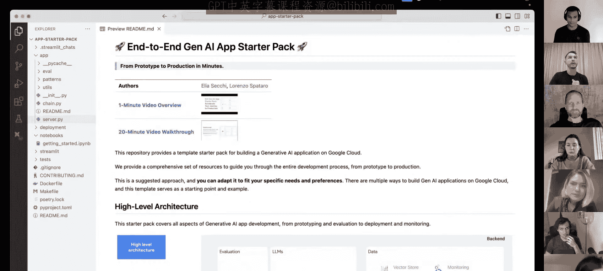

And and the model in this case， Ja and I will respond with a recipe assistant so what's behind the scene so we can actually look at the code that is power in Ts application here to do that essentially we have an application folder which essentially will contain the server that is power ins application and behind the scenes we use a framework like La chain to create the application in this case you can see here we are creating an application which is a culin assistant specializeizing providing cooking recipes Of course this is just the beginning right because you can change what's inside your application。

 you can do prompt engineering evaluation and so on to achieve your goal application we also offer a series of patterns as mentioned before like how to build an agent with Lagra。

 for example and how to build a custom rug Q andA application。

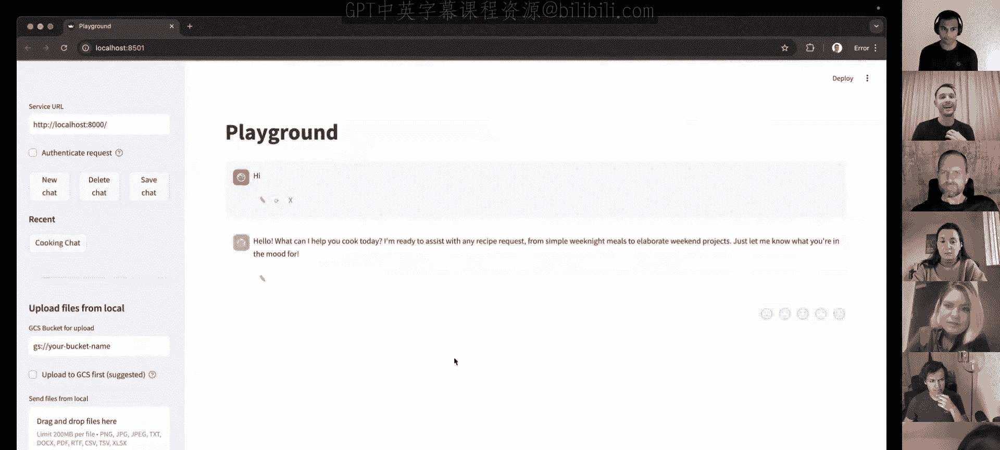

Of course， you can always change the you can also use some of these patterns here。

 And then when you're ready to go to production， you can actually before going to production。

 you will start to look at evaluation and so we offer actually here some examples about evaluation that you might want to use and finally there is the deployment part where essentially you will use a tools like a terraform or cloud build to deploy the CD to production。

 So an example of that will be that essentially as a user I will use Git to make a commit and this1 commit will land I can show you right now it will land into。

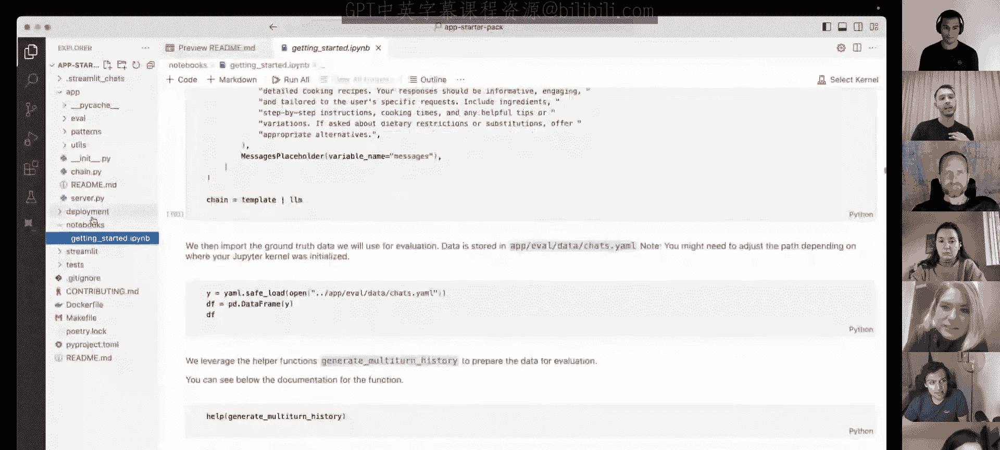

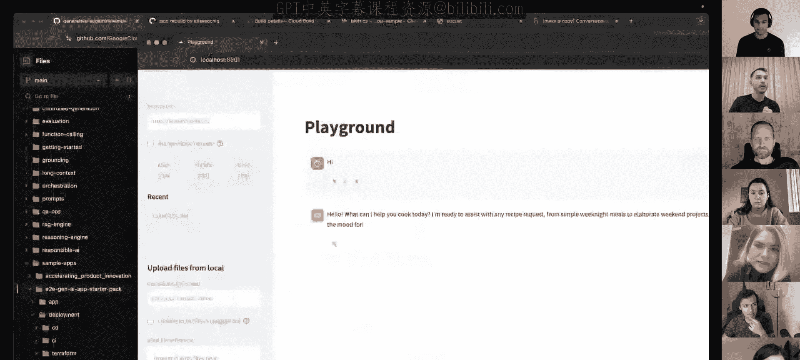

Into your or a Git provider， where you will be able to approve or not your commit this before approving the starter pack will allow you to do things like Uni Test and integration tests。

 which are typical activities you need to do before you deploy to production once these activities are done。

 you will be able to merge into your main branch。

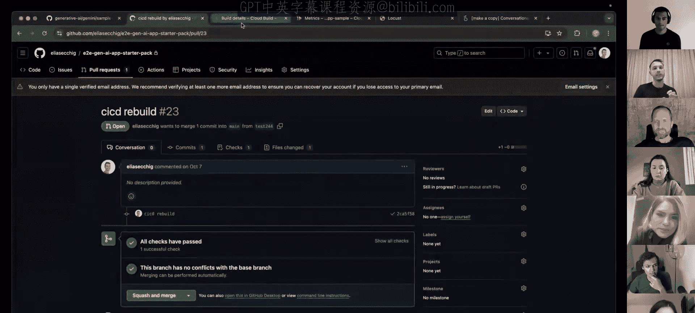

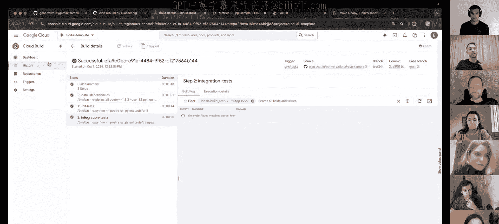

And then before deploying to production typically what you do is that you perform a series of test to test things like is the container being built what's the latency of my container and things like these so for example E the starter pack will allow you to autogene things like minimum latency maximum latency it will provide you a chart of all the different kind of throughput per second that you may have and then finally you will be able to click the deployment to production where you will have your final application in production Now we can even do a test here where I'm going to again go back to go back to the。

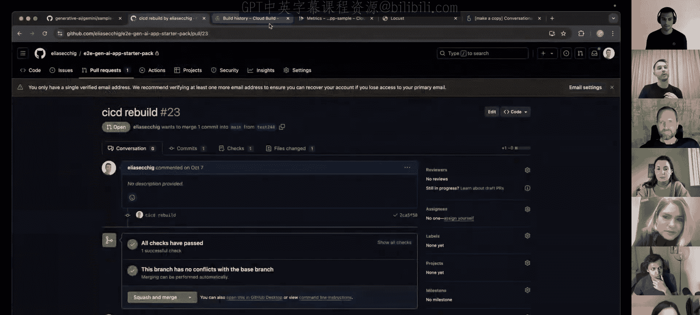

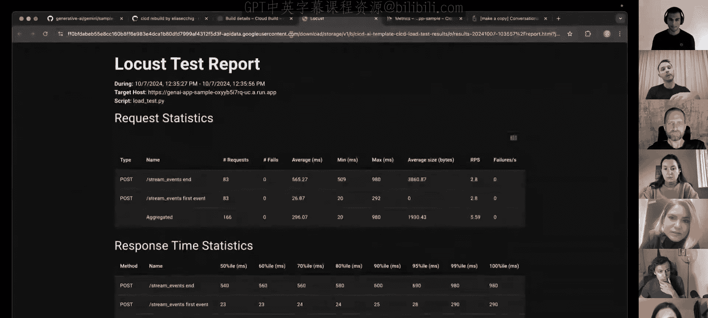

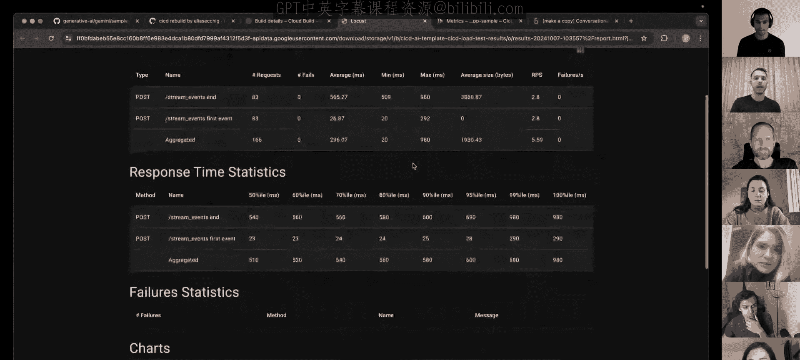

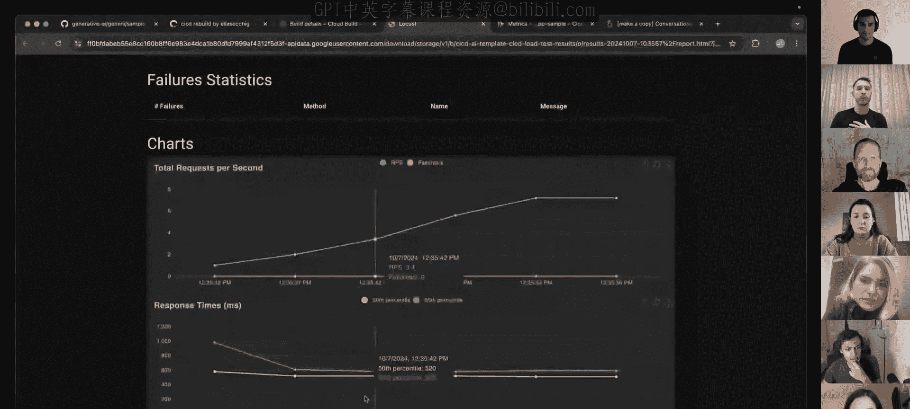

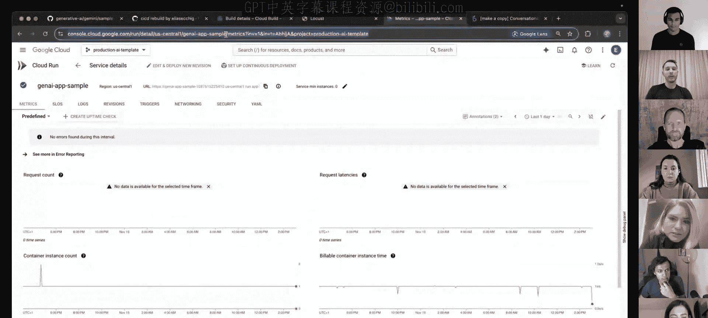

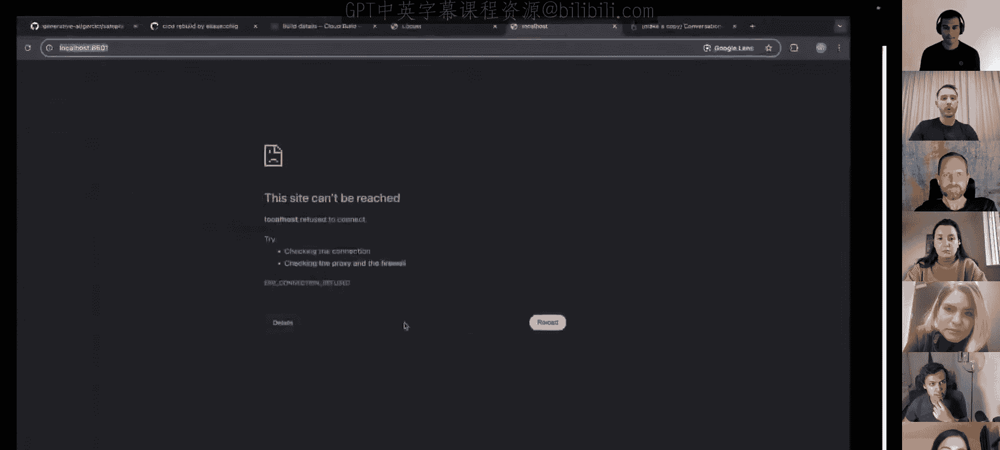

To the Vi studio code， and。And run the application in production so if we go here now and we replace the URL that we have here with the URL in production。

 we should be able to test our endpoint that I previously deployed to production。

And there you go so you have the application in production but it's not the end of the flow because when you're running things in production you want to also make sure you're collecting the data right and so the starter pack is achieving that by making sure everything the user is sending to the application is being logged and then is being saving to BigQury and so that as part of the starter pack we also offer a nice Luccr Studio dashboard that will allow you to do monitoring of like the usage of the application you will be able to see things like how many conversation you got。

 what the feedback collected a feedback score over time and for every conversation you will be able to zoom in and understand each specific data point where the human and theI interacted。

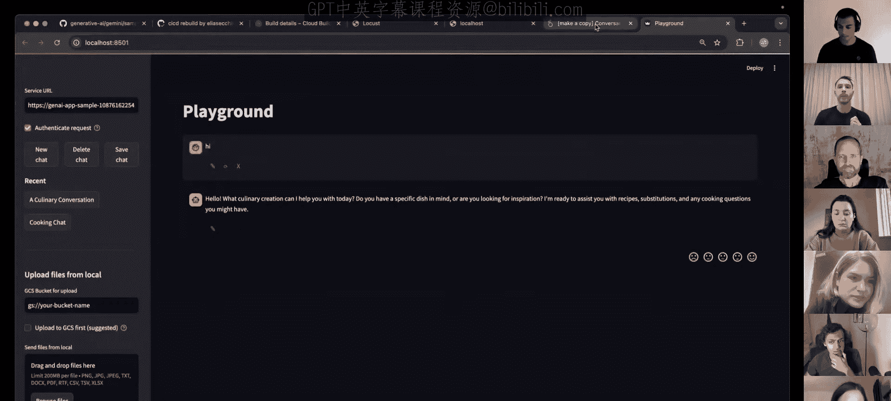

And so this is everything hope we are always available for any clarification over to UN and。😊。

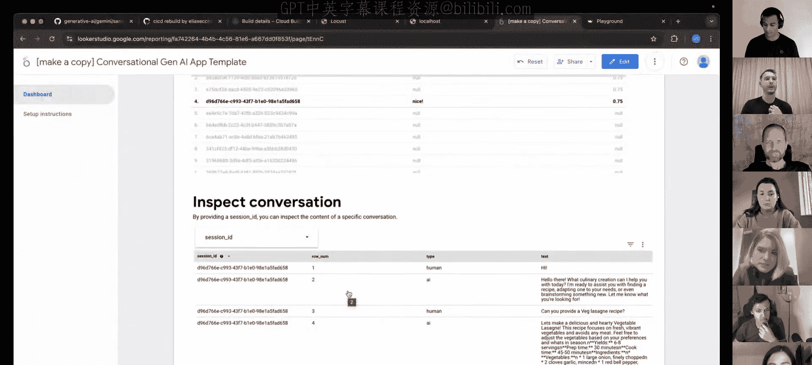

Thanks， Alia and for those of you are watching just to make it clear， this is on vertex AI。

 we'll be covering that in the Q& A。 the coreabs so far that you've been working on is has been an AI studio。

 which is our developer focused one and vertex AI as our enterprise platform for enabling production rate systems which we'll be covering in the Q& A as well。

 And just to mention Alilia mentioned BigQu。 That's one of the vers AI data warehouse solution where you can store and analyze large amounts of data along with a lot of more advanced functionality。

 we'll be including the link for both in in in the description later on。 So cool， thanks a lot。

 Alia and page over to you for the Q& A。😊，Excellent I loved that presentation I also especially love anytime I can see a VS code or VS code like a user interface I think it's a great way to be able to keep everything keep everything visible and to also be able to kind of see how all of the bits and components that we've been learning about over the course of the week fit together so really appreciate it thank you so much Alia that was amazing Excel。

😊，So now we are going to go to the Q&A。This Q&A session will be all about MLOs and generative AI so really excited to have here today a group of really excellent speakers and also have been overjoyed to see all of the questions that you've been posting on Discord about how to maintain these generative AI systems over time before we start though I want to give a quick shout out and thank you to all of our wonderful generative AI course moderators who over the course of the last five days have been answering your questions on GitHub on Disccourse on Discord on Cale on our YouTube videos。

 they've been really working around the clock the Sun never sets on our generative AI teams at Google and just want to say thank you immensely to pulllong cause Mark。

 Eric Irwin Miles and Guom y'all are amazing， we really appreciate you and please also make sure to emoji thank them or thank them just via text anytime they do something helpful or help point you' all in the right directions。

So really really appreciate you and very， very honored to introduce our expert panel today we have folks from Google Deepmind as well as from our Google Cloud vertex teams and our cloud AI and industry solutions teams so broad broad spectrum of experience across model evaluation as well as kind of maintenance of systems over time thank you so much for coming today beer Eliia。

 Olivia Socrates Advviate Gabriela and of course Anant we have a wonderful kind of collection of questions to answer today and in the interest of time I'm going to get right into it so question number one for Gabrielella how has ML ops changed with the introduction of large language models and generative AI you know I started doing machine learning in 2009 as an engineer and back back when we were just building single task models and doing kind of more traditional。

Machine learningIt felt like there were a lot of nuts and bolts that had to be considered now it feels like the game has changed quite a bit so tell us how you've experienced MLOs to change over the last couple of years。

Yes， I also started doing machine learning around that time around 2010。

 and I do remember in those early days the model development was rather manual with deployments being Nacog。

 We probably all remember you just started back in the days like me sharing data and model with a USB obviously this approach like scal reliability and the collaboration was rather bump if we just think how the field of MLOs has mature we started to incorporate and extend the principles from Devops to automate the building testing and deployment of both data and model assets right this was very necessary because the dynamic nature of machine learning where the data changes and model requires continue monitoring and retraining I mean over the time probably like late 2010 a white tool of ecosystem for MLOs arose and then we were able to manage the entire ML lifecycl Also the rest of the cloud was very important to further accelerate the adoption。

Automaticmatic pipelines and also server machine learning。

This actually helped us a lot to increase the scalability。

 the reliability while decreasing us costs for production and experimentation。 Now， more recently。

 with the rise of generative AI it has pushed again MLOs to adapt And now we are incorporating new roles like Pro engineers AI engineers。

 we have a broader Ar management including model configurations， foundation models use。

 prompt templates， changing pipelines， etc， and also achieved towards holistic application monitoring。

 before we were focusing only on the model on the machine learning monitoring monitoring the machine learning model sorry。

 but now we are focusing on monitoring Den and to an application。

 we are also thinking about encompassing just the feedback and doing task specific and custom evaluations of the entire system and of the single individual parts。

 Moreover， you all know we have new models。And new frameworks are rising every day。

 so it also demands exceptionally agile workflows。I love that you called out the broad spectrum of artifact management that teams have to deal with today。

 both in terms of you know doing things like defining functions but then also monitoring prompts。

 how prompts change over time the chain templates it's really really fascinating to see how some things have gotten a lot easier but a lot of other things have gotten much more challenging to manage so I love that detail and also really really excited to see somebody else who's like one of the OGs of machine learning that is still like interested in this new brave generative AI world。

 awesome。Next question for Anantin for Olivia， tell me about the importance of evaluation for productionizing models。

 is it only possible for text or is multimodal evaluation also an option and Olivia I know you're leading one of our Ebals teams over at Google Deepmd so welcome really excited to have you here。

Thank you， Paige。 And yes， I think you'll briefly start off mentioning evaluation since this topic was brought up quite a lot in the last days and questions in Discord as well。

 And I know I got a lot of you come to day5。 So hopefully had a chance to the evaluation part of the white paper but evaluation has a lot of dimensions to it I will start off with mentioning some parts of text evaluation and order be able to dive deeper into multimodal and the structured disassembly of various tasks for evaluation。

 So evaluation depends a non story short for text evaluation。 it's an incredible part of MLlops。

 you cannot have just like how it was a predictive AI as Gabriela mentioned。

 you still need to evaluate。 however， evaluation a generated image or string value a response is very task specific and it becomes far more complex It's not just a singular value that you can kind of calculate numerical value。

😊，can calculateulate accuracy on anymore。 It's far more task specific and nuanced。

 so on the text evaluation side of things。 we we can use this the traditional techniques which kind of compare like things that undocument or sentence level using computational metrics lets say Bla or roote scores where you compare the generated sentence but given that you have an existing ground truth or an existing golden human like thing to compare to So it only exists as how good is the generated answer compared to the golden answer。

 which I was expecting it to be so so it can be used for machine translation and many of the tasks the problem with this approach is that it's comparing to one ground truth answer。

 So you need a ground truth answer and secondly several tasks like summarization and very task specific answers are very。

😊，To compare as a unigram or Ngram， basically token basis sub sequenceequence of the strings and compare with one existing answer。

 because there's many ways to write a summary which might all be correct or even better。

 but it's really hard to judge that by solely comparing it with an existing reference point。

Now there is where LLM as a judge or alteratorbased systems come into play and for text。

 this is also very important because you can either take an LLM where to judge another LLM's response and say okay let's say you have a prompt you got a response from an LLM you can have another LLM which is kind of specialize at evaluation。

 judge it on say on a scale of one to five how good is this response compared to what like given the prompt and instructions and explain why so this is kind of like you can judge it as or sometimes you can have they can be a tie and two responses can be very similar or from different models or settings and you would like to compare side by side comparison。

 which is how humans evaluate things it's like take two responses to a prompt and say which one of these two are better because humans when given a bunch of responses。

😊，Do not tend to look at all the responses at once。 So they tend to kind of compare in pairs。

 And this is where side by side evaluation is also possible while you compare pairs of responses at once。

 And yeah， there is a lot of ways you can do that。 You have services like vertex AI。

 which offered an evaluation service， but also as you mentioned earlier page prompt Fu and and other open source alternatives to it as well。

 So Olivia has worked on a lot of great multimodal evaluation and other techniques techniques。

 I'll hand it over to you， Olivia for diving more deep into that。😊。

Thanks Anna so hi I'm a researcher people Deepmind and I've been working in the evaluation space and in particular in the multimodal space and just to kind of add to what Anna said I think evaluation is a really key area in NL but it's actually become a really interesting so has been interesting research direction but it's become even more interesting with these large models that are just being used in such a wide variety of settings and for different capabilities and has become really difficult to even think about the evaluation problem and how to break it down it's something that I've been thinking about for quite a while。

😊，In particular kind of the first thing that I tend to think about is what use cases do you really imagine your model being used for and can we then build like an evaluation data that has coverage over these kinds of use cases and I think it's really key to think about building this data as it's going to be what you're going to be evaluating your metric and your models on so if it doesn't have good coverage and if it's not really covering the things that you care about then you're not really going to know how your model is doing and you're not going to be able to monitor how it changes over time and so maybe it's not the most exciting part of the process there's a really key and fundamental part of the process。

And so kind of once you know what you want to evaluate and you have sufficient coverage and sufficient confidence。

 then it's time to actually build your evaluator。And an did a really great job of talking about the different ways for text I think multimodal is particularly interesting as you have you know image input and text input you're not evaluating them in isolation。

 but you want to evaluate。😊，The their combination。And I've been looking mostly at image generation and video generation。

 which is particularly interesting ass there was never a notion of kind of a ground truth you never it's never a ground truth image that can be generated from a given caption and so historically it wasn't very easy to evaluate these models and people relied on simple things like lip or FID even though as models became better even maybe two or three years ago people knew that these weren't fit for purpose。

And one interesting thing that we have been looking at in our Gea work is how we can actually leverage Gemini models as black boxes and see whether they're like effective for this kind of path。

And we particularly looked at alignment so we were looking at you know if I have a prompt and I generate an image then is that image aligned with prompt so for example I want to generate an image of a dog wearing a top hat is the image generated does actually the dog is the dog actually wearing a top hat etc are the properties in the prompt actually in generated images。

And we could follow an auditator type approach， which is。Potentily very useful for many scenarios。

 but we wanted to get away from just generating a single score and think about how we could give the user more control and understanding of what the metric is doing and so what we did was we thought about how can we use a Gemini model to break down this task into sub questions。

So for the prompt I was saying， you know， is there dog。

 is there a top path and then given these questions we can ask the Genii model to answer the question。

 give the image and then if there's no dog and the answer would be no。

And then what we can do is that we when we give this final metric。

 we can also give this breakdown to the user and then the user can actually see where is our model doing badly？

And then we can give the user a kind of intuition and an ability to have some flexibility with a veteran they can add questions。

 remove questions or evaluate for additional properties。

And I think this is like really quite an exciting approach that we found to be quite effective to pair models and also multiple generations versus abroad it's also quite general so we're thinking about how we can generalize it to other modalities or combination thereof and we're excited to see where it goes and how it can be useful and I just want to finish by saying like that while this is one direction of work I do think that there's a lot of interesting work that's been happening in this space more generally both in Google and externally and outside to see how we can use in multimodal kind of the work that's been doing in text in order to push it。

😊，Absolutely and we can definitely add a link to your research particularly gecko as well as some of the other really exciting multimodal evals that Deep Mind has been creating in the video description I love your calling out that you can use Jim and I almost as like an autoator to to help with some of the multimodal evals and I saw another blog post just recently posted to around video understanding。

 I think it was the Neptune the Neptune Eval that would be interesting to call out to so I I love this brave new world of being able to do multimodal evals and including image generation and video generation Evals and using models to kind of help with those tasks it's amazing。

So thank you thank you for that great overview and also for pointing out that EVLs are only as good as how well you specify your problem and how well you kind of architecture your EvalL to ensure that you have coverage over the thing that you care about and the thing that you want to be measuring it's super important and I don't think enough people spend time thinking about it so it's great to reinforce this in the educational content。

Cool。Next question for Socrates， what MLOs challenges are no longer priorities given that many companies are now using RE API calls as opposed to training。

 deploying and maintaining their own models， we talked a little bit about this already with Gabriela。

 I think， but what has been your perspective on what things are a little bit easier now given that most companies are calling models as RET APIs。

Sure calling a model like rest API means like somebody else has done the heavy lifting for us right that means that someone else has prepared a massive amount of data to train a model evaluate the model by checking a loss function and how close to the results that we need to have someone else has passed through all the different steps of auditing what data and artifacts we use to produce a model so all this will disappear by calling a model like a API Of course the customers or everyone who' is using the foundation models can jump directly on building an application and application that means that they don't really need to have data science skills extensively except if they start fine sh a model。

Of course， having prompt engineers， AEI engineers that are the new skills。

 we need a little bit to see how we can move the data science and ML engineers to that space。

 but I think if they are experts in their domain and the application they want to build。

 this is relatively easy。Now as you can imagine the classic approach that we had was data preparation。

 training evaluation， etca very long process now we start directly with evaluation and this is a big benefit why because we can reduce massively the amount of time to build our application of course in the evaluation we have new parameterss are not said earlier right we cannot rely on how the loss function performs but we need to rely on toxicity。

 fact knowledge and another more task specific metrics。

The next one is about monitoring now we don't need to have all this data or model drift classic ways of thinking about we need to have more about how our model drifts in terms of toxicity or fact knowledge or other task specific metrics that we have。

And lastly is about guardrails right what I want to say is in classic machine learning we used to have specific guardrails about the specific number limits。

 if I may say or thresholds， now we need to be closer to the understanding of the use case and to set more limits or more guardrails around specific topic that were examining。

Awesome， I love calling out all of the new things that we need to learn and to kind of be considerate and thoughtful about and how user focuseded all of those things。

 all of those things are so thank you for thank you for pointing out things like toxicity and then the the other components of model deployments that are really really kind of mission critical important to get right and that we're building tools to help users figure out how to wrangle about the model deployment that you mentioned and I forgot to point out right in classic machine learning also someone needs to be responsible to deploy the model and ensure auto scaling mechanisms that then point is up or running continuously now we don't have this concern right somebody else has deployed that and make sure that the model is available for everyone you for thisep the auto scaling autos scaling is something that Google cares very。

 very deeply about。For my personal projects， I really。

 really love that I don't have to worry about deploying an open source model on some sort of server myself and that I can just rely on。

 all right， well， if I get a lot more kind of people using my system。

 then it will gracefully scale along with the number of user requests as opposed to me having to figure out how to do that balancing。

Cool。Awesome， so next， next question。 This is the perfect segue into vertex AI and to to kind of cloud AI offerings。

 Adv， welcome， tell us a little bit about vertex AI and about why a customer might want to use it at their company。

😊，Yeah， great。 Hey everyone。 I have a partner on one of the product managers for vertex AI。

 And vertex is an enterprise platform that's meant to be kind of like your one stop shop for everything when it comes to machine learning。

 So that means both generative as well as nongenative type tasks that an MT Me a company might want to do。

 So if you need access to the API for Gemini， but also other models like models from anthropic or from La met asma models or mystral models。

 you can get access to all those models and then start to think about how are you gonna ground those models。

 use them for generative applications or building out agents。 And around this。

 you need a whole set of tools aroundops a lot of the topic of today。

 But the same concept still also apply in nongenrative use cases。

 So if you want to still build a time series model or anything that is nongenative in nature。

 you can still use vertex AI for all your needs。 Now。

 depending on where you are in your skill set in your journey inside of machine learning。

 can either build everything by hand by having manage notebook environments。

 manage computer to train your models。😊，ment tracking MLOs pipelines that you don't have to run actual underlying Kubernetes clusters for。

 or you can take a simpler approach by using something like autoMl for Automl。

 it's a point to click interface。 You don't necessarily need to know that much about machine learning。

 but understand how to evaluate the quality of those models and provide the right quality high quality data it starts to abstract away a lot of the effort that you would have done by managing a lot of the infrastructure。

 You don't want to necessarily be a DevOs engineer。

 perhaps you prefer to focus on ML and you can start to tackle various challenges。

 whether they be generative or not。that's a great overview you know we've been talking a lot about kind of open source libraries and kind of things that you can stand up yourself and kind of run on commodity hardware or infrastructure。

 but there can be immense value and time savingaving and kind of bundling it all together and then having managed services for all of those systems as opposed to trying to maintain and upgrade and modify all of those products yourself so really love that overview of vertex is trying to help people focus on the value add focus on machine learning or kind of the impact to their business as opposed to trying to figure out how to wrangle all of the services and deploy them themselves。

Awesome， next question for Veer， what specific MLOps practices should be prioritized when starting with generative AI and how do these differ from traditional MLOs workflows and are there any beginner friendly tools that help to help to kind of manage these practices or foundation models on vertex？

Great question。 So I'll actually build upon what So where Socrates and advice are left。So。

In the world of predictive AI， the models are typically self contained and trained for specific tasks。

 right mean in the world of generated A AI on the other other hand， models。

 and particularly elementss， they are more versatile They require a prompt to guide their behavior and output。

 So this difference， it necessitates。Considering the prompted model component as the fundamental unit of GI MLLOps so and this encompasses both the model and the front。

So coming to the question of which MLOs practices to prioritize when starting with JI on vertex AI specifically first is think about model discovery efficiently identifying the optimal foundation models for your use case from a vast landscape of options is crucial so this en says systematic approach to evaluating various models based on factors like quality or latency。

 development time cost and compliance so we have to evaluate certain factors so that's the first step second think about prompt engineering this is iterative process involves crafting and refining prompts。

To elicit the desired outputs for the model， it's crucial to manage prompts as both data。

 as well as code。Utilizing the data centric practices like validation， drift protection。

 code centric practices like version control and testing。

 so it's not just first time it's like how do you go back and fine tune in the product themselves。

Third， think about chaining and augmentation， right。

 as LLms can struggle with recency and hallucinations。

 chaining multiple models together and integrating。External APIs and data services is very essential。

 So now I'll also touch upon the tooling that vertex I offers in this space like。

We have we offer tools like grounding extensions， we have vector search。

 agent builder to support these kind of needs。Next is model tuning and training in this context。

 vertex AI provides robust platform for fine tuning LLMs。

 supporting techniques like supervised fine tuning。

 reinforcement learning with human feedback and distillation。Managing the artifacts。

 measuring the impact of the tuning and leveraging tools like Vertex AI's model registry。

And other tools that actually support within the Google Cloud like Dataplex are essential for this process。

As we think about data right think about data practices as well so geneative AI applications leverage various data types from different data sources。

 so implementing traditional MLObs and DevOps practices is like vital to ensure this reproducibility adaptability governance。

And continuous improvement across all data types involved。

Next is evaluation and others have covered a lot on this topic。 I'll just quickly talk about it。

 evaluatingval generative air models requires both manual and automatic automated approaches that custom evaluation methods and metrics are often necessary to this is due to the complexity and subjectivity of this model outputs。

 So addressing aversarial attacks is also crucial vertex AI provides。

Toolths like that we already discussed about， but these are automatic metrics again。

 coming to automation automatic site to site comparison。

To evaluate different models and rapid evaluation API to support this kind of a process。

Next is in terms of MLLOs now we are thinking about deployment。

 so deploying generative AI systems involves managing various components often like using standard software engineering practices like version control CICD so in this space Vertex AI offers endpoints for deploying models and features like citation checkers。

 safety scores， watermarking content moderation tools。

 but in addition if you think about the bigger Google Cloud we also have tools like CloudB cloud deploy for CICD some of these were actually part of the of ES demo earlier。

Next， once once it is deployed into production， now we are thinking about governance。

 this is where establishing control， accountability。

 transparency over entire development and deployments lifecycle itself solve critical。

 so this involves governing the chain element lifecycl data tune models and code。

 all everything that we have covered so far needs to be governed。Tols like vertex AI Fe store。

 model registry and Dataplex play significant roles in this aspect。So， I think I covered。

Overall MLL process that applies to GenI on how how that changes as well as I touched upon a bunch of tools。

 but to summarize the tools for the beginner friendly tools is what being is being asked in this question I would say start with vertex AI model garden which is where you will pick up the model of your choice next。

For beginners Vertex AI studio is extremely helpful because it features a playground where you can experiment with different prompts and models and making it ideal for the beginner environment Eventually you'll also get into agent builds I mean this is a place where you can build your own agents generateative AI agents like conversational chat boxt and things like that and then for the MLOps itself we have vertex AI pipelines。

So yeah， let's talk that。Awesome， thank you so much and I I definitely think that there are many different products that are available on vertex AI for folks to take a look at what are some strategies Gabriela to monitor large generative AI models in Google Cloud and production environments with highvari in user queries We'd love to learn more about this Yeah when we think about monitoring generative AI models。

 especially those ones with highvari in user queries。

 we need to track to things from one side we need to try the system performance and by system performance I mean the latency。

 how fast are the responses the query size， how big are the queries and these other aspects。

 the other part is to also attract the model quality itself like are the answers accurate。

 relevant save etc ce like the modli way to achieve this is like having detailed logs of everything that happens？

including like user queries， retrieve snippets， prompts， generate answers， user feedback， latencies。

 etc cea。 So one thing we can do is store all of this data in Google Cloud BigQury。

 which is a fully managed and serverless data warehouse。😊。

WBquery is because it is like a cost effectiveff way to keep this data analyze it and create dashboards to visualize the performance and identify areas of improvement etc ce。

 like just to give a concrete example for the case that you are presenting here it like once you're data in BigQury you can create embeddings for the user queries and model answers and then group similar ones together you can analyzeize then the user feedback for specific cluster of queries and then BigQury also works very well or integrates with other tools like Looker which will enable to build a dashboard for monitoring and it will give us like a clear aggregated view of both the system and model performance including metrics and feedback for a specific query of clusters。

Another thing we can aggregate here is like you can also leverage open source tools for Observ and then couple them with Google Cloud trace and Google Cloud logging in a way that you can instrument every answer given by Geneative AI model and you will also have a detailed tracing and actually this information that I'm saying was also presented or is part of the mod area presented earlier。

😊，Yeah I love I love BigQuery as an option to store logs and prompts and data about model interactions。

 especially given how many wonderful kind of integrations BigQuery has introduced with things like Looker and also sheets and then even the machine learning features that have been added into BigQuery I really love being able to use Gemini to help me write SQL queries to interact with BigQuery a little bit more effectively so I love that answer and folks haven't experimented with BigQuery。

 there are a lot of great resources to get started we can add some in the YouTube video comments as well。

嗯。Excellent next and final question for Socrates and for aVate。

 how does vertex AI enhance MLOs for foundational models and generative AI applications。

 are there specific features that make it more suitable for generative AI compared to other tools or platforms and we've covered some of these already but would love to get your perspective。

Yeah， absolutely if you think about it， a lot of the same concepts that applied with MLOs in the past still translate when it comes to geneerative applications。

 So if you start with， let's say something like prompt engineering conceptual。

 it's actually kind of similar to let's say if you're doing hyperpara tuning。

 It's something where you in the past would have manually done it。

 you would have to tweak it to see how you get the best performance today。

 you don't have to necessarily do that inside of vertex A。

 we have our prompt optimization tool So you bring in a data set and Eval data set and it will do the optimizations of your prompts on your behalf。

 simplifying and removing a lot of the art of prompt optimization and making it a little bit more statistically driven in nature。

Beyond that， everyone's spoken a lot about Evals， I also share the belief that evalals are kind of like the key thing that you need to land to get high quality results So inside of vertex AI。

 you can do evaluations both to compare models to compare prompts to see how your various different parameters that you select impact your results and also see how fine tuning impacts your model quality And then finally。

 there's a lot of thought around well， once you're in production。

 how do you actually monitor to the performance of this model。

 this is a bit more of an emerging space， specifically for generative AI but we're rolling out an experimental capability to evaluate and monitor models in production to see what topics are trying to happen are they adhering to safety protocols that you've defined from your safety filters and how can you make changes to the performance of the models by going back to those prior steps and augmenting your prompts or doing things like fine tuning。

 which you can do all directly inside of vertex。And to add to a right of course we have some other toys in GP that can help everyone to industrialize the intoI applications。

 for example you can combine the vertex AI vi components that the debate mentioned with pipelines and experiments and to create a quite scalable experimentation environment for GenI or we have prompt pro management that helps us a lot to store our prompts。

 understand what went wrong reuse them or try and change change them after evaluation and then we have a prompt Gaery that helps us a lot in order to start with a nice version of a pro for a particular application。

Awesome， I love kind of the end to end solutions that are offered on Google Cloud and then also how many of them are built to scale effectively as the number of users grow for enterprises and for companies。

 I think that's kind of mission critical important and something that is underappreciated until companies do need to scale so it's great hear great to hear those options。

And then next， thank you all so much for being wonderful kind of expert hosts and guests and giving a great Q&A as well as overviews of code Las really appreciate you taking the time to come here and to help share your en knowledgeledge with all of our students and all of the people who are dialed in to this generative AI intensive course。

 so virtual round of applause for all of our guest presenters and and if folks want to learn more about them their work。

 please refer to the White papers as well as the links that we have in the YouTube video so thank you again。

 and now we're going to head into our last and final section for today， the P quiz。😊。

All right everyone get out your pens， your pencils， your paper and start getting ready to take notes。

 this is our last and final pop quiz for the generative AI intensive course all about machine learning generative AI ops and how to deploy these systems into production so with that I am going to go ahead and get started Que number one which of these is not a core practice of MLOs for generative AI applications as discussed in the white paper so hopefully you are paying attention during today's readings is it prompt engineering and evaluation as an iterative cycle is it data validation model evaluation and model monitoring is it training a foundational model from scratch or is it managing and versioning prompt templates chain definitions and external data sets we also touched on this little bit in the Q&A section with Jabriella which of these is not a core practice of ML ops for generative AI applications。

I'm going to give you five，4。3，2，1。The answer is C training a foundational model from scratch is not part of MLOs you know after you're doing these MLOs for generative AI applications the model has already been built and you're just concerned with deploying it in a robust and production friendly way so question number two。

 what is a prompt template in the context of generative AI I it a simple text input from the user is it a set of instructions and examples with placeholders for user input is it the foundational model itself or is it the final output generated by the model which of these is a prompt template I'm going to give you five。

f。3。2，1。Hopefully everybody got the answer correct。

 which is B a set of instructions and examples with placeholders for user inputs。

 those are prompt templates， and as you deploy these models into production。

 you're going to have to worry about version controlling all of your great prompt templates。

Question number three， what is the purpose of chaining in generative AI applications is it to maintain recency in the model's outputs。

 is it to avoid hallucination and maintain recency in the models outputs。

 is it to increase the complexity of the model or is it to de reduce the efficiency of the model think back to your white papers。

 your readings and also those great podcasts， what is the purpose of chaining in generative AI applications。

Let me give you 5，4。3，2，1， the answer is B to avoid hallucination and maintain recency in the model's outputs。

 you know as you chain together all of the responses。

 the models kind of understand which information it should be using in order to guide further outputs so hopefully everybody was paying attention and has been getting all of these questions right number four。

 why is evaluation a crucial step in the development of generative AI systems think back to the discussion with Olivia and a not is it to ensure the model is deployed to the correct infrastructure I it to optimize resource utilization and reduce latency is it to track the lineage of data and model versions or is it to d measure the quality and effectiveness of the model's outputs why are EvalLs a crucial step in the development of generative AI systems。

Hopefully everybody's thinking about this very hard。And the correct answer is。

It is D to measure the quality and effectiveness of the model's outputs。

 and Evals can be not just text based， but also multimodal， so encompassing video， images， audio。

 text， code， all of the above。Question number5， which vertex AI product allows for recurrent execution of evaluation jobs in production。

 Sw and drift detection processes Is it vertex AI model monitoring vertex AI pipelines。

 vertex AI feature store or vertex AI model registry。

Which of these allows for recurrent execution of evaluation jobs？

The answer is B vertex AI pipelines and this was our last question of the course of the fiveday generative AI intensive practice and also for today。

 I also want to say thank you so much for tuning in for learning。

 for sharing your knowledge with others and for also asking all of these wonderful and great questions we have really enjoyed getting to kind of work with you to be with you to be part of this beautiful community over the course of the last five days and appreciate you taking the time to kind of work with us to understand and to come up to speed with all of these really interesting new tools and to start brainstorming how they could be applicable to your work and to the applications that you're building so again just from the bottom of all of our hearts from our host from our guest presenters from the。

ho have been working so hard on all of these white papers， we appreciate you。

 we appreciate you taking the time and are really truly excited to see what you build hopefully this is just the first installment and there will be many more of these to come。

 but it's been great to get to know you and have a wonderful rest of the year rest of the month。

By。

