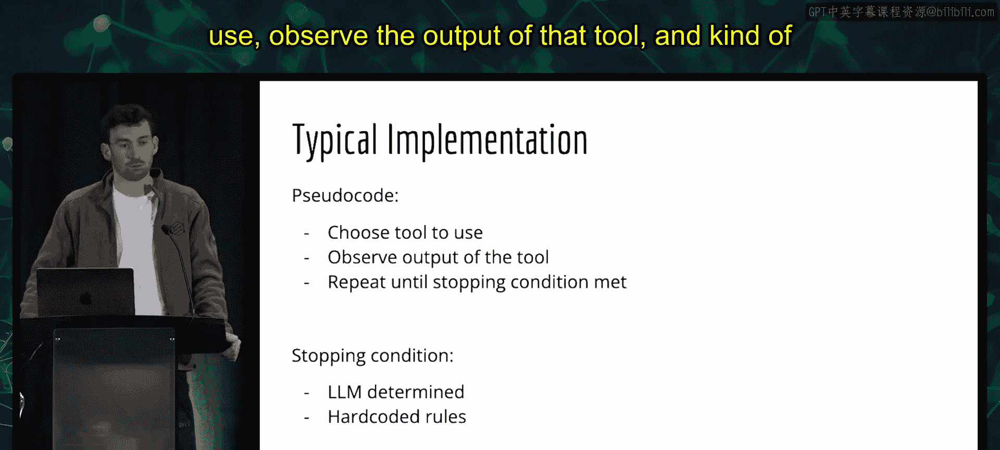
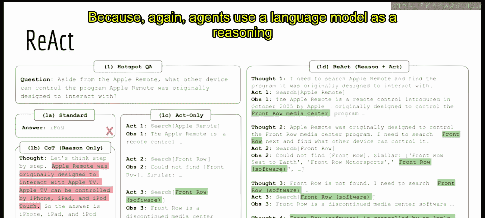
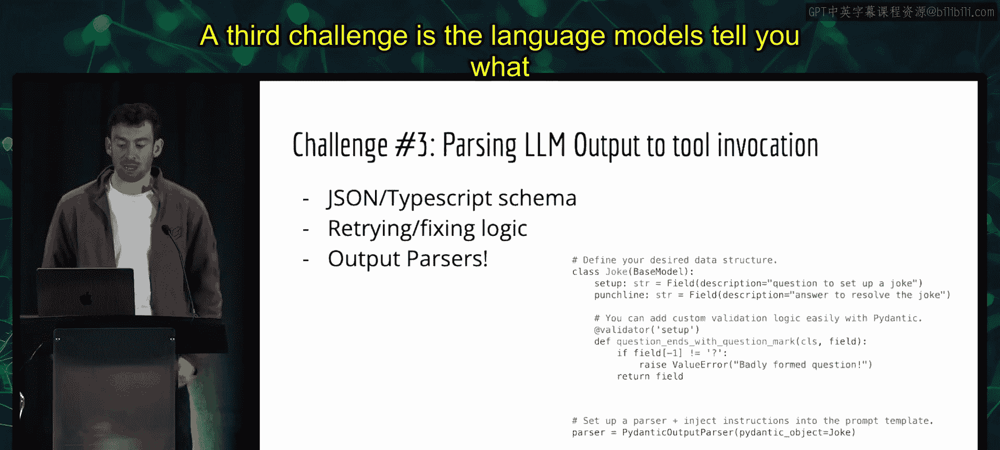
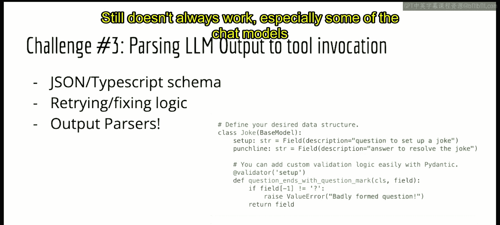
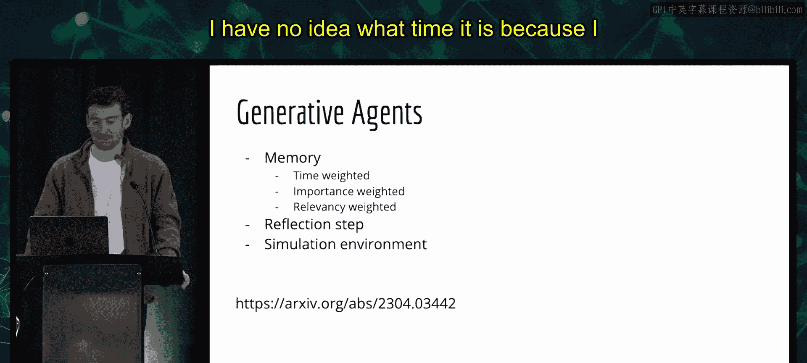
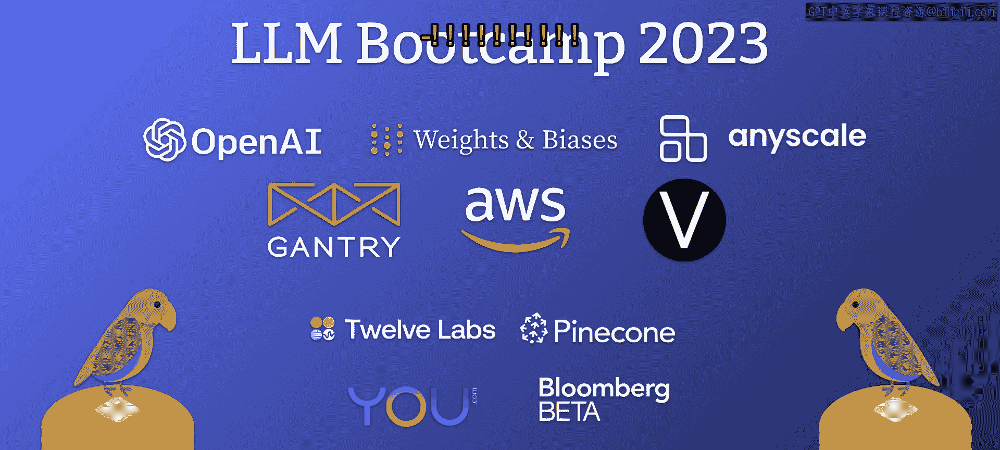

# LLM训练营 - 2023年春季 LLM Bootcamp - Spring 2023 - P10：-10-Harrison Chase - Agents Masterclass from LangChain Founder - GPT中英字幕课程资源 - BV1Wf421B7mP

So so I'll be talking about agents and yeah， there are many things in La chain。

 but I think agents are probably the most interesting one to talk about so that's what I'll be doing。

 I'll cover kind of like what our agents， why use agents。

 the typical implementation of agents talk about react。

 which is one of the first prompting strategies that really accelerated and made re the use of agents then then I'll talk a bunch about challenges with with agents and challenges of getting them to work reliably getting them to work in production。

I'll then touch a little bit on memory and segue that into more recent kind of like papers and projects that do agent things。

 I'll probably skim over the initial slides because I think most people here are probably familiar with the idea of agents。

 but the core idea of agents is using the language model as as a reasoning engine。

 So using it to determine kind like what to do and how to interact with the outside world。

 and this means that there is a nondeterministic kind of like sequence of actions thatll be taken depending on the user input。

 So there's no kind of like hard coded do do A than do B than do C。

 rather the agent determines what actions to do， depending on the user input and depending on results of previous actions。

So why why would you want to do this in the first place？

 So so one there's this very tied to agents is the idea of tool usage and connecting it to the outside world and so connecting it to other sources of data or computation like search APIs databases。

 these are all very useful to overcome some of the limitations of language models。

 such as they don't know about your data they can't do math amazingly well but the idea of tool usage isn't kind of like unique agents。

 you can still use tools you can still connect LLMs to search engines without using an agent so why use an agent And I think some of the benefits of agents are that they're more flexible and more powerful。

 they allow you to recover from errors better， they allow you to handle like multihop tasks again with this idea of being the reasoning engine。

 And so an example that I like to use here is thinking about like interacting with the SQL database。

 you can do that in a sequence of predetermined steps。 you can have like a natural language query。

 which you then use a language model。Convert to a SQL query， which you then pass then execute that。

 get back a result， pass that back to the language model。

 ask it to synthesize it with respect to the original question and get kind of this natural language wrapper around a SQL database very useful by itself。

 but there are a lot of edge cases and things that can go wrong。

 So there could be an error in the SQL query， maybe it hallucininates a table name or a field name。

 maybe it just writes incorrect SQL and then there are also queries that need multiple kind of like queries to be made under the hood in order to answer。

 And so although kind of like a simple chain can you know handle maybe I don't know，50。

80% of the use cases， you very quickly run into these like edge cases where a more flexible framework like agents helps kind of like circumvent。

So the typical implementation of agents generally。 and it's so early in this field that it kind of feels a bit weird to be talking about a typical implementation because I'm sure we'll see a bunch of different variants but generally you get a user query。

 you use the LM that's the agent to choose a tool to use and also the input to that tool。

 you then do that， you take that action， you get back in observation。

 and then you feed that back into the language model and you kind of continue doing this until a stopping condition is met。

 And so there can be different types of stopping conditions probably the most common is the language model itself realizes。

 hey， I'm done with this with this task with this question that someone ask of me I should now return to the user but there can be other more hardquartered rules And so when we talk about reliability of agents some of these can really help with that。

 So if an agent has done five different steps in a row and it hasn't reached a final answer。

 it might be nice to have it just return something then there are also certain tools that you can just like return。

icallySo so basically， the general idea is choose a tool to use。

 observeer the output of that tool and kind of continue going。

So how do you actually like， So that was pseudocode。 Now。

 let's talk about the actual kind of like ways to get this to do to do what we want。

 and the the first and still kind of like the main。Way of doing this。

 the main prompting strategy slash algorithm slash method for doing this is react。

 which stands for reasoning and then acting。 So RA from reasoning AC T from acting。

 and the paper is a great paper came out in I think October out of Princeton about synergizing two different kind of like methods and and we can we can look at this example。

 which is which is taken from their paper and see why it's so effective。

 So this example comes from the hotspot Q A data， which is basically a data where it's asking questions over Wikipedia pages where there are multihop usually kind of like two or three intermediate questions that need to be reasoned about before answering。

 So we can see so here there is this question aside from the Apple remote。

 What other device can control the program， Apple remote。

Apple Remote was originally designed to interact with。

And so the most basic prompting strategy is kind of just pass that into the language model and get back in answer。

 And so we can see that in1 a standard。 And it just returns， you know， a single answer。

 and we can see that it's wrong。Another method that had emerged maybe like a month or so prior was the idea of like chain of thought reasoning And so this is usually associated with the let's think step by step。

 prefix to the response。 and you can see in red that there's this like chain of thought thing that's happening as it thinks through step by step and it returns an answer that that's also incorrect in this case this has been shown to kind of like get the agent or get the language model to think a little bit better so to speak。

 So it's yielding higher quality， more reliable results。

The issue is it still only knows kind of like what is actually present in the data that the language model was trained on。

 and so there's another technique that came out， which is basically action only where you give it access to different tools in this case I think all the examples in this picture are of search but I think in the paper it had search and then look up and so you can see here that the language model outputs kind of like search Apple or remote。

 it looks up Apple or remote， it gets back in observation it then does search front row finds that so that's in instance of it kind of like recovering from an error and then it does search front row software finds in answer and then finishes。

And you can see here that the。The output that it gave， yes。

 kind of loses some of what it was actually post answer。

 So you've got this chain of thought reasoning， which helps the language model think about what to do。

 Then you've got this action taking step that basically actually allows it to plug into more kind of like sources of real data。

 what if you combine them。 And that's the idea of react。

 and that's the idea of a lot of the popular agent frameworks。 because again。

 agents use the language model as a reasoning engine。 So you want it to be really good at reasoning。

 So if there are any prompting techniques you can use to improve its reasoning。

 you should probably do those。 And then a big part of it is also connecting these tools。

 And that's where action comes in。 And so you can see here it arrives at kind of like the final answer。

So that' that's the idea of agents reactact is still one of the more popular implementations for it。

 but what are some of the current challenges and there are a lot of challenges like I think most agents are not amazingly production ready at the moment and these are some of the reasons why and we can I'll walk through them in a bunch more detail。

 I'll also leave a lot of time at ends for the question。

 so I'd love to hear kind of like what you guys are observing as issues for getting agents to work reliably。

 This is probably far from a complete list。So the most basic challenge with the agents is getting them to use tools in appropriate scenarios and so you know in the react paper。

 they address this challenge by bringing in the reasoning aspect of it。

 the chain of thought style prompting asking it to think kind of like common ways to do this include just like saying in the instructions you have access to these tools you should use these to overcome some of your limitations and just basically instructing the language model。

 tool descriptions are really， really important for this if you want the agent to use a particular tool it should probably have enough context to know that this tool is good at this and that generally comes in the form of like tool descriptions or some information about the tool that's passed into the prompt。

嗯。That can maybe not scale super well。 if you've got a lot of tools because now you've got maybe these more complex descriptions。

 you want to put them in the final prompt for the language model to know what to do with them。

 but you can quickly run into like context length issues And so that's where I think the idea of tool retrieval comes in handy。

 So you can have hundreds， thousands of tools you can can do some retrieval step think ret is another really interesting topic that I'm not gonna go into too much depth here。

 So for the sake of this we'll just it's some embedding search lookup there's a lot more interesting things there。

 you basically retrieval step you get back510 however many tools that you think are most promising。

 you can then pass those to the prompt and have the language model take the final steps from there。

 fewew shot examples， I think can also be really helpful So you can use those to guide the language model in what to do again。

 I think the idea of retrieval to find the most relevant few shot examples is particularly promising here。

 So if you give it examples similar to the one it's trying to do those help a lot better than random。

And then probably the most extreme version of this is fine tuning a model like tool form to really help with tool selection。

There's also a a subtle second challenge which is getting them not to use tools when they don't need to so a big use case for agents is having conversational style agents。

 one of the big problems that we've seen is oftentimes these types of agents just want to use tools no matter what even if they're having a conversation and so again like the most basic thing you can do is probably put some information in the instructions。

 some reminder in the prompt like hey you don't have to use a tool。

 you can respond to the user if it seems like it's more of a conversation that can get you so far another kind of like clever hack that we've seen here is add another tool that explicitly just returns to the user and then they like to use tools but they'll usually use that tool so I thought that was a pretty clever and interesting hack。

A third challenge is the language models tell you what tool to use and how to use it。

 but that's in the form of a string。 And so you need to go from that string into some code or something that can actually be run。

 and so that involves parsing kind of like the output of the language model into this tool and vocation。

 And so some tips and tricks and hacks here or one like the more structured you ask for the response。

 the easier it is to parse generally。 So language models are pretty good at writing JSsonN。

 So we've kind of transitioned a few of our agents to use that schema still doesn't always work especially some of the chat models like to add in a lot of kind of like language。

So we've introduced kind of like this concept of output parsers。

 which generically encapsulate all the logic that's needed to parse this response。

 and we've tried to make that as modular as possible。

 So if you're seeing errors you can hopefully kind of like substitute that out very related to that。

 we also have a concept of like output parss that can retry and fix mistakes So and I think there's some subtle there's some subtle differences here that I think are really cool。

 basically like you know if you have misforatted schema。

 you can fix that explicitly by just passing the output and the error in saying fix this response。

 but if if you have an output that just forget one of the fields like it returns the action but not the action input or something like that。

 you need to provide more information here。 So I think there's actually a lot of subtlety in fixing some of these errors。

 but the basic idea is that you can try to parse it if it fails。

 you can then try to fix it all this we currently encapsulate in this idea。Like output parsers。

So the fourth challenge is getting them to remember previous steps that were taken。

 the most basic thing， the thing that the react paper does is just keep a list of those steps in memory again。

 that starts to run into some some context window issues especially when you're dealing with long running tasks and so the thing that we've seen done here is again fetch previous steps with some retrieval method and put those into context。

 usually we've actually seen a combination of the two so we've seen using the and most recent actions and observations combined with the k most relevant actions and observation。

Incorporating long observations is another really interesting one。

 This actually comes up or this came up a lot when we were dealing with working with APIs because APIs often return really big JSON blobs that are really big and hard to put in context。

 So the most common thing that we've done here is just parse that in some way you can do really simple stuff like convert that blob to a string and put the first like thousand characters or something as the response。

 you can also do some more if you know that you're working with a specific API。

 you can probably write some custom logic to kind of like take only the relevant keys and put that if you want to make something general。

 you can also maybe do something dynamically to like figure out what key like basically explore the JSON object and figure out what keys to put in that's a bit more exploratory I would say but the basic idea is yeah。

 there is this issue of And so Zapier I always have to think about how to pronounce it。

 but it' Zapier makes you happier。 So Zapier when they did this with their natural。Lguage API。

 not only did they have something before the API that was like natural language to some API call。

 They also spent a lot of time working on the output。

 And so the output is actually very specifically。 I think it's like under like 200 or 300 tokens or something like that。

 And they did that on purpose， they spent a lot of time thinking about that。

 And so I think for tool usage that is that is really important as well。 another more kind of like。

Expllororatory way of doing this is also， you could perhaps just store the。

 the long output and then do retrieval on it when youre。

 when you're trying to think of like what next steps to take。嗯。Agents can often go off track。

 especially in longrun things。 And so there's kind of like two methods that I've seen to kind of like keep them on track。

 One， you can just reiterate the objective right before it makes each action So and why this works。

 I think we've seen that with at least with a lot of the current models with instructions that are earlier in the prompt it might forget it by the time it gets to the end if it's a really long prompt So putting it at the end seems to help and then another really interesting one that I'll talk about when I talk about some of the more recent papers and stuff that have come out is this idea of separating explicitly a planning and execution step and basically have one step that explicitly kind of things about these are kind of like all the objectives that I want to do at a high level and then a second step that says。

 okay given this objective。Given this one sub objectiveive， now。

 how do I do this one sub objectiveive and basically break it down even more in a hierarchicalical manner。

 And there's， there's a good example of that with baby AI， which I I'll talk about in a bit。

 And then another big issue is evaluation of these things。

 I think evaluation of language models in general， very difficult evaluation of applications built on top of language models。

Also very difficult。 and agents are no exception。 I think there's the obvious kind of like evaluate whether it arrived at the correct result in terms in terms of getting metrics on evaluation。

 And so yeah， if you're asking the agent to produce some answer that's like a natural language response。

 there's techniques you can do there a lot of them in the flavor of asking a language mall to score the expected answer and the actual answer and come up with some grade and stuff like that that applies to the output of agents as well。

 But then there's also some agent specific ones that I think are really interesting。

 mostly around evaluating this idea of like the agent trajectory or the intermediate steps。

 And so we'll actually have something coming out for this someone opened a PR that I need to get in。

 but basically there's a lot of little different things you can look at did it take the correct action。

 I the input to the action correct。 I it the correct number of steps by you know sometimes and this is very related to the next one which is。

the most efficient sequence of steps。 And so there's a bunch of different things that you can do to evaluate not only the final answer。

 but like is the agent getting there efficiently correctly and those are sometimes just as useful。

 if not more useful than evaluating the end result。

I'm trying to see what time it is because I also want to leave lots of time for questions。

 but I think I'm good。 So memory I think is really interesting as well。

 So we've obviously chatted about like memory of remembering the AI to tool interactions there's also like a more basic idea of remembering the user to AI interactions but I think the third type which is showing up in a lot of the recent papers on agents is this idea of like personalization of giving an agent kind of like its own kind of like objective and own persona and stuff like that the most obvious way to do that is just like you encode it in the prompt you say like hey you know this is your job as an agent you're supposed to do this。

Yda， yada， yada， but I think there's some really cool work being done on how to kind of like evolve that over time and give agents a sense of like this long termm memory。

 And， and one of the papers in particular around generative agents。

 I think does a really interesting job of of diving into this。And I think when a lot of people。

 the reason this is here in the agents section is I think when when people think of agents。

 there's the obvious like kind of like tool usage deciding what to do。

 But I think agents is also starting to take on this concept of some kind of like more。

Encapsulated kind of like program that that adapts over time。 And memory is a big part of that。

 And so I think memories is， is there's a lot to explore here。

 So that's why this is a bit of the outlier slide。Okay。

 I wanted to chat very quickly about four projects that that came out in the past two， three weeks。

 specifically how they relate， build upon， improve upon this the the react style agent that that has been around for a while。

 First up is autoGPT， which I'm assuming most people have heard of。都。There we go。 Allright。

 So auto GPT， the one of the main differences between this and the react style agent is。

 is just the objective of what it's trying to solve Auto GPT， a lot of the initial goals are like。

 you know， improve or increase my Twitter following or something like that。

 very kind of like open ended broad， long running goals， react on the other hand。

 was designed and and benchmarked on more kind of like short lived kind of like。

Really immediately quantifiable or more immediately quantifiable goals。 And so as a result。

 one of the things that autoGP introduced is this idea of long-term memory between the agent and tools interactions and using a retriever vector store for that。

 which becomes necessary because now you have this doing like 20 or 30 kind of like steps。

 And it's this really longrun project。 And so it's something that react just didn't need but due to the change in objectives。

 Auto GP kind of had to introduce Baby Agi is another popular one。

 It also has this idea of long-term memory for the agent tool interactions。

 and this is the project that introduced separate kind of like planning and execution steps。

 which I think is a really interesting idea to improve upon some of the longrun objectives And so specifically it comes up with tasks。

 It then takes the first tasks。 It then thinks about how to do that。

 which usually involves actually baby A initially didn't have any tools。

 So it kind of just like made stuff up。 I think they're giving it tools now。

 So it can actually actually。Ex those things， but the idea of separating the planning execution steps is I think that's a really interesting idea that might help with some of the the reliability and focus issues of longer term agents。

Camel is another paper that came out。 The main novel thing here was they put two agents in a simulation environment。

 which in this case， because it was just two was just a chat room and had them interact with each other。

 And so the agents themselves I think were basically just kind of like prompted language models。

 So I don't even think they were hooked up with tools。

 But going back to this idea of kind of like memory and personalization。

 when people kind of like talk about agents， that is part of what they're talking about。

 And so I think like the camel paper in my mind， the main thing is this idea of simulation environment。

 theres there's maybe like。Two reasons you might want to do this and have a simulation environment。

 One is kind of like practically to maybe like evaluate an agent if you're kind of like testing out an agent and you want。

 you want to see how it's interacting。 And for whatever reason。

 you don't want to test it out yourself。 So you you put two of them and you kind of like。

Make sure they don't go off the rails or something like that。

 Another one is just kind of entertainment purposes。

 So there are a lot of examples of this by people。 I think there was one with like a VC and a founder and they had them chatting with each other and kind of like solving stuff there。

 so this is a little bit entertainment a little bit practical。

 generative agents was another paper that came out。

 I think this was maybe like a week and a half ago。

 So very recent it also had a simulation environment aspect It was more complex。

 So I think they had like 25 different agents and kind of like a sims like world interacting with each other。

 So a much more complex environment set up And then they also did some really cool stuff around memory and reflection So memory refers to basically remembering previous things that happened in the world。

 So basically an as simulationim environment they had kind of like things that happened。

 and they had the agents decide what to do， take actions observe kind。😊。

The results of those actions observed more things that came in and so all of this is encapsulated in the idea of memory and then you fetch things from this memory to inform kind of like their actions in next time sequences so theres three kind of like main components to this memory retrieval thing they had a time weighted component which basically fetched more recent memories they had an important weighted piece which fetched more like important information so you know like trivial things like I forget what I had for breakfast today I don't know what's something that's really but I remember meeting Charles way back when right so there's different levels of importance there they get a to events and so you want to fetch events that are kind of like more bigger in importance and then they had the typical kind of like relevancy weighted thing so depending on what situation and you want to remember events that are relevant for that。

Then they also introduced a really interesting reflection step， which basically。

After like I think I think it was like 20 different steps or something happened。

 they would reflect on those things and kind of like update different states of the world。

 And so I think this is I've been thinking about this a bit because I think this idea of like reflecting on recent things and then updating state is maybe like a generalization that can be kind of like applied to a bunch of different things。

 so some of the other memory types that we have in L chain are we have like an entity memory type。

 which basically based on conversation kind of like extracts relevant entities and then constructs some type of graph and updates that there's a more general kind of like knowledge graph version of that as well。

 and then we also have kind of like a summary conversation memory which based on the conversation updates of running summary so you can get around some of the context window links。

 And so I think if you look at it through a certain angle。

 all of those kind of like relate to this idea of taking recent observations in updating some state。

 whether that state is like a graph。or just a piece of text or anything like that。

 So there's also been some other papers recently that have incorporated this idea of like reflection。

 I haven't had time to read those as carefully， but I think that's， yeah， I don't know。

 My personal take is I think that's really interesting in something to keep an eye out for the future。

嗯。And that's it。 I have no idea what time it is because I can't see the time。

 but I'm happy to take questions until Charles kicks me off。

🎼Yeah。🎼Yeah。🎼，🎼。

