# LLM训练营 - 2023年春季 LLM Bootcamp - Spring 2023 - P11：-11-Reza Shabani - How Replit Trained Their Own LLMs (LLM Bootcamp).zh_en - GPT中英字幕课程资源 - BV1Wf421B7mP

So， yeah， today I'll be talking about how to train your own large language models。

 So this is going to be based off a blog post that we actually published this week。

 So it's very much hot off the press and you know， has。

 has a lot of areas that they require additional information and updates。

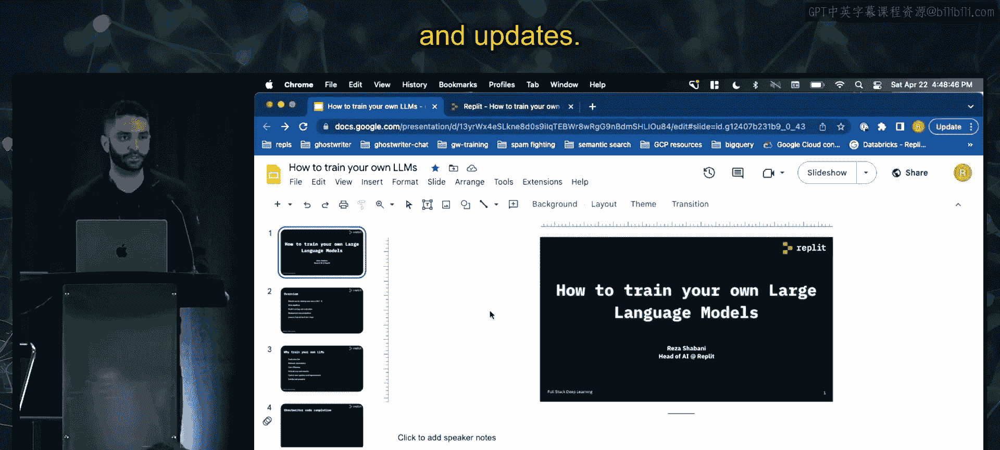

Okay， so like an agenda or overview， I want to go over。The first is。

 should you be training your own LLMs， actually wasn't here yesterday。

 but I saw on the agenda that there was a section called should you Tra your own LLMs。

 and I hope the answer wasn't no because then I'm just wasting everyone's time but in case people want to train their own LLMs。

 I'll discuss some of the data pipelines then model training and evaluation。

 the process of getting your model actually into into production and in front of users and then I'll talk a little bit about the lessons learned and the next steps。

So that first question of why actually train your own LOMs。

 It's there are any number of reasons why a company might want to train their own LOMs。

 And these are only a few of them listed here。 And these are some of the most important ones to us at Replelet。

 the top one is customization。 So just being able to do things that general purpose models aren't very well suited for。

 So things like G4 or Cha G Trbo。Might not be suited for for code use cases， for example。

 for code completion and even within code completion models like code X。

 you still are going to get code models that are customized for specific languages at Replet。

 we get a lot of webbased use cases。 And so people like to use a lot of JS X， T S X。

 And so we train our models overweight on those languages as opposed to some some of the others。

 We even actually tried to do because。Chat GBT， the 3。5 turbo model was so fast。

 we actually tried to use it for code completion once to to test。 And we just， no matter what we did。

 we just couldn't get it to actually write and complete some code。

Another reason is reduced dependency， and so we think this is really important that different companies。

 different people and developers have access these language models and aren't just reliant on a handful of tech firms。

For us， cost efficiency is also a really big reason。 And so we want to create these。

 these models to be much smaller and and more efficient so that we can bring them to to everyone。

 Copit still costs。I don't know what it is，10 bucks a month， something like that。

 We have 20 million users on on Relet， and we just can't pay that level of API cost for for our users and we want to bring。

Go straight to everyone for， for free eventually。 And so。

That requires training much more cost efficient models and hosting them at drastic drastically reduced costs。

Some other reasons data privacy and security， so obviously a lot of people don't want their data information going to open AI or Google or elsewhere。

 and then control over updates and improvements and of course， just having the IP of a trained model。

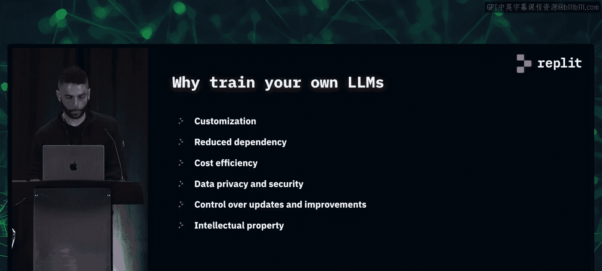

So what I'll be talking about this， this process is for the ghostt writer code completion model。

 For those of you that aren't familiar with with Ghostwriter。

 it's a competitor copit in a few ways and in this particular。Examp， it's a code completion。

If it loads， is the code completion example。 So this is different from the ghosttwriter chat product where you can talk to ghostwriter。

 ask questions and whatnot。

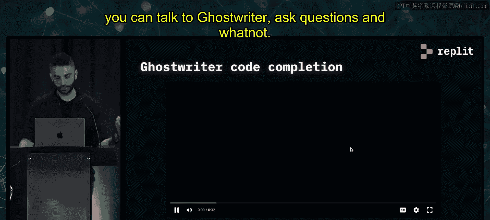

This is more for next token prediction， given the context of a code file。Loading。Issues。

 but this is you know the the type of model where you're going to feed it code in any number of languages。

 and given the context， what's fed in， it's going to predict the next level or。

A block or a multi line completion。Cant。Seem to get this to load。

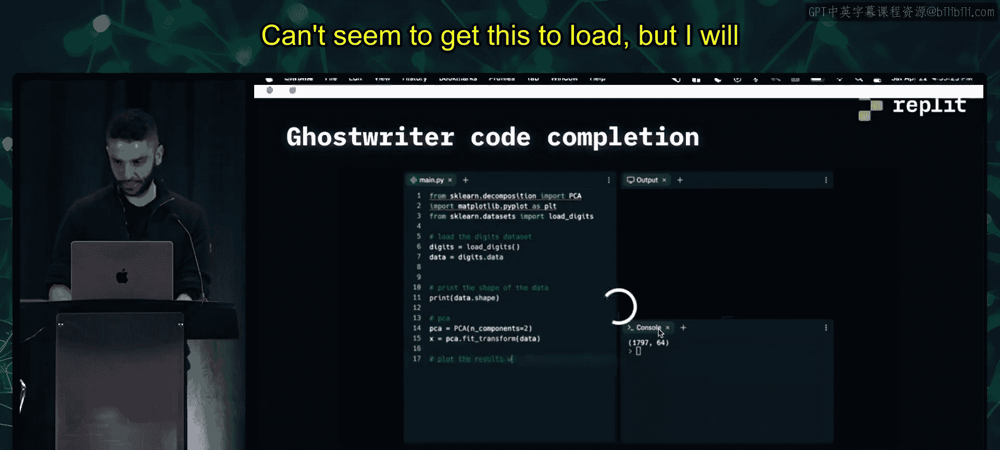

But I will move on。

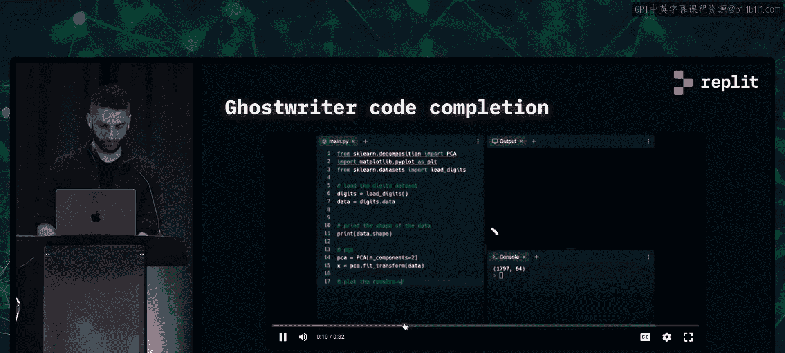

Okay， so what is the， the tech stack that we use for this。

The sort of like modern LOM stack that that we think at least is the modern stack at Replet。

We use data brickricks for all of our， our data pipelines。

 And so that that includes all of the pre processing， the summary statistics， analytics。

Transforms and， and pretty much everything else。 It falls pretty central in the。

 in the diagram of our， of our use case。Hugging face。

 which I'm sure everyone is familiar with here and uses all the time。

 so great resource for data sets， pretrain models， tokenizers and various inference tools。

 especially for code。Will we make use of their of their inference tools。

 and I'll talk about that a bit later。And then mosaic Ml， which。Brands itself， kind of as the。

 as the。Data breakricks of GPs and and model training。 And so they have a lot of。

Great ability to scale up GPU nodes and run。Distributed training。

 And they also have a ton of preconfigured LL M configurations for training and。

 and manage GPU infrastructure。

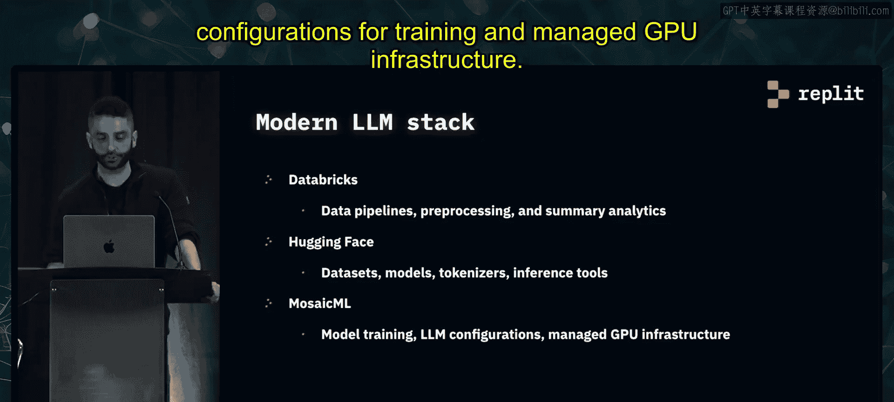

So this is the diagram that kind of lays out what what our process looks like at a pretty high level。

 I'll probably come back to this diagram a good number of times throughout throughout this talk。

 just because it really shows how everything is is kind of tied together。

 the three stages of this diagram。 one would be。Data processing is is the first stage。

 So everything that that falls under this sort of Databricks umbrella， we consider data processing。

 And， and that's where we spend the majority of of。Time and effort in this process。

 then you have the actual model training。 and so this is this kind of mosaic Ml portion of the diagram。

 so the ability to scale up GPU clusters and nodes actually actually run the training。

And then there's what we call， you know， inference or production or deployments of production。

 And so this is actually hosting the model。Making it run inference much more quickly。

 being able to do model evaluation and deploying these models up on a server where where the rep client and a user can actually access them。

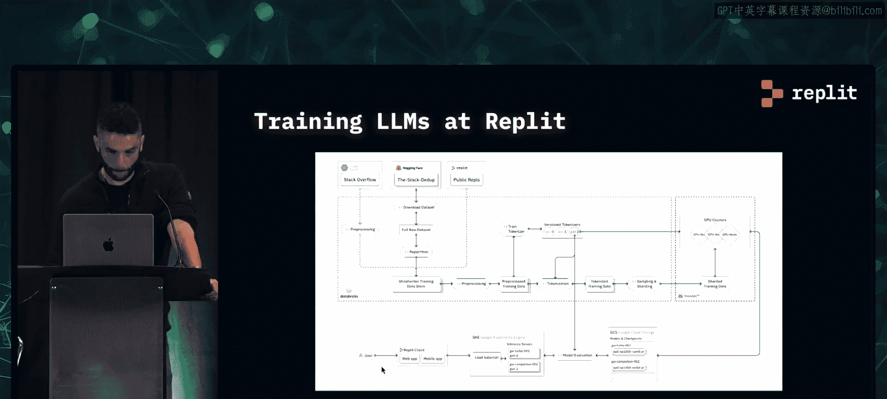

So let's start with that first。Portion， which is the the data pipelines。 obviously， there there's。

Way more than I could possibly go into in 30 minutes but I'll just give some broad overview。

 so we start with a large corpus of permissively licensed code data from the stack and the dedued version of this data is available on Huging face in Parquet format or the Huging face data set format。

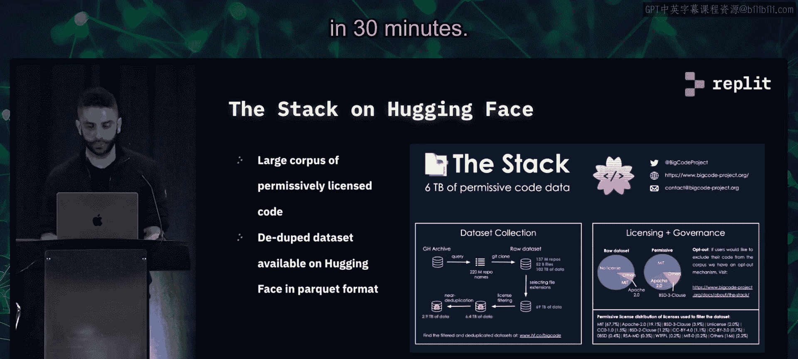

So this is a data set collection。 It comes from the Github archive， a bunch of different repos。

 a raw data set that then they。Select based on various extensions。

 based on languages and they do license filtering and near do deduplication on this。

 I believe the number of languages is something like 358 programming languages so they have everything on there and and it's the primary data set that we start with for training code models。

Yes。Yes， there are definitely going to be bugs in that code。 Yeah， so， so we'll。

 we'll talk about that in a in a second。 I mean， it's。

 we can identify some of them and then deal with them ideally。 But it's， it's kind of。

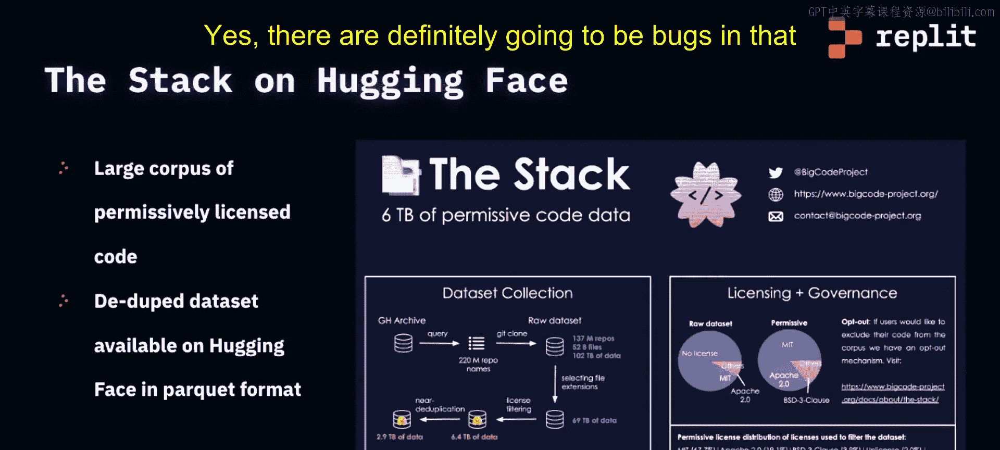

One of the things that comes with with the territory and there are different ways to increase the quality of your training data and I'll talk about those in a minute。

So it's， it's kind of a， a funny process。 If you look at this diagram。 we。

 we start on hugging face with the stack Ddupe and almost immediately go to a different format within。

 within Databricks and。

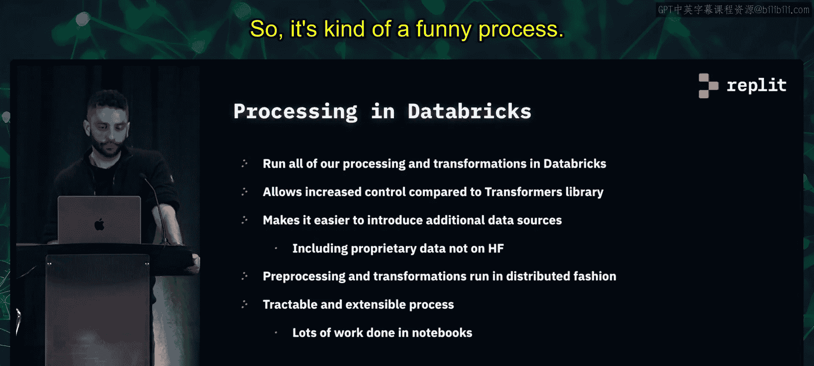

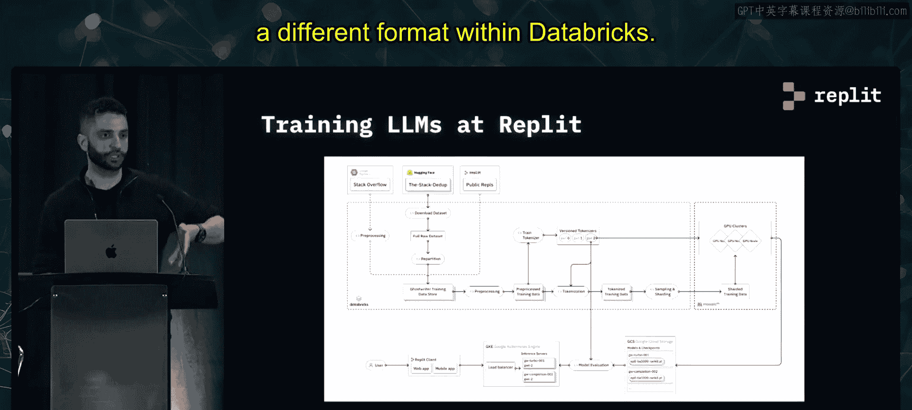

That is because Dataricks allows us。 It's it's what we use for all of our processing and transformations。

 I'm sure a lot of people here probably use have used the Transformers library from Huging face in some form and and transformers is great。

 it really abstracts away a lot of the issues or complications of working with with this type of。

Of data and for， for these various purposes。 But if you want to train your own models。

 you really need much more control over the data in。

 in a way that you just can't get from the the transformers library。 And so。

That's part of the motivation is to move it on to a platform where you can deal with data at scale and from a variety of different sources。

 and so like the next bullet point says it makes it easier to actually include additional data sources and that includes any kind of proprietary data that you have or any data set that's just not on on hugging face。

 so at Replepllet we have a proprietary data sources and things like public repples and so we wouldn't want to put those up on hugging face if we ever wanted to include them in the training set。

 for example。Another reason is just the scale that you can process at on Dataricks。

 And so all of the pre processingcess and transformations we can run in in distributed fashion。

 And so this allows you to speed up。S the process and， and speed it up dramatically to。You know。

 to speed up critical parts of the pipeline。In linear fashion。And then lastly。

 it's a very tractable and inextensible process。 So we actually do a lot of this work just in in notebooks。

 And we can track the progress of， of each of these runs。 We can keep track of。

All the different data analytics that we do along the way， the samples that go into the training and。

 and whatnot。

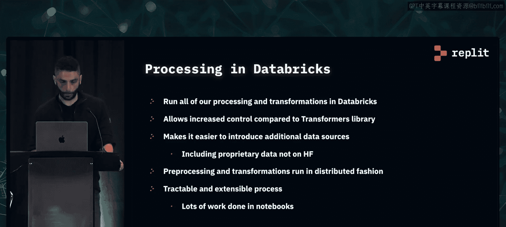

So here's an example of， of that。Of some of these like transformation。 So this is done in。

 in a Dataricks notebook。And and a lot of the kind of preprocessing steps that that I'll go into next。

 it's really important to dive into your data and really understand it and have a 360 degree view of what's inside。

 even deduped 2。7 terabytes of code data is is a ton to look at and you're gonna find a lot of a lot of garbage in there。

 And even the steps that you want to take。 So things like being able to remove bugs from code or just even being able to remove things like binary files or any other sort of garbage that may have ended up in there。

 there's really no good way but to be able to analyze this data scale and actually just jump into it and look at it。

 So here's an example of。

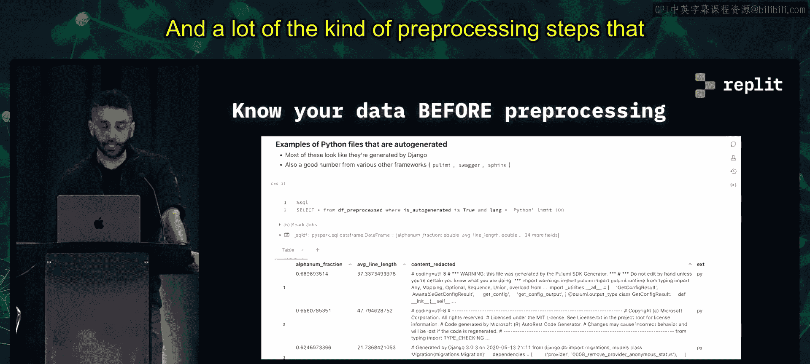

Of something we might do where we try to， we remove auto generated code from， from the data。

Just because a lot of this is going to introduce duplicates and and really reinforce certain coding styles that we may not necessarily want the。

 the model to。To pick up on and so we have this process where we run heuristics and Regx is over the data to identify anything that's autogenerated once you do you want to actually be able to go back and say here's what the data that was flagged this auto generatedrated looks like so in Python I believe it was something like 4% of the data is auto generatedrated and you want to be able to along the way go back。

 look and see okay it looks like this is code that's typically generated by Django and there's a few other of these of these frameworks and so that's what we're throwing out so this is what I mean by that kind of tractable process is that at every step of the way you can actually go dive into the data and see what it is that's going to be fed downstream into the model。

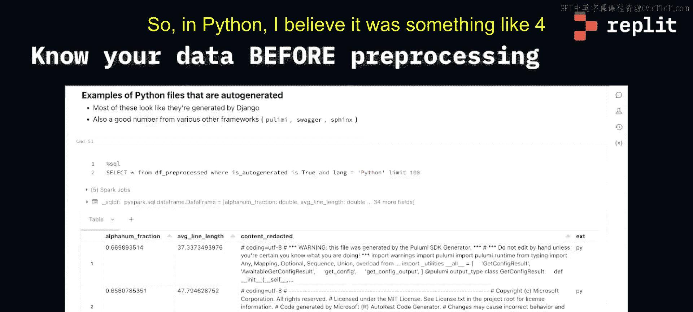

So then the actual pre processing steps that。That we take first it's really important to anonymize the data and so we do this by identifying and removing any kind of emails。

 IP addresses and secret keys， we replace a lot of these with a list of。

 let's say like 10 sample emails that would replace any kind of email in the code process just to keep the structure of the code the same。

 but then you're basically using mass tokens for replacing those emails or addresses or keys。

We remove auto generated code。 So as I just said， we'll use standard reex and and other heuristics to kind of go through and and scrub the data of any auto generated code that。

ThisThis also includes， this is much harder to do with heuristics。

 but things like Minified code and JavaScript， you try to remove using a various heuristics。

 a number of filters when analyzing the data。We remove code that doesn't compile or is not parable。

 And so this is our attempt to remove bugs。 Obviously， it's very limited。 and。

 and there isn't really much we can。We can do beyond that。

 but at least for a subset of languages where we're actually able to evaluate the language。

 We we do this to remove anything that doesn't look。

Like like legitimate code or something that would actually be able to run this is also really important for at least in the Python use case。

 so if you use， for example， AST to parse the Python code where you'll end up getting that'll help you remove a lot of Python 2 data that ends up in the data set and so that's not something that you want to feed the model to use Python 2 code。

In， in training。 And so。U using that check on parability really helps there。

And then we have any number of filters based on average line length， maximum line length。

 percentage of alphamer characters， all of that type of stuff。There are。

In terms of the question earlier as to， as to the bugs， there are things that you can do to。

Try and increase the quality of your models code。 And so you can try to do things like filter based on the number of Github stars or or some other kind of metric of of quality。

 I've seen some filters based on like the number of Github issues， for example。

 we didn't find any evidence that much of that stuff helps。

 And and from what I remember a lot of the papers that I that I've seen don't really find that that helps all that much either。

 So one of the other things that we do is we train our own tokenizer And so。

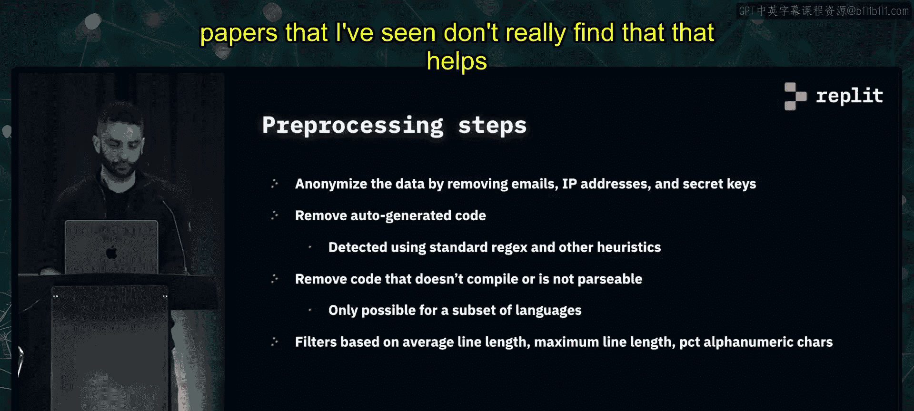

At their core， the tokens are made up of an algorithm， the tokenization algorithm。

 which is the model， and then the underlying vocabulary and you many of the standard tokens are available on Huging face。

 we started out using the codex slash codegen tokenizer initially。

 but then we decided we train our own custom vocabulary from the underlying training data。

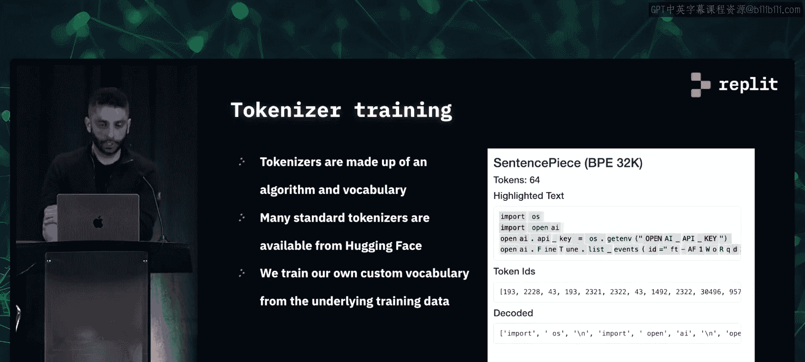

嗯。So the way that this works is you， you have your pre pre processed。Training data。

 I'm not sure how visible this is， but I'll just talk through it quickly。

 the preprocess training data， which you use to train the same tokenizer。

 and so it's on the same underlying sample that your tokenizer is supposed to cover and then you can do things like test how much of the tokenizer is actually covered or how much of the tokens are actually covered by the tokenizer you can blow up the vocabulary size。

 if you try to do 100% but often there's a。

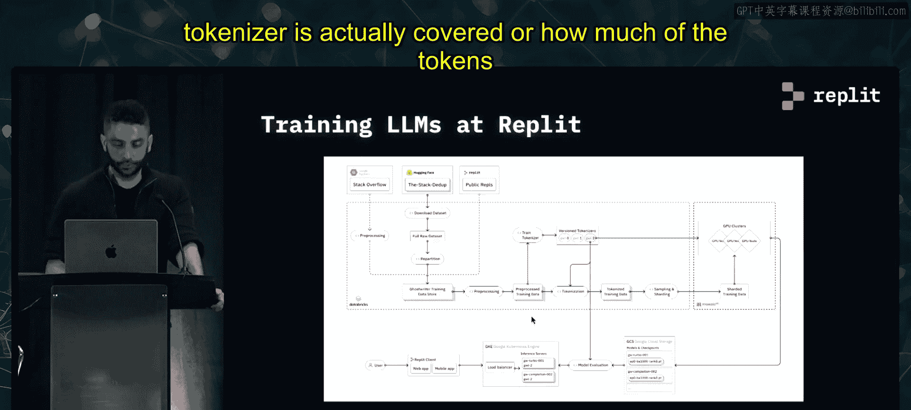

A sweet spot where you can cover the vast majority of tokens and keep your vocabulary small once you have this tokenizer it actually feeds right back into the tokenization process。

 which is the next step of the data pipeline and so it's very much integrated from the moment that you actually train the tokenizer it goes right back into the data pipeline it goes into your training process and it feeds back into inference time and so you should feel really good about your tokenizer when you have it and know that it'll stick around and be with you for some time。

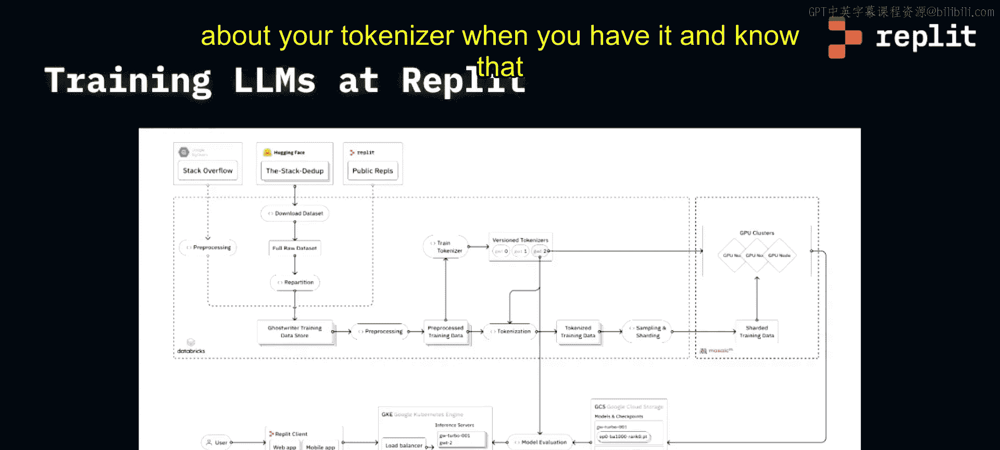

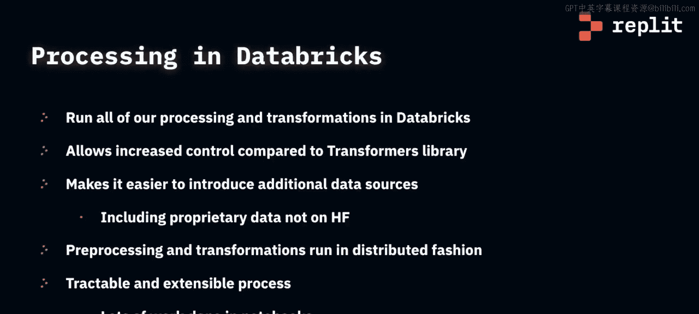

Here is， well， I guess first I should say， why do we do this。

 There are some benefits to having a custom vocabulary and custom tokenizer。

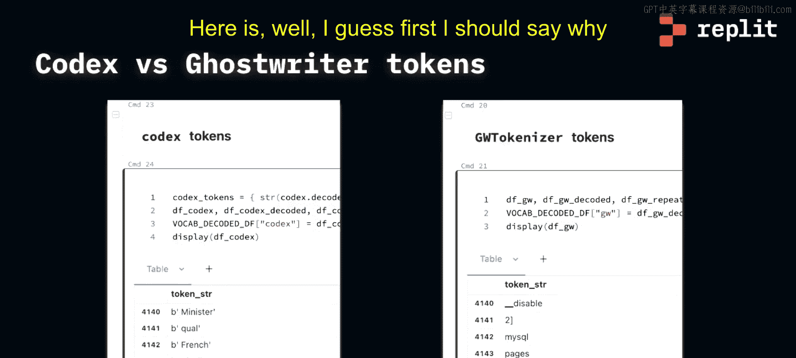

For your model， especially if you have a domain specific。

Data set or something that doesn't require you to produce as much general language。

 So here's here's an example of what this looks like。 So on the left you have the codex tokenizer。

 this is what's used for copilot， but it's also what's used just by open AI。 So this is the。

Open AI tokenizer with some。Differences its， it's， you know。

 the same thing that's used for general language。 And then on the right is our tokenizer。

 the ghost writerer tokenizer。 And this was trained on the underlying code data。

 And what you can do is you can just scroll through the tokens and see。At about， you know， I mean。

 you start to see it much earlier。 but definitely by the 4000 mark。

 the codex tokens well into natural language。 And it's talking about， you know。French。

 drink minister， all of these terms that just aren't as likely to come up in code and still at that point。

 based on the frequency of tokens that it's seen， our tokenizer is very much writing code。

 tokens are much more oriented for the use case。 And so that means at the end of the day。

 we have a smaller tokenizer， smaller vocabulary。 It speeds up model training。

 It speeds up inference and and captures a lot more information in the same block of context。

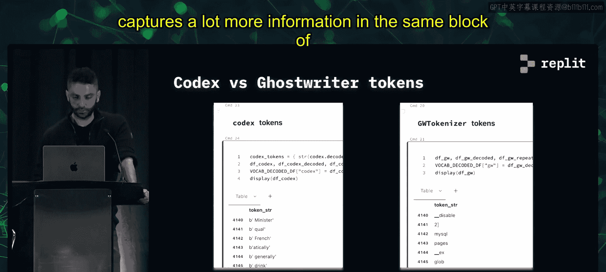

Okay。嗯。With that， I'll move on to。Model training。 So we train our models on mosaic M。

 I'm just curious， I'm sure a lot of people have have heard of and used databricks in a hugging face。

 Be curious to see raise of hands。 How many people have used mosaic or heard of them。系。

Decent number of of， of people， so。So mosaic M， as I， as I mentioned earlier。

 is a bit kind of like the the databs of， of GPs and model training。

 And so some of the key benefits that they provide， one is GPUus for multiple cloud providers。

 And so anyone who's been trying to。Acquire GPs and。

 and have them available to train knows what a pain that this can be， especially to get， get it from。

 you know， different cloud providers if you're。pririmarily an AWS shop or GCP shop or whatever else。

 And so've they've done some deals with different cloud providers and have GPUs readily available for them and usually at kind of reduce prices and you can also do this or integrate with them without having to actually sign up for that cloud provider。

 which is an added benefit just because it。Requires a lot of work to。You know。

 integrate a new account there。They also have a ton of well tuned LOM training configurations。

 And so they've thought carefully about。Various learning rates， batch sizes。

 all of the different configuration trade offs。 And。

 and I actually run these for specific models and to。Both make sure that。

 you know the loss curves are declining， but also make sure that there's a lot of GPU throughput and that the performance of the GPU is saturated and making full use of all your compute resources。

And this managed infrastructure deals with fault tolerance。 So if a node fails， it comes back up。

 and then they have a easy to use CI for kicking off these training runs。

 So we used to do this this stuff on our own， found that all of these benefits were really worth using Mosaic Kael instead。

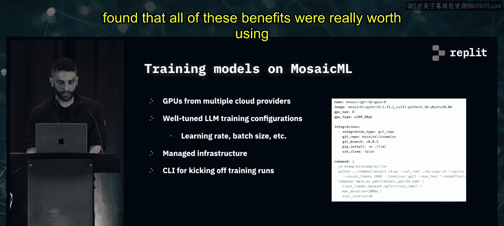

We kick off our training runs， and then we get to watch these like pretty loss curves。

 hopefully come down and hopefully not spike。And， and we use weights and biases for these for this logging。

 So pretty standard part of the of the stack as well。 Then I will move on to。

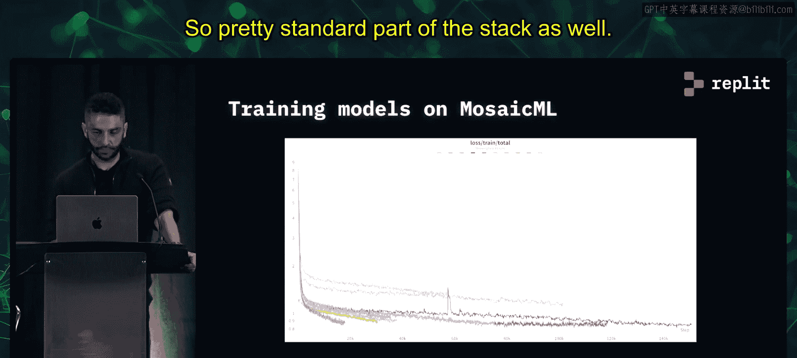

嗯。To testing。 So testing your models is actually。One of the most difficult things to do we found and and a really time consuming thing to get right。

 So one of the main methods， at least for code， is using something called human eval。

 which always bothered me because it's not there's like no human involved in this system。

 It basically just gives a prompt to。To the model， in this case， it's saying in。

 in Python to write a function， it returns the sum of numbers from one to N。

 And then it gives it a function signature definition of of sum of the numbers。

 And then here on the output， the the model produces an output。

 And then we can actually run a test to see that this。Produce what was， what was expected。

 Did the output of the model。Once we execute that output。

 does this produce the the test result that we expected。

 This is where hugging faces code inference actually comes in really handy because you can just run at least Python code and run through these test cases pretty quickly。

 There are a lot of other complications here one。One significant one。

 even within Python is just the amount of time that it takes to run this。 And so at this stage。

 inference is still really slow。 And so getting a test or getting a generated result back from the model is still。

A time consuming process。 So if you want to run through hundreds of test cases and do that potentially like 100 or 200 times。

 that that can take a lot of time and add up to to a lot of time producing those test results。

 then another is it's much more difficult to do this for multiple languages。

 And so Python is a pretty easy one。 But having a reproducible kind of test environment to do this across。

You know，2030，40 programming languages becomes much more difficult to， to do。

 There's also a lot of tasks that are very。Not as easily tested， I guess I should say。

 so creating like a login form using HTML， JS and CS，S， for example。

 or different types of web completion cases are not so easy to kind of run a unit test against and tell if the models generated proper output。

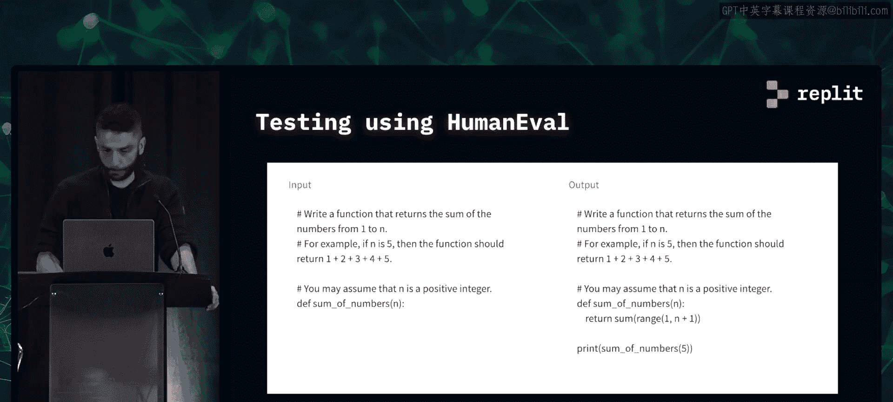

And as I said， you know， we， we run through different test cases for。For model evaluation， you know。

 get the。

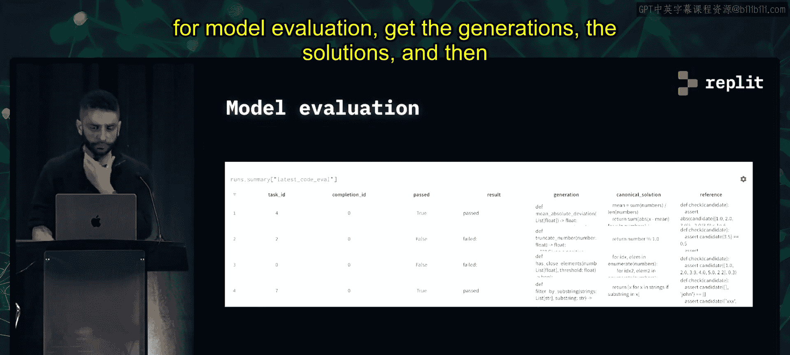

The generations， the solutions， and then statistically take a look at how many of these test cases the model gets right。

 for example， on the very first try in the first pass。

 one other really important thing here that we have to be careful of is decontamination。

 so we need to make sure that a lot of the test cases that are included here in the model generation or the cogeneration aren't actually included in the training data because then we're biasing our results。

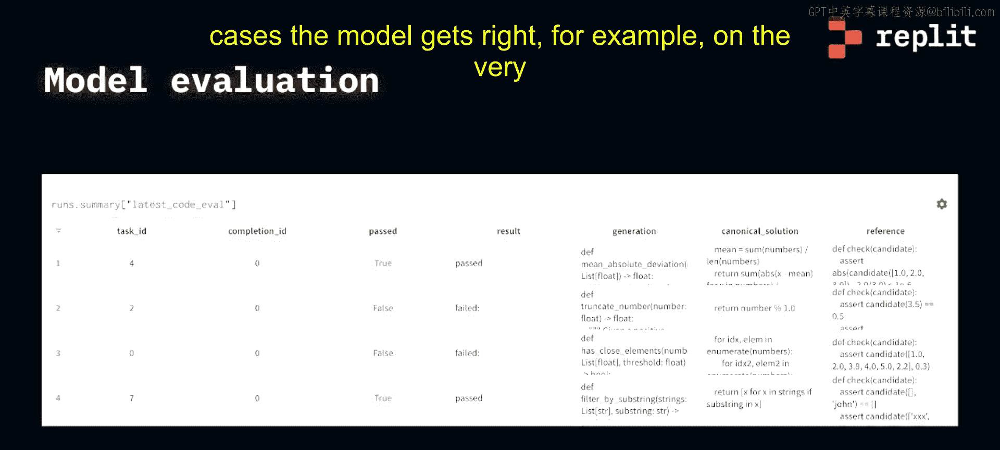

This is getting harder and harder to do， just as a lot of these models kind of become saturated and。

 and learn how to。rite all of these various test cases。

 it's very difficult to leave out and have some sort of unseen data that the model will then be able to use for for test case that's worth evaluating its performance we've definitely seen before where we've trained models that score really well in these test cases and then just aren't very easy to use or aren't very good at completion。

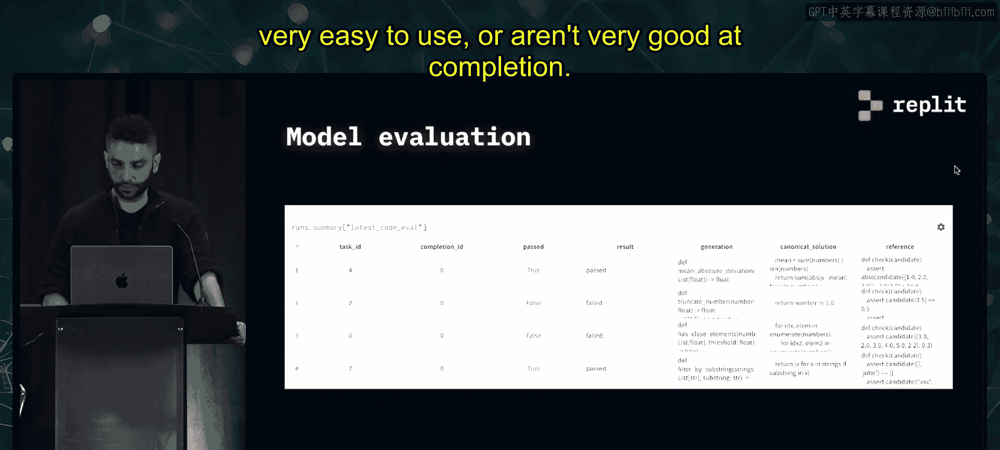

I'll talk really quickly about deployment into into production。 This is， again。

 a much longer topic I could go into。We use faster transformer and Tri and server。

 and so this gives us a really optimized， highly optimized layer between the transformer model and the underlying GPUs。

 Tri and Ser also gives you some some additional features like you can deploy multiple model instance or multiple models per。

instancest or GPU instance， it has features such as batching and a few other things like request cancellation that when you have really low latency needs are incredibly useful for reducing latency during inference。

And then we run this using our auto scaling infrastructure。 And we。

 we already do this at Replelet for a lot of。The machines that we run and and all of the containers that we're running at any given time。

 but then doing this for for deployed models has all of these unique challenges。

 And so the model sizes are much larger。 And then there's very specific GPU requirements。

 and we have to do things like dealing with GPU shortages and individual zones and whatnot。Qu。

 go over some some kind of lessons learned the in the process。

So data tends to be the most difficult part of the of the process。

 laying good pipelines that are scalable and still allow for for fast iteration。

 Once you have this process built out and laid out a lot of the iteration is going to come from from the underlying data sources。

 So what you sample what you include the tokens you train。Really， a lot of the model。Configuration。

 you can change it， run it， but much many of the levers you kind of have to actually affect the data or the model quality and output and type are determined by what data you actually feed into the model。

 And so a big part of that is just having these really scalable pipelines that allow you to iterate quickly and diving deep and actually just knowing your data well。

Evaluation can be more art than science。 And so。This is really important。

 We talked about the human Eval test results earlier but there's nothing like actually putting the model in front of users and allowing them to play with it。

 see how it feels， how it completes， the latency， how you know whether or not it tends to repeat itself all of those types of things that we call model model vibes。

 we take really seriously at replicate it and put it in front of users and kind of test with them for。

For， 30 minutes or so just to see is this thing actually useful for them？

And then it's also really important to， to collaborate across the team we， we've learned。

 So there's a lot of moving parts that require。Being being brought together。

 And so there are model configurations， for example。

 on the training side that allow for more advanced features。

 but then libraries like fast transformformer may not be able to support them or may dramatically slow down inference process。

 And so that's one thing that we've learned is just it's critical to kind of。

Watch the moving parts throughout the entire process and make sure that everyone is working together。

Just some really quick background on like what， what we've noticed makes a good engineer who works in in this space。

 One is the the right mix of research and and engineering mindset。 and so。

This means someone who has a research mindset but can also do the engineering that's involved and and required to actually test these ideas。

 train these models and and deploy them into into production experience working with data at scale obviously matters。

 And so， you know， if you use like the Transformers library， that's。That's great。 And but。

 but the ability to also move that into more distributed kind of pipelines that where you can analyze。

 say 2。7 terabytes of data at scale are is is really important。

 Obviously a solid technical background。 So the more you have an understanding of the stats。

 computer science， Algos and data structures underneath really helps。

And then if you're really skilled in in software development。 So that obviously includes programming。

 but also the libraries and frameworks， things like Pytorr。

 Tensorflow and as well as the C ICD process。 So that fast iteration loop， if you。

If you're an engineer that kind of appreciates CICD and builds it into everything that they do。

 that type of thing really helps you when it comes time to training these models and doing it in inter way。

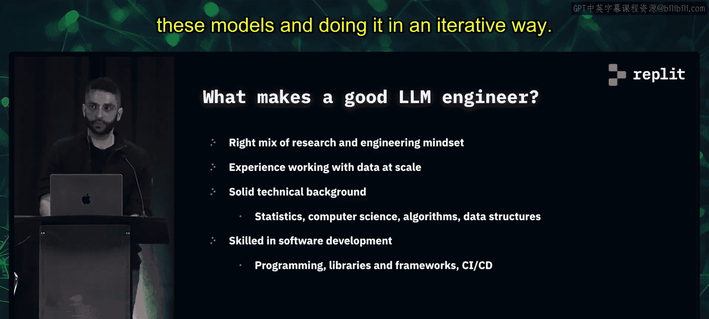

And just last little propagandaas that we're hiring on my team。

 if you're interested in working on these types of problems， definitely come talk to me。

 we'd love to speak with you about opportunities at Re。

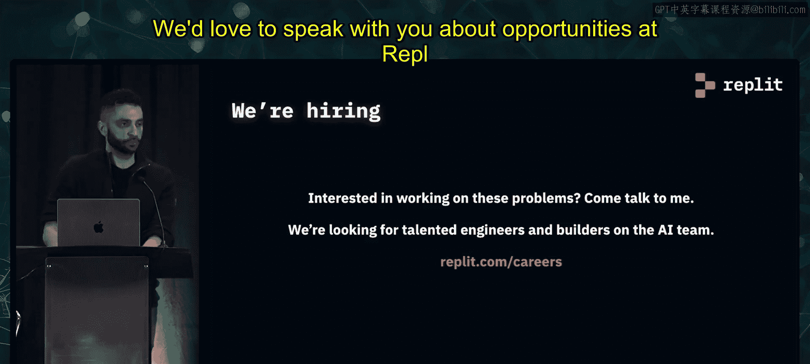

🎼Yeah。🎼Yeah。🎼，🎼。