# LLM训练营 - 2023年春季 LLM Bootcamp - Spring 2023 - P1：-01-Launch an LLM App in One Hour (LLM Bootcamp).zh_en - GPT中英字幕课程资源 - BV1Wf421B7mP

🎼，🎼，Agenda for this talk to intro sort of set up maybe everybody has their own reason for being excited about large language models and artificial intelligence right now。

 but I'll give you mine and my perspective， the one that we have at FSDL and then we'll go through what it takes to get an LLM app up and going in an hour first on prototyping and iteration like figuring out what you can and deployment。

 getting something out there and running as an actual people to interact with。

The basic form of what we put together and what I describe in this talk will be available for you to interact with during the event and we'll see what that looks like and then we'll talk about what comes after that first exciting hour of quickly shipping and explain why there's you know 10 more hours of talks after this one。

😡。

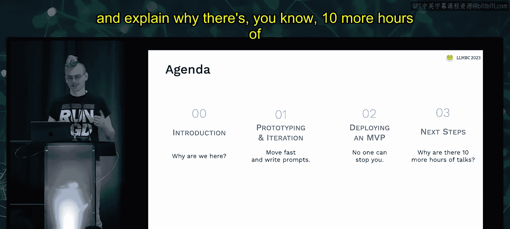

All right， so to introduce why this is a particularly good time to be thinking about artificial intelligence。

 I want you to imagine a world。Where there are disturbingly simple and heuristic computer programs that can mimic human cognitive process。

They're so good that actually humans are forming emotional attachments with their chatbot therapist。

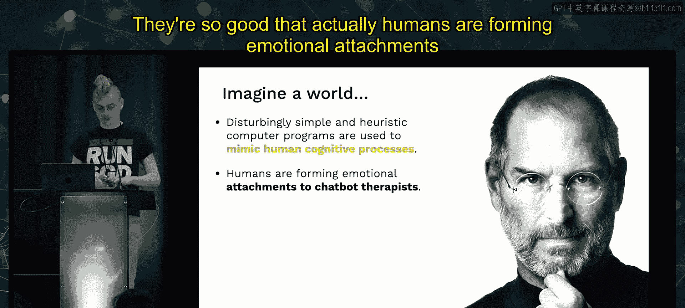

there's computers that can play chess， they can write mathematical proofs。

 there's like this awesome result that they can pass examinations that we do in school。

 the people's intelligence， and you know mind blowlowingly。

 you can get investment advice from an artificial intelligence。Um。

 and you don't have to be some visionary co foundunder to imagine this world because it happened in 1965。

So this is a paragraph from Heuristic problem solvinglving by Comp。

 a paper by Herbert Simon and Alan Newell that like took a look at the landscape of artificial intelligence at that time。

 it noted that there was a level of effectiveness comparable to humans that they could play chess do proves past school examinations and simulate the behavior of an investment fund portfolio manager。

 so I reread this paper only like within the last month or two and was just like shocked at its similarity to what people are doing now。

So the question is like you know clearly that didn't really pan out。

 we've not had artificial intelligence for 60 years。

 so like what's different this time and the clearest answer is that there's like one tool that can do all of those things instead of a bunch of kind of like specialized tools。

 one for each particular task that has a mixture of human knowledge。

 expert knowledge and knowledge maybe you learn from data one for each separate task now you can just use one single tool and with a tiny amount of configuration and get it going on a new task。

 which is more similar to the way that we get humans to solve tasks for us than the way that's machine learning models or old school expert systems models solve problem。

So language models like what what are these tools that kind of changed the game and made this possible in a way that it was not before language models model language that's。

Like surprisingly simple trick that is required to get this capability and what that looks like is something like this。

 if a paragraph was appearing word by word and you wanted to guess the next word is appears pretty smart。

Especially if you could predict more complicated things than just like conversations and chatter。

 but things like， you know， in the midst of speaking to somebody。

 you might throw out maybe not a mathematical equation， but you might talk about Python。

And especially if you look at written documents， there are many written documents that include。

These kinds of more complicated things in them， and as those words were appearing on the screen。

 at certain places， you were able to guess what the next word would be in a way that required your knowledge of something like Python。

 your knowledge of science and the physical world， your knowledge of mathematics。

And so large language models are really， really good at it。

guessssing what the next word is be and so in order to get good at that task they get good at all of these other things like adding numbers together or writing Python code or learning things about the physical world。

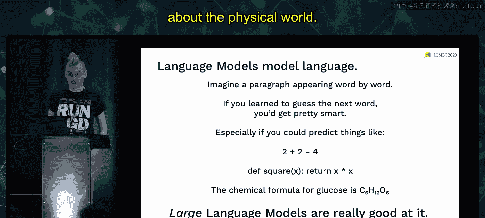

And the， I think。One of the key pieces that is unlocked by this particular path to artificial intelligence and that we're excited to be talking about and sharing in this bootc is language user interfaces so a language user interface is a type of user interface that's been speculated as a way to interact with computers since the very beginning。

 so since like the 1960s， the 1950s even we' familiar with graphical user interfaces and terminal user interfaces is ways to interact with computers。

 but before the Guy came about and you could look at a computer and like interact with like a physical space that was presented to you visually people thought oh maybe the way I want to interact with the computer is the way I interact with a person by talking to them by speaking in my natural language be it you English or Spanish or whatever。

And so there was like early work at trying to get this to happen。

 so a famous chat bot therapist named Eliza in the 1960s。

By Bizezenbaum and then so that was just a purely language interface。

 but people quickly realized that if you have a language interface that at least like gets the ideas for natural language into a computer。

 you could also have that language impact like something that was not linguistic so for example。

 like a block world a world of like simple objects so that would be that was put together by Terry Wananagrad in the Slo program in 1970 and this general idea of language user interfaces。

 I guess like the kind of closest that we've gotten so far is things like search engines where you can type in something that it's a little bit Googleoes maybe rather than your natural language but you interact much more naturally in your interactive like Python program language of Python and one of the first popular search engines ask yous like really presented itself as a natural language interface to the internet。

m and with large language models， we can make much more flexible and much more capable language user interfaces that actually you know。

 behave in process language much more the way that people stuck。thanhan these older systems。

 which are a lot more brittle， a lot more focused on a specific like particular example。

 like psychotherapy only and very simple kind or this block world only。

 this very limited world of discourse。

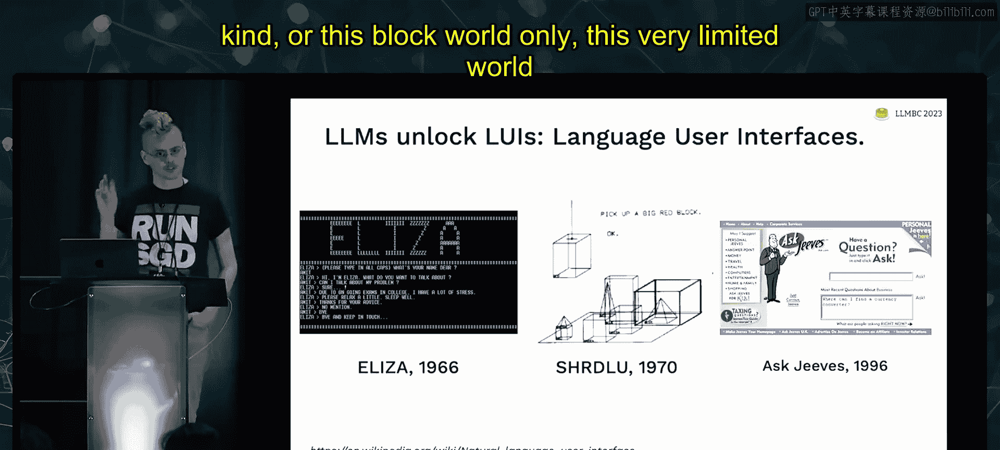

And also， I think's there's this like tremendous wave of hype that I think has got a lot of trigger a lot of people's like alarm bells about language models and artificial intelligence these in particular。

 people who've seen these past waves。And so I just want to get across the idea that this is something that was this guest at before it。

 this is something that we thought might happen if we got language modeling for。

 so this is a paper from the 1990s about what problems are I complete what are the problems that if we were to solve them we would consider ourselves to developed intelligence it's kind of a slippery concept it's named after things from classical computer science like NP complete but it doesn't have quite that degree of mathematical rigor but it represents the sort of field belief about what it takes to to solve this problem and the first one on the list is natural language understanding being able to understand natural language at a deep level and。

This combination like really nice user interfaces， a new type of user interface。

 and this like longstanding goal in the field of natural language understanding is sort of the reason we have this large capability unlock with the release and open availability of large language model。

So， but it's like so we have things are meaningfully different this time。

 and that's one reason for hope， but it's also important to look back and examine like， wait。

 what did happen in 1966， why didn't we end up with artificial intelligence because I'm sure there are people who would have been just as excited to share how their models worked back then？

😡，呃，嗯。The main thing that happened is that we sort of oversold and underdelivered as a field at that time。

 which led to a phenomenon known as an AI winter， a period in which people became less interested in which funding was harder to comemmic fall for these kinds of projects。

 so the prominent one was right after that big wave in the 1960s。

 and then there was another smaller one in the 1990s。

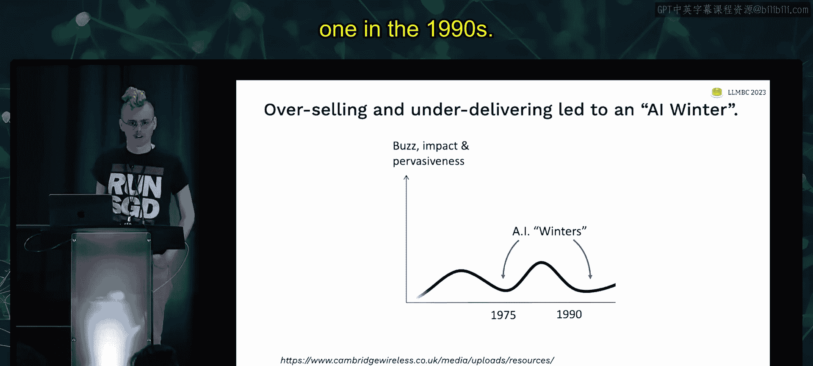

And it's important to look back at some of the details of like how that went down to understand how we can avoid that this time around and one of the key documents of that time is this report by Sir Richard Lighthill for the British government。

 he was a mathematician he got interested in this whole artificial intelligence thing people were doing so he looked into it and he decided it was like a load of nonsense and wrote up his feelings about it and convinced the British government。

 the British public and like eventually the world that this was a bad idea and pulled out a couple of key phrases from this report。

 he talks about the high hopes that were very far from having to realize which was causing enormous sums to be spent with very little result in particular in machine translation and also he really noted that this money was being spent on these problems and then it wasn't being turned into。

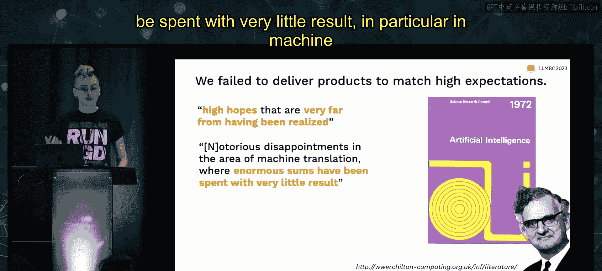

thhings that were commercially valuable there's also a separate section about like research applications。

 but there's a lot of it about the fact that these programs were just like not versatile enough to be commercially viable and that meant that this was like a bad investment of public research money。

And so to avoid another AI winter coming up in the 2020s。

 we need to build actual products that people value， we need to build software， build tools。

 build things that people actually use， and then people will continue to be interested。

 people will continue to like you fund our projects and make sure we can pay rent while we're playing with chat G。

So the good news is that this time around there is a lot more than just research happening。

 so I just went and grabbed。Like trending repositories on GitHub I think this is for the last month。

 but looking at them the top trending repository is the deep speed library which is for doing fast training and inferenceprints with large models and is particularly used with largely large language models there's also。

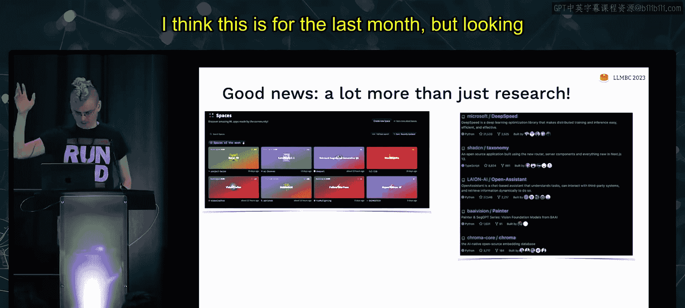

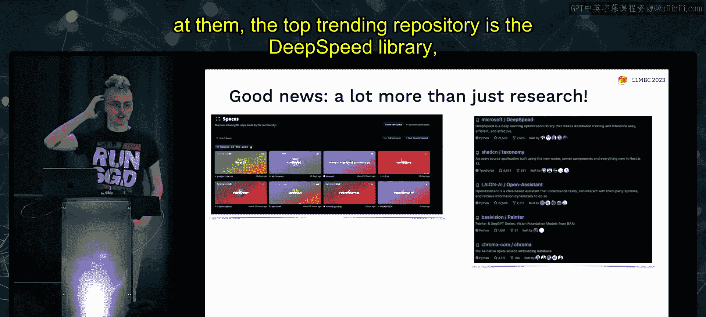

Three of the the rest of the top five well two of the rest of the top five are actual applications that use these large language models。

 so the open assistant from Leon that's an attempt to build like an open replication of something like the chat QT model from open AI and。

And they interacted。Image editing tool painter that uses like both vision models and language models。

 and then lastly， a new database technology that called the self AI nativeative Chma or AI nativeative embedding。

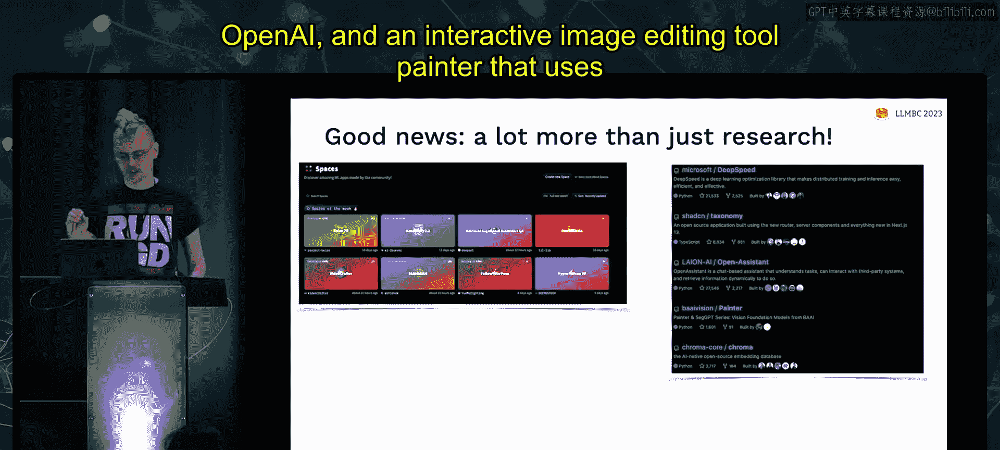

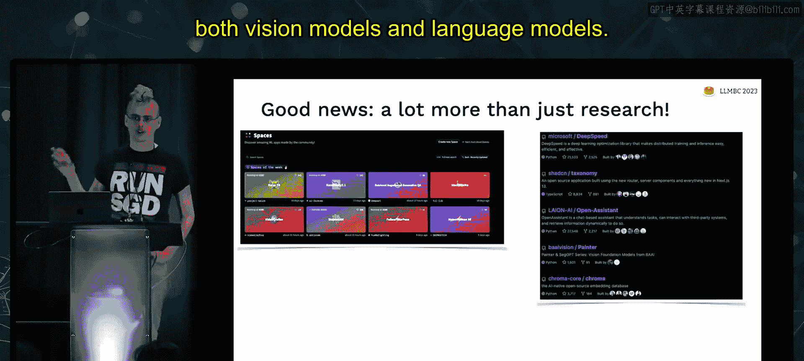

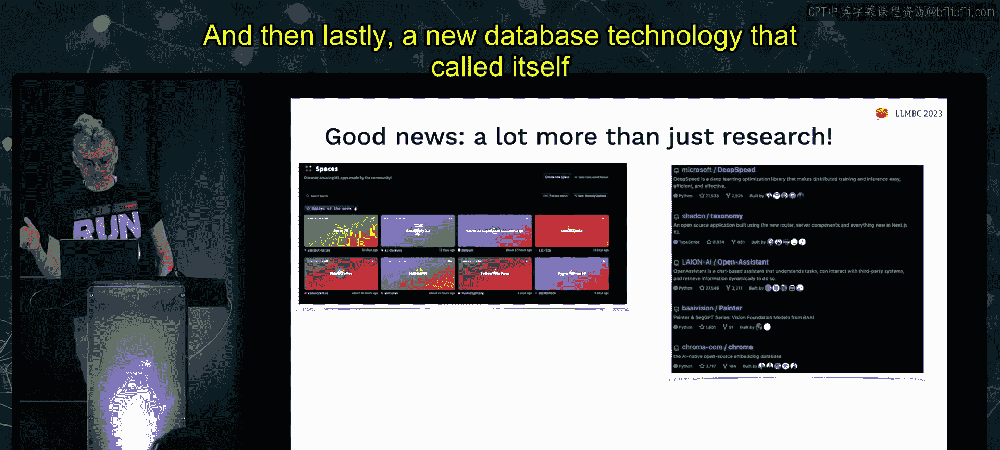

So there's these are actual libraries， people are building。

 people are creating companies around them， people are contributing to them by the thousands downloading them and using them like if you want an even faster fire hose of like things people are building。

 you can check out hugging faces spaces which is regularly showing cool demos。

 and I think Nat Friedman put it best in that when he said that like finally there's tinkering so finally people are actually like putting things together with these models that are these like useful little little toys or simple demos。

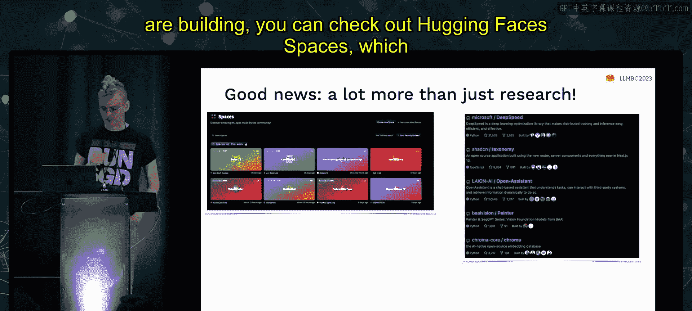

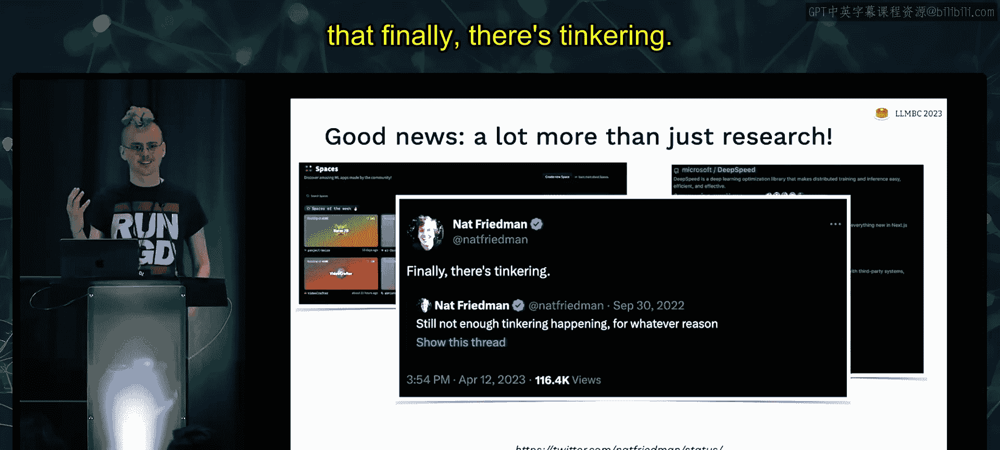

Or something like， you know， that makes for a good like tweet thread or like an afternoon playing around with with an image generation model or whatever。

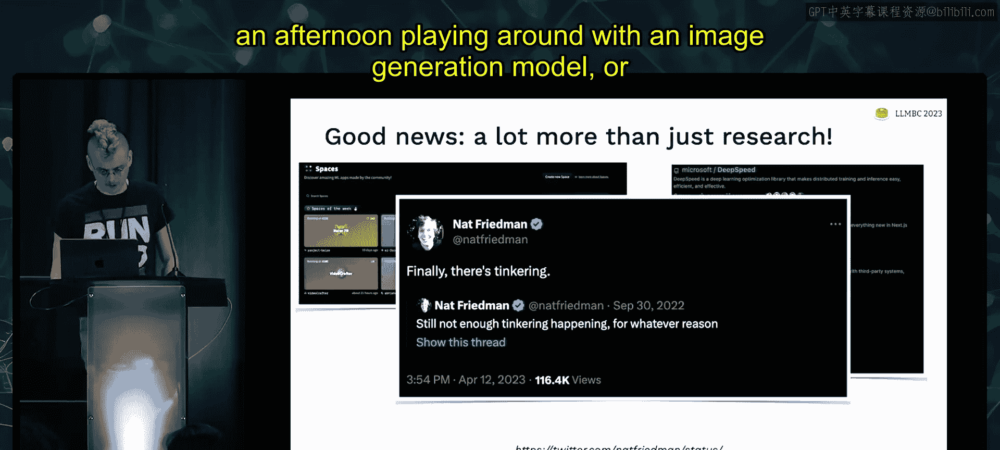

But the bad news is that the gap from like a demo like that。

 something that you can put together like fairly quickly and like use in certain cases。

 the gap from that kind of demo to a product is really big。

 even when you're building something with a product orientation。

 like when you aren't just a researcher for example。

 I remember back in the mid-2010s when people were really getting excited about self-driving cars on the basis of high quality image neural networks。

B there were a ton of demos of self- drivingriving cars like this one from NviIDdia in 2017 and it's 2023 we still don't have like self-driving cars readily available。

 there's maybe a few ways to use them in very limited settings but they're still closer to demo than product。

And that gap can be like really， really big， so the first demonstration of a neural network for running a self-driv car goes back to Nurs in 1988 with Alvin。

 the autonomous land vehicle in a neural network so if you just because you've made something that can work in a specific setting or that is impressive in a particular context doesn't mean that you can immediately productize that thing。

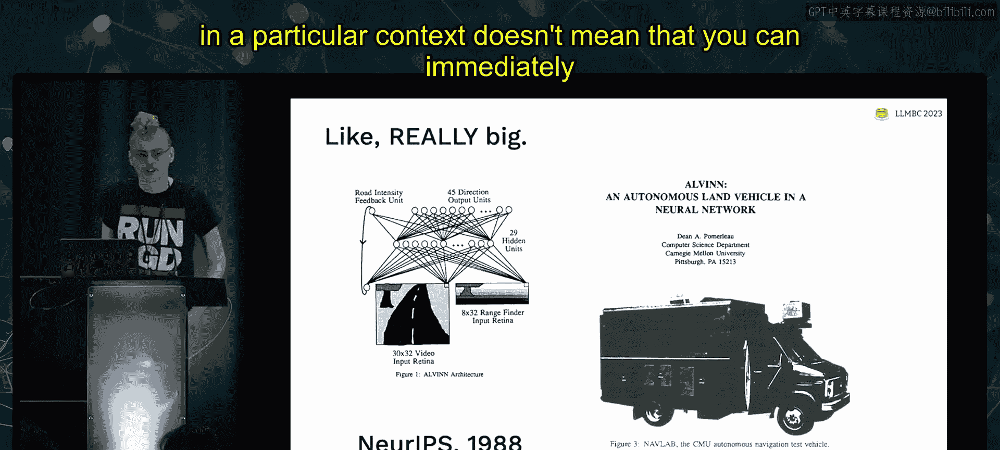

And it's starting to happen and we're starting to the field is starting to create and release products。

 so probably the most famous one is Open eyes chattGT， just directly productizing language modeling。

 which set a record for fastest growing user bits， according to some analysts。

 maybe like fastest to a million users， maybe fastest to 100 million users as well。

 faster than Instagram faster than TikTok。So that's a good sign tools for coding like GiHub Copiloott Replelift Ghotwriterer are also popular powered by these large language models and also some of the tools that we use in full stack deep learning to build our content like Descript for editing video and podcasts like you would edit。

So the product building is actually happening and that's good use for avoiding AI Win theory and it also means that there's like kind of a playbook emerging or there's patterns emerging for how to actually build these things you don't have to like fully blaze the trail yourself and so that is what we are going to cover in。

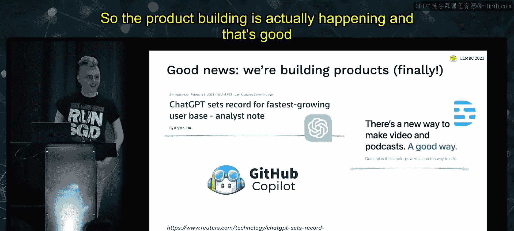

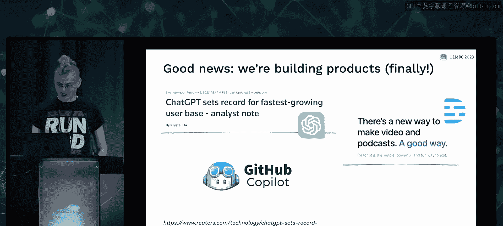

Like over the course of these two days， we're going to talk about a lot of the things that go into building those kinds of applications like Chat EBT or Copit and。

And in this first little like quick bit here， we're going to like just slap dashash put together one of those down。

All right， so I've got to put in a question slide I want to pause here。

 post questions in that Q&A session our Q&A channel and get we'll get back to them but yeah let let's dive into this sort of like process of putting together like a quick demo application and。

Yeah so this is in the past couple months， there's been a number of hackathons around Bay and elsewhere oriented on like putting together quick like product demos using these tools and so I've been attending a bunch of them and seeing what other people are doing and building stuff myself just wanted to walk through what WebEx like so the first half hour is sort of full of like typing and iteration it's sort of like a process of discovery of what is possible。

Um， so the kind of like takeaways here are that like rather than needing to spend a bunch of time like。

呃。Like thinking really hard about whether machine learning can possibly solve this problem。

 you can just try with。Your application some high capabilityhoed model like open AIs model。

 try out in like a simple chat type interface first， see if you can like see what works。

 what doesn't work and you'll like often be surprised by what you keep going in that simple context Of course that's like not what you're going deployloy but you can at least figure out like is this possible and see what the like core problems you're going to have to solve are and then you can like jump into some environment where you can do some like really quick tinkering in a programmatic way we'll do that by jumping into like a quick notebook environment。

 my preferred environment for that kind of quick tinkering and sort of like figure out like okay how would I make some of the things that I'm doing in this chat interface more programmatic and and there's like large set of like open source frameworks and tools coming out that look that easy。

有。First thing that I do when I want to figure out。Like whether I can build something with large language model is I drop into some like convenience interface for interaction so。

In for chat QT is great for this。So that's usually where I start and I think it's helpful to sort of like start off with a particular problem statement so the problem that I have is that I want to learn as much as possible about large language models and so I love to be able to use large language models make to help me learn about large language models and you know I'm sure there's like lots of other people who I'm connected with who also have the problem and so I'd like to help them as well。

Like just first off， I think and just like ask questions about language models to chat so like it's a good idea to start with something where you know the right answer because at the beginning here you're kind of going to end up simulating a lot of components of your final application in your head you have to pretend to be a user you have to think about how you're going to be programming this thing you have to maybe like step in and do stuff that you eventually automate little language model so there's like a lot of pieces here and you want to make sure that you're putting them together in the right way and getting and getting good results so start off with something you might already know so I picked like something that I already knew about language model which is what is zero shot chain of thought prompting and the answer that I get chatT is not really good zero shot chain of thought prompting is an NLP technique used to generate response to a prompt without having been explicitly trained on that prompt that gets some components of it gets the zero shot。

But it doesn't get the chain of thought。It gives an example like what is the capital of France language model can generate from Paris by recognizing the Lake？

So it's like that's not quite the right answer it's missing a ton of additional information and the missing piece here is that these language models are like constructed on data that lasts only up to a certain point in time about 2021 for model and a lot of the interesting stuff that has happened in language models has happened after the cutoff of their training date。

So that's that's not going to so this isn't going to work and be like another piece is I really want to be able to like follow up on this information like I want to be able to read more not just from language models but like I want to discover new resources and in general the outputs of these models in a bunch of stuff that does not exist so for example in a previous time when I asked about this。

Where I could read more， it came up with， it suggested one paper that did also suggested a bunch that didn't exist。

 like how to build Open AI to GDPT3 a step by step guide on towards data science。

 which sounds like something that might exist， but as far as I can tell does not exist。And yeah。

 and I don't think I'd want to read it if it did。Yeah， so like we have a problem here。

 which is that the language models like don't know。

Like where the sources are and they aren't they there's information that they don't have and so we need to like provide it to them if we want it to be a good。

A good solution for learning about language model。Like in this chat interface。

 I might actually I might pull up this zero shot， just check。

 so I'm forming a hypothesis about how a language model the hay is based off of like what I've read about them。

 what I've learned other things I've seen online。

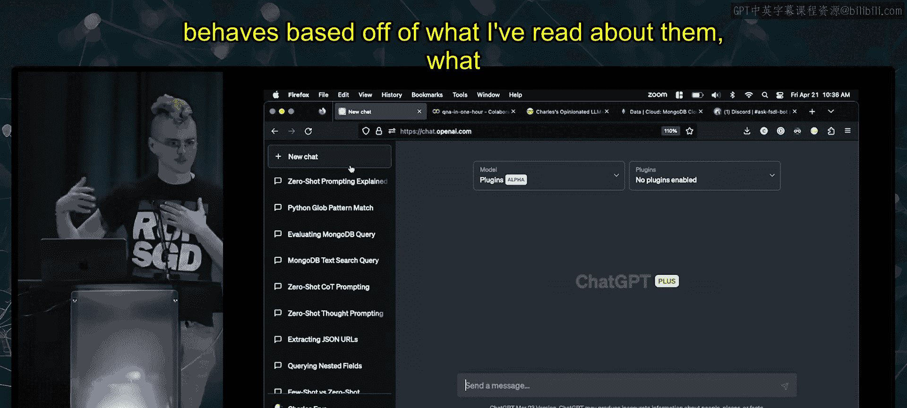

I'm building a hypothesis about why it's like succeeding or failing。

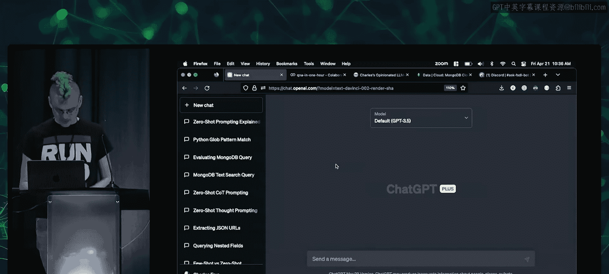

But I should check that before I go on to like trying to build up more of a prototype。

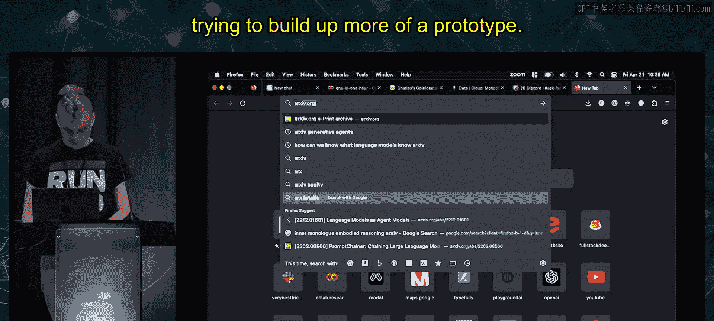

So my hypothesis is that if it just had the right paper in there。

 then it would give the right answer so let me just like quick look the paper that I'm thinking of up on Arco。

Rrab the abstract of it and then put it in， so here's the abstract。Paper。Drop it in。

Based on that abstract。What is the earth shot？So this isn't something we'd expect a user to do right this is something that's going to happen in our application。

 but we're just mocking it in this early。

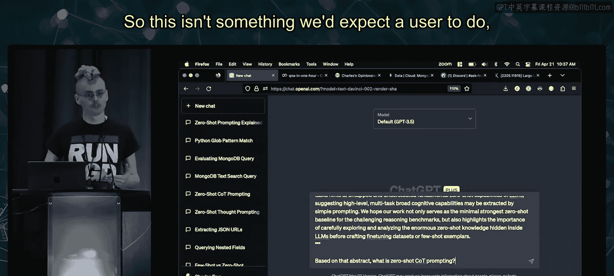

呃。Early stage。So now the model gets the answer correct zeroshot COT prompting technique for performing complex multistep reasoning without any handcrafted few shot example involves simply adding the phrase let's think step by step before each answer so great so if we can get our sources into our language model like pulling them from somewhere。

😡，And we can ask the language model like questions with those sources in its prompt。

 then we can probably get decent answers。So at this point。

 once I've like tried something like this out done a little bit of back and forth。

 maybe then I'd hop over to something like an ephemeral notebook environment like CoLab to try out like what would this look like if I were actually start automating some of these steps？

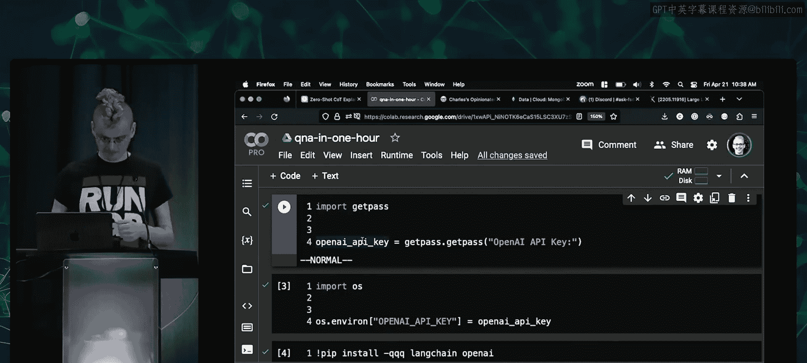

So apart from。Setting things up。

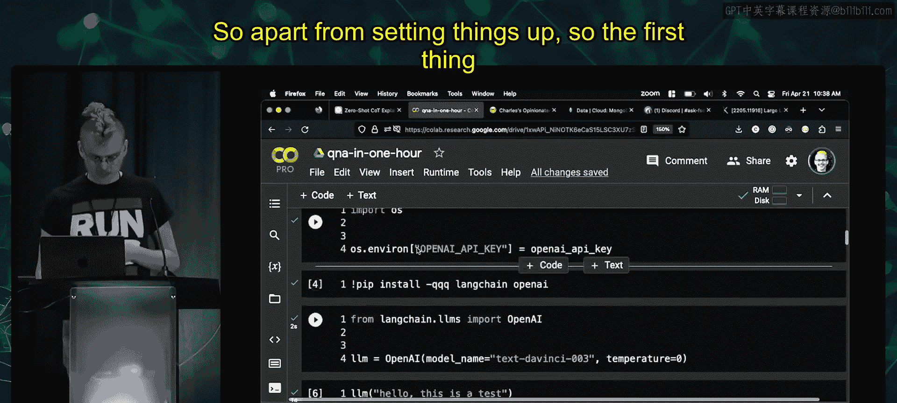

So the first thing is like how am I going to interact with the language model so open AI offers an API so you don't have to be typing stuff typing stuff in and there is a Python SDK for it and a bunch of other SDKs for it but and you can build your application on top of that and lots of people do they want that level of control there's also a bunch of emerging like frameworks open source frameworks for for interacting with these models。

Probably the most popular of them is this library Lang chain and in my experience every time that I need to do something new with a language model like oh you know what I could do my vector store in Redis oh looks like it's not in Lang chain let me code that up really quick then like a week later Lang chain adds it as a feature so they're like they're moving extremely fast and sort of like adding all the things that you might need sort of serving a similar role that like framework in like react might for frontend development like just giving you all the nuts and bolts you need because you don't have to reinvent the。

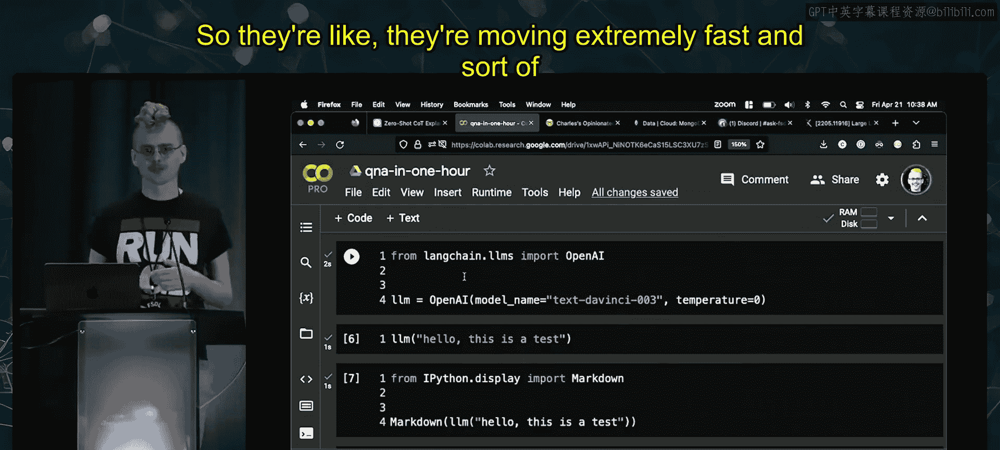

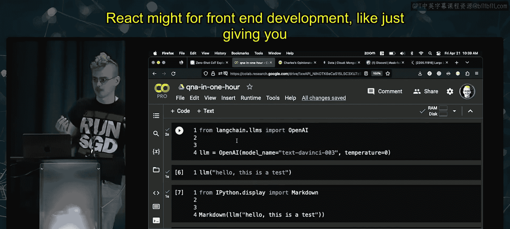

So for example， it gives us an abstraction over LLMs where we just like call them like Python function。

 which is convenient for not having to think too carefully about what's going on。

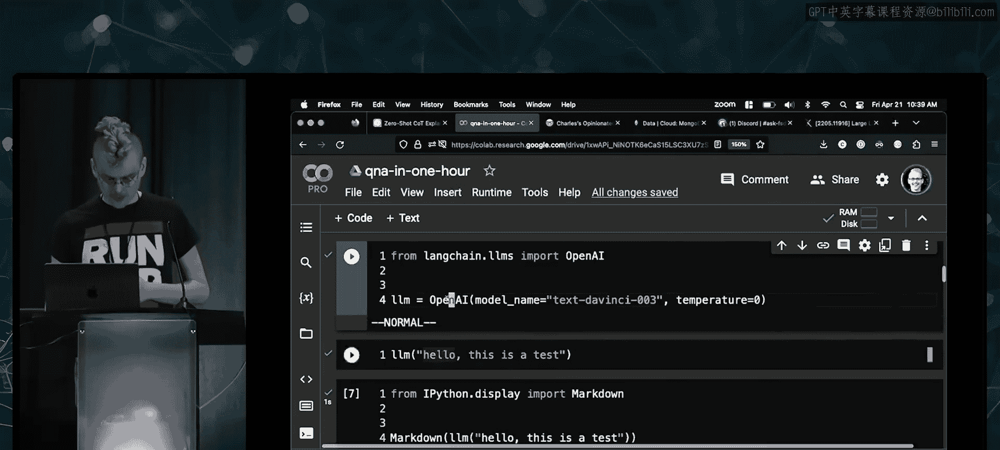

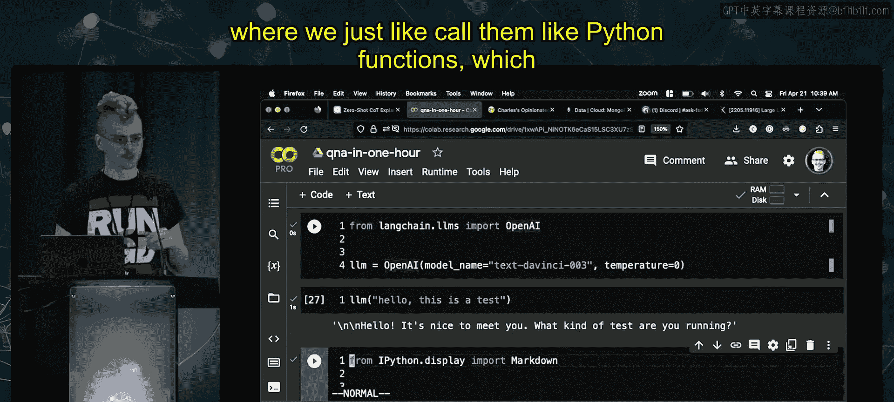

Yeah hot tip like when you're doing this like prototyping phase。

 which you'll run into is that like just displaying this text is really challenging one of my favorites is in a notebook environment you have things like markeddown for rendering。

Yes， all right， so we've got a little a place where we can run the language models。

 we can see what their outputs look like。

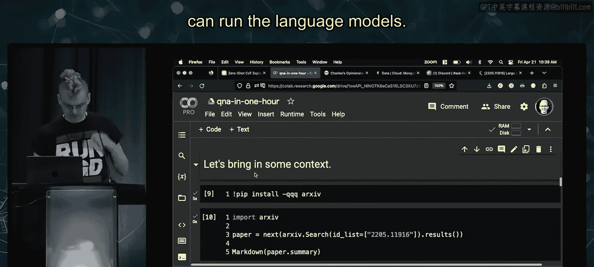

So now we need to do that process of finding information and bringing it into the context。

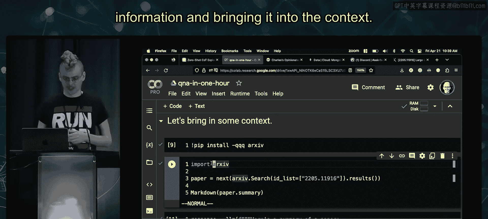

There's at this point you could think oh gosh， I got to go and like come up with a way to like you know scrape information from archive for me my white whale was I spent a very long time trying to figure out the YouTube SDK。

 but it turns out there's almost always a Python library scraping。😡。

You need to do so just like P install archive and import it and you're ready to go pay for summary and so。

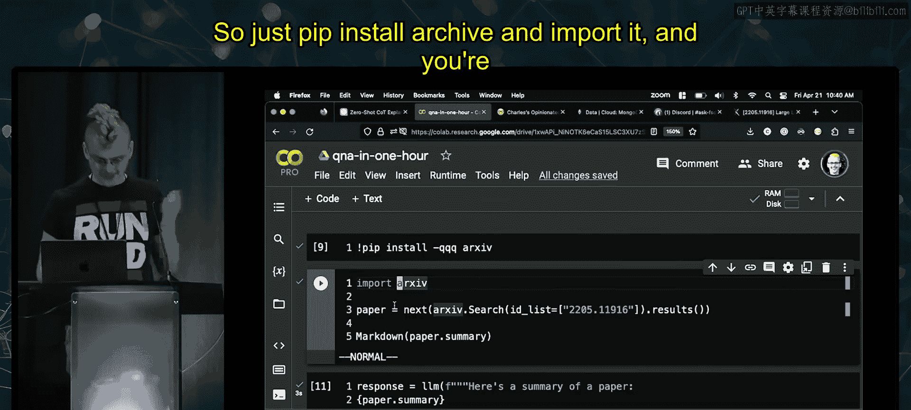

This maybe that's what it's going to look like in our final application， maybe not。

 but first quick check if we just grab that summary and run it into our language model。

 do we still get a good answer？Um， and heres side chain thought prompting multi step breathing single prompt template。

 okay， looks pretty good。But answers are always going to be in the summary。

 there's probably going to be answered elsewhere in the paper and now we run into a problem of like how do I get information out of the PDF？

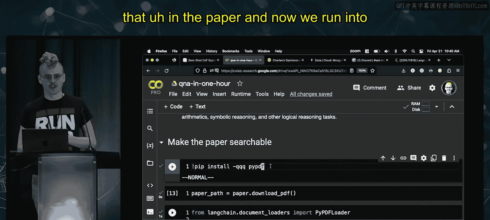

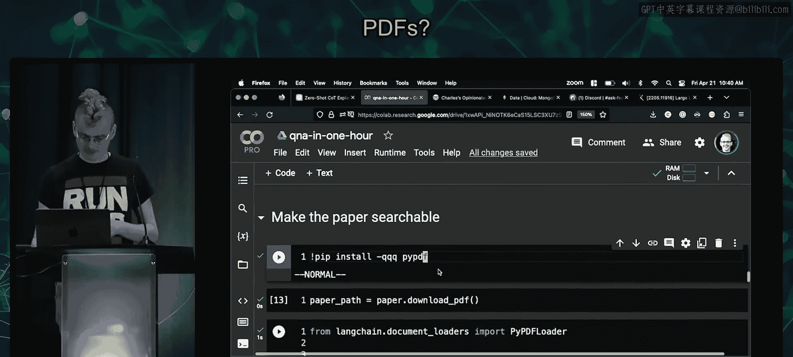

Luckily not only is there a Python package for like getting information out of PDFs it's also built into Lang chain as a document loader so there's a lot of these like core pieces that you might need for lots of different applications already built in with lots of different options so I just take a simple PDF。

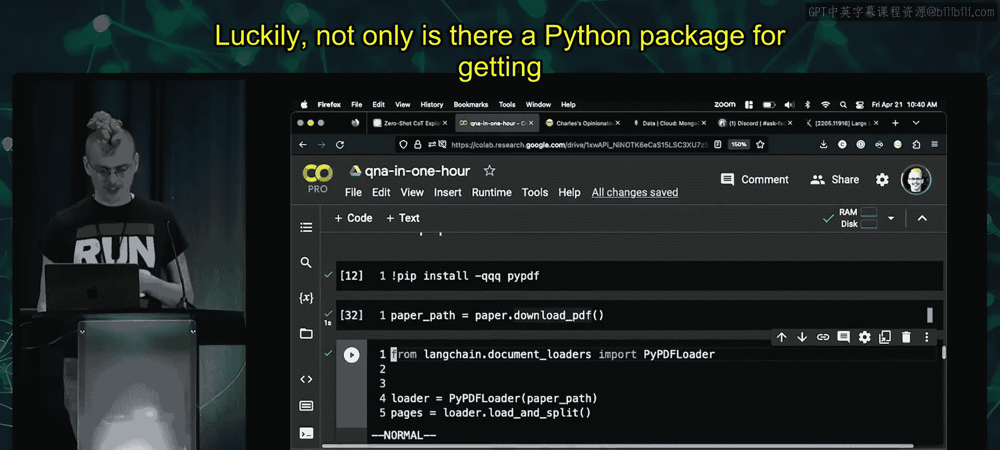

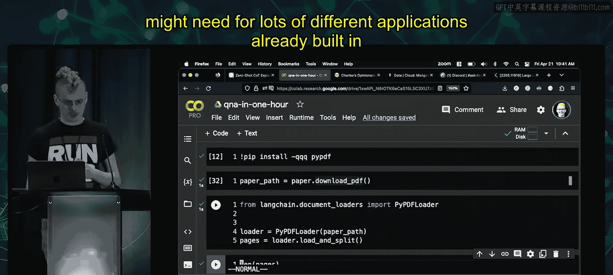

And so again， this the information for this question is just in those first few pages it' like grab it out and。

And see if we get the right answer and again the model answers correctly。

So then the last piece is like how do we solve this problem at a larger scale。

 like how do I find like I have a bunch of information。

 I want to like search through that and find the relevant relevant stuff we'll hear a ton about all the different ways to solve that problem。

In Josh's lecture on augmented language models， but for now。

 we'll just do what's become popular in the LM community， which is using embedding search。

 so turn documents into。And check the similarity of those factors。

All these things also built into L chain， split things into pieces。

 turn them into vectors and then check like which of these vectors have concept that's similar to this question so it's a heuristic much like many of the other heuristics like keyword matching you can definitely get a lot better than this but maybe this will work for our simple simple example this says information zero shot COT a zero shot template prompting for chain of thought reasoning。

So it got that Ed with the first thing returned has our example in it。

And we could continue like prompt fiddling。Like solve this problem like how do we take this thing and put them in there。

 how do we get the language model to like cite its sources but at this point once I've like got kind of core going I go out and I check like Twitter and a Lang chain to see like who else has built something similar and you often find that there's like really good chassis to jump off of so this QA with sources thing that I'm doing here kind of emerge is a bit of like a pet story PI or a to do list app kind of introductory example so there's tons of options available out there and we'll just run with L chain default example。

And just like once again， we get something that's like cable like a Python function and uses the language model under the hood so now we've got our source citation and an answer coming out of our language model。

So we've demonstrated the feasibility here。And like we just got to turn this into something that can actually be youth by people and at a larger scale so I think。

而。The first。Yeah， let's jump back。So that's your like first half hour and again it like the ability of like prototype and tinker has not been really part of the like machine learning workflow until like when I started it was like okay first you need to define your task really carefully and then collect gigabytes of data and then only then can you like try and figure out whether it's feasible or not and then once you figure out whether it's feasible or not you can try and do like you know like try and build the user interface around it so this is what's most different now what's most like unlock by the new the new affairs。

Okay， so then lastly， or so then like once we've got that that like basic thing going it's time to like put together like an MP version of that that's deployable and ship it and this。

Like the key like building a demo is easy， what makes building the actual application hard is like figuring out what's actually useful to people。

 not just yourself， people like you， but maybe like a broad collection of users and so like your priority should be like putting together user interface where you can start getting feedback from users like as quickly as possible and。

The like other major like unlock here coming not from the machine learning world。

 but from the broader software engineering world is it's like much easier to get started now thanks to like all like amazing tooling for like like cloud native or cloud based development so long like this makes it super easy get started makes it super easy to scale when you finally like blow up on on social media just like make sure to limit your your spending。

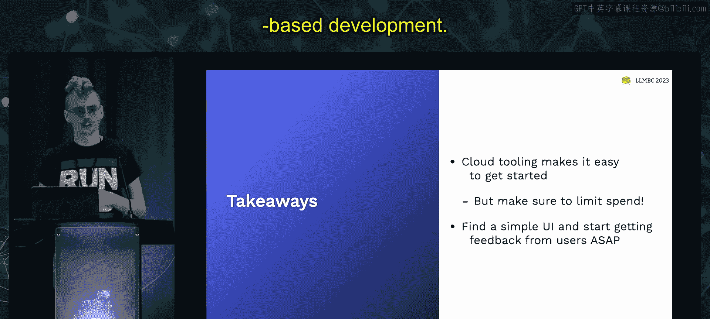

Yeah。So like all right， so we have this working Q&A bot and answers questions about stuff like what how can I turn that into like a user interface where I have some like readily available users who'll try to give me feedback well full stack deep learning has a discord where we have people from our past classes。

So let's build like a quick discord bo and this is popular enough of a way of building things with large models that what midjoney。

 if the primary user interface for mid journeyney， they'll like text to image model。

 so you start here， finish anywhere。嗯。So what is that like how do we put something like together。

 we're going to need to add some way to get a hold of data and put it into storage so we're going to need information lots of all of our different sources。

 put them in storage and then we need a way to quickly index them so that was like pull out the relevant information that then we're starting with this like very early version of the application we don't need to we don't want to have a bunch of servers on all the time do we want some serverless backend to communicate with a language model to communicate with our various persistent solution and then like that's where some of the heavier lifting happen and then we have a lightweight discord bot server that's like relatively cheap to run the whole thing。

And so there's like。Potentily like lots of different stacks that can solve this particular collection what all I'm going to use in this demo application is like open AI to give us our language models。

 Pine cone to give us quick search over vector MongoDB is our data storage just because you know we're moving fast here。

 Sche is just going to slow us down at least for now。And then。

For both our serverless backend and for our like loading of data into our data storage， we'll use Mo。

 which provides just like kind of quickly scalable serverless compute per data science and then for that Discord bot server we can use something like AWS lightweight EC2 instances are free for the first year so like make a new Gmail account like sign up for AWS。

 get a new credit card and now you have a whole year of free Discord bot server。嗯。

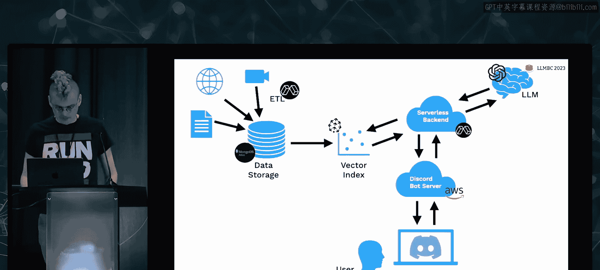

So the。not really enough time to go through the poll details of how this is set up。

 but I did want to just give one plug for why this like what why why did I call it like cloud native tooling is something that actually accelerates this process the bottleneck I ran I like I repeatedly ran into Eugene Yn mentioned running into this is like it's always the data processing right like that's always the part it's like heavy and slow and and fiddly in the details。

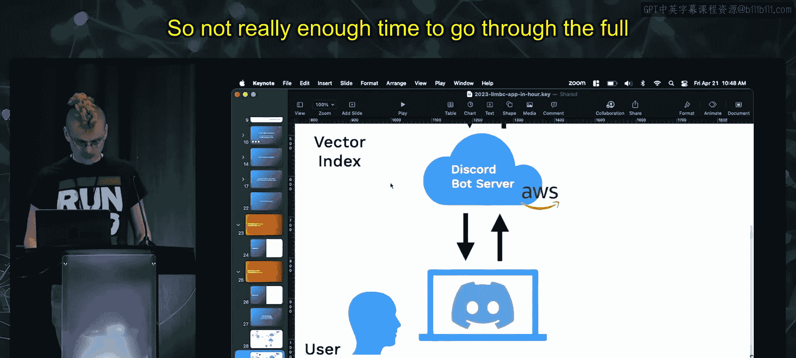

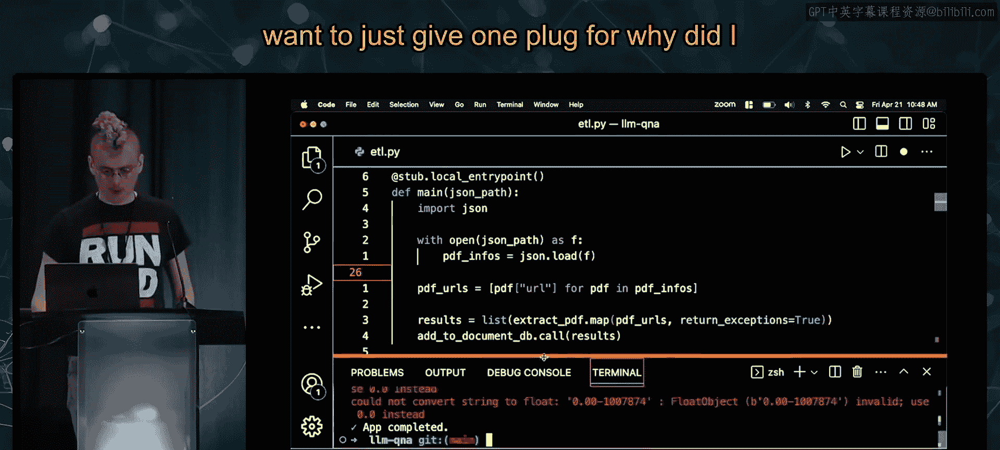

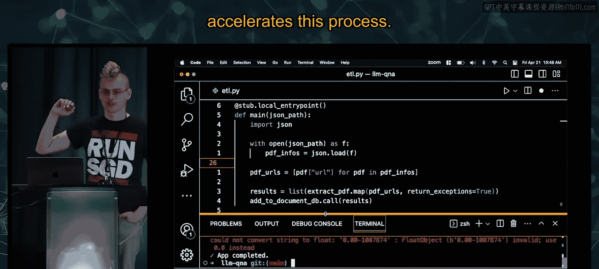

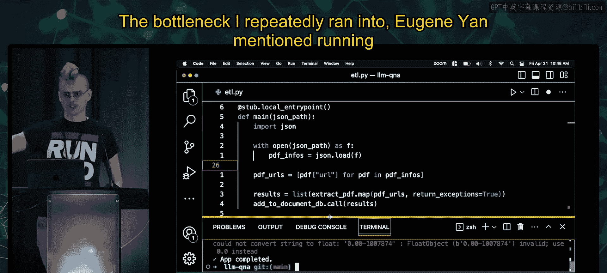

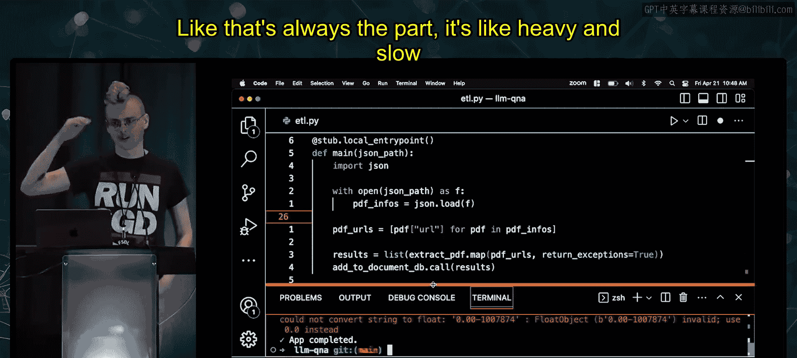

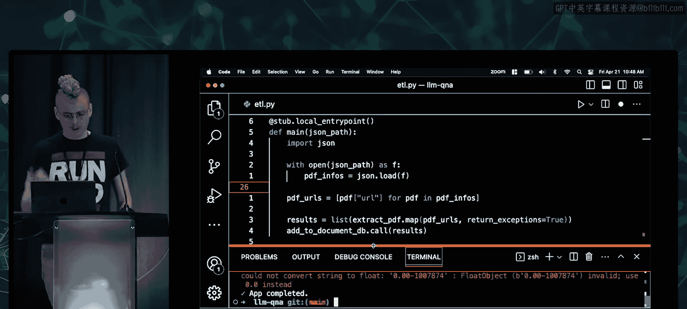

And so I ran into this problem where I had like a couple hundred Ps that I wanted。

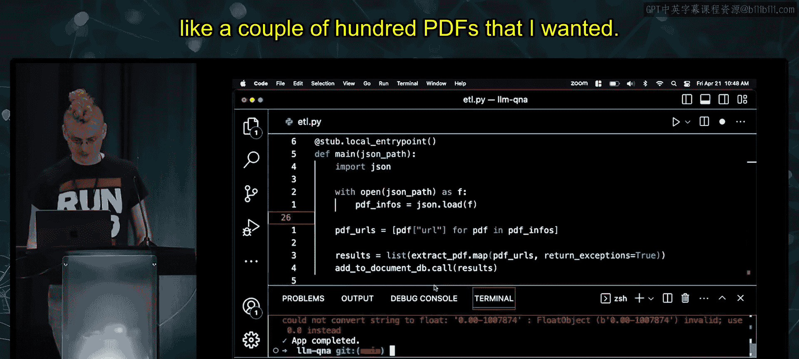

Yeah， so the primary source for this is my like lit review。About 300 models。

 300 on language modeling， it takes a long time for even a computer to read 300 PDF。

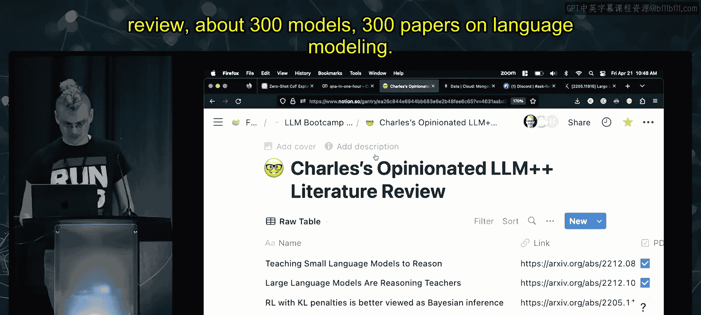

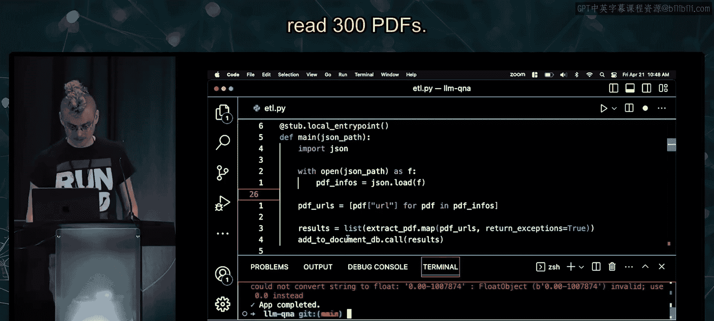

And that was likeneck bottlenecking me in development with Moal。

 I can just like put a little wrapper around a couple of my functions for like loading。

 extracting PDFs and then just grow it up。

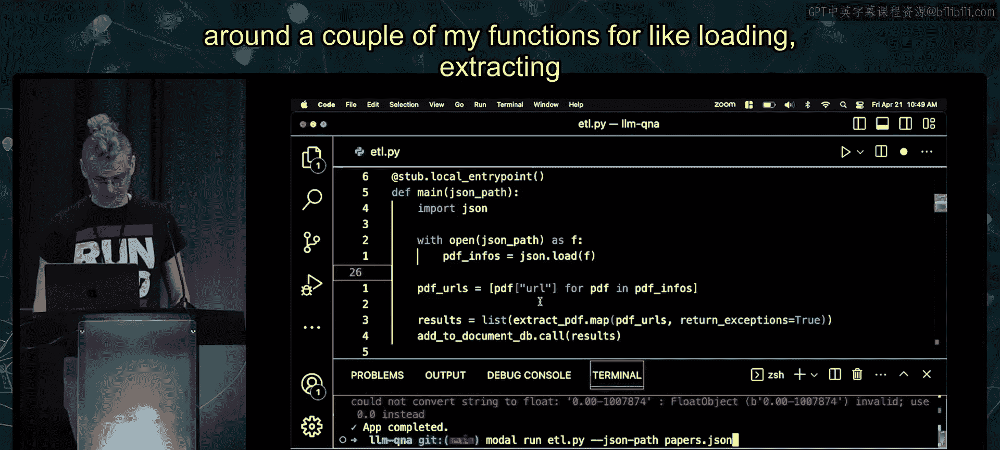

Their infrastructure and launch like 100 containers one for each PDFf like why would I put multiple PDFs。

 multiple PDFs in a single container like that we're mixing concerns obviously we should split this out so you could just like quickly like solve lots of your data problems without needing like to set up Kubernetes to like get a whole data engineering team to like or to like pay for maintaining a bunch a bunch of servers like。

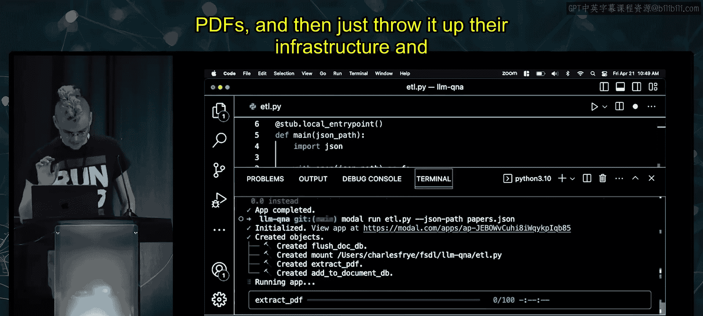

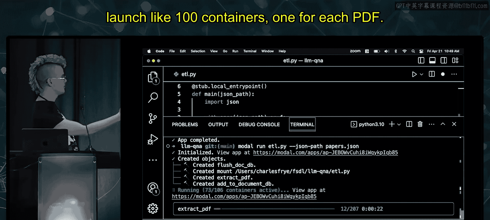

Really great for small teens， is critical in this time where we have like a lot capabilities like unlocked all at once with language model。

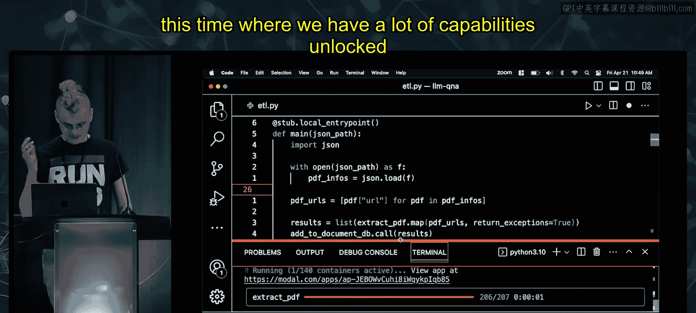

So then at that point， we just take some of the stuff from that notebook。

 like put it into some scripts and wrap it with Moal and so we'll talk in like a lot more detail about this what this looks like in the afternoon。

 do a walk through a code base of a sort of slightly more mature version of the application so you can see what it actually looks like。

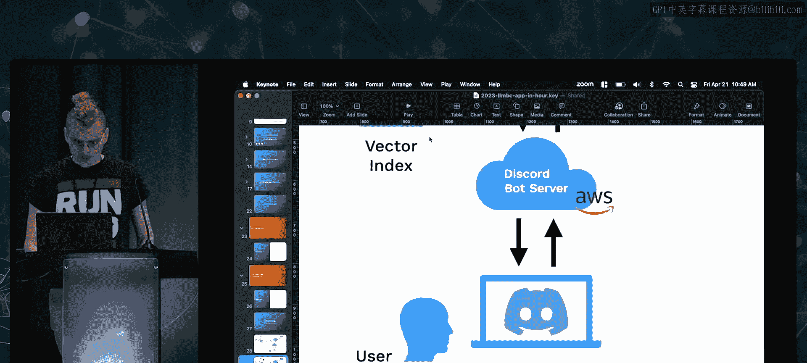

But yeah， that's that's the basic playbook for getting something going really quickly and so the。

This version of this is already running， it's in the Ask FSD Lbot channel in Discord and it's got information about LLMs and it's also got information from our past classes。

 so it's got a bunch more data sources。type slash ask and you can ask the bot in the discord。

 I might be just like a quick。Example there。All right。All right， so our first question coming in。

 how can we visualize what happens behind the scenes of LOM。

 visualizing what happens to find the scenes can be done by constructing belief graph？Okay。

 so this is interesting， this is an interesting paper back from like the birthday that tried to figure out what the like knowledge base of a language model is so interesting resource not bad answer to the question。

Also。Yes， this bot also has some stuff for handling irrelevant questions。

mLike how are you doing today？So yeah， you get emoji react， so type slash ask。

 you get this question pop up so what is zero shot？TheoD prompting。嗯。嗯。

What are key to killLMs billions of users that might come in。

Look how cool it is that it links to a specific time standing video up here so we have what is vector index and why do I need it？

Yeah， so so up here， it's got links not only to like papers。

 but also stuff from our past classes with ways of time stamp component。Of our E video。

 So we'll see a little bit more about how that's done。Yeah， so encourage you to try this out。

 like ask questions in different languages and see what it does like try and prompt inject it。

 I'm sure that there are ways to prompt inject it if you're familiar with that so just like try stuff out we're collecting up this user data and we'll sort of like analyze it in the afternoon and because like sort ofre one of the next steps that you need to do after you put this together。

I know that。One of the next steps that you need to do is like start monitoring this thing so that you can see like how you are interacting with it。

 what's going well， what's going poorly so that you can start making improvement。

So that'll be the stuff that you provide will provide some interesting lessons for how language model powered applications fail and succeed。

 hopefully at least。🎼The。🎼。🎼，🎼亲。🎼The。🎼。