# LLM训练营 - 2023年春季 LLM Bootcamp - Spring 2023 - P4：-04-Augmented Language Models (LLM Bootcamp).zh_en - GPT中英字幕课程资源 - BV1Wf421B7mP

🎼。

🎼，Charles has just told you about all of the wonderful tricks and hacks and kind of random ideas that you need to do in order to commence these amazing models to do what it is that you want them to do and next we're going to talk about how to actually give them the data need that they need in order to answer whatever questions you want them to answer。

So the framing here is there's really a ton that language models don't know。

 so if you go into chat GT even GT4 and you ask it who's the president of the United States。

 it's not going to be able to tell you the answer to that。

And so if we think about what language models are good at on their own。

 they're really good at well language understanding。

 they're really good at newer models are good at following instructions。

 they're good at kind of basic reasoning and for many of the more modern models they're also very good at understanding code。

 but there's a lot of things they also need help with。

 they don't have up to date knowledge of the world。

 they don't know anything about your specific data。

They don't do very well with more challenging reasoning， especially anything that looks like math。

 and they have no way of interacting with the world on their own。

And so the mental model that we should have is that language models are sort of these engines for general reasoning。

 they're not designed to have specific knowledge and it's unclear whether they ever will。

 you know openAI has been training larger and larger models for the past few years。

 but they still don't really train any models on data past 2021 and there's a reason for that。

 which is because they don't think that the more recent data is actually going to help the model be that much better。

So the way we can think of the language model is it's the brain and we have to give it tools and data so that it can actually do the tasks that we want it to do so you can think about this as like a large language model is like it's like you。

 but when you're in high school right you're probably really smart but you don't know anything。

So in order to actually solve problems， you need some training。

 you need a calculator and you need some other tools in order to actually do anything useful。

And so the baseline here is the simplest way that you can do this is just put more data in the context window。

So you know， if I want a large language model to know who the president of the United States is。

 I can tell it what is the current date and who is currently the president of the United States。

 and if you do that， the model will pretty reliably be able to answer that type of question with the exception of things like hallucination。

 which Charles was just talking about。

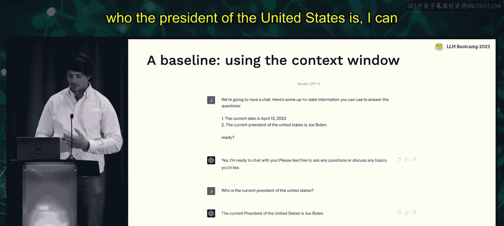

And so the analogy here is like if the model by itself is you when you're in high school。

 putting data in the context window is like when your teacher told you that you're allowed to bring a cheat sheet into the exam so you have this limited scratch pad where you can give this smart but not knowledgeable high school student access to the information it needs to know in order to answer the exam questions。

嗯。So like the cheat sheet。The context window that you give the model only has access to a limited amount of information。

 How much information does it have access to。Well， the size of the context window of language models has been growing pretty consistently over the past few years and very rapidly recently。

 And so the you， a few years ago， most of these models had around 2000 tokens。

Which is still what most of the open source models have today。 And now the state of the art is。

 you know， the yet to be released。 G 4 extension has 32000 tokens。

 So how much data is that right how much how much can you fit in your cheat sheet。

So if we kind of like do a logarithmic scale of different sizes of context windows。

 we could build some intuition about what fits into them so if your context window is 50 tokens。

 that's roughly a sentence at 500 tokens that corresponds to roughly four paragraphs of writing and for context the original G1 had about that much context。

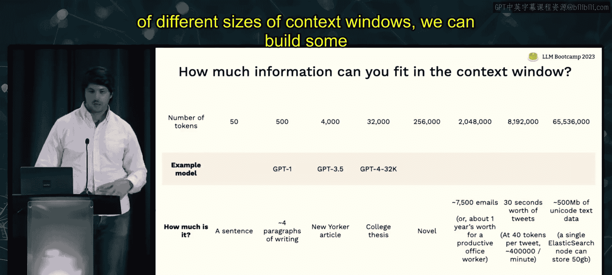

When you scale up to 4，000 tokens， which is what you get with GT 3。5， chat GT。

 and the sort of most state of the art open source models。

 that's roughly kind of a long article or a long blog post。32，000 tokens。

 which is what you can put into the yet unreleased GPT4 with 32K。

 that's kind of like a college thesis， like a short book。And then as you scale up。

 you can fit more and more information， but even with several more orders of magnitude of scaling。

 if you get up to you know 65 million tokens， which would require like big advances in how we're able to use context windows and today it would be prohibitively expensive。

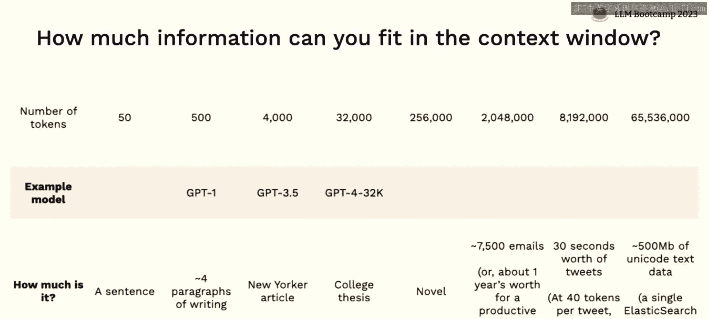

That's still only roughly like 500 megabytes or so of text data。

 and so for contexts like if you're using a traditional search engine。

 a single elastic search node can fit 50 gigabytes of data。

So the takeaway here is the context windows are expanding rapidly。

 and I think this is one of the biggest places where LLMs are advancing and will advance over the next couple of years。

 but in the grand scheme of things they still are not going to have access to a ton of data anytime soon。

And so these are not going to fit everything that you need them to fit for a while and of course。

 like putting more context in the model costs you more money because most of the API providers charge you per token。

 including the tokens in your context window。AndSo what we'll talk about today is how to make the most of the fact that for the foreseeable future。

 we're going to have a limited context window， and we're going to talk about specifically how to do that not by training models or fine tuing them。

 but by augmenting the language model with data or tools that I can use to answer the questions it need to answer。

So we're going to talk about kind of at a high level， three different ways that you can do this。

 The first is retrieval。Which basically just means augmenting the language model with an external corpus of data that it can search over to answer its question this is what we'll spend most of the time on today because this is I think like sort of the most mature of these techniques and the one where there's the that the most depth that you could go into if you want to。

Then we'll talk about chains， so chains are a way of one mental model you can have for change is that these are a way of augmenting language models with the output of another language model。

 so how do you take a language model and use it to develop the context for another language model and then finally we'll talk about tools which are ways for language models to interact with external sources of data that you don't have to curate yourself。

And so really like the flavor of this of this lecture is going to be， this is extremely deep topic。

 I'm going to try to give you sort of a whirlwind tour of some of the ideas that you might come across as you come across this problem and some of like concrete recommendations about starting point。

 but there's a ton of depth here and I would encourage you to go into more detail about any of these things if you're interested to learn more。

😡，All right， starting with retrieval augmentation。So we're going to talk about sort of these topics and starting with okay why why are we talking about retrieval augmentation so let's say that we want to give our model access to data that is in our database that corresponds to our specific users and so the first approach that we talk about before we be to put it into the context so I can give the model some context on the organizers a full stack deep learning。

And if I do that， then the model will answer a question like who on our team writes the prompts for our models。

 and it'll answer that correctly based on the title that the imaginary title that I gave Charles is our chief prompt engineer。

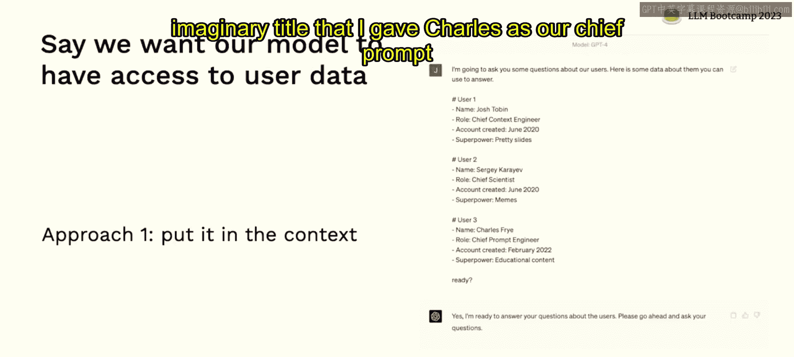

But what happens if we have thousands of users， not just three organizers？

So one thing that you might want to do is you might just imagine like， hey。

 why don't we just use some rules to figure out based on the query that the user is asking。

 which user data should go into our context？😡。

So maybe you could put data from the most recent users into your context。

 or if there's specific users that are mentioned in the query。

 you could put information about them in the context。

Or maybe the most viewed users or really any other heuristic that you can dream up。

 but the challenge with this is what happens if the relationship between the query and the users that need to go into that data is hard to describe just using code and simple rules。

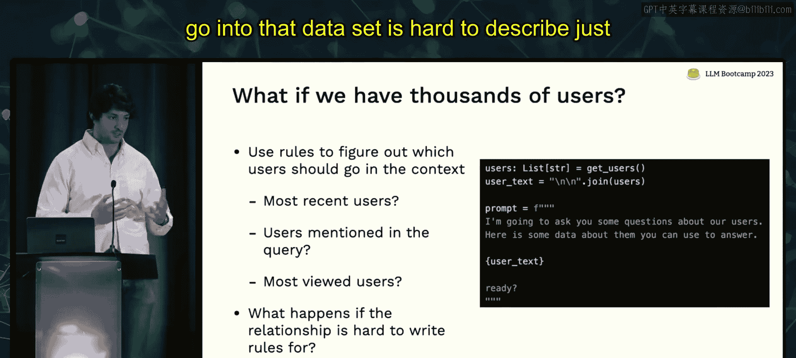

And so the takeaway here is that the process of building the context for your model。

 you should think about this as a form of information retrieval。

 so information retrieval is like the sort of you know， I guess like wonier way of describing search。

Search is a kind of information retrieval， but your mental model for you know putting the right data in the context for the model。

 you should think about that as kind of like a search problem。

 and so we'll expand a little bit on that metaphor。So if putting the data in the context is search。

 how can we do search so the first thing that we'll talk about here is the traditional methods for doing information retrieval before all this deep learning craziness started。

So a few basic definitions here， first， your user is going to give you a query。

 which is a formal statement of what information they need。😡。

Then we have a bunch of objects that are contained in a collection of content。

 an object you can think of that as just a document。

 but it could also be an image or any other type of object that you want。

We're going to measure the relevance of these objects， which is basically how well this object。

 how useful this object is for our query， and then we're going to take those relevant objects and we're going to rank them based on some metric for desirability。

And so all of information retrieval can sort of be boiled down to this process of taking a collection of objects。

 using a query to find the ones that are most relevant。

 ranking them against some criteria and taking the most relevant ones that can fill the space that you have available to build in this case your prompt。

In traditional information retrieval， the way that this normally works is you'll search for items via an inverted index。

 and so you can think of it as inverted index as kind of like a really。

 really simple type of database where you take all of your text documents and you just extract the frequency of the words that occur in each of those text documents。

So for uncommon words like winter， if a user asks a query that has the wordwin in it。

 it'll just pull up the docs in your database that have the wordwin in it as well。

 so it's a very good heuristic for finding documents， especially when there's uncommon words。

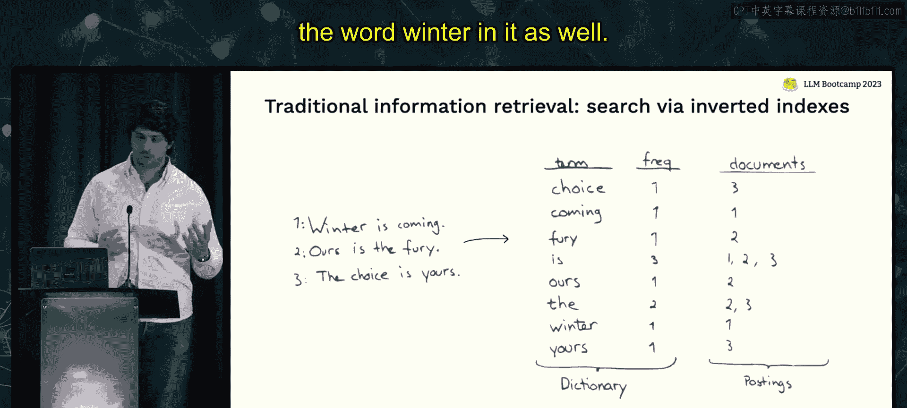

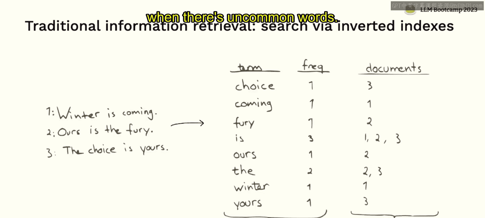

And then in traditional search the way that ranking and relevance works is typically you'll do relevance via Boolean search。

 so you can just exclude a lot of documents that have nothing to do with the reason why you're asking this query to begin with。

 so for example， you could just exclude documents that don't contain specific words。

 so if you remember like in the early days of searching the internet with Google everyone told you to use Boolean search which is this process where you're excluding a whole bunch of things from your search process that are just not relevant。

Once you have the relevant documents then you do ranking and typically the most common algorithm for ranking is called BM25。

 you don't need to know the details of this， but it's interesting to know the main factors that influence this and these are all very simple heuristics。

 like the more frequently your search term appears in the document， the more relevant it is。

 the higher rank it should be， the more objects the more documents that contain your search term。

 the the less important that search term is， because this is just a common word that might be in all of the documents。

And then lastly， if document contains you know， really short。

 like contains your word in a really short sentence。

 then that means that word is probably more important for the document or the sentence as well。

And then the last thing I'll say on traditional search is and this is relevant later because and has analogies as to when we talk about vector databases。

 which I think is how most people in LLMs are talking about search today。

 search engines like if you search on Google or Elastic search that's a lot more than this just simple inverted index data structure that we should describe and so search engines need to not just store the data in a way that you can retrieve it easily。

 they also need to be able to ingest documents， they need to be able to process them to remove stop wordss。

 put everything in lowercase and things like that， they need to handle transactions so what happens if you add or delete a document。

 how does the database manage that， they need to be able to scale up and down。

 they to be able to scale horizontally and they need to have the algorithms built in for ranking and relevance。

So a search index is kind of like a data structure that allows you to quickly run these simple queries to find documents。

 and a search engine wraps that with a bunch more functionality。Now。

 why are we talking about things more complicated than just traditional search。

 the search that you can do in Elastic search as of five years ago？Well。

 there's some pretty fundamental limitations to this type of search first it only really models simple statistical correlations between the words in your query and the documents。

 things like word frequencies， it doesn't capture any semantic information。

 it doesn't capture the crosscorrelations between these terms and so it's really kind of this like dumb heuristic that is very useful but you know for ambiguous statements like searching for what is the tophand bridge。

 you might get documents that have to do with all of the different uses of the word bridge。

 rather than the way that we mean bridge here， which is bridge the card game。

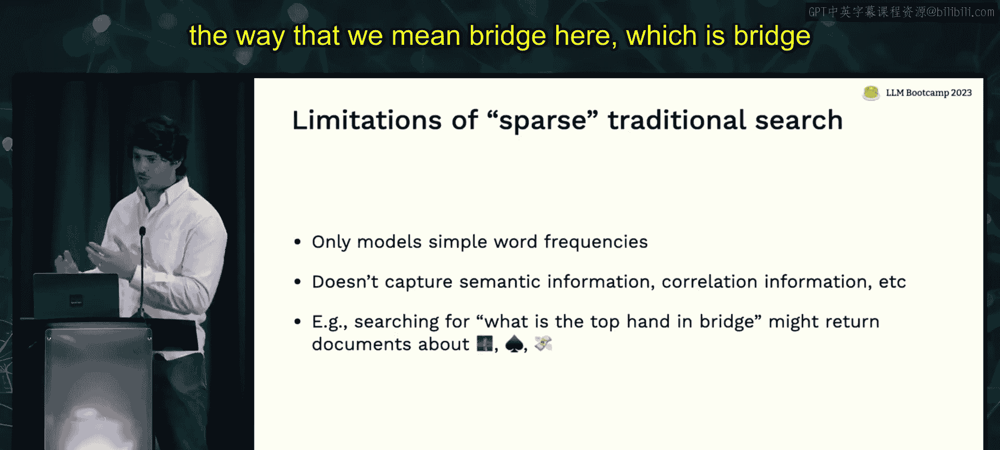

So that's kind of a whirlwind tour of traditional search。

And next thing that we're going to talk about is。Doing a more sort of AI centric approach here。

 which is to do information retrieval via embeddings。嗯。One kind of thing to note here is that。

You know， we've been talking about search as a as a way to improve AI。

 So search as a way of building the context so that your model can answer the important question that you have for it。

 But what we're going to be covering in this section is how AI also helps improve search。 So how。

Large language models and models like that can help us themselves retrieve better data from the context。

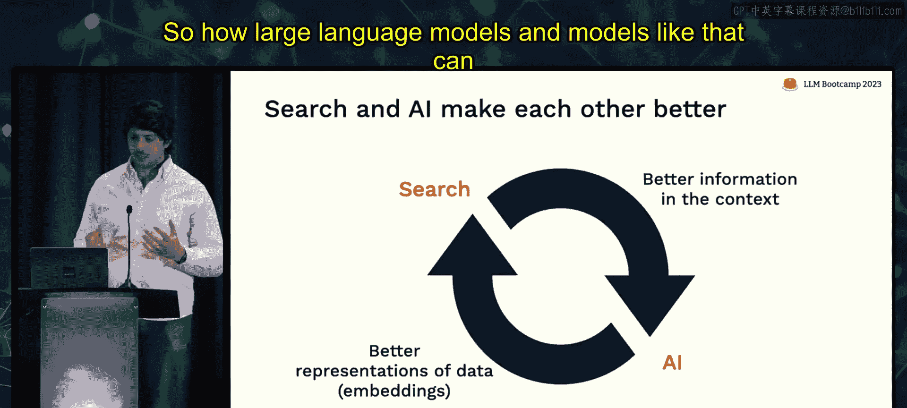

So first we'll talk about what are these things， like what do we talk about when we say embeddings？

Then we'll talk about， you know， the analogy to these traditional search indexes。

 these inverted indices， we'll talk about。We'll talk about indices for nearest neighbor search。

And then we'll talk about the equivalent to moving beyond the inverted index and building a database on top of it。

 and we'll talk about embedding databases。And then finally。

 we'll talk about how to go beyond some of the naive algorithms that we'll cover in the first section of this。

This part that we're covering。So first of all， what is an embedding。

 and embedding is an abstract dense。😡，Compacts usually fixed sized and usually learned representation of data。

 So what does that all mean， Well， in the traditional search world that we were just describing。

 we are constructing what you can think of as a sparse representation of the document that you want to search over。

So when we see a document， we look at each of the words in that document。

 and if a certain word is contained in that document， we flag it。

So this document here can be represented by the fact that it contains the word coffee。

 it contains the word tea and it contains the word laptop。😡。

And embedding is a dense representation of this document。

 so it's not just modeling whether these words are present。

 but it's modeling more complex statistical distributions of all of the words in this document itself。

 and so what this looks like concretely is an embedding is just a vector。

 a vector that contains some meaning about the text of the document that it corresponds to。

Water embedding is not so there's a lot of misconceptions about embeddings and I will talk about all of them we recommend checking out this blog post if you want to learn more about this。

 but embedding are not always necessarily the last learned layer of a neural network that's a common misconception。

 and embedding doesn't necessarily refer to a single input in your data， although it often does。

embedding don't have to be from a neural network at all。

 you can construct embeddings using all kinds of other techniques that have nothing to do with neural nets。

😡，And。Ebeddings don't even need to be directly comparable in a vector space。

So embedding is like a very general concept， but the way that we use them for the purpose of search and information retrieval in large language models is more specific。

Why do we use embeddings like wire are embeddings useful for information retrieval。

 I think the core reason is because vectors are a very compact way of representing any type of data。

So whether you have a massive text documents or an image or an audio clip or a video。

 any of those things can be represented by a vector。

 and you can construct those vectors in such a way that they're directly comparable with each other。

So that's a really powerful idea right because it doesn't matter how big your initial data was。

 it doesn't matter what format it was， whether it's MP3 or MP4 or something else entirely。

 when these documents are represented by embeddings。

 they all take the same form in the same structure。😡。

Next thing I want to talk about is what makes a good embedding。

 so how you know if you have the right embedding for your data。😡。

And I think there's really two things that you can look to here。

 the first and most important is utility for the downstream task。

So at the end of the day in machine learning， a lot of times the way that we need to evaluate things is empirically。

 so how do you know if you have a good embedding， a good embedding is one that allows you to solve the problem that you're trying to solve。

At the end of the day。And it's really important to think about this in the context of your specific task。

 the tasks that you are actually working on because general purpose embeddings are not as general purpose as large language models there are decent general purpose embeddings that we'll talk about in a second but you can often do better than a general embedding on your specific task so benchmarking embeddings really critical to use the task that you care about。

 if you can't do that for whatever reason， a decent sort of second choice is use a like the broadest benchmark that you can and so there is a MTEB leader board that you can find on hugging face that contains like kind of an up todate ranking of the best embedding models on this like very general benchmark that covers many different use cases for embeddings。

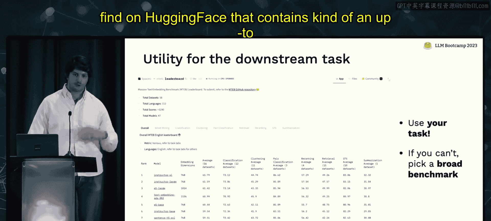

The other intuition for what makes a good embedding is that in the embedding space。

A property that you want these embeddings to have is that similar objects should be close together。

And objects that are really different from each other should be far apart。

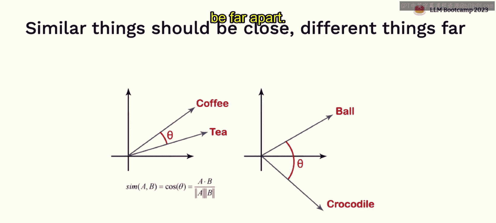

So for example， if you are constructing and embedding of a particular word。

 then you would want the embeddings for coffee and tea to be close together because those are similar concepts for us。

 but the embeddings for ball and crocodile， if those are close together that would be bad because those have nothing to do with each other。

 at least in most universes。So why is this important。

 this is important because of what we'll talk about in a second。

 which is the algorithms that we use to leverage embeddings to build our input spaces for our large language models。

So next thing I want to do is kind of be like a quick tour of some of the most important embeddings to know about if you're going to be building stuff in embeddings the kind of original embedding for a lot of people is word to V。

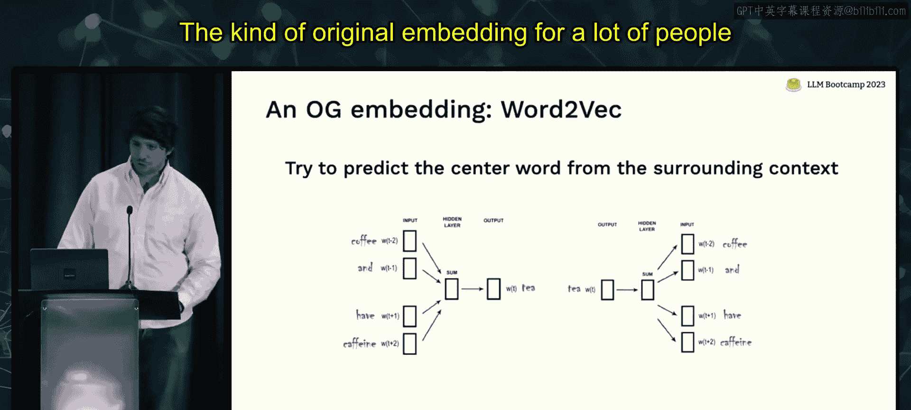

I won't talk about the details here， but at high level。

 like Word tovecca is a pre neural network embedding that tries to predict what a word is based on the surrounding context。

 the words that are immediately around it。And so if you want to kind of learn a little bit about the history of embedding and build more intuition。

 this is a good one to study。The baseline that you'll probably look at when you start to build embedding based models is sentence transformers sentence transformers encode two sentences and are trained using softmax to try to make similar sentences close together the great thing about sentence transformers is that they're really cheap and fast to run。

 they're widely available， they're kind of widely benchmarks and they work decently well for a lot of applications。

If you want to have an embedding that supports more than just text。

 the best option right now is clip， clip is a joint embedding space between text and images。

 so you can do things like find similar images for a text query or find similar text for a given image。

For like actually sort of protoping applications I think the best starting point right now is open AI embeddings the one to use is text embedding8da002 this is kind of like near state of the art on most of the benchmarks and the great thing is it's cheap it's really easy to use and it gets pretty decent results in practice so unlike with like state of the art open AI models for language modeling this is not going to get you state of the art for your task but what it is going to do is give you like a pretty solid baseline that you can start to build on top of。

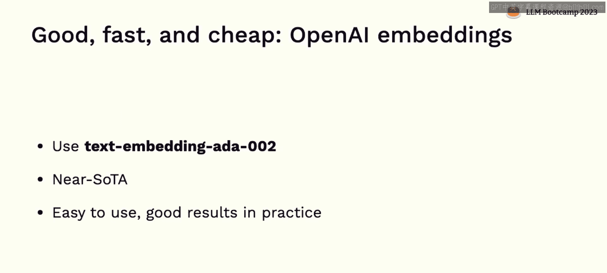

And it might be good enough。And then the last kind of the last embedding model that I want to cover is called instructor。

 this is the model that's at the top of the MTEB leader boards right now。

 and it's interesting to learn about not because you're probably going to be using it anytime soon。

 but because I think it points to a little bit of the direction that embedding models are going into and so the way that instructor works is rather than just training your embedding model on raw documents。

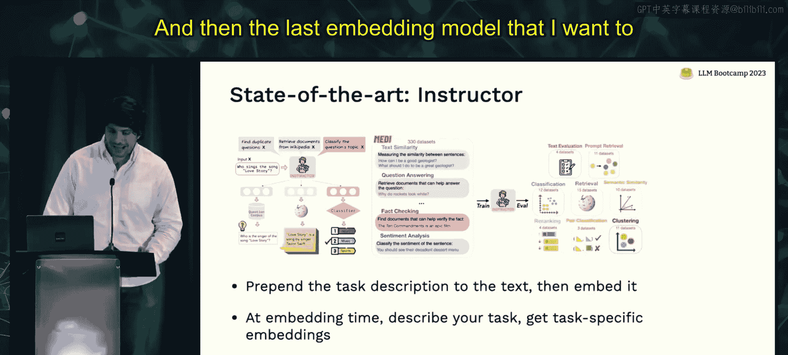

Instead。You prepend a description of the task that you're trying to solve。

To the document before you embed it。

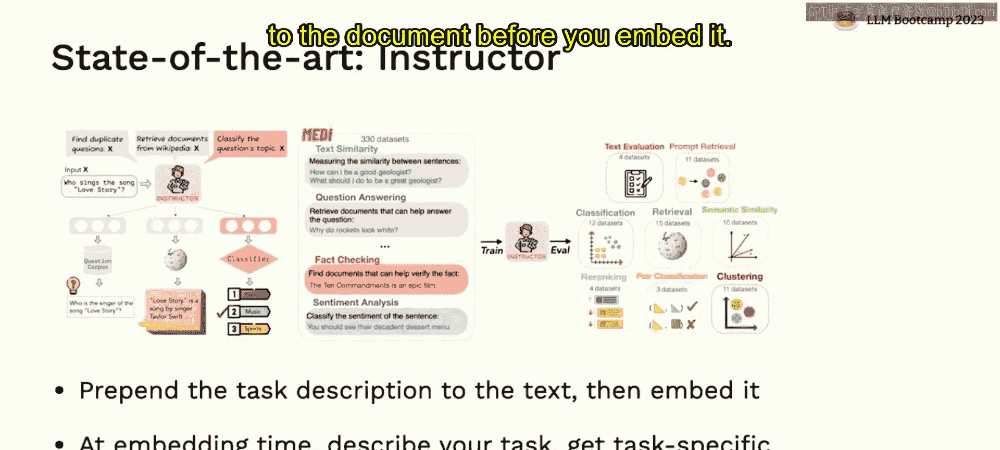

And then at the time that you actually want to get a new set of embeddings。

 you can just describe your task and then get tasks with specific embeddings because the model is trained to produce different embeddings depending on the task。

So the analogy that you can think of here is that this is kind of like the equivalent of instruction tuning for embedding models。

So this is the model that hits state of the art on benchmarks。

 I don't know of a lot of people using it in practice today。

 but it's an interesting one to look at if you're not getting good enough results from Open AI。喂。

If you really want to squeeze the performance out of your embeddings， unlike for LOMs。

 where fine tuning has more limited utility for just achieving high performance。

Off the shelf embeddings are a good start， but they are not going to get you all the way there。

Appaches like instructor， I think will help， but for now。

 if you really care about getting the best data into your corpus。

 you really can't escape training and bedding model on your own。😡，Okay。

 so we talk about embeddings like what are these things， how do we create them。

 next thing that we're going to talk about is how do we use embeddings to answer this information information retrieval question。

 like how do we use them to pull the right information from our corpus and put it into the props。

So finding relevant objects with embeddings， what we're going to do is we're going to take the object。

 our query object， we're going to embed it， use it， and we're going to create this vector。

 and then we're going to search over an index of documents that's analogous to the inverted index that we created in traditional search。

And we're going to search over that index to find the most similar objects， according to a metric。

What of the metrics that we can use， there's a bunch of them。

 I would say the most commonly used one is cosine similarity。

 probably followed by dot product similarity， opening eye says that it doesn't really matter so I wouldn't pay too much attention to this。

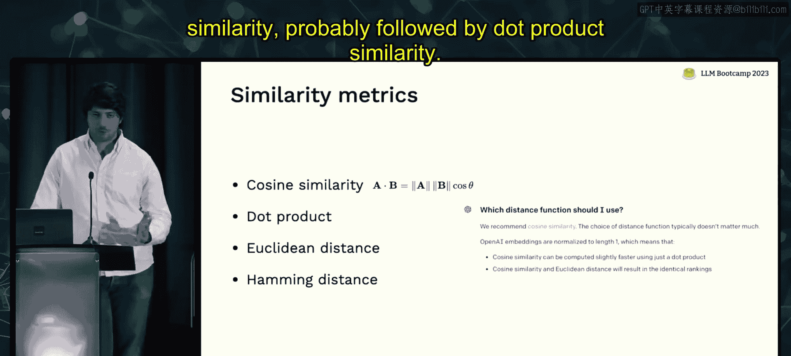

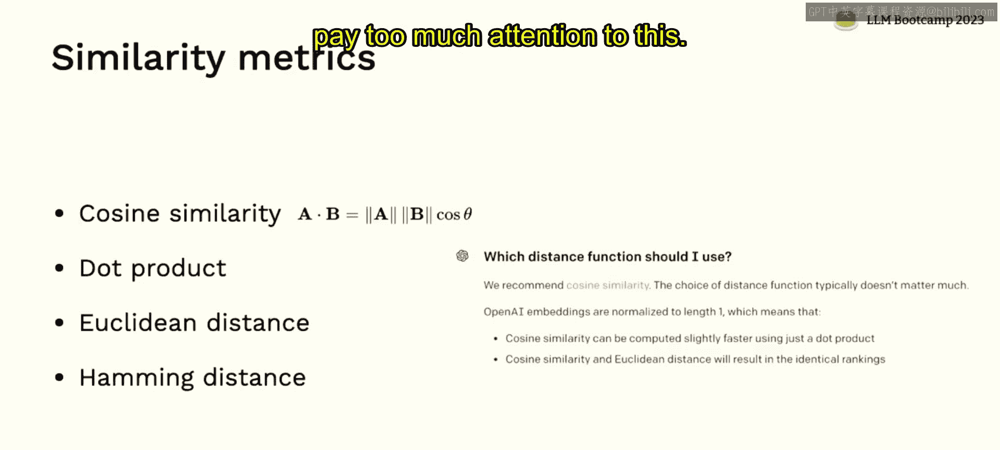

Now， minimal recipe for nearest neighbor search is， again， you've embedded your corpus。

 you can just store your embedding as an array， like as a nuy array。Then embed your query。

Compute the dot products between this array of embeddings and the new embedding that you created for your query。

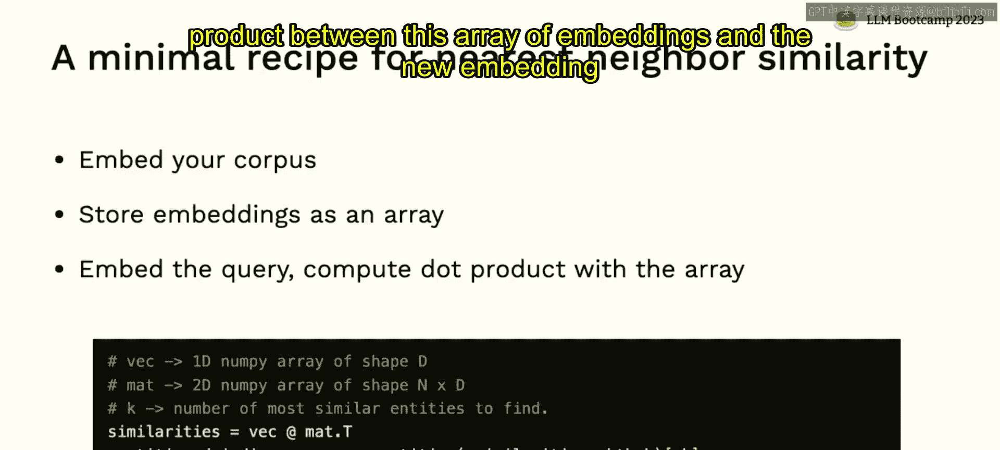

And just find the minimum of that， so find the one that's the most similar to that query and so this is like three lines of code that will do that and so the main thing that's doing work here is this first line。

 the similarities line where we're just computing the matrix vector multiplication between our new vector that came from our new embedding and this array of all of our previous vectors。

So that's it now we've solved similarity search and we can move on。

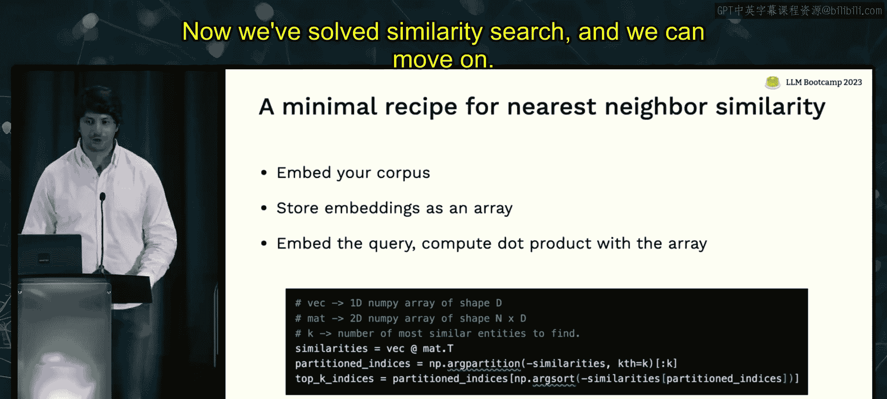

My question is like okay， that feels kind of hacky， when do we actually need more than that。

 when do we need all these like embedding databases and things that you've probably been hearing about on Twitter。

So the reality is if you have less than 100，000 vectors or so。

 you're really probably not going to notice the difference between just doing this in NI and having some fancy vector database so 10000 vectors for a lot of tasks is quite a lot so you don't necessarily need to reach for a complicated tool in order to solve this problem above a certain scale though it does make a big difference。

😡，And I guess just if you don't believe me， I think in these days。

 if you want to win an argument in machine learning。

 the best way to do so is to provide a screenshot of a tweet by Andrei Carpathy。

 and so here's the requisite screenshot where Andrea agrees with me。Okay。

 so sometimes you need more than just doing this in NP。

 and that's where approximate nearest neighbors come in。

There's a bunch of algorithms for approximate nearest neighbors。

 you don't really need to know the differences between them but at a high level like the definitions here are an embedding index like a inverted index is a data structure and that data structure lets us do this nearest neighbor search in an approximate way much faster there's a lot of different index types that are available and they make different tradeoffs between speed scalability and accuracy here's some of the kind of common algorithms that you might see you don't need to know the details of these although it's really interesting if you do want to learn more at a high level the way that they all work is they basically partition the space that you're searching over。

 so there' are different ways of dividing up the space of all of the vectors that you want to search over。

 so you only search over the vectors that are most likely to be close to your query vector in some way。

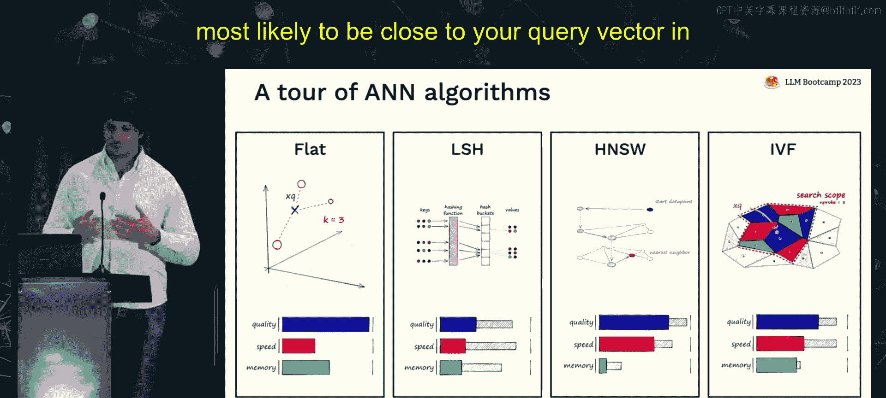

There's also a bunch of tools that can help you do these build these ANN。

 these approximately nearest neighbor indices， the most common ones that you'll see are probably face coming from Facebook AI。

 HNSW LibB and NBS LibB or very similar libraries for the HNSW Library。

 HNSW algorithm and Anoi is another one。

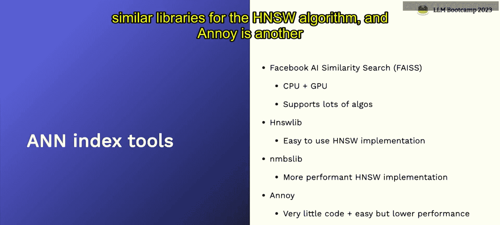

There's also some really good benchmarks that you can find online if you want to really study the performance trade offs between these different databases and different indices。

 but you don't really need to know all this because。At least not at first。

 and the reason for that is because if you are just prototyping。

 it really doesn't matter which one you choose， you're not going to have tens of millions of vectors where you really need to care about these performance trade offs。

 you can even just use Numpy if you want to。And when you're productionizing。

 then the much more important choice is not the underlying index。

 but it's actually the broader information retrieval system that that index is part of。

That being said， if you do have to choose an embedding index。

 then a very reasonable choice is just to use F and HNSW。

 and so that kind of answers the question if you do want to pick something。

 but I want to focus more on this question， which is know why do I say that it doesn't really matter which index you choose because you should be choosing not an index but an information retrieval system？

That's because just like inverted indices have a lot of limitations when it comes to traditional search。

A andN indices also have a parallel set of limitations when it comes to vector search and the main issue with them is that they're just a data structure。

 they don't offer hosting， they don't store data and metadata alongside of the vectors。

 they don't let you combine this dense retrieval， right this nearest neighbor lookup with sparse retrieval filtering。

They don't manage the embedding functions themselves， they don't scale up vertically or horizontally。

 and so when you go beyond prototyping and you're really ready for production。

 you're probably going to want an information retrieval system that supports more of these limitations。

😡，And so the analogy that you can think of is like。

How many of you have ever been to a library before？Wow。

 shockingly small number you can think of an index as kind of like the card catalog in the library。

 oh how many of have ever been to a library with a card catalog is is a better question。

Oh still some people okay cool not that old so the card catalog for those of you know who are on TikTok the card catalog was a thing that used to be in libraries where you could go and like look up the name of the author of your book and find out where in the library that book was located so the index is kind of like the card catalog it just tells you where on your hard drive does the data that matches this query live。

 but the database is kind of like the whole library right so it has the support staff it has the books themselves。

 it has all the other functionality that the library has， the late checkout cards and all that stuff。

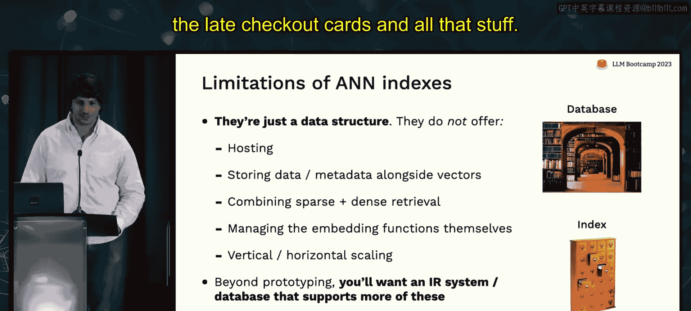

We talked about like how to search over vectors。 and then we sort of made the analogy that like。

Just being able to search over vectors like just having face or nuy is really not going to be that great for production So the next thing we'll talk about is databases that let you actually do this in a more reliable production oriented way。

And I think the first and probably most important thing to take away from this is just a question。

 right， which is for what you're doing right now， do you actually need an embedding database or is what you need just a database？

Okay so why do I ask that question， well， approximate nearest neighbors is an algorithm that is supported by data structures。

 these algorithms and data structures are pretty simple， they're open source。

 anyone can implement them and they're pretty popular and that means that。

The database that you use might already have an embedding index built into it。

So if you use Postgress， there's a library called PG vector that adds approximately the nearest neighbors search support to Postgres。

 Elastic searcharch has support for this now， Redis has support for this now。

 and probably most of the other databases， popular databases that you might be using have support for this or will add it soon。

And so this won't work for the most complicated potential queries that you might run or the highest possible scale that you want to reach。

 but for you， it's probably going to work， so my recommendation is just use your existing database for approximate nearest neighbors。

databaseabase you want is probably the one you're already using yeah。

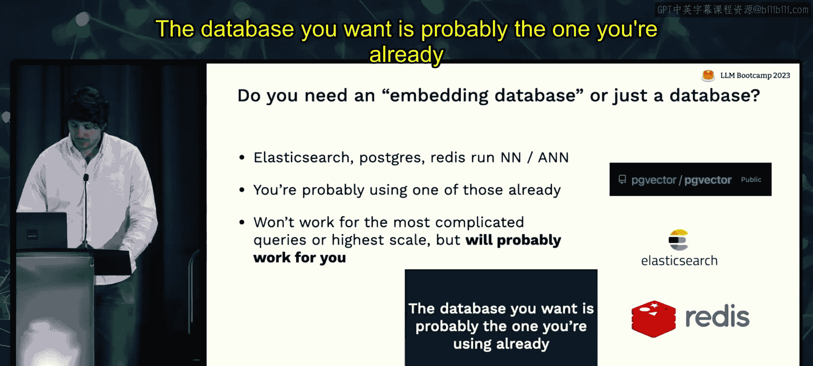

But okay， if you do really want something more advanced than that。

 then let's talk about where you might go next。So the dream of how this would work。

 the dream of how information retrieval for building the context for your model would work is you dump in a bunch of data。

 that data could be all kinds of different things， documents， images， etc ceter， you run a query。

To ask for descriptions of recent concerts in the Bay Area。

 and then you just get the most relevant results back automatically。So unfortunately。

 there's a lot of complexity that goes behind actually being able to build a system like this。

And so some of the big challenges are， you know， okay。

 we wanted to just be able to dump in a bunch of data， but in order to do that。

 we need to kind of be to handle sort of traditional database concerns like scale and reliability。

And we also need to handle the managing of the embedding function itself。

So what embeddings do we use， how do we version them。

 and how do we split up documents si fit into the embedding。When it's time to run a query。

 the main question is like how do we specify that query and when it's time to get the most relevant data back。

 there's all kinds of different search algorithms that might make the most sense depending on all the choices that you made before。

 so there's a lot of complexity here database stuff you know scale reliability。There's many。

 many books and courses。A whole academic career that you can build just on studying these questions in the context of databases。

For managing the embedding。You know， there's the question of like which embedding should we use what happens if we want to change the embedding function。

 which becomes very relevant if you're training your own embeddings。

 how do you take documents and split them up so they're small enough to fit in the context window of the embedding model itself。

And so the way that document splitting works is typically you'll pick some separator for your text。

 you'll split your text by that separator up to the maximum size that you can fit in the context window for the embedding model itself。

And usually that's the way that people do it there's more advanced things that you can try here so for example you can you know one issue with just splitting things up naively is you might split a document up in the middle of the thought that the author of that document had and so how you avoid that so that these like chunks of documents are like actually meaningful chunks well there's some techniques using more traditional statistical methods to try to make the chunks themselves semantically consistent that's a thing to look into if you're having that issue。

For the query language， you know， just asking for the most similar documents， that's easy。

 so you just take the document that you want the most similar documents to and you ask， hey。

 which embeddings are closest to this？But if you want to filter on other metadata。

 like I only want recent data or I want to up recent data or if you don't actually have a document that you want to compare to。

 you just have like a search string or a request for a summary or something like that。

 then building deciding how users can specify these queries becomes harder。😡，And then lastly。

 you know how when you're actually searching over this data。

 oftentimes the data has hierarchical structure， so the simplest and most common example of that is。

 let's say that you're dealing with very large documents and you can't fit the entire document into the context window of the embedding model so you have chunks those documents up into shorter chunks that can each be embedded。

Now， the database that you've built has structure to it because the individual chunks all have this consistent property that they belong to a single document。

And so the problem is when you're searching over chunks rather than searching over documents。

 you might get behavior that may or may not be desirable。

 like your top three or four results might all be from the same document。

Is that a good thing or is that a bad thing， well it really depends on the task that you're trying to solve and so sort of these properties of structure of the data that you're storing and searching over really matter if you're trying to maximize the quality of the information that you find to put in the model's context。

嗯。And。And so， you know， I think the thing to take away from this is that there's sort of infinite complexity of how much you can go in and explore this question of like getting the best and most relevant data from my corpus to put into the context。

 And so probably you don't want to actually just build all this stuff yourself if you're looking for like really advanced features for searching over documents。

You probably want to actually go and look for one of these embedding databases。

And so here are I think， like kind of the most common ones。

For each of these you know kind of laid out some of the more prominent users or at least the ones that have been announced publicly。

 and then the way I would think about distinguishing between these is based on a few different features so first is these database like features which is you how well do they scale how well do they handle insertions and deletions and questions like that and so most of the databases most of the vector databases on the market today except Chroma which is just very early all have these database features because they are after all databases。

A second kind of feature that distinguishes these is whether they support embedding management。

 so if you。Like again， if we're thinking about our NI approach。

 we needed to actually like call the embedding function ourselvesse to produce the embedding that's going to be saved in the array and like one of the features like the features that distinguishes these options is who is responsible for calling and managing that embedding function is it me like the user of the database do I have to run my embedding function before I put the data in the database or does the embedding function get called in the database itself？

And so some of these options support calling the embedding in the database and others require you to call the embedding function。

Another feature that distinguishes these is the ways you can do filtering。

 so oftentimes just searching over your entire corpus of documents is really inefficient because there might be just really easy ways that you can exclude a lot of those documents that are just not going to be relevant to your search。

 really old documents， documents that have nothing to do with the question that you're asking。

And so most of these databases support some degree or another of pre filtering documents before you run your more expensive nearest neighbor search operation on them。

And then lastly， another kind of desirable feature for these databases is to have like a really robust built- in old school search。

 like old school full text search， why is that important because you those algorithms are still really good and they're much more reliable than vector search alone so it can make things more efficient or even more accurate to combine vector search with traditional search。

So like what are the recommendations here， I think you know going to go through these one by one Chroma。

 I think is just a little bit too early to tell I think you would use this if you want to bet on like the most AI native tool in the category。

 this is the one company here that was really started from the beginning with thinking about AI in mind。

Millvis， I think is a really good choice if what you're optimizing for is scale or like enterprise considerations。

Pine cone has fewer features than the other options and does not have an open source option either it's kind of hosted only。

 and so Pine cone is really best if you want to get started very quickly。

Vespa is one that I hear talk about less in sort of AI circles。

 but VeEpa is among all of these the most feature rich， the most robust and the most battle tested。

 it kind of came from the last generation of search engines but has been kept up to date with some of the more modern AI features。

And then lastly， weviiate is a really good mix between some of these options。

 it supports embedding management and it has a pretty flexible query interface。

 and so if you want those features in your database that's a good option。

So more concrete recommendations when you're ready to move on for prototyping。

The recommendation is just use whatever database you're using already if you don't have one of those databases。

 but you want to build a prototype quickly， then P cone is great for speed of setup。

 that's why we use it in this course。When you're ready to upgrade。

 then you just need to think about why， like why do we actually need to upgrade here。

 if it's for more flexible queries， then VesA and weviiate are the most full featured options there。

😡，If it's for scale or reliability， Veva and Melvis seem to be the best options on the market and that was the last bullet point Any questions Yeah。

 so I think what I'll do is finish embeddings and then we'll let people take a break and we will we'll wrap this up later so。

Okay so I want to just really quickly touch on going beyond nearest neighbor embeddings so the problem is you know a common problem is that your queries and your documents are not the same right so your queries are short questions。

 your documents are these like long form text and so that means that the embeddings between these queries and the documents are really not that comparable your data and also on top of that your data might be totally different than what the embedding model was pretrained on。

So there's a bunch of approaches to address this， I'm not going to talk about these in detail。

 but there's a really great blog post summarizing this if you want to take a look at a high level。

 some of the things you can do are you can train your own model that jointly represents both the queries and the documents that you want to search over so that they're all embedded in the same embedding space and it's a more apples to apples comparison。

You can do hypothetical document embeddings， which is kind of the idea that we talked about earlier where you take your query。

 you ask a model to imagine the document that this query might contain the answer to。

 and then you find the most similar documents to that imagined document。

And then there's a bunch of techniques that are all in kind of the general category of reranking。

 which is you search over a lot of documents， you return a lot of results and you train a model to reorder those results based on the specific criteria that you're trying to search for so if you are not getting good enough results from nearest neighbor search then it's worth looking into some of these more advanced options。

Another problem that we alluded to before as well is that you might actually have some structure to your data might so searching over the entire index might not be very efficient and instead you might want to search in a way that respects that structure。

 so you might want to search over only the subset of your data that you comes from your notion database or only the subset that comes from Twitter。

Or only the more recent subset and there's a library for this that's gaining a lot of popularity called Lama index。

 what Lama index does is it combines the process of retrieving documents so like loading data from notionA or Twitter or whatever with the process of building these embeddings that are designed to be searched in this more hierarchical way。

Cool， and so I guess last thing to talk about on retrieval augmentation is some case studies。

First one that I want to talk about is coppiloot so coppiot I think probably all of you here have used copilot or heard of coppit how does coppit work really there's like I think two secrets to coppiot the first is the first and less interesting for this purpose is speed so one of the reasons copil is so magical is because just returns things very quickly so' we don't care as much if it gets the right answer because we don't have to wait for it。

But the other secret to compile it is how they put the relevant context into the model so the model can predict what type of code you're trying to write。

And there's we can split this into the like kind of the general process of information retrieval so first of all where where where do the like the possible options for code sniets to pull and come from Copi just looks at the most recently20 like most recently accessed 20 documents that are in the same programming language that you're currently working with。

That gives you a corpus of things that you can use to find the snippet that you want to actually generate。

On top of that there's a lot of post processing that happens。

 some of the things that are going on there are you know it looks at what is happening right before or after your cursor。

 it looks at each of the candidate docs and it tries to find the most relevant snippet from each of those candidate docs to reduce the amount of information that it needs to search over。

 and then finally there's a ranking process where all of these things so the code right before or after your cursor the most relevant snippets from most recently accessed docs。

And a few other heuristically accessed sources of data are sorted in an order given by heuristics。

And then the top view in that sort order are put into the prompt for the model。

 and that's how they generate the code that you get as the output of CO。

And so one takeaway here is that Copit is an extremely powerful tool that uses very。

 very simple methods for retrieval。嗯。And I think that's an important lesson because I think oftentimes like folks want to reach for know vector nearest neighbor search。

 but actually just starting with heuristics and using those heuristics to pull the most relevant information might be a better starting point and might actually work a lot better。

嗯。The other reason， by the way， that they do this is because since they're so latency constrained。

 they are avoiding like having expensive operations in the loop wherever they can。

And then the other pattern I want to cover is a pattern that's becoming really common。

 which is question answering using retrieval augmentation。So the way this works is。

 let's say that I have a bunch of data that's specific to my company， that data might be。

 let's say all of the data in our Google Docs or in our notion or in our company Slack。

And then as a user， I want to ask a question and have the model answer based on the information that's contained in that corpus。

 So we'll take this this question like， when was our company founded， we will compute an embedding。

Then we will look in an index to find the most similar documents。

 so these are the most similar snippets of all of our notion or notion documents。

 or they're the most similar slackck messages to the question that was asked。

And then the information from those documents， those top three or four or five documents。

 are then dumped into the prompt。And the prompt looks at both the original question that was asked as well as the documents that come from this really simple search。

 and it uses those to answer the question， and in a perfect world it's able to find the answer to the question really well from that。

So just like as a teaser of some of the stuff that we'll talk about later。

 one of the big limitations here is that you're really trusting this search process。

 so if you have millions of documents or millions of slacklack messages。

 but you only have room in your context for a few， then you're relying on the search process to always turn up the documents that actually contain the answer to the question。

And so one way to potentially get around this limitation is to add just add more models。

 add more models into the loop so what you could do is even if you only have room for like three documents in in your query in your context rather what you could do is you could just basically iterate over documents。

 so you only have room for three but you pull 10 or 20。

And then you call an LLM on each subset of three， like each sort of chunk of three documents。

 and you ask the LLM to answer the question， and then you feed to the next LLM。

 not only the three documents that it's responsible for parsing。

 but also the answer that the last LLM output。And so by doing that。

 you have like made the process much slower and much more expensive because you're now calling Open AI a bunch of times。

 but you've gotten around this limitation of only being able to fit a few things into the context window of the model。

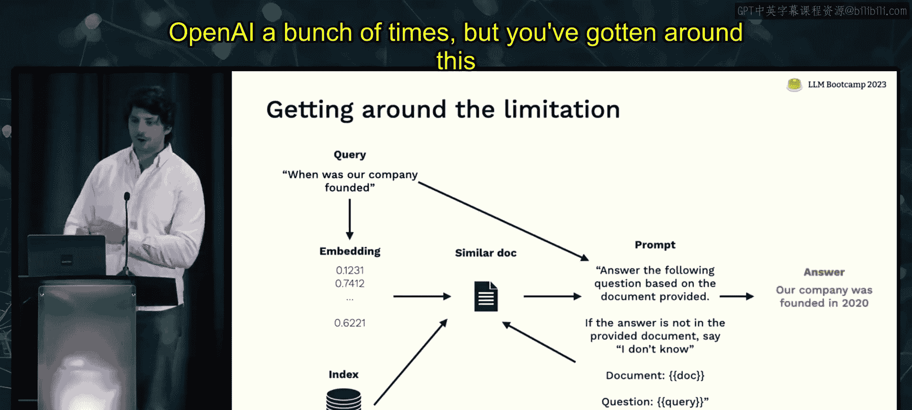

And so we will talk more about that when we talk about chains。

 which are sort of a way of generalizing this idea of， hey。

 maybe actually models are a great great way to build the context for other models。

Diving in yesterday for when we left off yesterday in giving LLMs access to external information。

 so augmented language models， so today what we're going to talk about is other ways other than retrieval to add information to the context for your model。

😡。

So last time we kind of ended by talking about this common pattern that you'll see in these retrieval based models。

 which is this question answering pattern， so you start with a query thatre one of your users asks like when was our company founded？

You embed that。And then you compare that embedding to the embeddings that you've stored in an index or a vector database to find similar documents。

 you take as many similar documents as you can find。

 you shove them into the context for your language model。

 and you prompt the language model to use the context and the question to try to answer that question based on the information that you retrieved from your vector database。

😡，This is a really common pattern， this is you know seems like kind of the to do list app of language model applications is the thing that everyone seems to get started with when they're building an app for the first time for good reason it's really powerful pattern really simple to set up but there's kind of a key limitation here which is that you're really relying on your retrieval system so let's say that you only have enough room in your context to fit three documents。

 then if the right information is in your corpus but it doesn't pop up in those three documents。

 you are out of luck right your model is not going to know how to answer the question。😡。

And so how do we deal with this Well one way that we can deal with this is we can you know just really really focus on improving the quality of our information retrieval system so we can add more and more advanced search features to make sure that the three documents that are returned are always the three documents that have the answer to the question。

 but another approach that you can take care is to add additional processing into the loop。😡。

And so we talked about one way that you could get around this limitation and the way you could get around this limitation is let's say that you ask your information retrieval system not just for three documents。

 but for 10 documents， you can't fit all of those 10 documents into your context because you only have room for three so what do you do you take those 10 documents and you apply further postproces to those documents another call to an LOM so what you might do is you might like construct a prompt that asks the LLM hey is the answer to the question that the user asks in this document？

😡，One simple approach， there's many others that you could take and given like using that approach。

 what you can do is you can find among those 10 documents that were returned by you know this nearest Dave search algorithm。

 which you can think of as this like really fast but like kind of dumb algorithm for looking for similar documents。

 you then have applied this really slow but really smart system on top of it， which which is a GP3。

5 GP4， a large language model that is answering the question of like hey， among these 10 documents。

 which one should I put into my context。😡，That's kind of like a brute forcelike approach to hoping make sure that you have the right context that you put into your model。

 the trade off that you're making here obviously is you're making more calls to your language model。

 which is going to make this process slower and more expensive。

 but can also really increase the quality。😡，And so observation here is that this approach of say。

 returning 10 documents from your corpus and then applying post processing to them via another LLM before setting them to your final prompt。

 this is an instance of a broader pattern called chains。😡，So I think of chains as。

A way of asking another language model to help you define the context for the language model that produces the output that you're trying to produce for your task and so the way to think about this is know sometimes the best context for your LLM it's not easy to find directly in your corpus and so you know again if you think of the context you're providing to the model as like the cheat sheet that you give to you know the teenager who's taking the math exam。

 then you know sometimes it helps to have like another really smart teenager help you build the cheat sheet from all the information that。

😡，And so you can think of chains as chains are basically ways of sequencing language model calls where you take the output of one call and you pass it as an input to another call and one mental model you can have for this is if the final call in your chain you can think of that as like the language model that is intended to solve the task that you're trying to solve and then the previous calls to the language model are ways using a language model to help develop the right context so that that final step in the chain has all the information that it needs to answer the question。

So there's a wide range of different patterns for building chains that go beyond the one that we just talked about。

 So you know one example is the questionaning pattern。

 So even if you don't apply another language model in the loop。

 you can still think of this as an example of a chain the first step in the chain is you take the question and you compute an embedding the second step in the chain is use that embedding to look up similar documents the third step in the chain is your question answering prompts but chains can get much more complicated than this we talked yesterday briefly about hypothetical document embeddings where you take the question that the user asked。

 you ask a language model， hey given this question generate a document for me that looks similar to the other document in my corpus but but contains the answer to the question and so the language model language models are really good at sort of imagining alternate universes as Charles put it so the language model will basically invent a document that it thinks might have contain the answer to the question then you can embed that into into。

Your embedding space run your nearest neighbor search and run that through prompts to find similar documents。

 and sometimes that can improve the process of retrieval。

 So hypothetical document embedding is another example of this chain pattern。

AnotherAnother example of the chain pattern is you can start with a corpus of documents， you can。

 for example， if you want to summarize the entire corpus of documents。

 you have thousands of documents that don't fit into the context of your LLM。

 what you can do is basically apply kind of a map reduced sort of process where you apply a summarization prompt to each document independently and so what you get is short summaries of many long documents。

😡，And then you can rather than passing the documents to your summarization model。

 you can pass the summaries to the summarization model。

 and the summarization model then looks at all of the summaries of each of the individual documents and summarizes the summaries to give you an overall summary of the entire corpus that's another example of a type of chain that you can build by connecting these language model calls together。

😡，嗯。There is a tool that is becoming extremely popular for building chains of models。

 how many have used Langcha？Like pretty much everyone cool okay so you don't even tell you about this but it's Lang chain is one of the fastest growing open source projects of all time I'm not sure if it was the fastest but I think like autoG is now the fastest language Langcha is up there It supports both Python and JavaScripts Should you use Langcha I think my answer to that is Langcha is definitely the fastest way to get started building these types of applications。

You can use it in production。Many folks that I talk to end up rolling their own sort of chaining。

 maybe drawing inspiration from Lang chain or pulling in some of the prompt from Lang chain or something like that。

 And the reason why I think a lot of people end up doing that is because if you know what problem you're trying to solve It's really not that hard to sort write the code to construct the chain to solve it what's hard is knowing the space of possibilities like what are the different types of chains that people have dreamed up that you might want to apply to problems like this and that's in my view really the problem that Lang chain solves is giving you all the ideas about here are the different chains that people have have dreamed up to solve different types of tasks and they're great about incorporating things that people come up with really。

 really fast。 And so it's a state of the art repository of all the different chains that you might want to apply and it also contains some nice code and abstractions for building the stuff yourself as well So should you use Lang chain I think make your own choice there if you're just getting started or prototyping I think you should。

Absolutely use it and then but just note that it's also relatively easy to build your own system if you find yourself needing to do that for production。

Lang chainin I think like one of the best things about it is it contains tons of different examples of types of chains here are some of them that you can find there but I would also encourage you to just like poke around the repo it's great for generating ideas of the types of things that you can do with this chaining pattern you know we've been talking a lot about information or retrieval search as a way of sort of building context for your model to answer questions and you know one thing that one thing that I thought when I first heard about this is wait a second like。

Why are we building our own search engineer， this seems kind of silly like can't we just use Google？

Um， so it turns out you can， um， here's a chain that you can like I would call like the feel。

 I'm feeling lucky chain。So let's say that you have your user has a question。

 then what you can do is you can search Google for that the answer to that question。

 you can get the top result， you can pass that result to a summarization prompts。

 and then you can return the summary to the user。😡。

So a this is a pattern that like might make for an interesting like sort of demo application。

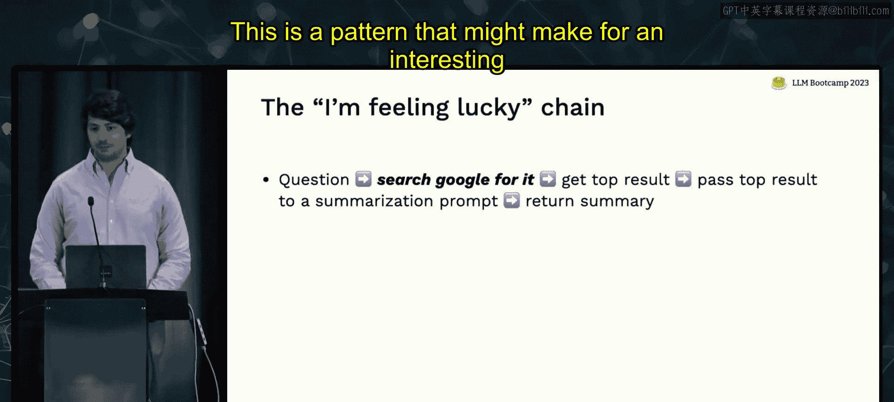

But the insight here is another way to give LLMs access to the outside world。

 in addition to you know building an information rettrival system yourself is just to let them use tools。

 give them access to APIs， that give them information about the outside world and so one question you might ask is like how far can we take this what the different ways that we can use this pattern。

😡。

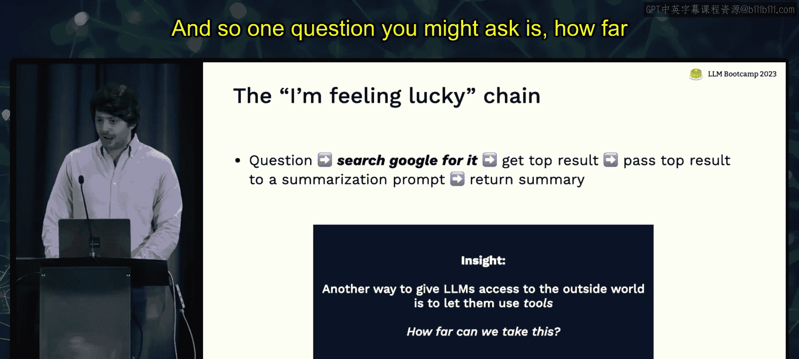

Um， so I think the paper thats sort of。Is the like most common citation here is tool form？

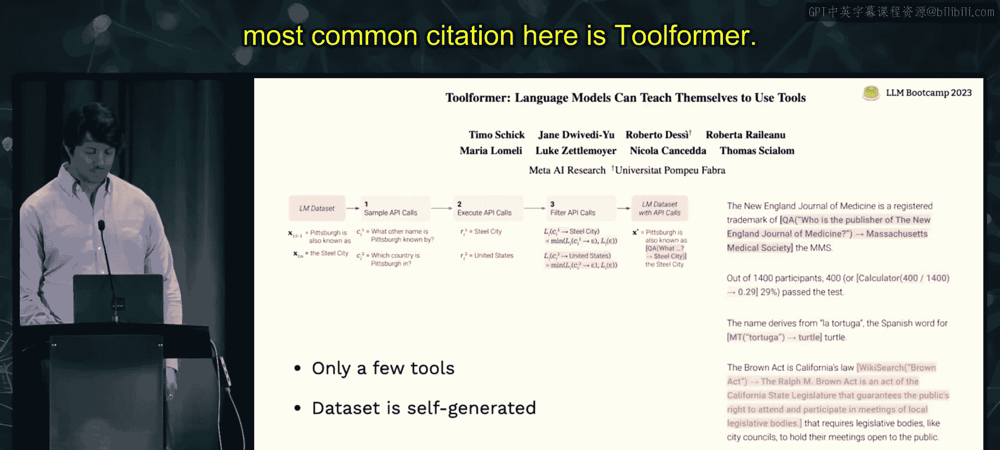

And so in To former， they constructed a method where they give an LLM access to certain tools。

 and so these tools included things like a calculator， question answering system。

 a translation system， etc。And they trained the model in such a way。

That it was able to use those tools as it generated the response and therefore if it used the tools to generate a correct response。

 it learned that this tool is a useful thing if I want to answer questions like this going forward。😡。

Um， this paper， like sort of。I would say maybe formalized an idea that people have been talking about on Twitter for a long time before that。

 it's kind a kind of common phenomenon in the language model world these days。

 and so the results of this paper are kind of limited， like it's only a few tools。

 it's a self-generated data， the results are not really that special but it's sort of the formalization of this idea that I think has been in the air in the LLM world for a while。

You can use tools in L chain， there's basically two ways to use them。

 the first is you can use them like any other element in the chain。

 so you can use them in a deterministic way where you say， hey， let me take the output of this LLM。

 pass this to a tool， pass that output to another LLM， etc。

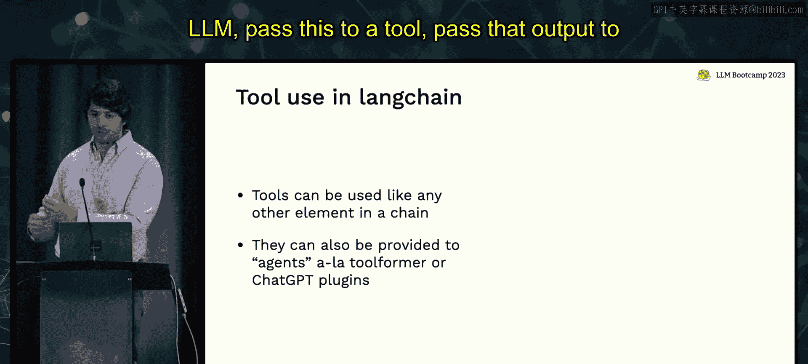

Or you can use them in a way that looks more like Open AI plugins。

 which I'll talk about in a second so some of the examples of tools that you can give your model access to in Lcha archive。

 search， you can give them access to a Python interpreter which can be really powerful if you want to do things that LMs are traditionally not very good at like math。

 things like that。😡，And there's all kinds of other things here。

 it's like very easy to add a tool to the LLM because it's essentially just making an API goal。

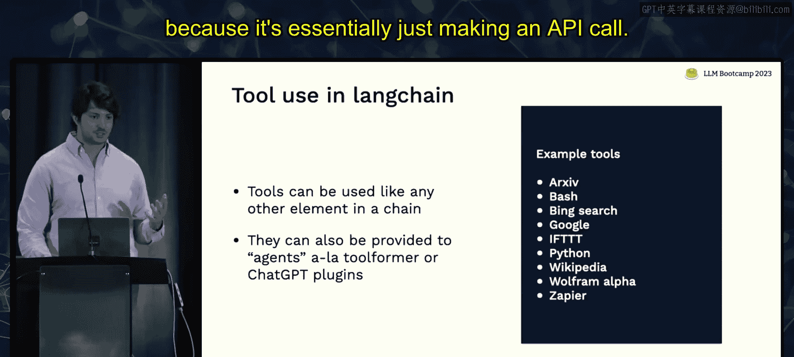

So one example tool chain in Lang chain is is like for  querying SQL so I think a common pattern that people that people want to do with LLMs is they want to ask a question in natural language and get a response from their SQL database。

 so the way that you can set this up with a chain that involves tools is you can take the user's question。

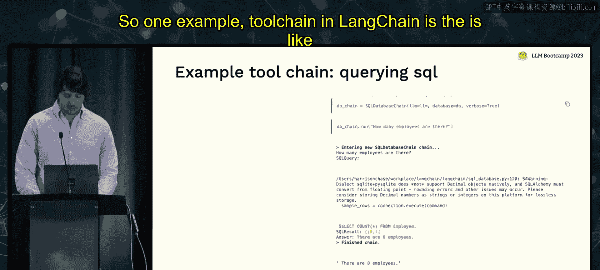

You can put the question alongside some metadata about the database that you want the model to be able to access into a prompt。

对。The purpose of that prompt is to map the question and the database metadata to a SQL query。

Then you can actually execute that SQL query on the live database。

Get the response from the database and pass that response alongside the original question to another language model。

 so now this language model has access to the question that the user asks as well as the result of the SQL query on your database and it's able to use that to answer the question。

So this is just one of like many examples and again I think the best way to learn about chains is to just go look at a bunch of examples of chains and it's infinitely there's infinite possibilities of things that you can do with these and so it's helpful to see what other people have come up with。

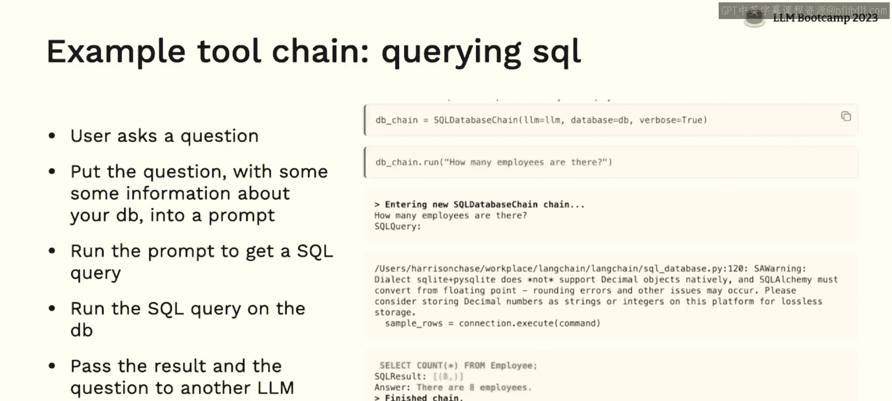

So there's a more automated approach to doing this。

 like what we just described is a method where you as the developer of the system。

Mannually design the way that the language model has access to these tools that interact with the outside world。

But there's a more automated approach to this that's like sort of becoming referred to as plugins。

 and this is the way that plugins work in Chat UBT。😡，So the chain based approach。

You start with a query。 you pass that query to a language model。

 that language model is designed to format the result of that query to be past the tool。

 Then you call the tool， which is like an API call or call to some external method you pass the result of that to a language model and to an output。

 And so these chains can get more complex than this。

 but this gives you a general idea of like you as as the developer are designing this pattern of how the model gets to interact with the tool the pluginbased approach。

I is simpler than this。You take a query。You call an LLM and that LLM gets to decide whether it wants to interact with the tool to answer the question or not。

So rather than you， as the developer， telling the model where it should use the tool or where it shouldn't use the tool。

 instead， the language model。Gets to decide whether this tool is something that's going to be helpful for solving the task or not。

So this is the approach that is taken in To Former and is the approach that's taken by plugins in Open AI。

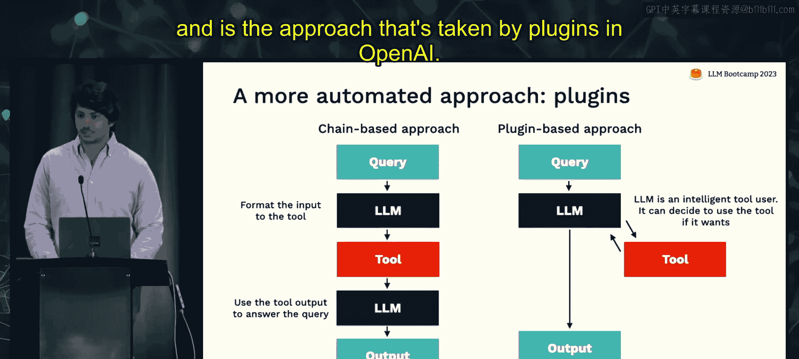

So you might ask like， okay， how can we make this more concrete， how do you create a plugin。

 how does a plugin work？

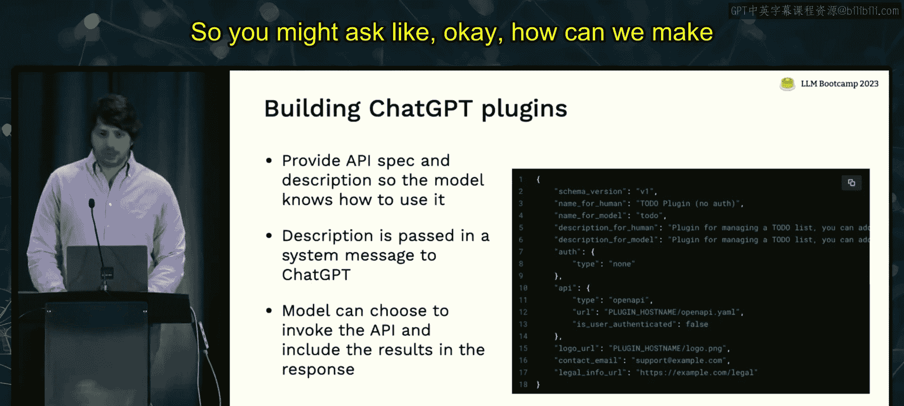

The way plugin works is。In Open AI， at least is you provided API spec and a description of the API the description of the API is designed not for the humans。

 but for the model， and so the description of the API is meant to help the model decide you know when is it actually going to be useful to use this API or not。

Then what Open eye does behind the scenes is it takes that description。It formats it。

 and it passes it to the model behind the scenes as part of its context。😡。

Then the model is able to use that context to make a decision， given the other context。

 given the inputs that the users are putting in， is this tool going to be helpful to me to solve this problem or not。

 and so the model can choose to invoke the API and if it does so the results from the API just get fed further into the context and the model can keep going。

😡，So the way to think about this is， you know， if you've designed a plugin， then behind the scenes。

 the model has access to the description of the plugin。😡，Now。

 the next step is you ask a question like ask a question to chat GPT， let's say。

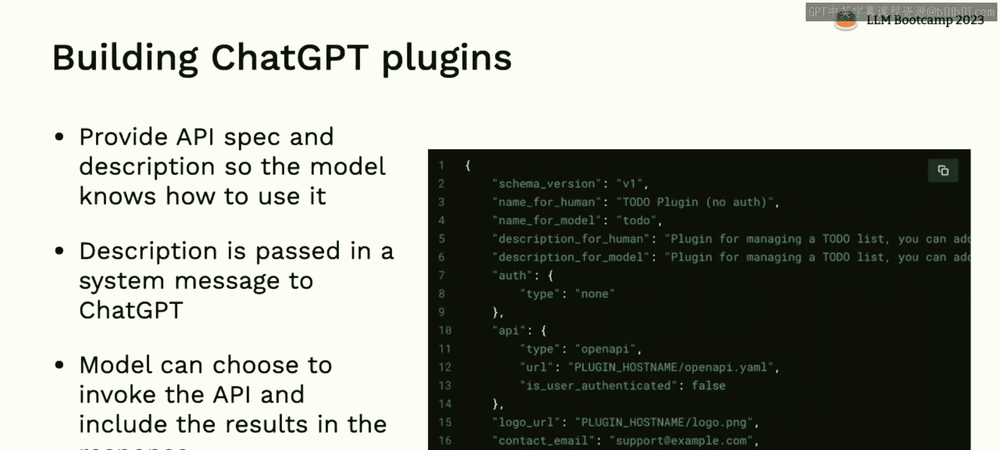

Then what chat E does is it thinks， okay， in order to answer this question。

 I would like to make an API call。It makes that API call and the language model is paused waiting for the API call to come back when the API call comes back that the output of that API call gets dumped into the context and then the model unpauses and it keeps doing it keeps trying to answer the question so it now has access to not just to the question but also to the output of the API call that it decided to make because it thought it would be helpful for answering that question and then it's able to sort of keep going with its generation to finish answering the question。

😡。

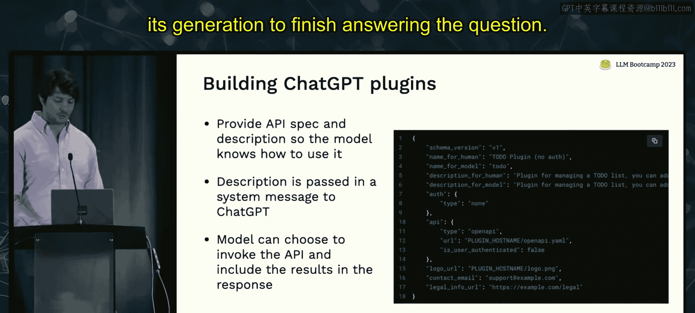

Okay， so that was sort of a quick overview of some of the different ways that you can use tools as another way of augmenting the language model with external data So what are your recommendations here like how should you think about this concretely。

To。Are a more flexible way to give your model access to external data so and the way you can think about this is like retrieval is just one instance of a tool so you can build a retrieval system you can that can be based on any of these vector databases or just your database or any complicated system that you want to。

 but at the end of the day that's just one tool that you can give your model access to。😡。

So there's two different ways to build tools to build tool use into LLMs the first is to manually describe the logic how the model should for how the system should use the tool in conjunction with LLMs to solve the problem and then the second way is to use plugins where you just ask the LLM to figure it out for you so which is better chains or plugins I think if your goals is reliability like if your goal is to build a system that solves the problem the same way every time then chains make more sense because you get you don't leave this up to the chance of what the model thinks is best on the other hand if you want interactivity and flexibility like if you want to build a really general purpose tool to give to your users that they can use to solve all kinds of problems that maybe you didn't anticipate then plugins are great because the user doesn't have to pick a different chain to solve a different problem in principle at least the model can just pick the plugins that you designed that are most helpful for whatever intention that the user has I guess the quick recap LLMs are more powerful when they're connected to external data when。

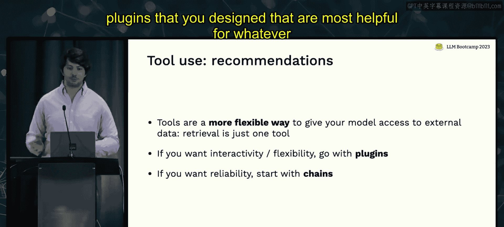

Connecting to external data， you know， you don't necessarily need to do anything complicated。

 you can you can do a lot with just rules and heuristics to tell the model you know which data is going to be most helpful for it as your knowledge based scales。

 you should start thinking about it as information retrieval。

Chains can help you encode more complex reasoning so if you need to do like a bunch of additional processing。

 you just start thinking about things as a chain they can chains can also help you get around token limits because you can you know pass many different like you can call the LLM many times each with its own sort of set of tokens this can get really expensive。

And， you know， tools are great for giving your model access to an external body of knowledge beyond maybe what you even have in your internal database。

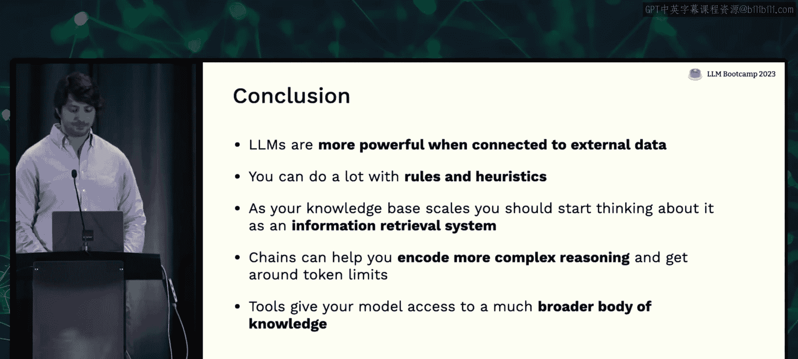

All right， that is it on augmenting language models， thank you everybody。🎼，🎼。🎼Yeah。🎼，🎼ね。🎼。

