# LLM训练营 - 2023年春季 LLM Bootcamp - Spring 2023 - P7：-07-LLMOps (LLM Bootcamp).zh_en - GPT中英字幕课程资源 - BV1Wf421B7mP

🎼，🎼。

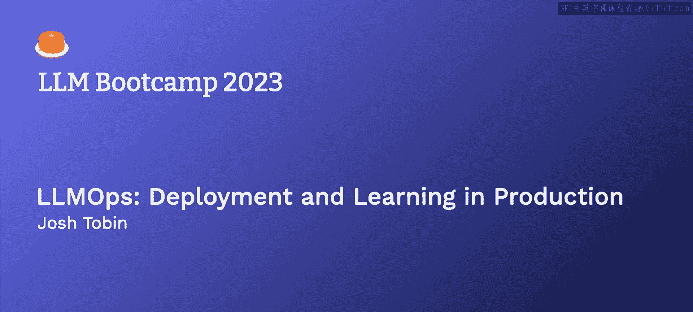

Okay， welcome back。I am。Really excited for this next one because I think this this topic is sort of core to our whole etho at Fulls stack deep learning we got started five years ago in the last AI hype cycle around this old-fashioned technique called deep learning because Sergey and I observed that you there are a lot of classes that teach you about how to build stuff with neural networks。

 but not a lot that teach you how to actually make that work in the real world and get it into production that's kind of a philosophy that we've carried throughout as we've developed other courses like this one and so a lot of what we've talked about today and yesterday has been how to think about building applications with language models and the focus of this lecture is going to be all the stuff around the edges that you need to think about to make these things work in production。

And so。The as like undeveloped and quickly moving as the space of like building applications with language models is。

 I would say the space of thinking about how to build real production systems systems with it is even more underdeveloped。

 So the flavor of the sock is。😊，I'm going to feel like kind of a grab bag of different topics that you should familiarize yourself with as you start building these applications I'll try to give you like high levelvel pointers about what you should be thinking about what some like basic initial choices that you can make are and where you can go to learn more but throughout the beginning of this it's going to feel like a bunch of as sort of different topics and at the end I'm going to try to tie this together into how like call it like a first pass at of theory for how to think about LLMOs which I haven't really share with anyone so I'm excited to get to that。

So the first thing that we're going to need to do is we're building an application on top of LLMs。

 the initial choice we have to make is which LLM should we build on top of。😡，And so。

The ted jar here is there's no single best like best LM to build on top of the right one for your use case depends on a lot of trade offs in particular a particular。

 how much do you care about out of the box quality for your task。

 How much do you care about speed and latency of inference， How much do you care about cost。

 fine tuneability or tuability。Data security and license permissibility and you know the trade offs between those things are going to determine what the right model is for your use case。

 But the kind of overall conclusion is most of the time you should probably be starting with G4 So don't overthink this But I think kind of one of the main questions that people ask is do we want models that are proprietary like G4 like anthropic or do we want models that are open source the way you should think about this is proprietary models today are better。

 they higher quality they are and most open source models that you get might actually not be open source because of licensing fractionction serving open source models also creates a lot of problems for you that if you use a proprietary model you don't have to deal with So serving these large language models is really difficult training them is really difficult just call an API it's much easier。

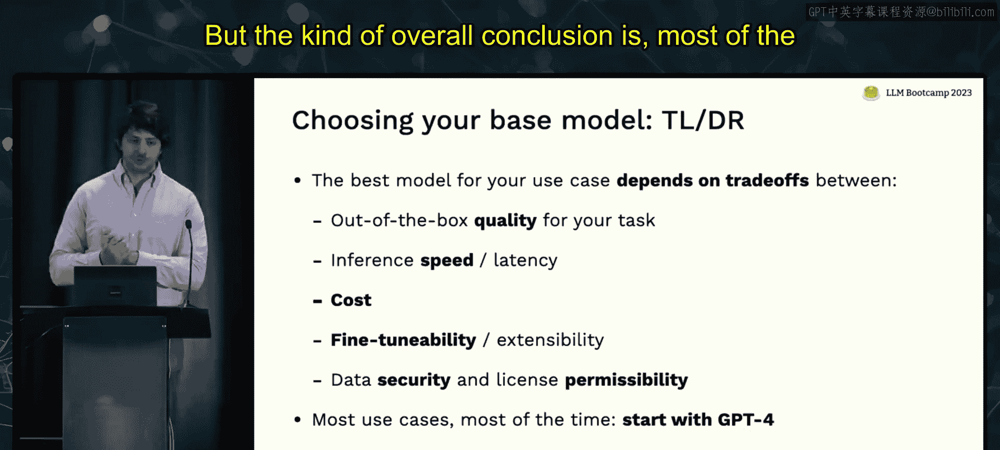

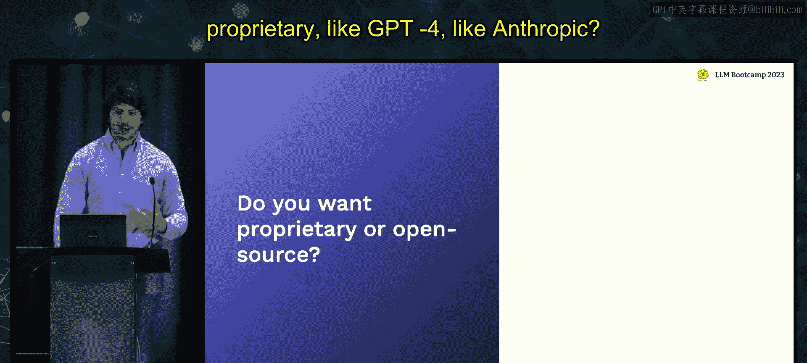

But for a lot of use cases， you really do need open source。

 so it's much easier to customize the APIs that you get from providers are very limited and it probably most importantly it respects data security。

😡，So if you can use a proprietary model， you should， but if you want to use an open source model。

 one thing to think about is licensing。😡，So there what we think about is there's like at a high level three different types of licenses。

 there's permissive licenses， which is what most of us are used to dealing with in open source software。

 these are licenses like Apache 2。0 which basically let you do whatever you want with the software or in this case the model。

😡，In the LLM world there's also restricted licenses and restricted licenses place like they say。

 place restrictions on commercial use， but they don't prohibit it entirely and so for these you're going to need to draw your own conclusions about whether this works for your use case but there's also a bunch of open source quote unquote open source models that are released under non-commercial licenses and unfortunately these totally restrict commercial use and I would say it's arguable whether you should really even consider these open source at all。

All right， let's double click on the proprietary contenders for models to use and so what we have here is a list of like some of the most important choices for proprietary models and we're ranking them according to a few different criteria first we're gonna look at the number of parameters in the model we' gonna look at the size of the context window we'll talk about what it was trained on we'll come back to in a second we'll talk about the subjective quality score we'll talk about the speed of inference and we'll talk about how finetnable they are。

So coming back to each of these criteria， the number of parameters is important to understand。

 especially in open source where it's more widely known。

 because the number of parameters and how much data the model was trained on are a decent proxy for how high quality that model is going to be the context window is important because as we spend a long time talking about yesterday and this morning。

 the amount of data that you can put in the context of the model plays a big role in how useful that model is for your downstream applications。

The what this training column refers to is what type of data the model was trained on so I listed four types of data here giveverse is like massive scale internet data。

 The reason why that's important is because that's why language models exist to begin with if you train a large model on more or less all of the internet then what you get is GPT3 quality model as of around 2019。

To get to up to modern G4 or G3。5 quality models you also need other data sources。

 most importantly code so code seems to be a really critical element of why these models perform well you also need instructions so you need instructions about what human wanted to do and what a good response is to that instruction and then you also need human feedback and so very few models that are available today are trained on all four of these different types of data sources and even the ones that are trained on things that are more than just internet scrapes tend to have more license restrictions as well。

😡，Next column is quality so how do you assess the quality of a a large language model Well。

 there's benchmarks that you can look at。

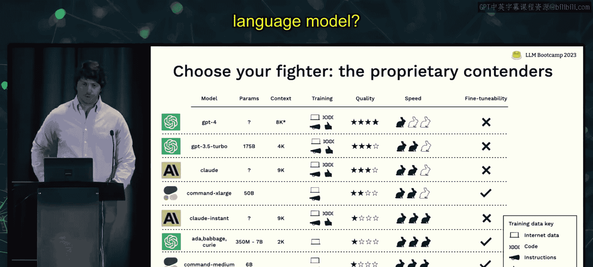

Those benchmarks are helpful for giving you like sort of a co-graed sense of how well the model works。

 but there's really no substitute for trying the model out and playing around with it in tools like not do devev which Charles and Sergey mentioned earlier but really like getting a feel for it on your own task there's no substitute for that and so the quality score here is like I would say this is a proprietary subjective quality score that is an algorithm that was secretly developed by the organizers of full stack deep learning to give you the best quality sense of whether the model really works or not and by what I mean by that is I played around with all these models pretty extensively and this is my overall feeling for how high quality they are。

Ethic speed and fine tuneability are a little bit more self explanatory。

 so let's go through each of these options。GPD4 is the highest quality large language model on the market today。

 there's nothing else that is in the same quality category as this。

 and so if you don't have some of the restrictions that we talk about。

 this is what you should be using。If you want something that is faster or cheaper than GPT4。

 but still really high quality， GPT 3。5 is which is what powers sort of the original chatGT is extremely high quality model that is only second in quality to GPT4。

 and it's significantly faster and cheaper。The best model on the market other than GPT3。5。

 according to our proprietary algorithm， is ClaD， Claed for Anthropic。

 and so this is one of the reasons why this is so high quality is that this is one of the only other models in the market that is trained on sort of the full gamut of useful types of data for training these types of models。

And I would say it's probably pretty comparable quality to GP 3。5。

 which one is better will depend on the specifics of your use case and really what type of output you prioritize in these models。

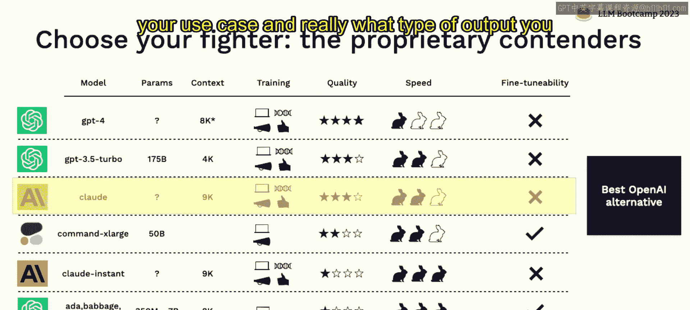

If you want a really high quality model that's still fine tuable。

 I think the best option is the largest model from cohere so cohe is like part of their strategy has really been emphasizing making their models。

 even their larger models finetable Open AI and Anthropic have sort of moved away from that so cohere is not trained on reinforcement learning from human feedback data。

 and so the quality of this model in my view is not really as high as the best models from Open AI or anthropic but it's still pretty good and you can fine tune it。

😡，The rest of the models on this list are like sort of the models that make a tradeoff of quality in the name of speed and cost。

 so if you want something that is cheaper or faster than the models on the top of this list。

 these three are good options， I think among these the best is the offering for Anthropic the reason why is because most of the other fast and cheap models are trained on simpler data sets。

 whereas Anthropic has done sort of the full training regimen on their simpler models as well。

But you know， if you're using Open AI or using cohere。

 then these models are perfectly adequate as well。So that's an overview of the proprietary options for large language models you can also pick from different open source options so starting from the top here and so we're going to use a slightly different set of criteria so we're still going to look at parameter count we're still going to look at context we're still going to look at what the models were trained on we're still going to look at our secret quality score。

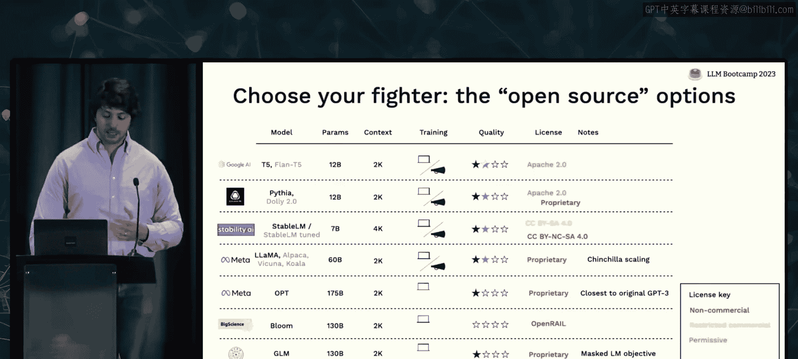

But we're also going to look at the license permissibility And so the way to read this is the green licenses are ones that are you fully you can use them for whatever you want。

 The yellow ones are the ones where you need to make up your own mind about whether the restrictions work for your use case and the red ones are ones that you can't use for any commercial use and so really these are just for tinkering they're not for any production uses at all The other thing to note here is for a lot of these models there's two options listed So you know in the first row there's T5 and flan T5 These indicate the first one is the way a lot of these open source models are released is they release the base model that's trained on internet data and then they separately release the finet of the model on instruction data and so the first option the first one here is is the base model and then the second one is the finet instruction tune model and so the quality score also refers separately to the base model and the instruction tune model。

So going to go through these now。嗯。Teth5 and Fan T5 are your best bets if you want like a sort of foolproof permissive license and you need decent quality results I would say flan T5 is not quite at the same quality level as coher' best offerings or the best you know semi open source offerings that we'll get to in the bottom of this list。

 but it's pretty decent and it's better than most of the other things that have Apache licenses。

Pythia and the fine tunes of Pythia like Dolly have made a pretty big splash recently。

 so this is a pretty recent option I think this came out like not this past week but the week before or something like that or at least in the last few weeks so we're still tuning our quality algorithm on these ones but the early reputations that they're really high quality unfortunately the fine tunes of Pythia。

 at least the ones I know about are like don't have licenses that you can actually use them for anything useful。

An even more recent option I think came out this past week from Stbil AI is stable LM and they have an instruction tune version of this as well this is a recent option。

 it's you know too early to say it's likely a good alternative to Pythia and Dolly they're also planning to release larger versions of these models and RLHF trained versions of these models going forward so this is a good offering to pay attention to。

Lma and its fine tunes like Alpaca， Viuna and Qoala are really like the ecosystem pick right now。

 these Lama was one of the first models to be released that or for people to get their hands on the weights that had reasonably high quality and so the community has built a lot of interesting fine tunes and applications on top of them。

 if you are really looking for something that you can tinker with and that's well suited by the community。

 this is probably your best bet， but these all have restricted licenses。

 so if you're trying to build for production I wouldn't even touch it。

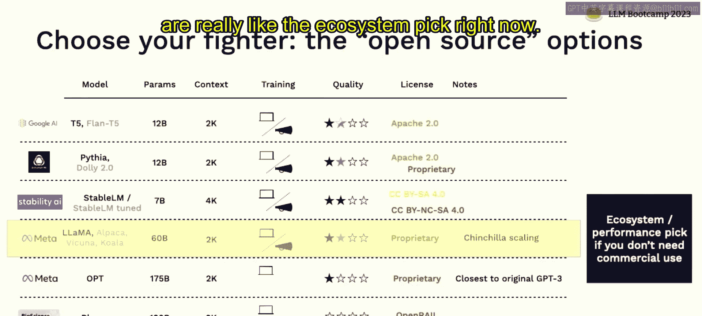

Lastly， the other one worth mentioning is OPT， OPT is an older model。

 it's the model that is trained in the way that is most similar to the original 2019 GPT3 model。

 and so if what you're trying to do is to research on a model that looks like that， you can pull OPT。

 but it's not really as high quality as some of these other options。😡。

And then you know you'll also probably hear about other models like Bloom and GLM， in my opinion。

 these are not really worth considering the quality is just not very good and they don't have very helpful licenses。

So got a quick overview of the available open source models。😡，Lastly。

 just a couple of notes on how to assess the performance of LLMs。

 the really the only way to know which LLM is going to work best is to do it。

 look at it on your task， and we'll talk a little bit later about how to do this effectively。

 I'm not saying don't look at benchmarks but they can be very misleading because it's a difficult task to assess these models that are designed to do so many different things。

So some recommendations here， I think for most projects， you should probably start with GT4。

 this will give you the fastest way to build a proof of concepts and it'll be the most reliable way to tell you if your task is even feasible to begin with because if you can't solve it with GT4。

 you're probably not going to be able to solve it with a simpler model。

 at least not with a lot of effort like a lot of fine tuning or something like that。😡。

Meaphor here is you know the kind of like common engineering adage of you want to prototype in the language where that's fastest for you to develop in。

 so a lot of teams will prototype things in Python and then they'll move to a lower level language like C or C++ or something like that when they know that this thing works and they just need to squeeze out more performance。

If costs or latency is a factor， then you can consider downsizing below GP4 GPT 3。

5 and Claudder book great as well， and you could go even faster and cheaper than that。Um。

 and then among all the sort of commercial providers cohere is the best for fine tuning。

And my recommendation at this point。Is I think by the end of this year。

 open source will probably catch up with like GT 3。5 level performance。

 but today I would only recommend using open source if you truly need it。Great。

 next thing I want to talk about is。As you're developing this model。

 so you've chosen your base model， the next thing that you're going to is you're going to develop your prompts for your task。

 so how can you think about iterating on prompts in a way that is a little bit more engineering minded than just kind of writing in a text file。

😡，So as you work on your prompts and your chains， how do you save your work in some sense？

First of all， why does this even matter， why are we talking about this？

So if you think about traditional deep learning， like all the way back in 2015。

 for those of you who were in the field back then， what it felt like was。

 you know every single time I trained a model， what I would do is I would write down the hyperfs I used to train the model in a spreadsheet。

And then I would save the train model somewhere on my like in a file on my laptop。

 and there was no way for me to reproduce what I did before。

 There was no way for me to share my work with the team and all this stuff just kind of got lost and was incredibly hard to keep track of over time。

 So there was a lot of like lost work， rework and things that were just impossible to work together with in an organization。

Now the way that companies build deep learning systems is， you every single time you run your model。

train call， it's instrumented and you automatically get a log of the experiment run that you ran with all the type of parameters。

 those runs are comparable with each other， they're shareable with other folks on your team and they're fully reproducible。

 so every single time you call model train， you're not worried about whether you're going be able to find that training run again in a month or whether if that training run actually works。

 you're going to have to do a ton of other work just so that your team kit you can convince your team of it。

😡，Prompt engineering today， I think feels a little bit like deep learning did in 2015。

 So every single time I change my prompts， what I'm doing。

 you know a lot of times is I'm playing around with it in playground。

The old prompts that I ran are sort of lost to time because I don't have a great way of keeping track of them。

 and there's no way for me to reproduce an experiment that I ran before。

 you know share the prompt with a team or anything like that。And so the question is like。

It feels like we're missing some tooling here to help make prompt engineering feel more like engineering and less like just kind of ad hog experimentation。

 So what should that tooling look like？😡，A reasonable question to ask is like。

 does prompt engineering even need this， is this the same as deep learning。

 do we need advanced tools to keep track of this stuff？😡。

So I want to talk a little bit about why I think experiment management was so impactful in the deep learning world。

I think the core reason is that。You constantly need to go back and check your old experiments in deep learning。

There's two reasons for this first， because experiments take a long time to run your training model so that can take hours。

 days， weeks， even， so it's important for you to be able to like shut your laptop， walk away。

 come back and know that you'll be able to refresh your state about what's happening。

And on top of that， you often run many experiments in parallel。

 so oftentimes you're running a hyperparameter sweep or you're trying different model architectures。

 and so there's a lot more to keep track of。😡，And you run a lot of these。

 so you end up if you're not careful， you end up repeating yourself and like running the same experiments over and over again。

 I myself noticed myself doing that many times like back when I was training a lot of models。😡。

Promp engineering today， I think， doesn't really have that same dynamic that made experiment management so impactful in deep learning。

 Expiments are quick to run。 It feels more like writing code than it does like training a model。

 right， You， you change a few words in your prompts。 You rerun this thing。

 It takes maybe a few seconds， not hours。Experimentation today， I think is also usually sequential。

 So normally what I'm doing when I'm iterating on prompts is like I make a change to the prompts。

 I rerun it， I see if that fixes my problem， I go back。

 I change the prompt again and I follow this kind of sequential back and forth step。

 I'm not today often running like a lot of experiments in parallel in ways that I change my prompt。😡。

And most of the time the amount of experimentation that you do is pretty limited。

 so you're you changing some things in your prompter or there。

 maybe you try tuning a model parameter， but you're not really like at least most of the time that I see。

 folks aren't you know trying thousands and thousands of different options for their prompts。嗯。

One thing I'll note here is I don't think that this is going to be true forever。

 I think one of the core reasons why experimentation is so sequential in prompt engineering is because we don't really have a great way to evaluate new prompts that we develop if you could automatically tell whether a change that you made to your prompt is better than the old version then we could paraze prompt experimentation and that would change this dynamic。

So I think overall conclusion is， you know， you probably don't need advanced tools for this today。

 but in the future， if evaluation improves， this might become really important。😡，All right。

 so I'm going to talk about three different levels of keeping track of your experiments with your prompts in your chains。

 The first level is just doing nothing right so make your prompts in the open AI playgrounds。

 you know， if they seem to work， then that's great copy and paste them into your your file and you're good to go。

This is good enough for at P0， this I think is like not quite enough for what you actually want for building applications。

 but level two is just tracking your prompts and get。😡，This is。

 I think honestly what teams most teams should be doing right now， it's super easy。

 it fits into the warflow that you're already doing。But in certain cases。

 you might need something more advanced， like you might need a specialized tool for tracking prompts and I think the places where the place where this might start making sense is if you're running a lot of parallel evaluations where Git is not really a great tool for keeping track of like many parallel experiments or if you need to decouple changes or want to decouple changes to your prompts from deploys or if you want to involve internal like nontechical stakeholders in the prompt iteration process your product manager probably doesn't really appreciate needing to use Git to tweak a couple words in the prompts and chat UT kind of let the cat out of the bag and product managers now know that they can make good changes to prompts sometimes so they might be expecting to do that。

If you do want to go for a specialized prompt tracking tool。

 what should you look for here first thing is it should be decoupled from Git right if it's not decoupled from Git that I don't think it adds much value and you should just use Git。

😡，If you beyond being decoupled from Git， I think a really desirable feature in a tool like this would be to be able to take the prompts that you're iterating on on your laptop and execute those but not only in code。

 but also in a UI The reason why I think this is valuable is because you again think about your product manager who wants to contribute to making prompts better。

 if you create an initial version of a prompts and they have a UI where they can interact with it and try changing words around and convince themselves that you actually came up with the right answer to begin with。

 that's gonna to make your life a lot easier。😡，嗯。I think it's also really helpful if this can be connected to visualizations of the executions of like the things that people interacted with this prompt on。

 I'll come back to why that's important。And so there's a lot of movement in this space right now there in the past week。

 there's been three tools announced from all of the major like traditional ML experiment tracking tool providers。

 weights and biases， comet and MLflow and I'm expecting a lot more movement in this space。

 so this is a place where I think the tools are going to be totally different a year from now than they are today。

Okay， so concrete recommendations on prompt management。

 I would just manage your prompts and your chains and get。

 but if you have a lot of interaction or collaboration with your nontechnical stakeholders or you're starting to really focus on automating your evaluation。

 then it's worth building your own experiment management tool。

 trying out one of the ones from the providers I showed on the previous page or just keeping an eye out for this space as I imagine there's gonna to be a bunch of new products launched here soon。

😡。

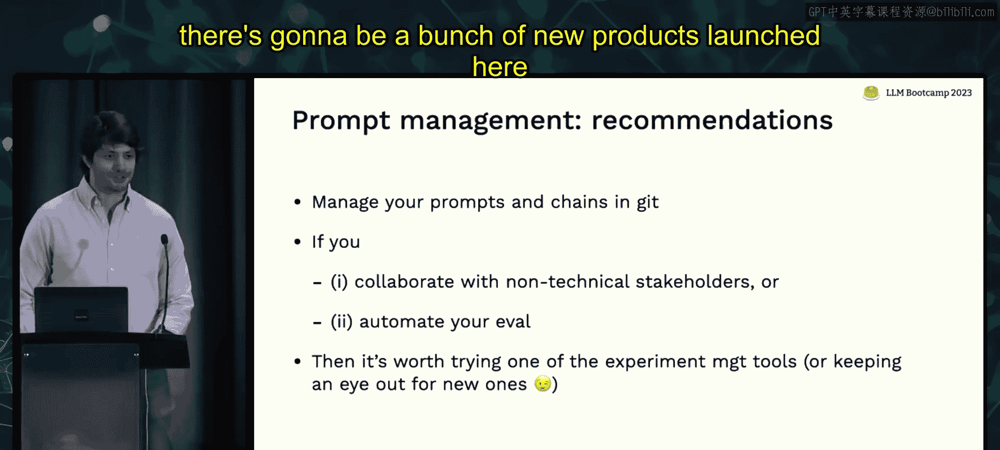

So the question here is， okay， I've made a change to a model like I've Open AI has updated their base model or I've made a change to a prompt。

 I've you know tweaked my my prompt language， I've changed how I put information in the context。

 how do I know if that actually worked， how do I know if that's actually better？😡。

So why does this matter， LMs make tons of mistakes。

So the nature of this technology that we're all building with now so just because your new prompt looks better on the handful of examples that you cherry picked it on and that you your product manager got excited about does not mean that it's better in general and it's super common to have use cases where you make the prompt better in one way。

 but it degrades performance in other ways。And so if you're not tracking。

 if you're not measuring performance on a wide range of data that represents the data your end users are ultimately going to be putting in。

 then you're going to miss regressions and performance。😡。

So and you know in particular I think this is important in like kind of the human side of building applications with LLMs where I think a really important component of user retention for AI powered applications is trust right like it's really easy to get people to be blown away by this cool new AI tool that you built and it's easy to attract users these days because everyone's looking for tools to try out。

 but at the end of the day if you get the wrong answer enough。😡。

Like if they don't trust the output that you're producing。

 that's going to cause them to go back to the tools theyre using before。

So like I did in the last section， I want to kind of compare this to the way that testing machine learning models worked in the sort of pre LLM pregenerative era。

So the way that folks think about testing machine learning models is you start with data that comes from your training distribution。

So you have a training set， which is the data you actually train your model on。

 and you compute a single metric on that training set， like let's say your accuracy。

Then you hold out some data from that same distribution and you evaluate your model on that distribution after it's trained that gives you another measurement for this metric of accuracy。

😡，The difference between those two measurements is called overfitting。

 so this is a measure of like how much your model is just really over overfitting on this exact training set that you produced。

Then you have a bunch of other data that's coming from production that data might come from a different distribution than your model was initially trained on and so you'll hold out some data from that production set to use to test your model and you'll compute that single metric again。

 that accuracy metric， the difference between your accuracy on the test set and the sort of heldout set from your training distribution is a measure of your domain shift so this is measuring like how much model how much worse your model gets when you move outside of the training distribution。

😡，And then finally you can measure the accuracy on the actual production data itself and the difference between that heldout test evaluation and the production evaluation is a measure that you can think of as drip right so how much worse has my model gotten on that production distribution？

😡，So why doesn't this work for LLFs？Well， first of all。

 you're using an API that you're calling from Open AI。

 they don't even tell you what data they they're training it on。

 much less giving you access to that data， so there's no way for you to really know what your training data is here。

😡，And then when you deploy this thing in production as a corollary of that。

 your production distribution is always going to be different than your training distribution。

 no matter what， like you're not going to be evaluating your model on the same data that Open AI trained their model on。

😡，In traditional M， the metrics that you compute are are deterministic right so a traditional ML problem you might have is classification。

 So I'm going to classify whether this image is a cat or a dog and the way that we'll measure how well this model is working is we'll compute a metric like accuracy where we just compare the predictions to some ground truth labels and we see how many times the model got it right and that gives us an accuracy score。

In generative M， your predictions are like text right so let's see you a prediction that says this is an image of a tabby cat。

 but your label is photograph of cat。 Is that a good output or a bad output。Really hard to say right。

 I mean it' it's kind of subtle whether this is a better prediction for the model or not。

So another additional challenge with generative models is like what metric should we even look at？

And then I think a final challenge here is。Oftentimes in more traditional ML。

 we think about like task specific performance， so our performance on this task classifying the difference between images of cats and dogs。

In language models， oftentimes we're building systems that are designed to be much more general purpose。

So even if you're able to measure the accuracy of that system。For a question answering system。

 you might have all kinds of different questions coming from your users。

 they might be asking you about startups， dogs， food， physics。

 and your performance might be totally different on those different subjects。

 so is it really fair to summarize the performance of the model in the single metric。

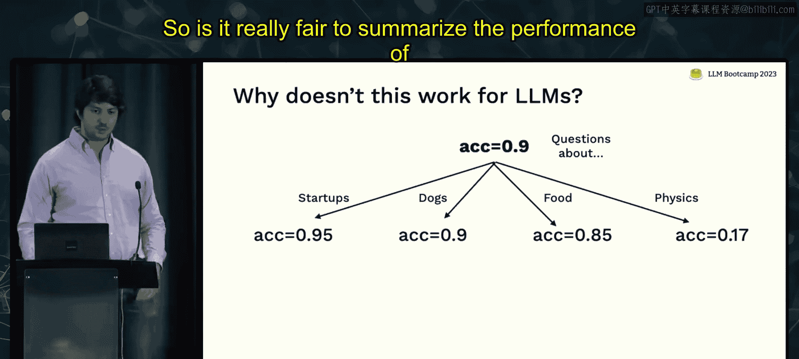

Um，Or is what you really need to do to capture a more diverse understanding of the behaviors that the model is supposed to be performing well on？

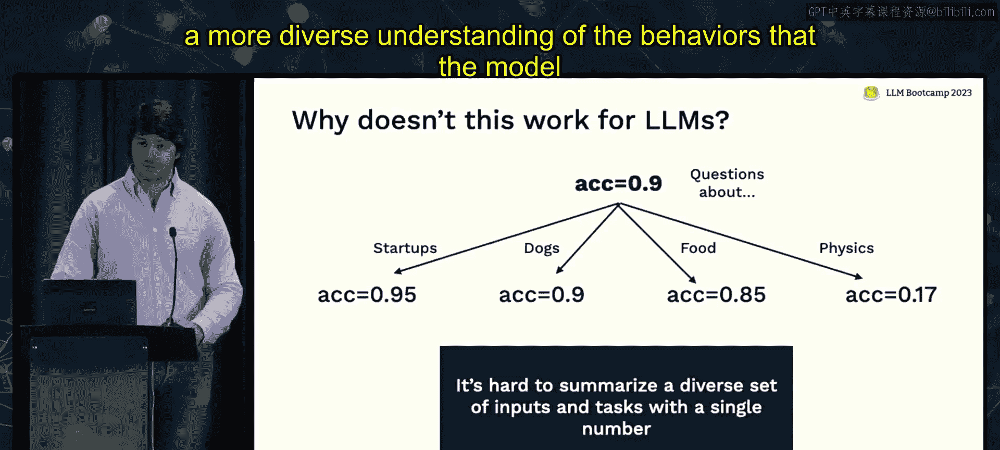

And so to summarize like your model trained on the internet， so there's always drift， your model。

 the output is the measurement of the output is qualitative。

 so it's hard to put a number for success and it's supposed to work out around a diverse set of behaviors so aggregate metrics don't work。

😡，So let's talk about how you can think about testing language models。

 I think there's sort of two key questions to ask yourself here。

 The first is what data do you test them on， and then the second is what metric do you compute on that data。

So here's how I think you should think about building an evaluation set for your task there's sort of four steps to this first is you want to start incrementally。

 you want to start building this evaluation set from the beginning as you're prototyping your model the second thing that you can do is you know since we're working with this magic technology。

 you can ask your language model to help you out here。😡，嗯。

The other thing that you can do is as you roll this out to a broader， broader set of users。

 you should think about the task of building this evaluation set as incremental。

 so you should always be adding data to your evaluation set as you discover new failure modes or new patterns in the behavior of the model。

😡，And then the last thing I want to talk about here is， you know， this feels very ad hoc。

 can we is there any way that we can formalize this？

So start incrementally the first thing that you're going to do most of the time as you play around with the language model is you're going to evaluate it as ad hoc right like let's say that you write a prompt that says write a short story about you know a given subject。

 then you might try different subjects， you might try the subject dogs。

 subject linkednkedIn subject hats and you're kind of like getting an ad hoc feel for like whether this model works for these different inputs。

😡，As you find interesting examples in this evaluation。

 then you should start organizing them into a small data set。😡。

What do we mean by and then like the next time that you have a change to your model rather than just playing around with different examples。

 you can run it against every example in this like small data set that you're building。😡。

What do we mean by interesting examples， I think there's like really two heuristics that you can look for here。

 The first is hard examples are interesting。 So if you find an example as you're playing around with your model where the model really doesn't do well。

 you should add that to your data because you want to make sure that future versions of the model improve on that。

😡，And then the other heuristic is that different examples are interesting。

 so if you find an example as you interact with it or as your users interact with it。

 where it's they're using this model for something totally different than the rest of the data in your data。

 that's also worth adding to the data。😡，So those are two heuristics about what you should add to the data set。

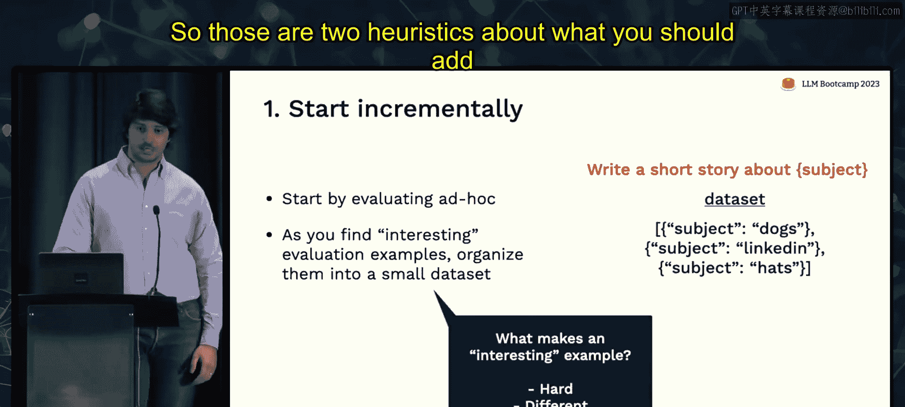

The second thing you do here is you can use your language model to help so amazing facts language models can help you generate test cases and there's a cool open source library by a FSDL alum actually called auto evaluator that takes this that uses this approach for question answering data and the way this works is you create a prompt。

😡，And that prompt you know takes into account the task that you're trying to solve。

 and then you basically ask the language model to generate diverse examples of input and output pairs for this task it's really cool and it can help you like bootstrap these test cases much faster。

Third step is as you roll this out to more and more users。

 you want to keep adding data to your data so some heuristics for what you might want to add is like what do your users dislike if you have annotators you should think about them as users too so what do they dislike。

😡，Third thing that you can do is you can ask another model。

 you can do self critique so you can create a prompt that assesses the quality of outputs of the model。

 you can add the ones that the second model doesn't like to your data。But you can also find you know。

 so those are examples of our data， you can also add different data so you can add data that is an outlier relative to your current evaluation set according to some metric。

 or you can add like potentially underrepresented topics or tense or documents。

 things that you find your users creating that you don't currently have in your E set。😡，Okay。

 so those are some intuitions about how to build your your evaluation set incrementally as you build your model。

😡，嗯。I want to talk a little bit about like kind of an idea and this is。

 I would put this more in the category of like speculative idea that I've been thinking about rather than something that's an accepted practice right now。

 but what I've been thinking about is like， is there any way that we can make this feel more quantitative。

 like is there any way we can quantify the quality of our test set？😡。

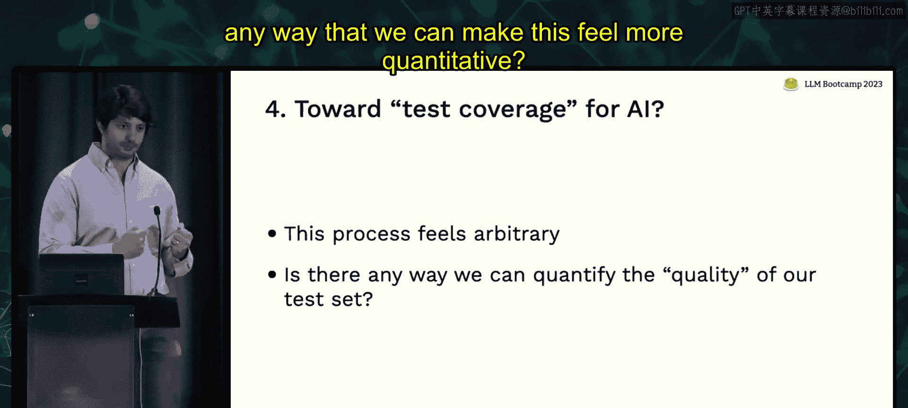

So and like one way to think about this is the notion of test coverage right so in software engineering a metric that software engineering teams often look at is test coverage and what that means is basically the percentage of lines in your code base that have a unit test that's associated with them。

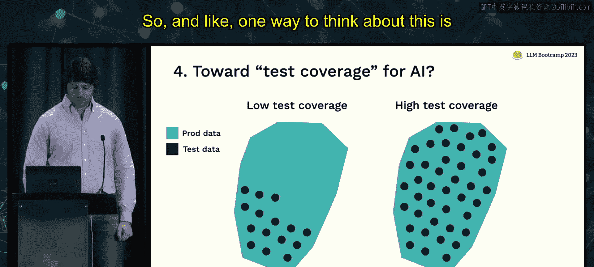

Is there anything analogous that we can come up with an ML I think the way to think about this is the analogy for lines of code in your codebase that you're testing is data points in your production distribution。

 so a good evaluation set according to this intuition is one that has good coverage of the types of things that your users are trying to actually do with the system。

😡。

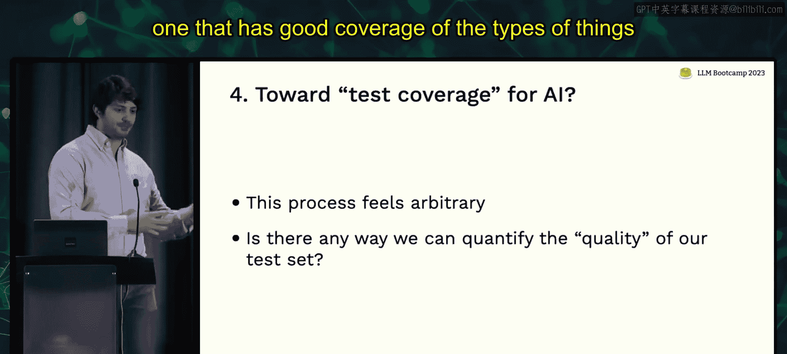

So what does this look like a low test coverage evaluation set is one where a lot of your production data。

😡，A lot of the data that your users are sending in as they interact with it is not really anywhere close in an embedding space to the test data that you have in your test set。

😡，On the other hand， a high test coverage data set would be one where， you know。

 pretty much anything that your users are sending in in production lives somewhere near。

You're one of your test cases in embedding space。So there's a lot of different ways to make this to you know formalize this mathematically。

 but this is kind of the intuition here。

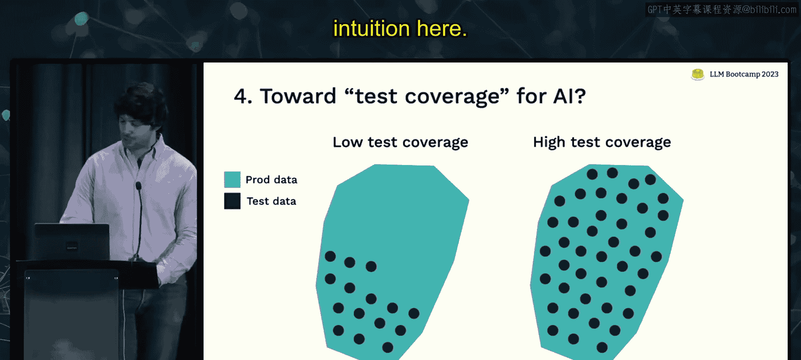

One sort of note here is that like for those of you who are like coming from a more traditional ML background。

 you might be familiar with the notion of distribution shift so test coverage and distribution shift are analogous notions distribution shift measures how far the test distribution is。

😡，From a certain reference distribution。So how far is your test data from your reference data。

 and you can use that to see if your data is changing relative to that reference data。😡。

On the other hand， test coverage measures。How well your evaluation data covers your production data。

 so it's kind of like a dual notion to that and what it's used for is also different。

 it's used to help you find more useful evaluation data to put in your data。😡。

So one question you might ask is like is this enough and I think the main way that a notion like this would fail is that you have like great coverage of your of your test data。

 but。😡，Hard data is underrepresented。Uh， or if like you have great coverage。

 but your metrics don't really matter， like your metrics have nothing to do with your how your users react to this stuff in the real world。

So I think you would also need another notion of test reliability that measures a difference between online and offline performance so again。

 that's this section a little bit speculative， but hopefully helps you build a little bit of intuition about what makes for a good evaluation set for as you start to build your model。

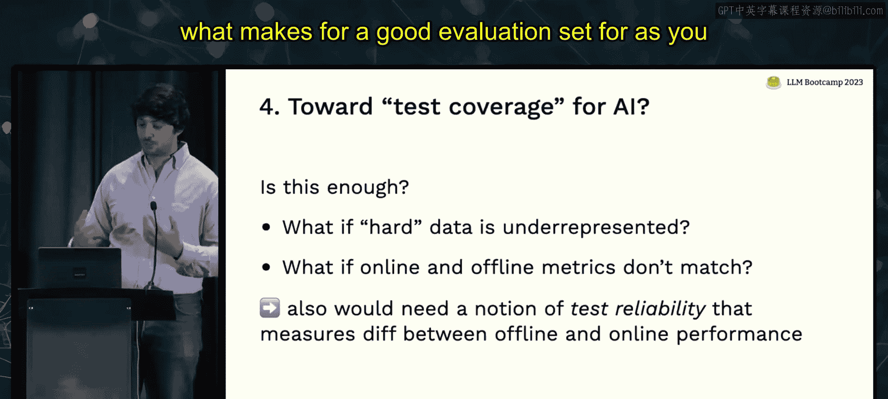

Okay， next thing I want to talk about is evaluation metrics for language models。😡。

And I think like the key idea here is there's a lot of quantitative metrics that you can define for LLMs if you know what the right answer is。

If you don't know what the right answer is， like if the correct answer is subjective。

 then the main technique that we have in the toolkit is to define a prompt that asks another model。

 whether this is a good answer for the question or not。And there's different ways of setting this up。

 So if there is a correct answer for your problem， then you can just compute your normal metrics like accuracy like you wouldn't regular MLl if there's no correct answer。

 but you have a reference answer so you have an example of what one good answer looks like。

 then you can use reference matching metrics。😡，Come back to what this means in a second。

 if you don't have a reference answer， but you do have a previous answer。

 like here's the answer that another like the previous version of my model spit out。

 then you can use like which is better metrics。😡，And if you don't have a previous answer from the model。

 but you do have human feedback， then you can use like is the feedback incorporated metrics？😡。

Finally， if you have none of that， you can still define static metrics on whether this output is correct or not。

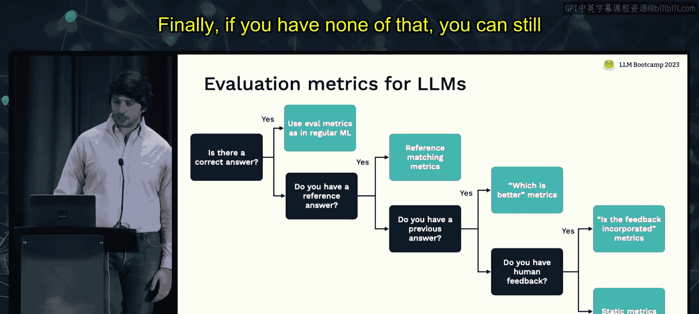

So to go through a few of these。There's regular evaluation metrics like accuracy。

 reference matching metrics， you know， you can look at things like semantic similarity。

 you can also ask another language model whether these two answers are factually consistent。😡。

If you have two answers from like two different versions of the model。

 you can ask a language model which of these two answers is better。

 according to any criteria you want， so which of these two answers is the better answer to the question。

If you have feedback on the model。😡，You can ask a language model whether the answer to the question incorporates the feedback that was given on the last version of the question。

And if you don't have any of that， then you can do two things。

 you can verify that the output has the right structure。

 so if your model is expected to produce JO output。

 you can just verify that it's JO structured output。😡。

Or you can ask a model to grade the answer on a scale of one to five， something like that。

So to answer the question， can you evaluate language models automatically Well， if you could。

 I think this would be really powerful because it would unlock parallel experimentation and it would help us move a lot faster but I think the reality today is you still need to do some manual checks and as you do these manual checks you should also be gathering these feedback from the people who are checking the answer and this the type of feedback that you gather is going to be analogous to the type of feedback that you're gathering in production next topic is deployment So this is gonna to be kind of the lightest topic here because。

😡，You I think if you're just using like an LLM API。

 then most of the time this is not really a hard problem。

 you can just call the API from your front end， even if you're using an LLM API。

 this can become more complicated if you have a lot of logic behind the API call like if you have complicated method defining your prompts or really sort of messy chain and so you might want to think about like isolating the LLM logic as a separate service deploying open source LLMs is a whole other thing that's beyond the scope of what we're trying to do today there's a couple of references I would recommend below including lecture from our previous class on deployment and then a great blog from Replet that covers how they built their own language models and we have Rea from Re coming in think talk this evening so I think you'll probably talk a little bit about their approach as well。

And then lastly， like the one other topic that's worth touching on in reference to， you know。

 deploying language models is。😡，You like when you're running the language model in production。

 there's different techniques you can use to improve the quality of the outputs of the language model and so just a few ideas to be aware of here。

 first you can do self critique。😡，So self critique is when you ask a second language model to critique the output of the previous language model。

 and so that can oftentimes lead to the language model coming up with a better answer to the question in a way that's kind of analogous to chain of thought prompting。

😡，Um， there's a u， there's a really good library， open source library called guardrails that has some of the sort of functionality around this built in。

Another technique that you can do at a high level is rather than just sampling once from the LLM。

 you can sample many outputs from the LLM and you can choose the best option and there's a whole spectrum of techniques that you can use to do that。

And then thirdly， like you can sample many times and even if you don't know which output is the best one。

 you can just average them together in an ensemble。So again。

 just kind of scratching the surface of this topic。

 but these are all different ways of in production， if you really care about quality and reliability。

 you can trade off some additional costs and additional latency penalty to improve reliability by adding more language model calls to your chain。

Next topic here is monitoring， so you've deployed your model。

 how do you actually know if it's solving the problem that your end users need it to solve in production？

😡，I think the most important signals to look at in general when you're monitoring any machine learning model is the most important thing at the end of the day is the outcomes that you're aiming for。

 so are your end users happy is the model helping them solve the task that they want to solve。😡。

If you don't have access to those or if you want additional signals。

 then model performance metrics can also be really good。

You can define proxy metrics like you might notice that， hey。

 our users tend to prefer shorter responses rather than longer responses。

 so we can monitor the length of the response。And then lastly。

 you can measure the things that actually tend to go wrong with these models in production。Um。

 so let's talk about， let's go， let's double click on a couple of these。

 gathering feedback from users。😡，I think the way to think about this is the you know users don't really like users are kind of easy。

 they don't want to give you feedback unless you make it really easy for them so good feedback is like as low friction as it can be as high signal as it can be so the best is if this is part of the user's workflow already。

😡，嗯。You can like accepting changes or giving thumbs up or thumbs down or also relatively lightweight ways to gather feedback and then you can also like ask your users for longerform feedback like。

 hey， tell me why this answer was wrong and it might be worth doing。

 you might not get very many users that do that but the ones that do might give you really high quality signals from it。

So that's kind of like ways of gathering feedback from users next thing is let's talk about the things that actually tend to go wrong with LLMs in production。

Most common， you know， in reality is often it has nothing to do with the language model itself it's actually just。

 you know we're building a product the most common issue with the product is something to do with the user interface itself latency is like an especially common one here this can be really hard one to detect because oftentimes users don't really know what they're missing with lower latency。

😡，Another common problem is incorrect answers or hallucinations。Long winded answers。

Sometimes with RJ models， they have a tendency to like dodge questions。

 say like I'm just a language model， I don't want to answer your question most of the time users don't really like that so that's another kind of common problem。

Prompt ejection attacks and toxicity and profanity。

So these are all like kind of common issues that people see with language models and production。

 and for each of these， there's signals that you can look at to monitor whether these things are going wrong。

And the last topic I want to touch on is okay， so we've gotten our model into production。

 we're monitoring it now we need to figure out like okay。

 what is actually going wrong with this model and how can we fix the model。

 how can we improve it based on the signals that we're getting from our users？😡。

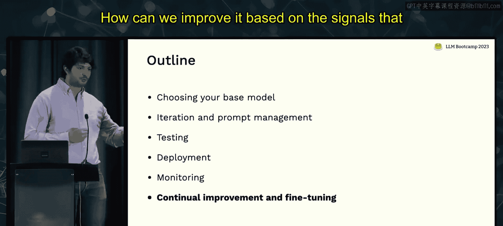

So we can use user feedback at a high level in two ways。

 the first is we can use it to make the prompt better。😡。

And the second is we can use it to fine tune the model。

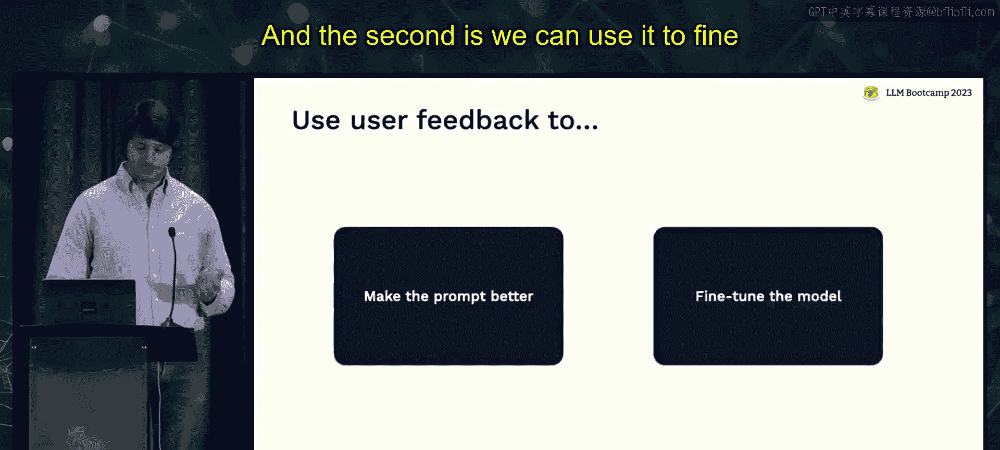

So using user feedback to make the prompt better， the way this works at a high level is you like you want to look for themes in your user feedback。

 so problems that users are having with the model oftentimes these days like I would say the most common way is people just look through the feedback that you're getting and you manually categorize like what's working or what's not working then you like do some more prompt engineering or change the context to adjust the prompt of the model to respond to those themes in the feedback。

😡，There's I think like a big open question here of like to what degree can this be automated。

 is it possible to automatically surface the themes that you're getting in the feedback from end users and is it even possible to automatically change the prompts to account for those themes I think we'll see a lot of exploration around these questions in the coming months。

😡，嗯。I wasn't gonna to talk about fine tuning LLMs and I heard so many questions about it that I put together some slides on it。

 but now I'm running really low in time， so I think I'm just gonna skip through it maybe we can come back to it if there's a few minutes or folks can ask about it。

 but high level know there's two main ways you can do supervised fine tuning which is actually starting to get relatively easy to do techniques like low rank adaptation like faster ways of fine tuning models and then there's fine tuning directly from human feedback which today is still really difficult to do and not very many organizations are doing this on their own。

Okay， so。Yeah， so just to conclude。The sort of style of lecture that I want to do here is like this is a rapidly evolving field。

 there are not really best practices yet so I wanted to give you a tour of like some of the main questions that you're going to come across as you build these applications and just point you to like kind of easy first steps and places you can go to learn more that being said I am optimistic that there is a way to formalize this process of building production applications with LLMs in a much more structured way and I wanted to kind of take a pass at what that might look like。

And so the way I've been like starting to think about the like a more formal process for developing language models is like you can think about this as test driven development or behavior driven development。

Okay， so what do I mean by that， Well， we start with our prompt development workflow or chain development workflow。

 right， So this is， you know， I， as the model developer， I'm working on， you know。

 trying to build a chain to solve task so。I start from a base LLM that I shows I you know iterate on my prompts。

 iterate on my chain， when I have something that I'm happy with， I test it， and then I deploy it。

And then once I deploy it， I start to gather feedback from end users and in this case like in this initial phase of the project。

 I am the end user right I'm just developing this model now by myself。

 I haven't even shared it with my team yet， but I'm still providing feedback on how the model is doing。

😡，And so from that user feedback we get the stream of interaction data and so again right now this interaction data is just coming from me。

 but over time it's going to come from a broader and broader set of users。😡，是认。

What we do with this interaction is we enter like a logging and monitoring workflow So what this workflow looks like is we take all of this interaction data so all the questions users are asking our system。

 all of the inputs that they're putting into the prompts。

 and we use that to identify themes in the feedback。😡。

What are the the what are the places where our users are having trouble with this system。

 where is it going wrong？From those themes， we extract test data。

 we extract that test data by you know just pulling in the examples that our users didn't like the outputs for。

 or maybe by asking a language model to help generate additional examples like those once。😡。

That test data feeds into our testing process for future versions of the prompt。

 and we move back to the stage of prompt iteration。

 where we now go back and try to make our prompt better to address this feedback with this now broader。

 more enriched set of data to test the model on。😡，Then finally。

 like as this starts to get more complex and we start to have more and more interaction data。

 we can like optionally have a fine tuning step for our workflow。

 so we can also from the interaction data extract not just some evaluation data but some training data。

 we can fine tune the model on that and loop back into the stage of starting again from a new base LLM。

 which its work noting is going to require us to revisit how we did the prompting。😡。

This is like the overall like test driven development workflow where you are making changes to a prompt。

 you are rolling those changes out to your users， those users are giving you feedback。😡。

On whether this is working， you're synthesizing that feedback。

 you're taking those themes from the feedback， using those to generate more test cases and creating this virtuous cycle where your tests get more and more robust over time as you gather more interaction data from your end users。

 and this process repeats right So I I'm going through this loop as an individual developer when I'm just working on a model by myself。

 and I'm the only end user。😡，But then as I get confident with this model and I'm like， hey。

 I think this this model is pretty good， might be ready to go out into production。

 I share it with my team and we go through this exact same process where now I'm not the only user。

 my team are users as well。 They're still giving me interaction data and I'm still trying to use that interaction data to make the model better。

And then finally， once we're ready to roll this out， we keep doing the same exact duration process。

 but with our end users in the loop。😡，And so this is kind of like。

I guess an initial pass how you might think about like a more systematic way of developing LLM applications and yeah。

 I'm going I'll wrap there all right， thank you。

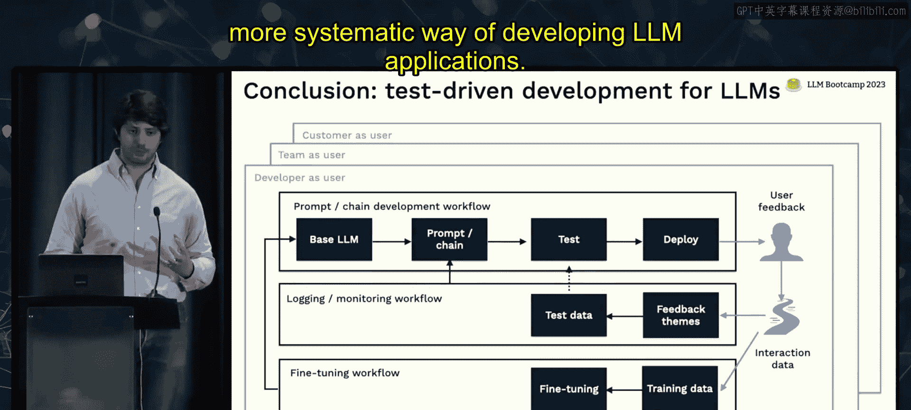

🎼，🎼。🎼，🎼听ち。🎼，🎼。