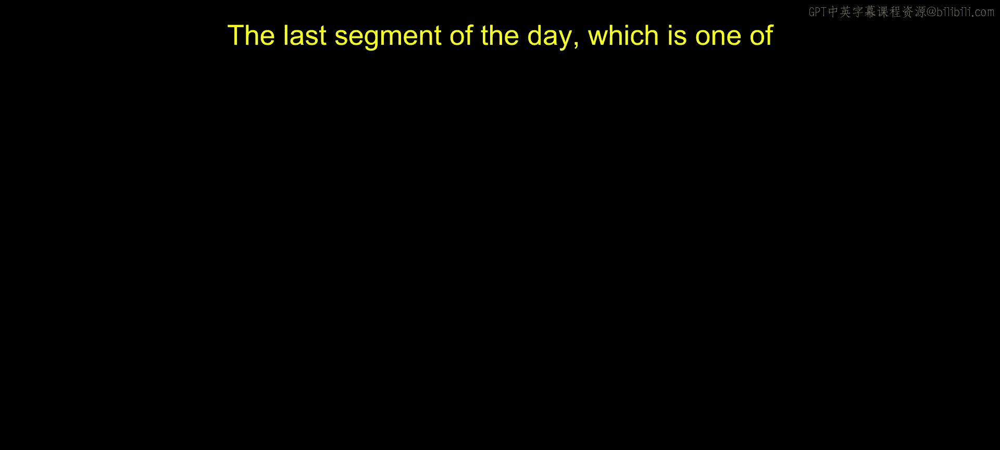
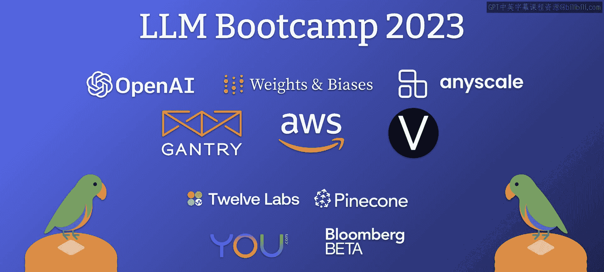

# LLM训练营 - 2023年春季 LLM Bootcamp - Spring 2023 - P9：-09-Peter Welinder - Fireside Chat with OpenAI VP Product (LLM Bootcamp).zh_en - GPT中英字幕课程资源 - BV1Wf421B7mP

The last segment of the day。

It's one of the most exciting we have。Peter Wildinger， the VP of Product and partnerships at Open AI。

And we thought we'd just have a little fireside chat， this feels too loud it？Okay。

I'll just hold it like this。嗯。So we'll definitely open it up to questions from you guys that's that's the most important part here。

 but i'm just going to kick it off and I'm going to ask Peter。诶。

Like how did you get into machine learning， I think is a good question to start。hello ok。

Thanks for having me by the way， super excited to be here， how do you get into machine learning？😊。

I think the first machine learning book I read was back in high school。

The Russells Norwick Art intelligence book， Green。Yes， yes， I wonder if。Was it red when I read it？

I have somebody read about red with screen but you know when I read that I was just very confused about what is our artificial intelligence that wasn't really a machine learning I went on to study physics and then kind of。

In grad school， switched to kind neuroscience。Realized I did not have the patience to do neuroscience。

 it's a lot of really hard work working on of you know real world models animals so ended up kind of focusing on computer vision and that's sort of how it get started in machine learning and that was kind of at the time where computer vision started kind really be starting to be addressed with machine learning so was back in the days of like SVMs and probabilistic models and so on。

What around was that？I was around like 2007，8。I actually have a similar thing because I entered college hoping to major in neurobiology。

 and then I had a research internship or yeah， like a research experience as an undergrad。

And you have to mix all these things and we have to cut these like sea slugs open。

And I was like not for me so I went back to the computer， I had to say where they were。

 I had to you know make a surgery on the rat at some point and I was just like no like。

First it was grass and then like second， one， you know you had to train this rat for a very long time and then the rat would die then your experiment would be completely wasted and it was pretty brutal。

But is it did you want to study neuroscience because of intelligence as like the core interest of the organization Yeah。

 I think like you know， I've definitely always been fascinated by the idea of like getting machines to a point where they can do everything that humans can do and and it kind of seemed obvious that eventually would be able to build machines that can do that but it was like。

You know， no idea how long it would take or you know what the problems were involved。

 but that just seemed like a very kind of this interesting problem。

So when you started working computer vision after you graduated grad school you started a startup right yes I started a startup out of grad school kind of doing more kind of image organization using kind of techniques of the day that were this was kind of pre deep learning this was back in like 2011 this was before like the really amazing kind of。

Imagenet paper and so we started doing that like we actually started since we had in my lab we had a lot of collaborations with biology labs we started with an application that was essentially tracking tracking animals like flies or micetes and so on using computer vision techniques and you know we knew nothing about creating starting companies so we realized very quickly that that market was not really great because grad students doing the same task was cheaper then having these computer radio systems doing it so it was basically no money to be made there so at some point we pivoted to basically building an application that could organize your photos based on based on content so you would like get all your photos of people in one a category photos of your food in one category and this was like right when the iPhone4。

took off and so it was the reason we kind of went into this we saw on Flickr at the time figure it it come if it's still around。

 but you would see like these graphs of how many cameras there would be how many photos per camera and you would see all these advanced cameras the DSLRs and so on and then it would be like iPhone4 which is went from like nothing to kind crush all the other things so suddenly everybody had like an amazing camera in their hands and we kind have predicted that would change everything around photos。

And then the startup quickly got acquired。Yes， we got acquired by Dropbox。

 where Dropbox had kind of we realized beginning the startup that it was quite hard to acquire users and Dropbox had acquired a lot of photos and they had you know it was like you know thinking up most of the space of Dropbox with all these photos that we had no were not indexed at all so we joined Dropbox to basically help build up the Dropbox's first machine learning computer vision team to start just making sense of all the data within Dropbox。

And it was a really fun time because it was just when like deep learning started to take off like all these problems that we thought would take like years to solve something could solve them in like three months or something with deep learning and it was just like kind of quite incredible to see how the whole PO changed like all these techniques that people had been using for like10 years。

 whatever didn't matter anymore， it was all neural networks。

And I remember that led to a pretty cool app right it was like a mobile app Yeah we built this app called carousel I used that I think it was a really fun app to people really love using it eventually we kind of decided I think Dropbox kind of realized that all these photos were costing them a lot of money so then they started kind of deprioritizing that product but it was really fun one we started focusing on other things like just analyzinglicing and all the documents in Dropbox making it easier to search semantically within Dbox and so on so that's what we kind of went through a lot of different applications of machine learning at Dropbox right so you have an academic background as a grad student and then you started focusing on product and your current role is VP of product。

So how was that transition for you from an academic mindset？IntoIs this useful to someone' mine side？

Yeah， so I've always been more interested in that aspect of this technology is like how do we like why are we building this I mean it's just like so it can be useful for all of us and I've sort of always been interested in this interface of like what are the problems that。

People have and what can new technology change around those problems and and I thought that was like you know。

 one of the reasons I really enjoyed the work at dropropbox was this idea of like。

It's that suddenly people had all their files at one place， suddenly。

 but they were really hard to make sense of them， but we had all these amazing techniques in machine learning we could start applying to organize that content。

So I kind of always been interested that while at Dropbox。

 this was also when kind of deep reinforcement learning was starting to take off and I remember kind of actually chatting with Peter Ail at B at the time and kind of learning about all these amazing deep deep reinforcement learning techniques applied to you know everything from Atari to robotics and so on。

 and it seemed like really kind of kind of a good。Ply high chance that these techniques would change the way you would go about robotics so。

II kind of that's what eventually took me to open theI was this idea of like， you know， again。

 how can there's a new technique here， there's a problem out there robotics。

 how can you apply it to that problem？So what brought you to Open Air is that mindset of like how do we make this new stuff useful to people exactly。

 and I think that Open Air was kind of a really interesting company so I joined Open Air Bing like 2000 early 2017 so it was about a year old。

And it， it was just a very interesting company in that it was a small group of people that were just。

Veryry interested in a very hard problem which was kind of AGI generally and had some interesting ideas of how to get there like robotics was like one be there was a number of other bes like you know just deep reinforcement learning applied to games so for robotics was specifically deep reinforcement learning applied to robotics it was like unsupervised learning there was a sense of like if you put these things together somehow we can figure out how to get to AGI and and AGI at the time kind of felt like it was slightly outside of the overturnone window of what was kind of acceptable and it just seemed like a little bit crazy but the people there were just like brilliant and had this like huge ambition so it seemed like just of a pretty good place to go to just see what we can do if we can be really pragmatic and you don't if you care more about the problem you're solving than like publishing is on and you care more about this like。

Everything that goes into everything from the research to engineering。

 like maybe we have a shot that like solving this crazy problem what was your estimate as like when you joined in 2017。

 did you think you would be like AGI would come？In 2022 or like 2030 or you just had no idea I felt like I had no idea it felt like still so uncertain I mean I kind I didn't even know if like oh I it would exist like after with it like a year or two it was a whole new setup right in nonprofit doing this tacking a problem that usually it was done in universities but like yeah it just it felt it felt very uncertain I was definitely kind of quite pessimistic about the timeline but it sort of felt like well who knows maybe maybe there's something here。

Can you talk more about how Open AI as an organization converged on the GPT style AI？

I think all these bets in the。I think it came down to like we tried a lot like all these different bets kind of taught us different things like for example。

 like we one thing we did was creating like a Doda bot that beat the world champions on Do Dota I and you know that was that actually that happened during of his De 2018 I believe。

 because I remember we we had a boot camp in person like this in 2018。2019。

 he were there and the Open A5 was like competing。And we pause the conference anything and like watch it oh well。

Or it was during the lunch break or something， but I remember it was on the screens that was like such a kind of cool project overall like I remember when we started that。

It was a number of things like you know like it was totally unclear whether this would be possible to do like I remember we invited a number of dota players they were like there's absolutely no chance in hell that you can do this because like I spent like 10。

000 hours on it there's so much strategy involved and you know this is completely impossible to solve and and you know in the beginning like there was a lot of like kind of。

Thoughts around like we will need to kind of come up with whole new architectures here。

 whole new kind of deeper like reinforcement learning techniques and so on。

 and I think what was really surprising by that whole project was that。

It was a fairly simple kind of neural network with a fairly with just a standard reinforcement learning argument went top and just。

You know shit ton of data， lots and lots of play out like trajectories and that got you to to kind of human level beyond human level on dota so that was kind of just I think a crazy kind of discovery in itself that was like now it sort of now it feels obvious but it was not at all obvious at the time it was like kind of。

F felt very it was not at all expected that that would happen。 Similarlyly， like， you know。

 we had other project， robotics project where we。Where we had a robotic kind of hand solve ruby scoop and I remember we picked that project also to kind of understand like what would it take to do deep reinforce learning in the real world and the problem again is that you need a lot of data at that point we had started to realize we need a lot of data but could we learn something in simulation and then put it out in the real world based on what we had learned in simulation and was one of those things where we kind we tried to pick the hardest problem we could like we went to a bunch of robot conferences and asked them like what is the hardest project you can think of what are the hardest problems in robotics and people told us like well contact with some object is really hard like manipulation you controlling kind lots of different complex robots like lots of robotic arms is really hard so then we took a hand which is like essentially five robotic arms and we took the rubbyco that seemed like theest something that's really hard for humans to do to manipulate and it seemed。

That's also one of those problems。 which seemed completely impossible when we got started and it was like grinding it for two years。

 and then we managed to do it。 And it kind of taught us again like like。

All these obstacles can sort of be that you think our data can be overcome with fairly simple algorithms and lots of data。

And you know， a similar thing was basically the language models where it started， I think the first。

Path in that territory was like the sentiment neuron with LSDM back in 2017 or something then it was like G1 and2 and and I think with GP3 we had started like that's where we started feeling like okay here here we have something that is now much more general like it can do it was almost a state of the art at a number of tasks that you needed specialized neural networks for it seemed like it was useful。

 we knew that we could apply deep reinforcement learning on top of it we had learned how to apply how to use reinforcement deep reinforcement learning really really well。

 we knew that we could scale these things further。 So at that point like we had this validated that that。

You know we also realized that pushing robotics or like gameplay wouldn't teach us very much more。

 were a lot of obstacles that more obstacles we would need to overcome that wasn't necessarily aligned with getting to AGI。

And deep with these language models we felt like， okay， this is a place where there's like utility。

 there's like there's scaling loss， this is like where we can really push it so then we basically based on that consolidated a lot of opening out can put it behind that be。

And with your product hat on。How did you think about？Tur it into a product。

 I guess what you eventually released that at as is an API right， not a specific vertical product。

 but as a pretty general API and then。Can you talk about that decision and like what you learned from that I mean。

 this is was really interesting because。I think。Usually the worst way to create a company or a product is like。

 you know， you have a like a solution looking for a problem。

 That's like a terrible way to start start start to start any any product。 and we were just。

We you know。We had talked about the number of different applications we could do like we could like maybe we should use this to create like the world's best translation system or a really good writing assistant or you know we were talking about chatbot all the way back then and we just couldn't make up our mind and I think it was like actually it it was John Schulman。

 who was also the inventor of a lot of these algorithms who was like let's just do an API because we can't decide which of all these ideas we want to do and let's just have have people actually other people build figure out what products can be built on top of it and so that's kind of what we set out to do like we had D3 but we just didn't know if it was useful so we went out and talked to like hundreds of companies where we were building the API and remember like the first version of the API was like extremely slow to do infencing like it was like a second per word that like everywhere like this is never going。

This is terrible I think during the course of like three months we improved like latency by like 100 x or something like that。

 you know it was a ton of work that went into it during that time we went out to like demo it for companies and so on and like probably hundreds of companies we talked to and like you know pretty much all of them were like。

😊，This is a cool demo， but I have no idea how we're going to use it， it doesn't make sense。

 but then we managed to kind of escape together like you know10 large partners or something thing and then get it out and but when we launched we were still not short like is really does anybody really want this？

And。I'm going to skip ahead to chat GP， I think。 So when that came out， did you。

What were your expectations for it？And how you know what was the reality I guess yeah so that was really interesting because like as I said like we had been thinking about a chatbot like we were actually thinking about a chatbot demo with the first API release at the same time we just felt like we just no way to live about these models and we probably if we create a chatpo with this at this point like will just embarrass us like we had all seen like Microsoft like the Twitter Microsoft chatbo that that people turned into a Nazi and we were like this is just like this is dangerous territories we decide like we were like I think before the API we release API even。

Within five days of the APIR release， we were like。Yeah。

 we were planning on doing it we kind of abandon that idea and all the way back in 2020 you were about to Yeah we were thinking about doing it at the time。

But so then， what we ended up。But we felt like the technology wasn't quite there。

 we hadn't really validated a lot of like the reinforcement learning from human feedback and stuff like that yet。

 like that was like ongoing research at the time at OpenAI。So then。

one thing that happened that was quite interesting with the API was that this is a developer focused product。

 there were like millions of people who signed up for it。

And but we saw that the vast majority of people signed up for the API they had no intent of actually building an application They just went to the playground and then we asked them like what are you doing in the playground They was like well I use it as my startup advisor or like you know I can't afford a therapist so then I talked to the playground or you know I sometimes put in a long article there and summarized it so like people just used the playground for all these things we like this is a terrible product for these people that just to kind just work with the playground and so we kind of knew like we have to we have to do something better here for all these people like there's clear demand for something that's better we had also kind of a separate project that was kind this was we had also developed this like instruction following technique where was easier to prompt models but given them instructions but we knew that the next step would need to be conversational we had an ongoing part around that as well so so we thought okay so let's let's try I think we're now ready to create kind of a chatbot。

we tried it out with a kind of I think a few thousand users like a small experiment。

 it wasn't actually very successful like we didn't get a high retention on that first group of users。

 we made some changes to the model and then we were like well like the only way to learn at this point is to get it out in the world I think you know so we decided that we would release chatTBT。

And we were。Quite， you know， there was a lot of kind of guesses， you know。

 I think some people thought it would be a complete flop。 It's not going to work。 People were like。

 okay， some people were like this is going to you know we're just doing another Microsoft today。

 we're just going be completely embarrassed probably we'll have to shut it down in a week because it says some terrible things and but then you know I think we're allocated sort of。

WeWe plan for okay， it should， it should be able to kind of scale to like a few hundred thousand users。

 That's probably what we'll get。And then we released it and then I think like within a week or something。

 we had like a million users on it and it was just like it just when it it was just completely crazy since then and it was like four months of just fightinging fires。

 scaling systems， finding scraping together GPUs from across everywhere。

 you know it's been pretty wild。What have you been most surprised by in how users have like started using it？

Yes， this is also really interesting。Another hypothesis we had。

 and like as we were kind discussing this a lot internally was like， well。You know， we were like。

 this might not be ready because it feels a little bit like it's okay so so at a lot of things。

 but not really great at anything was a little bit that we were worried about。

And I think what we saw when people started using it was that people actually found it to be great for lots of different use cases。

 and it wasn't just one use case that people ended up using it for。 but like tons of different ones。

 And we just saw that for every user we talked to like they didn't have one use case。

 they had like five or 10 different use case that they came back to over and over and over again and usually they had started with one thing like you know just asking about some topic they wanted to learn more about。

 but then really as they could kind of you know summarize things and on。

 So they started just learning about more and more ways to apply it in their workflows。

 And I think that was kind of surprising just how well it worked for so many different things。

 we sort of suspected that this would happen。We felt fairly confident that this would happen with DPT4。

 but we weren't entirely sure if it was good enough with DPT 3。5。That's interesting。

And one thing I've observed is。That's been surprising to me is how fast like large incumbents have been to adopt this kind of chat technology。

Like intercom and。I think salesfor like all these companies are very quick to integrate sometimes partnering with you sometimes on their own is that partially because you've been pushing for it or is it more of a pull from them it's definitely a pull like this I think I think the。

The big update。Is that， I think。What chat with。Kind of just become became incredibly kind of just good product marketing in some sense for what this technology can do like before you had to kind of explain like what is a language model。

 what can it do， like how is it useful for you and so on now everybody could just try it and they could see it like you know everybody in their grandmother was doing it It like kind of pretty incredible right and and so you didn't need to explain anything everybody were like。

 well， why it seems that this thing seems like it could fit really well into my product And I think you know。

 company started started to realize that。If I don't do this I will fall behind I think it's just created a lot of kind of just FO quite frankly and like both foO and opportunities in some sense like it's very clear that this like you could get a sense of how reliable it was or anybody's trying it so it wasn't like just like some snake oil or the kind of demo anymore like everybody could try it and get a sense of it and then get the appeal like this is actually worth investing in。

So one thing that's。I have trouble disentangling as like。Gious what do you think。

 what percentage would you assign to the UX of the chat interface versus the improved capabilities of the model？

Because like you're saying， some of this tech has been kind of out longer than it seems， right。

 but it really reached this critical mass with the Chagi PT least。

 do you think that's because of the UX largely or did the underlying tech actually change as well？

I think there's， I think it's。I think it's the UX like the dialogue based did matter like you kind of want to go back and forth it's a very natural way like like that's how we all humans are trained in some sense。

 if you do something wrong， you can just like。Do a follow up thing like hey。

 you know whats you know summarize this article as like you know summarizes it and like no。

 I want to summarize in like two sentences， not like a whole paragraph or whatever and so it's a very natural way to kind of go about things but I think that but you could sort of already do that in our playground in fact like with the instructor models you could you could actually do those kind of back and forth and it worked pretty well。

But I think the other thing was just the availability， you know。

 we made this like we just made it so anybody could sign up and you know in practice that meant like you know the server that we had these fail wh up all the time it was like but like anybody could like just go and sign up and try it and it was free and I think that was really the thing that that was different to be honest。

Okay last question for me then we're opening it up but so when you joined in 2017 you didn't have an expectation for like AGI one question but what's your take now are we there now or do you think it's next year Yeah you know I got to say like I feel like very uncertained of this one I feel like there's some probability that I feel like it feels fairly likely that we will have something kind of at or close to AGI by the end of this decade and when I say AGI here。

 what I usually usually the way I define it is like it's kind of an autonomous of AI system that can do economically useful work at the level of humans or beyond so like imagine like basically an AI all the things that you can do at a computer if the AI can do that then it's going to be you know the pandemic showed us like autonomy work can be done from a computer and it's very economically。

Useful， if we can do that sort of work， then we're probably there。 And I thinks there's probably。

 I feel like now I start to feel like it's probably。

wouldn I would not be surprised if it happened by the end of the decade。

 but I also feel like you know maybe maybe a few years from now we look back and we say we had AJI already with GT4 or something like that。

 you know it's just like we just hadn't figured out how to put all the pieces together。

 you know if you look at some of the things like autoGBT and so on you're like this is pretty crazy。

Okay， well， let's open up to questions。Okay， well we're at time， so thank you， Peter。

 thanks for these questions， thanks for having me。🎼，🎼，🎼。

🎼。