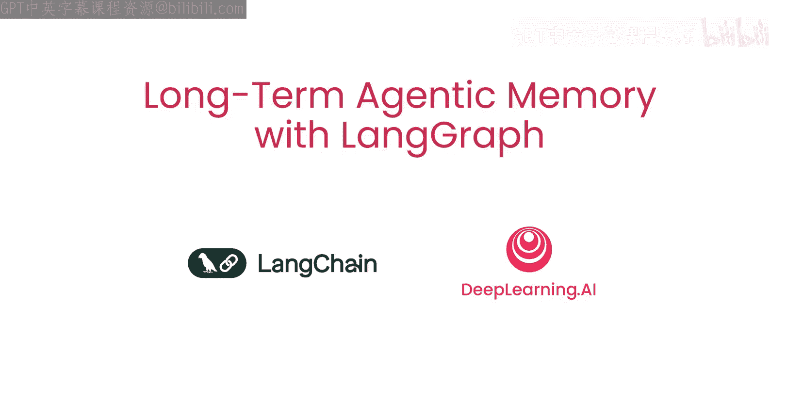
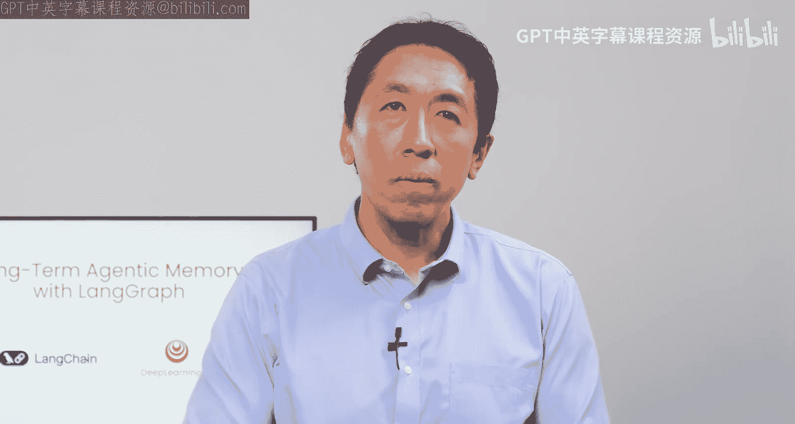
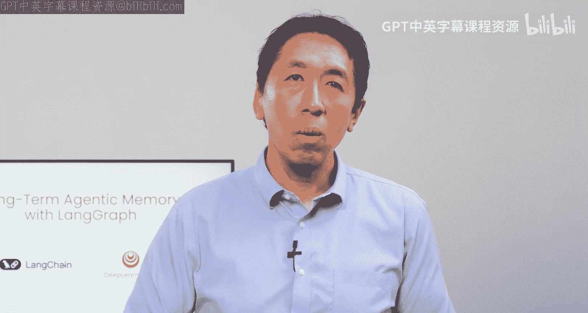
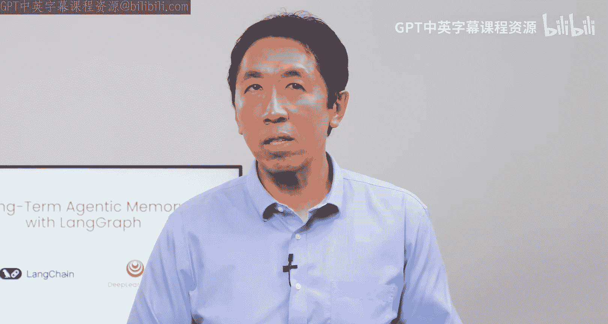
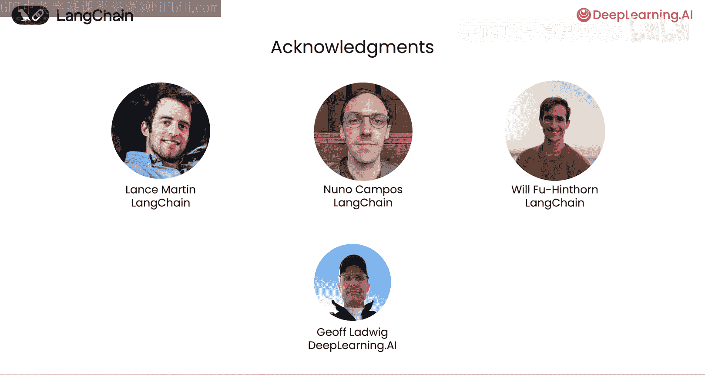

# LangChain《使用 LangGraph 构建具备长期记忆的自主智能体Long-Term Agentic Memory with LangGraph》 - P1：1.introduction.zh_en - GPT中英字幕课程资源 - BV16oQhYdEjF

Welcome to long term agent memory with Langgraft built in partnership with Langchain。

 I'm delight to the welcome back Harrison Chase， co foundunder N Langchain。 Thanks， Andrew。

  recently， we've seen many agent applications being built。

 And this has helped us to develop a mental framework that is useful to think about for when you're adding memory to agents。

 We would like to share that with learners。 More and more AI applications persist over time。

 And this really drives the need for agent memory。 An example would be an AI personal assistant。

 Exact， Ass are a great example， the more they learn the better they are at future tasks。

 to add memory to an agent， you must first figure out what information to store in long term memory。

 And also， when it comes time to use the information what to retrieve。😊，First us on what to store。😊。

Chatbos initially just saw a conversational history in the context memory at each turn of a conversation。

 but agents that act for you over time need long term memory。 For example。

 a calendar agent might need to persist information about meetings over long periods and across multiple implications of the agent。

Then comes retrieval。 Retrieval will take information for memory and insert it into the context。

 Harrison will show you how to figure out when and what to retrieve。 And additionally。

 we also needs to decide when to update these stored information So should it be updated through each iteration of an agent loop or maybe in the background of its time。

 right， to address these questions weve found that is useful to think about three types of memories。

 semantic memories。 These are facts like important birthdays for a calendar agent。

 next is episodic memories。 These are experiences that can help an agent remember how to do tasks。

 And finally， there's procedural memories， which are rules for an agent to follow to help manage memory we've created a new library laying them that supports a vector database that provides searchable。

 shareable， persistent storage that can be updated immediately by the agent or in the background by a helper agent in this course。

 you'll build a useful email assistant。😊。

That demonstrates all of these concepts using Lm。Several people have worked to trade this course。

 I'd like to thank from Langchain， Lance Martin， Wil Fu Hinphonn and Nnocompos and from Dilanta AI Jeff Ludwig。

 All right， let's get started on the first lesson。

