# LangChain《使用 LangGraph 构建具备长期记忆的自主智能体Long-Term Agentic Memory with LangGraph》 - P2：2.introduction-to-agent-memory.zh_en - GPT中英字幕课程资源 - BV16oQhYdEjF

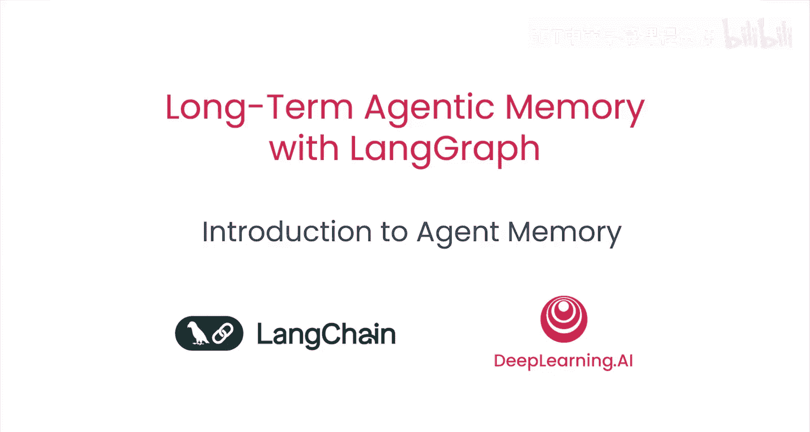

We surveyed developers a few months ago， asking which tasks they thought Asians were best suited to perform today。

The second most answered one was personal assistance and productivity tasks。

One core aspect of these tasks is memory， specifically long term memory。

Think about working with a human assistant who is serving as a personal assistant of sorts。

If they forgot all their conversations with you and didn't remember things that you told them previously。

 that would be a pretty bad experience， and the same goes for agents。

So memory is a key part of these types of tasks， and so when we think about an example through which to introduce memory。

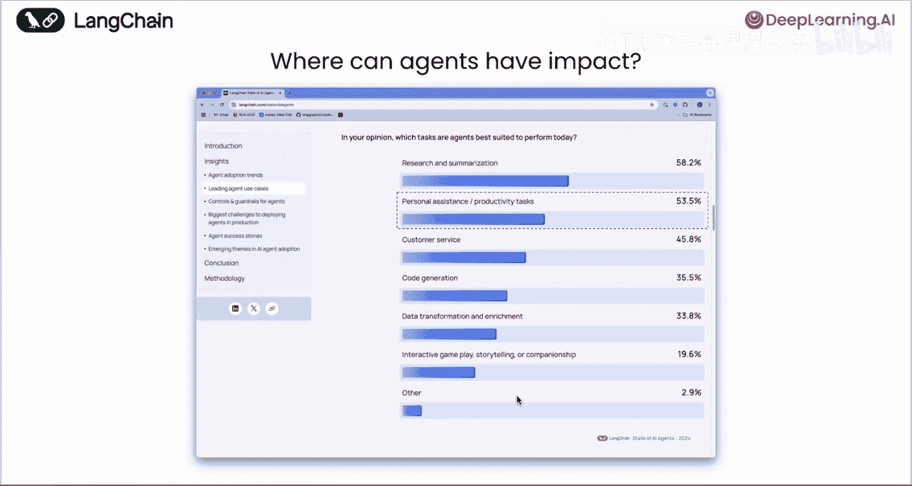

A task of this nature is a great fit。그。One example of a task like this is an email agent。

So email is something that we all have and we all have to deal with and as you get busier and busier。

 you may have more and more emails popping up that you just don't have time to look at or respond to and this is perfect for an agent to come in。

If we think about what an agent would need to do this job well。

 it's probably pretty similar to what an executive assistant might need to do this job well。

 they might need calendar to check your calendar to see where you're free。

 and they might need access to writing emails on your behalf or in response to other emails。

 and so when we think about building an agent， we can think about giving them access to these types of tools。

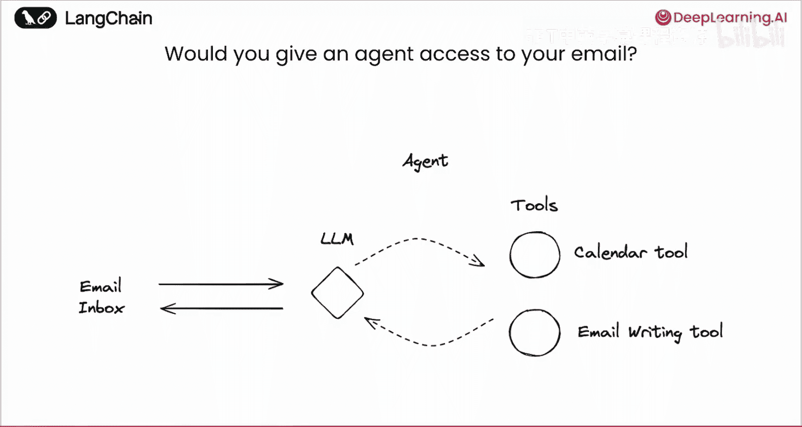

Yeah。And an agent like this has a lot of places where memory becomes really important。

First step is looking at all the emails and deciding，Should I ignore this， should I respond to this？

If it does decide to respond to it and decides to use the calendar or email tool。

 it needs to know what is the person's meeting preferences， both in terms of time。

 but also location and title。And then if it decides to write an email and you to， know。

 what is this person's tone， what is their style？And then there might also be interactions with people that they've had previously。

 this is important context to be able to know to respond to。

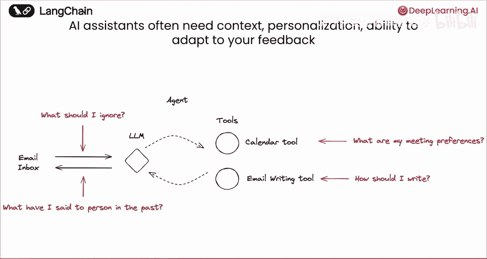

And so this email assistant is a great place to show off。What LLMs and memory can do together。

And so we're going to use it as a proving ground for talking about three different types of memory for AI agents。

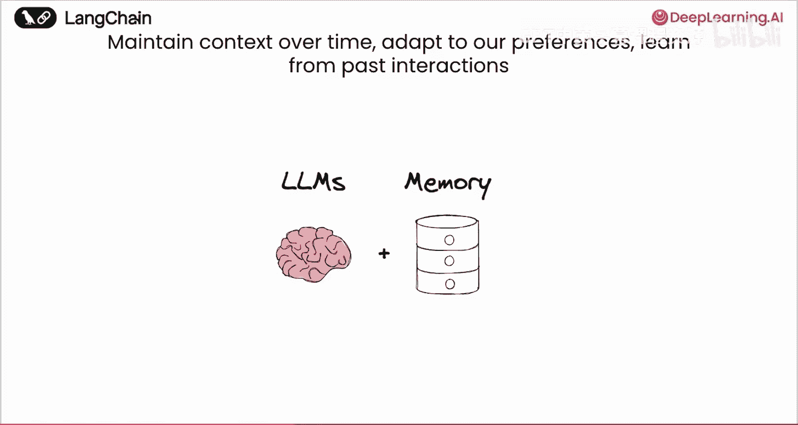

So first is semantic memory。So what is semantic memory？It's basically facts。

If we think about semantic memory in humans， it's things that you've learned。

 facts that you've learned in school by reading a textbook that you remember from previous interactions all these kind of like facts based type of memory。

A second type of memory is episodic memory。 This is experience as this is calls backs to exact conversations that you've had。

It's not necessarily facts about these conversations。

 It's just the memory of this conversation itself， the memory of going to Disneyland。

 something like that。And the third type of memory is procedural memory。

These are kind of like instructions for yourself or instincts or motor skills。

 how to ride a bike or instructions that you give yourself for how to respond to emails， for example。

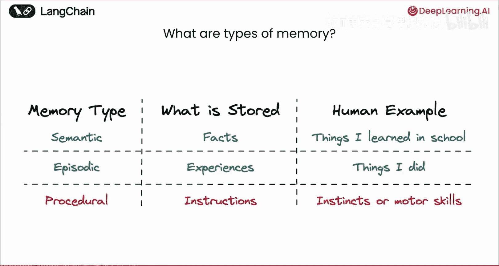

How do we map these onto agents？So for semantic memory。

These might be facts about a user or about people place things that the agent has interacted with。

For episodic， this might be past agent actions， So in the form a few shot examples。

 So actual literal kind of like trajectories of what have happened before。And then from procedural。

 this is maybe the most straightforward。 This is a system prompt。

 the instructions that you give the agent on how to behave。

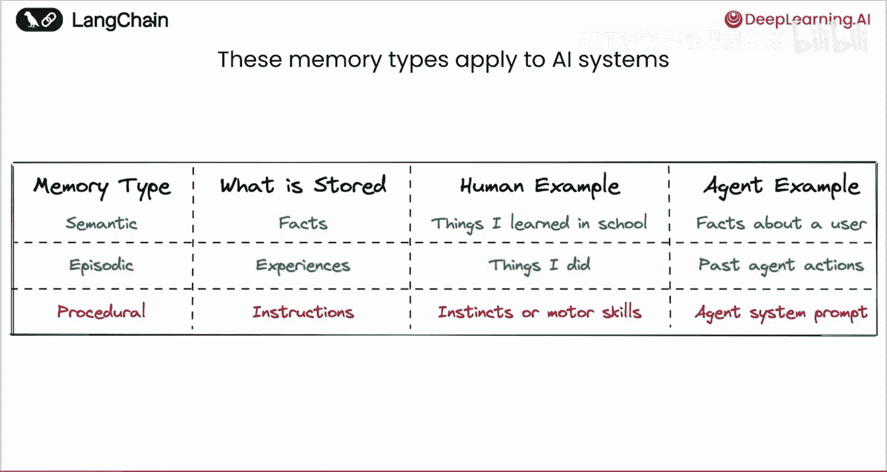

Besides these three types of memories， it's also worth calling out the different ways that these agents can interact with these memories。

So there's two different paradigms that we see one is generally in the hot path。

 so this is where the agent updates memories。As it's responding to the user， so it's all in one go。

A separate type is when the updates of the memory happen in the background or in a separate process。

There's pros and cons to each of these。 When you update things in the hot path。

 you generally just have one agent。 and so that's simpler to maintain。

 and the updates often happen instantaneously。However。

 the downside is that you now have this agent that has to do both these things that has to update memories and respond to users。

 so it's more complicated and it also adds an additional latency when responding to the user。

And the background has the flip。So now you can separate the update of memory from the agent's core。

Things that it needs to do so it's simpler。And you remove the updating from the hot pass so it actually responds faster。

The issue is that now you have two agents instead of one， so that's more complicated。

And the updates might not happen instantaneously， they might only happen when the updating memory gets kicked off。

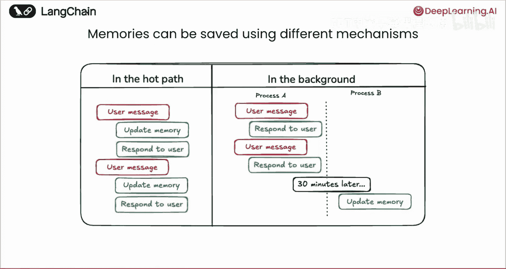

So in this course， we are going to apply these memory types to an email agent。

So we're going to start with a basic email agent that first triages the incoming emails。

 and if it's worth responding to， it passes it on to a second agent which uses a calendar tool and a writing tool to respond to the email。

The first type of memory that we're going to add in is semantic memory。

And so we're going to do this by giving this agent that's responding to emails。😊，More tools。

 tools for writing， memories and tools for reading memories。Yeah。

The agents going to use these tools in the hot path。

 so as it's looping and as it's calling the calendar or writing the email。

 it's going to be writing memories and retrieving memories。

So this is semantic memory in the hot path and we're doing this by giving the agent a tool。

Then we're going to add episodic memory。So this is in the form of few shot examples that are going to be in the triage step。

So here we're going to have few shot examples。That correspond to emails and then it's also going to have what we want the triage result to be so whether it should be ignored or notified or responded to。

And so these are going to be inserted into the prompt right here。

We're going to add these examples in a separate process， so this is an example of episodic memory。

Where the updates happen in the background。And finally， we're going to add in procedural memory。

 So these are the prompts themselves， or rather parts of the prompts with instructions for how to use different tools or how to triage things。

We are going to update this in the background as well。

And we're actually going to use a separate agent to do the updates。

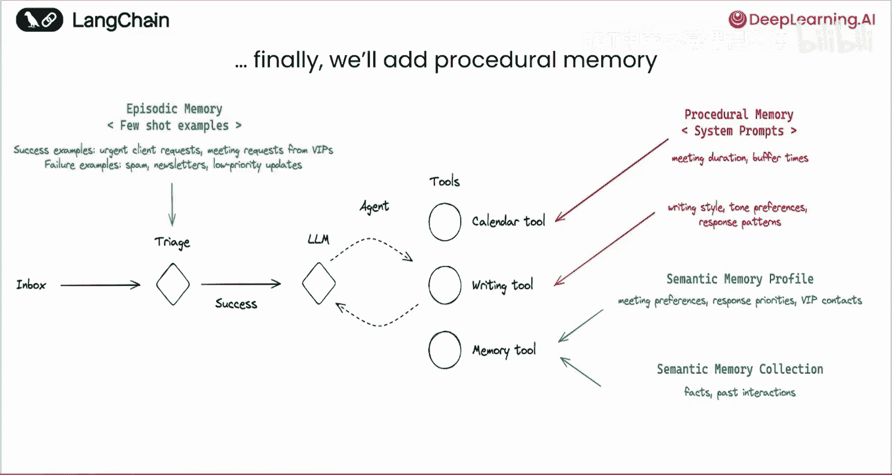

Although we're working with a very specific email agent which we're going to build in lesson two。

The techniques for managing agent memory that you learn here will be applicable to any agents that you build in the future。

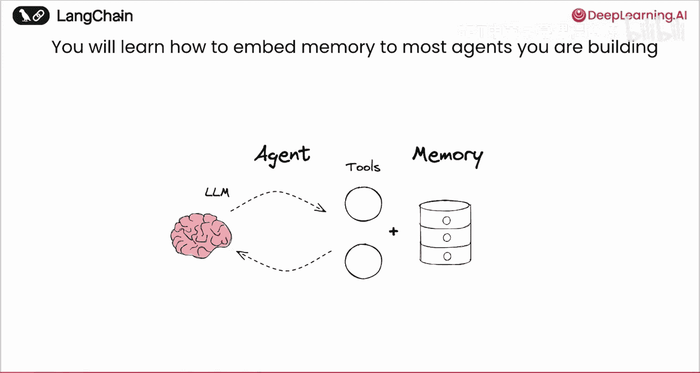

You'll want to think carefully about what types of memories your agent needs。

 does it need to learn better instructions， okay， maybe that's procedural。

Do you want to give it few short examples because you think that will help really guide its actions。

 Okay， that's episodic。Does it just need to know facts about people place and things， Okay。

 that's semantic。 It all kind of depends on the application that you're building。With that。

 let's jump to the next lesson and learn how to build this baseline email agent。

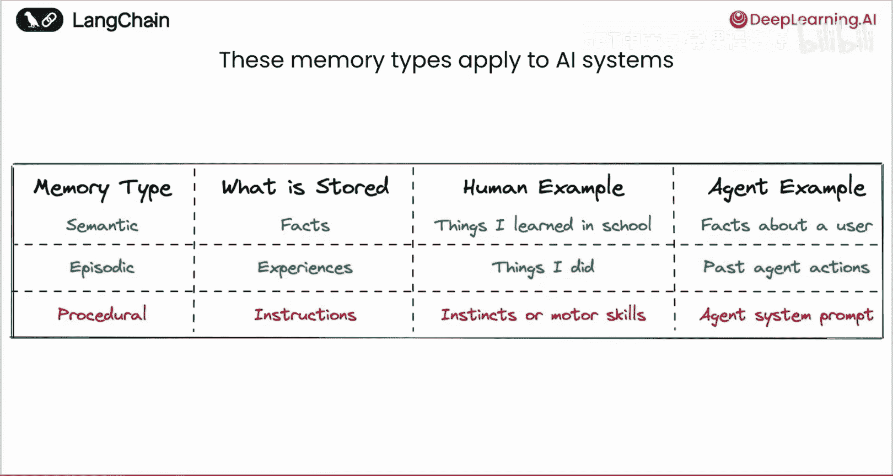