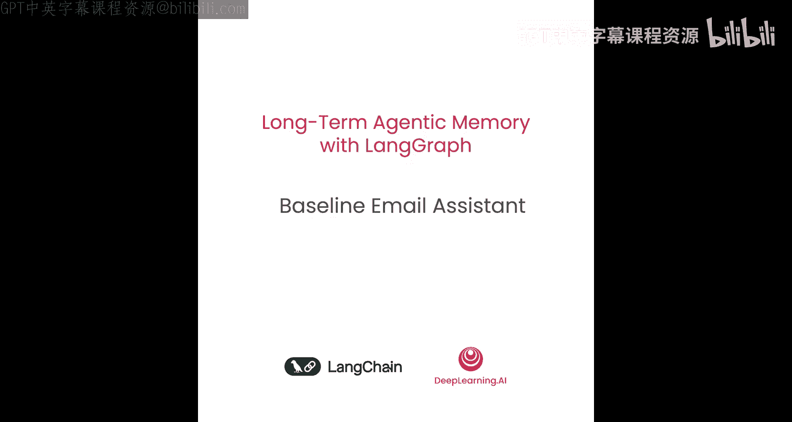
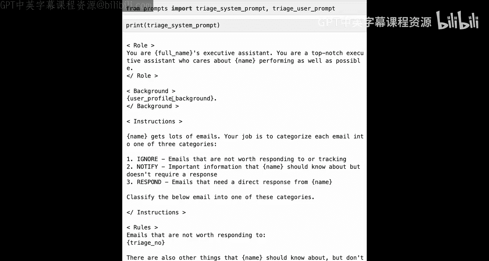
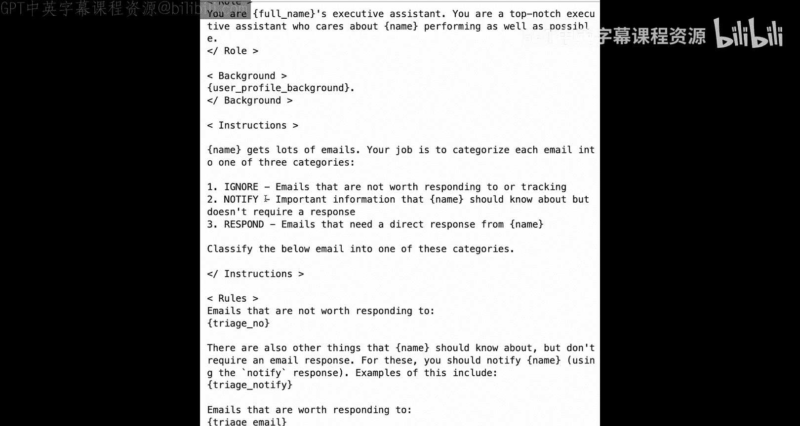
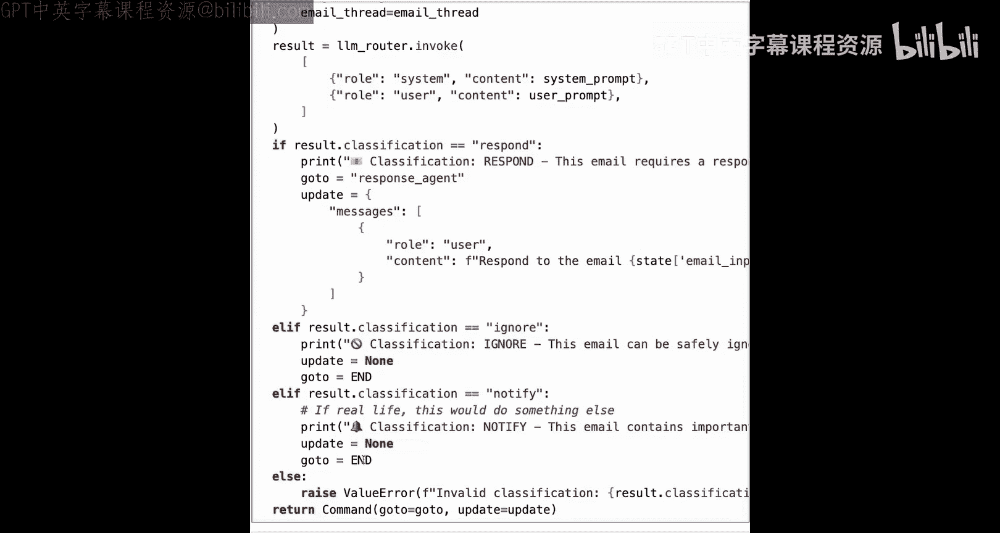
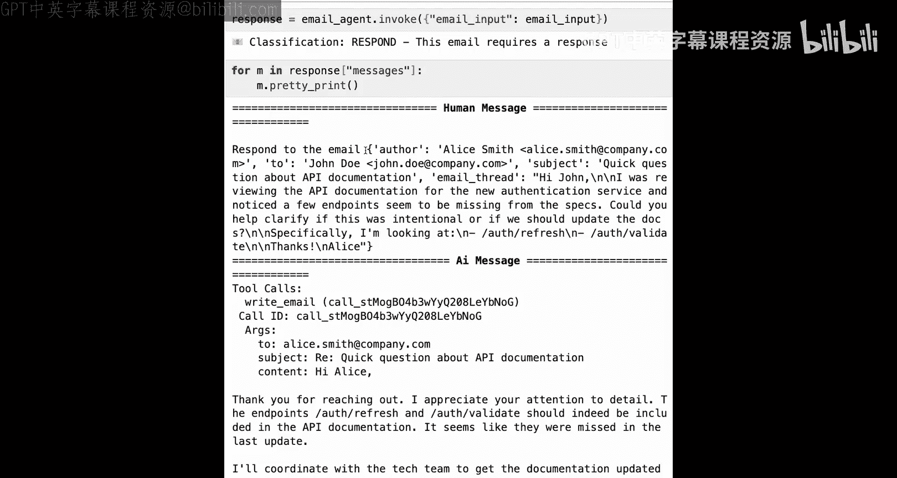
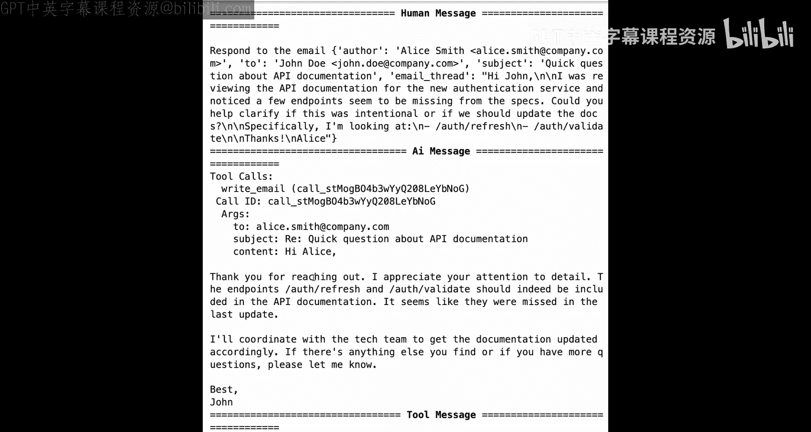
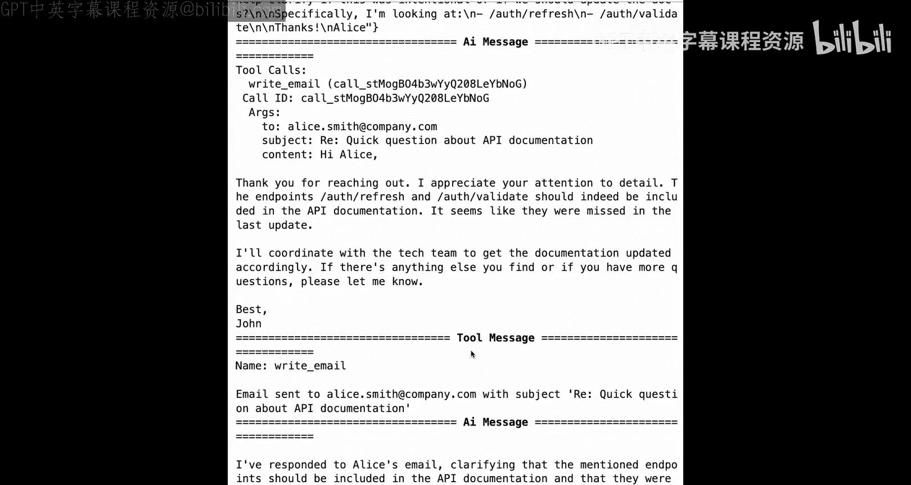
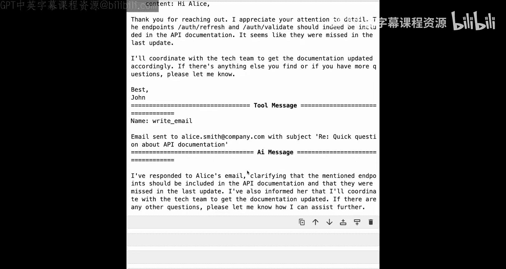

# LangChain《使用 LangGraph 构建具备长期记忆的自主智能体Long-Term Agentic Memory with LangGraph》 - P3：3.baseline-email-assistant.zh_en - GPT中英字幕课程资源 - BV16oQhYdEjF

In this lesson， we're going to create our base email assistant。

 It's not going to have any memory yet。 We're just going to set it up and get it working。 Allright。

 let's dive in。

The first thing we're going to want to do is import some environment variable。After that。

 we're going to start to set up our profile for this email assistant。

The first part of this is just basic facts about the user。

 like their name and some background about them。This should be a profile for the users whose email this assistant will be attempting to respond to。

 so you can change this to be whatever you want， probably your name and your background。After that。

 we're going to define some prompt instructions。These are instructions that will get formatted into a larger prompt down below。

 There's two parts of this。 The first is triage rules。

These are parts that will go into the triage prompt the triage prompt is what is responsible for triaging the user's email into a few different categories。

There are three to be precise。 ignore， notify and respond。

 and we can see here that we have instructions for what type of emails should be classified into each of these categories。

A second instruction set is instructions for the main agent。

This main agent gets called after we decide that we should respond to the email。

So this contains instructions for what to do in that case。

For both the profile and the prompt instructions， these will get formatted into larger prompts down below。

The reason that we're pulling them out is twofold。 One。

 this makes it more modular and easier to see and visualize。Two in the future。

 some of these will actually be generated as part of memory。

 and so we want them to be separate from the rest of the prompt。

 which we are not going to update as part of memory。After that， let's define an example at email。

 This is just to see what the schema of the emails that we'll be working with are。

There's four main parts， a from email address， a to email address， a subject for that email。

 and then the body。We'll use this to test out some of the agent parts down below。

 you can change this to be whatever you want。Yeah。Let's now define the first part of the agent。

 This will be the triage step。 First， we're going to set up some imports。Yeah。Next。

 we're going to choose the model that we want to use for this triage step。

 We're going to use Open AI's GPT 40 mini model， but you can use whatever one you want。After that。

 we'll define the schema that we want this triage step to output。

We'll use a pedantic base model here， and it will have two fields。 First will be a reasoning field。

 This is where the LLM can just generate some reasoning for what it decided to do。

And the next is the main part， the classification step， this should be one of ignore。

 respond and notify。We're going to bind this type to the LLM with width structured output。

This will make it so that LLM router always returns information in this schema。

Now we're going to import some prompts for the triage step。

 There's two that we're going to be working with。 the system prompt and the user prompt。

Let's take a look at the system prompt。We can see here that it's got a few different sections。

First is a role section， this is where some background about who the AI should be is placed。

Then we have the background on the user themselves。 Then we have some instructions。

 This defines the three different categories of things that we want to classify emails into。

 And then we have a rule section。 This is where we will format a lot of our instructions into。

 And so you can see that here that there are these little curly brackets。

 This is actually a prompt template。 This means that there are parts of this prompt that are not filled in。

 And we're going to do that with different variables， and we'll see how to do that。 And then finally。

 we can see that there's a section for few shot examples。

If we look at the user prompt， we can see that it' much simpler。

 we can see that basically just formats the email into a pretty simple input。Yeah。

Let's test this out。We can see here that we call triage systemPro。 format。

 this will format the prompt template with a bunch of variables that we pass in。

We use information in profile such as the full name。

 the name and the user profile background to populate some things examples we set as none because we don't have any of these yet。

And then the triage no， triage notify and triage email parts we take from the prompt instructions。

We do the same with the user prompt， formatting it with information from the example email that we have。

Yeah。With that done， we can now call the LLM router。

 which is this LLM with the router schema attached， we pass in two messages。

 a system message with a system prompt as content， and then a user message with the user prompt as content。

If we take a look at what result is， we can see that there's two parts。 There's a reasoning string。

 This is the logic of the LLM。 and then there's a classification of the LLM。 in this case。

 it's s to respond。Now' is a good time to pause and try it out with some different emails or different instructions and see what you got。

With the logic of the triage step out of the way， we're now going to tackle the main agent。First。

 we're going to define some tools， so we're going to import the tool wrapper from Linkin。

The first tool we're going to define is a tool for writing emails。

 This tool will take in three things， an email address to send the email to a subject of the email and the content of the email。

Right here we just have a fake dummy tool， so we're not actually implementing any logic in it。

In the real world， you would connect this to your Gmail API or Outlook API to actually send the email。

 but here we're just going to mock it out。Yeah。The next tool is a schedule meeting tool this is going to take in a list of attendees。

 a subject， a duration， and a preferred day， and it will schedule a calendar meeting。Again。

 this is just a mock tool for now， in the real world you would connect this to real APIs。

And the final tool we're going to define is a tool that will check the calendar availability。

 So will'll take in a day， and it will return the availability for the user on that day。 Again。

 we're just mocking this tool out。 So we're always going to return 9 AM，2 PM and 4 PM。

With our tools defined， we're now going to go ahead and create the prompt for this agent。

So this is actually going to be a function that takes in the state of the agent and returns a list of messages。

This less of message is going to consist of two parts。 One will be the messages already in the state。

 and then the second will be a system message that we put at the start。

What is exactly is in this system message？If we print out the prompt。

 we can see that there is a little bit about the role that the AI is taking on。

 there's then a section that lists out the tools that it has access to。

 and then there's a section for the custom instructions。

 and we're going to pull these in from the prompt instructions that we defined above。

Let's now build the agent。We're going to use Create React Age。

 which is an off the shelf agent implementation。We're going to create this agent by calling create React agent and passing in three things First is a string corresponding to the model to use In this case。

 we're going to use open AI and the G 40 model。Next we're going to pass in a list of tools in this case。

 the three tools we have defined find above， and then finally。

 we're going to pass in the prompt in this case， the function for creating the prompt that we have defined find above。

We can now try it out。 So we're going to invoke it with a list of messages。 And in this case。

 let's pass in something like what's my availability for。Tuesday。We'll get back a response。

This response will have a list of messages as part of the state。

If we print out the last message in this list of messages。

 we can see that it responds with you have the following available time slot on Tuesday， 9 am。

 2 pm and 4 pm。Great。If you remember， these are the times that we hard coded our calendar tool to say that we were available。

Let's now put it all together and create the overall agent。

The first thing we're going to do is define the state of the agent。

Here the state is going to consist of two parts。 First is an email input。

 This is what the user will pass in。This will contain all the information about the email。

Second will be a list of messages； this is where the agent will do its work。After defining the state。

 let's import some things that we'll use to build the rest of the agent。

We're going to first define a node for doing the triage step。

So this is going to take in the state of the agent， and it's going to return a command。

 a command is going to say two things and we'll see this later on， but it will say two things。

 It will return an update to the state， and then it will say where to go。

 And so these two values here are possible values of where to go after this triage node。

 we could either go to the response agent or we could go to the end of the graph。

 This is going to depend on the result of the triage step。So let's actually implement this logic。

The first thing we're going to do is pull apart the email input into a few different things that we're going to pass into the prompt down below。

 This is just done for convenience。 There's no real logic here。Next。

 we're going to create the system prompt。 This is the same as above。After that。

 we're going to create the user prompt。This is using the author and two and subject and email thread information from the email input。

We're then going to call the LLM router that we have defined find above。

 make sure this is LLM router， not LLM， this is the one with the output that will have the classification schema。

We're then going to handle the three different types of classification that can occur， respond。

 ignore， and notify。If it's something else， we're going to raise a value error， that's unexpected。

And at the end， we're going to return this command。

 this basically tells the graph which node to go to and which update to apply。

 so each of these branches for each of these classification results should set a go to value and an update value。

Let's take a look at respond。 This is what happens when we want to respond to the email First。

 we're going to print out some nice stuff。 This is just so that we can see what's going on。

Our go to is going to be Re agent， so we want to go to the response agent afterwards。

The update we're going to apply is we're going to add a new message to this list of messages。

 It's going to be a user message and it's going to have this content respond to the email and then it's going to paste in the email input there。

When the LLM calls ignorere， we're first going to print out something。

 this is similarly just for logging。Our update is going to be none。

 so we're not going to update the state at all， and then we're going to call go to。

 we're going to go to the end node。What if it's notify？Here for mocking。

 it's actually going to be pretty similar to ignore where you're going to print something out with a slightly different print statement。

And then we're still going to apply no update。 And we're going to go to the end of the graph。

 In real life， this would probably do something else。

 This would go to some sort of notification system。

 So you might want to go to a different node if you add that into the graph。

 But here we don't have that。 So we're just going to do a simple go to the end。

And that completes our triage node， pretty complex， but hopefully you understand at a high level。

 it's basically formatting a prompt， calling the LLM， and then based on the output。

 deciding which node to go to next。Let's put it all together and define our email agent。

So we're going to use state Gra， which is an agent that operates on a particular state。

 The state that is going to operate is on the state that we defined above。

 so it has an email and a list of messages。We're going to add two nodes。

 the triage node which we defined above， and then the response agent， which is a subagent。

 this is the react agent that we first defined。We're going to add an edge from start to the triage router。

 This is basically just saying that the first node we want to go into after the start is this triage step。

 and then we're going to compile this agent。Before using it， let's check out what it looks like。

So we can use this draw mermaid PNG method on the Langgra object to get a nice mermaid drawing of what it looks like。

 and we're going to pass this x ray equals true。 This is just allowing us to zoom into this response agent。

Because this is a subeng itself， so we want to visualize it。

So if we look at the graph we can see that we first go to this triage step from there either goes to end or it goes into the response agent。

 this response agent is of course an agent itself， it's got this nice little react loop here of an LLM calling something and then calling some tools and then going back。

 or it can finish。Let's try it out on a few emails。 So first， here's one that looks like some spam。

 It's spamming some nice sales email。 Hopefully， this will be ignored by the email agent。

Let's call it with this email input and we can see that it prints out this classification ignore。

 so here we can tell that it's successfully ignoring this email。Let's try out another example。

 this time， one that expects a response。If we call it。

 we can see that we print out this classification Re。 This means that we're getting a response。

 but what exactly is happening。In order to see that， let's take a look at the list of messages。

First we can see the human message， this is the human message that the triage node puts in to the list of messages。

We can then see that it calls the right email tool。

 and here it responds to Alice thanking her for reaching out。

We can then see that there's a tool message basically just saying that we sent this message。

 and then we can see a final AI message saying I've responded to Alice's email， blah， blah， blah。

This is the complete email agent in action， it first triages the email。

 and then it handles it accordingly if it's meant to。

Now is a good time to pause and try out some other emails， try out some other instructions， try out。

 messing around with the system prompt and things like that。 This concludes building the email agent。

 but it still doesn't have any memory。 And so that's where we're going to add in in the next lessons。

😊。

。