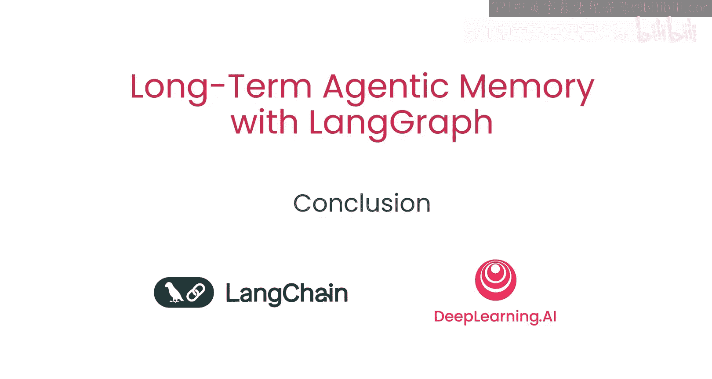

# LangChain《使用 LangGraph 构建具备长期记忆的自主智能体Long-Term Agentic Memory with LangGraph》 - P7：7.conclusion.zh_en - GPT中英字幕课程资源 - BV16oQhYdEjF

Congratulations， you're now equipped to add memory to your agents。

 You've learned to categorize memory as semantic， episodic or procedural。

And you're ready to do memory operations in the hot path or in the background。

 where information can be consolidated later without impacting latency。

I'm looking forward to seeing how you use memory in your future project。

