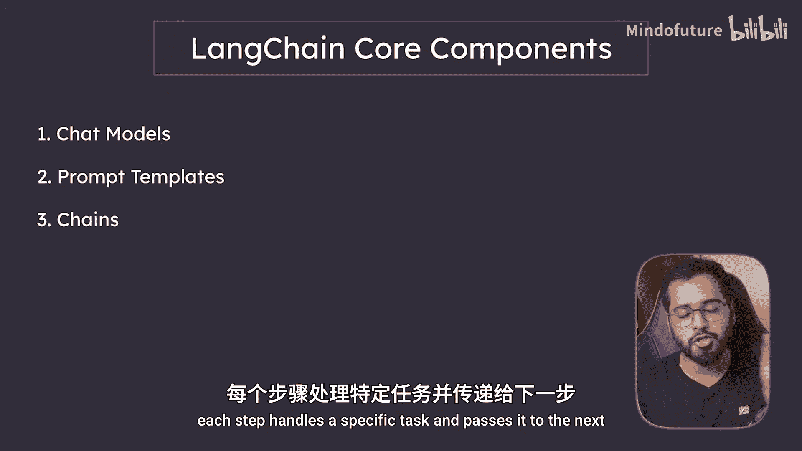
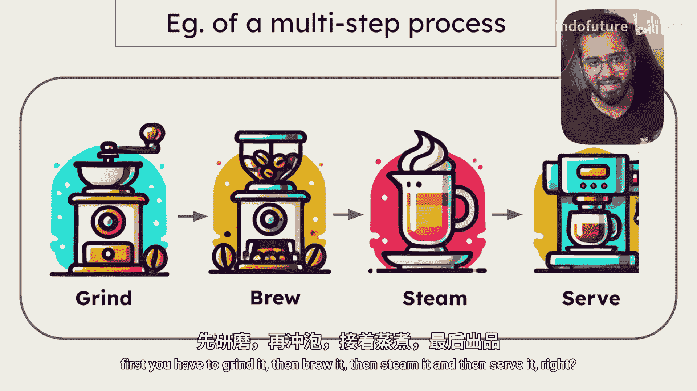
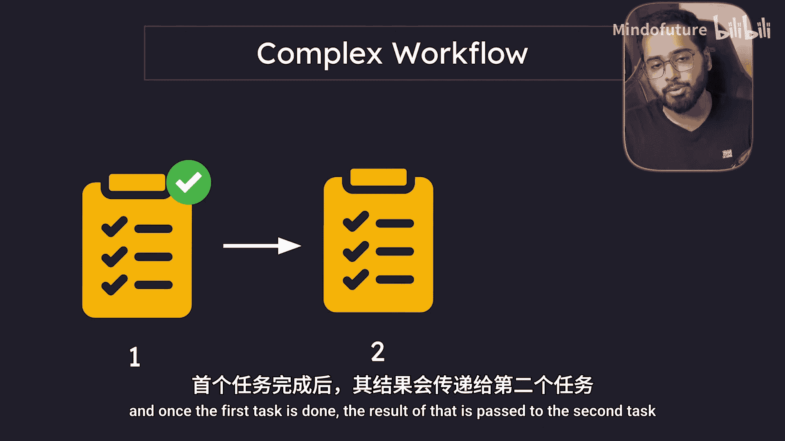
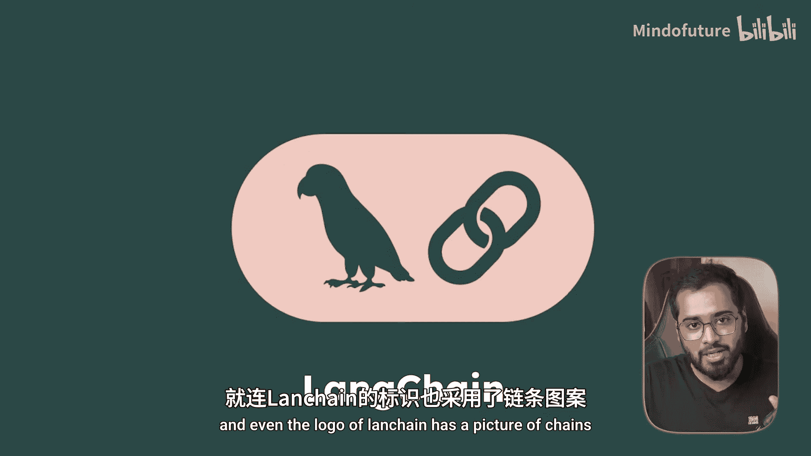
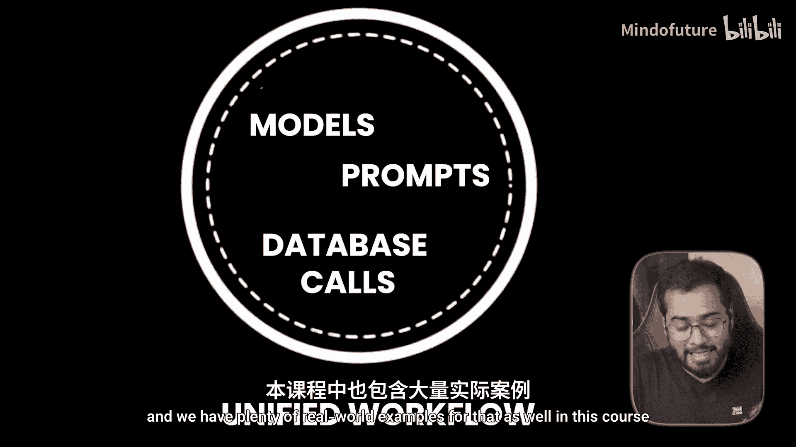
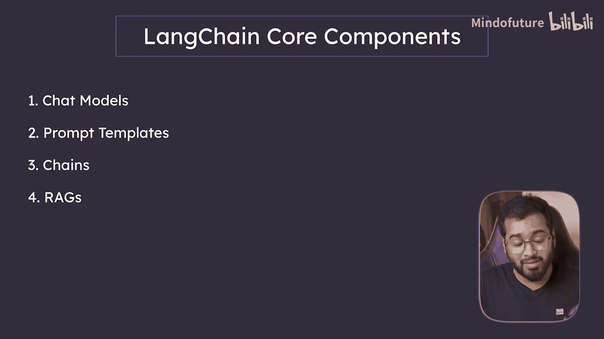
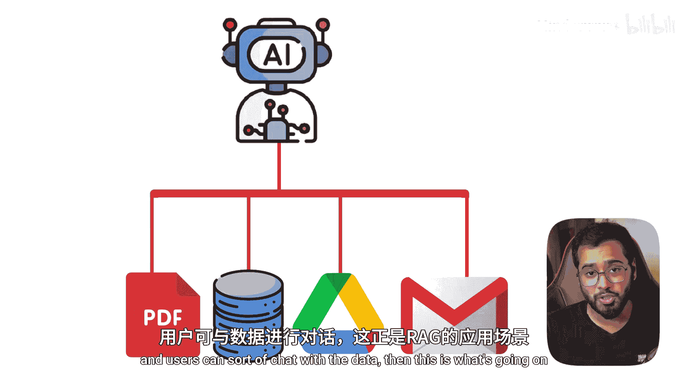
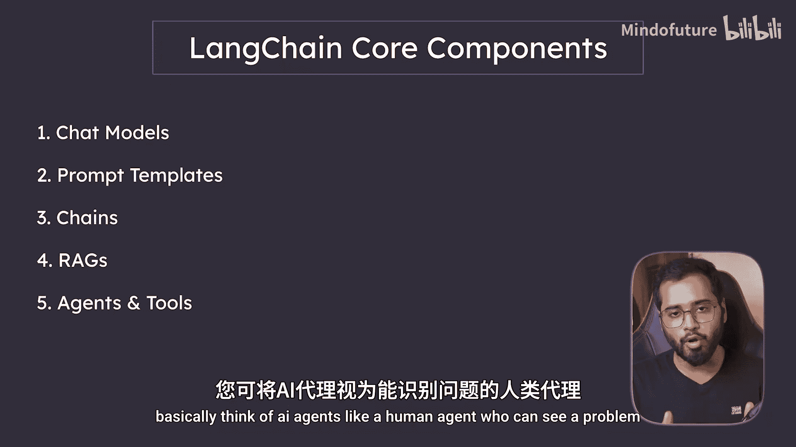
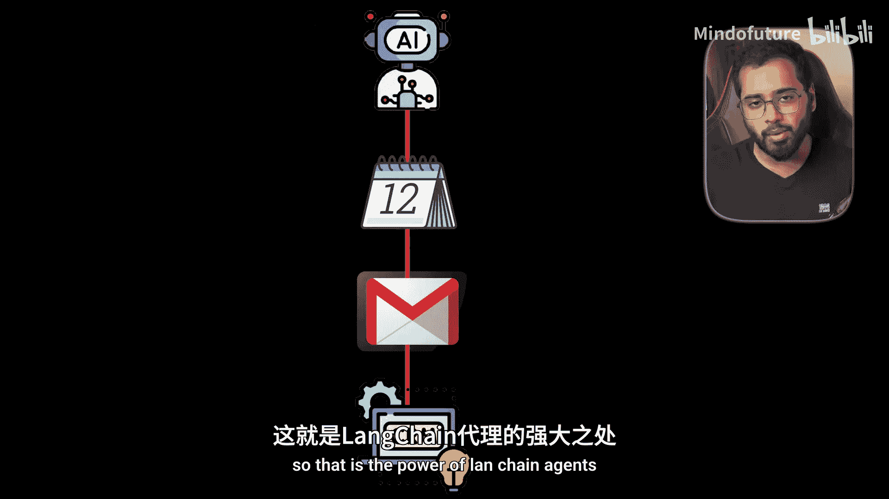

# Langchain初学者入门2025 p02 P02_#2_概述 -BV1jgeWzYEey_p2-

So here is what we will be covering in this course。 First， we will talk about what is laing。

 why we use it， What problem does it actually solve。

 and then we will set up our Python environment so that we can actually start using La and start interacting with these Apis right So once we have that setup we are then going to start diving deep into the core components of Lacha。

 First off， we're going to start working with chat models。

 meaning well basically just interact with open eyes chat models， clouds chat models。

 all of that in the first section。 The second core component of La is going to be prompt templates。

 basically make our prompts to the AI as templates and at placeholders in it so that it can take dynamic values。

 Allright， the next component it gets really interesting from this point onwards。

 the third component of Lacha is going to be chains so chains in La are like an assembly line。😊。

Each step handles a specific task and passes it to the next。 Here's a real world example。 Okay。

 so imagine chains like making a coffee。 right First， you have to grind it， then brew it。

 then steam it and then serve it。 right So that's exactly what we're doing here as well。

 So if there is a complex workflow， we'll be dividing it into smaller tasks。

 And once the first task is done， the result of that is passed to the second task。

 So that is why it's even called Lacha。 And even the logo of Lacha has a picture of chains。

 because it links various processes like models， chat models prompts databases calls into a unified workflow。

 And we have plenty of real world examples for that as well in the course。 And then we have a rags。

 This is a pretty huge section in the course。 And it's one of those important technologies that are helping businesses to increase productivity。

 So if you've ever heard of custom chatbos trained on a company's private data。

 the data could be in the form of Pdfs or it could be from the database or。😊。

And users can sort of chat with the data。 Then this is what's going on。

 rags or retrieval augmented generation。 And finally。

 we are going to wrap up this course with another critical component of La。

 which is called agents and tools Basically think of AI agents like a human agent who can see a problem and use various tools to solve a particular problem。

 It can sort of interact with API is send emails automatically script data from a website。

 run a python script or even query a database。 I'll give you an example。

 Imagine an AI agent gets a task to book a meeting。 just like a human。 It can check your calendar。

 It can send an email invite。 It can update the CRm as well all automatically So that is the power of La agents。

 They can use the right tool for each and every single step。 Here is a quick tip。

 If you want to get a complete overview first try watching the whole course at twoex speed。

 then you can go back and focus on the parts that you actually need most That's how I learn it because it lets me see the big picture。

😊。

First and see how everything sort of fits together in the next section。

 let's talk about what is La why we even needed I'm pretty excited and as you there。😊。

