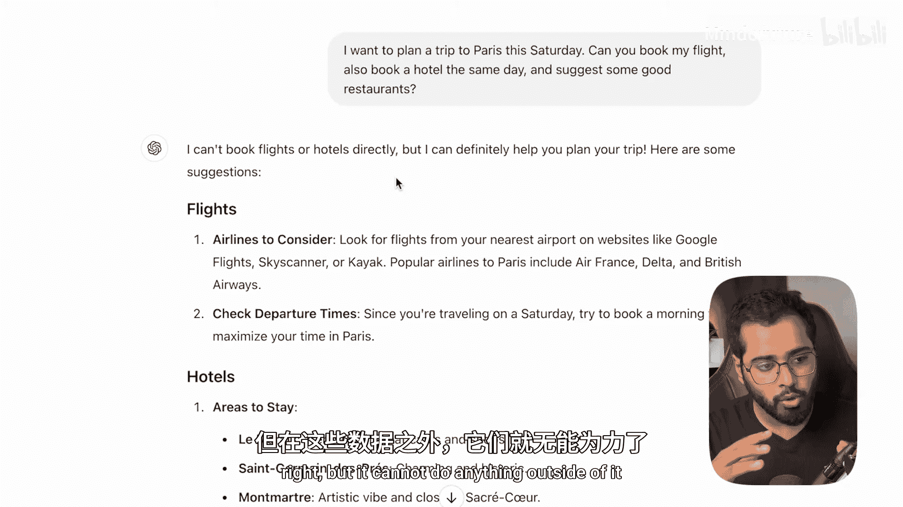
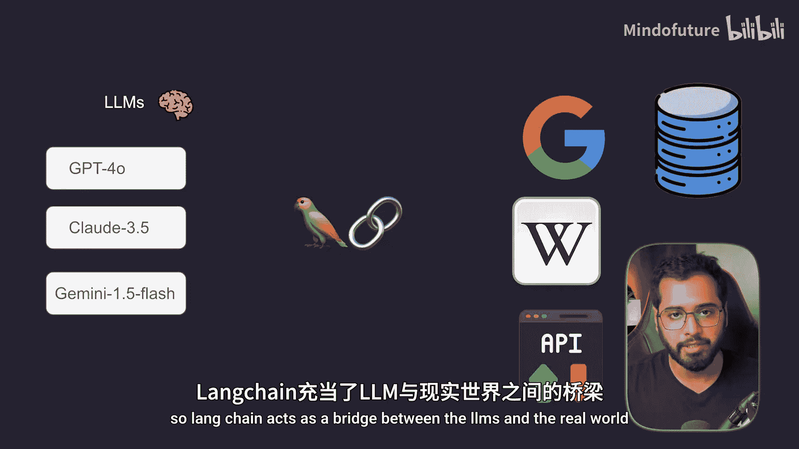
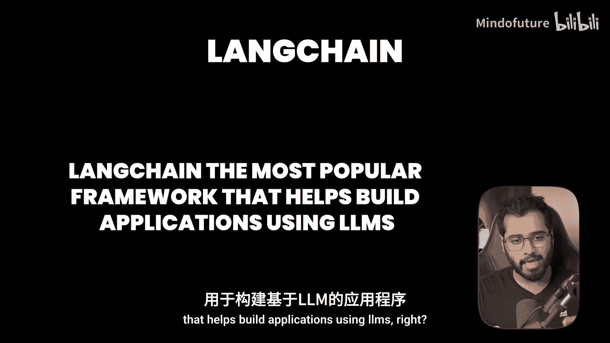
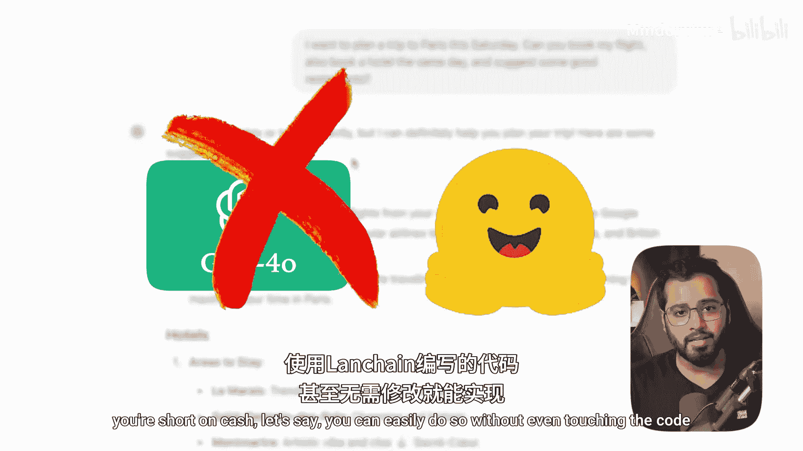
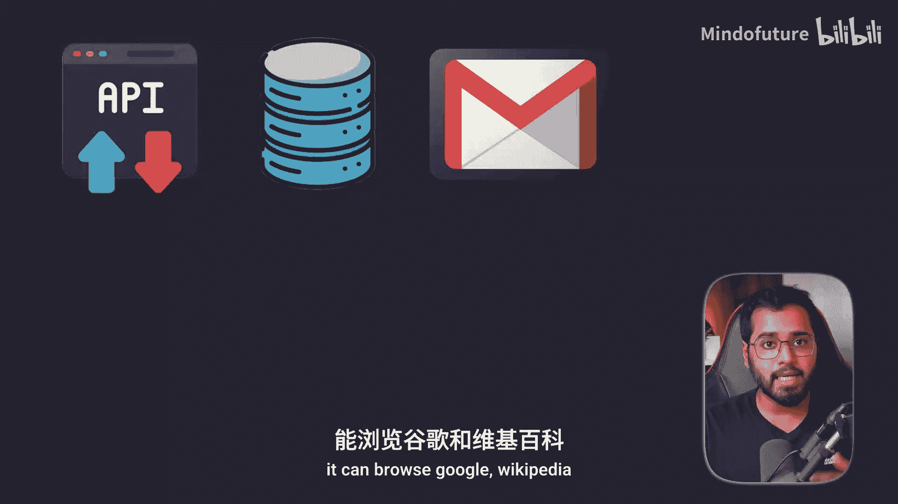

# Langchain初学者入门2025 p03 P03_#3_什么是_LangChain -BV1jgeWzYEey_p3-

🎼Allright， so to understand what long chain is， let's start with a very simple problem。

 So imagine you want to plan a vacation and you want to seek the help of Chari So I'm going to say something like I want to plan a trip to Paris this Saturday can you book my flight Also book a hotel the same day and suggest some good restaurants so let's actually see what happens behind the scenes I'm not pressing enter just yet So when I press enter this query is sent to an Lm model So this Chay application might use a lot of models it might use Cha 3。

5 Cha4040 mini a lot of other models right So these are the large language models that you see on the right side。

 So Chay application itself is just an interface for the user like you and me right So when I press enter let's see what happens。

😊，🎼Right so you can see that it says I cannot make bookings directly but I can help you with planning right so this is one of the biggest limitations of large language models they are smart and can talk about travel but they cannot actually interact with the real world right so on its own the LLms are just the brains right they can be trained on certain data and it will reason with it right but it cannot do anything outside of it let's say you want to build an application that needs to have the brains basically the reasoning ability of an LLM but at the same time it also should have the ability to communicate with the real world right communicate with real world APIs databases send emails if you want to do that we need to have some sort of a framework right in the middle right and that is where Lcha comes into the picture so Lcha acts as a bridge between the LLMs and the real world so to put it simply Lacha is by far the most popular framework that helps build applications using LLMs。

😊。

🎼RightSo in the future， if you want to switch out GP40 with let's say a free hugging face LLM if you're shot on cash。

 let's say you can easily do so without even touching the code that you wrote with Lcha right so with La the AI that we are working with can do so much more in real world I'll give you a few examples so it can access a lot of APIpis for example it can access flight and restaurant booking as from let's say booking do co or opentable co it can access private company databases to answer customer queries it can send emails it can browse Google Wikipedia it can scrape websites and a lot lot more so La doesn't just make the AI smarter。

 it gives it the ability to act in the real world this is just a very small example so as we go through the course we will explore a lot more use cases So I hope you're excited let's get started。

😊。

