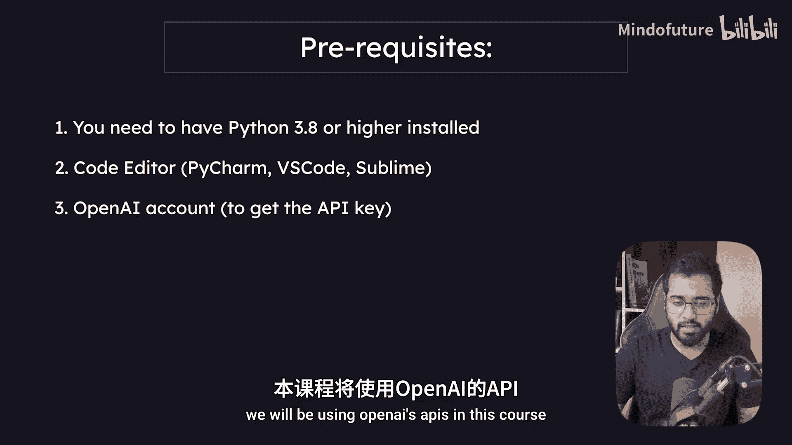
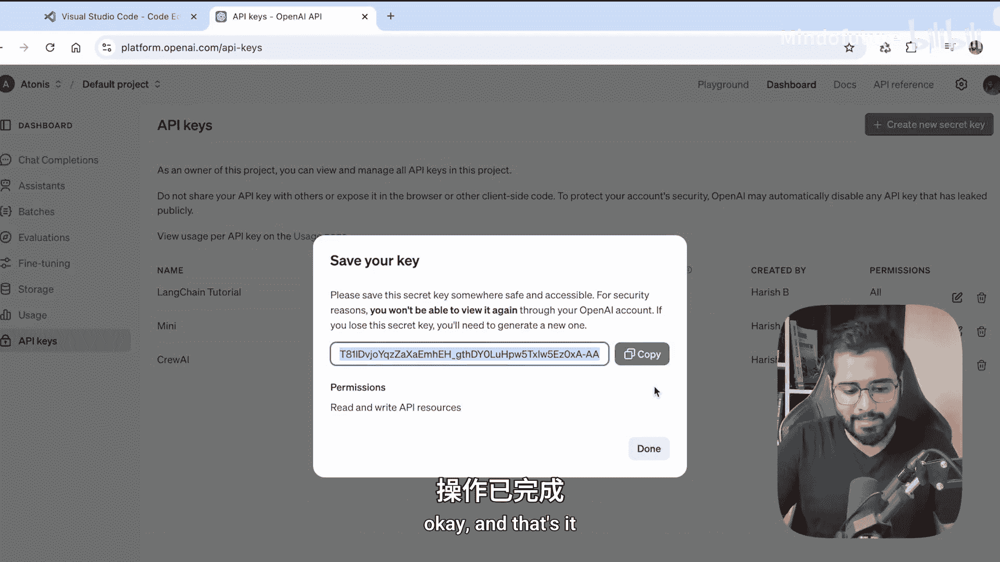
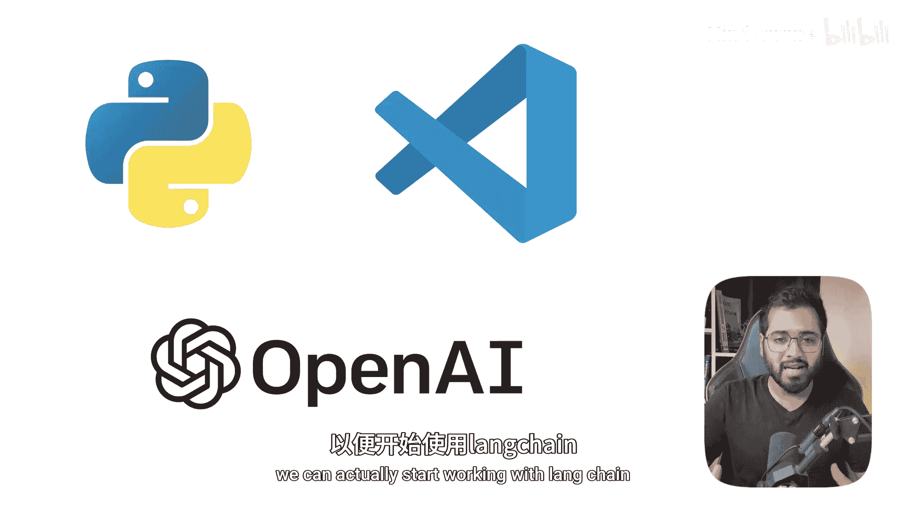

# Langchain初学者入门2025 p04 P04_#4_先决条件 -BV1jgeWzYEey_p4-

Alright， so let us talk about the prerequisites first to be able to follow along with the scores。

 you will need Python version 3。8 or higher installed And the second thing is make sure that you have a code editor installed as well。

 I will be using vs code in the course and last but not least you will also have to create an open AI account because we will be using open AIs APIpis in the course if you don't have Python installed。

 I have attached Python3 installation tutorial links in the description for both Windows as well as Mac So once you're done installing。

 you can come back to the video and for vs code， you can go to this particular link right here and then you can download visual Studio code for whichever operating system that you are working with The installation is also pretty straightforward for this。

 And finally， let's go ahead and create an open AI account if you don't have it already。

 The reason why we need that is because we need the API key in order to be able to hit that API endpoint to access open A LLms right So to do that。

 let's go to platform do open AI dot com。😊。

🎼Okay so I'm going to log in because I already have an account if you don't you can just go ahead and sign up right here so once you're in you can click on this dashboard tab right here on your left side you can see a tab for API keys so we can click on it so if you've never created a key before you might see an empty list right here so let's actually go ahead and create a new one by clicking on this button。

I'm going to name it， Lang chain。Tuttorial。I'm going to leave the permissions as all and let's go ahead and create it。

😊，🎼Alright， so we have it right here Also please make sure to save it somewhere in your computer because if you lose it you will have to create another one again Okay and that's it so far we have installed Python 3 we've installed Bis Studio code as well as we've created an open eye account and created an API key as well So in the next section let us actually go ahead and set up our development environment using Python so that we can actually start working with Lcha so as you there。

😊。

