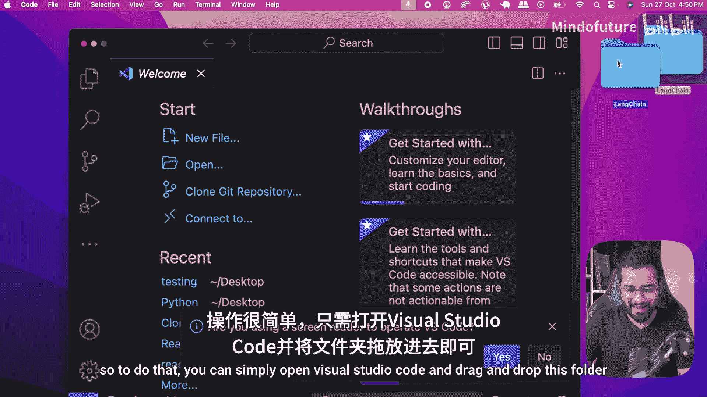
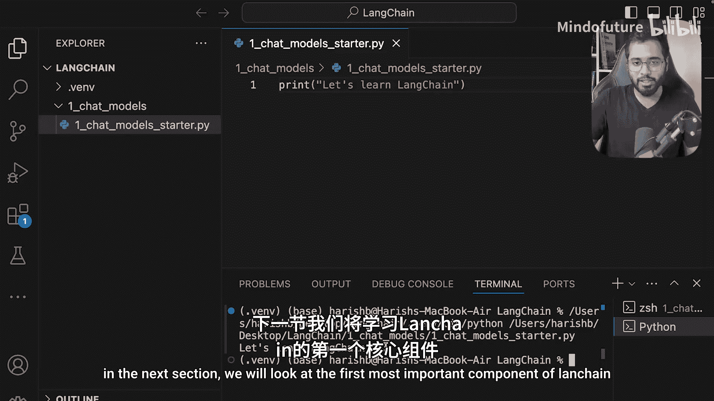

# Langchain初学者入门2025 p05 P05_#5_开发环境设置 -BV1jgeWzYEey_p5-

Alright， so in this section let's actually set up our development environment。

 so I'm going to create a folder called la chain。😊。

And I'm going to open this folder in my visual Studio code。

 so to do that you can simply open Viual Studio code and drag and drop this folder inside of it and you can see that it's been opened right here。

😊。

🎼Right so now let us open up the terminal and we have to create something called a virtual environment so whenever we are installing packages we don't want it to be available globally we only want it to be available inside of that one virtual environment Also it is a pretty standard process whenever we are working with Python projects so I'm going to say Python3 I'm working with Mac by the way so I have to say Python 3 right here but if youre a Windows user you can just say Python alright and then we have to say dash he and this is to tell Python to run a specific module。

😊，So dash M， and then let's say V E and V。🎼So this is the module that we want Python to run and finally we need to give the name for the virtual environment that we will be creating as well so I'm going to name the folder that will be getting created as dot V E and V。

😊，🎼So we put this dot here so that the file that will be created will be hidden but you can also choose not to hide it as well so in that case we can just not put the dot there。

So， let's press enter。And now you can see that we have the virtual environment created so the first step of creating a virtual environment is done the next step is to make the terminal point to that virtual environment right now you can see that it is point to base which is the location outside the virtual environment but we need to point it to the virtual environment because we'll be installing a lot of packages for this course right so to change this v code might automatically show a pop up to accept it right here but if it doesn't show you you can just easily click on this button right here。

😊，And then select the V E N B directory right here。And that's it。

 it has been changed to the V E and V path。So if I open up another terminal window。

 you can see the V E and V on the left side。So we are now in the virtual environment。 That's it。

 Our Python development environment is completely set。 All right。

 So now I've gone ahead and created a very simple folder right here and then a file inside of it as well called chat models starter。

😊，So inside of it， if I now type let's say print。Let's learn L。And hit run right here。

You can see that we have the text in the terminal right alright so our development environment is perfectly done so we are actually ready to start working with La chain now in the next section we will look at the first most important component of La which is called chat models so as you there。

😊。

