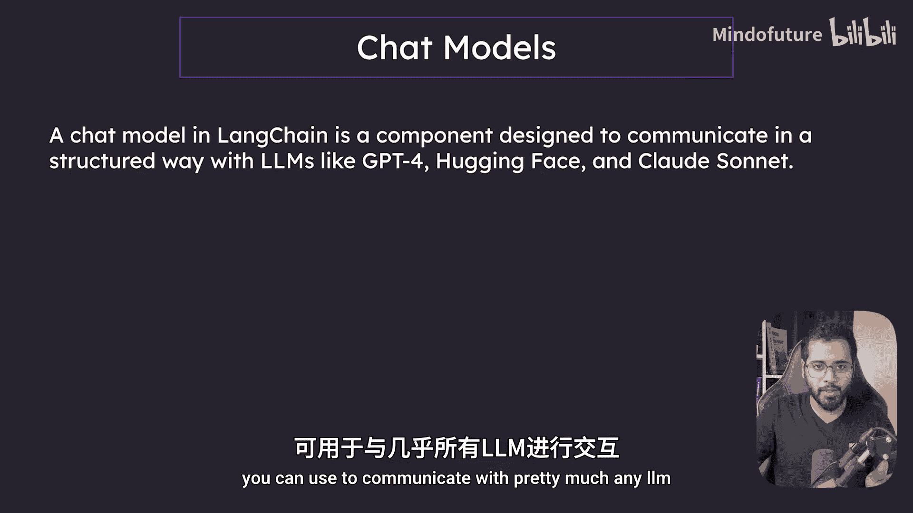
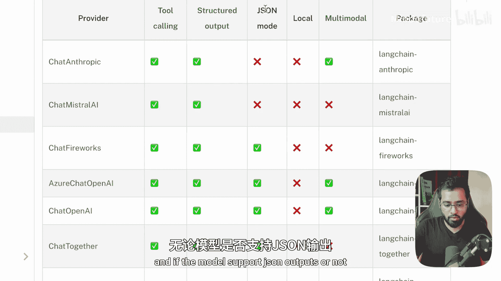
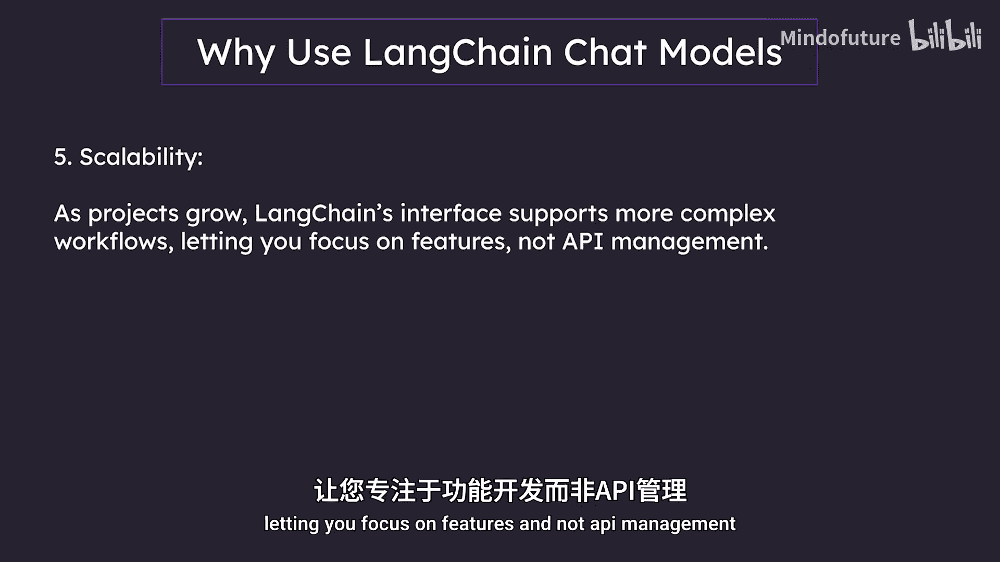
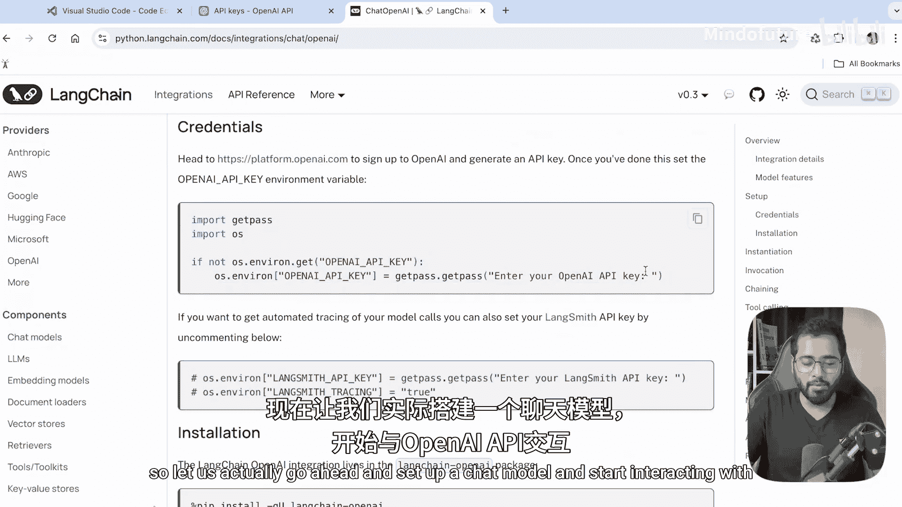

# Langchain初学者入门2025 p06 P06_#6_聊天模型概述 -BV1jgeWzYEey_p6-

So in this section， let us look at the first core component L， which is called chat models。 Okay。

 so let us now look at the official definition。 A chat model in La is a component designed to communicate in a structured way with LLM right So the LLMs could be G4 LLM。

 It could be hugging phase and open source LLM， it could be cloud Sonet APIs right So chat models in L offer sort of like an interface that you can use to communicate with pretty much any LLM that you want right So if I go to the official documentation in L on chat models。

😊。

You can see that there are different models right here right so there is a long chain chat model for the anthropic LLM there is another one for myel right here and since we are going to be communicating with open AIs LLMs in this course then this is the models class that we will be using and this is the package that we will have to install you can also see what each and every single model is capable of。

😊，We can also use tools using these models， tools we will talk about in the later part of the course。

 and then we have these structured output as well。 And if the models support Json outputs or not。

 Allright so so far we know that chat models offer an interface for us to communicate with so many different LLms As right But now we need to ask ourselves a question。

 why do we need a middleman right here After all， we can directly call them right the answer is yes。

 of course we can but as long as we are building smaller apps but as we start building more and more complicated apps then you can see it will start getting messy really fast。

 So here are some advantages of using Lacha model interfaces instead of directly calling LLms Apis So knowing these things are important because it gives you a high level overview of why we do certain things knowing that you can architect your own solutions better even after this course right So let's look at a few advantages So reason number one。

 consistent overflow Land change chat models unify different。😊。

PI saving you from managing each one's unique setup and quirks we will explore all of this pretty soon reason number two。

 easy switching between LLMs if you want to switch between one LLM to another Las chat models make it very simple without a lot of code changes。

😊，Reason number three， context management working with La changes chat models help manage conversation history。

 letting you keep context across multiple interactions seamlessly。😊，Reason number four。

 efficient training， you can connect multiple LLM calls and tasks in one structured pipeline。

 which can be a bit tricky to set up manually。And finally， reason number5， scalability。😊。

As projects grow， Lcha's interface supports more complex workflows。

 letting you focus on features and not API management。

So in this course， we will be mostly working with open AIs APIs。

 so we will need the chat open AI model right here。😊，So if we click on this。

 you will find it very easy to understand the documentation on how to set this up。

 so let us actually go ahead and set up a chart model and start interacting with open As APIs so I'll see you in the next section。

😊。

