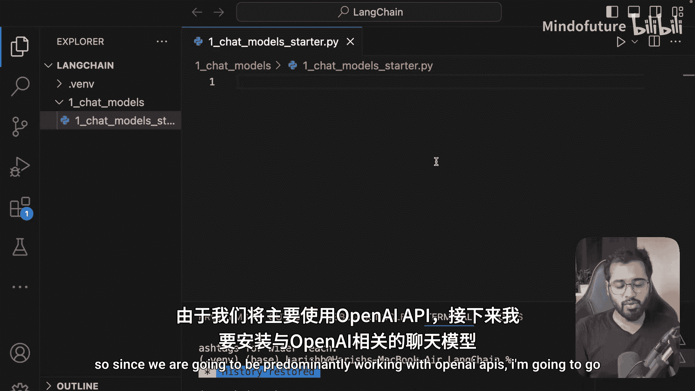
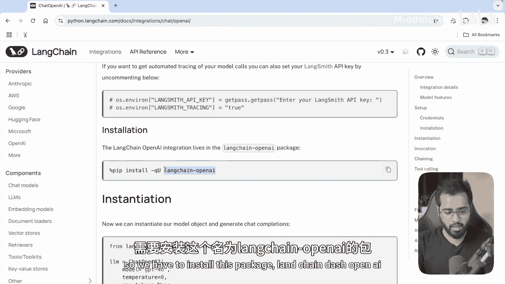
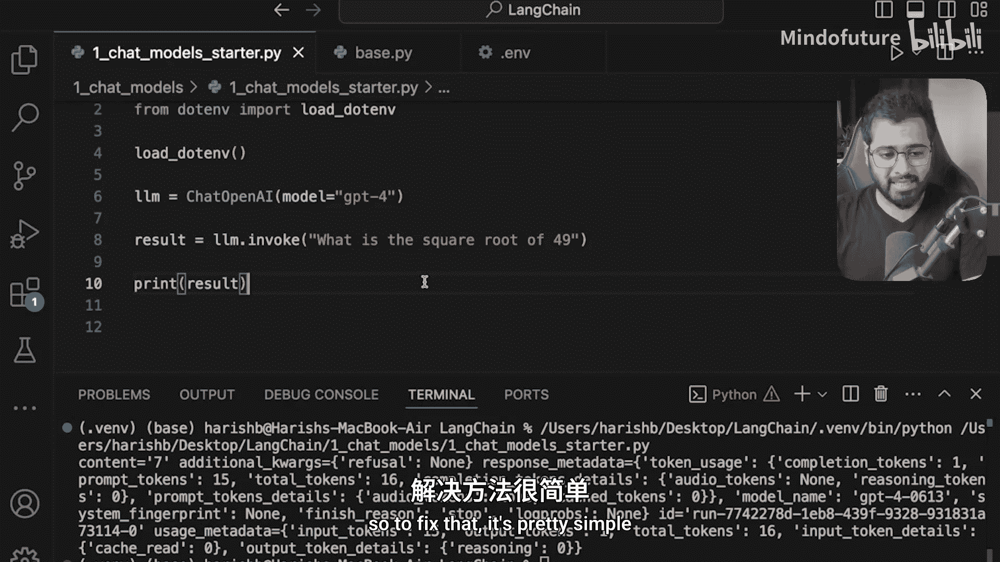
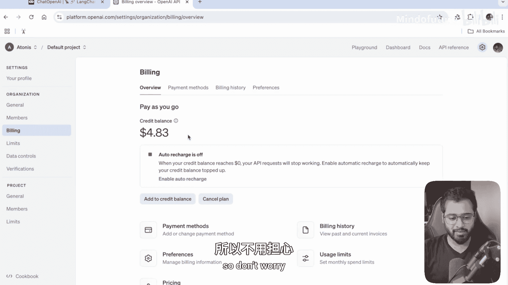
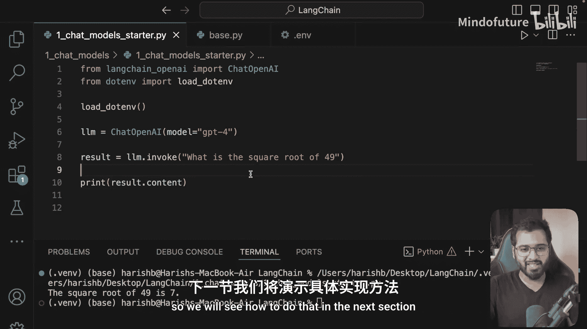

# Langchain初学者入门2025 p07 P07_#7_聊天模型设置 -BV1jgeWzYEey_p7-

Hello guys in this section， let us actually start working with Lachas chat models。

 So since we are going to be predominantly working with open AIs APIs。

 I'm going to go ahead and install the chat model related to the open AI right So if you look at this。

 this is what we need right chat open AI So if I click on it。😊。

And if I scroll down here， you can see that this is the command that we have to use to install this particular package right so we have to install this package La dash open AI so let me copy this come down to my terminal in VS code。

And let me install it。Okay， it's not installing because， yeah， we have to remove this particular。

Percentage sign。Alright。 Now we should install。Let's give it a few seconds。And perfect。

 it has successfully installed， right。 So let's actually go ahead and import this particular chart model in our file。

 I'm going to say。😊，From La， open AI。So this is the module and from this module we want to import the chat open AI class So this is what we need so we can now go ahead and initialize our model so we can call this LLM or model or whatever we prefer so we can say chat open AI。

And we want to use a certain model right so we can pass in this particular keyword parameter and the model that I want to use for this particular example。

Is going to be G 40 right and I'm using this particular model because this is kind of the latest model that's been released by open AI and usually the latest models can be a little bit expensive because they are the most advanced model。

 but if you are a little short on cash you can go you can always go with G3。

5 or G4 even So now that we have used a chat model to initialize an LLM for us。

 So this is the variable that we are going to be using to sort of communicate with open As APIs。

 So to make an API call to open AI。😊，We can just say LLM dot invo。Okay。

 so we can pass in any string that we want inside of this。

 Just remember that any time that we want to make any sort of calls to the LLM just remember that this is going to be the magic keyword that you have to remember invooc right so this is going to be used throughout the rest of the course in rags is going to be used in a lot of other sections as well so just remember that this is going to be the magic keyword invooc right so I can ask pretty much any question that I want right here so I can see something like let's say what is the square root of 49。

😊，Right， what I'm going to now do is I'm going to store the result of this LLms response。

 the A response inside of this particular。Variable， and I'm also going to print this。Result。

All right。So now what I'm going to do is I'm going to hit run， let's see what happens。

Okay so we are getting an error here and it says that the API key is missing right so we have completely forgotten to provide the API key so let's actually quickly go ahead and create an EV file in the parent directory right here and what should be the name of the API key right so what should be the key name right so you can see that if I go inside of this particular model chat open AI chat model if I go inside of here you can see that it automatically requires this particular open AI API key to be available globally right。

😊，So what I can do is I can go inside of the dot enV file。

Put this thing here and I'm going to copy paste my API key that I just copied from openaiIs dashboard right here。

 so I'm going to paste this right here perfect now if I come back to this file and if I try to run it。

 we are still going to get the same API key error and that is because just because we have created it here does not mean that this file has access to this particular key okay we still have to explicitly provide the sort of access into all the contents of this specifically inside of this particular file So to do that we have to install another package So the name of the package is Pip install Python。

Dash dot E V。Okay， so it looks like it's been installed。

 so I'm going to come up here and I'm going to say dot E and V。😊。

Import load dot Av okay so this is the library and this is what we want to import this is going to be a method so to make the contents of the ENV file available inside of this file all that we have to do is initialize or basically call this particular method。

O。All right， perfect。 That's pretty much it。So if I now again run this particular file。

You can see that we finally get the entire response so we have the content it says that the square root of 49 and 7 we've also got additional key arguments。

 we've also got response metadata and a lot of other things and just one more thing if you are not able to see the response down here in case open AI is not letting you access their APIs it's probably because you don't have enough balance So if you search in the terminal in the error message you might probably find that your balance is a little low so to fix that it's pretty simple So just come back to platform do openaiI dot com and then go into settings right here。

😊。

And go into billing and you can just do a little bit of top up So the least amount of money that open AI accepts is 5 so since we are just learning things you can just go for the $5 it is probably going to last you a couple of months。

 so don't worry。

So this contains a lot of additional data as to you know how much tokens have been consumed and a lot of other data。

 but we don't really need any of this。 We just want this particular content property instead of this entire object so what I can instead do is I can just say result dot content so anytime that I am making a call to the LLM the result that Im going to be getting is going to have all of this junk but the only thing that I I am interested in is the content parameter or the property right so let me just clear this out and then run it again for you guys。

So you can see that Allright， the square root of 49 is 7 right So that is how simple it is to use Lcha chat models in order to communicate with pretty much any API that you want out there。

 So right now we are just working with open AI API and this is basically just an interface that lets us access that particular API and this is how simple it is。

 we are just going to provide whichever model that we want to access on open AI side。

 So if we want 3。5， let's say we can use that as well if you want four we can access that as well。

 So in this section we just pass then a very simple prompt to the LLM saying what is the square root of 49 in the next section I want to send the LLM an entire conversation history right for example。

 the human set this thing the AI said this thing the human said this thing So basically the entire history is what I want to send to the LLM so that it is able to better give responses because it has the awareness of what happened before right so we will see how to do that in the next。

😊，在ction？

