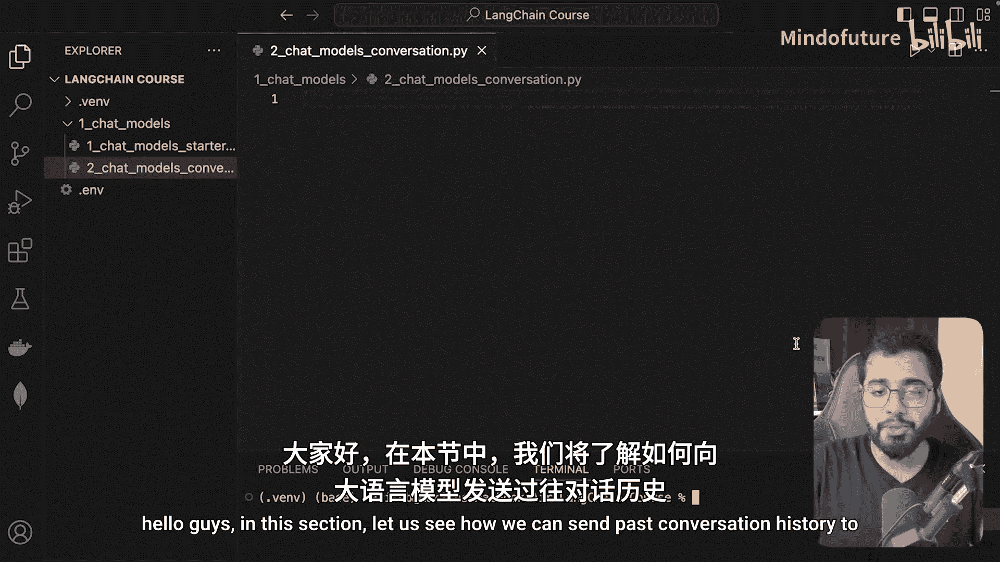
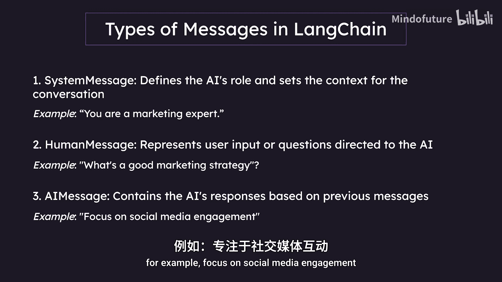
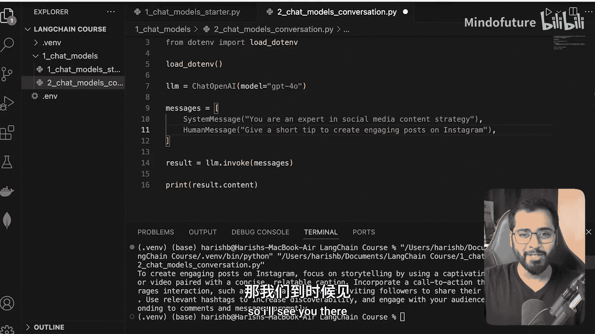

# Langchain初学者入门2025 p08 P08_#8_聊天模型_传递聊天历史 -BV1jgeWzYEey_p8-

Hello guys in this section， let us see how we can send past conversation history to the LLM so that it has more context awareness。

😊。

So to proceed forward， we need to learn about the types of messages in Lacha。

 So the first one is going to be system message。 It defines the AI's role and sets the context for the conversation。

 It is typically said at the very start of the conversation。 So， for example。

 you are a marketing expert。 Let's look at the next type of La message。

 And it's called human message。 And this should be pretty selfexplanatory。

 It represents user input or questions directed to the AI。

 And the last one is going to be AI message。 It contains the AI's responses based on previous messages。

 For example， focus on social media engagement。 So now that we know all of the types of messages。

 Let us see how we can use them in our code。 So the first thing that I'm going to do is to import all these three types of message classes from Lacha。

😊。

More specifically， we'll be taking them from langing core package and from this module。

 we extract three classes， first system message and then the human message and then the AI message。

 So first let's sort of hard code a conversation history so that we consider to the LLM to do that we can initialize a list called Me and the first item should be the system message。

Remember， the system message is what defines an AI's role right so I can say you are an expert in let's say social media marketing or social media。

😊，Content strategy。 Now I can provide the human message or the question that I want to ask so I can use the human message class from up here and provide in the content。

 So I can say give a short tip to create engaging posts on Instagram。

 because I don't want it to go off and give me paragraphs upon paragraphs， right， perfect。

 we have a simple conversation list。 We can also add a lot more to this。

 like add another AI message and then another human message。 But for now， let's just run it。 Now。

 we need to talk to the LLM and get an answer。😊，So we can follow the same thing that we did earlier。

 let me copy paste this from the starter file。And now instead of this particular string we are now going to pass in this list of messages。

 So let's remove this and put the messages list here。

 So this invoke method is pretty versatile as you can start to see right because we can pass in strings we can pass in this list as well and Lain knows exactly what needs to be done It sort of abstracts away all the complexity so that it gives you a very clean interface to work with right so let's also print the content from the result as well。

😊，Right， now let's open the terminal。Clear all of this。 And let's run the file。

So now you can see that the LLM returns our data are answer So it says to create engaging posts on Instagram focus on storytelling by using captivating image or video paired with a concise relatable caption right So it is keeping it very concise as well right it is giving us a short tip。

😊，So， this is basically how you can you know you you are sending the system message and the human message and we can also take this next step as well。

 so basically we can copy this entire content and then put it inside of a AI message right here and then again add another human message on top of it。

😊，Okay， so I know that this seems a little weird because we are statically sort of like adding the we are hard codinging all of the data but。

😊，Knowing how these things work is crucial because we can then later make it dynamic。 Alright。

 So what we learned just now in this section where we pass in the entire past conversations to the LLM is pretty important。

 especially if you're building real world applications because if you're building a real world production grade application and users are talking to the AI The user also expects the AI to remember the past conversation right。

 So that is exactly what this lets us do。 So we need to know how to program these things in the backend and having it in a list using these three types of messages。

 the system human and AI。 This is pretty important。

 So I hope that you're starting to see how it is all coming together。

 So so far we've only been interacting with open AIs LLms right in the next section。

 let us also look at you know how we can easily sort of switch between different models using La so as you there。

😊。

