# Langchain初学者入门2025 p09 P09_#9_聊天模型_替代_LLM -BV1jgeWzYEey_p9-

Welcome to the third example of Lachain。 We are going to see how easy it is to switch between different models using Lacha。

 So so far， we've only been working with open AI's chat models。

 right so I have gone ahead and written out some code for you So this first part of the code。

 you should be familiar already We have the messages a list we have a simple system message and a human message and for this we are using the open AI chat model。

 But in the future， if you want to switch to a different model and this could be for whatever reason。

 maybe this model is a little more pricier， or there is another model that is doing a certain task much better or faster even whatever is the case。

 you can sort of easily switch models in Lacha。 So in the section we will look at using Google's Gemini model as well as the anthropic model which is clouds Alright so you can see that up top。

 I have installed two more chat models to communicate with Google as well as anthropic。

 So if I scroll down。😊。

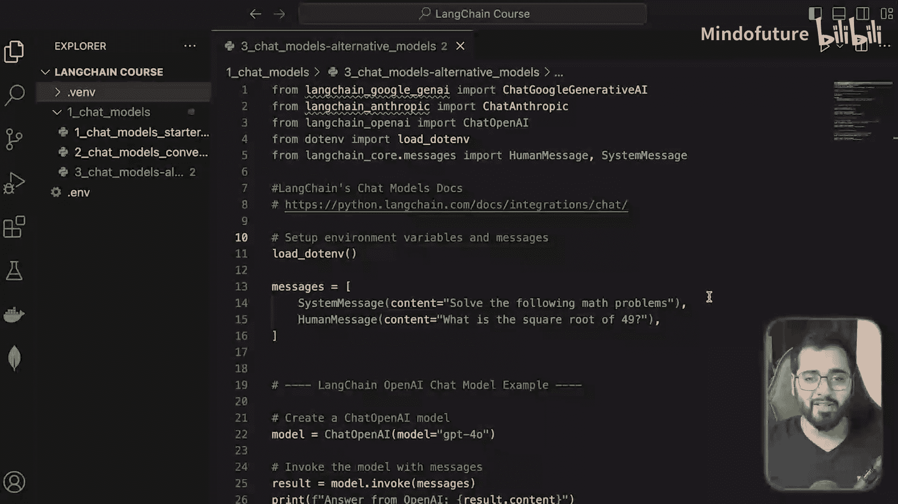

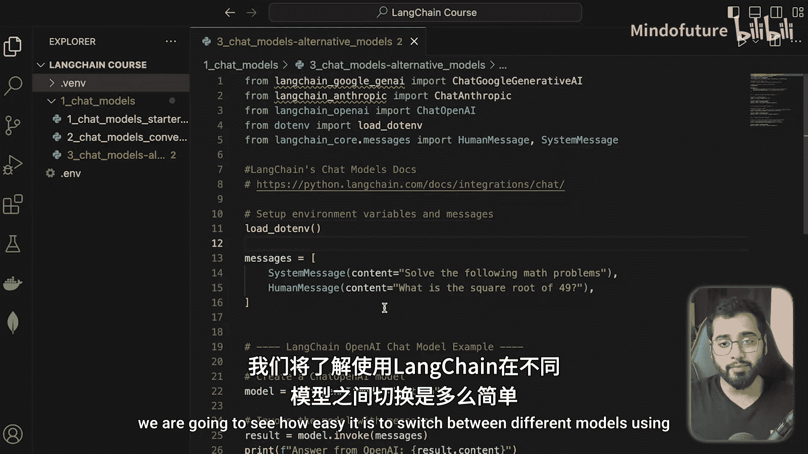

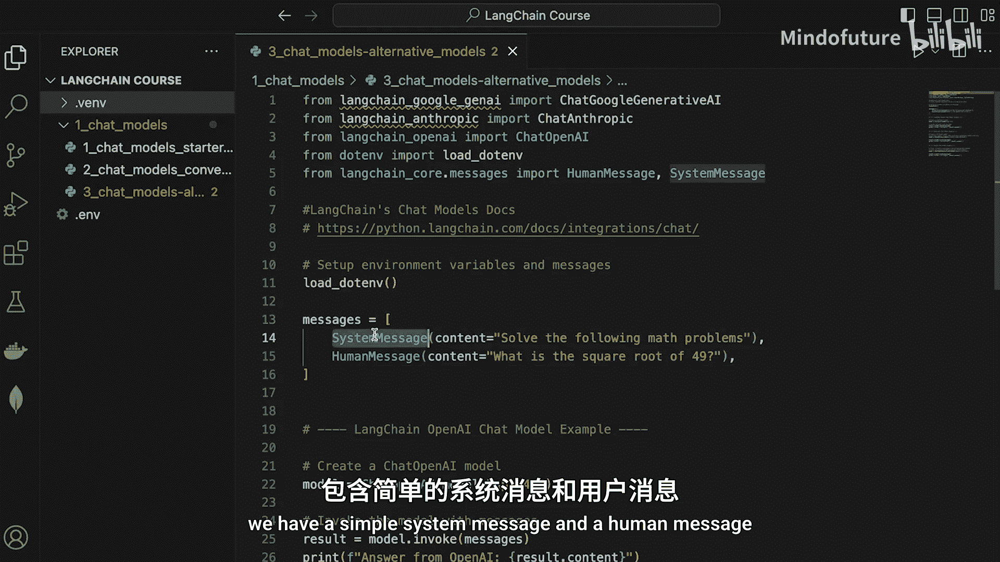

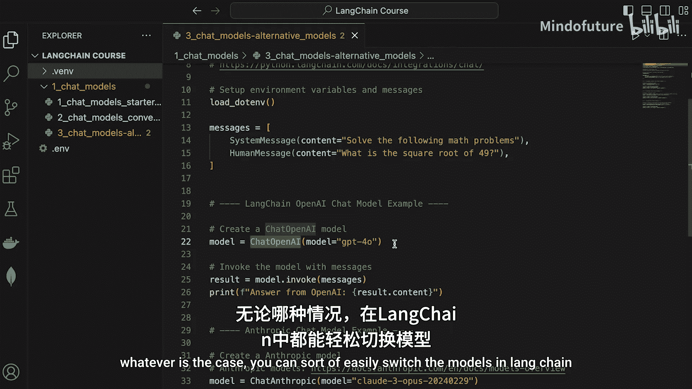

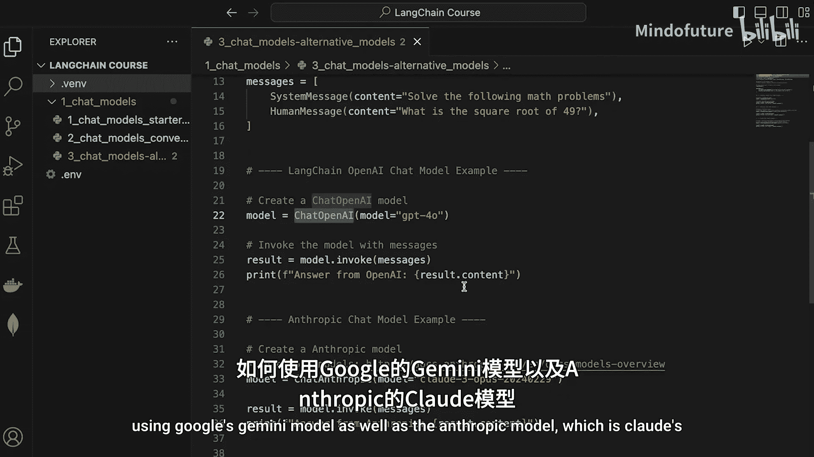

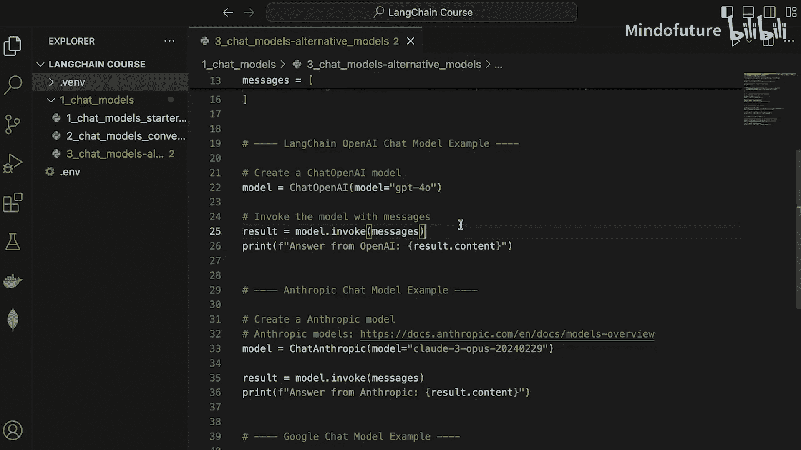

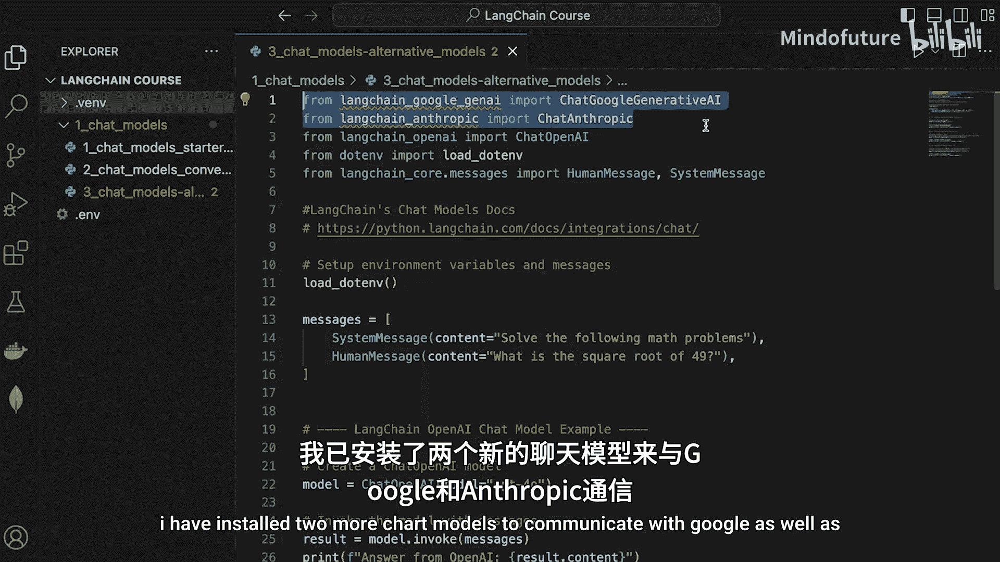

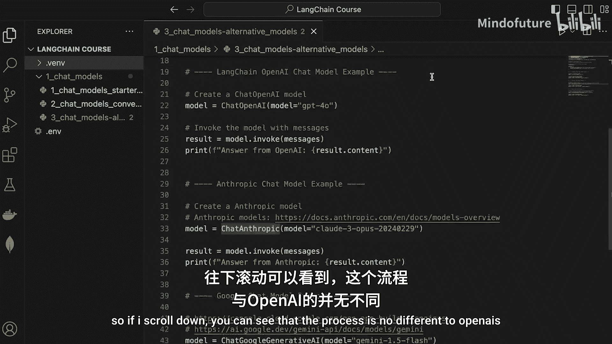

You can see that the process is no different to openaiIs So we just use a different model。

 So in this case， we are using chat anthropic and we are passing in the exact model inside of anthropic that we want to work with。

 So in this case this is the model that I want to work with Alright no different to working with。

 let's say how you are doing so far with openaiIs chat model right same thing for Google Gemini as well So if you have any questions or if you want to download the right chat model package I've provided the link to the La docs where you can find the right model that you want。

 So if I scroll down even below you can see that I have used Lachas chat model for Gemini and all that I'm doing is specifying the exact model that I want to use So in this case we are using Gemini 1。

5 flash Alright， so as you can see La abstracts away all of the complexity to sort of interact with different model Apis and also it makes the。

😊。

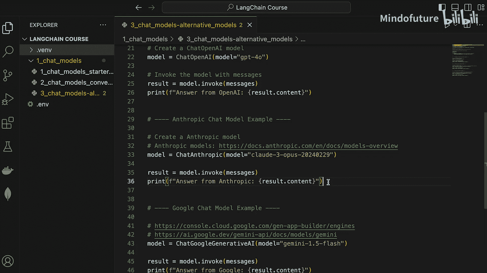

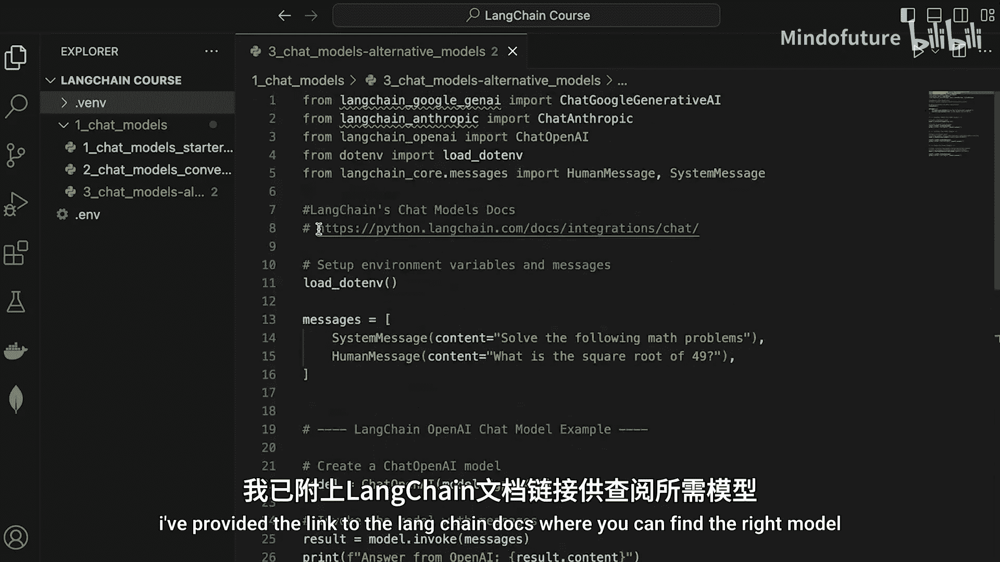

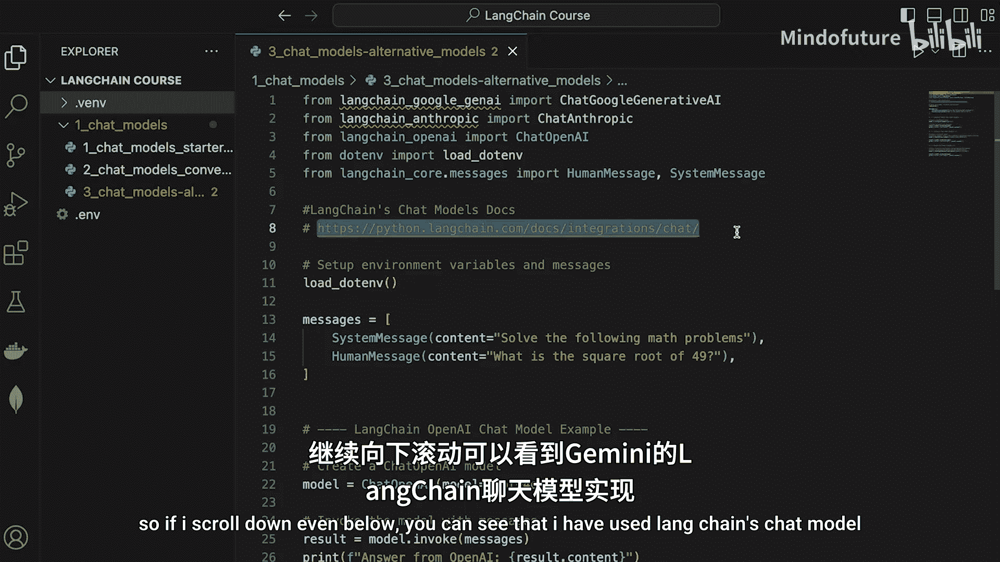

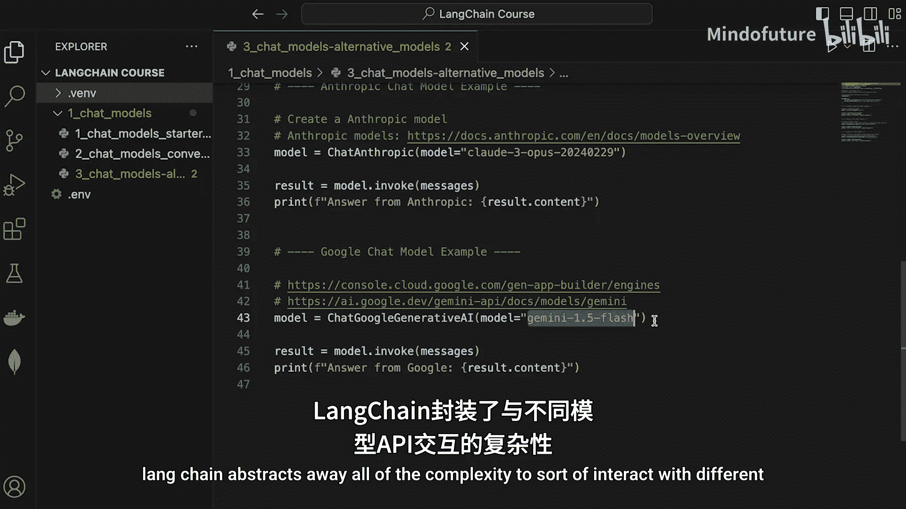

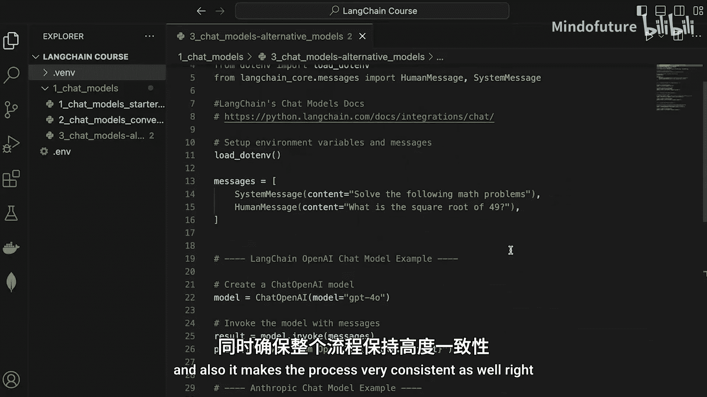

Process very consistent as well right so I have attached all of the docs related to what are the models that are available in Gemini。

 what are the models that are available in cloudde， etca， etc ce。

 So knowing how to switch between models can be pretty handy because let's say you're working on a product or you're building a solution and based on the task at hand。

 maybe a different model is better at handling a certain thing maybe another model is faster maybe another model is more accurate maybe another model is more faster or cheaper right So Laangcha also let's it very easy to sort of help you switch things up as well。

 Alright guys， that's pretty much it for the section in the next section we are going to be doing something very interesting we are basically going to be having a conversation with an LLM through our terminal very similar to how chatP works but you're gonna be doing all of this locally instead of your terminal So I'm really looking forward to it and I'll see you there。

😊。

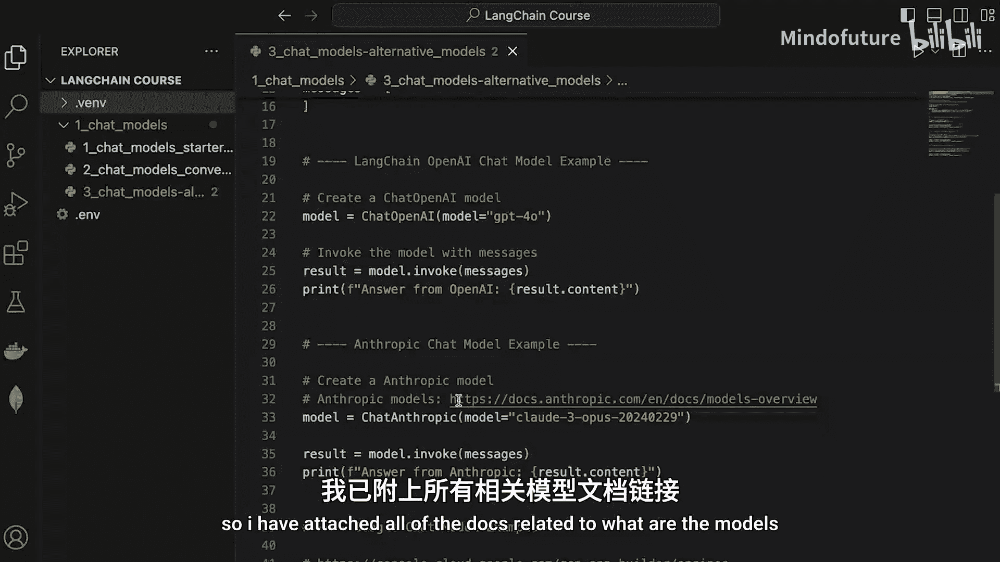

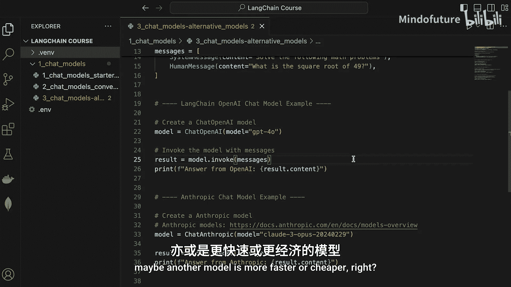

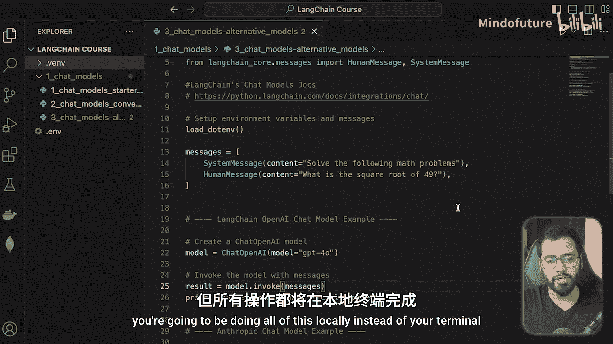