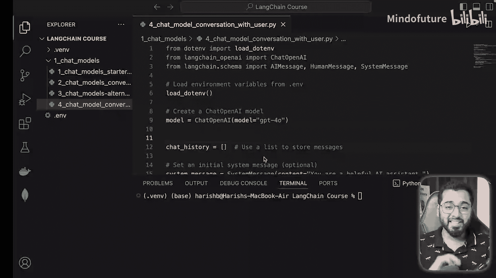
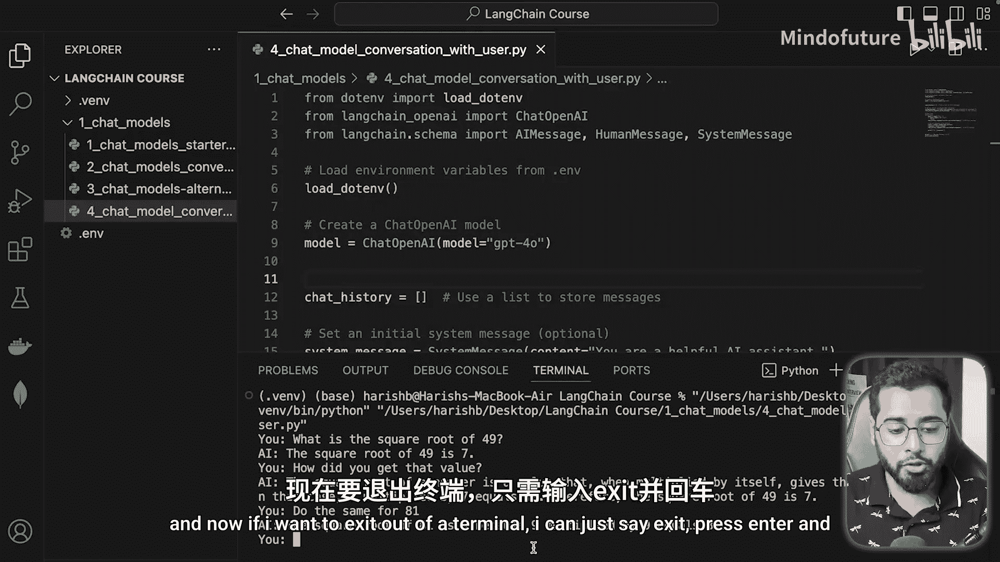
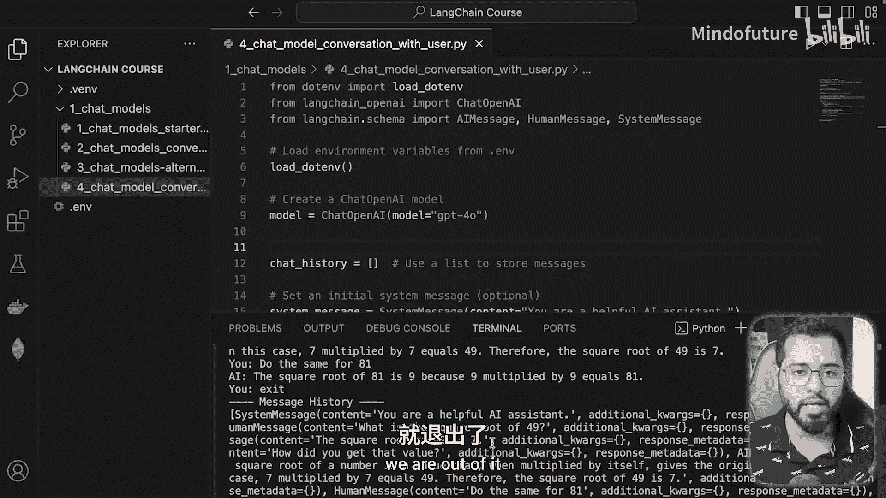
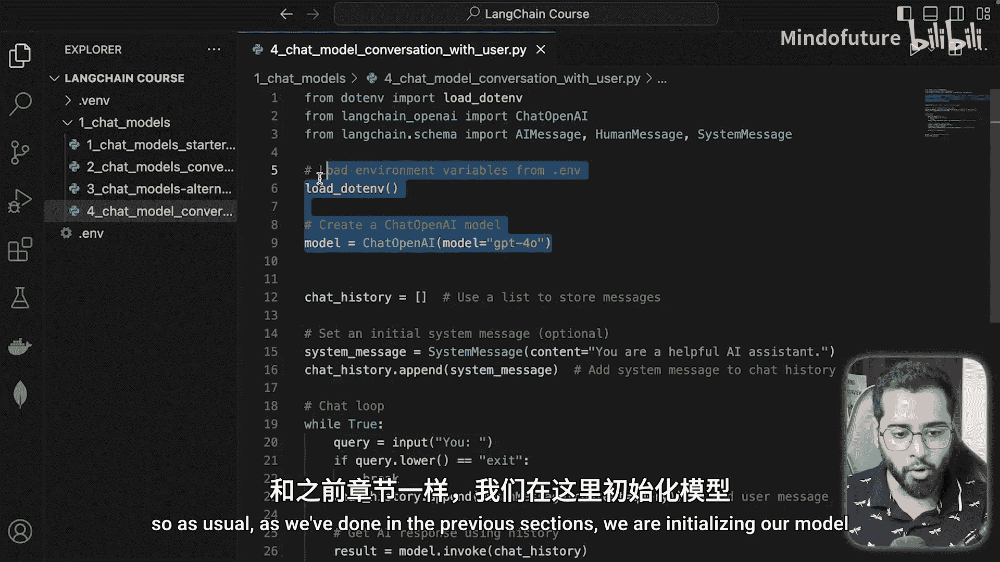
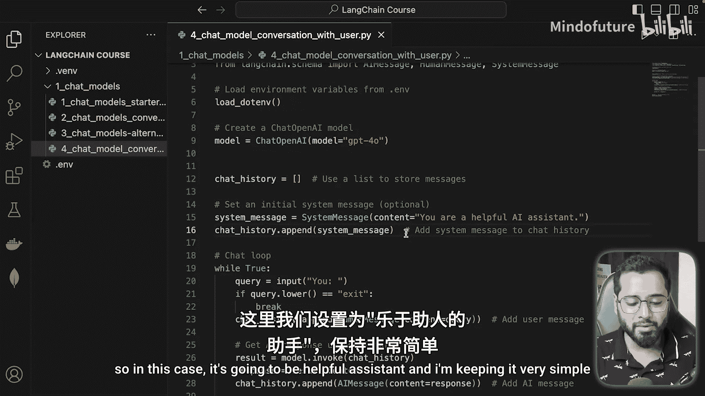
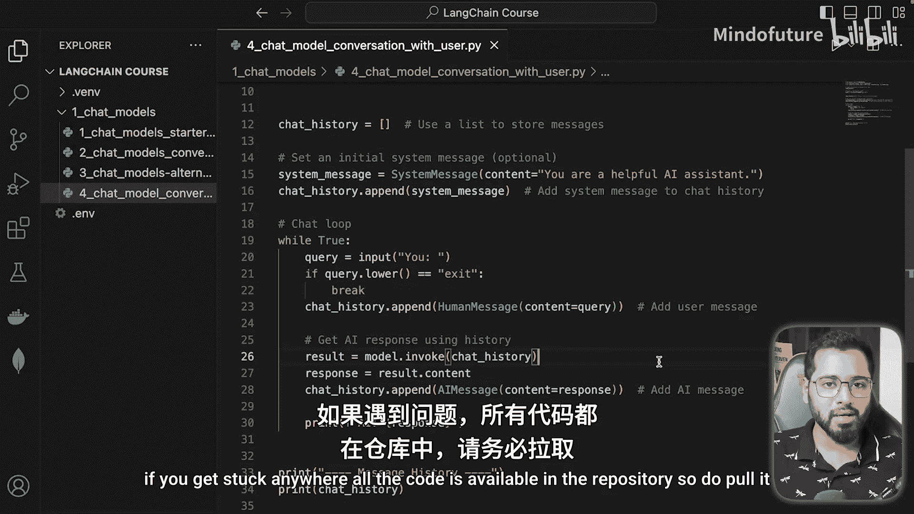
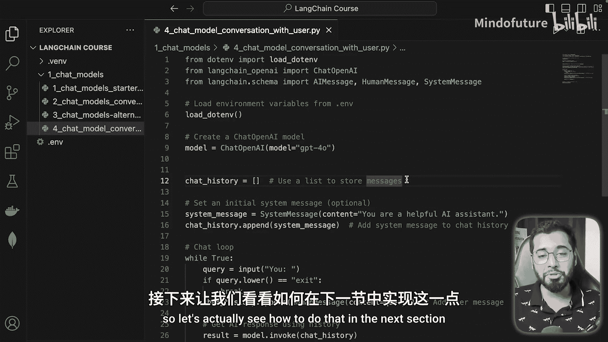

# Langchain初学者入门2025 p10 P10_#10_聊天模型_实时对话 -BV1jgeWzYEey_p10-

Hello guys。 welcomelcome to the fourth example in chat models where we are going to have a realtime conversation with a chat model through our terminal。

 right， So it's going to be very similar to what we do in chat C application itself。

 But instead we are going to do it locally on our computer。 So as you can see。

 I've already prepared the code， let me show you the result of it and then we can jump into the code。

 So when I hit run， you can see that it says you right。

 it is basically prompting me the user to give it a question right So if I were to say let's say what is the square root of40。

😊。

9ine。And when I press enter， lets wait for a while。

And now you can see the AI's message saying7 right and now I can also ask a follow up question something like how did I how did you get that value right and so I can say how did you get that value。

😊，And then press enter。And you can see it is walking us through the reasoning right it's great because it sort of remembers the previous conversations basically the history or the context of the conversation。

 So now if I wanted to let's say know the square root of 81 right so I don't even have to explicitly type out what is the square root of 81 I don't have to do that anymore because it remembers right so I can just say do the same for 81。

😊，And press enter。 Let's wait for a second。 So you see it is it already knows that we are asking for the square root。

 So it is already giving us the value， which is9 right And now if I want to exit out of a terminal。

 I can just say E X I press enter and now we're out of it。

 So basically how chat C works under the hood let's actually see how we can implement this in the code。

 So as usual as we've done in the previous sections we are initializing our model right here and then we are loading all the environment variables。

 Now this is where it starts to get interesting。 So very similar to the list that we had two sections ago。

 we're still going to work with the list here， the list is going to have AI messages system message human messages right but this time we are not going to have it hard coded instead we are going to be adding things dynamically right So to start off we have an empty list here called chat history。

😊。

So， as we discussed in the previous sections the first item of the history array or the list should typically always be the system message that sort of gives AI a certain role or a responsibility right so weve created a system message right here and then we've added it to the chat history list。

😊，So in this case， it's going to be helpful assistant。 Im I'm keeping it very simple。

 So let's move on。 So right here we have a while loop that keeps on looping until a certain condition is met right。

 So let's go through it line by line。 Let's see what's happening。😊。

So to start off， we are basically prompting the user。

 which is me or the user basically to type in a string。

 It could be a question could be anything right， So I want to ask AI a question right here like we did in the demo what is the square root of 49 right So the entire string of what is the square root of 49 is going to be in this query variable So in case we put the string E X I exit。

 then we is going to break out of this loop but we are not going to do that So it's going to come to this particular line So this line adds the human input message to the list as the human message very simple right now as soon as the list has a human question at the very end we are going to send the entire list with all of its history to the LLM。

😊，Now， whatever response that we get back from the LLM is going to be the AI message right so the response。

 which is now the AI message is then put into the list right here and the while loop just keeps on looping so that is how simple it is to communicate with an LLM through our terminal right So all the code again if you get stuck anywhere all the code is available in the repository so do pull it and do run it by yourself All right so in this section basically we've seen how to store all the conversation history in a local variable that is kept in memory and that is the chat history variable right but in real production applications normally you would save all of the conversations in the cloud so that even if you exit out of the terminal in this case or even if the user where to close the application the data is still going to remain in the cloud so let's actually see how to do that in the next section。

😊。

