# Langchain初学者入门2025 p11 P11_#11_聊天模型_存储在云端的聊天历史 -BV1jgeWzYEey_p11-

Welcome to the last example in chat model section。 So so far we've been storing all the past conversations in a variable in memory right but in production grade applications。

 we might ideally want to put it in the cloud so that the user can sort of log back out and then come back after a we and still continue the conversation right So we are going to be doing that in this section So all the history is going to be retrieved from the cloud as soon as the application is going to be turned up basically So for that we are going to be using the firebase Fire store database right So let me show you a quick demo of what we are going to be doing in the section。

 So I'm going to run this file。 So we have a message prompting the user to type in something。

 So I'm going to say let's say hey， how is it going right It's very simple before I press enter let's actually go to the fire store。

😊。

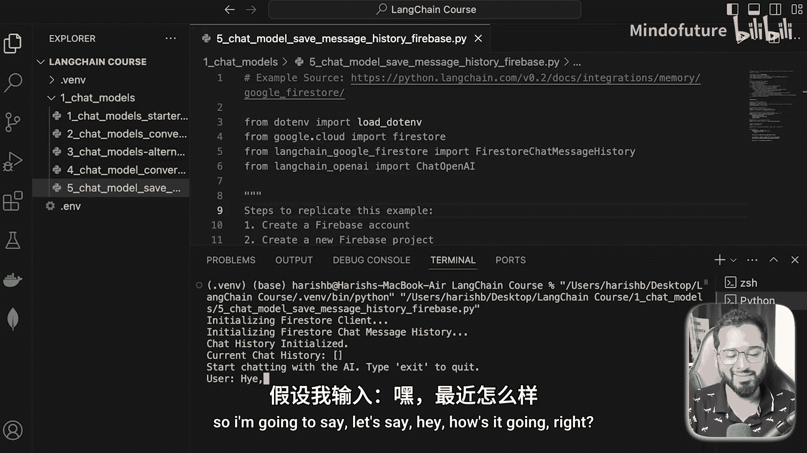

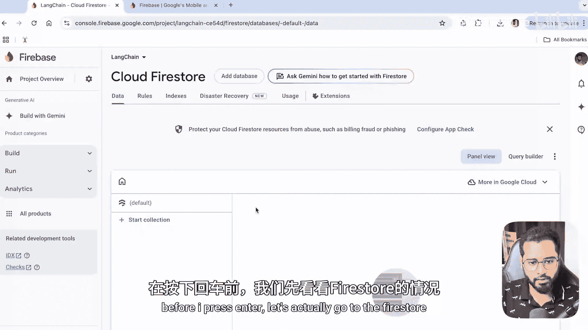

And you can see the database currently is empty right， So let's come back。

 So if I come back and if I press enter。😊，You can see that the AI responds with a very simple message right now I am going to ask it something like lets say what is2 plus 2。

😊，Enter。Let's give it a few seconds yeah it gives back four right now if I go back to the database you can now see that we have four messages that have been added。

😊。

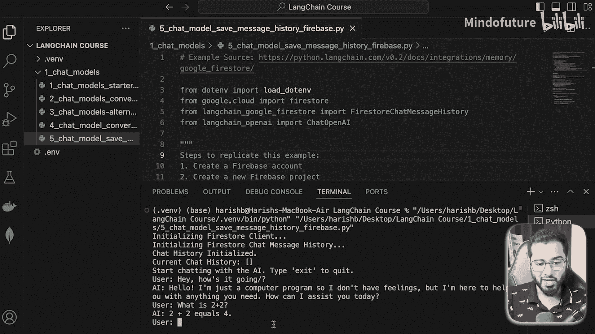

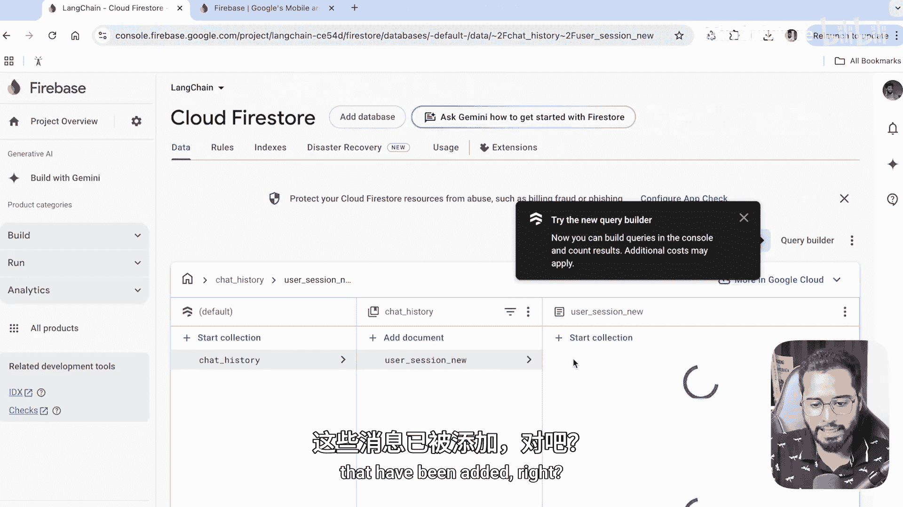

Right， so now if I stop the terminal。 So let's actually do that。 Let's stop the terminal。And then。

 run the file again。Okay， you can see that all the messages are retrieved from the database so that the conversation actually continues right So that is what I've coded out already。

 let's quickly walk through it and youll find it to be pretty simple right the actual main code is not really that much different to what we wrote in the previous section。

 most of the difference is just in the Firebase setup part。 Okay so to make it very。

 very simple for you。 I've typed out installation steps right here。 it's very straightforward。

 So once we do the cloud setup works Firebase Firestore setup works the rest to the code is pretty much the same。

 There is literally no difference actually。😊。

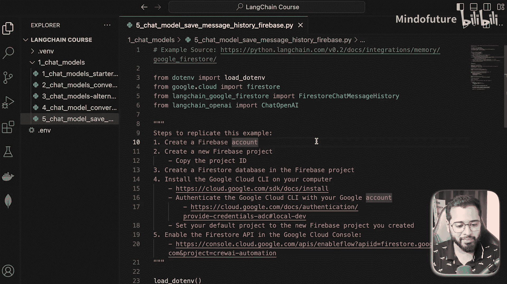

So let's see So the first thing that we are going to be doing is creating a Firebase account。

 so you can just go to Firebase do Googlegle dot co。😊。

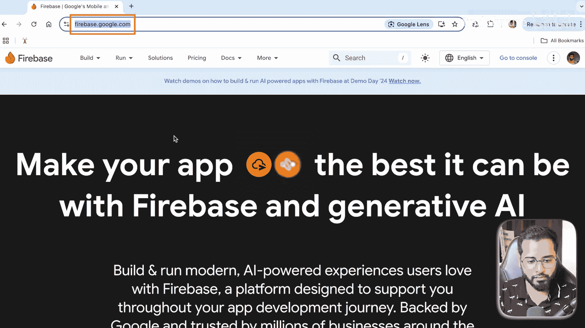

Okay。And then let's go to console right， So click on this's go to console。

 And then we are going to enter the name of the project。 So I'm going to call it la chain。Allright。

 so we don't really need analytics for this。And the project creation itself might take a minute or so。

 Let's actually give it some time。Alright， so its done and let's click on this button right here and you are in the project now now you can just go to the build drop down on the left side and choose Firebase database and this is what we are going to be working with Okay so just go ahead and click on create a database I'm going to leave the location as it is I'm going to click on next next。

😊，And now we can leave it in test mode because the application is not live yet。

 And once we click on create。😊，Fi store will be set up for you in this project。

 So if you haven't worked with Firestore before， it is basically just a document based nosQL database。

 So you have something called a collection in this panel you can have as many collections as you want So for example。

 we can have a collection called users and each user document can in turn have a collection inside of it let's say user messages right and each of those messages inside of the user messages is going to be。

What you guess it right。 It's going to be a document。 So it sort of alternates。

 So we have collection document collection document right So just a short crash course on Firebase Fire store for you。

 So let's head back and let's look at the third step in the list。 The third step is going to be。

 you need to retrieve the project I D of the project that you've just created So you see our application needs to know which projects Firebase database it needs to make changes to because we can have multiple Firebase projects。

 right， So to get it， we can just go back to Firebase。😊。

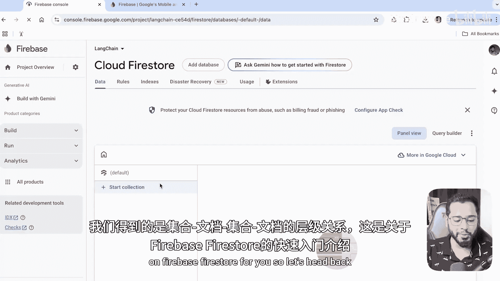

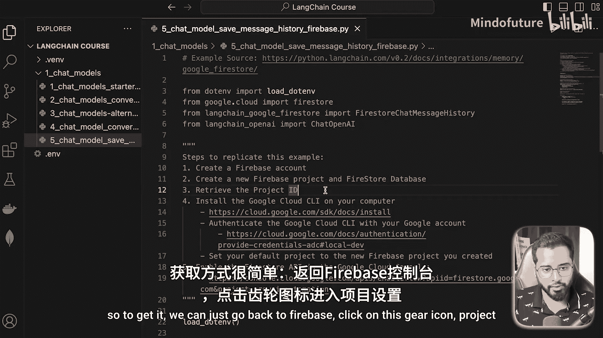

Click on this gear icon。Project settings。Project I， So we have it right here。

 So I'm just going to copy this。

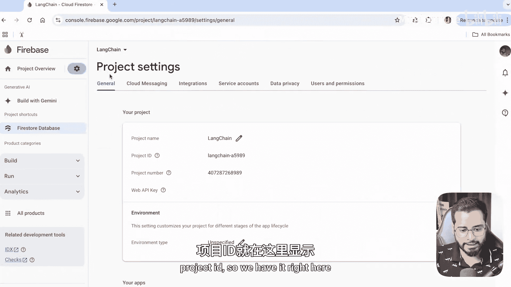

Come back here。And I am going to replace this value perfect。

 Now let us look at the fourth step right here。 it might look a little bit complicated。

 but is actually very simple。😊，So， all that we are doing is we need to install the Google Cloud CI in our computer and sort of authenticate ourselves cells so that Google or Firebase sort of trusts us when we make changes to the database right so the setup is extremely simple just click on this particular link right here。

😊。

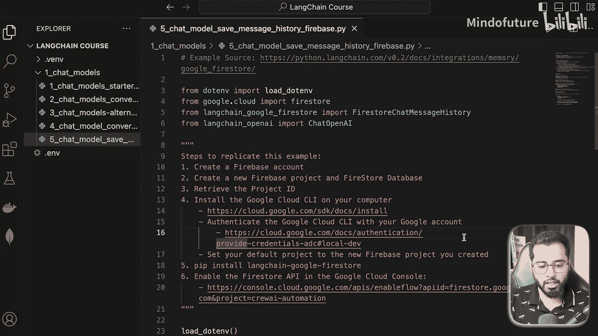

Scroll all the way down。If youre a Mac user just download the right package based on your operating system the same for Windows as well and then wherever this particular package is installed。

 probably it is going to be in the downloads folder so just go to that particular path in your terminal and run this particular commander the same thing for Windows as well All the instructionss are easily laid out here you just need to follow it right and finally initialize the CI by running this last commander and that is it for the step let's look at the next step。

😊，So we have to configure something called the ABC right the documentation makes it very。

 very easy to set this up。 So lets click on this particular link。😊。

And let's scroll down and you will have to run this particular command。😊。

And do an application default login right so we have to do that and finally you will have to run this command as well and that is the last step it is pretty simple there's tons of tutorials out there that will help you set this up and to be honest you don't even need any of these tutorials because the documentation is pretty straightforward as well but we are not going to go too deep into it in this course because it is a little out of scope for this course right。

😊。

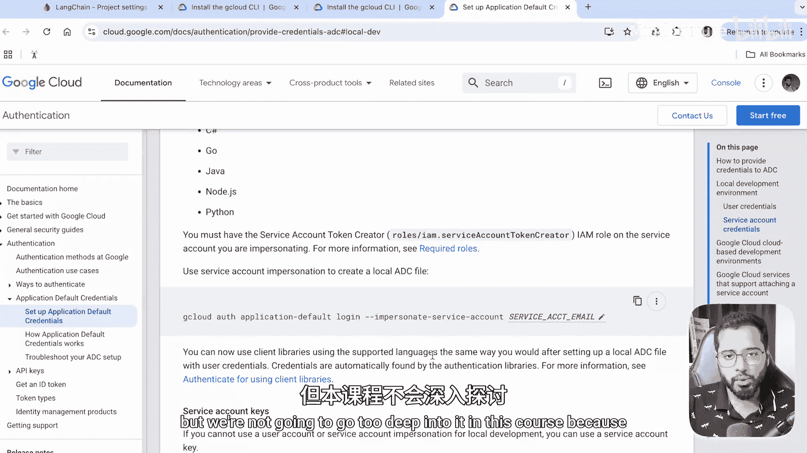

And finally， we are going to install this particular package as well。😊，Again。

 this package is built by L chain， and it does all the magic to communicate with the the Firebase fire store。

 right， So this entire thing， the Google cloud setup up is kind of the most difficult part of the section。

 The setup of it。 But the rest of it is very similar to what we did in the previous section。😊。

And at the end， we just have to make sure that we have all the right imports up here， perfect。

So let's actually scroll down and see what we have。😊。

So the first thing is we need to initialize our fire store client。

 so we are going to pass in this particular project I as well that we had just copied a while ago right now we are going to initialize the fire store chart message history。

This takes in three arguments the session ID， which is going to be the unique identifier for the current chat session。

😊，So we can name it pretty much anything that we want I have just gone ahead and named it user session。

 but ideally this should be a long 16 digit string right because there is going to be a lot of user sessions。

😊，And then we are going to have the collection name right so the collection name that is going to be created and updated in the fire store is going to be chat underscore history right here。

😊，And you can name it message history as well， right， pretty much anything that you want。And finally。

 we are going to pass in the client as well。😊，So the rest of the code is literally no different to what we did in the previous section so the only change that we are going to be doing is instead of having the history list in memory we are now going to be having it from the cloud right so this chat history is being returned by the Lchas Firestore class so now if we run this file we can just start chatting with the AI right and more importantly we get to store every single message in the cloud and this particular class the firestore chat message history class sort of abstracts away a lot of the complexities so it sort of enables very smooth communication between laing as well as the fire store right and that brings us to the conclusion of chat models so I hope you now have a pretty good understanding of how chat models work and how you can actually build production grade applications by storing your messages in the cloud and also I'm pretty excited about the next core component of laing which is going to be prompt templates and it's one of the most easiest component to learn but at the same time when you're building production grade application。

😊，That would save you a lot of time。 So I'm pretty excited。 and as you there。😊。

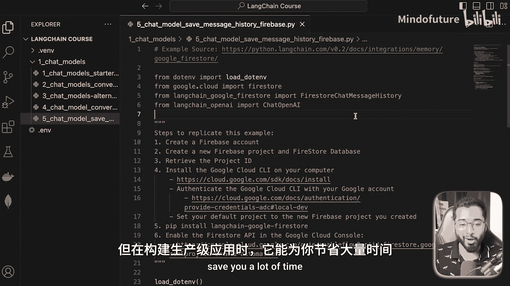