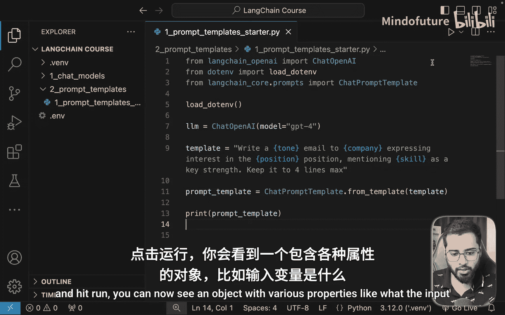
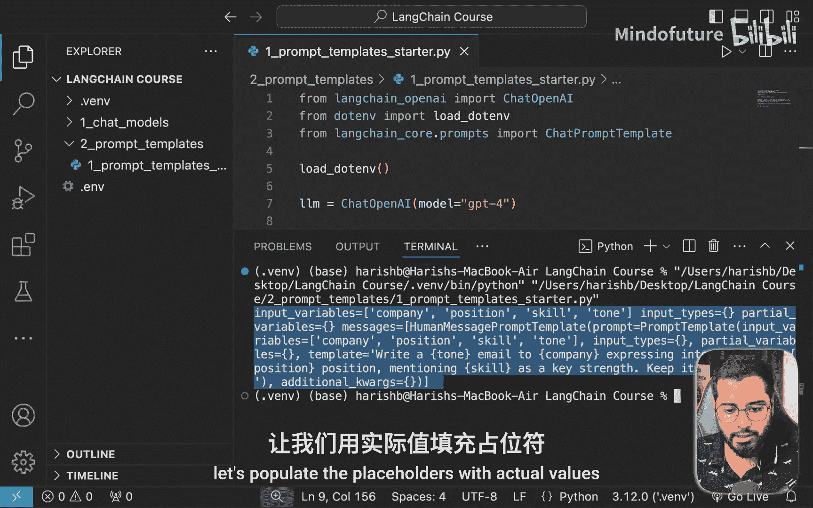
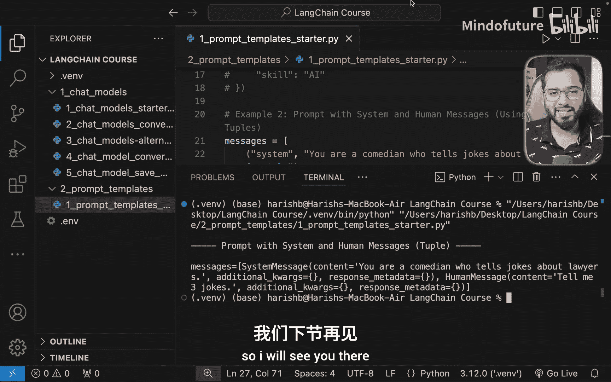

# Langchain初学者入门2025 p12 P12_#12_提示模板 -BV1jgeWzYEey_p12-

Welcome to the second core component of La chain call prompt templates。

 This is something that you will find it very easy to understand。

 but in production grade applications， you will find yourself using this a lot。

 So let's actually go ahead。😊，Let us look at an example and you will be able to grasp it very quickly。

 So this is an example of a prompt。😊，So we have write a tone email to company expressing interest in the position。

Mentioning the skill as the key strength。So all these placeholder values can be replaced with custom values like the tone could be write an enthusiastic email right a confident email right a professional email right a warm email right So the company here could be pretty much any company right it could be Google。

 Amazon， Samsung， whatever。😊，And the position here could be you know designer developer etc and we have the skill as well right So if we pass in these values as input to the prompt with let's say tone as professional the company as Samsung the position as AI engineer we get a string like this with the values replaced that is it right so if you're building a product that generates emails based on all these varying parameters then you can imagine we can easily make it happen with prompt templates so let's actually quickly see how we can implement all of this in our code。

😊，So you can see I've created a new file under prompt templates and I've initialized a chat model here as well。

 So it's no different to what we've been doing so far。

 So now is when we are going to start working with prompt templates。

 So step1 we create a string with the placeholders Also note that this string right here is only a prompt that you and I can understand。

 So this is the first step right So the next step is to convert this prompt into a format that La chain understands。

 So that is going to be step 2。 So to do that I'm going to import something right here。

 So I'm going to say。😊，From。Langch core。Dot prompts。So from this particular Laching core package。

 we need the prompts module and from this module， we want to import the chat prompt template。Class。

So if you're curious about where we got this la chain core from， because we never installed it right。

 it automatically gets installed when we installed the open AI chart model package that we installed earlier in the first section。

 Alright， So to check， you can just go to the virtual environment folder inside of the library right here you'll be able to find the core inside。

 Okay， it's right here。 Allright， now let's look at step 2。

 So let's actually go below the template string right here。

 and let's convert this prompt into a prompt that lacha understands。

 So I'm going to name it prompt template。😊，Right， equals。Chat prompt template。

And we want to use the from template method。And we want to pass in the template string right here。

So if I now go ahead and print this variable。And hit run。

You can now see an object with various properties like what the input variables are and a lot of other things right great。

 So this brings us to step number3。 let's populate the placeholders with actual values。

 So to do that I'm going to say prompt template and I'm going to use the magic keyword invoke to tell La chain to do that in the last section we use the invo keyword to talk to the LLM in this case。

 we are going to do it to replace all the placeholders。

 So this takes in an object okay so I'm going to copy paste an object right here and I'm going to save the return value into a variable called。

😊。

Prompt， okay， so let's print this as well。 Hi run。 And now you can see Lchain has converted this prompt template into a list with human message because only a human can prompt。

 right， pretty obvious。 Also， if you remember from the previous sections。

 this is the exact structure that we send to the LLM for answers with the list in everything right。

 we can do the same thing here， we can say LLM dot。😊，Invoke and pass in the prompt。

And then we can store the result in a variable called result。😊，And let's print that as well。

 so just the content。Allright， so if I hit run。Let's give it a few seconds。

And now you can see the subject and the content of the email and everything right here and the tone that we provided was energetic so the tone of the email will also be energetic right perfect So so far we've been able to take a prompt and make it into a template and send it to an LLM but there is one limitation with this particular approach So when we convert our python string prompt right into the prompt that Langs understands which we do right here。

😊，You always see it creates a list with just one human message right but what if we want more control right what if we want something like this where the system message is also customizable And that is what let's say your product the product that your building needs right So doing that is very simple as well。

 So I'm just going to paste a bit of code here and let's go through it step by step。😊，Alright。

 so we are going to have a list of tus right so a tuil is a data structure in Python and each tuil will have the type of message and the message itself。

 Alright so in this example we have the system message and the human message with placeholders All right now this is a template that U me Python can understand but Lacha does not understand it right so we are converting that right here So as you can see this from messages method not only takes a simple string but also a list of tus as well right and then finally we are replacing the values by passing in these placeholder values and invoking it。

😊，Now I've already gone ahead and printed it as well。 So let's actually run this file right now。😊。

All right， so now you can see we have an entire list with system message as the first item and the placeholder value has been replaced here as well plus we also have the human message as well。

😊，Now， this could be a functionality that your product requires。 And now you know how to do it。

 Now we can easily pass this fully built prompt and get responses from the LLM by using the LLM variable that we've just created using the chart model And passing this final prompt。

 Okay， and that is it for the section。 As I said， this is a relatively very simple component plank chain。

 And that brings us to the end of the section in the next section we are going to be looking at Another core component plan chain called chains。

 And personally， it is my favorite because it is really fun to work with at the same time。

 it potential is really unlimited。 So Ill see you there。😊。

