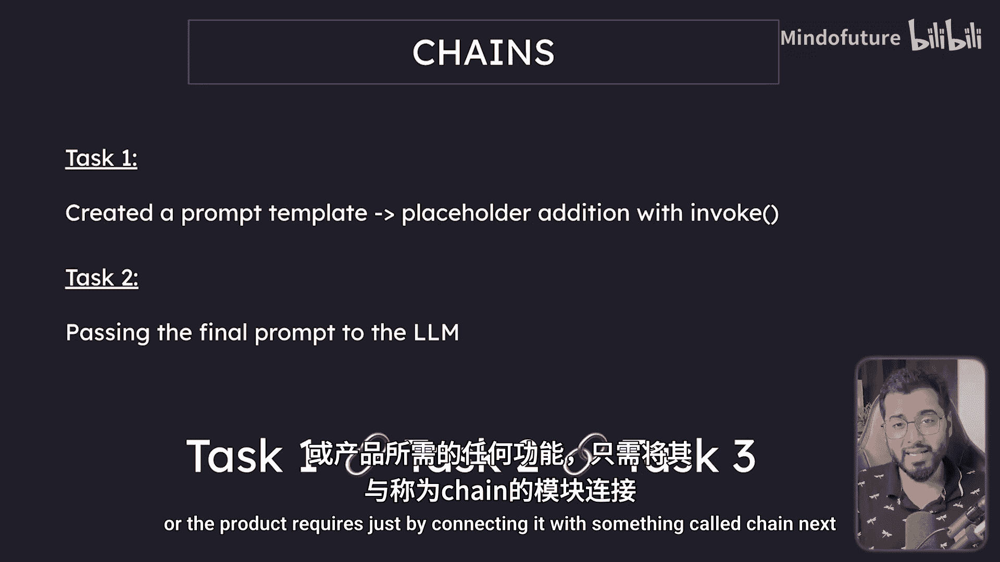
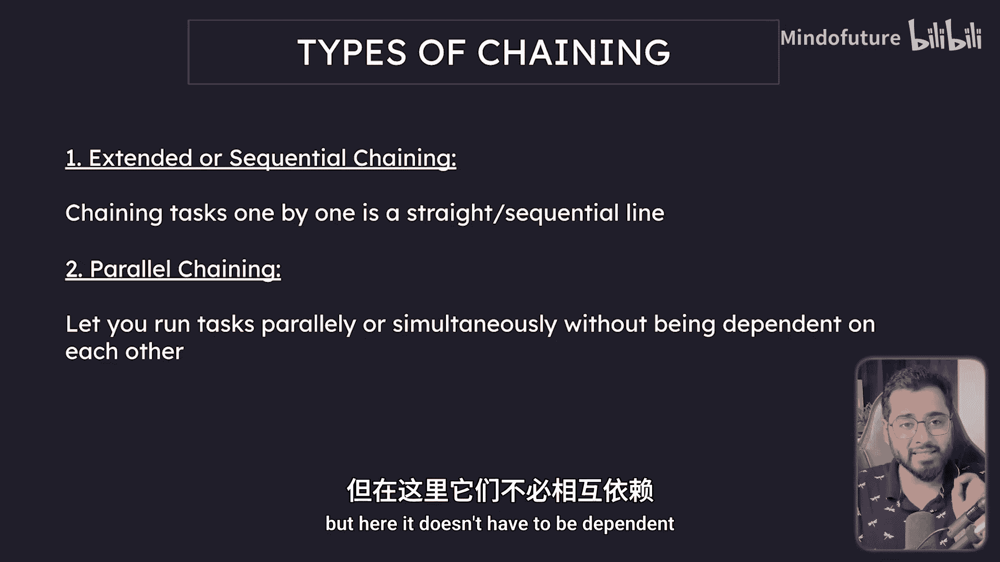
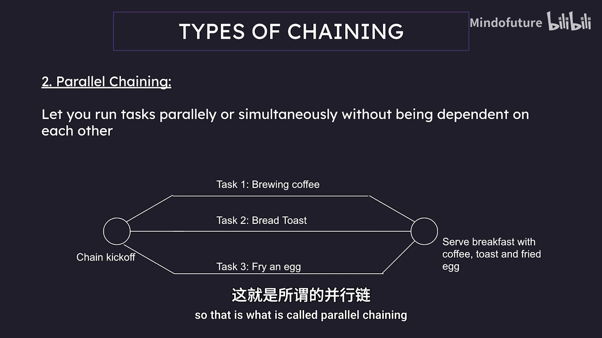
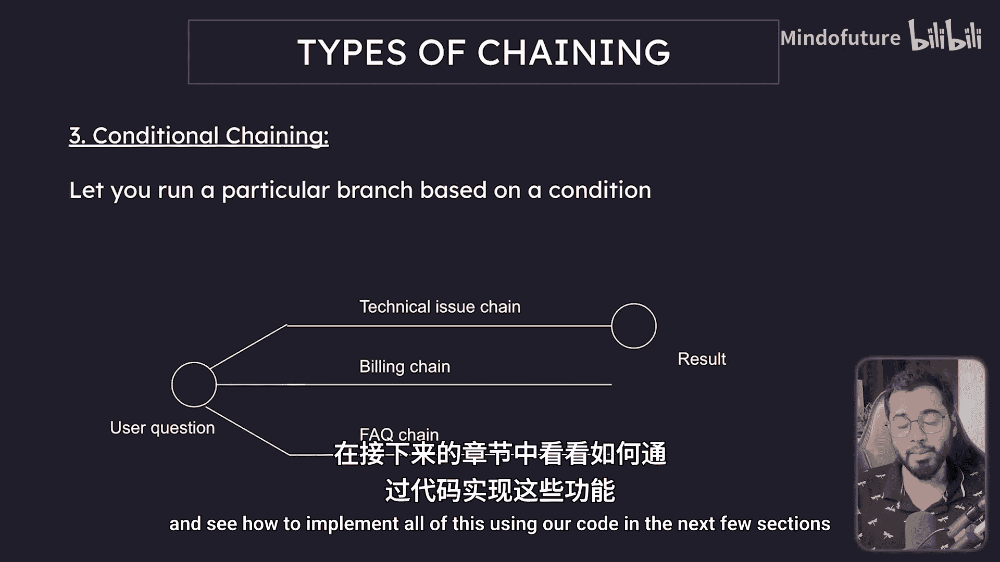

# Langchain初学者入门2025 p13 P13_#13_链概述 -BV1jgeWzYEey_p13-

In this section， we are going to be covering the third component of lanching call chains。

 and it is personally my favorite component of lanching because it lets you connect multiple tasks together by chaining it together。

 and it helps you create sort of like a unified workflow Let's look at a quick example。

 So if you remember from the prompt template example where we just created a prompt template called the invoke method on it with the placeholder values passed in and it gave us the final output right so this can be considered as one task。

 and another task could be passing that prompt to the model and calling the invoke method on it again。

 So we can chain the first task and the second task so that once the first task is done the result of that is passed to the second task and then so on and so forth So you can think of a third task as well So from the second task we' are actually getting the response from the LLM。

 So what we can do is there might be a requirement in the product where you might have to convert that particular response from the LLM into a specific language。

 Let's say French。😊，Right so that could be a third task。

 so sending that message to the LLM saying it， okay convert this particular message into French and then send it to me。

 So that could be the third task。 a fourth task could be sending that particular response。

 the French response to another person via email right So that could be a fourth task。

 So we are chaining all of these tasks together to create a unified workflow。

 So that is the idea right So by using chains， we can do pretty much anything that the business or the product requires just by connecting it with something called chain Next。

 we are going to be looking at all the possible ways to chain tasks。

 So the first task is the extended or sequential chain right So this is basically what we've been discussing so far we have the first task the response of that is getting sent to the second one and then the third one and the fourth one。

 So it is in a straight line It is sequential right So that is the that is called extended or sequential chain。

😊。

The next type is we have parallel chain right so with this type of chain we can run tasks parallelly or simultaneously without it being dependent on each other right so in the previous example each task was sort of dependent on the previous one right。

😊，But here it doesn't have to be dependent。 I'll give you an example Allright so here's an example taskask one could be brewing a cup of coffee。

 taskask two could be making a bread toast taskask 3 could be frying an egg right all these tasks run parallelly and quickly and then sort of converge into the fourth task which is to serve a breakfast plate with the coffee toast and fried egg So in this example you can see that none of these tasks are dependent on the previous one they all execute parallelly and then they converge right so that is what is called parallel chain。

😊。

And finally， we also have conditional training which can be used in certain scenarios here we start a task and based on the result of the task or the condition it can either go here or here or here in parallel chain all the tasks execute simultaneously all the chains execute simultaneously but in this case based on a condition it will only go towards one chain I'll give you an example so let's say in a customer support chatbot if the user selects technical issue the bot runs a troubleshooting sequence which can be thought of as the first branch。

😊，If the user were to select building question it triggers a building inquiry sequence。

 which is the second branch， whereas if it is a general question then another sequence it could be an FAQ sequence right so based on the condition based on whatever the user selects that particular chain the flow goes into that particular chain all the chains do not execute right so I hope this high level explanation is sufficient let us actually jump into our code and see how to implement all of this using our code in the next few sections as you there。

😊。

