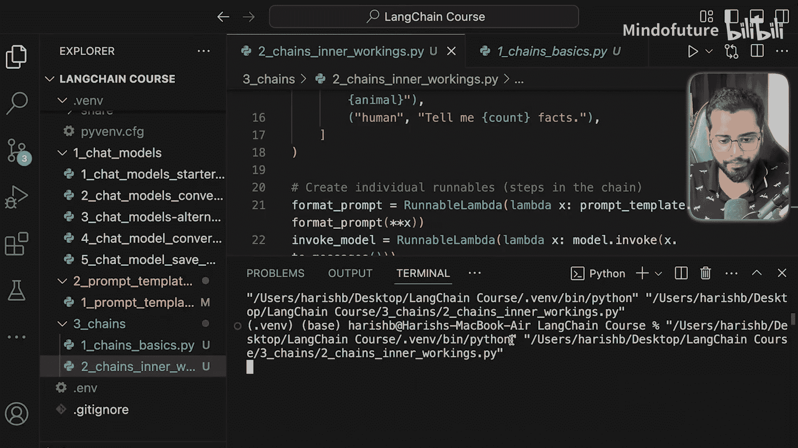

# Langchain初学者入门2025 p15 P15_#15_链内部工作原理 -BV1jgeWzYEey_p15-

Hello guys， welcome to the second example in chains where we are going to be seeing what is going on internally in a chain。

 So basically if we understand that it will it will make it easier for us to customize it based on our own use case our own business necessities So in the previous section we essentially connected different tasks together using the pipe operator So what would we do we created a pro template right and the result of that is passed to the model and then the result of the LLM is then passed to this other task which only extracts the content property right So for this section though let us actually try to implement the same thing but without the pipe operator that will help us see what is actually going on under chains under the hood basically So what I've done is I've just gone ahead and created another file right here。

😊。

And Ive created the code here as well right so if we scroll down up until here it is all the code that weve written in the previous section no different okay so we are creating the model and then we are creating the prompt template and then we have all the placeholders here as well。

😊，Now we basically know the goal right we know we need to create a workflow that takes the prompt template invokes it with all the values and then creates the final prompt right so that is going to be task one and the result of the task one the chat model should take that and make a call to the LLM right so that is going to be task2 so this is what we know and finally the task3 is2 basically extract the content property alone right so we are going to be chaining all of these tasks together with something called a runnable lambmbda okay so if we scroll up to the very top we can see that we are importing something called runnable lambda and something called runnable sequence from La so this is very important this is what we are going to be learning in the section。

😊，So what is it actually right so to put it very simply a runnable lambda is just a simple wrapper that lets us create each task as a single reusable unit each runnable lambda takes an input does something with it it could be like filling in a prompt or calling the model and then gives us the output so this way we can connect each step smoothly okay so we have the first runnable lambda which is going to format the prompt。

😊，And inside of the runable lambda we are providing a function which takes input values and returns a computed value alright so in this case I'm using something called a python lambda function but you can use pretty much any you can use even regular functions if you want basically just a function that takes in an input and then returns an output right so if you do not know what python lambmbda functions are it's basically just a function that you can write in line without even a function name right it is a very simple empty function that takes in something and then return something so if you want to learn more about it there's tons of tutorial out there but yeah so this x is the input to the lambmbda function and this expression is going to return the output right so as you can see this object or the dictionary is what will be passed in as x inside here and then we are going to format the prompt by spreading out this object as multiple arguments and this format prompt method is going to replace all of the placeholder values。

😊，With the past in values note that we are not calling the invoke method here。

 as we did in the previous sections， so there is a small difference okay。

So invoke method basically what it does is it not only replaces the placeholder values but it also converts the data into the right format that can be sent to the LLM right whereas this method only replaces the placeholder values the process of converting the data into the right structure that can be sent to the LLM all of that will be done down here when we invoke the chain okay not up here so this constitutes as the first task or the first runable right in La we can think of each task as a runable okay we can call each task as a runable as well。

😊，Let's now look at the second task so the second task is to take in a prompt string from the previous task that is and then call the LLm using the invoke method and we know that and we know that the last task is to only extract the content keyword from the response of the previous task so so far we have a total of three different tasks or we can also call them three different runables but theyre all separate right they don't actually work with each other as a single unified workflow right so the next step is we need to chain it together right so this is where langchain provides something called a runable sequence so if you remember we imported it right runable sequence so using this particular class we can chain multiple runnables together okay so you can see this is what's going to return us a chain and always remember this particular runnable sequence class is always going to take in three parameters so it is always going to have the first middle and the last parameters the first task。

😊，There is always going to have the first task it is pretty intuitive right and the last one is always going to have the last task and in the middle it does not matter if you have one task two tasks51000 tasks all of those tasks needs to be put in this array format in the middle parameter okay so why do we do it like that well if I go inside of this class by pressing on the command on Mac or control on PC and then I'm going to scroll down to the class definition。

😊，You can see that the first and the last is going to be。

One runable each right so the first parameter and the last parameter is always going to take just one runnable and the middle one is going to be a list of runables right and also if we scroll up a little bit you can see that it says a runnable sequence can be instantiated directly or a more common way to do it is by using the pipe operator。

😊，So coming back in your projects we can either use this particular class and chain runnerables together or you can use the La chain expression language so Lain expression language is basically using the piping operator the pipe operator and connecting different runnerables together okay so we can also do it like this。

😊，Under the hood， both are the same right so you can create your separate runables using this runable class and pass in a function。

 a normal Python function or a simple Lada function it needs to take in this x amount of inputs and it does something inside of it and then it returns a value so once you have the runners you can chain it together using the one way or the other we can either do it by piping it together using the pipe operator or we can use this particular class So when we put it all together we are finally going to get our chain okay and we can invoke it by providing all of these placeholder values So now I'm going to run our chain so I can either click on this play button right here or you can just go to your terminal and say Python3 or Python if you're a Windows user and then just go to this file and then hit enter right so I'm gonna click on play。

😊。

Let's give it a few seconds。And perfect there we go so we have two facts about cats because that is exactly what we specified here right so that is how things work under the hood personally I prefer to work with the pipe operator basically use the la and expression language but you can also use this particular class you know what let me actually put it side by side so you can actually see the difference okay。

😊，So you can see that compared to doing it this way using the pipe operator is much more easier to understand right yeah。

😊，And in the next section we are going to be looking into something very interesting so if you remember from the overview section we saw that there are different ways of chaining chains right so for example we had extended chains we had parallel chains branching chains I mean conditional chains right so we will actually look at examples for each of those types and see how you know real worldorl applications are built so that you get a clear idea of where we can actually use it right so I'm pretty excited and I'll see you there。

😊。