# Langchain初学者入门2025 p16 P16_#16_链_顺序链接 -BV1jgeWzYEey_p16-

So in the section we will see how we can actually extend the chains that we have written so far and how we can continually add on more and more runables so Ive already populated the code as you can see right here we are working with the same promptng as the previous section but I've just given it a slightly better name。

😊。

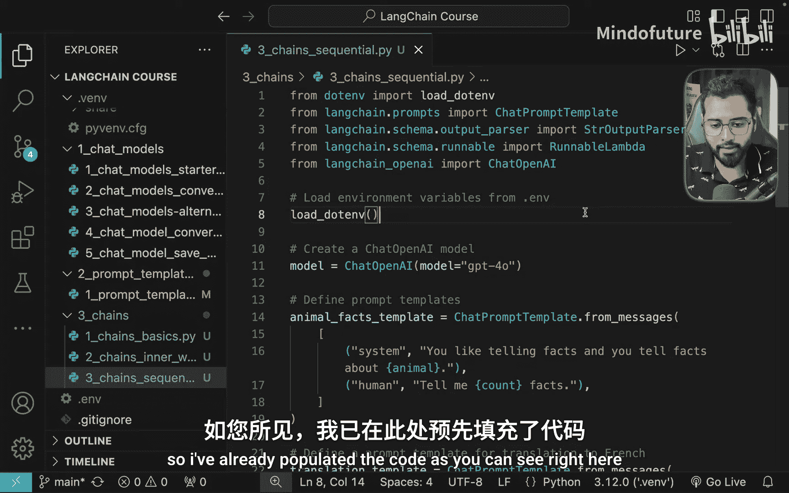

Ive also added a few more prompts here， but actually let's just go to the chain itself right here and see what we are doing well take it from the ground up okay so the first three nus we've already done right so basically we are just going to we just have the first prompt which is going to tell the model to generate a certain number of facts about a certain animal right so in this case two facts about cats。

😊。

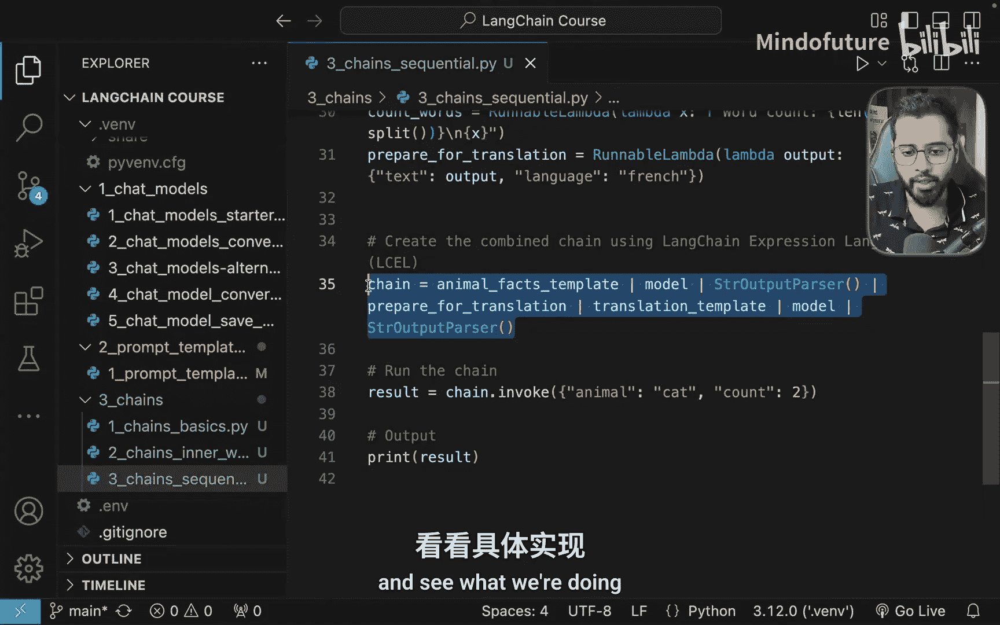

And we are extracting the content alone right here。 Okay， great， so now we have two facts。

 so what next。

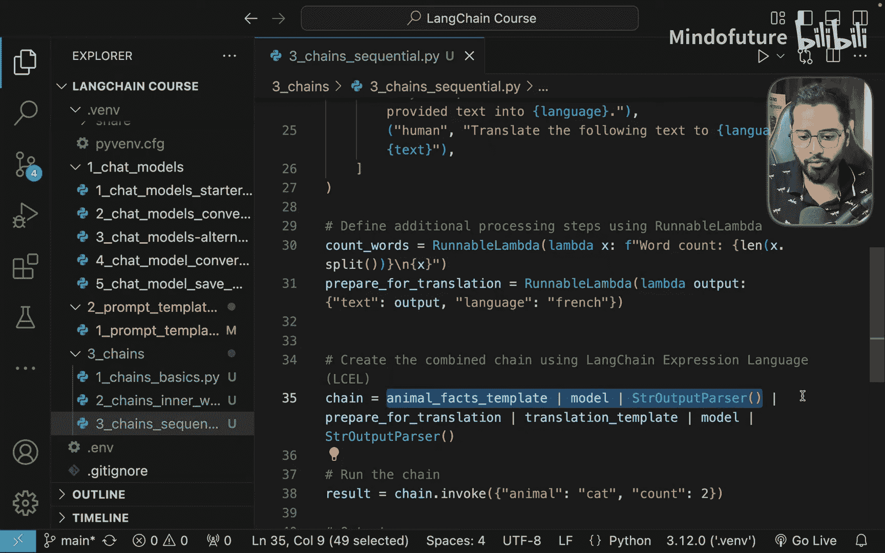

So let's say based on my use case， I run a French Twitter page and actually not an English Twitter page right but the response that we would have gotten from the model is going to be in English right so now the next thing that I want to do is send that text to an LLM and ask the LLM to convert it into French so to hit the LLM what we want to do before that we want to always do one thing right we need a prompt template that is going to tell the LLM to translated to a certain language right so what input does the prompt template require it requires an object like this to be passed into it right a prompt template always requires an object that needs to be passed into it but is the result of this string output par an object of course not it only has the content string so we need to prepare the input so that we can actually prepare the prepare to pass it inside of the prompt template so what we've done here is that weve written a runable called preparepa for translation。

😊。

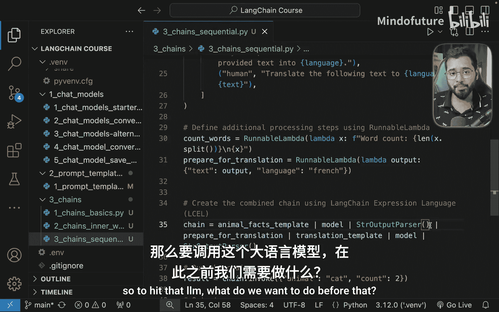

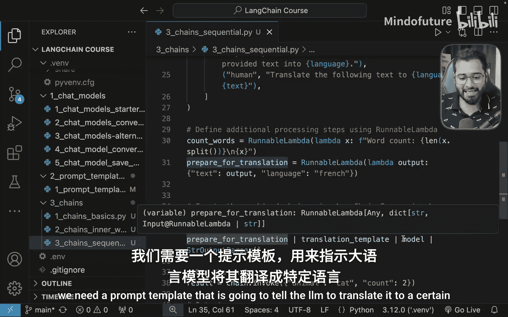

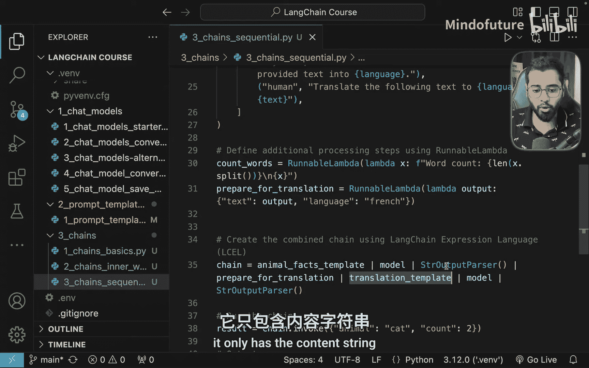

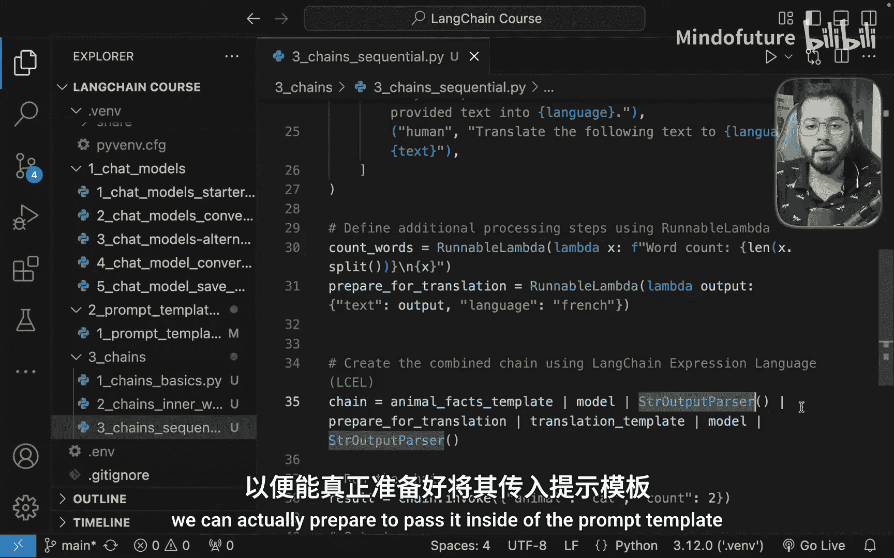

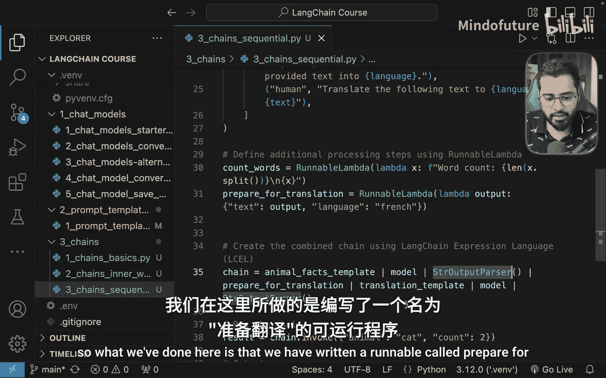

That takes the output of the previous task。And then you can see it also provides the output as well as the language and then returns it as an object to the next task right So now that object goes inside of the prompt template Okay it says that you're a translator and your job is to convert the text to a certain language so we have provided the text as well as the language in the object now the final prompt will be generated as well right so now that the prompt is now sent to the model which now gets invoked and we finally get the content printed to the console right so that is how simple it is let's actually run this file So I'm just going to go ahead and click on the run button All right we can see that it is starting to execute let's give it a couple of seconds and perfect so you can see that we have two facts about catchs in French I can't read it either and we can even further extend this right so we can create another runable which is now going to talk to the Twitter API right and then post it post that particular fact as a post as a Twitter post basically right。

😊。

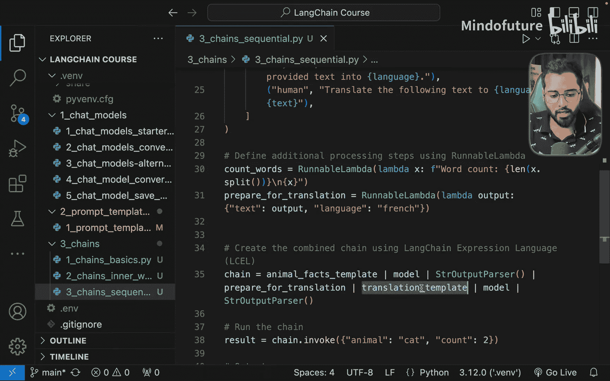

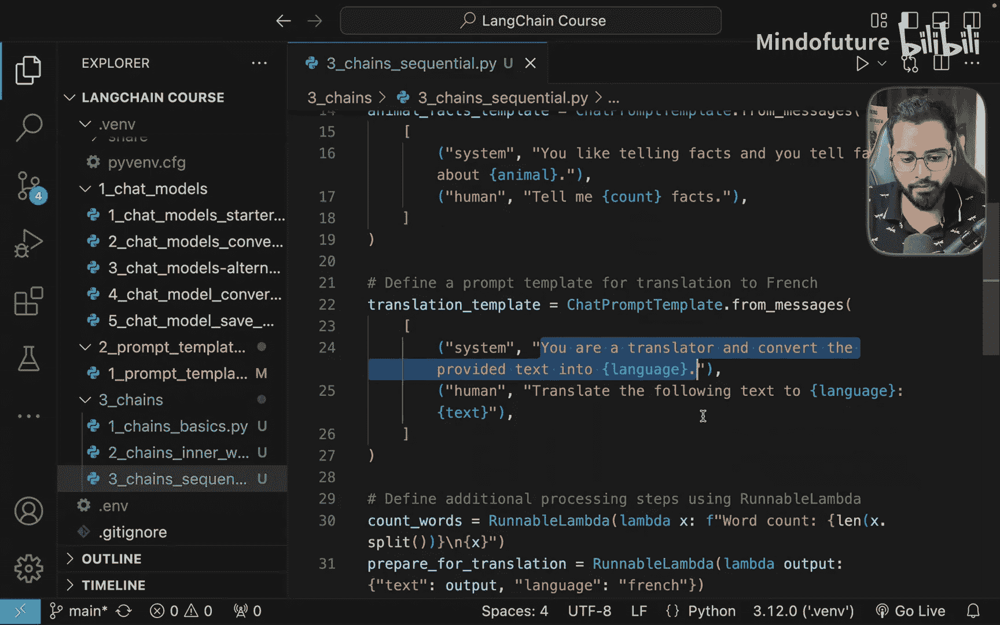

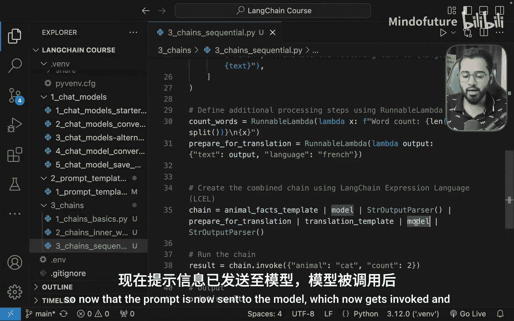

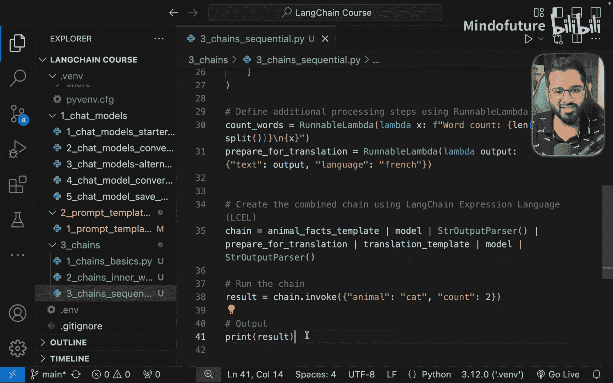

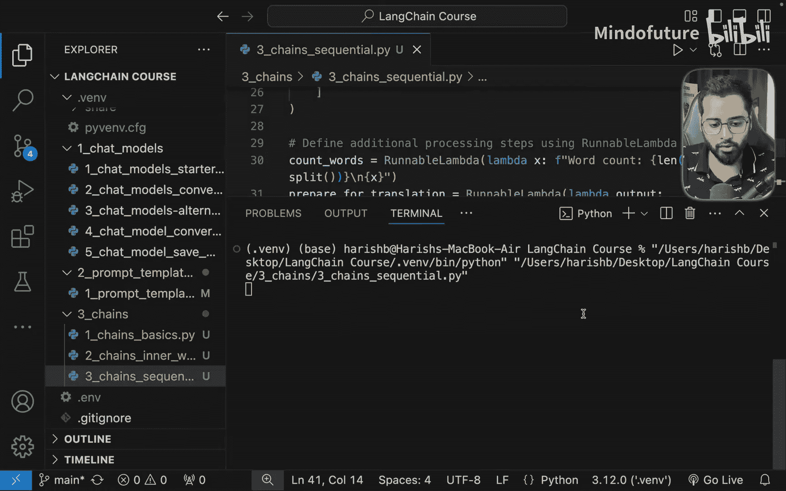

So you can see that。😊，Sky is the limit when it comes to working with chains right we can keep on adding more and more chains sequentially in a straight line right so that is what sequential chain is in a nutshell So in the next section we'll actually be looking at a type of chain called parallel chain so as you there。

😊。

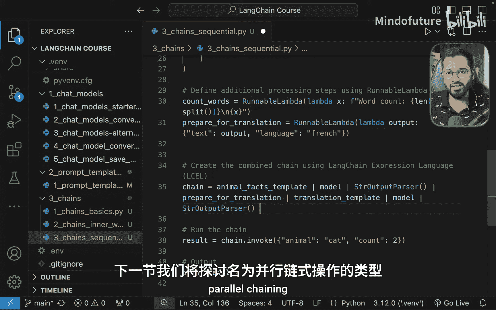