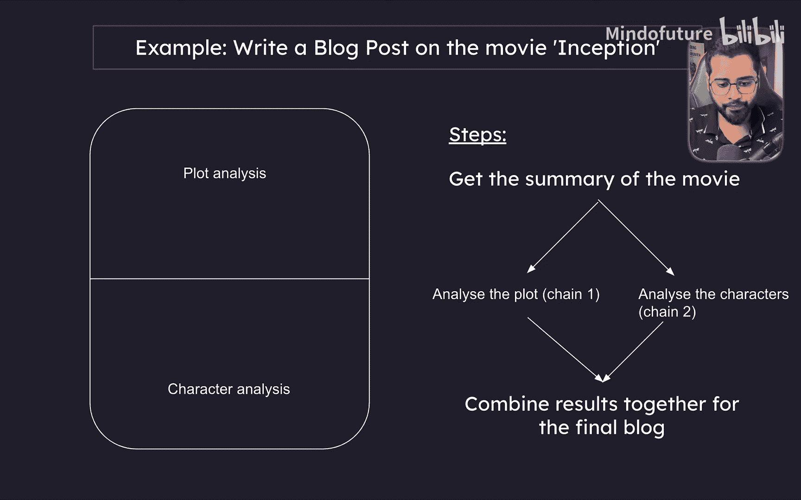
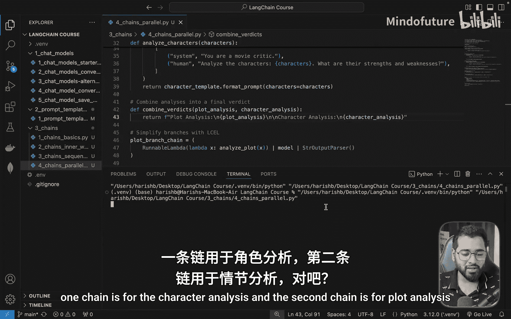
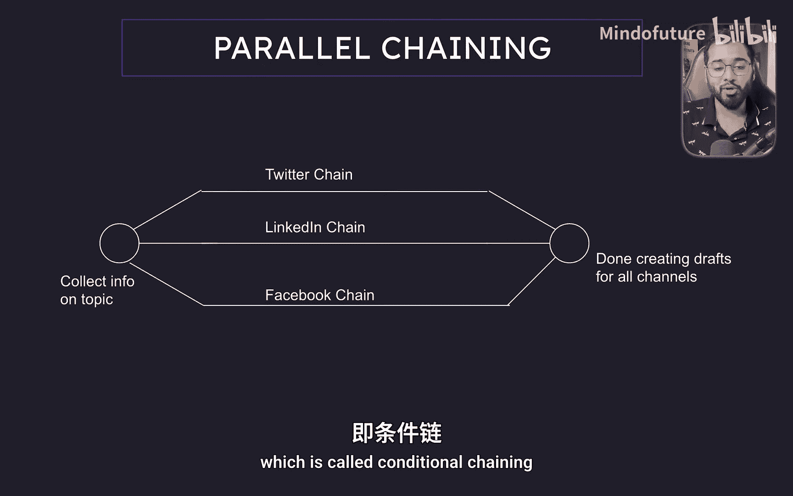

# Langchain初学者入门2025 p17 P17_#17_链_并行链接 -BV1jgeWzYEey_p17-

In this section， let us see how we can use parallel chain in launch chain and just to jo your memory。

 let's actually go back to the diagram。 So what we are going to be doing is so first off we are going to kick off one task okay and that triggers two different chains or three or even 100 even right and all those chains run parallelly at the same time。

😊，And once all of those chains resolve and come to an end we can then do something with the result of all of those chains right so I'm going to be using a very simple example right here let's say I want to write a blog post about a movie that I'm critiquing or analyzing okay a blog post let's say the movie is inception。

😊，And I want the first section of the blog post to have my analysis of the plot okay and I want the second section of the blog post to have the analysis of the characters involved so the first section is going to be all about the plot and the second section is going to be all about the characters okay。

😊，So what can we do first we can first get the summary of the movie from the LLM and once we have it we can actually start off two separate chains okay so the first chain is going to analyze the plot and the second chain is going to analyze the characters。

Again it's a very simple example but you can imagine that we can apply it to pretty much anything basically we trigger one task and that is going to set off several chains parallelly and then once all of it comes to an end we do something with the results of all of those right and that's exactly what we are doing here as well so let's actually go down to the chain itself you can see I've already prepared the code and let's actually go through it one by one。

😊。

So as we discussed we are first getting the summary of the movie from the LLM and to get it from the LLM we need to prompt it first okay so just always remember that is right before calling the LLM always prompt it because it makes life so much easier for us so we have a summary template if I go ahead and click on it with command the system message says you are a movie critic right provide me a brief summary of the movie。

😊，So we are passing the movie name down here when we are invoking this chain。

Okay now this is when it starts to get interesting so once we get the content alone we are now going to start something called a runnable parallel okay so basically this is a class that Lain provides that will help us run multiple chains simultaneously so we are basically you can see that we are importing this from up here so let's come down and you can see that we specify a branches directory and we can actually provide a name for each of the branches or the chains that we want to start okay so in this case we have the plot chain which is going to analyze the plot and then we also have the characters chain which is also going to analyze the characters。

😊，Right okay you picture this right， we have the first chain and the second chain and we are basically naming a trier。

So let's look at the first chain I'm going to click on it and you can see that this is a chain itself right so the summary of the movie from the previous task you remember the first task was to gather all of the summary from the LLM right so that summary of the movie from the previous task is passed into this first runnable lambmbda task okay so here were constructing another prompt。

😊，So here we are just creating a prompt that tells the model to analyze the plot if I scroll up here you can see that it says you are a movie critic and we provide in the plot here as well。

😊，Okay， so we are passing it over to the model now and finally we are going to get the output right here Okay so this is the exact same thing that we are doing for the character analysis as well right so we are going to create a prompt passing in the plot summary same as before making the LLM call and keeping the character analysis result ready okay so once both of these chains sort of okay we have both these chains right so once both of these chains are done with their execution。

😊，You can imagine that both of those chains are running parallelly right one can end earlier one can end a lot before。

 but basically once everything all the parallel chains are done with their execution we get to the next stage in the chain where we have a method to combine all of the results right so you can see the result of the runnable parallel is an object and the object is going to have a property called branches and each of the branch names with their corresponding result will be present inside of that as well。

So if we actually take a look inside of this method。

 that is all that we're doing right here right all that we're doing is combining it all together。

 That's it。 So let's run this file and then see the result。

 and it's going to take a while because it's first generating the summary and then another API call goes and then it starts two different chains right one chain is for the character analysis and the second chain is for plot analysis right Allright so we have the result right here。

 we first see the plot analysis and if we scroll down here we can see that we have the character analysis as well right So this is just a very simple example you can use this for a variety of use cases based on the business requirements right So I' also give you another example so that you you can see where we can apply this concept of parallel chain let's say you want to write a social media post on multiple channels on the same topic。

 let's say So we have Twitter we have linked in Instagram Facebook all of these channels have different format。

😊。

right we have to write our content in a different way right we can also generate a full length YouTube script as well right so what could be the first task that we have to do。

The first task is to basically collect all of the information on the topic right so let's say that's what we first do and once we have that we can then set off a chain for each and every single social media channel right so because each and every single channel have their own style of content right so we can also have each chain talk to the APIs of each of those channels and also post them for you。

Right so we first off we collect all the necessary information we set off multiple chains parallelly to execute they all do their own separate things where they are formatting the content based on you know the channel that they are focusing on and then they also communicate in the next runable they also communicate with the corresponding channelss Apis and post them if you don't want La to directly post that particular post we can actually talk to the draft APIs right that's basically just going to create a draft in that particular platform and then we can this review it right so basically the sky is the limit right and that is it for parallel training I hope that you understood how we can actually use parallel chain to apply for real world use cases so in the next section we are going to be looking at the last type of chain which is called conditional training so I'll see there。

😊。

