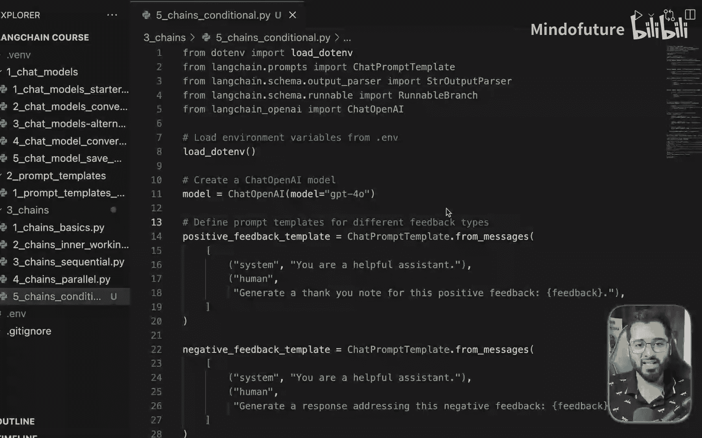
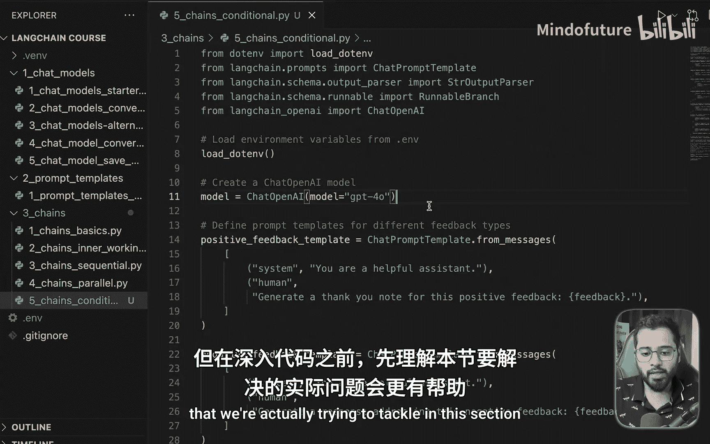
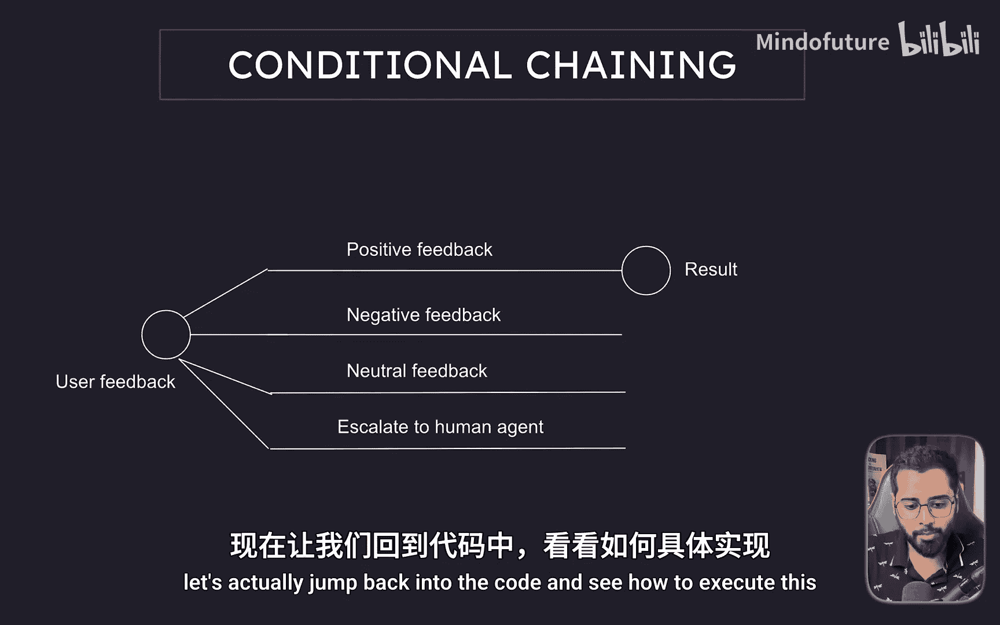
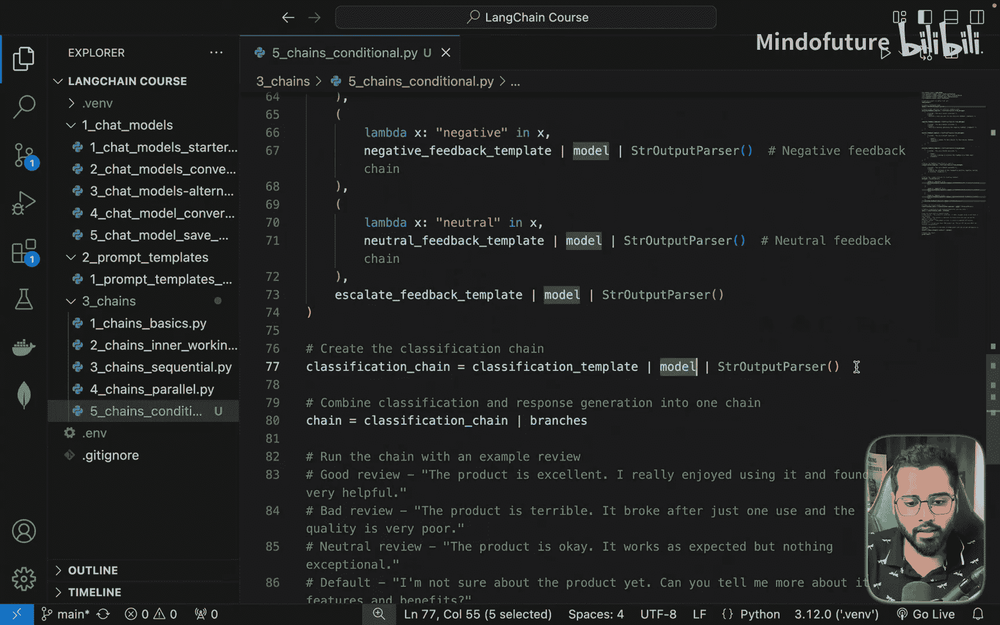
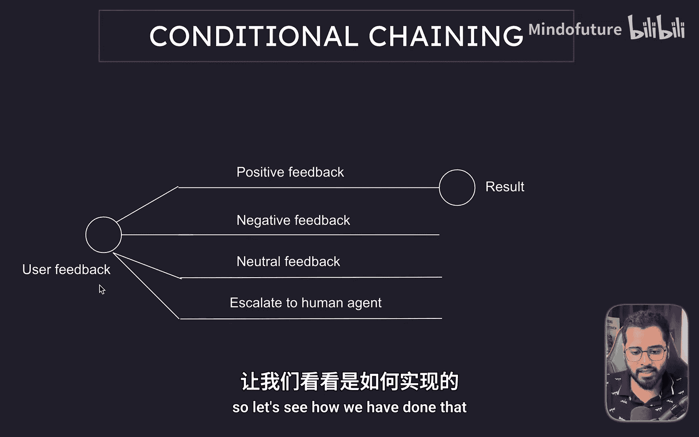
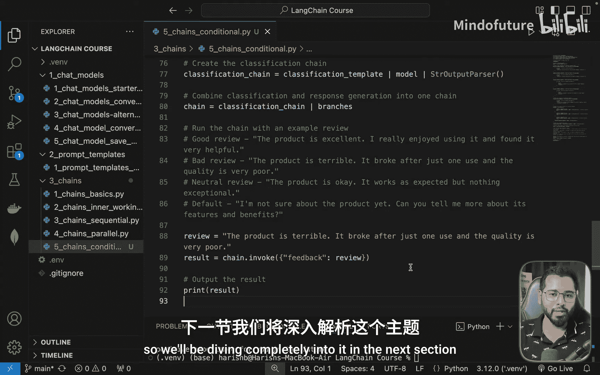

# Langchain初学者入门2025 p18 P18_#18_链_条件链接 -BV1jgeWzYEey_p18-

So in this section we are going to be looking at the last most commonly used type of training called conditional training right so as you can see I've already prepared the code for that。

 but before we jump into the code it will help if we sort of understand the problem that we are actually trying to tackle in the section so to explain this of prepared a flow chart。

So here's what I want us to solve okay so let's say you run an ecommerce-commerce website and users can leave feedbacks on the products that they have bought right and depending on the type of the feedback by the user right it could be a positive feedback by the user it could be a negative feedback right it could be a very very bad feedback that requires escalation I mean depending on the type of the user feedback the response from the customer support agent would vary So this customer support response is exactly what we are trying to automate here with La and AI。

Okay so we are just going to see analyze basically how the user is feeling looking at the review whether it is positive or negative or basically just a neutral feedback or it is a very bad feedback and the user is like really mad and we have to escalate it right so we are assessing that and accordingly the AI is going to respond to that particular thing so first off we are taking the user feedback and then we are sending the feedback to the model asking it to tell whether it is a positive feedback or a negative feedback a neutral one or if it requires escalation to a human agent。

😊，So right here we would have categorized the feedback the next thing that we have to do is depending on the type of feedback we need the control flow to go to different branches right so the first branch is for the post feedback flow the second one is for the negative one and we have the neutral branch and finally we have the escalate branch well。

So essentially we are conditionally sort of making a decision to go into any one branch so in the previous section we talked about parallel branching where all the branches start firing whereas in this section we have multiple branches or multiple chains and based on one condition it is going to go to the first one or the second one or the third one or the I don't know the hundredth one right so I hope that that makes sense let's actually jump back into the code and see how to execute this so you can see I have all the code ready already let's go down let's scroll down to the chain and let's again try to work backwards right。

So here is the chain and first runable that we are going to call is the classification chain so if you remember from the diagram that we saw earlier we are first going to take the user feedback and then decide the type of the feedback and this is a chain in and of itself right it might look very simple but it's actually a little abstracted if we go inside of here we can see that first we are preparing a template and always remember anytime we talk to the model we make a call to the model we first have to prepare a prompt template right basically saying like hey what type of feedback is this review right so let's look at the prompt now。

😊，So were just saying you are a helpful assistant。😊。

And we are saying classify the sentiment of the feedback as positive， negative。

 neutral or escalator right and we are providing the feedback here as well。😊，Okay。

 so if you scroll down， you can see that we are providing the feedback inside the object All right now let's come back to the classification chain。

😊，Now the model is going to spit back the keyword right it could be just a keyword called positive negative neutral or escalate right so now we have the condition ready as well so if we come back to the diagram we now have the type of the feedback which is going to be the condition and that is ready。

😊。

Now we have to decide which exact branch it should go inside of right so let's see how we have done that。

😊。

So now the type of the feedback is sent inside of this next chain called branches so let's click on it and let's see what we have done here so what we have here is like a switch case right where if x which is going to be the feedback type is positive then this chain will execute right if it is negative then this chain and then we have the neutral and the escalate at the end as a final default case if it cannot find a match above。

Now let's say the feedback was positive， right， what do we do then？So。

 what we might have to do is we need to send that feedback message to the LLM and ask it to provide a positive response to the positive review right so if I actually click on this you can see that it says generate a thank you note for this positive feedback。

😊，And then we are providing the feedback here as well。

 and as soon as the response comes from the LLn。 what do we do then let's scroll down So we are getting the response back from the LLn and now we are extracting the content property from the object see the branches is at the end of the chain so it gets printed to the console That's it So the same thing applies for other types of feedbacks as well right So if it was a negative feedback the prompt the prompting is going to be a little different So we are going to say generate a response addressing this negative feedback basically the user is super frustrated then the control flow will go inside of the escalate chain and this is going to be the prompt So we are saying generate a message to escalate this feedback to human agent So let's actually try to run this file So currently you can see that this is the review that I've hardcoded here the product is terrible it just broke after one news So clearly this is a pretty negative review So if I run this in the terminal。

😊，Let's give it a few seconds， all right。So you can see that it gives a proper response to the negative feedback from the user it apologizes for its service and it's asking for more details the user faced And right here I've also added more feedback examples for different types like a happy user a neutral user negative escalate as well right So you can just like play around with these different reviews and then see where the control goes and just to remind you all the code that we've written so far it is available in the repository so do go ahead and pull it and yeah that's it that brings us to the end of the chains module I really hope that you're confident enough to architect or construct your own chains based on the business problems that you're currently facing and again if you ever get stuck do join the community it could be me or some other developer could come and help you out in the next section we are going to be looking at the fourth comfort of La and in my opinion it is what is creating a lot of impact in how businesses operate。

😊，Increase efficiency as well。 And that component is called rags or retrieval augmented generation。

 And it's kind of the， I would say， the most difficult to get to wrap your head around。

 But at the same time， it would make you a really valuable developer。

 So well be diving completely into it in the next section。 So as you there。😊。

