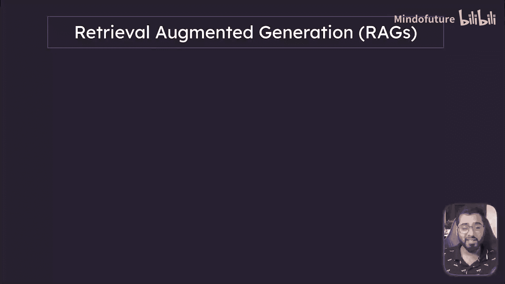
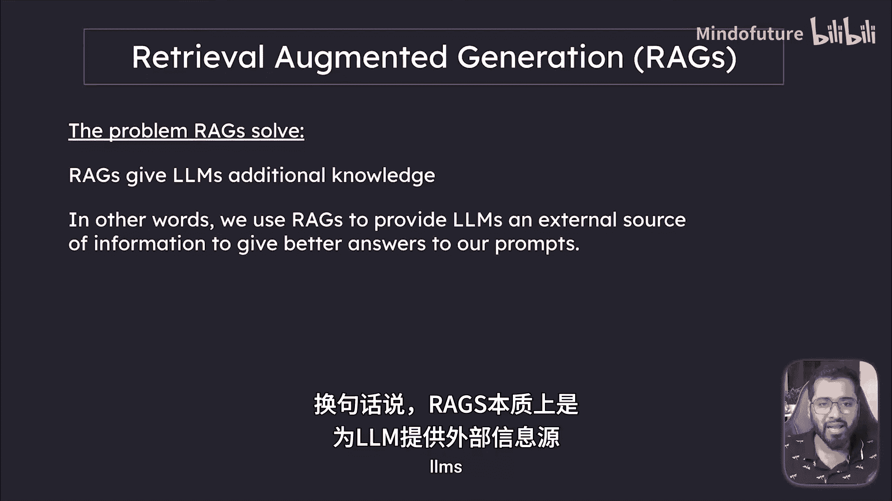
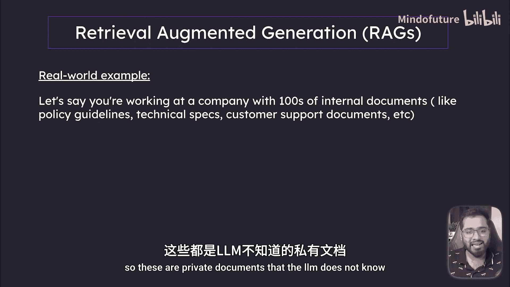
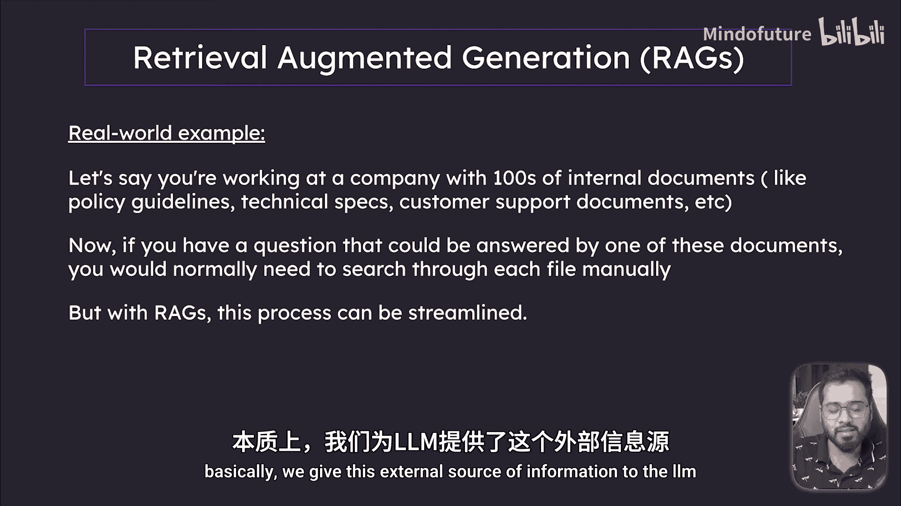
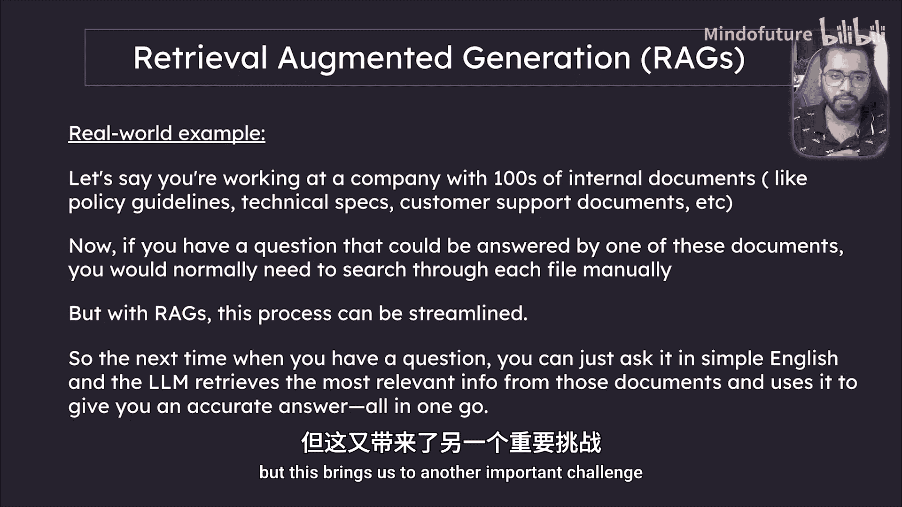
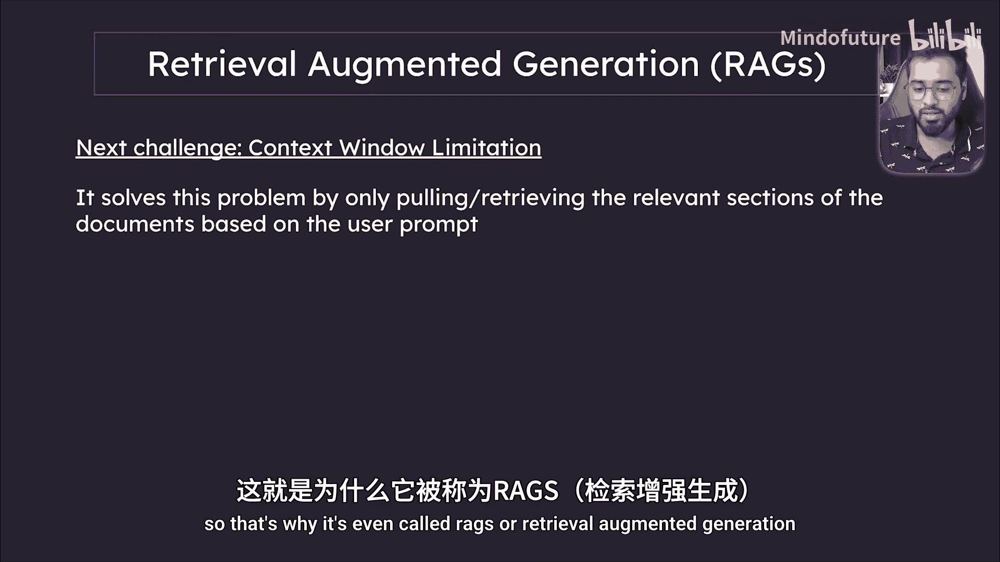
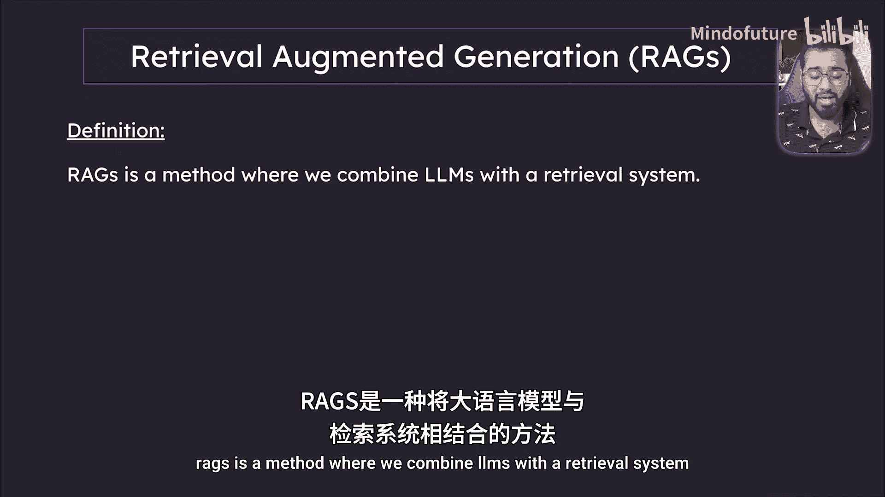
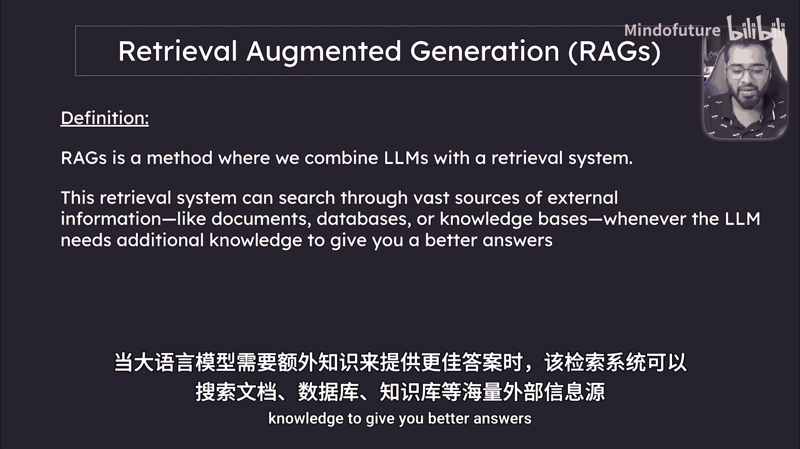
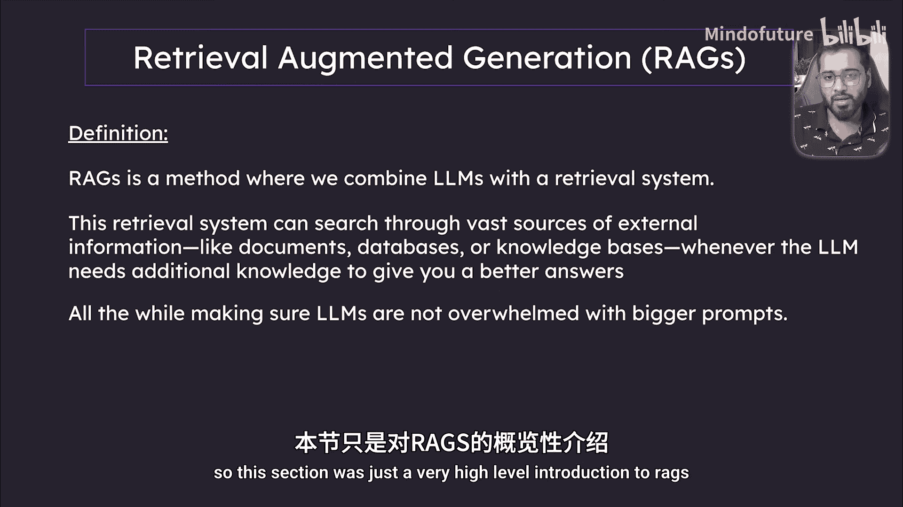
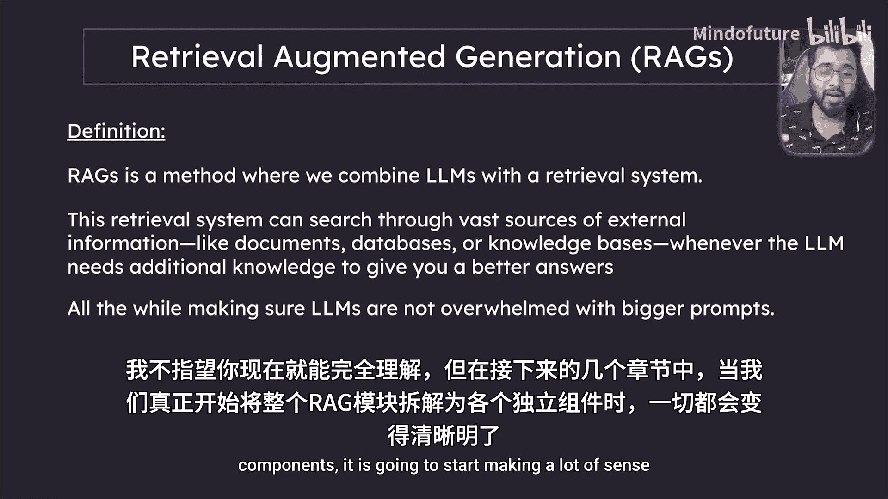

# Langchain初学者入门2025 p19 P19_#19_RAGs_介绍 -BV1jgeWzYEey_p19-

Hello everybody in this section were going to start looking at the fourth comfort of launching called rags or retrieval augmented generation。

 So in my opinion， I feel that drags is a pretty misunderstood topic because it can be a little tricky for beginners to understand。

 especially if you are completely new to the concepts like embeddings and vector databases Alright but don't worry we are going to be taking it slow step by step right So what is rags and what is the problem that it solves right So to answer the question rags solve just one problem with LLms Okay just one problem and that is giving LLms additional knowledge。

😊。

Just remember that for now okay it gives LLMs additional knowledge or in other words racks basically just provide an external source of information to LLMs so that LLM can better answer the user's questions。

😊。

So this is the first problem that it solves right So if you don't understand it let's explore a very simple example。

 So let's say you work at a company with hundreds of internal documents right let's say things like policy guidelines。

 technical specs customer support documents right So these are private documents that the LLM does not know okay just know that now let's say you have a question that could be answered by any one of these documents right what you would normally do without AI what you would normally do is you would basically normally comb through each and every single document trying to find your answer or you would just ask a colleague or something right but。

😊。

With AI and with rags， especially。We can really streamline this entire process right so what you're gonna do is instead of going through all the files manually by yourself right which is like the most least efficient way of doing things right instead of doing that what we do is we make all of these private data available to the LLM basically we give this external source of information to the LLM right so the next time you have a question you can just ask that question in plain English and now that the LLM has access to all your private information it is now able to cone through all your data and then give you a very informed accurate answer right so that is the power of rags but this brings us to another important challenge right theres a challenge called context limits or context window that is something that you know you probably would have experienced it where if you give large huge pros to the LLM it really struggles to answer the question it really struggles to it sort of starts hallucinating and it sort of starts to forget what happened before that in the past and all of that because the context。

😊。

Window or the limit becomes very high。So we can't really dump all our private documents into ChayP let's say and then ask a question on it because that is not going to work right so this is the second problem that rag solve which is with context limits you can make all these PDFs in everything available to the LLM without having to actually dump all of it into a prompt let's say you have let's say1 hundred or1 thousand documents sitting in your own private database right so rags the way that it solvess is by only pulling in the relevant sections of the documents based on the prompt that the user provided okay so this way we keep things sufficient we only extract certain chunks from all the documents that are relevant to the user question and then send it to the LLM so that's why its even called rags or retrieval augmented generation right so let's actually look at a much better definition rags is a method where we combine LLMs with a retrieval system。

😊。

So this retrieval system can search through vast sources of external information like documents。

 databases， knowledge basease whenever the LLM needs additional knowledge to give you better answers。

😊。

So all the while making sure that the LLM is not overwhelmed with bigger problemss So this section was just a very high level introduction to rags I don't expect you to completely understand it。

 but in the next couple of sections when we actually start splitting the entire rag module into all its individual components it is going to start making a lot of sense and that is exactly what we are going to be doing in the next section so as you there。

😊。

