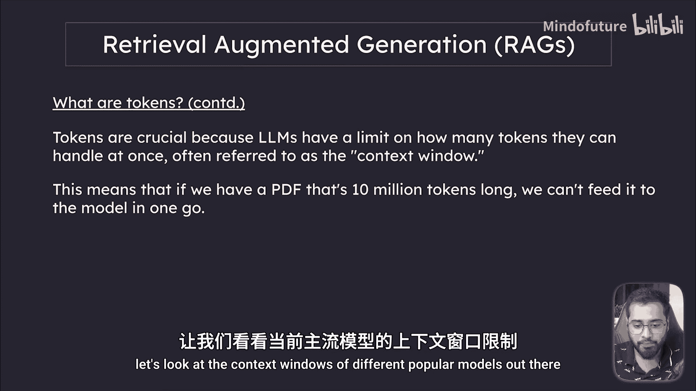
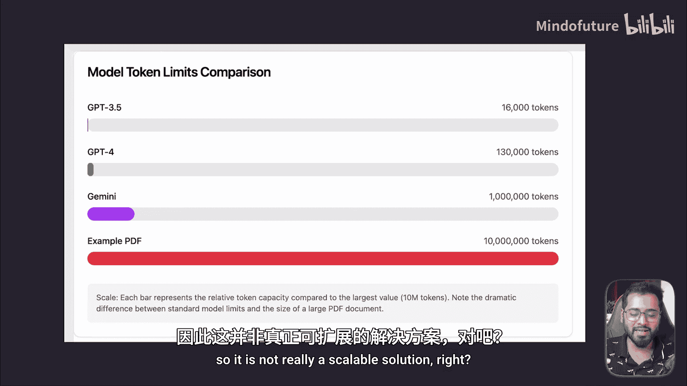
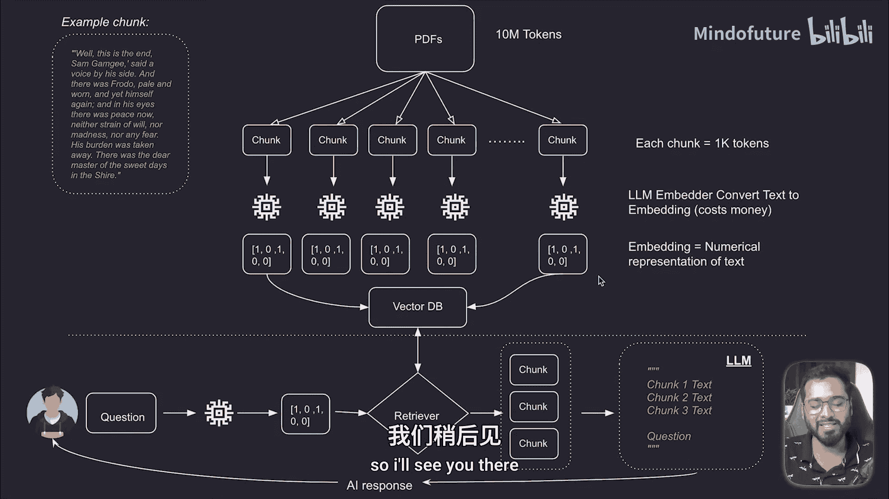

# Langchain初学者入门2025 p20 P20_#20_RAGs_工作流程_第1部分 -BV1jgeWzYEey_p20-

Hello guys in this section， we are going to be breaking down the entire retrieval augmented system and looking at each of the components so that we can see what exactly is going on right so I'm going to be using the same examples that we saw in the last section and as you can see up here we start with a few hundred PDFds or basically just like a lot of text documents that are private so we'll be doing something called chunking right here so we'll be learning terminologies like embeddings vector store and how the retrievetr works right here。

 So once you understand how all of these individual pieces come together to form the entire ra system the actual coding aspect itself is actually kind of a cakewalk and it's very simple Allright so what I'm going to do is I'm going to split this section into two different parts so in the first part we're going to go over this first process right here which is going to basically take a huge amount of private text in this case a lot of documents and then make it go through several processes and finally save that in a very。

😊，Special type of a database called a vector database and once we are done with that in the second part of the section we are going to be seeing how a user can ask a question okay something like let's say what are the company's policies on remote work right and then this component called the retriever retrieves only the relevant parts from these documents。

😊，Okay so once the retriever has both the relevant parts from the document plus the user's question as well。

 it sends both of that， both of that information to the LLM so that it can give an accurate well informed answer so this was a very quick glance on the entire rags workflow let's actually deep dive into the first section of this workflow where we're going to be converting all of this documents and text into a certain format and store all of that in the vector stored right alright so in the flow chat you can see that there is a PDF that is insanely big right so in other words this is 10 million tokens along。

😊，So if you do not know what tokens are， let's first understand that right so what is a token？So。

 in the context of language models， a token is a unit of text that the model processes okay so tokens tokens can be as short as one character or as long as one word depending on the language and the structure of the text。

For example， the word hello is one token while the phrase I am is typically broken down into two tokens I and M right so tokens are crucial because LLms have a limit on how many tokens they can handle at once often refer to as the context window so this means that if we have a PDFf that is 10 million tokens long we cannot feed it to the model in one go。

😊，Okay， why lets look at actually lets actually look at the context windows of different popular models out there。

😊。

So GP 3。5 turbo which is the model that you get access to on your free ChatP version right in this free version you can only send 16000 tokens at any given time right G4 though is somewhere around one lack 30000 tokens right and Google's Gemini right here is at the highest at 1 million tokens but in our example though we have one period or several periods it could be anything worth 10 million tokens right so it is impossible to dump all of that and ask a question to the LLM right it will complain that it's too long right and it's not a scalable solution either because think about it right now yeah maybe Google's Gemini has the context window so that you can dump all your private documents or ask a question on top of it you can do that maybe but let's say in the future your document size grows right and Google's Geminized context window might remain the same so it is not really a scalable solution right。

😊。

This is exactly why in the rags system we are going to be putting all that text documents through a process called chunking which is going to be step2 right so lets see what chunking is okay。

Chunking is a process where we can split big documents into several smaller chunks and you can see here that you know each chunk is worth thousand tokens right so if each chunk is worth thousand tokens then you can do some simple mathematics in your head and we can probably say that we now have 10000 chunks because 10000 chunks into00 tokens each is going to be 1 million again we just chunking it because we cannot dump all these large files into chargetp but if we make smaller chunks and based on the user prompt this component retriever which will get to in a second so this retriever what it will do is it will go query only those relevant chunks based on the users prompt and then pass it to the model along with the user prompt so by doing this we can pass in not just one or two chunks but actually a lot of chunks right if each chunk is like thousand0 tokens and the free version of chatt accepts like 1600 right so we can pass in like。

😊，1314 different chunks and in addition to the users prompt which could be one or two tokens right I mean not one or two but1 thousand00 or 2000 tokens right。

So yeah we also have a lot of room for the users's question as well about those chunks。

 So this way we will have some more room for the user's question as well about those chunks right so we now know that we sort of break everything down into several chunks but what exactly is a chunk what does it have right So if you're wondering basically they just plain text right so if you imagine this to be a 500 page book and we also know that each chunk can only have00 tokens then each chunk can be thought of as just like four to five lines or a small paragraph like this right and the next chunk is going to be the next four to five lines So it's a continuation the ordering is maintained as well right alright so so we've chunked it what next so so far we've just taken a huge text spread it into chunks now our next goal is to extract only the chunks that are relevant to the user prompt collect only those particular chunks and then send it to the model along。

😊，The prompt， so that is what we got to do second right so we have to ask ourselves a question how can we actually query only the chunks that are relevant。

Okay， after all， we can just brute force search and check for exact words that match with the prompt right that's kind of like an old school dumb way of doing things right we need to be collecting the chunks based on meaning not the exact word itself。

 and this is where the concept of embeddings and vector databases come into play it lets us search for chunks semantically or in other words。

 based on meaning and not look for exact words or letters。 So in the next section。

 we're just going to quickly take a detour look at what embeddings and vector databases are and then come back to this particular rags Alright so I you there。

😊。

