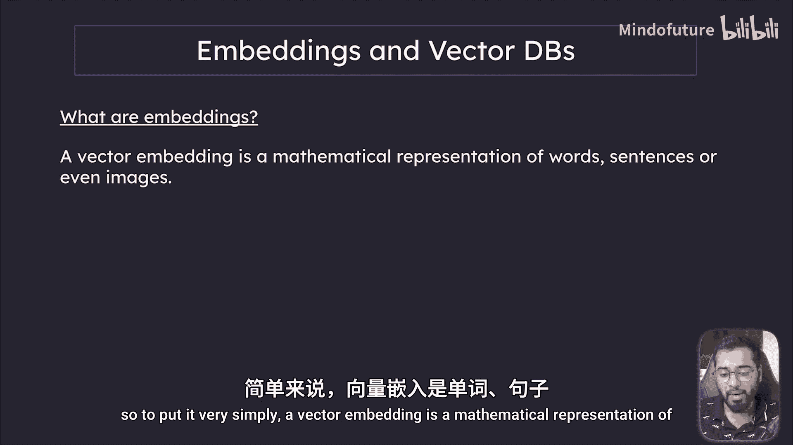
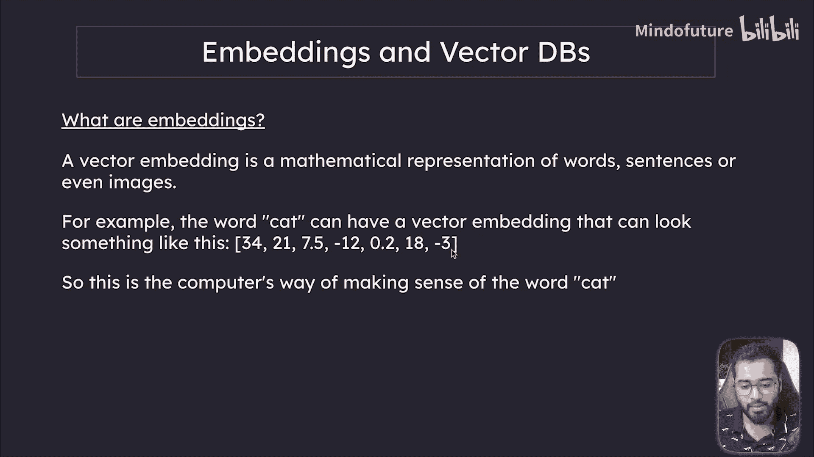
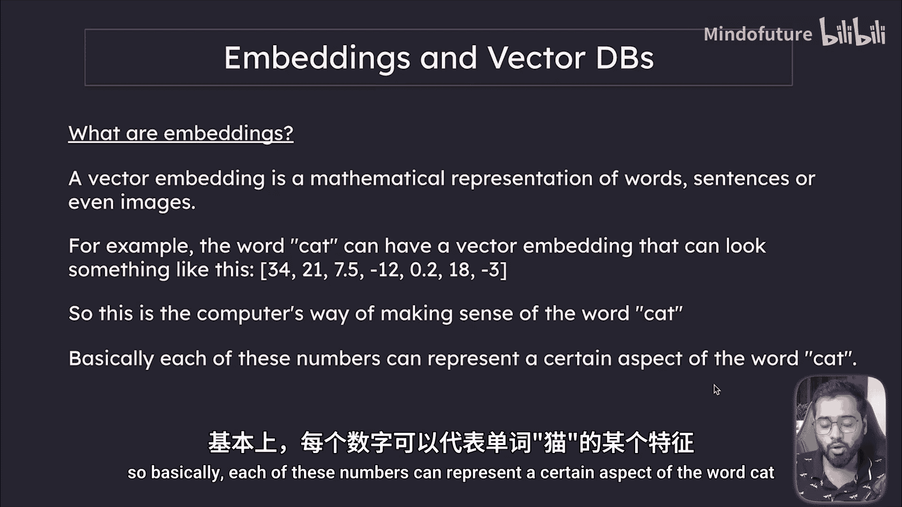
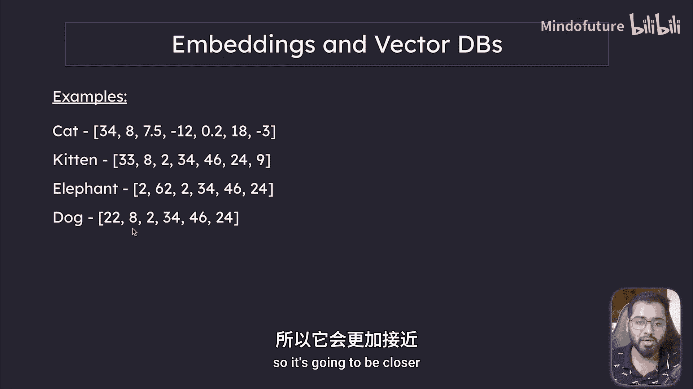
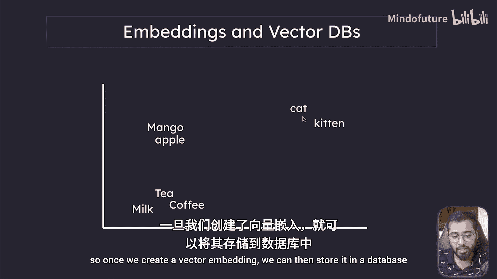
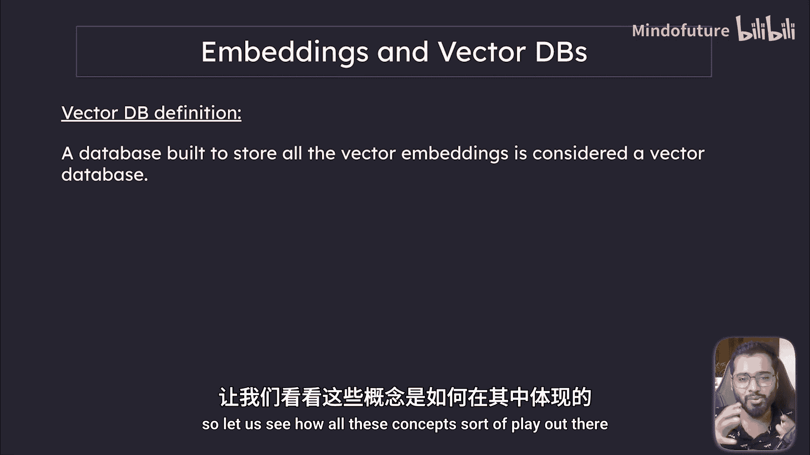

# Langchain初学者入门2025 p21 P21_#21_RAGs_嵌入式_向量数据库 -BV1jgeWzYEey_p21-

Okay， so in this section we are going to be talking about embeddings as well as vector databases right so basically they work together So let's actually start with embeddings。

 What are they。😊，So to put it very simply a vector embedding is a mathematical representation of words sentences or even images so for example the word cat can have a vector embedding that can look something like this right so this is the computer's way of making sense of the word cat but what exactly are these numbers right and just for your information this is how chatt works under the hood as well right so it is going to be pretty interesting so basically each of these numbers can represent a certain aspect of the word cat。

😊。

So the first number here in the array could represent the size of the ca okay so if there was a similar representation of the word。

 let's say kitten then the first value of the kitten vector embedding would be closer to 34 right because they are with regards to size they are much similar right compare that to let's say an elephant the embedding for the elephant the first number can be much more farther away from 34 because the sizes are very different right now we can think of the same thing for the second number as well so let's say the second number might represent whether it is a pet or not right so if we vectorize the word dog so the second value in the vector would be closer to this because both cats as well as dogs are pets so it' is going to be closer。

😊。

No。Picture this all right， picture this each of the values are actual coordinates in a multi dimensionsional space。

😊，Okay so let's take a very simple example in the form of a 2 d graph we know that the words cat and kitten are almost similar in meaning and their vector coordinates are also very similar right so this is why we see the words cat and kitten closer together in the map and is farther away from something like mango because all the coordinates are going to be different because in every almost every single aspect there。

😊，Different from each other right but this is just a very simple 2D map exampleright but in reality though。

 the vector has hundreds of dimensions that has some information about the relationship between words and sentences and etc etc so basically words and sentences with similar meaning hang out together like right here and then something unrelated will be farther away from it So once we create a vector embedding we can then store it in a database a database built to store all of the vector embeddings is considered a vector database right so what do databases do right it basically lets us retrieve information or update information or do something like that right so as you can imagine this vector database as well it enables us to retrieve information based on meaning rather than exact word matches right so we hope that you're starting to understand what vector databases are and embeddings are so let's actually now jump back to what we were doing in the previous section which is rags right。

😊。

So let us see how all these concepts sort of play out there， so as' you there。😊。

