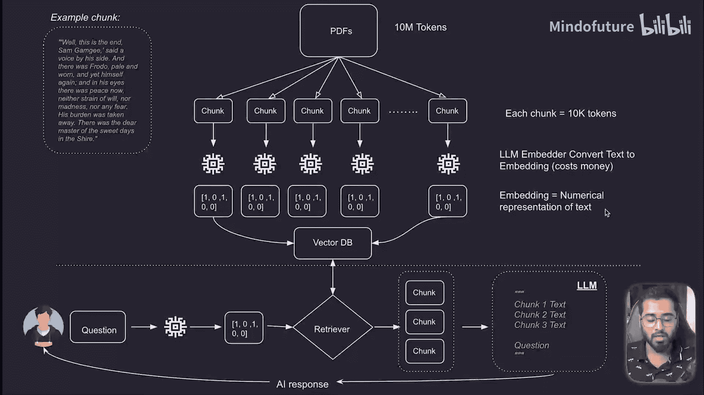
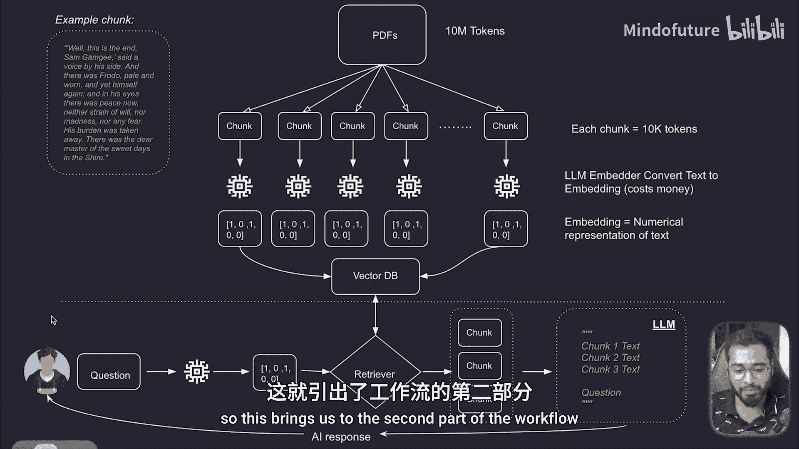

# Langchain初学者入门2025 p22 P22_#22_RAGs_工作流程_第1部分（续） -BV1jgeWzYEey_p22-

So now that we know what embeddings are and what vector databases are。

 let's actually continue with the flow。😊。

So we have split a big document or a huge book or pretty much anything into several chunks right here。

 which is going to be the first step the second step we are converting each of those chunks into vector embeddings。

😊，Remember weta embeddings are mathematical representation of texts in the chunkngs right so how can we convert it we can use the LLM emrs and again there is a lot out there but open AI provides us with an emr API that lets you convert simple text into embeddings and that is exactly what we are going to be using in this course as well。

😊，So once we've converted it we are then going to have all the embeddings for each of the chunks and finally we are going to store all of that in the vector store al right so note that we store the actual plain text plus the embedded version of each of the chunk so each of the chunk in the vector store is going to have the embedded version as well as the plain text version as well right so now our entire book or PDF or just pretty much any private data is completely present in our vector store right so because of this we can now query only the relevant chunks based on the user question and then get back the actual text right so this brings us to the second part of the workflow so we will explore that in the next section。

😊。

