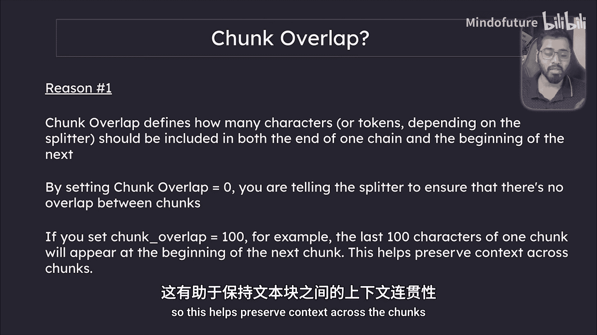
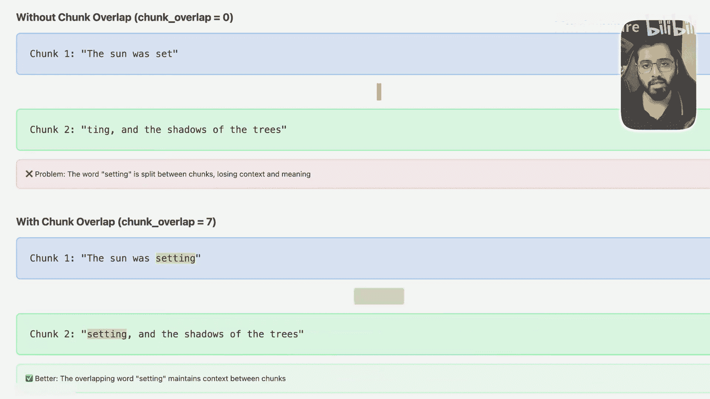
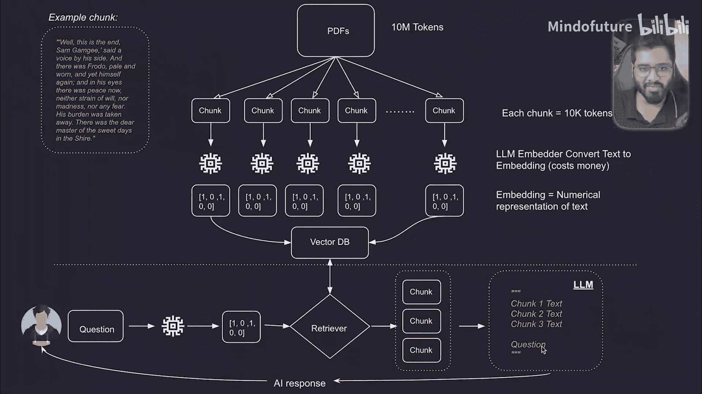

# Langchain初学者入门2025 p24 P24_#24_RAGs_基本示例_(1) -BV1jgeWzYEey_p24-

Welcome to the first code example inside the Ra module So in this section we are going to be implementing the same exact thing that we saw in the diagram earlier which is we are going to have a document in this case it's going to be the lot of theings book technically it is a book but we can think of it as a large collection of texts alright so I've split the code into two parts here so that we can understand it better so in the first part we are going to be implementing the first part of the diagram so if we come back here first we are going to be loading the document or the book or the collection of books load it and then we are going to start chunking it。

😊，Next we are going to convert each of those text chunks into vector embeddings and finally we are going to be saving all of those embeddings along with the original texts inside to the vector store okay so for our code we are going to be using the chromroma Db vector store and it basically lets us embed I mean save our embeddings locally as well so we don't have to use cloud for that。

😊，For this section， we have to install two additional packages， so you will have to run the command。

 whipip install Chroma Db and this is going to have all the core modules needed to create the vector stored。

😊，And we also need lain dash chromma package as well this is going to be the wrapper that connects our La chain application with the vector store so now that we have installed all the necessary packages lets dive into the code。

So we know that the first thing that we have to do is to load the document right so to load the document we need to know the path to that particular document right and that is exactly what we're doing here so this d method is going to give us the path to the current directory the file is in and we are inside this four underscore rags directory right so now that we have the current directory we can then go inside of the documents and then the name of the book and this gives us the file path to the book right here so this is just very standard Python stuff so now this is where the actual vector stores come into play now we need to provide a directory in our project for the chromma Db to go ahead and create its vector store remember we are going to be storing all of our vector embeddings locally and not in the cloud because were just learning right so and is going to tell it to create a folder inside of our current directory called the folder DB。

😊，And then create a Db file inside of it called Chma underscore Db。Okay。

So weve named it persistent directory because you know whatever is going to be saved there is going to be persistented as in it is not going to be erased every time we stop the application and restarted okay so if we go back to our diagram right here in this step we have all of the chunks。

😊，Converting it into embeddings and then we are going to be storing all of that content in the database and this data will persist so that we can use it at a later date Al right next I've got a very simple check here saying that if this DP file is already created we don't want to be running the same thing again why if we come back to the diagram the text to embedding process it costs a little bit of money right because we'll be using an API to convert it right so were just making a check right here saying that。

Only if it is not created already， you know， we allow it to go inside of here。Alright。

 so let us see what happens inside of this so it says persistent directory does not exist initializing vector stored right so we are starting the process but in order for the process to start we actually need this file in the location。

😊，If we don't have this file inside the documents folder we are not which is going to throw an error saying that the file does not exist lets keep going now we know the exact path to the book as well as the path to the D。

Next up， let's load the book。So this is going to be the first step right so we are going to be using the text loader class that I am importing from the documents loader module。

😊，So this will help us basically load the document in memory right here like basically assigning a value to a variable so once we've loaded the document or it could be multiple documents right we are going to start chunking it right into smaller texts so to do that we are going to be using the character text splitter class that if I scroll up here weve imported it from the text splitter module so this takes care of chunking how much ever documents you provided okay so we are initializing it saying that we want each chunk to have a thousand characters and we currently have the chunk overlap set to0 as well so what is this chunk overlap right so let's look at that chunk overlap defines how many character or tokens depending on the splitter should be included in both the end of one chunk and the beginning of the next chunk so by setting the chunk overlap to0 you are telling the splitter to ensure that there is no overlap between chunks。

😊，If we set the chunk overlap to 100， for example， the last1 hundred0 characters of one chunk will appear at the beginning of the next chunk。

 So this helps preserve context across the chunks。 All right。

 this is an example of two different chunks。 You can see that the first chunk ends with the sun was set and the second chunk begins with。

Ting and the shadows of the tree right so this is the reason why we have to add a little bit of overlap okay so we ideally want to maintain as much information within a particular chunk so that is why we add some overlapping right so by adding this extra overlap we ensure that the model doesn't miss important context while processing chunks independently okay so secondly it also helps with semantic understanding especially when we are working with large texts it could be like books right chunking with overlap can help with better understanding across the chunks when querying or processing。

😊。

So let's get back to the code and let's add some chunk overlap here as well if we are working with complex texts like essays。

 novels etc it's better to give it somewhere between 20 to 100 characters so I' am going to give something like 50 if we are working with a simple text0 is also fine but I am going to leave it at 50 let's move along So now that we've chunked it and now we have an array of chunks it could be you know 205000 right so we'll print that as well to look at the length。

So the next step if we look at the diagram is to convert each chunk into its vector embeddings version。

 so we are going to be using the help of this particular model right here。

 the text embedding3 small okay this is by far the most capable embedding model by openaiI that is also I believe very cheap as well that is also another model called text embedding three large so if we want your vector embeddings to have a lot more numbers in the array。

 then you can go for this large model so of course for this tutorial we're going to be sticking with the small okay so this I believe does the job pretty well once we have all of the embeddings right here the next step is to store them in the database the vector database right so if we come back to the diagram we store the embeddings as well as the corresponding text in the database and that is exactly what we' are doing here right So we pass in the docs as well as the embeddings to the store。

😊，And exactly where to store it that is in this particular directory right。

 So let us go ahead and run this file。😊，So I am going to click on the play button。

 also note that there isnt any folders， database folder database files that are getting that are not created just yet right so if I run it lets give it a few seconds。

And great， so now you can see that the embedding process has been done and it's been successfully stored in this file right here。

😊，The same chroma Db that we specified above in the code so if I scroll up right here we can see that we have several logs right what were the processes it went through right it just created a chunk created a chunk right and the total number of chunks is going to be 40 something okay and we've also printed the first chunk to the console the very first chunk and it's nothing but the first few like the first 1 lines of the book something like that so it says the book is largely concerned with Hobbbars and if I go into our book right here you can see that that is exactly what we have at the very top。

😊，So the first step in the whole process is done we have stored our private data in the vector store now lets actually go to the par two of the code where we are going to be looking at。

😊，This particular part of the system， Al I'll see you there。😊。

