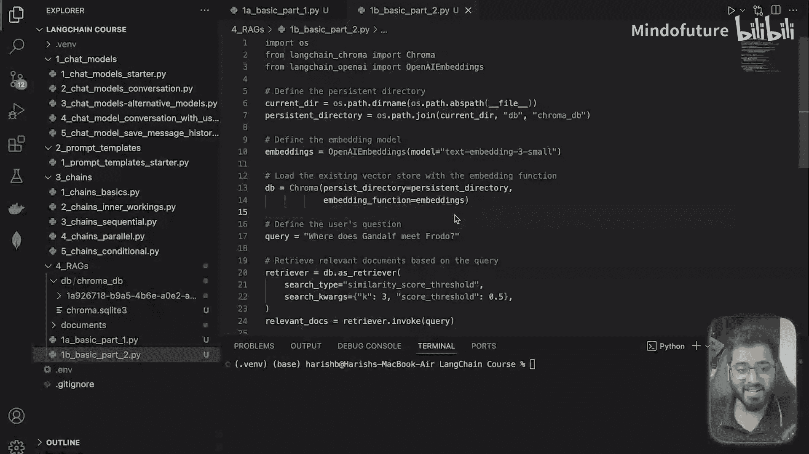
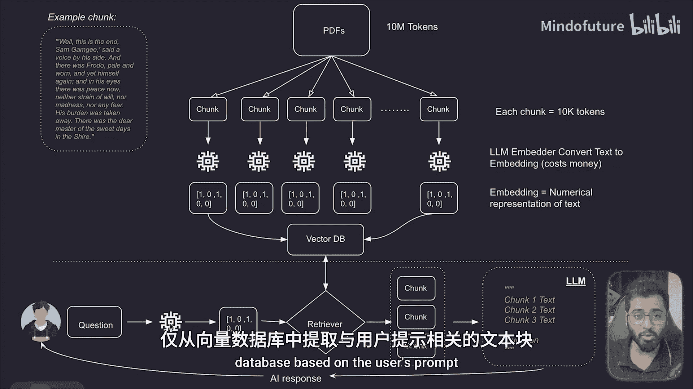
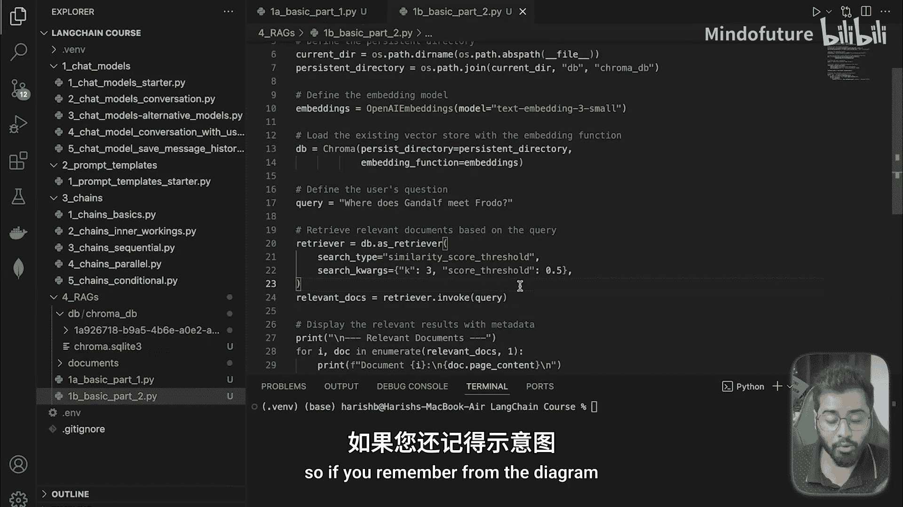
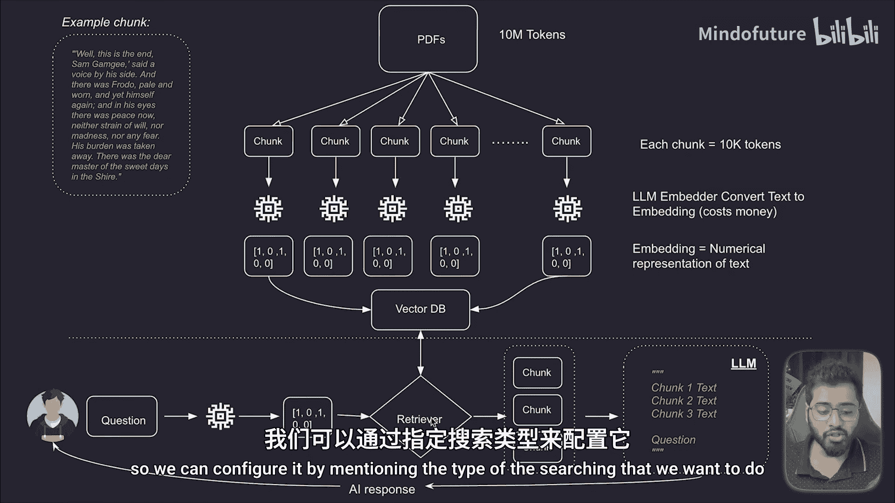
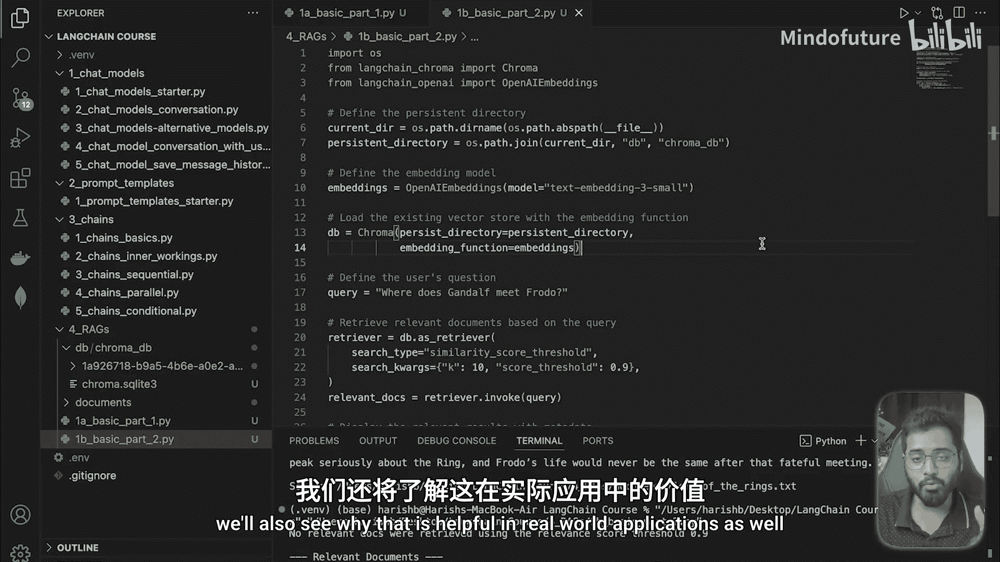

# Langchain初学者入门2025 p25 P25_#25_RAGs_基本示例_(2) -BV1jgeWzYEey_p25-

So in this part of the section we are going to be looking at the second part of the rat system where we are only going to be pulling the relevant chunks from the database。

 the vector database based on the user prompt so let's go through it step by step。

So we already know that the book is vector embedded and is now present in this file right here。😊。

So to start off all that we are going to do is referencing our current file to the Db file so we are taking the current directory and with that we are piecing together the exact location of the chromma Db file。

😊，Okay and then we are loading the vector store in this case。

 the chromroma Db right here so that the database is available to use inside of this file。😊。

Right first we need the database to be available to work with right so that is what we are doing right here were telling it this persistent directory is where the database exists and later if you want to embed the user's question as well to search the database for the right chunks we can use this ember and again with specifying the embedding model that we are going to be using now this is something that a lot of people seem to get wrong right so whichever embedding model that we used to embed your private data we have to use the same model to embed the users question as well okay you can't use different models。

😊，Or else it is not going to work all right so in this case we are constantly always sticking to the text embedding3 small model okay just remember that。

😊，Now the next step is to set up a retriever and then we are going to configure the retriever alright so if you remember from the diagram the retriever is basically what collects the relevant chunks from the database based on the user' prompt right so we can configure it by mentioning the type of the searching that we want to do so in this case I'm using the similarity score threshold searching type but in the next few sections we are going to be doing different we are going to be exploring different types of searching right and then we are going to be using the search kw as so what does this mean we are specifying just how many highest relevant chunks that we want the retriever to bring so in this case it is going to collect the top three chunks with the highest relevant scores and right now we are saying the similarity score needs to be at least 0。

5 or higher so this is a scale that goes from 0 to1 so it is going to collect all of the chunks that have the similarities。

😊。

That is higher than 0。5 and it is going to shortlist the top3 and then give it back to us alright so now weve set up a retriever weve configured it the next step is we have to query the relevant chunks based on the user' question right so once again i'm going to be using the magic keyboard invoke right here if you remember this is the magic key that we are going to be using to take action in La。

😊，So once we run this， it's going to give us the top three relevant chunks。

So let's actually go ahead and run this file we are also going to be playing around with these parameters see what happens so remember all that we are doing is printing the relevant chunks right now okay so if we run it let's see let's wait for a while。

😊，And great we have a response I right now expect three different docs or basically three different chunks that relate to the user's question right so we know that the question is where does Gallf meet Fdo right so let's actually go look at the first chunk see if it actually contains the information required to answer that question。

😊，So you can see it says。It was in the heart of Hobitton at the home of Frodo Bagins that Gandal came to speak of matters far greater than Frodo could have imagined。

And this perfectly answers the question， right， how amazing is that？😊。

So Gallf meets Frodo at the heart of Hoitton in Frodo's home right so let's look at the second chunk here it says Gandlf came to Hoitton to visit Frodo one summer day。

😊，This answers the question as well， right， And finally。

 let us look at the last chunk Frodo was in his home in Hobitton when Galf arrived。

 his old friend and mentor。😊，That's amazing right the exact passages that contains the answer have been retrieved。

 so now you can actually pull this code change the parameters right here and then see what happens as well so now we can say we need the top 10 chunks let's say instead of three and we are lowering the upper limit as well。

😊，So it' is going to bring in a lot more results as you can imagine right in the other hand if we become a little too stringent so let's say I am only saying only collect the chunks that have a similarity score of 0。

9。😊，RightSo let's see what happens。😊，And then run it again。

Okay so you can see that it says it cannot find any relevant docs because using this particular threshold of 0。

9 right so if you're building your own rag applications you might be you know mistakenly be a little bit more stringent with a score and this is the lesson you can't really go too high or low you have to find the right balance right and that brings us to the end of this section where we basically just dealt with one full book and then we implemented a rag search in the next section we'll actually see how we can add metadata to each of the chunk so what I mean by metadata is basically being able to add you know more information about where the chunk came from for example this particular chunk came from this book this chapter this passage etc so that in the future by retrieving it we'll actually be able to see where this source of the chunk came from we'll also see why that is helpful in real applications as well so as you there。

