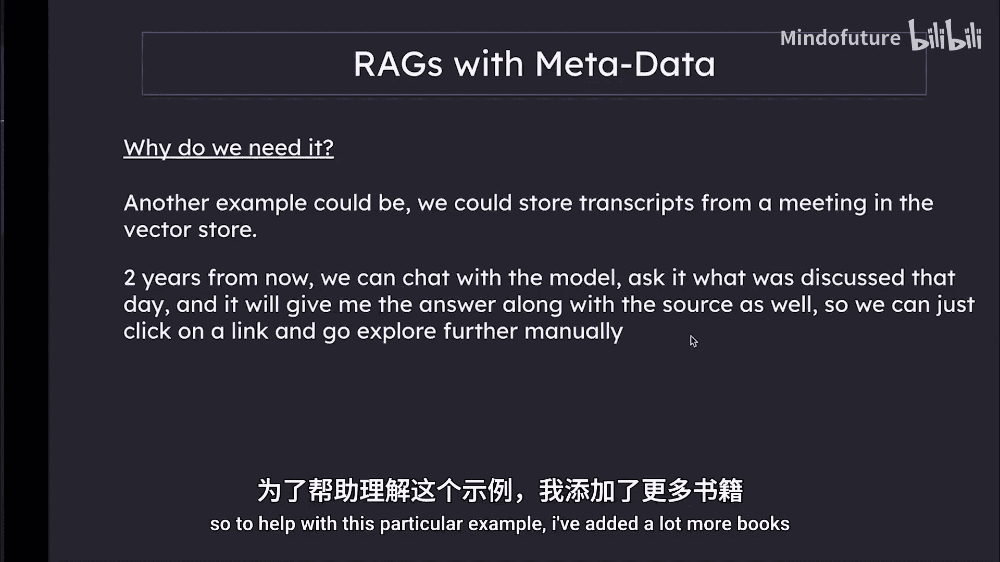
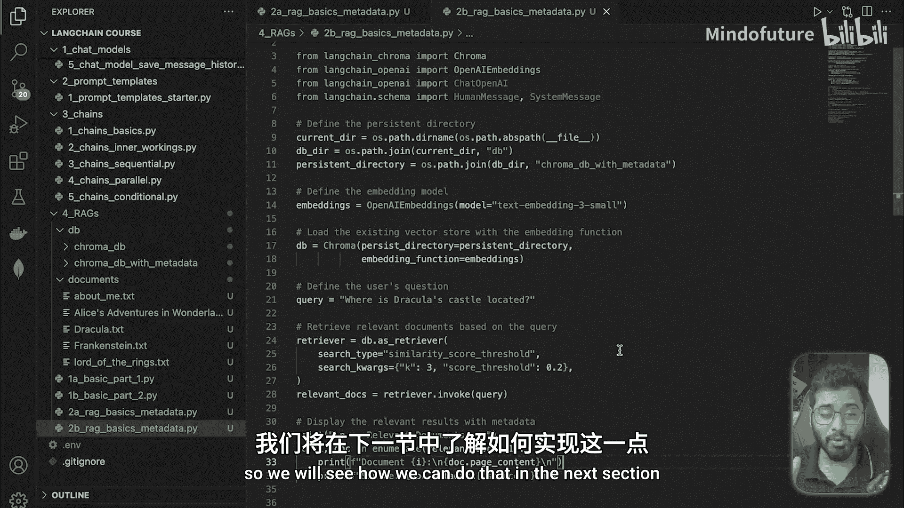

# Langchain初学者入门2025 p26 P26_#26_RAGs_与元数据 -BV1jgeWzYEey_p26-

In the second example of rags， let us see how we can introduce metadata into our chunks。😊。

So first let's talk about why we even need metadata let's say we put 10 different private docs or books into our vector store and we ask a question in addition to getting the chunks it will be better if we also know where the chunks originated from right for example like it's this particular book Cha 4 paragraph3 or this particular document this section paragraph 7 so it gives us extra information on where the chunks came from so if you think about it it is very similar to what chat HpT search does as well when we ask a question it cross the web it gives you a response but at the same time it attaches a source URL as well like these are the websites I took the answers from so this way we know that the answers are legitimate and it is not just hallucination and other example could be we could store transcripts from a meeting in the vector store and two years from now we can chat with a model ask it what was discussed that particular day and it will give me the answer。

😊，With these source as well。 So we can just click on that particular link and go further explore manually。

😊，So sky is the limit。😊，So to help with this particular example。

 I've added a lot more books and preparedpar code for this section as well as the next few sections for rags。

😊。

So let's jump into the code now and you will find that it is not really that different to what we've written earlier in the previous section。

First thing， we need to pull all of our new books into the vector store so that we can start asking questions。

 right？😊，So I've added a few more books right here like Frankenstein， Raracula， etctera， etc ce。

 and these are pretty long books。😊，Now， let us chunk all of these books。

 embed them and then put them in the better store。So first thing。

 we are getting a reference to the documents directly。😊。

And then we are also telling La to create our vector database containing all of these books in this new file called Chroma Db with Meta inside of the Db folder。

😊，So we are using a different database file this time。I've already run this file。

 so I already have the full embedded version of all of my books in this database file。😊。

And the rest of the code is very identical to the first example we saw。😊。

We are checking if the database is already created or not， if it is already created。

 we do not go inside of this if block so coming in this is where it is slightly different。😊。

Basically what we did the last time， but this time we are embedding several books。

So the first thing that I'm going to do is go inside of the documents folder。😊。

And search for all the files that have a TXt extension as you can see I've got all the books with the TXt extension and this line is going to grab all of those book file names and put it in this array all right now we are looping through all the book file names and with each book file name I'm going to load it in memory using the loader and I'm going to add it to the final documents array。

😊，Very， very similar to what we did earlier， but instead of just one book or document。

 we are doing several right here。😊，But there is one more additional thing that we are doing。

Along with the document， we are also going to be adding a metadata to each document。Okay。

 so we can have as much information that we want， but for now Im just saying source and I'm adding a book file to the source。

😊，So if I'm loading the Frankenstein book， the book file name is going to be Frankenstein。😊。

And from here on we are going to go through the same process we're chunking the entire list of books and then we're specifying the embedding model that we are going to be using to embed which is going to be the next step and finally we are creating the vector store by providing the docs the embedding model plus the final Db file it should create and put all of the embedded data in and as I already told you at the start I've already ran this file so I already got the Db file created with all the chunks embedded so let's now go to the next section where we can actually ask questions to the rack system so what we' are going to do here is pretty much the same we point the file to the new Db location that we've just created a minute ago so this was the Db name if you remember so this line loads the Db file up so we provide the location as well as the embedding model so here is the query that we are going to be asking so it is going to be where is Draculas Ca located if you're familiar with Dracula is a vampire that lives in a castle。

😊，And this is the question that we are asking and obviously somewhere in the book the location of the castle will be mentioned so our super intelligent rack system is going to retrieve the relevant chunks when I run this file so let's look at the next piece of code and here we are configuring the retriever。

😊，We are still going to be using this type of searching the similarity score threshold and we are also going to be specifying the count should be 3 and the threshold value should be 0。

3 this is the number that works for me because if I reduce this it doesn't give me any results so in your applications you will have to find the right balance and finally we are going to be using the magic keyword invo and if you remember it does two things right it converts the user question into an embedding and now and now that we have a query that is in an embedding vectorized format the book content which is also in a vectorized embedding format。

😊，It goes out， queries the top three chunks and finally it prints out all of the chunks so I am pretty excited to run this file let us see if we are able to find the answer in the retrieved chunks but lets run this file so it is going to take anywhere from 4 to 10 seconds。

😊，And amazing we now have three chunks and these are pretty big chunks。

 We know that Dracula exists in this town called Transylvania if youve watched any of the animated movies etc cetera。

 etc cetera， so let us actually see if the term transylvania is present in any of these retrieved chunks So as you can see we have transylvania mentioned in the third line and also in the seventh line。

😊，I had visited the British Museum and made search among the books and maps in the library regarding Transylvania。

And also down here it is giving the exact locality of the castle Dracula so with just this one paragraph even a human can deduce that dracula lives in Transylvania and more even more importantly we can also see the source of the chunk which says dracula。

 Txt because if you remember we added the book names as metadata to each of the chunks。😊。

So let' us now move on to the next chunk and let's search for the term Transylvania and you can see that it is not listed in the second and third chunks。

 but it probably gives more information that the Dracula does live in Transylvania。😊。

So you can see that it says thus when we find the habitation of this man that was meaning the dracula。

 so it is still talking about the location of the dracula so we only have three books right now but imagine hundred books thousand books or private company documents and how rags basically allow the possibility of chatting with it in natural language and be able to get that answer right so I hope that you are starting to see the power of rag systems so that is basically how we can add metadata for each of our chunks right so the next step is basically to send all these retrieved chunks along with the user's question to the LLM so that the LLM can actually look at the chunks that might potentially have the answer to that particular question and it is going to give us the answer which is going to be in this case Transylvania so we will see how we can do that in the next section。

😊。

