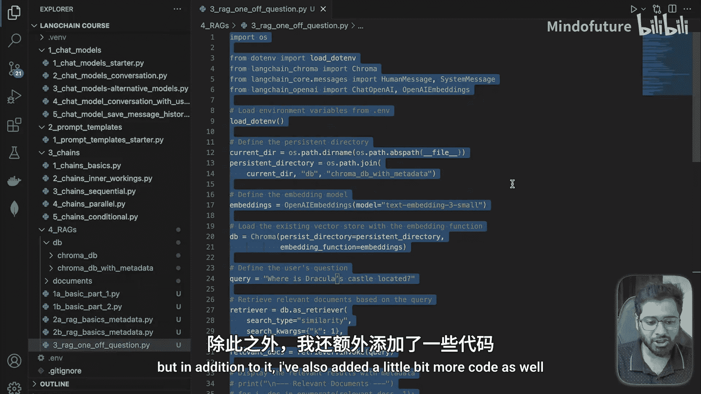
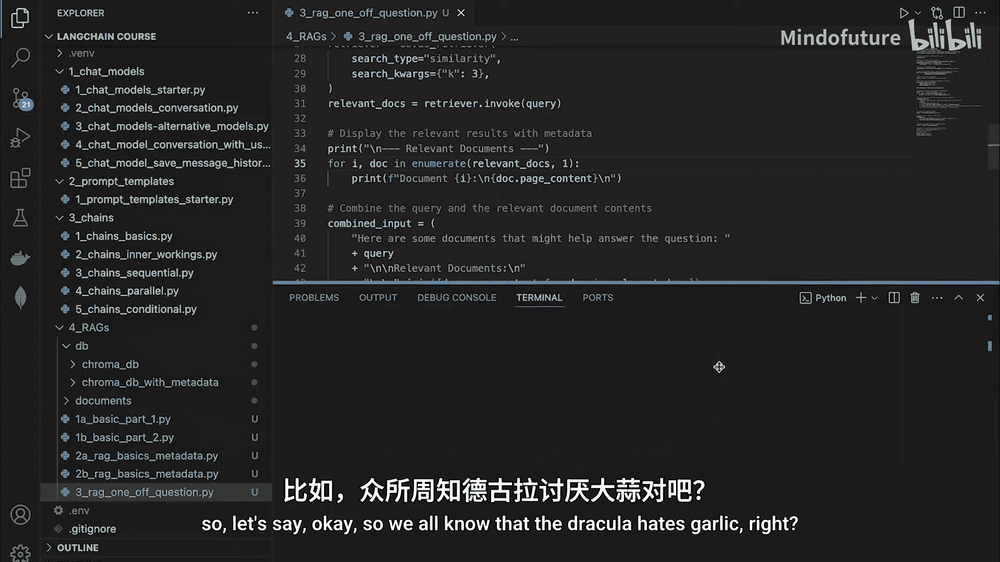
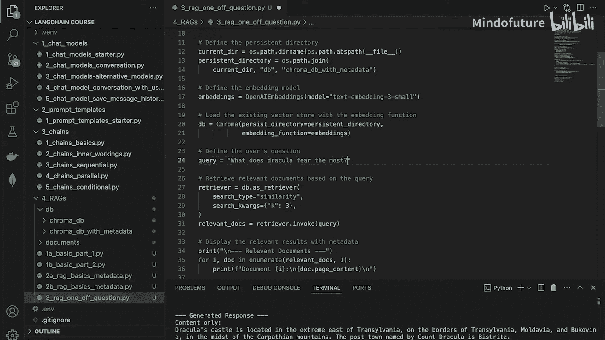
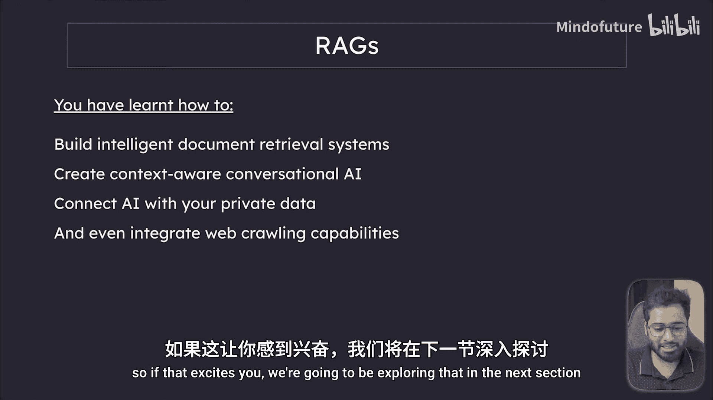

# Langchain初学者入门2025 p27 P27_#27_RAGs_一次性问题 -BV1jgeWzYEey_p27-

So what I've done is I've copy pasted everything from the previous section in this new file。

 but in addition to it I've also added a little bit more code as well okay so let's look at what we' are doing step by step so so far we have the user prompt as well as the relevant chunks that are getting generated based on this question So the first thing that I am going to do is very simple first I am preparing a combined prompt to the LLM saying here are some documents that might help answer this question。

😊。

So here we can put the actual user question， which in this case is where is Draculas Ca located？😊，So。

 we provide the prompt。Now we need to provide all of the relevant chunk texts。If you remember。

 we shortlist the top three chunks and we are providing that here as well by joining these talks together very simple。

And to make sure it works， this is what I'm going to do I'm going to say please provide a rough answer based only on the provided documents。

😊，If the answer is not found in the documents， respond with， I am not sure。

So we are doing this so that the LLM only answers the question from the chunk text provided。

Now we are instantiating the model， so weve done this several times now we are defining the messages array with the system message as a simple you are a helpful assistant。

😊，And finally， we are going to invocate and print the result。😊。

Let's actually comment this out so that we are only interested in the content。

So let's actually run this file and give it a few seconds。

And we have the final result and let's see what it says based on the provided documents。

 Draculas Ca is located in the extreme east of Transylvania， just on the borders of Transylvania。

 Mulavia and Boovvina in the midst of the Carpathan Mountains。

 The post town named by count Dracula is Bistritz right。

 I can't pronounce either how amazing is that right。

 The Llum is able to identify this based on all this data that was present in the chunks。😊。

So let me show you， let's copy this word bistrs and search for this and you can see it shows up in multiple places in the chunks。

😊，Right just how amazing is that？Let me ask another question as well。 So let's say okay。

 so we all know that the dracula hates garlic right， So let's ask that question。

 what does dracula fear the most。😊。

So now let's clear the terminal。😊。

And now， let's run this file。Okay， so we have the response， let us see what it says。😊。

It says the Dracula fears a lot of things he cannot enter places unless invited。

 does not like garlic wve， right， it gave the answer and its given a lot of other things that we even did not know。

😊，Let's actually confirm if the LLM gave this answer based on the chunks we sent it。

So I'm going to copy this word garlic and search for it。😊，Scroll up。

And you can see this is mentioned several times in the chunks。How amazing is that， right？See。

 it says he is afflicted by garlic。 He also does not like crucifixes。

 So if I scroll down all the way， you can see that the LLM also assures us that it only took all of this based on the provided documents。

😊，So this way we know it didn't go into its own knowledge or do an internet search so in your own projects instead of doing it with books you can put in your private data that the LLM has no way of knowing and give it additional knowledge and chat with it。

And we can even take it one step further So instead of it being a one off question you can build it in such a way that we can have two1 f conversation as well okay so if you remember we already did that in the chat models module and you can implement the same thing here and with that said we've completed our deep dive into rags take a moment to appreciate know how far we've come you are currently in the top 5% of developers who can build rack systems and build these intelligent retrieval systems using Lacha right so you can now build intelligent document retrieval systems create context aware conversational AI connect AI to your private data and even integrate web crawling abilities right so if you're finding value in this journey please don't forget to click the subscribe button because it really helps the channel grow but at the same time I can it gives me more incentive to make more advanced AI related content right but yeah guys we're not done yet up next we are going to dive into the。

😊，And the final component of La called agents and tools Okay so this is where it gets really interesting imagine basically giving your AI the ability to actually use tools and make decisions like an actual human being right so if that excites you we are going to be exploring that in the next section so as you there。

😊。

