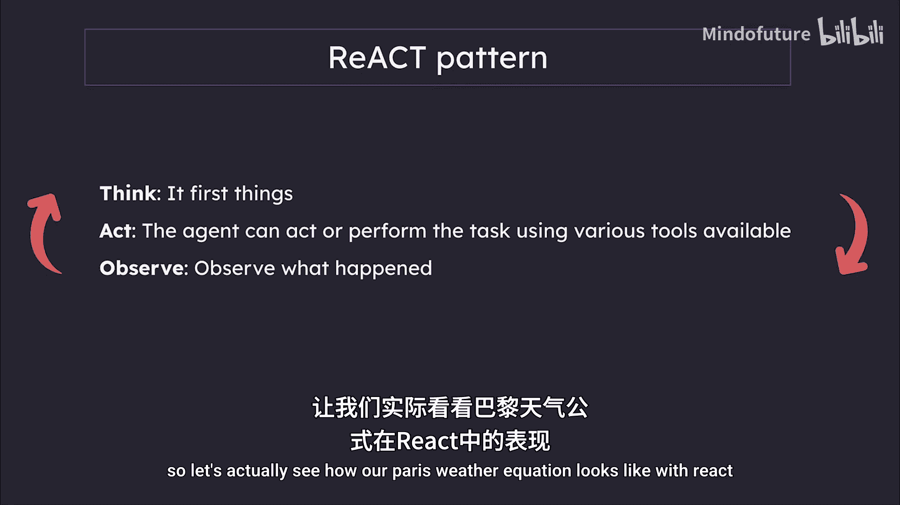
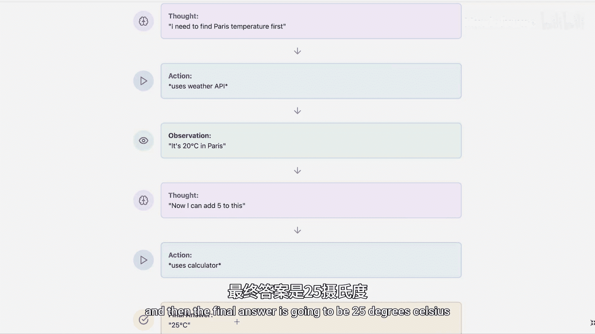
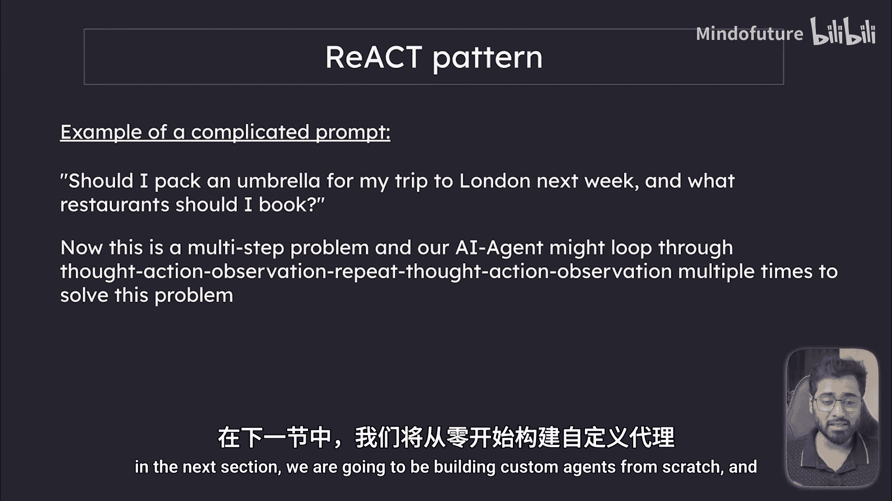

# Langchain初学者入门2025 p28 P28_#28_智能体_工具介绍 -BV1jgeWzYEey_p28-

Welcome to the last and final component of La called Age and tools you know that moment when you hear AI agents and you think that it's going to be super complicated I felt the same way when I started it but here's the thing it is actually much more simpler than it sounds okay and by the end of the section you'll be wondering why where you even worrying so much you can think of agents as the problem solvers of the AI world agents are capable of thinking on their own so in other words its AI that can make autonomous decisions。

😊，We learn about chains and rags right， they follow our specific instruction， but agents。

 they actually take it a step further。😊，They can decide for themselves what steps to take on their own。

If that sounds too complex to understand， don't worry， we are going to be starting from the basics。

 We will break down what agents really are， why they are such a game changer and how they solve real world problems。

 So no complex words， no confusing concepts。 just straightforward explanations that will make you say。

 oh， that's what it means。😊，Okay， great。 let's get started with the fundamental question。

 what exactly are agents。😊，Think of agents as AI decision makers that can pick the right tool for the job without being told what to use just like a chef who knows when to use a knife。

 whisk or the oven to create a perfect dish， an AI agent can decide when to browse the internet or when to use a calculator or when to make an API call to the database。

😊，So， right here we notice this keyword tools right so what are these tools？😊。

Tools are specific functions that AI can use to complete tasks。

Just like a chef's kitchen tools like knife for cutting oven for baking blender for mixing。

 tools are the special abilities we give to AI agents。😊，Okay。

 so just like giving a calculated tool or a search engine tool or a calendar tool。😊。

Right tools like perplexity and a lot of other tool I mean applications are built using tools only al right so now you somewhat must have an idea why we might want to use agents right so basically agents help language models decide what actions to take when solving a problem。

😊，They choose the right tools at the right time without us telling them which tool to use。

So let's look at a very simple example of using tools。If I ask an AI agent。

 what is the weather in Paris plus 5， it gets really interesting。

The AI agent isn't just randomly picking tools it is actually thinking through the process kind of like a detective solving a case。

😊，Firstly， the agent saw two parts to the problem， finding weather and doing math。

It knows to get the weather first because you can't add5 to something that you don't know yet。

Then it uses the calculatedalulator tool to add 5。But you might ask。

 how does the agent know what to do first and what to do second。

This is where the concept of react comes in。This is one of the best patterns in AI today to build agents and by react I don't mean the front end framework we are talking in terms of AI terms it stands for reasoning plus acting。

 So this is basically a concept that mimics how human beings think。😊，So if we look at a problem。

 what do we do first， we first think about the problem right。

 and thats when that's exactly what agents do as well think。😊，So the second step is act。😊。

And the agent can act or perform the task using various tools available。

And then the third step is observe what happened。And lastly， repeat the entire process if needed。

So let's actually see how a Paris weather equation looks like with react。😊。

So first it iss going to think， so the thought comes first。

 I need to find the Paris temperature first。So the action is going to be uses whether。

RightIt uses the weather API。And secondly， the action is going to be uses weather API。

And the third step is the API observation。It's 20 degrees celius in Paris。😊，And then again。

 the thought happens， right， It is come coming back。 It's it's cycling。 So the thought happens。

 it now says now I can add 5 to this。😊，And then the action again happens， uses calculator。

And then the final answer is going to be 25 degrees Celsius。😊。

Think of it like solving a puzzle instead of just showing the finished picture。

 react let us see each piece being put into place。😊。

This is a very small example imagine I ask you a much more complicated question like should I pack an umbrella for my trip to London next week and what restaurants should I book。

😊，You can imagine that this is a multi step problem， right？

And our AI agent might look through the thought action observation。

 repeat thought action observation this thing multiple times to solve this problem。😊。

I hope you are starting to somewhat get a picture of what agents and tools are if you don't understand it completely yet don't worry in the next section we are going to be building custom agents from scratch and we are going to be looking at a lot of examples as well so Ill see you there。

