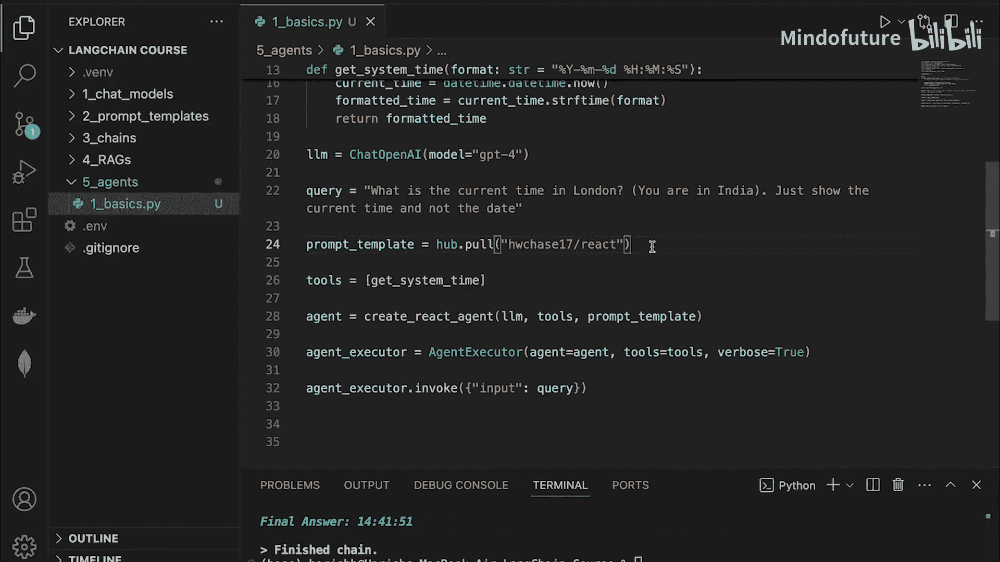
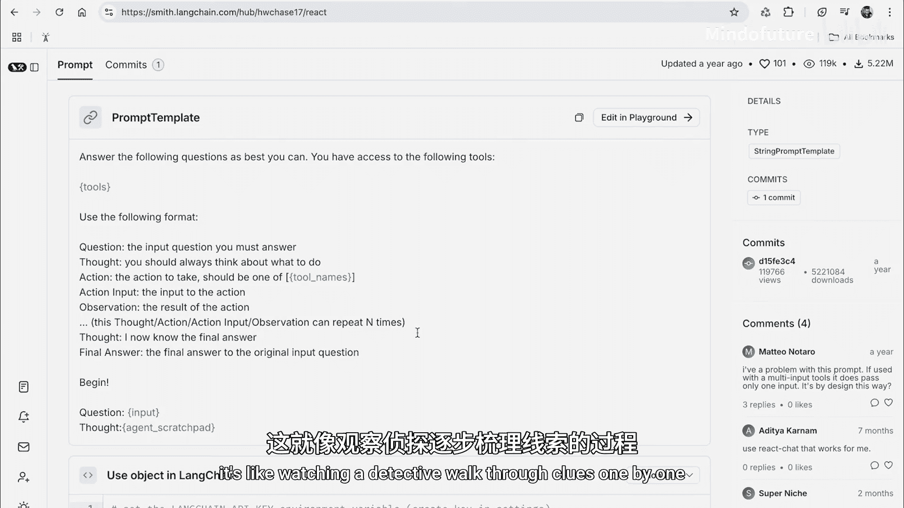
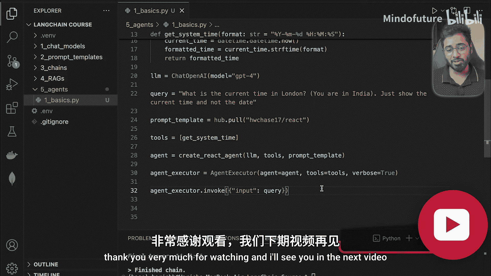

# Langchain初学者入门2025 p29 P29_#29_智能体_工具深度解析 -BV1jgeWzYEey_p29-

Hello guys welcome to the section where we are going to be building an AI agent from scratch using code So by the end of the section you should have a pretty good idea of how to build agents for pretty much any business use case and since this is a new concept we are going to be taking it very slow step by step So here's what we'll do Firstly I will show you a limitation that we currently have with LLMs and then we'll see how we can solve that limitation with an agent。

😊，So now I'm going to copy paste some code right here。So。

 all that we have done here is loading the environment variables。

 initializing the LLM using the GPT 40 model again and I have this question I want to ask to the LLM what is the current time？

😊，Now this query， we are providing this as an input to the chain so that this gets converted into a prompt and gets sent to the LLM。

 very basic stuff。😊，So let's run this file again and let us see what GPp 40 has to say about the current time。

 so let us hit run。😊，Give it a few seconds alright so we are saying that it cannot access real time information right and the reason why this happens is because LLms by itself cannot access real time data。

😊，They are trained on some data and they usually have a cutoff data as well。😊。

But if I ask it something that happened today morning， chancezar it does not know。

 and this is a perfect example where we can give more ability to the LLM by creating an agent。😊。

And now that agent can then use a tool to figure out the current time。😊，If this sounds too scifi。

 don't worry， we will all make sense of it pretty soon。😊，So now first off。

 we need to install a few packages and the first package I need to install is called Laang chain hubub。

😊，So let me go ahead and clear my terminal。😊，And I'm going to say。Pip， install La chain hub。

While it's installing， we will deep dive into what this package is， but on a very high level。

 it lets us use other people's prompt templates from the internet。😊，So instead of writing my own。

 I'm going to use someone else's very simple。😊，So in this example。

 I'm going to need the react prompt template。😊，Don't worry。

 we are going to be seeing exactly what the react prompt looks like later on。

 but for now let's just go ahead and use it and let's see what we get。😊，So to do that。

 what we are going to do is I'm going to replace this part right here for the prompt template。😊。

And instead， we are going to be using the react prompt template from Langcha hub。

So I'm going to say hub dot pull。And I'm going to specify the exact repository and file。

 So it is going to be H W Cha 17。😊，Slash react。Because we want the react prompt。

If you're confused what this is， this is just the organization's space of Harrison Chase。

 who was the creator of Lnin。So inside of this repository。

 we want the access to the react prompt template。So right now we are getting as quickly right here because we haven't imported the package。

😊，So I'm going to go up here， say from Laing。Import。Houb。

And now the squiggly line goes away perfect we will look at what this prompt actually contains later on。

 but for now let's move ahead and create some tools that we can make the agent use。😊。

So I'm going to say tools。😊，And this is going to be a list。

We can provide a lot of tools to the agent and depending on what the agent is solving at that particular point of time。

 it can use the right tool to get the job done。😊，It could be a Google search tool。

 an email sending tool， etc， etc。In this case， we need to create the get system time tool。😊。

And this is going to let the agent access the current time。😊，We'll get to that in a minute。Now。

 the next thing that we have to do is create an agent。😊，So to do that。

 I'm going to import something from up here。😊，So I'm going to say from La chain dot agents， import。

 create react agent。And in addition to this， we also need something called the agent executor。😊。

Ill explain to you what all of these mean in a minute and the later part of the section。

 we will see how we can implement all of this without all these helper methods so that you actually understand how an agent is created under the hood。

😊，But for now， I'm going to come down here and say agent。Equed。Create a react agent。Inside of this。

 I'm going to pass in the LLM， which in this case is the GPPT 40。😊，I'm going to pass in my tools。😊。

And then I'm going to pass in my pro template， which we are going to be pulling from Lang chain hub。

And what I'm going to do is I'm going to remove this chain and now we are going to declare an agent executor。

😊，And then we can assign it to the agent Executor class。😊，And this takes in a few parameters。

We can pass in the agent equals agent。And then we can also pass in the tools so tools。Equals tools。

And finally， I'm also setting verboose to true。😊，So we set verbo to true because we want to be able to see what the agent is thinking and what it is doing at every step of the way。

😊，It is making it easier to debug and tweak the agent。And finally。

 Im going to remove all of this and just invoke on this agent executor and the input is going to be the query。

😊，Everything looks good and we don't want to print anything because a verbo is made it true。

 so youre anyway going to see the logs。😊，Alright， so to do a very quick recap， we have the query。

 the prompt which we are pulling from the La hub， no tools weve written just yet and finally passing all of this information into the executor which is going to execute everything。

😊，And finally， we are going to invoke the agent with a query。So if I run this。

 what's going to happen？😊，It is obviously going to fail right because the LLM does not have a tool here to figure out the time。

😊，So let's actually run it and see what happens。😊，And great。

 you can actually see all of the logs as the agent is going through each and every single step。😊。

RightSo we know that the react agent prompt follows reason act observe repeat right and that is exactly what is happening right here。

😊，So the first one is reason and that's what it does it reasons to itself。

 I need to check the current time in my current location。😊。

So once it reasons what the problem is or what it needs to do， it then needs to do something with it。

😊，So that's why the second step is action， it says use a tool to figure out the current time。😊。

But unfortunately， we have not provided the agent with a time tool yet。

 and that is why it says that it does not have any tools to figure out the problem or you know even if there isn't any tool sometimes it starts to hallinate as well。

😊，And finally， it gives an answer that it cannot find the current time。😊。

Because it does not know how to solve the problem by itself。So let's fix that。

 lets now equip our agent by providing it a tool， so I'm going to go ahead and create a very simple Python function that is going to return the current time。

😊，So I'm going to say de。😊，Get system time。And I want the agent to give me the answer in a certain time format as well。

😊，So Im going to put in the default time format right here。😊，Very simple。

 I just want the your month day。😊，Hours， minutes and seconds。So now that we are done with that。

 let us now write the function and to do that I am going to make use of the standard date time Python library that gives you access to the system type so I can come up here and just say import date time。

😊，And then come back and I can say current time is equal to date time。😊，Dot date time。Dot now。

And this will give us the current system dig time， and I also want to format the time so that I can say formatted time。

😊，And then say， current time。Dot S， R， F time。And passing the format right here。

So if the LLM decides to not pass in a certain format。

 then in that case it will just default to the default format and that is it and oh。

 lets actually return this file right now and that is it for the function definition。😊，So。

 we have a pretty decent function that returns the current time， but unfortunately。

 land chain doesn' not actually know what to do with this particular function。😊。

So there is one more additional thing that we have to do。😊。

We have to add a Python decator for this function so we can say add tool。😊。

And we can import this by going up here and saying from Lacha dot agents。And import tool。

So what this decorator will do is basically change this method into a format that launching can easily understand。

😊，And also provide in this a dock string or a description about the method so that the LLM will have more context about this method。

😊，So we can then use this triple codes and inside of it。

 say returns the current date and time in the specified format。So because of this。

 the LLM would know if it should use this tool or not for a particular task。😊。

So make sure you always give your tool functions a really good description or a do screen。😊。

So now all that is left is to provide this tool as an item in the tools list。😊，Like this。Perfect。😊。

Before we run this file， I want to show you how the control flows so that we get a much clearer picture of how it all comes together。

😊，So， the first step is what we did was prompt and initialization。You provide a prompt to the agent。

 such as the react prompt。The prompt includes an instruction to the LLM about its task， example。

 reasoning step by step and deciding when to use tools。😊，Secondly， a description of available tools。

 including their names and usage details。😊，And step two is agent execution。

When the user provides a query to the agent， the LLM interprets the query and generates a response。😊。

The LLM does not directly execute the tools instead it suggests which tools to call and optionally provides arguments based on its reasoning。

😊，Step 3， tool invocation。The agent's framework launching intercepts the LLM output to check if it suggests a tool invocation。

If a tool is suggested， L calls the tool in your Python code passing in any arguments the LLM has proposed。

😊，Step4， tool execution。The tool runs in your Python environment with access to your Python's resources like the current time file system。

 APIs， etc。The tool returns its result to La。And then， LLM responds。

Langchain sends the toolss output back to the LLM for further reasoning or generating a final response for the user。

So enough theory， I hope you are excited to see how it is all going to work together now。

 so let's clear up our terminal and then lets hit run and now it has access to the tool。😊。

So as you can see right here， it says it needs to access the get system time tool。

 so it's reasoning first。😊，And once it is done reasoning， the second step is action。😊。

Langchain is now calling our function with the input that the LLM provided as well。 In this case。

 it just took the default format。😊，Then it generates the final answer and now another LLM call happens with this final data and the LLM is like。

 okay， I now have the final answer。😊，And now it displays the finalny answer。So essentially。

 what it is done is look through all of the tools and finds the tool that will help it achieve its task and uses it。

😊，And it was able to identify the tool with the description that we have provided。😊。

Now we don't have to be super stringent about a brand。😊。

We can actually be a little bit different and maybe even just ask you to tell us the current day or the current year or the current hour of the day。

 so lets actually try it。😊，So I'm going to add to this， just show the current time and not the date。

😊，Now， what this is going to do is the LLM is going to send back to Laing a slightly different input format to this tool。

😊，So let's run this file again。Let's clear the terminal and run it。Let's give it a few seconds。

And great， now you can see that the format that it provided to the tool is slightly different and this time we can only see the time and not the date in the final answer how cool is that right in the reasoning it is able to see that it just needs to adjust the format to give the right answer。

😊，So， instead of using the default format， the LLM is suggesting a different format and Laing executes the tool for us。

😊，So once Lin runs the tool。It takes the result and sends it back to the LLM with all the past context and the LLM is like okay。

 we now have the final answer and it ends the reason action observation loop right here。😊。

In our example， the cycle only ran once because it is a one step problem Find the current time so it uses the tool and that is it。

😊，But there could be a much more complicated query and in that case the the cycle basically could run three times four times five times depending on the complexity of the user prompt。

 So that is how react agents work very very cool stuff let's change the prompt a little bit more this time This time we will get it to tell us the time。

😊，And I am right now in India so what is the current time in London okay and it doesnt know where the system is right now so we can say you are in India because I am in India right so lets run this。

😊，And now if we run this one more time， it should hopefully be able to do the calculation and manually figure out from its own knowledge base。

 figuring out the time difference between India and London。😊。

So you can see it first reasons that it needs to check the system time in India。😊。

And then convert it to London time， and then it also knows that London is5 something hours behind India。

And it thinks about that too， and now it acts and calls the get system time function。

 and it now has India's current time。😊，It passes in the right format as well as the tool based on the query。

😊，So， once it has the right Indian time， it then thinks and reasons to itself。

 okay so now we have the Indian time now we need to calculate the London time by subtracting5 something our。

😊，So you can see that is exactly what it says here。😊，So the next step after reasoning action。

 it says subtract5 hours from the time。😊，And then it gives the final answer。

 which is the current London time。😊，And to do the mathematical operations。

 we can provide our own calculated tool。😊，But most of the times the LM should be able to do it by itself。

 but it is always safer in production to provide it our own tools because sometimes it will just say I cannot find the math tool to do the subtraction so it is always better to be on the safer side。

😊，And that is a great demonstration why tools are important。😊，Without the get system tool。

 the LLM has no way of knowing what my current time is。😊。

So so far weve seen the logs of the agent going through the cycle of reasoning， acting。

 observing and then repeating the cycle， but how exactly is the LLM able to do it？😊。

We know that it' is the react prompt。So let's actually look at what this react prompt actually contains so that it is able to do this repeated cycle until it gets the answer。

😊，So to look at that prompt， I'm going to go to Smith。😊。

Dotlachain dot com。Slash hub， slash H Wch 17。It might ask you to log in and once youve logged in。

 you will be able to see the react prompt， which is the reason plus act prompt。😊。

This is the high level system prompt which weve used in the app。 So what does it say。

 let's go through it step by step。😊，So we are seeing answer the following questions as best as you can。

You have access to the following tools。And all the tools that we've written。

 we are providing it all in a string format。😊，If youre wondering when we did that。

 we did not our helper functions did that。 All right。

 so all of our tools are provided next we are instructing the LLM to follow this format。

 So first the input question we are telling the LLM it must answer this and down here。😊。

We can also see that we are providing the question right here。So once it understands the question。

 we are telling the LLM to first think。😊，So， this is thought or reason。Basically。

 think about what is the next step。And that's what's written here。

 You should always think about what to do before doing it。😊，Once it thinks。

 it then needs to take action。So the action to take should be one of these two names。

So the name of the tools will be provided here with our helper methods。😊。

So once it knows the action it is going to take the action inputs or the inputs to the tools and finally it is going to look at the result so once it knows the action it is going to take the action inputs or the inputs to the tools and finally it is going to look at the result and that is what observation is right here。

😊，It' is going to see， h， well， do we have the final answer or do we have to repeat the cycle again？

😊，And once it has the answer， it then proceeds to the final answer。😊。

Just like we saw in the terminal， the cycle of thought action observation continues until the agent is confident it has solved each part of your prompt。

😊，🎼It's like watching a detective walkthrough closes one by one and this brings us to the end of the course This course has already gone on for too long。

 but I believe that we've learned everything important in Laing to be able to get started with building AI applications so you might notice that we've used a lot of helper functions and prebuilt prompts from the repository right here I'm also going to make a separate video next to where we're going to be deep diving into agent creation without the help of any of these existing helper methods so no helper functions no prem prompts just pure agent creation okay so that will give you a much deeper understanding of how agents work and how agents think Also I am posting several videos per week and if you haven't subscribed do subscribe so that you will be notified so thank you very much for watching and I'll see you in the next video。

😊。

