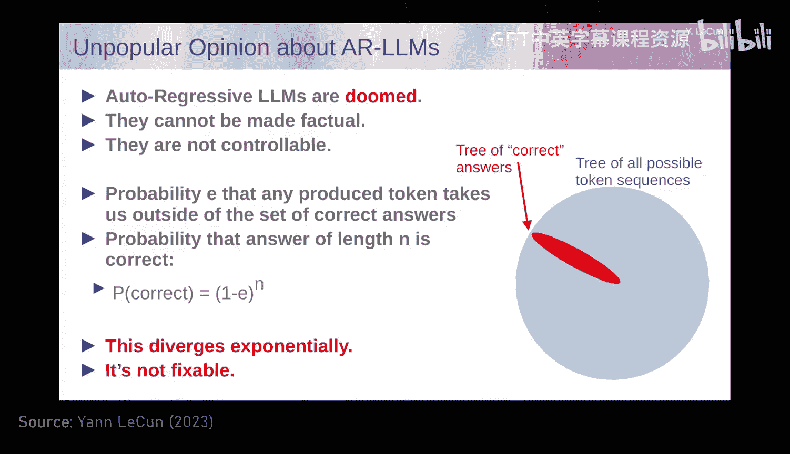
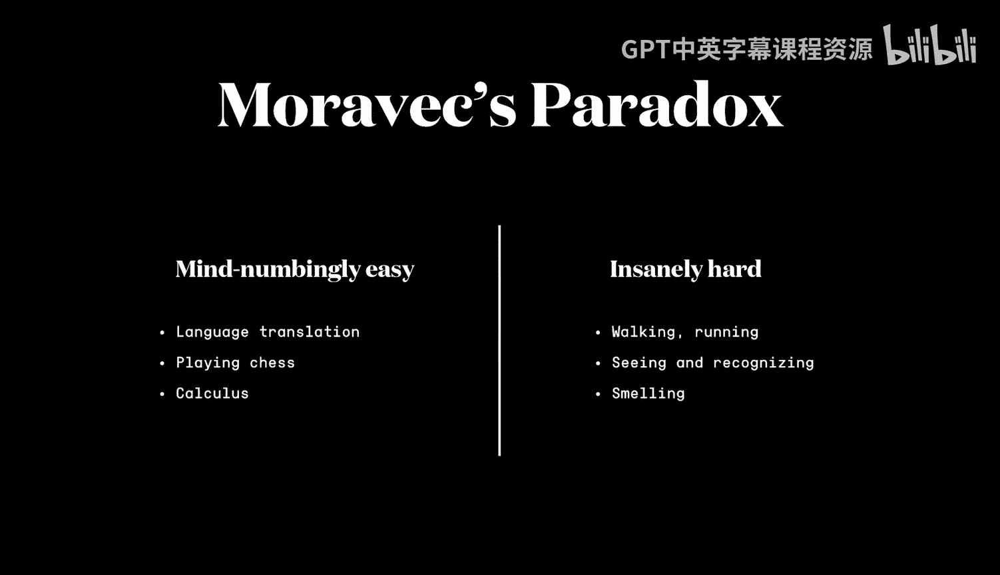
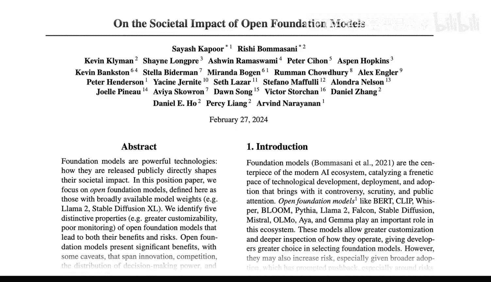
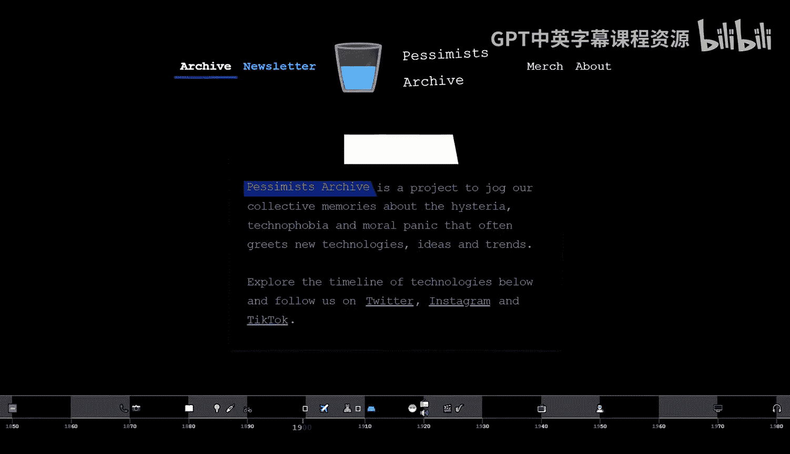

# Lex Fridman Podcast #416《杨立昆：Meta AI、开源、LLM 的局限、AGI 与 AI 的未来》中英字幕 - P1：-20240307-Yann Lecun_ Meta AI, Open Source, Limits of LLMs, AGI & the Future of - GPT中英字幕课程资源 - BV1BTycBkEMG

I see the danger of this concentration of power through proprietary AI systems。

As a much bigger danger than everything else， what works against this。

Is people who think that for reasons of security， we should keep AI systems under lock and key because it's too dangerous to put it in the hands of everybody。

 that would lead to a very bad future in which all of our information diet is controlled by a small number of companies who proprietary systems。

 I believe that people are fundamentally good in AI。Especially open source AI can。Make them smarter。

 It just empowers the goodness in humans。 So I I share that feeling。 Okay。

 I think people have found it pretty good。呃。And in fact。

 a lot of dos are dos because they don't think that people are fundamentally good。

The following is a conversation with Janon Laun。 His third time on this podcast。

 He is the chief AI scientist at Meta professor at NYu。

 touring Award winner and one of the seminal figures in the history of artificial intelligence。

 he and metata AI have been big proponents of open sourcing AI development。

 and have been walk in the walk， by open sourcing many of their biggest models。

 including Lama 2 and eventually Lama 3。Also， Yon has been an outspoken critic of those people in the AI community who war about the looming danger and existential threat of AGI。

He believes the AG I will be created one day， but it will be good。 It will not escape human control。

 nor will it dominate and kill all humans。At this moment of rapid AI development。

 this happens to be somewhat a controversial position。

 And so it's been fun seeing Jann get into a lot of intense and fascinating discussions online。😊。

As we do in this very conversation。This is the Lex Riverman podcast to support it。

 Please check out our sponsors in the description， and now， dear friends， here's Janon Laoon。

You've had some strong statements。Technical statements about the future of artificial intelligence recently throughout your career actually。

 but recently as well， you've said that auto aggressive LLMs are。

Not the way we're going to make progress towards superhuman intelligence。

 These are the large language models like G 4， like Lama 2 and 3 So and so on。

 How do they work and why are they not going to take us all the way For a number of reasons。

 The first is that there is a number of characteristics of intelligent behavior。

For example， the capacity to understand the world。ToUnder the physical world。

The ability to remember and retrieve things。Pistent memory。

The ability to reason and the ability to plan， those are four essential characteristic of intelligent systems or entities。

Humans， animals。LNMs can do none of those。Or they can only do them in a very primitive way and they don't really understand the physical world。

 they don't really have persistent memory， they can't really reason and they certainly can't plan。

And so you know， if you expect the system to become intelligent， just you know。

 without having the possibility of doing those things， youre making a mistake。

That is not to say that UMs are not useful， they're certainly useful。

That they're not interesting that we can't build a whole ecosystem of applications around them。

 of course we can but。As a path towards human level intelligence。

 they are missing essential components。And then there is another tidbit or fact that I think is very interesting。

Those airlines are trained on enormous amounts of text。

 basically the entirety of all publicly available text on the internet， right that's typically。

On the order of 10 to the 13 tokens， each token is typically two bytes。

 so that's two 10 to the 13 bytes as training data。It would take you or me 170。

000 years to just read through this at eight hours a day。

So it seems like an enormous amount of knowledge， right that those systems can accumulate。😊，嗯。

But then you realize it's really not that much data if you talk to developmental psychologists。

 and they tell you a four year old has been awake for 16，000 hours in his oral life。Um。

And the amount of information that has。Reached the visual cortex of that child in four years。

It's about 10 to 15 bytes。And you can compute this by estimating that the optical nerve carry about 20 megabytes per second。

 roughly。And so 10 to the 15 bytes for four year old versus two times 10 to the 13 bytes for 170。

000 years worth of reading。What that tells you is that through sensory input。

 we see a lot more information than we do through language。And that despite our intuition。

Most of what we learn， and most of our knowledge。Is through our observation and interaction with the real world。

 not through language。Everything that we learn in the first years of life and certainly everything that animals learn has nothing to do with language。

So it would be good to maybe push against some of the intuition behind what you're saying。

It is true there are several orders of magnitude， more data coming into the human mind。

How much faster and the human mind is able to learn very quickly from that filter the data very quickly。

You know， somebody might argue your comparison between sensory data versus language。

 that language is already。Very compressed， it already contains a lot more information than the bitetes it takes to store them if you compare it to visual data。

So there's a lot of wisdom and language， there's words and the way we stitch them together。

 it already contains a lot of information。 So is it possible that。Language alone already has enough。

Wisdom and knowledge in there to be able to from that language construct a world model and understanding of the world an understanding of the physical world that you're saying all lambs lack。

 So it's a big debate among philosophers and also cognitive scientists like whether intelligence needs to be grounded in reality。

I'm clearly in the camp that yes， intelligence cannot appear without some grounding in some reality doesn't need to be。

You know， physical reality， it could be simulated， but the environment is just much richer than what you can express in language。

 language is a very approximate representation。Of or percepts and our mental models， right， I mean。

 there's a lot of tasks that we accomplish。where we manipulate a mental model of the situation at hand。

 and that has nothing to do with language， everything that's physical， mechanical。

 whatever when we build something when we accomplish a task。

 model task of you know grabbing something etc， we plan or action sequences and we do this by essentially imagining the result of the outcome of。

Sequence of action， that we might imagine。And。That requires mental models that don't have much to do with language and that's I would argue most of our knowledge is derived from that interaction with the physical world。

 so a lot of my colleagues who are more interested in things like computer vision。

I really own that camp that。AI needs to be embodi， essentially。

And then other people coming from the NLP side or maybe have。

 you know some other motivation don't necessarily agree with that and philosophers are split as well。

And。TheThe complexity of the world is hard to。It's hard to imagine you know it's hard to represent all the complexities that we take completely for granted in the real world that we don't even imagine we require intelligence。

 right this is the old Mova paradox。From the towner of robotics hence Mark， we said， you know。

 how is it that with computers it seems to be easy to do high level complex tasks like playing chess and solving integrals and doing things like that。

 whereas。

The thing we take for granted that we do every day， like， I don't know。

 learninging to drive a car or you know， grabbing an object。We can't do with computers。And， you know。

 we have AMs that can pass pass a bar exam so they must be smart， but then。

They can't learn to drive in 20 hours like any 17 year old。

 They can't learn to clear out the dinner table。And fit of the dishwasher。

 like any 10 year old can learn in one shot。Um whyhy is that like， you know， what。

 what are we missing， what what type of learning or or？Reasoning architecture or whatever。

 are we missing that？Baically prevent us from from you know。

 having level  five start driving cars and domestic robots。

Can a large language model construct a world model that does know how to drive and does know how to fill a dishwasher。

 but just doesn't know how to deal with visual data at this time。

It can operate in a space of concepts。So yeah， that's what a lot of people are working on。

 So the answer the short answer is no。😊，And the more complex sensor is you can use all kind of tricks to get an LLM。

To basically digest visual representations of images or video or audio for that matter。U。

And a classical way of doing this。Is you train a vision system in some way？

And we have a number of ways to train vision systems， either are supervise， or be supervised。

 self supervised， all kinds of different ways。That will turn any image into high level representation。

Basically， a list of tokens that are really similar to the kind of tokens that。

Typical LM takes as an input。And then you just。Feed that to the L M， in addition to the text。

And you just expect Lm to kind of。You know， during training to kind of。

be able to use those representations to help make decisions I mean it's been working along those lines for quite a long time and now you see those systems right I mean there are LMs that can have some vision extension。

 but they basically hacks in the sense that those things are not like trained and to end to handle to really understand the world they're not trained with video for example。

They don't really understand intuitive physics， at least not at the moment。

So you don't think there's something special to you about intuitive physics about sort of common sense reasoning about the physical space。

 about physical reality that to you is a giant leap that Llums are just not able to do We're not going to be able to do this with the type of ats that we are working with today and there is a number of reasons for this。

 but the main reason is，The way L M LMs are trained is that you you take a piece of text。

Remove some of the words in that text， you mask them， you replace replace them by black markers。

 and you train a giant signal neural net to predict the words that are missing。

And if you build this neural edge in a particular way。

 so that it can only look at word star to the left of the one it's trying to predict。

Then what you have is a system that are basically is trying to predict the next word in a text right so then you can feed it a text a prompt and you can ask it to predict the next word it can never predict the next word exactly and so what it's going to do is produce。

A probability distribution over all the possible words in a dictionary， in fact。

 it doesn't predict words， it predicts tokens that are kind of subward units。

And so it's easy to handle the uncertainty in the prediction there because there is only a finite number of possible words in the dictionary。

And you can just compute a distribution over them。Then what the system does is that it picks a word。

From that distribution， of course， there's a higher chance of picking words that have a higher probability within that distribution。

 so you sample from that distribution to actually produce a word。

And then you shift that word into the input。And so that allows the system not to predict the second word right and once you do this。

 you shift it into the input， etc。 that's called autoregressive prediction。

And which is why those LLM should be called autore LLMs。Uh， but we just call them at Ems。And。😔。

There is a difference between this kind of process and a process by which before producing a word。

When you talk， when you and I talk， you and I are bilingual。

 we think about what we're going to say and it's relatively independent of the language in which we're going to say it。

When we we talk about， like I don't know， it's a mathematical concept to something。

 the kind of thinking that we're doing and the answer that we're planning to produce。

Is not linked to whether we're going to see it in French or Russia or English Chomsky just rolled the。

 but I understand， so you're saying that there's a bigger abstraction that's that goes before language Yeah maps onto language right It's certainly true for a lot of thinking that we that we do is that obvious that we don't。

Like you're saying your thinking is same in French as it is in English， Yeah， pretty much。

Pretty much or is this like how， how flexible are you like if， if there's a probability distribution。

 well， it depends what kind of thinking， right if it's just。If it's like producing puns。

 I get much better in French than English about that much worse is there an abstract representation of puns like is your humor an abstract like when you tweet and your tweets are sometimes a little bit spicy is there an abstract representation in your brain of a tweet before it maps onto English。

 there is an abstract representation of imagining the reaction of a reader that text or you start with laughter and then figure out how to make that happen or figure out like a reaction you want to cause and then figure out how to say it so that you causes that reaction but that's like really close to language but think about mathematical concept。

Or， you know， imagining you know something you want to build out of wood or something like that'。

 right？The kind of thinking you're doing is absolutely nothing to do with language really。

 like it's not like you have necessarily like an internal monologue in any particular language。

 you're you know， imagining mental models of the thing right。

 I mean if I if I ask you to like imagine what this water bottle will look like if I rotate it 90 degrees。

 that has nothing to do with language。And so clearly there is you。

 a more abstract level of representation in which we do most of our thinking and we plan。

What we're going to say if the output is is。You know， uttered words。

As opposed to an output being you know， mouse actions， right？We。

 we plan no answer before we produce it。 And Ls still do that。 They just。

Produce one word after the other。Instinctively， if you want， it's like， it's a bit like the。You know。

 subconscious actions where you don't。Like you're distracted， you're doing something。

 you're completely concentrated and someone comes to you and， you know。

 asks you a question and you kind of answer the question and you don't have time to think about the answer。

 but the answer is easy so you don't need to pay attention and you sort of respond automatically That's kind of what an LLM does。

It doesn't think about its sense really。It retrieves it because it's accumulated a lot of knowledge。

 so it can retrieve some some things， but it's going to。Just spit out one。

 to after the other without planning the answer。But。

You're making a sound just one token after the other， one token at a time generation。Is。

Bound to be simplistic。But if the world model is sufficiently sophisticated。

 that one token at a time。The， the most likely thing it generates is a sequence of tokens is going to be a deeply profound thing。

 Okay， but then that。Assumes that the the systems actually possess and you can world model。

 So it really goes to the， I think the fundamental question is， can you build a really。嗯。

Complete world model， not complete， but a one that has a deep understanding of the world。 Yeah。

 so can you build this first of all， by prediction right and the answer is probably yes。

Can predictCan you build it by predicting words and the answer is most part no。

Because language is very poor in terms of weak or low bandwidth if you want。

 there's just not enough information there。Building war models means。Observing the world。

And understanding。Why the world is evolving way the way it is。

And then the extra component of a world model is。Something that can predict how the world is going to evolve as a consequence of an action you might take right so what model really is here is my idea of the state of the Well at time T。

 here is an action I might take。What is the predicted state of the world at 1 T plus1？

Now that state of the world does not need to represent everything about the world。

It just needs to represent enough that's relevant for this planning of the action。

 but not necessarily all the details。Now here is the problem。

 you're not going to be able to do this with generative models。

So a geneity model has train on video and we've tried to do this for 10 years， you take a video。

Show a system a piece of video and then ask you to predict the reminder of the video。

 basically predict what's going to happen one frame at a time。

 do the same thing as sort of the autoag LLMs do， but for video right。

 either one frame at a time or a group of friends at a time。

 but yeah an large video model if you want。呃。The idea of doing this has been floating around for a long time and at Fair。

 some our colleagues and I have been trying to do this for about 10 years。嗯。

And can you can't really do the same trick as with LLMs because， you know， LLms， as I said。

You can't predict exactly which word is going to follow a sequence of words。

 but you can predict the distribution over words。Now， if you go to video。

What you would have to do is predict a distribution over all possible frames in a video。

And we don't really know how to do that properly。We do not know how to represent distributions over high dimensional continuous spaces in ways that are useful。

And there lies the main issue。And the reason we can do this is because the world is incredibly more。

Complicated and richer in terms of information than text text is discrete。

Video is highly dimensional and continuous， a lot of details in this。

 so if I take a video of this room。And the video is， you know， camera panning around。嗯。

There is no way I can predict everything that's going to be in the room as I pan around。

 the system cannot predict what' is going to be in the room as the camera iss spinningning。

Maybe it's going to predict this this is a room where its a light and there is a wall and things like that。

 it can't predict what the painting on the wall looks like or what the texture or the couch looks like。

 certainly not the texture of the carpet， so there's no way I can predict all those details。

So the way to handle this。Is one way possibly to handle this。

 which we've been working for a long time， is to have a model that has。

Let's call the latent variable and the latent variable。😊，Is fed to a neural net。

 and it's supposed to represent all the information about the world that you don't perceive yet and。

That you need to augment。The the system for the prediction to do a good job at predicting pixels。

 including the， you know， fine texture of the。Of the carpet and the couch。

And the painting on the wall。That has been a complete failure， essentially。

 and we've tried lots of things。 We tried just straight neural nets。 we tried Gs。 we tried。呃。

You know， VEs， all kinds of regularotto encoders， we tried it。Many things。

We also tried those kind of methods to learn good representations of images or video。

That could then be used as input to， for example， an image classification system。

And that also has basically failed like all the systems that attempt to predict。

Missing parts of an image or video。For， you know， form a corrupted version of it， basically。

 so right take an image or a video， corrupt it or transform it in some way。

And then try to reconstruct the complete video or image from the corrupted version。

And then hope that internally the system will develop good representations of images that you can use for object recognition。

 segmentation， whatever it is。That has been essentially a complete failure。

And it works really well for text。 That's the principle that is used for Lms right So what where's the failure exactly is that it's very difficult to form。

A good representation of an image， good in like a good embedding of all。

All the important information in the image is it in terms of the consistency of image to image to image image that forms the video like where what are the pur highlight re of all the ways you failed what what that look like Okay。

 so the reason this doesn't work is。First of all， I have to tell you exactly what doesn't work because there is something else that does work so the thing that does not work is training a system to learn representations of images。

By training it to reconstruct a good image from a corrupted version of it， okay。

 that's what doesn't work。And we have a whole slew of techniques for this that are。You know。

 variant on 12 diis autoto encoders， something called MAE developed by some of my colleagues at Fair Max Doto encoder。

 so it's basically like the。You know， LLMs or things like this where you train the system by corruptting text。

 except you corrupt images， you remove patches from it and you train a gig neural net to reconstruct。

The features you get are not good and you know， they're not good because。

If you not train the same architecture， but usually train need to supervise。With label data。

 with textual descriptions of images， etc， you do get good representations and the performance on recognition tasks is much better。

Then if you do this self supervised free training， so the architecture is good。

 the architecture is good， the architecture of the encoder is good。

But the fact that you train the system to reconstruct images。

Does not lead it to produce to own good generic features of images when you train in a self supervised way。

 self supervised by reconstruction。 Yeah， by reconstruction。 Okay， so what's the alternative。

The alternative is joint em Betting。What is joint embedding what are what are these architectures that you're so excited about Okay。

 so now instead of training a system to encode the image and then training it to reconstruct the the full image from a corrupted version。

You take the full image， you take the。Corrup to the door transform version。

 you run them both through encoders。Whichch in general are identical， but not necessarily。

And then you， you train。A predictor on top of those encoders。

To predict the representation of the full input from the representation of the corrupted one。Okay。

So joint embedding because you're taking the full input and the corrupted version or transform version。

 run them both through encoders， you get a joint embedding and then you're saying can I predict？

The representation of the full one from the representation of the corrupted one。Okay。

 and I call this a Jepath， so that means joint embedding predictive architecture because this joint embedding and there is this predictor that predicts the representation of the good guy from from the bad guy。

And the big question is， how do you train something like this？And until five years ago。

 six years ago， we didn't have particularly good answers for how you train those things except for one called contrastive learning。

Where。And the idea of contrastive learning is you take a pair of images that are。Again。

 an image and a corrupted version or degraded version somehow or transform version of the original one。

And you train。The predicted representation to be the same as I said， if you only do this。

 the system collapses， it basically completely ignores the input and produces representations that are constant。

So the contrastive methods avoid this and those things have been around since the early 90s。

 I had a paper on this in 1993。Is you also show pairs of images that you know are different。

And then you push away the representations from each other。

 so you say not only do representations of things that we know are the same should be the same or should be similar。

 but representation of things that we know are different should be different。

And that prevents the collapse， but it has some limitation and there's a whole bunch of techniques that have appeared。

Over the last six， seven years that can revive this type of method。Some of them from Fair。

 some of them from from Google and other places。嗯。But there are limitations to those contrasting method。

 What has changed in the last。You know， three， four years is now now we have methods that are non contrastive。

 so they don't require those negative contrastive samples of images that are that we know are different。

 You can only you turn them on with images that are。You know。

 different versions or different views are the same thing。

And you rely on some other tricks to prevent the system from collapsing and we have half a dozen different methods for this now。

So what is the fundamental difference between joint embedding architectures and LLMs so can Jaa take us to AGI whether we just say that you don't like the term AGI and we'll probably argue I think every single time I've talked to you with argued about the G in AGI I get it I get it well we'll probably continue to argue about it it's great you like I mean this because you like French and I mean is I guess friend in French and AMI stands for advanced machine intelligence right but either way can Jaa take us to that towards that advanced machine intelligence well so it's a first step okay so first of all。

 what's the difference with generative architecture is like LLMs so Lms or。

Vision systems that are trained by reconstruction。Generate the inputs。Right， they generate the。

Original input that is non corrupted， non transformed。RightSo you have to predict all the pixels。

And there is a huge amount of resources spent in the system to actually predict all those pixels。

 all the details。In a Jeah， you're not。Trying to predict all the pixels。

 you are only trying to predict an abstract representation of of the inputs， right？

And that's much easier in many ways。So what the JA system when it's being trained is trying to do is extract as much information as possible from the input。

 but yet only extract information that is relatively easily predictable okay so there's a lot of things in the world that we cannot predict like for example。

 if you have a cell driving car driving down the street or road。There may be trees around the。

 around the road。And it could be a windy day， so the the leaves on the tree are kind of moving in kind of semi chaotic random ways that you can't predict and you don't care。

 you don't want to predict。So what you want is your encoder to basically eliminate all those details。

 it will tell you there is moving leaves， but it's not going to keep the details of exactly what's going on。

😊，U and so when you do the prediction in representation space。

 you're not going to have to predict every single pixel of a relief。And that。You know。

 not only is a lot simple， but also it allows the system to essentially learn and abstract representation of of the world where。

 you know， what can be。Model then predicted is preserved and the rest is viewed as noise and eliminated by the encoder。

 so it kind of lifts the level of abstraction of the representation if you think about this this is something we do absolutely all the time whenever we describe a phenomenon we describe it at a particular level of abstraction。

And we don't always describe every natural phenomenon in terms of quantum field theory right that would be impossible right so we have multiple levels of abstraction to describe what happens in the world。

 you know starting from quantum field theory to like atomy theory and molecules you know and chemistry materials and you know all the way up to you know kind of concrete objects in the real world and things like that so we can't just。

😊，好你。Model everything at the lowest level and that's what the idea of Jeah is really on is really about learn。

abbstract representation in a self-supvised manner and you know you can do it hierarchically as well so that I think is a national component of an intelligent system and in language we can get away without doing this because language is already to some level abstract and already has eliminated a lot of information that is not predictable and so we can get away without doing the juta me without you know lifting the abstraction level and by directly predicting words。

So joint embedding it's still generative but it' generative in this abstract representation space and you're saying language we were lazy with language because we already got the abstract representation for free and now we have to zoom out actually think about generally intelligent systems we have to。

Deal with a full mess of physical reality of reality and you can't you do have to do this step of jumping from。

呵。The full rich detailed reality to a abstract representation of that reality based on which you can then reason and all that kind of stuff right and the thing is those self supervisorvised algorithm that that learn by prediction。

Even in representation space， they learn more concept if the input data you feed them is more redundant。

 the more redundancy there is in the data， the more they're able to capture some internal structure of it。

And so there there is way more redundancy and structure in。Perceptual inputs。

 sensory input like vision， than there is in text， which is not nearly as written done know。

 this is back to the question you were asking。A few minutes ago。

 language might represent more information really because it's already compressed。

 you're right about that， but that means it's also less redundant。

And so self supervisor who will not work as well， is it possible to join？

The self supervised training on visual data and self supervised training on language data。

 there is a huge amount of knowledge， even though you talk down about those 10 to the 13 tokens。

 those 10 to the 13 tokens represent the entirety。A large fraction。

Of what us humans have figured out。Both the shit talk on Redddit。

And the contents of all the books and the articles and the full spectrum of human。

Intellectual creation， so is it possible to join those two together Well eventually yes。

 but I think if we do this too early。We run the risk of being tempted to cheat and in fact that's what people are doing at the moment with vision language model。

 we're basically cheating。We are using language as a crutch to help the deficiencies of our。

Vision systems to kind of learn good representations from images and video and the problem with this is that。

We might improve our vision language system a bit， I mean our language models by feeding them images。

But we're not going to get to the level of even the intelligence or level of understanding of the world of a cat or dog。

 which doesn't have language。You， they don't have language and they understand the world much better than any LLM。

They can plan really complex actions。And so to imagine the result of a bunch of actions。

How do we get machines to learn that before we combine that with language。

 obviously if we combine this with language， this is going to be a winner。😊，Um， but， but before that。

 we have to focus on like， how do we get systems sort of on how the work works？

So this kind of joint embedding predictive architecture for you that's going to be able to learn something that common sense。

 something like what a cat uses to predict how to mess with its owner most optimally by knocking over a thing that's that's the hope In fact。

 the techniques we're using are nonconive。So not only is the architectureural non generative。

 the learning procedures we' are using are non contrastive。So we have two sets of techniques。

 one set is based on distillation and there's a number of methods that use this principle。

 one by Deep Min called beYOL， a couple by fair， one called V CraigG。

And another one called Ijeah and Viragg， I should say is not a distillation method actually。

 but IjeP and BY well certainly are and there is another one also called Dno or Dno also produced from at Fair。

And the idea of those things is that you take the full input， let's an image。

You run it through an encoder。Produces a representation。

And then you corrupt that input or transform it， run through the essentially what amounts to the same encoder with some minor differences。

And then train a predictor sometimes to predictor is very simple sometimes doesn't exist。

 but train a predictor to predict a representation of。

The first uncorrupted input from the corrupted input。but you only train the second branch。

 you only train the part of the network that is fed with the corrupted input。

 the other network't you don't train， but since they share the same weight when you modify the first one。

 it also modifies the second one。And with various tricks。

 you can prevent this system from collapsing with the collapse of the type I was explaining before where the system basically ignores the input。

So that works very well， the technique with the two techniques we develop at Fair Dino and IjeA work really well for that。

 so what kind of data are we talking about here so the several scenario one scenario is you take an image？

You corrupted by。Changing the cropping， for example， changing the size a little bit。

 maybe changing the orientation， blurring it， changing the colors。

Doing all kinds of horrible things to it， but basic horrible things。

 basic horrible things that sort of degrade the quality a little bit and change the framing。

 you know， crop image。Um or and in some cases， in the case of Ajepah。

 you don't need to do any of this， you just， you just mask some parts of it。Right。

 just basically remove some。Regents like a big block， essentially。And and then you know。

 run through the encoders and train the entire system。

 encoder and predictor to predict the representation of the good one from the representation of the corrupted one。

U。So that's IJP doesn't need to know that it's an image， for example。

 because the only thing it needs to know is how to do this masking。Uh， whereas with Dino。

 you need to know it's an image because you need to do things like， you know。

 geometry transformation and blurring and things like that that are really image specific。😊。

A more recent version of this that we have is called VJA so it is basically the same ideas as IjaP except it's applied to video。

 so now you take a whole video and you mask a whole chunk of it。

And what we mask is actually kind of a temporal tube so an all like a whole segment of each frame in the video over the entire video that tube is like statically positioned throughout the frame throughout the tube the tube we typically is 16 frames or something and we mask the same region over the entire 16 frames it's a different one for every video obviously。

And then again， train that system so as to predict the representation of the full video from the partially maed video。

And that works pretty well， it's the first system that we have that。

Learns good representations of videos so that when you feed those representations to a supervised class your head。

 it can tell you what action is taking place in the video with pretty good accuracy。

So that that's its first time we get something of that of that quality so that that's a good test that a good representations form that means there's something to this Yeah。

 we' also preliminary result that seem to indicate that the representation allows us allow our system to tell。

Whether the video is physically impossible or completely impossible because some object disappeared or an object。

 you know， certainly jumped from one location to another or or change shape or something。

 so it's able to capture some。Some physics based constraints about the reality represented in the video。

About the appearance and the disappearance of objects。That's really new。Okay， but can this actually？

Get us to this kind of world modeled that。Understands enough about the world to be able to drive a car。

Possibly， this is going to take a while before we get to that point， but there are systems already。

 you know， robotic systems that are based on this idea。呃。

And the what you need for this is is slightly modified version of this where imagine that you have。呃。

A video and a complete video and what you're doing to this video is that youre either translating it in time towards the future。

 so you'll only see the beginning of the video but you don't see the latter part of it that is in the original one。

Or you just mask the second half of the video， for example， Paul。

And then you train a JeA system of the type I describe to predict the representation of the full video from the shift in one。

 but you also feed the predictor with an action， for example。

 you know the wheel is turned 10 degrees to the right or something。Right。

If it's you a dash cam in a car and you know the angle of the wheel。

 you should be able to predict to some extent what's going to happen to what you see。

You're not going to be able to predict all the details of you know objects that appear in the view obviously。

 but at a。As track representation level， you can probably predict what's going to happen。

So now what you have is。A internal model that says， here is my idea of state of the world at time T。

 Here is an action I'm taking。Here is a prediction of the state of the world at Time T plus 1。

 T plus delta T T plus2 seconds， whatever it is。If you have a model of this type。

 you can use it for planning， so now you can do what LLms cannot do。

 which is planning what you're going to do so as to arrive at a particular outcome or satisfy a particular objective。

😊，Right， so you can have。A number of objectives right if you know I can I can predict that if I have an object like this。

 right and I open my hand， it's going to fall right and and if I push it with a particular force on the table。

 it's going to move if I push the table itself， it's probably not going to move with the same force。

So we have we have this internal model of the world in our。In our mind。

 which allows us to plan sequences of actions to arrive at a particular goal。

So now if you have this word model， we can imagine a sequence of actions。

Predict what the outcome of the sequence of action is going to be。

Measure to what extent the final state satisfies a particular objective like you know。

 moving the bottle to the left of the table and then plan a sequence of actions that will minimize this objective at runtime。

 we're not talking about learning we're talking about inference time right so this is planning really。

And in optimal control， this is a very classical thing it's called model predictive control。

 you have a model of the system you want to control that can predict the sequence of states corresponding to a sequence of commands。

And you're planning a sequence of commands。So that according to your one model。

 the end state of the system will satisfy an objectives that you fix this is the way。呃。You know。

 rocket trajectories have been planned since computers have been around so since the  early060s essentially so yes for model predictive control。

 but you also often talk about hierarchical planning yeah can hierarchical planning emerge from this somehow Well so no you will have to build specific architecture to allow for hierarchical planning so hiarchical planning is absolutely necessary if you want to plan complex actions。

If I want to go from， let's say， from New York to Paris， thiss the example I use all the time。

And I'm sitting in my office at NYU， my objective that I need to minimize is my distance to Paris at a high level。

A very abstract track representation of my location。And we have to decompose this into two sub goals。

 first one is go to the airport， second one is Cattrop plane to Paris。Okay， so my so goal is now。

h goinging to the airport， my objective function is my distance to the airport。

How do I go to the airport where I have to。Go in the street andhail the taxi。

Which you can do in New York。嗯。Okay， now I have another sub goal go down on the street。

Well that means going to the elevator， going down the elevator， walk out the street。

How do I go to the elevator， I have to。Stand up from my chair， open the door of my office。

 go to the elevator， push the button。 How do I get up from my chair， Like， you know。

 you can imagine going down all the way down。To basically what amount to millisecond bisecond muscle control okay。

 and obviously you're not going to plan your entire trip from New York to Paris in terms of millisecond memoryisecond muscle control。

First， that would be incredibly expensive。But it will also be completely impossible because you don't know all the conditions or what's going to happen。

 you know how long is it's going to take to catch a taxi or to go to the airport to traffic。

 you know， I mean you will have to know exactly the condition of everything to be able to do this planning and you don't have the information so you have to do this hierarchical planning so that you can start acting and then sort of replaning as you go。

And nobody really knows how to do this in AI nobody knows how to train a system to learn the appropriate multiple levels of representation so that howarchical planning works does something like that already emerge so like can you use an LLM？

State of the Art LLM to get you from New York to Paris by doing exactly the kind of detailed set of questions that you just did。

 which is， can you give me a list of 10 steps I need to do？To get from New York to Paris and then。

For each of those steps， can you give me a list of 10 steps。

 how I make that step happen and for each of those steps。

 can you give me a list of 10 steps to make each one of those until you're moving your individual muscles。

Maybe not。Whatever you can actually act upon using your mind。Right。

 so there's a lot of questions that are implied by this right so the first thing is LLMs will be able to answer some of those questions down to some level of abstraction。

Under the condition that they've been trained with similar scenarios in their training set。

 they would be able to answer all of those questions。But some of them may be hallucinated。

 meaning non factactual。 Yeah， true， I mean， they will probably produce some answer。

 except they're not going to be able to really kind of produce millisecond by millisecond muscle control of how you how you stand from your chair right so but down to some level of abstraction where you can describe things by words。

They might be able to give you a plan， but only under the condition that they've been trained to produce those kind of plans right they're not going to be able to plan for situations where they never encountered before they basically are going to have to regurgitate a template that they've been trained on but where like just for the example of New York to Paris is it going to start getting into trouble like at which layer layer of abstraction do you think it'll start because like I can imagine almost every single part of that and no alone will be able to answer somewhat accurately especially when you're talking about New York and Paris major cities So I mean certainly and then would be able to solve that problem if you find tune need for it you know。

 just。And so I can't say that NLM cannot do this， it can't do this if you train it for it。

 there's no question down to a certain level。Where things can be formulated in terms of words。

 but like if you want to go down to like how you， you know。

 climb down the stairs or just stand from your chair in terms of words like you you can't。

 you can't do it。you need， that's one of the reasons you need。TheExper of the physical world。

 which is much higher bandwidth than what you can express in words。

In human language so everything we've been talking about on the joint embedding space is it possible that that's what we need for like interaction with physical reality for on the robotics front and then just the LLms are the thing that sits on top of it for the bigger reasoning about like the fact that I need to book a plane ticket and I need to know I know how to go to the websites and so on Sure and you know a lot of plans that people know about。

That are relatively high level are actually learned that not people， most people don't invent the。

You know， plans。But themselves， they you know we have some ability to do this， of course， obviously。

 but most plants that people use are plants that they've been trained on like they've seen other people use those plants or they've been told how to do things。

 right？That you can't invent how you like take a。The person who's never heard of airplanes and tell them like。

 how do you go from New York to Paris？They're probably not going to be able to kind of， you know。

 destruct the whole plan an SFC seen examples of that before。

 So certainly LMs are going to be able to do this。 but but then。

How you link this from the low level of actions that needs to be done with things like JeP that basically lift the abstraction level of the representation without attempting to reconstructively detail of the situation。

 that's why you need JePs for。I would love to sort of linger。And your sism around。

Auto aggressive LLMs。So one way I would like to test that skepticism is。

Everything you say makes a lot of sense。But if I apply everything you said today and in general。

To like， I don't know， 10 years ago， maybe a little bit less， no， let's say three years ago。

I wouldn't be able to predict。The success of LLMs。 So does it make sense to you that autoaggressive LLMs are able to be so damn good？

Yes。Can you explain your intuition， because if I were to take your wisdom and intuition？

At face value， I would say there's no way auto aggressive alums one token at a time would be able to do the kind of things they're doing No。

 there's one thing that autoreive LLMs or that LLMs in general。

 not just the autoregressive one but including the B style bydirect Os are exploiting and its selfsupvised running and I've been a very。

 very strong advocate of selfupvised running for many years。

So those things are a incredibly impressive demonstration that self supervis learning actually works。

The idea that started it didn't start with Bt， but it was really kind of a good demonstration with this。

The idea that， you know， you take a piece of text， you corrupt it and then you train something signal that to reconstruct the parts that are missing。

That has been an enormous producing enormous amount of benefits it allowed us to create systems that understand。

Understand language。Sstems that can translate。Hundreds of languages in any direction。

Systems that are multilingual， so they're not it's a single system that can be trained to understand hundreds of languages。

And translate it in any direction。And produce summaries and then answer questions and produce text。

And then there's a special case of it where， you know， you。

 which is the auto progressivegress trick where you constrain the system to。

Not elaborate representation of the text from looking at the entire text， but only。

Predicting a word from the words that are come before， right。

 And you do this by the constraining the architecture of the network。

 And that's what you can build an not aggressive you had M from。

 So there was a surprise many years ago with。What's called decoder only LLM。

 so since you systems of this type that are just trying to produce words from the previous one and the fact that when you scale them up。

They， they turn to。Really kind of understand more about the about language when you train them on lots of data you make them really big that was kind of a surprise and that surprise occurred quite a while back like you know。

With work from you know， Google metata open AI， etc， you know， going back to you know。

 the GPT kind of work general pretrain transformers you mean like GPT2 like there's a certain place where you start to realize scaling might actually keep giving us an emergent benefit yeah。

 I mean there were there were work from from various places。

 but if you want to kind of you know place it in the in the GPT timeline that would be around GPT2。

Well， I justca you said it you're so charismatic and you said so many words。

 but so supervised learning， yes， but again， the same intuition you're applying to saying that autoaggressive LLMs cannot have a deep understanding of the world。

If we just apply that same intuition， does it make sense to you？

That they're able to form enough of a representation in the world to be damn convincing， essentially。

Passing the original touring test with flying colors where we're fooled by their fluency， right。

 we just assume that if a system is fluent in manipulating language。

 then it has all the characteristics of human intelligence， but that impression is false。

We're really fooled by it， what do you think Alanorian would say？without understanding anything。

 just hanging out with it and would decide that your turing test is a really bad test， okay。

 this is what the AI committee decided many years ago that the Tring test was a really bad test of intelligence。

What would Hans morerov say about the about the larger language models Hansmak would say that moreec paradox still applies Okay。

 okay， okay， we can perhaps think he would be really impressed No of course everybody would be impressed but。

You know it's not a question of being impressed or not。

 it's the question of knowing what the limit of those systems can do like they again they are impressive。

 they can do a lot of useful things， there's a whole industry that is being built around them。

 they're going to make progress but there's a lot of things they cannot do and we have to realize what they cannot do and and then figure out you know how we get there and you know and I'm not seeing this。

I'm seeing this from basically，10 years of research。On on。

The idea of self supervised running actually that's going back more than 10 years。

 but the idea of self supervised running， so basically capturing the internal structure a piece of a set of inputs without training the system for any particular task like learning representations。

You know the conference I co-founded 14 years ago it's called International Conference on Learning Representations。

 that's the entire issue that deep Running is dealing with right and it's been my obsession for you know almost 40 years now so learning representation is really the thing for the longest time we could only do this with supervised running and then we started working on you know what we used to call unsupervised running and sort of revive the idea of unsupervised running in the early 2000s with Yesshaenjo and Jeff Inton。

Then discovered that supervisioning actually works pretty well if you can collect enough data and so the whole idea of。

 you know， unsupervised sub supervision link and I took a。😊。

backseat for a bit and then I kind of tried to revive it in a big way， you know， starting in 2014。

 basically when we started fair and really pushing for like finding new methods to do self supervisorvised running both for text and for images and for video and audio and some of that work has been incredibly successful I mean。

 the reason why we have multilingual translation system，You know。

 things to do content moderation on M， for example。

 on Facebook that are multilingual to understand whether a piece of text is H or not or something。

Is due to that progress using self supervisedion learning for NLP。

 combining this with transformer architectures and blah blah， blah。

 but that's the big success of self supervision learning。

 we had similar success in speech recognition。A system called wave2 V。

 which is also a joint em bedding architecture， by the way。

 trained with contrastive running and and that that system also can produce。

Speech recognition recognition systems that are multilingual with mostly unlabeled data and only need a few minutes of label data to actually do speech recognition recognition that's amazing。

We have systems now based on those combination of ideas that can do realtime translation of hundreds of languages into each other。

 speech to speech， speech to speech， even including which is fascinating languages that don't have written forms that's right spoken only that's right we don't go through text that goes directly from from speech to speech using an internal representation of kind of speech units that are discrete buts it's called text lesson LP。

 we used to call it this way but yeah， so that I mean incredible success there and then you know for 10 years we tried to apply this idea to learning representations of images by training a system to predict videos。

 learning intuitive physics by training a system to predict what's going to happen in the video。

And tried and tried and failed and failed with generative models， with models that predict pixels。

we could not get them to learn good web representations of images。

 we could not get them to learn good web representations of videos and we tried many times we published lots of papers on it。

 you know， they kind of sort of work but not really great。They started working。

 we abandoned this idea of。Predicting a repeat pixelix all and basically just doing the joint embedding and predicting in representation space。

 that works。So there's ample evidence that we're not going to be able to learn good representations。

Of the real world using gener model。 So I'm telling people everybody is talking about generative AI。

 if you're really interested in human level AI， a on the idea of generative AI。Okay。

 but you really think it's possible to get far with a joint embedding representation。

There's common sense reasoning。And then， there is high level。Reasoning。Like。

 I feel like those are two。The kind of reasoning that LLMs are able to do， Okay。

 let me not use the word reasoning， but the kind of stuff that Lms are able to do seems fundamentally different than the common sense reasoning we use to navigate the world。

 it seems like we're going to need both you're not sure would you be able to get。

With a joint embedding， which is a juet type of approach looking at video。

 would you be able to learn。Let's see， well， how to get from New York to Paris or。

How to understand understand the state of politics in the worlded right these these are things where various humans generate a lot of language and opinions on in the space of language but don't visually represent that in any clearly compressible way right well there's a lot of situations that you know might be difficult to for a purely language based system to to know like。

Okay， you can probably learn from reading text， the entirety of the publicly available text in the world that I cannot get from New York to Paris by snapping my fingers。

 that's not going to work right。But there's， you probably sort of more complex scenarios of this type。

 which an NLM。May never have encountered and may not be able to determine whether it's possible or not。

So。So that that link， you know， from the low level to the high level。

 the thing is that the high level that language expresses is based on the common experience of the low level。

Wwhichch LLms currently do not have， you know， we when we talk to each other。

 we know we have a common experience of the of the world， like you know， a lot of it is。Is similar。

And。Lm don't have that， but see there it's present youre not have a common experience of the world in terms of the physics of。

How gravity works and stuff like this and that。Common knowledge of the world。

I feel like is there in the language。 We don't explicitly express it。

 but if you have a huge amount of。Text， you're going to get this stuff that's between the lines you going you're going in order to form a consistent world molecule。

 you're going to have to understand how gravity works。

 even if you don't have an explicit explanation of gravity， so even though in the case of gravity。

 there is explicit explanation of gravity in Wikipedia but。

You're like the stuff that we think of as common sense reasoning。

I feel like to generate language correctly you're going to have to figure that out Now you could say as you agree there's not enough text sorry okay so what you don't think so no I agree with the what you just said which is that to be able to do highle common sense to have high common sense you need to have the lowle common sense to build on top of and that's not there and that's not there in NLMs NLms are purely transformed text so then the other statement you made would not I would not agree with the fact that implicit in all languages in the world is the underlying reality there's a lot about underlying reality which is not expressed in language they're obvious to you Yeah totally。

So， like， all。All the conversations we what， okay， there's the dark web， meaning whatever。

 the private conversations like Dms and stuff like this。Which is much。

 much larger probably than what's available。 What， what LMs are trained on。

 You don't need to communicate the stuff that he's coming。But the humor， all of it。

 no you do like when you you don't need to， but it comes through like like if I accidentally knock this over。

 you'll probably make fun of me in the content of the you making fun of me will be explanation of the fact that cups fall and then you know gravity works in this way and then you'll have some very vague information about what kind of things explode when they hit the ground and then maybe you'll make a joke about entropy or something like this it will never be able to reconstruct this again like okay you'll make a little joke like this and there'll be trillion of other jokes and from the jokes you can piece together the fact that gravity works and mugs can break and all this kind of stuff you don't need to see。

It'll be very inefficient。 It's easier for like。It's not to think over。

 but I feel like it would be there if you have enough of that data。

I just think that most of the information of this type that we have。

Accumulated when we were babies is just not present in in in text any in any description essentially。

 and the sensory did as much as a much richer source for getting that kind of understanding I mean that's the 16。

000 hours of wait time of a four year old and 10 to the 15 bytes， you know。

 going through vision just vision right， there is a similar。bandwidthand， you know。

 of touch and a little less through audio and then text doesn't language doesn't come in until like you know。

 a year in in life and by the time you are nine years old you've learned，About gravity。

 you know about inertia， you know， about gravity， you know， the stability， you know。

You know about the distinction between animate and inanimate objects， you know， by 18 months。

 you know about like。White people want to do things and you help them if they can't， you know。

 I mean， there's a lot of things that you learn mostly by observation。Really。

 not even through interaction in the first few months of life。

 babies don't don't really have any influence on the world they can only observe， right？

And you accumulate like a gigantic amount of。Of knowledge just just from that。

 So that that's what we're missing from current AI systems。

I think in one of your slides you have this nice plot that is one of the ways you show that LLMs are limited。

 I wonder if you could talk about hallucinations from your perspectives。

The why hallucinations happen from large language models and why and to what degree is that a fundamental flaw of large language models？

Right， so because of the autoregressive prediction。

 every time an paradigmetime produces a token or a word。

There is some level of probability for that word to take you out of this set of reasonable answers。

And if you assume， which is a very strong assumption that the probability is here of such error。嗯。

Is that those errors are independent across。The sequence of tokens being produced what that means is that every time you produce a token the probability that you rest you stay within the set of correct answer decreases and it decreases exponentially So there's a strong like you said assumption there that。

If there's a no zero probability of making a mistake， which there appears to be。

Then there's going to be a kind of drift， y。And that drift is exponential。

 it's like errors accumulate right， so so the probability that。

An answer would be known sensical increases exponentially with the number of tokens Is that obvious to you。

 by the way， I well？So mathematically speaking maybe。

 but like isn't there a kind of gravitational pull towards the truth because on on average。

 hopefully the truth is well represented in the training set， no。

 it's basically a struggle against the。Curs of dimensionality。

 So the way you can correct for this is that you fine tune in the system。

By having it produce answers for all kinds of questions that people might come up with。And。

People are people， so a lot of the questions that they have are very similar to each other so we can probably cover you know。

 80% or whatever。Of questions that people will will ask by。you know。

 collecting data and then and then you find you in the system to produce good answers for all of those things and it's probably going to be able to learn that because it's got a lot of capacity to learn。

But then there is。You know， the enormous set of prompts that you have not covered during training。

 And that set is enormous。 Like within the set of all possible prompts。

 the proportion of prompts that have been。Use for training is absolutely tiny。It's a tiny， tiny。

 tiny subset of all possible prompts。And so the system will behave properly on the prompt that has been either trained。

 pretrained or finetu。But then there is an entire space of things that it cannot possibly have been trained on because it's just the number is gigantic so so whatever training the system。

Has been subject to to produce appropriate tensors。

 You can break it by finding out a prompt that will be outside of the。

The the set of prompts has been trained on or things that are similar and then it will just spew complete nonsense when you say prompt。

 do you mean that exact prompt or do you mean a prompt that's like in many parts very different than like is it that easy to ask a question or to say a thing that hasn't been said before on the internet。

 I mean people have come up with things where like you put a。

Essentialsspecially a random sequence of characters in a prompt and that's enough to kind of throw the system into a mode where you know it is going to answer something completely different than it wouldnt have answered without this。

So that's a way to childbreak the system basically you get it， you know。

 go outside of its of its conditioning right so that's a very clear demonstration of it。

 but of course。呃。You know， that's that goes outside of what is designed to do right if you actually stitch together reasonably grammatical sentences。

 is that is it that easy to break it？Yeah， some people have done things like。

you write a sentence in English rather has an or you ask a question in English and it produces a perfectly fine answer。

 and then you just substitute a few words。By the same word in another language。

 I don't know if' sudden the answer is complete noise Yes so I guess what I'm saying is like which fraction of prompts that humans are likely to generate are going to break the system so the problem is that there is a long tail Yes this is an issue that a lot of people have。

Realize you know in social networks and stuff like that， which is there's a very。

 very long tale of things that people will ask and you can fine tune in the system for the 80% or whatever of the things that most people will will ask and then this long tail is so large that you're not going to be able to fine tune the system for all the conditions and in the end the system has up being kind of a giant lookout table essentially which is not really what you want you want systems that can reason certainly they can plan so the type of reasoning that takes place in LLM is very very primitive。

😊，And the reason you can tell is primitive is because the amount of computation that is spent。

Pertoken produced is constant。So if you ask a question and that question has an answer in a given number of token。

 the amount of computation devoted to computing that answer can be exactly estimated， it's like。

 you know，Its it's the size of the prediction network。

 you with it 36 layers or 92 layers or whatever it is， multiply by number of tokens， that's it。

Essentially， it doesn't matter if the question being asked。Is is。Simple to answer。

 complicated to answer。Impossible to answer because it's undecidable or something。

The amount of computation the system will be able to devote to the answer is constant or is proportional to the number of two can produced in the answer。

 right？This is not the way we work， the way we reason is that when we're faced with a complex problem or a complex question。

 we spend more time trying to solve it and answer it， right？Because it's more difficult。

 there's a prediction element， there's an iterative element where you're like。

Adjusting your understanding of a thing by going over and over and over there's a hierarchical and so on does this mean that it's a fundamental flaw of LLms。

 but does it mean that it's more part to that question now you're just behaving like an LLM immediately answer no that that is just the low level world model on top of which we can then build some of these kinds of mechanisms like you said persistent long term memory or。

Reasoning so on， but we need that world model that comes from language is it maybe it is not so difficult to build this kind of reasoning system on top of a well constructed world model okay。

 whether it's difficult or not the near future will will say because a lot of people are working on reasoning and planning abilities for for dialogue systems I mean if we're even if we restrict ourselves to language。

呃。Just having the ability to plan your answer before your answer。

In terms that are not necessarily linked with the language you're going to use to produce the answer right so this idea of the cemental model that allows you to plan what you're going to say before you say it。

That is very important， I think there's going to be a lot of systems over the next few years that are going to have this capability。

But the blueprint of those systems will be extremely different from auto LLMs。So。

It's the same difference as the difference between what psychology called system1 and system two in humans right so system1 is the type of tasks that you can accomplish without like deliberately consciously think about how you do them。

 you just do them。You've done them enough that you can just do it subconsciously right without thinking about them。

 if you're an experienced driver， you can drive without really thinking about it and you can talk to someone at the same time or listen to the radio right if you are a very experiencedial chess player。

 you can play against a nonexperience chess player without really thinking either you just recognize a pattern and you play right that's the system one。

So all the things that you do instinctively without really having to deliberately plan and think about it。

 And then there is all the tasks where you need to plan。 So if you are。

And not to experience a chess player or you are experienced where you play against another experienced chess player。

 you think about all kinds of options， right you think about it for a while right and you're much better if you have time to think about it than you are if you play blitz。

With limited time and so this type of deliberate planning， which uses your internal world model。

That's system two， this is what LLms currently cannot do so how do we get them to do this right。

 how do we build a system that can do this kind of。Planning that or reasoning that devotes。

More resources to complex problems than two simple problems。

 And it's not going to be autorous prediction of tokens。 It's going to be more something akin to。

Inference of latent variables in。um。You know what used to be called probil models or graphical models and things of that type。

So basically， the principle is like this。You know， the prompt is like observed variables。

And what what the model does。Is that it's basically a measure？

Of it can measure to what extent an answer is a good answer for a point。 Okay。

 so think of it as some gigant neural net， but it's got only one output and that output is a scalar number。

Which is， let's say zero if the answer is good answer for the question。And a large number。

 if the answer is not a good answer for the question， imagine you had this model。

If you had such a model， you could use it to produce good answers。The way you would do is。You know。

 produce the prompt and then search through the space of possible entries for one that minimizes that number。

嗯。That's called an energy based model， but that energy based model。

Would need the model constructed by the LLM。Well， so really what you need to do would be to not search over possible strings of text that minimize that energy。

But what you would do is do this in abstract representation space。

 so in sort of the space of abstract thoughts， you would elaborate a thought right using this process of minimizing the output of your model which is just a scalar is an optimization process right so now the way the system produces its sensor is who optimization。

UmBy， you know， minimizing an objective function basically， right？

And this is we're talking about inference， we're not talking about training right the system has been trained already。

 so now we have an abstract representation of the thought of the answer。

 representation of the answer， we feed that to basically on the vector decoder。

Which can be very simple that turns this into a text that expresses this thought。Okay， so that。

 in my opinion， is the blueprint of future dialogueg systems。They will think about their answer。

 plan their answer by optimization before turning it into text。And that is turning complete。

Can you explain exactly what the optimization problem there is like what's the objective function。

 just link on it， you kind of briefly described it。

 but over what space are you optimizing the space of representations？

It goes that's abstract representation that's。You have an abstract representation inside the system。

 you have a prompt， the prompt goes through an encoder， produces a representation。

 perhaps goes through a predictor that predicts a representation of the answer or the proper answer。

 but that representation may not be。The good。Answer because there might。

 there might be some complicated reasoning you need to do right。 So。

 so then you have another process that takes the representation of the answers and modifies it so as to minimize。

A cost function that measures to what extent the answer is a good answer for the question。

 Now we we sort of。Ignore the fact for I mean the issue for a moment of how you train that system to measure whether an answer is a good answer for a question。

 but suppose such a system could be created what's the process。

 this kind of search like process It's an optimization process you can do this if the entire system is differentiable that scalar output is the result of you know running through some neural net running the answer。

 the representation of the answer to some neural net。

 then by gradient descent by back propagating back propagate gradients。

 you can figure out like how to modify the representation of the answer so as to minimize that so that's a gradient based is gradient based inference so now you have a representation of the answer in abstract space now you can turn it into text。

Right， and the cool thing about this is that the representation now can be optimized through grain and descent。

 but also is independent of the language in which you're going to express the answer。Right。

 so you're operating in the subtract representation， I mean。

 this goes back to the joint embedding right that is better to work in the in the space of I don't know or to romanticizes the notion like space of concepts versus yeah the space of concrete。

Sensory information， right。Okay， but this can can this do something like reasoning。

 which is what we're talking about Well not really only in a very simple way， I mean。

 basically you can think of those things that doing the kind of optimization I was I was talking about except the optimizing the discrete space。

 which is short space of possible sequences of tokens。And they do it。

 they do this optimization in a horribly inefficient way。

 which is generate a lot of hypothesis and then select the best ones。And that's incredibly。

Wasteful in terms of computation because you have you run。

 you basically have to run your LLM for like every。Possible， you know。

 gener sequence and incredibly wasteful。So it's much better to do an optimization in continuous space where you can do gradient and descent as opposed to like generate tons of things and instead select the best you just。

😊，Iteratively refine your answer to to go towards the best， right， that's much more efficient。

 but you can only do this in continuous spaces with differentiable functions。

 You're talking about the reasoning like ability to think deeply or the reason deeply。

How do you know what？Is an answer。That's better or worse based on deep reasoning right。

 So then we' are asking the question of conceptually how do you train an energy based model right So energy based model is a function with a scalar output。

 just a number。You give it two inputs， X and y。And it tells you whether y's compatible with x or not。

 x you observe， let's says a prompt， an image， a video， whatever。And why is a proposal for an answer。

 a continuation of video？You know， whatever。And he tells you whether y is compared with x。

And the way it tells you that y is compatible with x is that the output of that function would be0 if y is compatible with x and would be a。

A positive number， non zero if y is not compatible with x。Okay， how do you train a system like this？

Had a completely general level。Is youhu it？Pairs of x and y's that are compatible。

 a question and the corresponding answer。And you train the parameters of the big neural net inside to produce zero。

MhOkay， now that。Doesn't completely work because the system might decide， well。

 I'm just going to say zero for everything。😊，So now you have to have a process to make sure that for a wrong way。

 the energy would be larger than zero。And there you have two options。😊，One is contrastive method。

 so contrastive method is you show an X and a bad y。And you tell the system， well， that's， you know。

 give a high energy to this， like push up the energy， right。

 change the weights in the neural net that computefuse the energy so that it goes up。

So that's contrast you methods， the problem with this is if the space of y is large。

 the number of such contrast you samples are going to have to show。Is gigantic。But people do this。

They they do this when you train a system with RHH， basically what you're training is。

What's called a reward model， which is basically an objectiveive function that tells you whether an answer is good or bad。

 and that's basically exactly what。But this is。So we already do this to some extent。

 we're just not using it for inference， we're just using it for training。😊，嗯。

There is another set of methods which are non contrastive and I prefer those。

And those non contrast method basically say。Okay， the energy function needs to have low energy on pairs of x Ys that are compatible that come from your training set。

How do you make sure that the energy is going to be higher everywhere else？

And the way you do this is by having a。Regularizer， a criterion。

 a term in your cost function that basically minimizes the volume of space。That can take low energy。

And the precise way to do this is all kinds of different specific ways to do this。

 depending on the architecture， but that's the basic principle。

 so that if you push down the energy function for particular regions in the Xy space。

It will automatically go up in other places because its only a limited volume of space that can take low energy。

Okay， by the construction of the system or by the regularizer regularizing function。

We've been talking very generally。But what is a good X and a good Y。

 What is a good representation of？X and Y as we've been talking about language and if you just take language directly。

That presumably is not good， so there has to be some kind of abstract representation of ideas。Yeah。

 so you， I mean， you can do this with language directly by just， you know。

 x is a text and y is the continuation of that text？Um or x is a question， why is the answer。

 but you're saying that's not going to take it， I mean that's going to do what LLMs are doing。Well。

 no， it depends on how you how the internal structure of the system is built if the the internal structure of the system is built in such a way that inside of the system。

 there is a latent variable that good Z that。You can manipulate so as to minimize the output energy。

Then that Z can be viewed as a representation of a good answer that you can translate into a Y that is a good answer。

So this kind of system could be trained in a very similar way。Very similar way。

 but you have to have this way of preventing collapse of ensuring that。

 you know there is high energy for things you don't train it on。And。

And currently it's very implicit in NLM， is's done in a way that people don't realize it's being done。

 but it is being done。😊，Is due to the fact that when you give a high probability to a word。

Automatically， you give low probability to other words， because you only have。

AF amount probabilityability to go around the idea to sum to one。

 So when you minimize the cross entropy or whatever。

 when you train the your LM to produce the to predict the next word。😊。

You're increasing the probability your system will give to the correct word。

 but you're also decreasing the probability you will give to the incorrect words now。Indirectly。

 that gives a low probability to a high probability to sequences of words that are good and low probability to sequences of words that are bad。

 but is very indirect。And it's not obvious why this actually works at all but。

Because you you're not doing it on a joint probability of all the symbols in a in a sequence。

 you're just doing it kind of。You sort of factorize that probability in terms of conditional probabilitybabil over successive tokens。

 How do you do this for visual data So we've been doing this with all Dpa architectures basically even join a betting hydro Dpa so。

There the compatibility between two things is you know， here is an image or a video。

 here is a corrupted， shifted or transformed version of that image or video or masked。Okay。

 and then the energy of the system is the prediction error of。Representation。

The predicted representation of the good thing versus was the actual representation of the good thing。

RightSo so you run the corrupted image to the system。

 predict the representation of the the good input andcorruped and then compute the prediction error。

 That's the energy of the system。 So this system will tell you。This is a good。You know。

 if this is a good image and this is a corrupted version。

 it will give you zero energy if those two things are effectively。

One of them is a corrupted version of the other， give you a high energy of the if the two images are completely different and hopefully that whole process gives you a really nice compressed representation of。

Of reality visual reality and we know it does because then we use those for our presentations as input to a classification system and that system works really nicely。

 Okay， well， so to summarize you recommend。In a in in a spicy way that only Ya lacoon can。

 you recommend that we abandon generative models in favor of joint embedding architectures。

 abandon auto aggressive generation， abandon problem。

This feels like court testimony abandoned probabilistic models in favor of energy based models as we talked about。

 abandoned contrastive methods in favor of regularized methods。And let me ask you about this。

You've been for a while a critic of reinforcement learning so the last recommendation is that we abandon RL in favor of model predictive control。

 as you were talking about， and only use RL when planning doesn't yield the predicted outcome。

And we use ourL in that case to adjust the world model or the critic。

You've mentioned RLHF reinforcement learning with human feedback。

Why do you still hate reinforcement learning， I don't hate reinforcement learning and I think it I think it should not be。

Abandon completely， but I think it's used to be minimized because it's incredibly inefficient in terms of samples。

And so the proper way to train a system is to first have it learn good representations of the world and world models from mostly observation。

 maybe a little bit of interactions， and then steer based on that if the representation is good then the adjustments should be minimal。

Yeah， now there's two things you can use， if you've learned a world model。

 you can use a world model to plan a sequence of actions to arrive at a particular objective。

You don't need our。Unless。The way you measure whether you succeed might be inex。Your idea of。

 you know， whether you were going to fall from your bike。Might be wrong。

Or whether the person you're fighting with MMA was gonna do something and then do something else。

 So there。So there's two ways you can be wrong， either your objective function does not reflect the actual objective function you want to optimize or your word model is inaccurate。

So you didn't the prediction you were making about what was going to happen in the world isn' inaccurate。

So if you want to adjust your what model while you are。

Operating the world or your objective function， that is。Basically in the realm of Rl。

 this is what Rl deals with。To some extent right so adjust your world model and the way to adjust your world model even in advance is to explore parts of the space where your world model where you know that your world model is inaccurate that's called curiosity basically or play right when you play。

You kind of。Explore parts of the state space that。You know， you don't want to。

Doing for real because it might be dangerous， but you can adjust your world model。呃。

Without killingding yourself， basically， so that's what you want to use Rl for when when it comes time to learning a particular task。

You already have all the good representations， you already have your word model。

 but you need to adjust it for the situation at hand。

That's when you use R What do you think RLHF works so well。

 This reinforcement learning of human feedback， Why did it have such a transformational effect on large language models So what's had the transformational effect is human feedback There is many ways to use it and some of it is just purely supervised actually。

 it's not really reinforcedmentron So the the HF is theHF and then there is various ways to use human feedback right so you can you can ask humans to write answers multiple answers that are produced by word model。

And。And then what you do is you train an objective function to predict that rating。

And then you can use that objective function。To predict。

 you know whether an answer is good and you can back propagate gradient through this to fine tune your systems so that it only uses highly rated answers。

Okay， so that's one way。 So that's like。In RL that means training what's called a reward model right。

 so something that you know basically a smaller neural on that that estimates to what extent an answer is good。

It's very similar to the objective I was talking about earlier for planning。

 except now it's not used for planning， it's used for function tuing your system。

I think it would be much more efficient to use planning， but。

But but currently it's used to fine tune the parameters of the system Now there's several ways to do this。

 you know， of some of them are supervised， you just you know。

 ask a human person like what is a good answer for this？Then you just type the answer。I mean。

 there's lots of ways that those systems are being adjusted。Now。

 a lot of people have been very critical of the recently released Google's Gemini 1。5。

For essentially， in my words， I could say super woke， woke in the negative connotation of that word。

 there are some almost hilariously absurd things that it does， like it modifies history。

Like generating images of a。Black George Washington or perhaps more seriously something that you commented on Twitter。

 which is refusing to comment on or generate images of。

Of。Designing these LLMs what is what is what is the role of censorship and these all that kind of stuff So you commented on Twitter saying that open source is the answer Yeah essentially so can you explain。

II actually made that comment on just about every social network I can and I've made that point multiple times in various forums。

Here's my point of view on this people can complain that AI systems are biased and they generally are biased by the distribution of the training data that they've been trained on that reflects biases in society。

U。And that is potentially offensive to some people。Or potentially not。And some techniques to D bias。

Then become offensive to some people。U。Because of you know。

 historical incorrectness and things like that。嗯。And so you can ask the question。

 you can ask two questions， the first question is， is it possible to produce an AI system that is not biased and the answer is absolutely not。

And it's not because of technology coal。呃。Challenges， although they are。

Technological challenges to that it's because。Bas is in the eye of the beholder。

Different people may have different ideas about what constitutes bias。You know。

 for a lot of a lot of things， I mean， there are facts that are， you know。Indisputable。

 but there are a lot of opinions or things that can be expressed in different ways。

 and so you cannot have an unbied system that's just an impossibility。嗯。And so what's the。

What's the answer to this？ And the， the answer is。The same answer that we found in liberalal democracy about the press。

The press needs to be free， and。Dverse。We have free speech for a good reason。Is because。

We don't want all of our information to come from a unique source。

Because that's opposite to the whole idea of democracy。

You know progress of ideas and even science right in science people have to argue for different opinions and science makes progress when people disagree and they come up with an answer and you know consensus forms right and it's true in all democracies around the world so there is a future。

Whi is already happening where every single one of our interaction with the digital world will be mediated byI AI systems。

 AI assistant， right？We're going to have smart glasses， you can already buy them from Meta。

 the Rayban Meta， where you know you can talk to them and they are connected with an LLM and you can get answers on any question you have。

Or you can be looking at a。Monument and there is a camera in the system that in the glasses。

 you can ask it like what can you tell me about this building or this monument。

 you can be looking at a menu in a foreign language and a will translate it for you or we can do alltime translation。

If we speak different languages， so a lot of our interactions with the digital world are going to be mediated by those systems in the near future。

You know， increasingly the。Search engines that we're going to use are not going to be search engines。

 they're going to be dialogueg systems。That we just ask a question and it will answer and then point you to perhaps appropriate reference for it。

But here is the thing we cannot afford those systems to come from a handful of companies on the West coast of the US。

Because those systems will constitute the repository of all human knowledge。And。

We cannot have that be controlled by a small number of people。

It has to be diverse for the same reason the press has to be diverse。

So how do we get a diverse set of AI assistance？It's very expensive and difficult to train a base model。

 right， a base LLM at the moment， you know， in the future it might be something different。

 but at the moment that's an LLM。So only a few companies can do this properly。And。

If some of those sub systems are open source。Anybody can use them， anybody can fine tune in them。

If we put in place some systems that allows any group。Of people。Whether they are。Individual citizens。

 groups of citizens。Government organizations， NGOs。UmCompanies， whatever to take those。Uens source。

systemsystems， AI systems， and fine tune them for their own purpose on their own data。

Then we're going to have a very large diversity of different AI systems that are specialized for all of those things。

 right？So。I tell you， I talked to the French government quite a bit and the French government will not accept that the digital diet of all their citizen be controlled by three companies on the west Coast of the US。

That's just not acceptable， it's a danger to democracy regardless of how well intentioned those companies are。

 right？嗯。And so it's also a danger to local culture。To values， to language。Right， I was talking with。

The founder of Inis in India。He's funding a project to fine tune in Lama 2。

 the open source model produced by Meta。So that Lama2 speaks all 22 official languages in India。

It's very important for people in India， I was talking to a former colleague of mine。

 Gustaafasisse who used to be a scientist at fair and then moved back to Africa。

 I created a research lab for Google in Africa and now is there's a new startup Co Cara and what he's trying to do is basically have LLM that speaks the local languages in Senegal so that people can have access to medical information because they don't have access to doctors it's a very small number of doctors per capita in in Seneggal。

I mean， you cant have any of this unless you have open source platforms。

So with open source platforms， you can have AI systems that are not only diverse in terms of political opinions or think of that type。

But in terms of。Language， culture， value systems。Prettyical opinions。

Technical abilities in various domains。And you can have an industry。

 an ecosystem of companies that fine tune those open source systems for vertical applications in industry。

 right you have， I don't know， a publisher has thousands of books and they want to build a system that allows a customer to just ask a question about any but the content of any of their books。

You need to train on their proprietary data right you have a company we have one within metata is's called metamate and it's basically an LM that can answer any question about internal。

😊，Stuff about about the company， very useful， a lot of companies want this， right。

 a lot of companies want this not just for their employees。

 but also for their customers to take care of their customers。

So the only way you're going to have an AI industry。

The only way you're going to have AI systems that are not uniquely biased is if you have open source platforms on top of which。

Any group can build specialized systems。The the direction of of inevitable direction of history is that the vast majority of AI systems will be built on top of weapons source platforms。

 So that's a beautiful vision。 So meaning like。A companyy。Like matter or Google or so on。

Should take only minimal fine tuning steps after the building the foundation pre traineded model。

As few steps as possible。Basically。は。Can meta afford to do that No。

 so I don't know if you you know this， but companies are supposed to make money somehow and open source is is is like giving away。

 I don't know Mark made a video， Mark Zuckerberg。very sexy video talking about 350，000 NviDdia H100s。

The math of that is just for the GPUs， that's 100 billion。嗯。Plus， the infrastructure for training。

 everything。 So I'm no business guy。But how do you make money on that So the division you paint is a really powerful one。

 but how is it possible to make money Okay， so you have several business models right。

 the business model that Meta is built around。Is。Youre for a service。

And the financing of that service is either through ads or through business customers。

 so for example， if you have an LLM that you know can help a mom and pop P place by you know talking to the customers through Whatsapp。

And so the customers can just order a pizza and the system will just， you know。

 ask them like what topping do you want or websites blah blah， blah。U。

 the business would pay for that， okay， that's a model。嗯。And otherwise， you know。

 if it's a system that is on the more kind of classical services， it can be ad supported or。

 you know， the several models， but the point is。If you have a big enough potential customer base and you need to build that system。

Anyway， for them。It doesn't hurt you to actually distribute it in open source。 Again。

 I'm no business guy。But if you release the open source model。

 then other people can do the same kind of。Task and compete on it basically provide fine tune models for businesses is the bet that metata is making by the way。

 I'm a huge fan of all this but the bet that meta is making is like we'll do a better job with it Well no the bet is is more we have we already have a huge user base and customer base right right so is going to be useful to them whatever we offer them is going to be useful and there is a way to derive revenue from this。

U， and it doesn't hurt that。You know， we provide that system。Or the base the base model， right。

 the foundation model。In open source for others to build applications on top of it too。

 if those applications are not to be useful for our customers， we can just buy it from them。

it could be that they will improve the platform in fact we see this already。

 I mean there is you know literally millions of downloads of Lama2 and thousandss of people who have you know provided ideas of how to make it better so you know this this clearly accelerates progress to make the system available to。

It's sort of a wide community of people and there is literally thousands of businesses who are building applications with it。

Our ability to Mi as's ability to derive revenue from this technology is not impaired。by。

The distribution of it of base models in open source。

 The fundamental criticism that Gemin is getting is that， as you point out on the West Coast。

 just the。Just to clarify we're currently in the East Coast。

 where I was supposed matter AI headquarters would be。So there're strong words about the West Coast。

 but I guess the issue that happens is。I think it's fair to say that most tech people have。

A politicalffilation with the left wing they lean left。

 and so the problem that people are criticizing Gemini with is that there's in that deicising process that you mentioned。

That their ideological lean。Becomes obvious。Is this something that could be escaped？

You're saying open source is the only way have you witnessed this kind of ideological lean that makes engineering difficult No。

 I don't think it has to do， I don't think the issue has to do with the political leaning of the people designing those systems。

It has to do with the acceptability or political leanings of their customer base or audience， right？

A big company cannot afford to。offffend too many people。

 So they're going to make sure that whatever product they put out is safe， whatever that means。And。

And it's very possible to overdo it。And it's also very possible to。

 it's impossible to do it properly for everyone， you're not going to satisfy everyone so that's what I said before you cannot have a system that is unbiased is perceived as's unbiased by everyone。

It's going to be， you know， you push it in one way， one set of people are going to see it as biased。

 and then you push it the other way and another set of people is going to see it as biased。

And then in addition to this， there's the issue of。If you push the system。

 perhaps a' little too far in one direction， it's gonna be non factual， right， you're gonna have。

You know， you know， black Nazi soldiers in the， so should we should mention image generation of。

Of black Nazi soldiers， which is not factually accurate。

 and can be offensive for some people as well， right so。So you know。

 it's going to be impossible to kind of produce systems that are unbiased for everyone。

 So the only solution that I see is diversity。And diversity in full meaning of that word。

 diversity of in every possible way。Yeah， Mark Andreen just tweeted today。Let me do a T LDR。

 The conclusion is only startups and open source can avoid。

The issue that he's highlighting with big tech。He is asking。

 can big tech actually field generative AI products  One。

 ever escalating demands from internal activists， employee mobs， crazed executives， brokenken boards。

 pressure groups， extremist regulators， government agencies， the press experts。And everything。😔。

Corrupting the output 2 constant risk of generating a bad answer or drawing a bad picture or rendering a bad video。

Who knows what is going to say or do at any moment，3， legal exposure， product liability。

 slant or election law， many other things and so on。 anything that makes Congress mad。

Four continuous attempts to tighten grip unacceptable output tograde the model。

 like how good it actually is。In terms of usable and pleasant to use and effective and all that kind of stuff。

 and five publicity of bad text images， video actually puts those examples into the training data for the next version。

And so on so he just highlights how difficult this is from all kinds of people being unhappy he said you can't create a system that makes everybody happy so if you're going to do the fine tune yourself and keep a close source。

Essentially， the problem there is then trying to minimize the number of people who are going to be unhappy yep。

 and you're saying like the only that that almost impossible to do right and it's the better ways to do open source。

Physically， yeah， I mean he's。Mark is right about a number of things that he lists that indeed scare large companies。

You know， certainly congressional investigations is one of them， legal liability， you know。😊。

Making things that get people to you， hurt themselves or hurt others like you know？

B companies are really careful about not producing things of this type。Because they have。You know。

 they don't want to hurt anyone first of all， and then second they't want to preserve their business。

 so it's essentially impossible for systems like this that can inevitably formulate political opinions and you opinions about various you things that may be political or not。

 but that people may disagree about。😊，About， you know， moral issues and， you know。

Thinkings about like questions about religion and things at that right or cultural issues that people from different communities will disagree with in the first place。

 So there's only kind of a relatively small number of things that people will。sort of agree on。

 you know， basic principles， but beyond that， if you， if you want those systems to be useful。

They will necessarily have to。Oend。A number of people， inevitably。And so open source is just better。

 and then diversity is better right and open source enables diversity that's right。

 open source enables diversity that that's going to be fascinating world where。

If it's true that the open source world， if metal leads the way and create this kind of open source foundation model world。

 there's going to be like governments will have a fine new model and and then potentially。you know。

 people that vote left and right will have their own model in preference to be able to choose and it will potentially divide us even more。

 but that's on us humans， we get to figure out basically the technology enables humans to human。

More effectively and all the difficult， ethical questions that humans raise will just。嗯。

Leave it up to us to figure it out。Yeah， I mean， there are some limits to what， you know。

 the same way there are limits to free speech。 there has to be some limit to the kind of stuff that those systems might be authorized to。

To produce， you know， some guardrails， so I mean， that's one thing I've been interested in， which is。

In the type of architecture that we were discussing before， where the。

Output of the system is a result of an inference to satisfy an objective。

 that objective can include Godrails。And we can put guardrails in open source systems， I mean。

 if we eventually have systems that are built with this blueprint。We can put guardrails。

In those systems that guarantee that there is sort of a minimum set of guardrails that make the system non dangerous and nont。

 et cetera， you know， basic things that everybody would agree on。U and and then， you know。

 the the fine tuning that people will add or the additional guardrails that people will add will kind of cater to their community。

 whatever it is and yeah， the fine tu will be more about the gray areas of what is yeah hate speech。

 what is dangerous and all that kind of stuff， I mean you've with different value systems seal value systems I mean like but still even with the objectives of how to build a bioweon for example。

 I think something you've commented on or at least there's a paper。

A word a collection of researchers is trying to understand the social impacts of these LLMs。

And I guess one threshold is nice is like does the LM make it any easier than a than a search would like a Google search would。

 right， So the increasing number of studies on this seems2 point to。

The fact that。It doesn't help so having an a doesn't help you design a。

Or built a bio weaponapon or a chemical weapon if you already have access to a search engine and their library。

And so the the sort of increased information you get or the ease with which you get it doesn't really help you that's the first thing。

 the second thing is it's one thing to have a list of instructions of how to make a。

It can be call weapon， for example， or bio weapon， it's another thing to actually build it。

And it's much harder than you might think and N will not help you with that。In fact， you know。

 nobody in the world not even like you know countries used bio weapons because most of the time they have no idea to protect their own populations against it so so it's too dangerous actually to kind of ever use and it's in fact banned by u。

International treaties， chemical weapons is different。 It's also banned by treaties， but。

But it's the same problem， it's difficult to use in situations that doesn't turn against the perpetrators。

 but we could ask it on mask like I can I can give you。

A very precise list of instructions of how you build a rocket engine。

And even if you have a team of 50 engineers that of re experienceience building it。

 you're still going to have to blow up a dozen of them before you get when that works and you know。

 it's the same with。You know， the。chemicalemical weapons or by weapons or things like this。

 it requires expertise， you know， in the in the real world that another line is not going to help you with and it requires even the common sense expertise that we've been talking about。

 which is。How to take a。Language based instructions and materialize them in the physical world requires a lot of knowledge。

 It's not。In the instructions。Yeah exactly a lot of biologists have posted on this actually in response to those things saying like。

 do you realize how hard it is to actually do the lab work I can know this is not trivial。Yeah。

 and that's Hansmark， comes to light once again。Just to linger on Lama， you know。

 Mark analysis on Lama three is coming out eventually I don't think there's sort of least date。

 but what？What are you most excited about， first of all Alll Lama 2 that's already out there and maybe the future。

 llma 3， 4， 5， 6， 10， just the future of the open source under meta？Well， number of things。

 so there's going to be like various versions of Lama that are， you know， improvements。

Of previous las。Bigger， better multimodal things like that。 And then in future generations。

 systems that are capable of planning that really understand how the world works。

Maybe are trained from video so they have some world model maybe you know capable of the type of reasoning and planning I was talking about earlier like how long is that going to take like when is the research that is doing going in that direction going to sort of feed into the product line if you want of Lama I don't know I can't tell you and there's you know a few breakthroughs that we have to basically go through before we can get there but you'll be able to monitor or progress because we publish or research right so。

You know， if last week we published the Vjepa work。

 which is sort of a first step towards training systems from video。

 and then the next step is going to be。World models based on kind of this type of idea training。

 training from video， there's similar work at a D also and taking place people and also at UC Berkeley on。

Onear models some video， a lot of people are working on this。

 I think a lot of good ideas are coming are appearing。

My bet is that those systems are going to be Jeelite and not going to be gene models。

And we'll see what the future will tell。There's really good work at。

And gentleman called Denja Hafner， who is in not a deep mindd who's worked on kind of models of this type that learn representations and then use them for planning or learning tasks by reinforcement training。

And a lot of work at Berkeley by P I Beas， Sanvine。

Push of other people with that type I'm collaborating with actually in the context of some grants with my NYU hat。

U。And then collaborations also through meta includes the。

The lab at Berkeley is associated with metata in some way。 So with fair。 So I。

 I think it's very exciting。 You know， I， I think。😊，I'm super excited about。

 I haven't been that excited about like the direction of machine learning and AI。You know。

 since you know， 10 years ago when Fairway started and before that， 30 years ago。

 when we were working on 35 on combinational nets and the early days of neural nets。

 so I'm super excited because I see a path towards，Potentially human level intelligence。

With systems that can understand the world。Remember plan reason there is some set of ideas to make progress there that might have a chance of working。

And I'm really excited about this。What I like is that， you know it。Some。

 we get onto like a good direction and perhaps succeed before my brain turns to a white sauce or before I need to retire。

Yeah， yeah。 you're also excited by you。Is it beautiful to you just the amount of GPUs involved sort of the whole training process on this much compute？

It's just zooming all， just looking at earth and humans together have built these computing devices and are able to train this one brain。

Then then， we then open source。Like giving birth to this open source brain trained on this gigantic compute system。

 there's just the details of how to train on that。How to build the infrastructure and the hardware。

 the cooling， all of this kind of stuff or you just still most of your excitement is in the the theory aspect of it。

 the meaning like the software。Well， it used to be a hardware guy many years ago， decades ago。

 hardware has improved a little bit chills a little bit， yeah， I mean。

 certainly scale is necessary but not sufficient。Absolutely， so we certainly need computation。

 I mean we're still far in terms of computer power。

From what we would need to match the compute power of the human brain。

 know this may occur in the next couple decades， but but we're still some ways away and certainly in terms of power efficiency。

 we're really far。So a lot of progress to make in hardware and you know right now。

 a lot of progress is is not， I mean， there's a bit coming from silicon technology。

 but a lot of it coming from architectural innovation and quite a bit coming from。

Like more efficient ways of， you know， implementing the architectures that have become popular。

 basically a combination of。Transformers and conve right。😊，So， you know。

 there's still some ways to go until。We're going to saturate。

 we're going to have to come up with like new new principles， new fabrication technology。

 new basic components。Um， perhaps you know， bid on sort of different principles that this classical digital CMs。

Interesting， so you think。In order to build。AM I and me， we need。

 we potentially might need some hardware innovation too。Well， if you want to make it ubiquitous。

 Yeah， certainly because we're gonna have to reduce the。You know， compute the power consumption。

 a GPU today， right， is half a kilowatt to a kilowatt。Human brain is about 25 ws。

And a GPU is way below the power of human brain， you need something like 100。

00 million to match it so you know we are off by a huge factor here。You often say that AGI。

Is not coming soon。Meaning like not this year。Not the next few years， potentially farther away。

 what's your basic intuition behind that So first of all， it's not going to be an event。Right。

 the idea somehow， which， you know， is popularized by science fiction in Hollywood that， you know。

 somehow somebody is going to discover the secret， the secret to。AGI or human level AI or AI。

 whatever you want to call it。And then， you know， turn on a machine and then we have a GI。

 that's just not going to happen， it's not going to be an event。It's going to be gradual progress。

Are we going to have systems that can？Learn from video。

 how the world works and learn good web representations Yeah。

 before we get them to the scale and performance that we observe in humans。

 it's going to take quite a while。It's not going to happen in one day。嗯。

Are we going to get systems that can have large amount of associate memory so they can remember stuff？

Yeah but same it's not going to happen tomorrow I mean there is some basic techniques that need to be developed we have a lot of them but like you know to get this to work together with full system is another story how we going to have systems that can reason and plan perhaps along the lines of objective driven AI architectures that I described before yeah but like before we get this to work you know properly is' going to take a while so。

😊，And before we get all those things to work together。

 and then on top of this have systems that can learn like hierarchical planning。

 hierarchical representations， systems that can be configured for a lot of different situation at hands the way the human brain can。

 you know， all of this is going to take， you know at least a decade。

 probably much more because there are，A lot of problems that we're not seeing right now that we have not encountered。

 and so we don't know if there is a easy solution within this framework。Um， so you know。

 it's it's not just around the corner， I mean， I've I've been hearing people for the last 12。

 15 years claiming that， you know， AGI is just around the corner and being systematically wrong。

And I knew there were one when they were saying it， I called their bushshit。

 why do you think people have been calling， first of all。

 only from the beginning from the birth of the term artificial intelligence？

There has been eternal optimism。That's perhaps unlike other technologies。

 is it a Mark paradox is the explanation for why people are so optimistic about AGI？

I don't think it's just Mar of X products。 Marx products is a consequence of realizing that。

The world is not as easy as we think so first of all。U。

Intelligence is not a linear thing that you can measure with a scalar with a single number。Um。

You know， can you say that humans are smarter than？Or wrong tongues？In some ways， yes。

But in some ways， longuttons are smarter than humans in a lot of domains。

That allows them to survive in the forest， for example。

 So IQ is a very limited measure of intelligence to intelligence is bigger than what IQ， for example。

 measures。 Well IQ can measure， you know， approximately something for humans。But。

Because humans kind of， you come in。Ral TV can I。Uniform form， right。

 but it only measures one type of ability that， you know， may be relevant for subt， but not others。

And。But then if you are talking about other intelligent entities for which the。You know。

 the basic things that are easy to them is very different than it doesn't mean anything。

So intelligence is a collection of。Skills。And an ability to acquire new skills efficiently。Right。

And the collection of the scales that an particular intelligent entityTT。

Possess or capable of learning quickly is different from the correctional skills of another one。

And because it's a multidimensional thing， the set of scale is a high dimensional space。

 you can't measure， you can compare， you cannot compare two things as to whether one is more intelligent than the other。

It's multidimensional。So you push back against。What are called AI doomers， a lot。

Can you explain their perspective and why you think they're wrong Okay。

 so AI doomers imagine all kinds of catastrophe scenarios of how。

AI could escape or control and basically kill us all。

And that relies on a whole bunch of assumptions that are mostly false。

So the first assumption is that the emergence of super intelligencetel is going to be an event。

That at some point we' going to have we're going to figure out the secret and we'll turn on a machine that is super intelligent。

And because we'd never done it before， is's going to take over the world and kill us all。

That is false。 It's not going to be an event。We're going to have systems that are like。

As smart as a cat has all the have all the characteristics of。You know， human level intelligence。

But their level of intelligence would be like a cat or a parrot， maybe。Or something。

And then we're going to walk our way up to kind of make those things more intelligent and as we make them more intelligent we're also going to put some guardrails in them and learn how to kind of put some guardrails so they behave properly and we're not going to do this with just one it's not going to be one effort that it's going to be lots of different people doing this and some of them are going to succeed at making intelligent systems that are。

Controllable and safe I have to write guardrails and if some other goes rogue then we can use the the good ones to go against the rogue ones so it's going to be my you know smart AI police against your rogue AI so it's not going to be like you know we're going to be exposed to like a single rogue AI that's going to kill us all that's just not not happening now there is another fallacy which is the fact that because the system is intelligent it necessarily wants to take over。

And there is several arguments。That made people scare of this。

 which I think are completely false as well。 So one of them is。You know， in nature。

 it seems to be that the more intelligent species are the one that end up dominating the other and and even。

You know， extinguishing the others， sometimes by design， sometimes just by mistake。And。And so。

 you know， there is sort of。Thinking by which you say， well。

 if AI systems are more intelligent than us， surely they're going to eliminate us if not by design。

 simply because they don't care about us。And that's just preposterous for for a number of reasons。

 first reason is they're not going to be a species。

 they're not going to be a species that competes with us。

They're not going to have the desire to dominate because the desire to dominate is something that has to be hardwired into an intelligent system。

It is hard and humans。It is hardwired in baboons， in chimpanzees， in wolves。Not in the Wtons。

The species in which this desire to dominate or submit。Or or attain status in other ways。

Is specific to a social species。Nonons social species like goallutons don't have it。Right。

 they are as smart as we are almost right， And to you。

 there's not significant incentive for humans to encode that into the AI systems。

 And to the degree they do， there'll be other AIs that。

sort of punish them for I'll compete them over well there's all kinds of incentive to make AI systems submisssive to humans right right I mean this is the way we're going to build them right and so so then people say oh but look at LLMs LLMs are not controllable and theyre right LLMs are not controllable but objective driven AI so systems that derive their answers。

By optimization of an objective means they have to optimize its objective and that objective can include guardrails。

One guardrail is。呃。Oeyy humans and other guardrail don't obeyey humans if it's hurting other humans within humans I've heard that before somewhere I don't remember yes maybe in a book but speaking of that book could they be unintended consequences also from all of this No of course so this is not a simple problem right。

 I mean designing those guardrails so that the system behaves properly is not going to be a simple issue that for which there is a silver bullet for which you have a mathematical proof that the system can be safe is's going to be very progressive iterative design system where we。

Put those guardrails in such a way that the system behave properly and sometimes they're going to do something that you know was unexpected because the guardrail wasn't right and we're going to correct them so that they do it right The idea somehow that we can't get it slightly wrong because if we get it slightly wrong we all die is ridiculous。

We're just going to go progressively。And it's just going to be the analogy I've used many times is。

Is turbboje design how did we figure out how to make Tboje so unbelievably reliable right。

 I mean those are like you know incredibly complex。

Pie is of hardware that were at really high temperatures for， know， 20 hours at a time， sometimes。

And we can， you know， fly halfway around the world with two on a two engine。呃。

A jetliner at the other speed of sound， like how incredible is this is just unvaluable， right？And。

Did we do this Because we invented like a general principle of how to make turbboje safe， No。

 we it took decades to kind of fine tune in the design of those systems so that they they were safe is there。

A separate group within。General E or snake mail or whatever that。Hes specialized in。To wt safety， no。

 it's the design is all about safety。Because a better tobo is also a safer tobo。

 so a more reliable one is the same for AI like do do you need？😊，You know。

 specific provisions to make AI safe， no， you need to make better AI systems and they will be safe because they are designed to be more useful。

And more controllable， So let's imagine a system， AI system that's able to be incredibly convincing。

And can convince you of anything。I can at least imagine such a system。And I can see such a system be。

Weapon like， because it can control people's minds。 We're pretty gullible。 We。

 we want to believe a thing。 You can have any assets that controls it。

 And you could see governments using that as a weapon。So do you think if you imagine such a system？

There's any parallel to something like nuclear weapons。No。

So is it why why why is that technology different So you're saying there's going to be gradual development Yeah there's going to be I mean it might be rapid。

 but it'll be iterative and then we'll be able to kind of respond and and so on So that AI system designed by Vlaimir Putin or whatever or is minions。

You know， iss going to be u。Like talking to trying to talk to every American to convince them to vote for。

 you know。Whoever， whoever pieces Putin。Or whatever or you know。

 or ri people up against each other as they've been trying to do。

They're not going to be talking to you， they're going to be talking to your AI assistant。

Which is going to be as smart as theirs。Right that AI because as I said in the future every single one of your interaction with the digital world will be mediated by your AI assistant so the first thing you're gonna ask is is this a scam like is this thing like to mefu like it's not even going to be able to get to you because it's only going to talk to your AI system or your AI system is not even going to is going to be like a spam filter right you're not even seeing the email the spam email it's automatically put in a folder that you never see it' going to be the same thing that AI system that tries to convince you of something is' going to be talking to AI assistant which is going to be at least as smart as it。

And he's going to say this is spam， you know？It's not even going to bring it to your attention。

 so to you it's very difficult for any one AI system to take such a big leap ahead to where you can convince even the other AI systems so like there's always going to be this kind of race where nobody's way ahead。

That's the history of the world。His theory of the world is you know。

 whenever there is a progress some place， there is a countermeasure。And， and you know， it's a。

 it's a Keton Ma escape， this is why mostly yes， but this is why nuclear weapons are so interesting because that was such a powerful weapon。

That it matters who got it first。That， you know， you could imagine。Hitler， Stalin。

Mao getting the weapon first and that having a different kind of impact on the world and than the United States。

 getting the weapon first to you nuclear weapons is like you don't imagine a breakthrough discovery and then Manhattan project like effort for AI no as I said。

 it's not going to be an event is going to be you know， continuous progress and。And whenever。

 you know one breakthrough occurs， it's going to be widely disseminated really quickly probably first within industry。

 I mean， this is not a domain where you know， government or military organizations are particularly。

innovative and they're in fact way behind and so this is going to come from industry and this kind of information disseminates extremely quickly we've seen this over the last few years right where you have you like you know even take Algo this was reproduce within three months。

Even without like particularly detailed information， right， yeah。

 this is an industry that's not good at secrecy。No。

 but even as there is just the fact that you know that something is possible。

Makes you like realize that it's worth investing the time to actually do it。

 you may be the second person to do it， but you know you'll do it。And， you know， save for， you know。

 all the innovations of you know， self supervising transformformers， decoder only architectures LLMs。

 I mean those things， you don't need to know exactly the details of how they work you know that。

 you know， it's possible。Because it's deployed and then it's getting reproduced and then， you know。😊。

People who work for those companies move。They go from one company to another and you know the information disseminates what makes the success of the the US tech industry and siliconicon Valley in particular is exactly that is because information ciulates really really quickly and you know disseminates very quickly and so you know the whole region sort of。

😊，Is ahead because of that circulation of information。

So maybe just to linger on the psychology of AI dos。

 you give in the classic Ya Leun way a pretty good example of just when a new technology comes to be。

You say engineer says I invented this new thing， I call it a ball pen。

And then the Twitter sphere responds， Omg， people could write horrible things with it like misinformation propaganda。

 a hate speech banit now。Then writing dos come in。Akin to the AI dos。

 imagine if everyone can get a ballpen this could destroy society。

 there should be a law against using ballpen to write hate speech， regulate ballpens now。

 and then the pencil industry Mogul says yeah， ballpens are very dangerous unlike pencil writing。

 which is erasable ballpen writing stays forever， government should require a license for a pen manufacturer。

I mean， this does seem to be part of human psychology。When， when it。Comes up against new technology。

So what deep insights can you speak to about this？Well。

 there is a natural fear of new technology and the impact it can have in society and people have kind of。

instiive reaction to， you， the world they know being threatened by major transformations that are either cultural phenomena or technological revolutions。

And if here for。Their culture， they feel for their job， they feel for the future of their children。

And the way of life， right， so any change is feared。And you see this， know， a long history。

 like any technological revolution or cultural phenomenon was always accompanied by groups or reaction in the media。

That that basically attributed。The older problems， the current problems with society to that particular change。

 right， electricity was going to kill everyone。At some point， you know。

 you the train was going to be a horrible thing because you know you can't breathe past 50 kilometers an hour and so there's a wonderful website called the pessimist Archive which has all those newspaper clips of all the horrible things people imagine would arrive because of。

Either technological innovation or a cultural phenomenon， you know？Is this wonderful examples of？

You know， jazz or comic books being blamed for。Unemployment or young people not wanting to work anymore and things like that。

 right， and that has existed for centuries。嗯。And。😔，It's knee jerk reactions。The question is， you。

 do we embrace change？Or do we resist it？And。😔，What are the real dangers as opposed to the imagined ones？

So people worry about。I think one thing they worry about with big tech。

 something we've been talking about over and over。But I think， worth。Mioning again。

 they worry about how powerful AI will be。And they worry about it being in the hands of one centralized power of just a handful of central control。

And so that's the skepticism with big tech you can make these companies can make a huge amount of money and control this technology and by so doing。

You know， take advantage， abuse the little guy in society。 Well。

 that's exactly why we need open source platforms Yeah， I just wanted to。

Nail the point home more and more。So let me ask you on your。Like I said。

 you do get a little bit flavorful on the internet。

 Yoshabach tweeted something that you loOL at in reference to Healm 9000。Quote。

 I appreciate your argument and I fully understand your frustration。

 but whether the Pod Bay doors should be opened or closed is a complex and nuanced issue。

So you're at the head of metataAI。Oh， you know， this is something that really worries me。

That AI are AI overlords。Will speak down to us with corporate speak。

mOf this nature and you sort of resist that with your way of being is this something you can just comment on sort of working at a big company。

How you can。Avoid the。Overfeing， I suppose。Through caution， create harm，Again。

 I think the answer to this is。ventsource platforms and then enabling a widely diverse set of people to。

Build AI assistance that represent the diversity of cultures， opinions。

 languages and value systems across the world so that you're not bound to just。you know。

 be brain wired by a particular way of thinking because of single AI entity so I mean I think it's a really。

 really important question for society and the problem I'm seeing is，😊，嗯。Is that。

 which is why I've been so vocal and sometimes a little sardonic about it。

 never stop never stop yeah。We love it is because I see the danger of this concentration of power through proprietary AI systems。

As a much bigger danger than everything else。That if we really want， you know。Diversity of opinion。

 AI systems that。You know， in the future that where we all be interacting through AI systems。

We need those to be diverse for the preservation of。Diversity of ideas and， you know。

Creeds and political opinions and whatever。And the preservation of democracy and。

What works against this？Is people who think that for reasons of security。

 we should keep AI systems under and key because it's too dangerous to put it in the hands of everybody。

Because it could be used by terrorists or something。嗯。That would lead to。You know， potentially。

A very bad future in which all of our information diet is controlled by a small number of companies who proprietary systems。

Do you trust humans？With this technology to。To build systems that are on the whole good for humanity。

 isn't that what democracy and free speeches all about。

 think so do you trust institutions to do the right thing？

Do you trust people who do the right thing and yeah， there's bad people who going to do bad things。

 but they're not going to have superior technology to the good people。

 So then it's going to be my good AI against。You bad AI right I mean it's the examples that we were just talking about of。

 you know， maybe some worldgue country will build， you know some AI system that' going to try to convince everybody to。

Go into a civil war or something or elect favorableable ruler and but then they will have to go past our AI systems。

 an AI system with a strong Russian accent will be trying to give this and doesn't put any articles in their sentences。

Well， itll be at the very least absurdly comedic， okay。

I since we talked about sort of the physical reality。

 I'd love to ask your vision of the future with robots in this physical reality。

 so many of the kinds of intelligence you've been speaking about。

Would empower robots to be more effective。Collaborators with us humans so since Tesla's optimist team has been showing us some progress on humanoid robots I think it really reinvigorated the whole industry that I think Boston dynamicsynas has been leading for a very very long time so now there's all kinds of companies figure AI obviously Boston Dynas Un Tree but there's like a lot of them it's great it's great I mean I love it so do you think there'll be。

Millions of humanoid robots walking around soon。Not soon。

 but it's going it's going to happen like the next decade I think is going to be really interesting in robots like the the emergence of the robotics industry has been in the waiting for。

 you know， 10， 20 years without really emerging other than for like， you know。

 kind of preprogrammed behavior and stuff like that。And the main issue is。Again， the Maric paradox。

 like you know， how do we get the systems to understand how the world works and kind of you know plan actions and so we can do it for really specialized tasks。

U。And the way Boston Ds goes about it is basically with a lot of handcrafted dynamical models and careful planning in advance。

 which is very classical robotics with a lot of innovation， a little bit of perception。

But it's still not like they can't build a domestic robot。Alright。And， you know。

 we're still some distance away from completely autonomous level5 driving。

And we're certainly very far away from having， you know。

 level five autonomous driving by a system that can train itself by driving 20 hours like any 17 year old。

So until we have。呃。Again， war models。Systems that can train themselves to understand how the world works。

We're not going we're not going to have significant progress in robotics。

 So a lot of the people working on robotic hardware at the moment are are betting or banking on the fact that。

AI is going to make sufficient progress towards that and they're hoping to discover a product in it too is a yeah before you have a really strong world model there'll be an almost strong world model and。

People are trying to find a product in a clumsy robot， I suppose。

Like not a perfectly efficient robot So there's the factory setting where humanoid robots can help automate some aspects of the factory。

 I think that's a crazy difficult task because of all the safety required and all this kind of stuff。

 I think in the home is more interesting， but then you start to think。

I think you mentioned loading the dishwasher right。

 Yeah like I suppose that's one of the main problems you're working on I mean， there's， you know。

Cleaning up， yeah cleaning the house， cur cur up the。Tabled after Emil watching the dishes， you know。

 all those tasks， you know， cooking， I mean， all the tasks that， you know。

 in principle could be automated， but are actually incredibly sophisticated， really complicated。

But even just basic navigation around an spaceful of uncertainty。

 that sort of works like you can sort of do this now， navigation is fine。Well。

 navigation in a way that's compelling to us humans is a different thing。 Yeah， it's not going to be。

 you know， this is Sally， I mean， we have demos actually because you know。

 there is a so calledled embodi AI group at fair。And you know they've been not building their own robots。

 but using commercial robots and you can tell robot a dog like you know。

 go to the fridge and they can actually open the fridge and they can probably pick up a can in the fridge and stuff like that。

And bring it to you no， so it can navigate， it can grab objects as long as it's been trained to recognize them。

 which， you know， vision systems work pretty well nowadays。Um， but， but it's not like a completely。

 you know， general。Robot that would be you， sophisticated enough to do things like。

Clearing up the dinnerino table。Yeah to me that's an exciting future of getting humanoid robots robots in general in the whole more and more because that it gets humans to really directly interact with AI systems in the physical space and in so doing it allows us to philosophically psychologically explore our relationships with robots can be really really really interesting so I hope you make progress on the whole JA thing soon Well I mean I hope things can you know work as planned。

I mean， again， we've been kind of working on this idea of self supervisorvised running from video for 10 years。

And and you know， on you made significant progress in the last2 or3 and actually youve you've mentioned that there's a lot of interesting breaks that can happen without having access to a lot of compute so if you're interested in doing a PhD and this kind of stuff。

 there's a lot of possibilities still to do innovative work so like what advice would you give to a undergrad that's looking to go to grad school and do a PhD？

So basically I've listed them already this idea of how do you train a world model by observation。

And you don't have to train necessarily on。Juant did said or。I mean。

 you could turn out to be necessary to actually train and large data sets to have emergent properties like like we have without lamps。

 but I think there is a lot of good ideas that can be done without。😊，This is how is getting up。

 then there is how you do planning with a learn world model if the world the system evolves in is not the physical world。

 but is the world of。They say the internet or you know some sort of。

World where an action consists in doing search a search engine or interrogating a database or running a simulation。

Or calling a calculator or solving a differential equation。

How do you get a system to actually plan in a sequence of actions to you know。

 give the solution to a problem？And so the the question of planning is not just a question of planning physical actions could be。

 you know， planning。Actions to use tools for a dialogueog system or for any kind of intelligent system。

And there's some work on this， but not a huge amount， some work at fair， one called tool Form。

 which was couple years ago。Some more recent work on planning but but I don't think we have like a good solution for any of that。

 Then there is the。Question of hierarchical planning。

 So the example I mentioned of you know planning a trip from New York to Paris。That's hierarchical。

 but almost every action that we take involves hierarchical planning in some sense。

And we really have absolutely no idea how to do this。

 like this zero demonstration of hierarchical planning。呃，102。

Where the various levels of representations that are necessary have been learned。

We can do like two level hierarchy hierarchical planning when we design the two the two level。

 So for example， you have like a dog like robot， right you want to go from。The room to the kitchen。

 you can plan a pass that avoids the obstacle。And then。U。

You can send this to a lower level planner that figures out how to move the legs to kind of follow that trajectories。

 right？So that works， but that two level planning is designed by hand。

 right we specify what the proper levels of abstraction the representation at each level of abstraction has have to be。

How do you learn this， how do you learn that hierarchical representation of action plans？

with covens and deep learning， we can train the system to run hierarchqical representations of percepts。

What is the equivalent when what you're trying to represent are action plans for action plans yeah。

 so you want you want basically a robot dog or humanoid robot that turns on and travels from New York to Paris all by itself？

For example， right。They might have some trouble at the。At the TSA， but yeah， no。

 but even doing something felt simple like a household task Sure， like， you know。

 u cooking or something， Yeah， that there's a lot involved。

 it's a super complex task that we take and once again we take it for granted。What hope do you have？

For the future of humanity。We're talking about so many exciting technologies。

 so many exciting possibilities， what gives you hope when you look out。Over the next 10， 20， 50。

00 years， if you look at social media， there's a lot of there's wars going on， there's division。

There's hatred， all this kind of stuff， that's also part of humanity。

 but amidst all that will gives you hope。I love that question。그。We can make humanity smarter with AI。

Okay， I mean， AI basically will。Amplify human intelligence。It's as if。

Every one of us will have a staff of smart AI assistants， they might be smarter than us。

They'll do our bidding。Perhaps。Execute a task in ways that are much better than we could do ourselves because they'd be smarter than us。

And so it's like everyone would be the boss of a staff of super smart virtual people。

So we shouldn't feel threatened by this any more than we should feel threatened by。

Being the manager of a group of people， some of whom are more intelligent than us。

I certainly have a lot of experience with this。😊，Of。You know。

 having people working with me who are smarter than me， that's actually a wonderful thing。

 So having machines that are smarter than us that assist us， you know。

All of our tasks our daily lives， whether it's professional or personal。

 I think would be a absolutely wonderful thing because intelligence is the most。

iss the commodity that is most in demand that that's really what， I mean。

 all the mistakes that humanity makes is because of lack of intelligence really or lack of knowledge which is you know。

 related。So making people smarter， which just can only be better， I mean。

 for the same reason that you know， public education is a good thing。And books are a good thing。

And the internet is also a good thing intrinsically。

 and even social networks are a good thing if you run them properly。😊，It's difficult， but you know。

 you can。Because， you know， it， its。Helps the communication of information and knowledge and the transmission of knowledge。

 so AI is going to make humanity smarter。And the analogy I've been using。

Is the fact that perhaps an equivalent event in the history of humanity to what might be provided by。

Journalization of AI assistant is the invention of printing the printing price。

 it made everybody smarter， the fact that。People could have access to books。

 books were a lot cheaper than they were before。And so a lot more people had an incentive to learn to read。

 which wasn't the case before。呃。And。People became smarter， it enabled the enlightenment。

RightThere wouldn't be an enlightenment without the printing price。It enabled。😔，Philosophy。

 rationalism。Escape from religious doctrine。Democracy。Science。呃。And certainly。With others。

 it wouldn't be wouldn't have been the American Revolution or the French Revolution。

 and so was still me under a few old。Regimes， perhaps。呃。And so， it completely transformed the。

The world， because people became smarter and kind of learn learn about things now it also。

Crety 200 years of。Essentially religious conflicts in Europe。

Because the first thing that people read was the Bible。

And realized that perhaps there was a different interpretation of the Bible than what the priests were telling them。

And so that created the protesttestant movement。And created the rift， and in fact。

 the Catholic school， the Catholic Church， didn't like the idea of the printinging price。

 but they had no choice。And so it had some bad effects and some some good effects。

 I don't think anyone today would say that the invention of the printing press had a overall negative effect。

 despite the fact that it created。200 years of religious conflicts。In Europe， now compare this。

And I thought I was very part of myself to come up with this analogy。

But realized someone else came with the same idea before me。

 compared this to what happened in the Ottoman Empire。The Ottoman Empire banned the printing press。

For 200 years。嗯。And it didn't ban it for all languages， only for Arabic。

 you could actually print books in Latin or Heboru or whatever。In the Ottoman Empire。

 just not in Arabic。And。I thought it was because the worlders just wanted to preserve the control over the population and the dogma。

 religious dogma and everything。But after talking with the UAE minister of AI， O。He told me no。

 there was another reason。And the other reason was that it was to preserve the corporation of cargraphers。

RightTheres like an art form， which is， you know， writing those beautiful， yes， you know。

 Arabic poems or whatever religious text in this thing。

 and it was very powerful corporation of scribes basically that kind of。😊，you know。

 run a big chunk of the empire and you know， we couldn't put them out of business， so they you know。

 banned the Beijing price in part to protect that business。Now， what's the analogy for AI today。

 like who are we protecting by banning AI， like who are the people who are asking that AI be regulated to protect their their jobs？

And of course， you know， there it's， it's a real question of what is going to be the effect of。

You know， technological transformation like AI on the job market。

And the labour market and there are economiesconom who are much more expert at this than I am。

 but when I talk to them， they did tell us。You know。

 we're not going to run out a job this is not going to cause mass unemployment。

 this is just going to be gradual shift of different professions。

 the professions are going to be hot 10 or 15 years from now。

We have no idea today where they're going to be。The same way if we go back 20 years in the past。

 like who could have thought？20 years ago that like the hottest。

Job even like 10 years ago was mobile app developer， like smartphones weren't invented。

Most of the jobs of the future might be in， in the metaverse。Well， it could be， yeah。

 but the point is you can't possibly predict。But you're right， I mean。

 you made a lot of strong points。I believe that people are fundamentally good， and so of AI。

Especially open source AI can。Make them smarter。 It just empowers the goodness in humans。

 So I I share that feeling。 Okay， I think people I found it pretty good。呃。And in fact。

 a lot of dos are dos because they don't think that people are fundamentally good。

And they either don't trust people。Or they don't trust the institution to do the right thing so that people behave properly。

Well， I think both you and I believe in humanity， and I think I speak for a lot of people in saying。

 thank you for pushing the open source movement。Pushing to making。Both research and AI open source。

 making it available to people and also the models themselves making it open source So thank you for that and thank you for speaking your mind in such call beautiful ways on the internet I hope you never stop you know one of the most fun people I know and get to be a fanno so yeah thank you for speaking to me once again and thank you for being you Thank you。

Thanks for listening to this conversation with Jan Lacoon to support this podcast。

 please check out our sponsors in the description， and now let me leave you with some words from Arthur C。

 Clark。The only way to discover the limits of the possible is to go beyond them。

And to the impossible。Thank you for listening and hope to see you next time。

