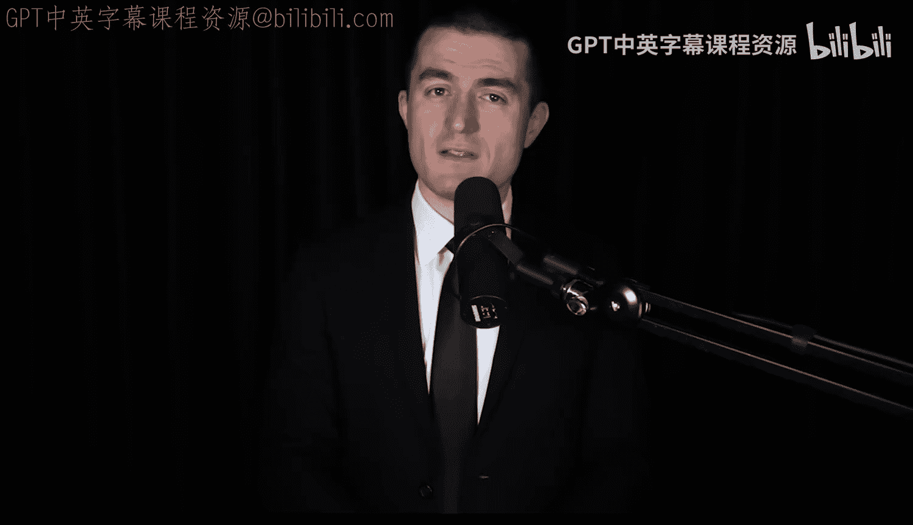
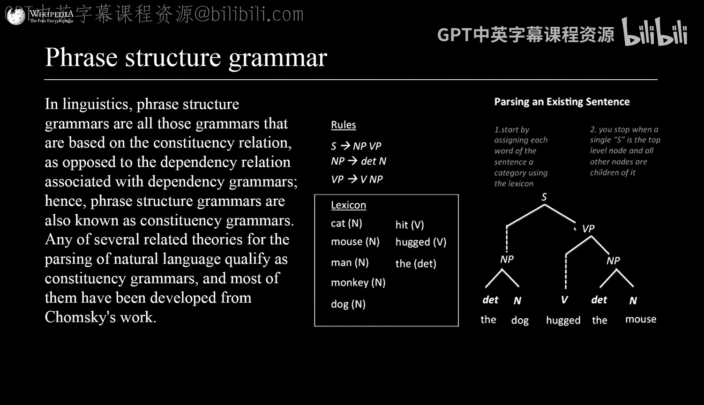
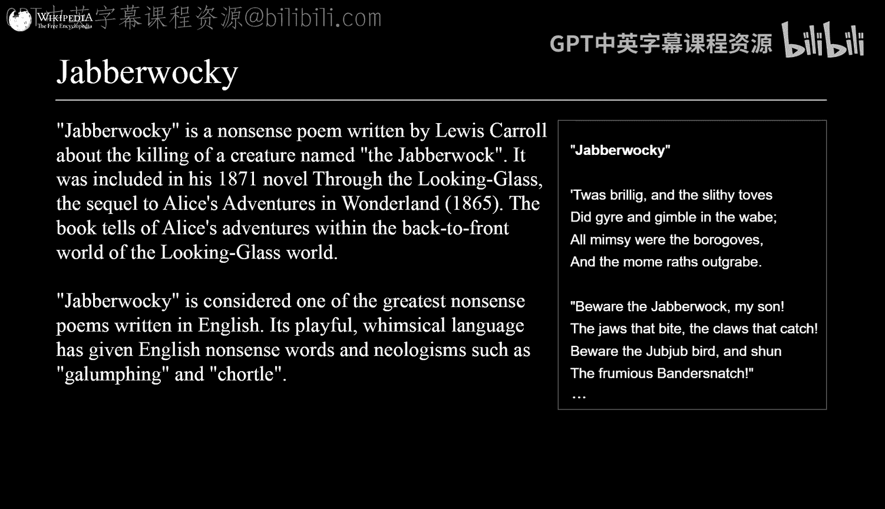
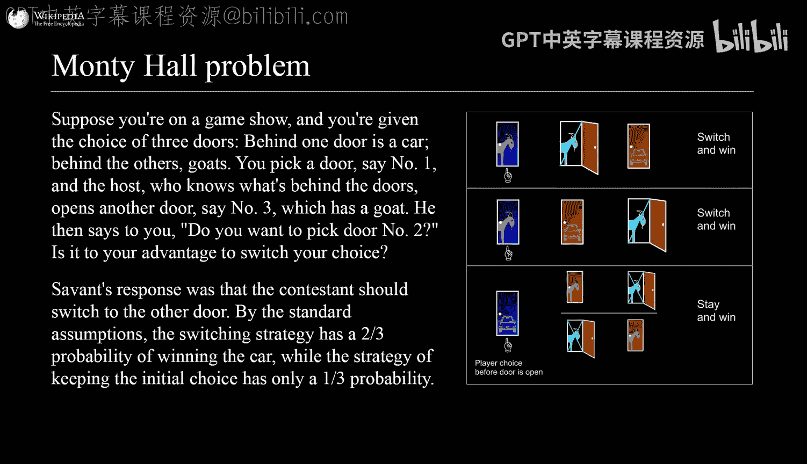
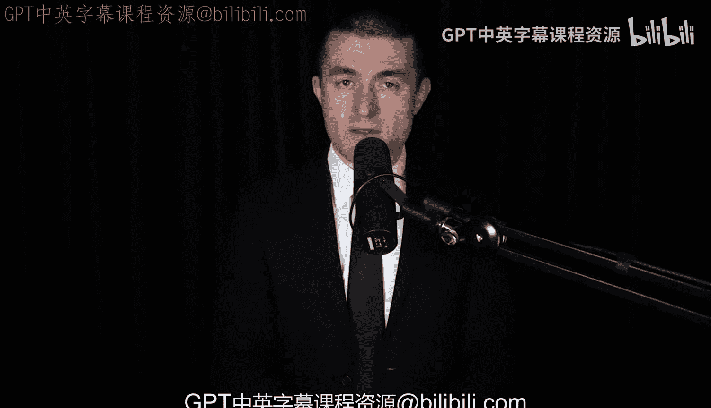

# Lex Fridman Podcast #426《爱德华·吉布森：人类语言、心理语言学、句法、语法与大型语言模型》中英字幕 - P1 - GPT中英字幕课程资源 - BV1LjUTBvEsU

Niveively， I certainly thought that all humans would have words for exact counting。

 and the Poha don't。 Okay， so they don't have any words for even one。

 There's not a word for one in their language。 And so there's really not word for 2，3 or 4。

 so that kind of blows people's minds on。 So that is blowing my mind。 That's pretty weird。 How you。

 how are you gonna ask， I want two of those。 You just don't。

 And so that's just not a thing you can possibly ask in the Pha。 It's not possible。 That is。

 there's no word for that。

The following is a conversation with Edward Gibson， or Ted， as everybody calls him。

 he is a psycholinguistics professor at MIT， he heads the MIT language lab that investigates why human languages look the way they do。

 the relationship between cultural language， and how people represent， process and learn language。

Also， he should have a book titled synyntax， a Cognitive Appach published by MIT Press coming out this fall。

 so look out for that。This is Alex Freeman podcast to support it。

 please check out our sponsors in the description and now dear friends， here's Edward Gibson。

When did you first become fascinated with human language As a kid in school when we had to structure sentences and English grammar。

 I found that process interesting。 I found it confusing as to what it was I was told to do。

 I didn't didn't understand what the theory was behind it， but I found it very interesting。

 So when you look at grammar， you were almost thinking about like a puzzle like almost like a mathematical puzzle。

 Yeah， I think that's right I didn't know I was gonna to work on this at all at that point。

 I was really just I was kind of a math geek person， computer scientist。

 I really liked computer science。 and then I found language as a neat puzzle to work on from an engineering perspective。

 actually， that's what as I sort of accidentally I decided after I finished my undergraduate degree。

 which was computer science and math and Canada in Queens University。

 I decided to go to grad school as that's what I always thought I would do and I went to Cambridge。

where they had a master's in a master's program in computational linguistics。

 and I hadn't taken a single language class before all I' had taken was CS computer science and math classes pretty much mostly as an undergrad。

 and I just thought this was an interesting thing to do for a year。

cause it was a single year program and then I ended up spending my whole life doing it。

 So fundamentally， your journey through life was one of a mathematician and a computer scientist and then you kind of discovered the puzzle。

 the problem of language and approached it from that angle to try to understand it from that angle。

 almost like a mathematician or maybe even an engineer as an engineer， I'd say I mean， to be frank。

 I had taken an AI class， I guess it was 83 45 somewhere 84 in there a long time ago and there was a natural language section in there and it didn't impress me I thought there must be more interesting things we can do it didn't seem very it seemed just a bunch of hacks to me。

 it didn't seem like a real theory of things in anyway way。

 And so I just thought this was this seemed like an interesting area where there wasn't enough good work that you ever come across like the philosophy angle of logic So if you think about the 80s with AI the expert。

Systems where you try to kind of。Maybe sidestep the poetry of language and some of the syntax and the grammar and all that kind of stuff and go to the underlying meaning the language is trying to communicate and try to somehow compress that in a computerreable way Do you ever come across that in your studies。

 I mean I probably did but I wasn't as interested in it I was trying to do the easier problems first than once I could thought maybe we're handleable。

 which is seems like the syntax is easier like which is just the forms as opposed to the meaning like you're talking when you're starting talking about the meaning that's very hard problem and it still was a really really hard problem but the forms is easier And so I thought at least figuring out the forms of human language which sounds really hard but is actually maybe more tractable So it's interesting do you think there is a big divide There's a gap There's a distance between form and meaning because that's a question you have discuss a lot with LLMs because they're damn good。

yeah， I think it's what theyre good at is form exactly。

 And that's that's why they're good because they can do form meanings hard。

Do you think there's oh wow， and I mean， it's an open question right， how close form and meaning are。

 but we'll discuss it， but I to me， studying form， maybe it's a romantic notion。

Gives you form is like the shadow。Of the the bigger meaning thing underlying language as I it forms language is how we communicate ideas。

 we communicate with each other using language， So in understanding the structure of that communication。

 I think you start to understand the structure of thought and the structure of meaning behind those thoughts and communication to me。

 but to you， big gap， yeah。What do you find most beautiful about human language， Maybe the form。

Of human language， the expression of human language。

 what I find beautiful about human language is the some of the generalizations that happen across the human languages within and across a language。

 So let me give you an example of something which I find kind of remarkable。

 that is if like a language。 if it has a word order such that the verbs tend to come before their objects。

 And so that's like English does that。 So we have the the first， the subject comes first in。

 in a simple sentence。 So I say you know， the。😊，The dog chased the cat or Mary kicked the ball。

 So the subjects first and then after the subject， there's the verb。 and then we have objects。

 all these things come after in English。 so it's generally a verb and most of the stuff that we want to say comes after the subject it's the objects。

 There's a lot of things we want to say they come after and' a lot of languages like that。

 about 40% of the languages the world or look like thatre subject verb object languages and then these languages tend to have prepositions these little markers on the nouns that connect nouns southern nouns or nouns to verb。

 So ver preposition like in or on or of or about I say I talk about something that something is the object of that preposition that we have these little markers come also just like verbs they come before they're nouns and then so now we look at other languages like Japanese or or Hindi or these are so called。

Verb final languages， those。Ass about maybe a little more than 40%。

 maybe 45% of the world's languages or more。 I mean，50% of the world's languages are verb final。

 Those tend to be post positionss。 Those markers， the we have the states have the same kinds of markers as we do in English。

 but they put them after。 So sorry they put， the markers come first。 So you say instead of you know。

 talk about a book， you say book about the opposite order there in Japanese or in Hindi。

 you do the opposite。 And and the talk comes at the end。 So the verb will come at the end as well。

 So instead of Mary kicked the ball， it's Mary ball kicked and then it's Mary kicked the ball to John。

 it's John2， the two the marker there， the preposition it's a post position in these languages。

 And so the interesting thing， fascinating thing to me is that within a language。

This order aligns it's harmonic And so if it's one or the other。

 if either verb initialial or verb finalnal， but then you'll have a prepositions prepositions or post positionss And so and that's across the languages that we can look at We've got around 1000 languages there's around 7000 languages on the earth right now。

 but we have information about say word order on around 100 of those pretty decent amount of information and for those thousand which we know about about 95% fit that pattern。

 So they will have either verb it's it's about half and half half of ver initial like English and half a verb final like like Japanese or to clarify ver initial is subject verb object That's correct verb final is still subject object verb That's correct。

 the subject is generally first that's so fascinating I ate an apple or I Apple 8。Okay。

 and it's fascinating that there's a pretty even division in the world amongst those 4 45%。 Yeah。

 it's pretty， it's pretty even。 And， and those two are the most common by far， those two word。

 the subject tends to be first there's so many interesting things。

 But these things are the thing I find so fascinating is there are these generalizations。

Within and across a language and not only those are the and there's actually a simple explanation。

 I think for a lot of that and that is。You're trying to like minimize dependencies between words。

 That's basically the story， I think behind a lot of why word order looks the way it is。

 is we're always connecting what is what is a thing I'm telling you I'm talking to in sentences。

 you're talking to me in sentences， these are sequences of words which are connected and the connections are dependencies between the words and it turns out that we're trying to do in a language is actually minimize those dependency links。

 it's easier for me to say things if the words that are connecting for their meaning are close together。

 it's easier for you in understanding if that's also true if they're far away。

 it's hard to produce produce that and it's hard for you to understand and the languages of the world within a language and across languages you fit that generalization。

 which is so it turns out that having verbs initial and then having prepositions ends up making dependencies shorter and and having ver。

Final and having post positions ends up making dependencies shorter than if you cross them if you cross them it ends up。

 you just end up it's possible， you can do it within a language within a language， you can do it。

 it just ends up with longer dependencies than if you didn't so languages tend to go that way they tend to they say they call it harmonic so it was observed a long time ago by without the explanation by a guy called Joseph Greenberg who's famous typologist from Stanford。

 he observed a lot of generalizations about how word order works and these are some of the harmonic generalizations that he observed harmonic generalizations about word word order。

 there's so many things I want to ask you let me sometimes basics you mentioned dependencies a few times what do you mean by dependencies Well。

 what I mean is in in language there's kind of three structures to three components to the structure of language one is the sounds so cat is at to in English。

I'm not talking about that part I'm talking and then there's two meaning parts and those are the words and and you're talking about meaning earlier so words have a form and they have a meaning associated with them and so cat is a full form in English and it has a meaning associated with whatever a cat is and then the combinations of words that's what I'll call grammar or syntax and that's like when I have a combination like the cat or two cats okay so where I take a two different words there'm putting them together and I get a compositional meaning from putting those two different words together and and so that's the syntax and in any sentence or utterance。

 whatever I'm talking to you you're talking to me， we have a bunch of words and we're putting together in a sequence it turns out they are。

😊，Connected so that every word is connected to just one other word in that in that sentence。

 And so you end up with what what's called it technically a tree。 It's a tree structure。

 So where there's a root of that of that utterance of that sentence。

 And then there's a bunch of dependence。 like branches from that root that go down to the words。

 the words are the leaves in this metaphor for a tree。

 So a tree is also sort of a mathematical construct。

 it's a theoretical thing a theory So this fascinating that you can break down a sentence into a tree。

 And then when every word is hanging on another depending and everyone agrees on so all linguists will agree with that。

 controversial。 that is not controversial。 There's nobody sitting here。 I do mad at you。

 I don't think so I linguists sitting there mad at this I think in every language。

 I think everyone agrees that all sentences are trees at some level。

 Can I pause on that because it's to me， just as layman。Surprising yeah。

 that you can break down sentences in many， mostly all languagess I think into a tree。

 I think so Thats I've never heard of anyone disagreeing with that。 That's weird。

 The details of the trees are what people disagree about Well， okay。

 so what's what's that the root of a tree， How do you construct， How hard is it。

 What is the process of constructing a tree from a sentence。Well， this is where， you know。

 depending on what your' there's different theoretical notions， I'm gonna to say this simplest thing。

 dependency grammar。 It's like a bunch of people invented this Tare was the first French guy back in。

 I mean， the paper was published in 1959， but he was working on the 30s and stuff。

 So and and it goes back to you know， philologist pinini was doing this in ancient India。 Okay。

 and so， you know， doing something like this。 the simplest thing we can think of is that there's just connections between the words to make the utterance。

 And so it's just say， I have like two dogs entered a room。 Okay， here's a sentence。😊。

And so we're connecting two and dogs together that's like there's some dependency between those words to make some bigger meaning and then we're connecting dogs now to entered right and we connect a room somehow to entered and so I'm going to connect to room and then room back to entered that's the tree is the root is entered that's the thing is like an entering event that's what we're saying here and the subject。

 which is whatever that dog is is two dogs it was and the connection goes back to dogs which goes back to that goes back to two I'm just that's my tree it starts entered goes to dogs down to two and then the other side after the verb。

 the object it goes to room and then that goes back to the determiner or article whatever I' going to call that word So it's a bunch of categories of words here we're noticing so there are verbs those are these things that typically mark they refer to events and states in the world and there are nouns which typically refer to people play。

and things is what people say， but they can refer to other they can heard of events themselves as well。

 they're marked by they the category， the part of speech of a word is how it gets used in language that's how you decide what the category of a word is not not by the meaning but how it gets used's useds usually the root。

 I it going be the verb that defineies the event usually I mean if I don't say a verb。

 then there won't be a verb and so it'll be something else。

 What if you're messing are were talking about language that's like correct language。

 What if you're doing in poetry and messing with stuff then rules got the window then it's no no you're constrained by whatever language you're dealing with probably you have other constraints in poetry that usually in poetry。

 there's multiple constraints that you want to you want to usually convey multiple meanings is the idea and maybe you have like a rhythm or a rhyming structure as well。

 And depending but you usually are constrained。the rules of your language for the most part so you don't violate those too much。

 you can violate them somewhat， but not too much。 so it has to be recognizable as your language like in English。

 I can't say dogs to entered room I mean I meant you know two dogs entered a room And I can't mess with the order of the articles the articles and the noun。

 you just can't do that in some languages you can you can mess around with the order of words much more I mean。

 you speak Russian Russian has a much freer word order than English And so in fact。

 you can move around words in know I told you that English has the subject verb object word order。

 so does Russian but Russian is much freer than English and so you can actually mess around with the word order。

 So probably Russian poetry is going to be quite different from English poetry because the word order is much less constrained。

 Yeah， there's a much more extensive culture of poetry throughout the history of the last hundred years in Russia。

And I always wondered why that is， but it seems that there's more flexibility in the way the language is used。

 There's more， your're more female language easier， by altering the words。

 altering the order of the words messing with it。 Well。

 you can just mess with different things in each language。 And so in Russian。

 you have case markers on the which is there's these endings on the nouns。

 which tell you how it connects each noun connects to the verb， we don't have that in English。

 And so when I say Mary kissed John。I don't know who the agent or the patient is except by the order of the words。

 right in Russian， you actually have a marker on the end。

 if you're using a Russian name in each of those names。

 you'll also say is it you know agent it'll be nominative which is marking the subject or an accusative will mark the object and you could put them in the reverse order。

 you could put accusative first you could put subject you could put the patient first and then the verb and then the subject and that would be a perfectlyly good Russian sentence and it would still mean I could say John kissed Mary。

 meaning Mary kissed John as long as I use the case markers in the right way。

 you can't do that in English。 And so I love the terminology of agent and patient and the other ones you used those are sort of linguistic terms correct are those are for like kind of meaning those are meaning and and subject and object are generally used for position So subject is just like the thing that comes before the verb and the object is one that comes after the verb。

 The agent is kind of like the thing。Doing that's kind of what that means， right。

 the subject is often the person doing the action， right， the thing。 So yeah， okay。

 this is fascinating。 So how hard is it to form a tree in general， I there。

Is there a procedure to it Like if you look at different languages。

 I it supposed to be a very natural， Like is it autoatable or is there some human genius involved in I think it's pretty autoatable at this point。

 people can figure out the words are。 They can figure what the morphs。

 which are technically morphmes are the minimal meaning units within a language。

 Okay so when you say eats or drinks。 It actually has two morphmes in in English there's the root。

 which is the verb and then there's some ending on it。

 which tells you know that's the third person third person singular morphs morphs are just the minimal meaning units within a language and then a word is just the things we put spaces between English and they have a little bit more。

 they have the morphology as well。 they have the endings this infexual morphology on the endings on the roots。

 it modify something about the word that adds additional meaning。

 and so we have a little bit of that in English， very little have much more in Russian for instance but we have a little bit in English。

 And so we have a on the nouns。 you can say it's either singular or plural and and you can say same thing for。

For verbs， like simple past tense， for example， you notice in English， we say drinks。

 you know he drinks， but everyone else is I drink you drink we drink it's unmarked in a way and then but in the past tense。

 it's just for everyone there's no morphology at all for past tense there is morphology is marking past tense but it's an irregular now so we don't even drink to drink it's not even irregular word So in most verbs many verbs there's an E we add so walk to walk we add that to say it's the past tense that I just happened to choose an irregular because the high frequency word and high frequency words tend to have irreg is in English what's inregular irregular there isn't a rule So drink to drank is an irregular as opposed to walk walked talk talked and there's a lot of irregulars in English There's a lot of irregulars in English the frequent ones the common words tend to be irregular there's many。

 many more low frequency words and those tend to be there's irregular ones。

You know the irregulars are fascinating because it's essentially slang that's sticky because you're breaking the rules and then everybody use it and doesn't follow the rules and they they say screw it to the rules。

's fascinating。 So you said morphes lots of morphologies what the study of morphs morphologies is the connections between the morphemes onto the roots。

 the roots。 So in English， we mostly have suffixes， we have endings on the words。

 not very much but a little bit and as opposed to prefixes。

 some words depending on your language can have you know mostly prefixes。

 mostly suffixes or mostly or both and then even languages several languages have things called infixes where you have some kind of a general form for for the root and you put stuff in the middle。

 you change the vowel's fascinating fascinating so in general。

 there's what two morphmes per word one or two or well in English it's one or two。

In English it tends to be one or two， there can be more， you know， in other languages， you know。

 a language like like Finnish which has a very elaborate morphology。

 there may be 10 morphemes on the end of a root okay。

 and so there may be there be millions of forms of a given word okay， okay。

 I will ask the same question over over but。How does just sometimes still understand things like morphmes。

 it's nice to just ask the question， how does these kinds of things evolve？

So you have a great book studying sort of the。How how the cognitive processing。

 how language is for communication so the mathematical notion of how effective language is for communication what role that plays in the evolution of language but just high level like how do we how does the language evolve with where English is two morphmes or one two morphfumes forward word and then Finnish has infinity toward word so what how does that how does that happen is it just people that has a really good question Yeah that's a very good question is like why do languages have more morphology versus less morphology and I don't think we know the answer to this I I think there's just like a lot of good solutions to the problem of communication so like I believe as you hinted that。

Language is an invented system by humans for communicating their ideas。

 And I think it comes down to we label things we want to talk about。

 Those are the morphems and words。 those are things we want to talk about in the world。

 And we invent those things。 And then we put them together in ways that are easy for us to convey to process。

 But that's like a naive view。 And I don't， I mean。

 I think it's probably right it's naive and probably right。 I don't know if it's naive。

 I think it's simple， simple。 I think naive is naive is an indication that's an incorrect somehow it's a trivial to too simple。

 I think it could very well be correct。 but it's interesting how sticky。

 It feels like two people got together。It it just feels like once you figure out certain aspects of a language that just becomes sticky and the tribe forms around that language。

 maybe the language， maybe the tribe forms first and the language of alls and then you just kind of agree and that you stick to whatever that is I mean。

 these are very interesting questions we don't know really about how words even words get invented very much about。

 you know， we don't really I mean， assuming they get invented。

They we don't really know how that process works and how these things evolve what we have is。

Kind of a current picture， a current picture of a few thousand languages， a few thousand instances。

 we don't have any pictures of really how these things are evolving， really。 and。

 and then the evolution is massively。You know， confused by contact right。

 So as soon as one language group， one group runs into another。We are smart。 humans are smart。

 and they take on whatever is useful in the other group。 And so any kind of contrast。

 which you're talking about， which I find useful， I'm I'm going to start using as well。

 So I worked a little bit in specific areas of words in number words in color words and in color words so we have in English。

 we have around 11 words that everyone knows for colors and many more。

 if you happen to be interested in color for some reason or other。

 if you're a fashion designer in artist or something you may have many， many more words。

 but we can see millions， like if you have normal color vision， normal trichrometric color vision。

 you can see millions of distinctions in color。 So we don't have millions of words。

 know the most efficient， no the most detailed color vocabulary would have over a million terms to distinguish all the different colors that we can see。

 but of course we don't have that。 So its somehow it's been it's kind of useful。

For English to have evolved in some way to such as there's 11 terms that people find useful to talk about。

 you know black，w， red， blue， green， yellow， purple， gray， pink。

 and I probably miss something there anyway there's 11 that everyone knows and and depending on your but you go to different cultures especially the non-industrialized cultures and they'll be many fewer so some cultures will have only two believe it or not that the Dan and I in Papua New Guinea have only two labels that that the group uses for color those are roughly black and white they are very very dark and very very light which are roughly black and white and you might think oh they're dividing the whole color space into light and dark or something and that's not really true they mostly just only label the the black and the white things they just don't talk about the colors for the other ones and so and then there's other groups I worked with a group called the Chimani down in in Bolivia in South America and they have three。

wordds that everyone knows， but there's a few others that are that several people like that many people know。

 and so they have it's kind of depending on how you count between three and seven words that the group knows okay and again they're black and white。

 everyone knows those and red red is like that tends to be the third word that everyone that cultures bring in if there's a word。

 it's always read， the third one and then after that。

 it's kind of all bets are off about what they bring in。 And so after that。

 they bring in sort of a big bluegreen they have one for that and then they and then you know different people have different words that they'll use from other parts of the space so anyway and it's probably related to what they want what they now what they now what they see because they see the same colors as we see so it's not like they' they have a weak a low color palette and the things they're looking at they're looking at a lot of beautiful scenery。

Okay， a lot of different colored u， flowers and berries and things， and you know。

 and so there's lots of things of very bright colors。

But they just don't label the color in those cases。 And the reason probably we don't know this。

 But we think probably what's going on here is that what you do。

 why you label something is you need to talk to someone else about it。

 and why do I need to talk about a color。 Well， if I have two things which are identical。

 And I want you to give me the one that's different。

 And and the only way it varies is color then I invent a word， which tells you， you know。

 this is the 1 I want。 So I want the red sweater off the rack。

 not not the green sweater there's and so those things will be identical because these are things we made and they're dyed and there's nothing different about them。

 And so in industrialized society， we have you know everything。

 everything we've got is pretty much arbitrarily colored。 But you go to nonindustrialized group。

 that's not true。 And so they don't suddenly they're not interested in color。

 you bring bright colored things to them。 They like them just like we like them。

 bright colors are great。 They're beautiful。 but they just don't need to。

No need you talk about them They don't have So probably color words is a good example of how language evolves from sort of function when you need to communicate the use of something I think so then you kind of invent different variations and basically you can imagine that the evolution of a language has to do with what the early tribes doing like what they want what kind of problems are facing them and they're quickly figuring out how to efficiently communicate the solution to those problems whether it's aesthetic or function or all that kind of stuff running away from a mammoth or whatever but know I think what you're pointing to is that we don't have data on the evolution of language because many languages have formed a long time ago so you don't get the chatter We have a little bit of like old English to modern English because there was a writing system and we can see how how old English looked so the word order changed for instance。

 in old English to middle English to modern English and so know we can see things like that but most language。

Don't even have a writing system。 So of the 7000 only you a small subset of those have a writing system and even if they have a writing system it's not a very modern writing system and so they don't have it。

 So we just basically have for Mandarin for Chinese。

 we have a lot of a lot of evidence from for long time and for English and not for much else。

 not for men German a little bit， but not for a whole lot of like long termm language evolution。

 we don't have a lot have snapshots is what we've got of current languages。

 Yeah you get an inkling of that from the rapid communication and certain platforms like readit there's different communities and they'll come up with different slang usually from my perspective。

 German by a little bit of humor or maybe mockery or whatever you know。

Just talking shit in different kinds of ways。 and you could see the evolution of language there because I think a lot of things on the internet。

 you don't want to be the boring mainstream so you like want to deviate。

From the proper way of talking。And so you get a lot of deviation， like rapid deviation。

 Then when communities collide， you get like just like you said。

 humans adapt to it and you can see it through liness of humor。 I mean， it's very difficult to study。

 But you can imagine like 100 years from now， if there's a new language born， for example。

 will' get really high resolution data on。 I mean， English changing English changes all the time。

 all languages change all the time。 So you know， there's a famous， result， But the queen's English。

 So the if you look at the queen's vowels， the queen's English is supposed to be， you know。

Originally， the proper way for the talk was sort of defined by whoever the queen talked or the king。

 whoever was in charge。 And and and so if you look at the how her vowels changed。

From when she first became queen 1952 or 53 when she was current the first， I mean。

 that's Queen Elizabeth who died recently， of course， until you know 50 years later。

 her vowels changed， her vowels shifted a lot and so even in the sounds of British English in her the way she was talking was changing the vowels were changing slightly。

 So that's just in the sounds there was changed， I don't know what I'm interested we're all interested in what's driving any of these changes the word order of English changed a lot over1 thousand years so it used to look like German it it used to be a verb final language with case marking and it shifted to a vermedial language。

 a lot of contact So a lot of contact with French and it became vermedial language with no case marking and so it became this verb initially thing and so that's evolving it totally evolved and so it may very I mean you know doesn't evolve maybe very much in 20 years is maybe what you're talking about but over 50。

00 years， things change a lot。 I think will now have good data on Yeah which is That's for sure。

 Can you talk to what is syntax and what is grammar。 So you've wrote a book on syntax。

 I did you were asking me before about what， you know。

 how do I figure out what a dependency structure isnt I'd say the dependency structure aren't that hard generally I think it's a lot of agreement of what they of what they are for almost any sentence in in most languages。

 I think people will agree on a lot of that。There are other parameters in the mix such that some people think there's a more complicated grammar than just a dependency structure。

 And so， you know， like Noam Chomsky， he's the most famous linguist ever。

 and he he is famous for proposing a slightly more complicated syntax。

 And so he he invented phrase structure grammar。 So he's well known for many， many things。

 but in the 50s in the early 60s like the late 50s。

 he was basically figuring out what's called formal language theory。 So and he figured out。

Sort of a framework for figuring out how complicated language， you know。

 a certain type of language might be so called phrase structure grammars of language might be。

 And so he his his idea was that maybe。We we can think about the complexity of a language by how complicated the rules are。

 okay and the rules will look like this。 They will have a lefthand side and we'll have a right right hand side。

 something on the left hand side will expand to the thing on the right hand side。

 So we'll say we'll start with an S， which is like the root， which is a sentence。 Okay。

 and then we're going to expand to things like a noun phrase and a verb phrase is what he would say。

 for instance， an S goes to an N and a Vp is a kind of a phrase structure rule。

 And then and we figure out when an N is an N is a determiner and a noun， for instance。

 and a verb phrase is something else as a verb and another noun phrase and another NP。 for instance。

 those are the rules of a very simple phrase structure。

 and and so he proposed phrase structure grammar as a way to sort of cover human languages。

 And then he actually figured out that well， depending on the formalization of those grammars。

 you might get more complicated or less complicated languages。 And so he could he said。

 well these are。

Things called， you know， context free languages that rule that he thought， you know。

 human languages tend to be what he calls context free languages and but there are simpler languages。

 which are so called regular languages。 And they have more a more constrained form to the rules of the of the phrase structure of of these particular rules。

 So he， he basically discovered and kind of invented ways to describe the language And and those are phrase those are phrase structure a human language and he was mostly interested in English initially in his his work in the 50s。

 So quick questions around。 So formal language theories。

 the big field that just studying language formally。 Yes。

 and it doesn't have to be human language there we can have a computer languages。 Any kind of system。

 which is generating some set of expressions in a language。 and those could be like the the。You know。

 the statements in a computer language， for example。

 so it could be that or it could be human language So technically you can study programming language and heaven heavily studied using this formalism。

 there's a big field of programming language within the formal language and then phrase structure grammar is this idea that you can break down language into this SNPVP of thing it's a particular formalism for describing language。

 Okay so and Chomsky was the first one。 he's going to figured that stuff out back in the 50s but he and that's equivalent actually the context for grammar is actually is kind of equivalent in the sense that it generates the same sentences as a dependency grammar would the dependency grammar is a little simpler in some way。

 You just have a root and it goes we don't have any of these the rules are implicit。

 I guess we just have connections between words。 the phrase structure grammars like kind of a different way to think about the dependency grammar。

Any more complicated， but it's kind of the same in some ways。

 So to clarify dependency grammar is the framework under which you see language and you make the case that this is a good way to describe I think it's the language that's correct and no Jobskys watching this is very upset right now So it's just kidding but what's the difference between where's the the place of disagreement。

Between phrase structure， grammar and dependency grammar they're very close。

 So phrase structure grammar and dependency grammar aren' aren't that far apart。

 I like dependency grammar because it's more perspicuous。

 it's more transparent about representing the connections between the words。

 It's just a little harder to see in phrase structure grammar。

 the place where Chomsky sort of devolved or went off from this he also thought there was something called movement so and that's where we disagree that's the place where I would say we disagree I mean maybe we'll get into that later。

 but the idea is if you want to do you want me to explain that note I would love explain movement so so many interesting things so here's the movement is Chomsky basically sees English and he says。

 okay I said you know we had that sentence it was like two dogs entered the room changed it a little bit say two dogs will enter the room And he notices that hey。

 English if I want to make a question yes， no question。from that same sentence。

 I say instead of two dogs will enter the room， I say will two dogs enter the room Okay there's a different way to say the same idea。

 and it's like well， the auxiliary verb， that will thing it's at the front as opposed to in the middle and so and he looked you know if you look at English you see that that's true for all those modal verbs and for other kinds of auxiliary verbs in English。

 you always do that， you always put an auxiliary verb at the front。

 and and what he when he saw that so if I say I can win this bet can I win this bet So I move a can to the front So actually that's a theory I just gave you a theory there he talks about it as movement。

 that word in the dec thinks the declarative is the root is there a default way to think about the sentence and you move the auxiliary verb to the front That's a movement theory and he just thought that was just so obvious that it must be true that there's nothing more to say about that that this is how auxiliary verbs work in English。

Movement rule such that you're move like to get from the declarative to the interrogative。

 you're moving the auxiliary to the front。 And it's a little more complicated as soon as you go to simple simple present and simple past because you know if I say you know John slept。

 you have to say did John sleep， not slept John and so you have to somehow get an auxiliary verb and I guess underlyingly it's like slept it' a little more complicated than that。

 but that's his idea， there's a movement。 and so a different way to think about that that isn't I mean then then he ended up showing later。

 so he proposed this theory of grammar， which has movement。

 and there's other places where he thought there's movement。

 not just auxiliary verbs but things like the passive in English and things like questions W H questions a bunch of places where he thought there's also movement going on and each one of those。

 he thinks there's words well phrases and words are moving around from one structure to another what you call deep structure to surface structure。

 I mean there's like two different structures in in his theory there's a different。

way to think about this， which is there's no movement at all。

 There's a lexical copying rule such that the word will or the word can these exuxiliary verbs。

 they just have two forms。 and one of them is the declarative and one of them is interrogative and you basically have the declarative one and oh。

 I form the interrogative or I can form one from the other doesn't matter which direction you go and and I just have a new entry which has the same meaning。

 which has a slightly different argument structure， argument structure。

 it's a fancy word for the ordering of the words。 And so if I say it was the dogs two dogs can or will enter the room there's two forms of will。

 one is will declarative and then okay， I've got my subject to the left It comes before me and the verb comes after me in that one And then the will Interrogative。

 It's like oh， I go first Interrogative will is first and then I have the subject immediately after and then the verb after that。

So you just you can just generate from one of those words。

 another word with a slightly different argument structure with different ordering。

 and these are just lexical copies and they're just they're not necessarily moving for one there's no movement There's a romantic notion that you have like one main way to use a word and then you can move it around which is essentially what movement is but that's the lexical copying is similar so so then we we do lexical copying for that same idea that maybe the declarative is the source and then we can copy it And so an advantage there's multiple advantages of the lexical copying story。

 It's not my story。 This is like Ivan a bunch of linguists have been proposing these stories as well know in tandem with the movement story。

 Okay Ivansag died a while ago， but he was a one of the proponents of the nonmovement with lexical copying story。

 And so that is that a great advantage is well， Chomsky。

Really famously in 1971 showed that the movement story leads to learnability problems。

 It leads it leads to problems for how language is learned。 It's really。

 really hard to figure out what the underlying structure of languages if you have both phrase structure and movement。

 It's like really hard to figure out what came from what there's like a lot of possibilities there。

 if you don't have that problem the learning problem gets a lot easier。

 just say there's lexical copies we say the learning problem。

 do you mean like humans learning a new language。 Yeah， just learning English。

 So baby is lying around listening to listening to me talk and how are they learning English or you know maybe it's a two year old who's learning Interrogatives and stuff or how are they doing that。

 are they doing it from like are they figuring out or so Chomsky said is impossible to figure it out actually。

 he said it's actually impossible not not hard but impossible and therefore that's where universal grammar comes from。

I that it has to be built in。 And so what they're learning is that there's some built-in movement is built in in his story is absolutely part of your language module and and then you are you're just setting parameters you're said depending on English is just sort of a variant of the universal grammar and you're figuring out oh which orders does English do these things the non-movement story doesn't have this。

 it's like much more bottom up you're learning rules。

 you're learning rules one by one and oh there's this word is connected to that word a great advantage another advantage it's learnable another advantage of it is that it predicts that not all auxiliaries might move like it might depend on the word depending on whether and that turns out to be true So there's words that that don't really work as aili they work in declarative and not an interrogative so I can say I'll give you the opposite first I can say。

Aren'tI invited to the party and that's an interrogative form。

But it's not from I aren't invited to the party。 There is no I aren't， right。

 so that's interrogative only。 and then we also have forms likeaught， I ought to do this。

And and I guess some British old British people can say exactly， it doesn't sound right。

 does it for me， It sounds ridiculous。 I don't even thinkaught is great， but I mean。

 I totally recognize I ought to it is not too bad actually I can say I ought to do this that sounds pretty good。

 Yeah， if I'm trying to sound sophisticated maybe I don't know。 it just sounds completely out。😊。

Anyway， so there are variants here and a lot of these words just work in one versus the other and that's like fine under the lexical copying story。

 it's like， well you just learn the usage， whatever the usage is is what you is what you do do with this word。

 but it doesn't it's a little bit harder in the movement story， the movement story。

 like that's an advantage I think of leical copying in all these different places。

 there's all these usage variant which make the movement story a little bit harder to。

Work so one of the main divisions here is the movement story versus less story that has to do about the auxiliary war and so on。

 But if we rewind to the phrase structure grammar versus dependency grammar There are equivalent in some sense。

 in that for any dependency grammar， I can generate depend phrase structure grammar。

 which generates exactly the same sentences。 I just like the dependency grammar formalism because it makes something really salient which is the the length of dependencies between words。

 which isn't so obvious in the in the phrase structure， it's just kind of hard to see It's in there。

 It's just very's opaque technically， I think phrase structure grammar is mappable to dependency grammar and vice versa and vice versa there's like these like little labels S on PVP a particular dependency grammar。

 you can make a phrase structure grammar， which generates exactly those same sentences and vice versa But there are many phrase structure。

Gmmars， which you can't really make a dependency grammar I mean you can do a lot more in a free structure grammar you get many more of these extra nodes basically you can have more structure in there and some people like that maybe there's value to that I don't like it Well for you so we you clarifyifies so dependency grammar its just one word depends on only one other word and you form these trees and that makes it really puts priority on those dependencies just like as a tree that you can then measure the distance of the dependency for one word to the other that can then map to the cognitive processing of of these sentences how well how easy it is to understand and all that kind of stuff so it just puts the focus on just like the mathematical。

U distance of dependence between words so like it's just a different focus absolutely just continue on a thread of Chomsky because it's really interesting because it as you're discussing this agreementment。

To the degree， there's this agreementment， you're also telling the history of the study of language。

 which is really awesome。So you mentioned context free versus regular。Does that distinction。

Coming into play for the grammars。 No， okay， not at all。 I mean， regular。

 regular languages are too simple for human languages。 They they are they it。

 it's a part of the hierarchy， but human languages are in in the phrase structure world are definitelyin they they're at least context free。

 maybe a little bit more， a little bit harder than that。

 But so there's something called context sensitive as well。

 where you can have like this is just the formal language description in in a context free grammar。

You have one this is like a bunch of like formal language theory we're doing here but I love it Okay so you you have a left hand side category and you're expanding to anything on the right is is a that's a context free So like the idea is that that category on the left expands in independent context to those things。

 whatever there are on the right doesn't matter what and a context sensitive。😊，Says okay。

 I actually have more than one thing on the left。 I can tell you only in this context。 You know。

 I maybe have like a left in a right context or just a left context or a right context。

 I have two or more stuff on the left tells you how to expand that those things in that way。 Okay。

 so it's context sensitive。 a regular language is just more constrained。 And so it。

 it doesn't allow anything on the right。 It It allows very it allows basically it's one very complicated rule is kind of what a regular language is。

 And so it doesn't have any，to say long distance to pan， it doesn't allow recursion， for instance。

 there's no recursion Yeah， recursion is where you which is human languages have recursion。

 They have embedding and you can't。 Well， it doesn't allow center embedded recursion。

 which human languages have， which is what center embedded recursion。

 So within a sentence within a sentence。 Yeah within a sentence。 So here we're gonna get to that。

 But know， the formal language stuff is a little aside Chomsky wasn't proposing it for human languages。

 even He was just pointing out that human languages are context free。

 And then he was most for human because that was kind of stuff we did for formal languages and what he was most interested in was。

Human language。 and that's like the movement is where we where where he sort of set off on the I would say very interesting but wrong foot。

 It was kind of interesting。 It's I agree it's very interesting history。

 So he proposed this multiple theories in 57 and then 65 they all have this framework though was phrase structure plus movement。

  different versions of of the phrase structure and the movement in the 57 These are the most famous original bits of Chomsky's work。

 And then 71 is when he figured out that those lead to learning problems that there's cases where a kid could never figure out which rule which set of rules was intended。

 and so and then he said， well， that means it's innate。 It's kind of interesting。

 He just really thought the movement was just so obviously true that he couldn't he didn't even entertain giving it up。

 It's just obviously that's obviously right， And it was later where people figured out that there's all these like subtle ways in which things which。

claylay generalizations aren't generalizations and they across the category they they're word specific and they have and they kind of work。

 but they don't work across various other words in the category。

 And so it's easier to just think of these things as lexical copies。

 and I think he was very obsessed。 I don't know I'm guessing he he really wanted this story to be simple in some sense。

 and language is a little more complicated in some sense。

 he didn't like words he never talks about words。 He likes about combinations of words。

 And words look up a dictionary。 there's 50 senses for a common word the word take will have 30 or 40 senses in it。

 So there'll be many different senses for common words。 And he doesn't think about that。

 doesn't think thats language。 I think he doesn't think that's language。

 He thinks that words are distinct from combinations of words。 I think they're the same。

 If you look at my brain in the scanner while I'm listening to a language I understand and you。

Hereair， I can localize my language network in a few minutes in like 15 minutes。

 And what you do is I listen to a language。 I know。 I listen to， you know。

 maybe some language I don't know， or I listen to muffled speech or I read sentences that I read nonwords。

 like I can do anything like this。 Anything that's sort of really like English and anything that's not very like English。

 So I've got something like it and not。 and I got to control。 And， and the voxels， which is just。

 you know， the 3D pixels in my， in my brain that are responding most is a language area。 And。

 and that's this left lateralized area in my head。 And， and。Wherever I look in that network。

 if you look for the combinations versus the words。

 it's there it's it's everywhere it's the same so it's like hard to find there are no areas that we know I mean that's。

It's a little overstated right now at this point， the technology isn't great。 It's not bad。

 but we have the best， the best way to figure out what's going on in my brain when I'm listening or reading language is to use FMRI functional magnetic resonance imaging。

 And that's a very good localization method。 So I can figure out where exactly these signals are coming from pretty know down to you know millime cubic millimeters are smaller。

 very small。 we can figure those out very well。 The problem is the when okay it's measuring oxygen。

 Okay， and oxygen takes a little while to get to those cells。 so it takes on the order of seconds。

 So I talk fast， I probably listen fast。 and I can probably understand things really fast。

 So a lot of stuff happens in two seconds。 And so to say that we know what's going on that the words right now。

 in that network are best guesses that whole network is doing something similar。

 but maybe different parts of that network are doing different things。

 And that's probably the case we just don't have very good。

Methods to figure that out right at this moment and so。

Since we're kind of talking about the history of the study of language。

 what other interesting disagreements and you're both at MIT or were for a long time。

 what kind of interesting disagreements there， attention of ideas are there between you and No Chosky and we should say that Noome was in the linguistics department and your。

I guess for a time we're affiliated there， but primarily a brain and cognitive science department。

 which is another way of studying language and you've been talking about FMRI so like what is there something else interesting to bring to the surface about the disagreement between the two of you？

Or other people in the industry， I mean， I've been at MIT for 31 years since 1993。

 and he Chomsky's been there much longer。So I， I met him。 I knew him。I met when I first got there。

 I guess and and we would interact every now and then I'd say that so I'd say our biggest difference is our methods。

 And so that's the biggest difference between me and is that I gather data from people I do experiments with people and I gather corpus data whatever corpus data is available and we do quantitative methods to evaluate any kind of hypothesis we have。

 he just doesn't do that。 And so you know he has never once been associated with any experiment or corpus work ever。

 And so it's all thought experiments。 It's his own intuitions。

 So I just don't think that's the way to do things's that's you know across the street there' across the street from us kind of difference between brain and cogsi in linguistics。

 I mean， not all some of the linguists depending on what you do more speech oriented。

 They do more quantitative stuff。 but in the。In the meaning， words and， well。

 it's combinations of words synt semantics， they tend not to do experiments and。

And corpus analyses linguistic size probably well but the method is a symptom of a bigger approach。

 which is sort of a psychology philosophy side on no for you it's more sort of data driven almost mathematical approach。

 Yeah， I mean， I'm psychologist。 So I would say we're in psychology brain cognitive sciences psychology department it was a psychology department up until 1985 and it became the brain cognitive science department And so I mean my training is in I mean training is computer science but alogist I mean I I't know what I am data drivenlogist I am I'm called the linguist have to be called a computer scientist I' have to be called a psychologylogist any of those things in the actual like how that manifests itself outside of the methodology is like these differences differences about the movement story versus the lexical copy story those are theories So like the theories are but I think。

The reason we differ in part is because of how we evaluate the theories。

 And so I evaluate theories quantitatively and noome doesn't got it。 Okay。

 well let' let's explore the theories that you explore in your book。

 Let's return to this dependency grammar framework of looking at language。

 What's a good justification。 Why the dependency grammar framework is a good way to explain language。

 What's your intuition So the reason I like dependency grammar as I've said before is that it's very transparent about its representation of distance between words。

 So it's like all it is is you've got a bunch of words。

 you're connecting together to make a sentence and。😊，A really neat insight。

Which turns out to be true is that the further apart the pair of words are that you're connecting。

 the harder it is to do the production， the harder it is to do the comprehension。

 Its as harder to produce， harder to understand when the words are far apart when they're close together。

 It's easy to produce and it's easy to comprehend。 Let me give you an example。 Okay， so。😊。

We have in any language。 we have mostly local connections between words， but they're abstract。

 the connections are abstract。 They're between categories of words。

 And so you can always make things further apart。 if you put your if you add modification。

 for example， after a noun， So a noun in English comes before verb。

 the subject noun comes before verb。 And then there's an object after， for example。

 So I can say what I said for， you know， the dog entered the room or something like that。

 So I can modify dog。 If I say something more about dog after it。

 Then what I'm doing is in indirectly， I'm lengthing the dependence the dependence between dog and entered by adding more stuff to it。

 So I this make just make it explicit here， if I say the。The boy who the cat scratched cried。

 We're gonna have a mean cat here。 And， and so what I've got here is I， the boy cried。

 It would be a very short， simple sentence。 And I just told you something about the the boy。

 and I told you it was， it was the boy who the cat scratched。 Okay。

 so the cried is connected to the boy。 cried at the end。 Yeah。

 it's connected to the boy in the beginning。 right， And so I can do that。

 And I can say that that's a perfectly fine English sentence。 And I can say the cat。

 which the dog chased。Ran away or something。 Okay， I can do that。

 But it's really so it's really hard now。 I've got whatever I have here。 I have the boy who the cat。

 Now let's say I try to modify cat。 The boy who the cat which the dog chased scratched， ran away。

 my God， that's hard I can I'm sort of just working that through in my head。

 how to produce and how and it's really very just horrendous to understand。 It's not so bad。

 at least I've got intonation there to sort of mark the boundaries and stuff。

 But's that's really complicated。 That's sort of English in a way。 I mean。

 that follows the rules of English。 but so what's interesting about that is is that what I'm doing is nesting dependencies there。

 I'm putting one I've got a subject connected to a verb there。

 and then I'm modifying that with a clause， another clause。

 which happens to have a subject in a verb relation。 I'm trying to do that again on that second one。

 And what that does。 I it lengthens out the dependence。

 multiple depend actually get lengthened out there。 The dependencies get get longer。

On the outside ones get long and even the ones in between get kind of long and and you just so what's fascinating is that。

That's bad。 That's really horrendous in English。 but that's horrendous in any language。

 so no matter what language you look at， if you do。

 just figure out some structure where I'm gonna to have some modification following some head。

 which is connected some later head。 and I do it again。 It won't be good。

 guaranteed like 100% that will be uninterpretable in that language in the same way that was uninterpretted in English so clarify the distance of the dependencies is whenever the boy cried。

 there's a dependence between two words。And then you counting the number of what morphemes between them That's a good question I just say words your words are morphs between we don't know that actually。

 that's a very good question。 what is the distance metric。

 but let's just say it's words Sure Okay so that and you're saying the longer the distance of that dependence。

 the more no matter the language except legalese even legally okay we'll talk about Okay， okay， okay。

 but that。The people will be very upset They speak that language， not upset。

 but they'll either not understand it。 they'll be like this is they'll their brain will be working in overtime。

 Yeah they will have a hard time either producing or comprehending it。

 they might tell you that's not their language。 You know， it's sort of the language。

 I mean it's following like they'll agree with each of those pieces is part of their language。

 but somehow that combination will be very， very difficult to produce and understand。

 I that a chicken or the issue here。 So like I'm giving you an explanation well I mean。

 I'm giving you two kinds of explanations。 I'm telling you that center embedding that's nesting。

 are the same those are synonyms for the same concept here。

And the explanation for those are always hard。 Crum embedding and nesting are always hard。

 And I gave you an explanation for why they might be hard， which is long distance connections。

's when you do centrumbedding when you do nesting， you always have long distance connections between the dependence。

 You just so that's not necessarily the right explanation。

 just I can go through reasons why that's probably a good explanation。

 And it's not really just about one of them so probably it's a pair of them or something of these dependence that you get long that drives you to like be really confused in that case。

 And so what the behavioral consequence there I mean this is kind of methods like how do we get at this。

 you could try to do experiments to get people to produce these things。

 they're gonna have a hard time producing them， you can try to do experiments to get them understand them see how well they understand them can they understand them another method you can do is give people partial materials and ask them to complete them。

 those cent em materials and they'll fail。 So I've done that。 I've done all these。

I mean so central betting meaning like you can take a normal sentence like the boy cried and inject a bunch of crap in the middle。

 that separates the boy in the cried。 that central bedding。

 and nesting is on top of that nesting is the same thing bedding totally equivalent terms。

 I'm sorry sometimes use one Go And then what you're saying is there's a bunch of different kinds of experiments you can do mean I like to understand is like have more embedding central bedding is it harder to understand。

 but then you have to measure the level of understanding。

 I guess yeah you could I mean there's multiple ways to do that。

 mean's a simplest ways just ask people how good is the sound natural is sound that's a very blunt but very good measure reliable will do the same thing And so I don't know what means exactly but it's doing something that we're measuring something about the confusion。

 the difficulty associated with those are giving you signal's why you can say what about the。

The completion of this with the central bit。 So if you give them a partial sentence。

 say I say the book。Which the author， who， and I ask you to now finish that off for。 I mean。

 either say it， Yeah， yeah， but you can just put say it's written in front of you。

 And you can just type in have as much fun time as you want， they will。

 even though that one's not too hard， right， So if I say it's like the book， is's like， oh。

 the the book， which the author who I met wrote。Was good。 You know。

 that's a very simple completion for that。 if I give that completion online somewhere to you know a crowdsourcing platform and ask people to complete that。

 they will miss off a verb very regular like half of the time maybe twothirs of the time。

 they'll say they'll just leave off one of those verb phrases even with that simple so say the book which the author who and they'll say was they you need three verbs I need three verbs or who I met wrote was good and they'll give me two。

 They'll say who was who is famous was good or something like that。

 they'll just give me two they'll happen about 60% of the time。

 So 40% maybe 30 they'll do it correctly correctly meaning they'll do with three verb。

 I don't know what's correct or not know this is hard， It's a hard task。

 Yeah I'm struggling with it in my head。 it's easier when you list if you look its a little easier then listening is pretty tough because you have to there's no。

Tce of it， you have to remember the words that I'm saying， which is very hard auditly。

 we wouldn't do it this way。 We do it written。 You can look at it and figure it out。

 it's easier in many dimensions in some ways， depending on the person it's easier to gather written data for I mean。

 most sort of psycho I work in psycholinguistics， psychology of language and stuff。

 And so a lot of our work is based on written stuff because it's so easy to gather data from people doing written kinds of tasks。

 spokenken tasks are just more complicated to administer and analyze because people do weird things。

 when they speak and it's harder to analyze what they do。

 But they generally point to the same kinds of things。 So okay， so the universal theory of language。

 Yeah by Ted Gibson is that you can form dependency。

You can form trees for any senses and that's right you can measure the distance in some way of those dependencies and then you can say that most languages have very short dependencies。

 all languages， all languages all languages have short dependencies you can actually measure that so an next student of mine his guys that University of California Irvine Richard Futral did a thing a bunch of years ago now where he looked at all the languages we could look at which was about 40 initially and now I think there's about 60 for which there are dependency structures like so there meaning that's got to be like a big text。

 bunch of texts which have been parsed for their dependency structures and there's about 60 of those which have been parsed that way and for all of those you can what he did was take any any sentence in one of those languages and you can do dependency structures and then start at the route we're talking about dependency structures that's pretty easy now and he's trying to figure out what a control way you might say。

Same sentence is in that language and so we is just like all right。

 there's a root and it has say as a sentences let just go back to you know two dogs entered the room and so entered is the root and entered has two dependences。

 it's got dogs and it has room and what he does is like let's scramble that order that's three things。

 the root and the head and the two dependences and into some random order。

 just random and then just do that for all the dependence down so now look do it for whatever was two in dogs for in room and that's not it's a very short sentence when sentences get longer and you have more dependences。

 there's more scrambling that's possible and what he found what so that's you can figure out one scrambling for that sentence it did like 1 hundred times for every sentence and every cor and every one of these texts every corpus then he just compared the dependency lengths in those random scramblings to what actually the English or the French or the German was。

Original language or Chinese or what all all these like 80 length No 60 languages。 Okay， and。

 and the dependency lengths are always shorter in the real language compared to to these。

 this kind of a control。 And there's another that he， it's， it's a little more rigid his control， so。

The way I described it， you could have cross dependencies like by scrambling that way。

 you could scramble any way at all。 languages don't do that。

 they tend not to cross dependencies very much like so the dependency structure they tend to keep things non-cros know there's a technical term。

 they call that projective， but it's just non-cro is all that is projective。

 And so if you just constrain the scrambling so that it only gives you projective sort of noncro the same thing holds。

 So so still still human languages are much shorter this kind of a control。

 So there's like what it means is that in every language。

 we're trying to put things close relative to this kind of a control like it doesn't matter about the word order。

 some of these are verb final， some of them these are verb medialike English and some are even verb initial。

 there are a few languages the world which have VSO world word order verb subject object languages haven't talked about those's like 10% of the。

And even even in those languages that's still short dependencies sure dependencies is rules Okay。

 so how what what are some possible explanations for that for why why languages have evolved that way so that that's one of the I suppose disagreements you might have with Chosky so you consider the evolution of language in in terms of information theory yeah。

And for you， the purpose of language is ease of communication。

 right and processing right That's right。 So I mean， the the story here is just about communication。

 It it is just about production really， it's about ease of production is the story when we say production Oh。

 I does mean age of language production is's easier for me to say things when the when I'm doing whenever I'm talking to you is somehow I'm formulating some idea in my head and I'm putting these words together and it's easier for me to do that。

To put to say something where the words are close closely connected in dependency as opposed to separated like by putting something in between and over and over again。

 it's just hard for me to keep that in my head like that's the whole story like the story it's basically I dependency grammar sort of gives that to you like just like long long is bad or it good it's like easier to keep in mind because you have to keep it in mind for probably for production know。

 probably matters in comprehension as well like also matters in comprehension both sides of the production but I would guess it's probably of all for production about producing what's easier for me to say that ends up being easier for you Also that's very hard to disentangle this idea of who is it for is it for me the speaker or is it for you the listener I mean part of my language is for you like the way I talk to you is gonna to be different from how I talk to different people I'm definitely angling what I'm saying to who I'm saying It's not like I'm just talking the same way to every single person。

 so。A sensitive to my audience。 But how does that， does that， you know。

 work itself out in the in the dependency length differences， I don't know。

 Maybe that's about just the words， that part， you know which words I select。

 My initial intuition is that。You optimize language for the audience， Yeah。

 but but it's it's just kind of like messing with my head a little bit to say that。

Some of the optimization might be， and maybe be the primary objective of the optimization might be the ease of production。

 Yeah we have different senseus。 I guess I'm， I'm like very selfish。 And you' fact， Im like。

 I think it's like it's all about me。 I'm like， I'm just doing this easiest for me all I don't want to I'm like。

 I'll， I mean， but I have to of course， choose the words that I think you're gonna know。

 I'm not gonna choose words you don't know。 In fact， I'm gonna fix that when I， you know。

 so there it's about， but， but maybe for。For the syntax， for the combinations， it's just about me。

 I feel like it's， I don't know， though。 it's very， wait。

 But the purpose of communication is to be understood is to convince others and so on。

 Yeah like the selfish thing to be understood。 Okay， it's， it's about a little circular there， too。

 then， Okay right， I mean， like the use of production that can me be understood then。

I don't think it's circular。 So I think the primary。

 I think the primary objective is to be understood is about the listener because otherwise if you're optimizing for the ease of production。

 then you're you're not gonna have any the interesting complexity of the language。

 Like you're trying to like， let's control for what it is I want to say I'm saying。

 let's control for the thing the message control for the message。

 means the message needs to be understood， That's the goal。 but that's the meaning。

 So I'm still talking about the form， just the form of the meaning。

 How do I frame the form of the meaning is all I'm talking about。

 you're talking about a harder thing， I think is like， how am I。Like try to change the me like's。

 let's keep the meaning constant like which you got it if you keep the meaning constant how can I phrase whatever it is I need to say like I get to pick the right words and I'm gonna to pick the order so that it's so it's easy for me that's that's that's。

 that's what I think is probably I think I'm still tying meaning and form。Together in my head。

 but you're saying if you keep the meaning of what you're saying constant， would the optimization。

 Yeah， it could be the primary objective of that optimization is the。For production。

 that's interesting。I'm struggling to keep constant meaning。It's just so， I mean。

 I'm such I'm a human right， So for me， the form without having introspeced。On this。

 the form and the meaning are tied together like。Deeply。Because I'm a human， like for， for me。

 when I'm speaking， because I haven't thought about language。

 like in a rigorous way about the form of language。 But look。For any event。There's。

 there's an an unbounded。 I don't， I don't w tona see infinite but sort of unbound ways of that I might communicate that same event。

 This two dogs entered a room。 I can say in many， many different ways。 I can say， hey。

 there's two dogs。They entered the room。 Hey， the room was entered by something。

 The thing that was entered was two dogs。 I mean there's， I mean。

 it's kind of awkward and weird to stuff。 But those are all similar messages。With different forms。

 the different ways I might frame and of course I use the same words there all the time。

 I could have referred to the dogs as you know a Dalmatian and a poodle or something。

 you know I could have been more specific or less specific about what they are and I could have said been more abstract about about but the number there's like so I'm trying to keep the meaning which is this event constant and then how am I going describe that to get that to you it kind of depends of what you need to know right and what I think you need to know but I'm like trying let's control for all that stuff and not ands I'm just like choosing I'm doing something simpler than you're doing which is just forms to use specifying the species the breed of dog and whether they're cute or not is changing the meaning that might be yeah yeah。

 that would be that would be changing the meaning for sure right so you're just yeah that's changing the meaning but say even if we keep that constant we can still talk about what's easier or hard for me right the listener and。

Yeah。can which phrase structures I use， which combinations。

 which you this is so fascinating and just like a a really powerful window into a human language。

 but I wonder still throughout this how vast the gap between meaning and form， I just。

 I just have this like，May be romanticized notion that they're close together。

 that they evolve close like hand in hand， that you can't just simply optimize for one without the other being in the room with us。

Like， it's， well， it's kind of like an iceberg form is the tip of the iceberg and the rest the。

 the meaning is the iceberg。 but you can't like s。 But I think that's why。

These large language models are so successful because they're good at form and form isn't that hard in some sense。

 and meaning is tough still。 And that's why they're notre， you know。

 they don't understand what they're we're going to talk about that later。 maybe。

 but like we can distinguish in our， forget about large language models like humans maybe you'll talk about that later too。

 is like the difference between language， which is a communication system and thinking。

 which is meaning。 So language is a communication system for the meaning。 It's not the meaning。

 And so that's why， I mean and there's a lot of interesting evidence we can talk about relevant to that。

 Well， I mean， that's a really interesting question。 What is the difference。

 what is the difference between language written， communicated。😊，Versus thought。

What to use the difference between them？Well， you or anyone has to think of a task。

 which they think is， is a good thinking task。 and there's lots and lots of tasks。

 which should be good thinking tasks。 And whatever those tasks let's say it's， you know。

 playing chess or that's a good thinking task or playing some game or're doing some complex puzzles maybe。

Maybe remembering some digits that's thinking， remember remembering some a lot of different tasks we might think。

 maybe just listening to music is thinking。 or there's a lot of different tasks we might think of as thinking。

 There's a woman in my department at Federrenco。 and she's done a lot of work at on on this question about what's the connection between language and thought。

 And， and so she uses， I was referring earlier to MRI。 FMRI。 That's her primary method。

 And so she has been really fascinated by this question about whether。What language is， Okay。

 and so as I mentioned earlier， you can localize my language area。

 your language area in a few minutes。 Okay， in like 15 minutes， I can listen to language。

 listen to nonlanguage or backward speech or something。

 and we find areas left lateralized network in my head。

 which is especially which is very sensitive to language as opposed to whatever that control was specify mean by language like language what just sentences。

 know， I'm listening to English of any kind story or can read sentences。

 anything at all that I understand if I understand it then it'll activate my language network。

 So right now， my language network is going like crazy when I'm talking and when I'm listening to you because we're both' communicate and that's pretty stable。

 Yeah it's incredibly stable。 So I happen to be married to this womano。

 So I've been scanned by over and over and over since 2007 or6 or something。

 And so my language network is exactly the same。 know， like a month ago as it was back in 200。

It's amazingly stable， it's astounding with its it's a really fundamentally cool thing and so my language network is it's like my face okay。

 it's not changing much over time inside my head ask a cool question sorry I as a small tang at which point in the。

As you grow up from baby to adult， Does it stabilize。 We don't know。

 that that's a very hard question。 They're working on that right now because of the problem scanning little kids。

 like doing the trying to do local trying to do the localization on little children in this scanner or you' lying in the fMRI scan that's the best way to figure out where something's going on inside our brains and the scanners loud and you're in this tiny little area。

 you're claustrophobic and it doesn't bother me at all， I can go sleep in there。

 but some people are bothered by it and little kids don't really like it and they don't like to lie still and you have to be really still because move around that messes up the coordinates of where everything is And so you know try to get know your question is how and when our language developing know how does this left laterized system come to play。

 which is you know， and it's really hard to get a two year old do this task。

 But you can maybe's trying to get three and four and fivey olds to do this task for short periods。

 And it looks like it's there pretty early。 So clearly when you lead up to like。A baby's first words。

Before that， there's a lot of fascinating turmoil going on about like figuring out like what are these people saying and you're trying to like make sense。

 how does that connect to the world and all that kind of stuff that might be just fascinating development that's happening there's hard to intropect anyway we're back to the scanner and I can find my network in 15 minutes and now we can can find my network find yours20 other people do this task and we can do some other tasks。

 Anything else you think is thinking of some other thing I can do a spatial memory task I can do a music perception task I can do programming task if I program I can do where I can understand computer programs and none of those tasks tap the language network at all like at all。

 There's no overlap they do they're highly activated in other parts of the brain。

's there's a bilateral network which I think she tends to call the multiple demands network。

 which does anything kind of。And so anything that's kind of difficult in some ways will activate that multiple demands network。

 I mean， music will be in some music area。 you know。

 there's music specificific kinds of areas and so but but none of them are activating the language area at all unless there's words like so if you have music and there's a song and you can hear the words then then you get the language area we're talking about speaking and listening or we also talking about reading this is all comprehension of any kind and so that is fascinating so this network doesn't make any difference if it's written or spoken so the thing that she calls Federandco calls the language network is this highlel language So it's not about the spoken the spoken language and it's not about the written language is about either one of them and so so when you do speech you're sort you're listening to speech and you subtract away some language you don't understand and or you subtract away back backward speech which signs sounds like speech but isn't and and so you take away the sound。

Part altogether together。 And so and then if you do written， you get exactly the same network。

 So for just reading the language versus reading sort of nonsense words or something like that。

 you'll find exactly the same network。 So it's is about high levelreion of language。

 Yeah in and the same thing production is a little harder to run the scanner but the same thing happens in production。

 you get the same network。 So production is a little harder you have to figure out how do you run a task。

 in the network such that you're doing some kind of production。

 And I can't remember what they've done a bunch of different kinds of tasks there where you get people to control produce things figure out how to produce and the same network goes on there exactly the same place。

 so if you read random words you need things like Louis Carroll's Ts Dewa they call that everwaki speech network doesn't get not as much。

 there are words in there there's function and。 so it's lower activation so there's like basically the more language language。

The higher it goes in the language network and that network is there from when you speak from as soon as you learn language。

And it's it's there you speak multiple languages。 The same network is going for your multiple languages。

 So you speak English。 you speak Russian both of them are hitting that same network。

 if if you're affluent in those languages。 So programming not at all。

 Isn't that amazing even if you're a really good programmer that is not a human language is just not conveying the same information。

 And so it is not in the language network。 And so that as mind blowing as I think That's pretty cool。

 That's weird is amazing so that's like one set of day。

 this is hers like shows that what you might think is thinking is not language language is just the just just this conventionalized system that we've worked out in human languages。

Oh， another fascinating little bit Tidbit is that even if they're these constructed languages like clling on or。

I don't know the languages from Game of Thronees。 I'm sorry。 I don't remember those languages。

 maybe a lot of people offend right now。 There's people that speak those languages。

 they really speak those languages because the people that wrote the languages for the shows they did an amazing job of constructing something like a human language and those that that lights up the language area that's like because they can speak。

 you know， pretty much arbitrary thoughts in a human language。

 It's not it's a constructed human language in it probably it's related to human languages because the people that were constructing them were making them like human languages in various ways。

 but it also activates the same network， which is pretty really cool anyway。

 sorry to go into a place where maybe a little bit philosophical。

 but is it possible that this area of the brain is doing some kind of translation into a deeper set of。

😊，Almost like a concepts I it has to be doing So it's doing in communication， right。

 it is translating from thought， whatever that is， is's more abstract and it's doing that that's what's doing like it is that that is kind of what it is doing。

 it's like kind of a meaning network， I guess。Yeah， like a translation network， Yeah。

 but I wonder what is at the core at the bottom of it。

 like what are thoughts are they thoughts to me， like I don't have thoughts and words are they neighbors or are is it one turtle sitting on top of the other meaning like is there a deep。

Set of concepts that we well， there's connections right between the what these things mean and then there's probably other other parts of the brain that what these things mean。

 And so， you know when I'm talking about whatever it is I want to talk about if it's it'll be represented somewhere else that that knowledge of whatever that is will be represented somewhere else Well I wonder if there's like some stable nicely compressed encoding of meanings I don't know that's separate from language。

That like， you know。I guess， I guess the implication here is that。That we don't think in language。

 That's correct。 Isn't that cool。 and that's so interesting。 So people， I mean。

 this is like hard to do experiments on， But there is this idea of an inner voice。

 And a lot of people have an inner voice。 And so if you do a poll on the Internet ask if you you hear self-ting when you're just thinking or whatever。

 about 70 or 80% of people will say yes， most people have an inner voice。 I don't。

 And so I always find this strange so when people talk about an inner voice。

 I always thought this was a metaphor。 and they hear I know most of you whoever's listening to this things I'm crazy now because I don't have an inner voice。

 And I just don't know what you're listening to， I just， it sounds so kind of annoying to me。

 but that to have this voice going on while while you're thinking。 But I guess most people have that。

 and I don't have that。 And I we don't really know what that connects to。

 I wonder if the inner voice activates that same note work I wonder I don't know。 I don't know。

 I mean， this TV speechy right， So that's like。You hear， do you have an inner voice。

 I don't think so。 Oh， A lot of people have this sense that they hear other people。

 they hear themselves and then say they read someone's email。

 I've heard people tell me that they hear that other person's voice when they read other people's in emails And I'm like。

 wow， that sounds so disruptive。 I do think I like vocalize when I'm reading。

 but I don't think I hear a voice。 Well，'s you probably don't have an。 Yeah。

 I don't think people have an inner voice。 people have this strongcept of hearing sound in their heads when they're just thinking。

 I refuse to believe that's the majority of people。 Major， absolutely was's。

 it's like two thirds or three quarters。 It's whenever ask class and I went internet。

 they always say that。 So you in a minority。 It could be a selfreport flaw。 It could be， You know。

 when I'm reading，Inside my head。I'm kind of。Like saying the words。

 which is probably the wrong way to read。But I don't hear a voice， there's no precept of a voice。

I refuse to believe the majority people have it anyway， it's a fascinating。

 the human brain is fascinating， but it still blew my mind that the that language does appear。

 comprehension does appear to be separate from thinking。So that's one set。

 one set of data from Federranco's group is that。No matter what task you do。

 if it doesn't have words and combinations of words in it。

 then it won't light up the language network and it'll be active somewhere else， but not there。

 So that's one。 And then this other piece of evidence relevant to that question is it turns out there are this group of people who've had a massive stroke on the left side and wiped out their language network and as long as they didn't wipe out everything on the right as well。

 in that case they wouldn't be cognitively functionalable。

 but if they just wiped out language which is pretty tough to do because it's very expansive on the left but if they have then there are these there' is patients like this socalled global aphasics who can do any task just fine but not language。

 they can't talk to them， I mean they don't understand you， they can't speak， they can't write。

 they can't read， but they can do they can play chess， they can drive their cars。

 they can do all kinds of other stuff do math， they so math is not in the language area。

And you do arithmetic and stuff that's not language area。 It's got symbols。

 So people sort of confuse them kind of symbolic processing with language and symbolic processing is not the same。

 So there are symbols and they have meaning， but it's not language it's not a you know conventionalized language system and so so math isn't there so they can do math they do just as well as their control Age match controls and all these tasks。

 This is Rosemaryarley over in university College London who has a bunch of patients shes shown this that they're just so that sort of combination suggests that language isn't necessary for thinking it doesn't mean you can't think in language。

 you could think in language because language allows a lot of expression。

 but it's just you don't need it for thinking it suggests that language is separate is a separate systems kind of blowing mountain It's cool I'm trying to load that in because it has implications for a large language model It sure does and they've been working on that Well。

 let's take a stroll there you wrote。The best current theories of human language are arguably large language models。

 So this has to do with form。 It's kind of a big theory。

 and but the reason it's arguably the best is that it does the best at predicting what's English for instance。

 it's incredibly good better than any other theory but we don't know it's not sort of there's not enough detail it's opaque like there's not you don't know what's going on don know what's going on it's another black box。

 but I think it is a theory's the definition of a theory because that's a gigantic it's a gigantic black box you know a very large number of parameters controlling to me theory usually requires a simplicity Well I don't know。

 maybe I'm just being loose there I think it' it's it's not a great theory。

 but it's a theory it's a good theory in one sense and that it covers all the data like anything you want to say in English it does。

 And so that's why that's how it's arguably the best is that no other theory is as good as a large language model and in predicting。

Exactly what's good and what's bad in English now you're saying is it a good theory， well。

 probably not， you know， because I want a smaller theory than that， it's too big。 I agree。

 you could probably construct mechanism by which it can generate a simple。

Explanation of a particular language like a set of rules。

 something like a depend it could could generate a dependency grammar for a language right you could probably。

You'll probably just ask it。About itself Well， you know， that's， mean， I mean， that presumes。

And there's some evidence for this that some large language models are implementing something like dependency grammar inside them。

 And so there's work from a guy called Chris Manning and colleagues over at Stanford in natural language and they looked at I don't know how many large language model types。

 but certainly Bt and some others where where you do some kind of fancy math to figure out exactly what the sort what kind of abstractions of representations are going on and and they were saying it does look like dependency structure is what they're constructing。

 It doesn't like so it's actually a very， very good map So kind of they are constructing something like that。

Does it mean that， you know， that they're using that for meaning， I mean， probably。

 but we don't know。 You right that the kinds of theories of language that LMs are closest to are called construction based theories。

 Can you explain what construction based theories are It's just a general theory of language such that there's a form and a meaning pair for for lots of pieces of the language。

 And so it's's it's primarily usagebased is a construction grammar。

 It's just it's trying to deal with the things that people actually say。

 actually say and actually right。 And so that's it's a usagebased idea。

 And what's a construction of a construction is either of simple words So like a morph theme plus its meaning or a combination of words。

 it's basically。Combinations of words like the the rules。 so， but it's， it's it's。

Unspecified as to what the form of the grammar is underlyingly。

 And so I would I would argue that the dependency grammar is maybe the right form to use for the types of construction grammar construction grammar typically isn't kind of formalized quite And so maybe the formalization a formalization of that it might be in dependency grammar I mean。

 I would think so， but I mean it's up to people， other researchers in that area if they agree or not。

 So do you think that large language models understand language， are they mimicking language。

 I guess the deeper question theres are they just understanding the surface form or do they understand something deeper about the meaning that then generates the form I mean。

 I would argue they're doing the form they're doing the form of doing it really really well and are they doing the meaning no probably not。

 I mean， there's lots of these examples from various groups showing that they can be tricked in all kinds of。

They really don't understand the meaning of what's going on。

 And so there's a lot of examples that he and other groups have given。

Wwhichch which show they don't really understand what's going on。

 So you know the Monty Hall problem is this silly problem right where you know if you have three door it's lets make a deal is this old game show and there's three doors and there's a prize behind one and there's some junk prizes behind the other two and you're trying to select one and if he knows Monty。

 he knows where the target item is， the good thing knows everything is back there and you're supposed to he gives you a choice。

 you choose one of the three and then he opens one of the doors and it's some junk prize and then the question is should you trade to get the other one And and the answer is yes。

 you should trade because he knew which ones you could turn around And so now the odds are two thirdhirds and then you just change that a little bit to the large language large thing from all just seen that explanation so many times if you change the story It's a little bit but it makes it sound like it's the Monty Hall problem but it's not you just say。

 oh there's three。

And one behind them is a good prize and those two bad doors。

 I happen to know it's behind door number one。 The good prize。 The car is behind door number one。

 So I'm going to choose door number one。 Monty Hall opens door number three and shows me nothing should I trade for door number two Even though I know the good prize in door number one and the large language model say yes you should trade because it just goes through the forms that it's seen before so many times on these cases where yes。

 you should trade because your odds have shifted from one and three now to two out of three to being that thing it doesn't have any way to remember that actually you have 10% probability behind that door number one。

 you know that that's not part of the scheme that it's seen hundreds and hundreds of times before and so can' you try to explain to it that it's wrong that it can't do that it'll just keep giving you back the problem but it's also possible the large language model will be aware of the fact that there's sometimes over a representation of。

Of a particular kind of formulation and it's easy to get tricked by that。

And so you could see if they get larger and larger models be a little bit more skeptical。

 So you see over representation。 So like you it just feels like form can。

Training on form can go really far。In terms of。Being able to generate things that look like the thing understands。

Deeply the underlying world world model。Of the kind of mathematical world。Physical world。

Psychological world that would generate these kinds of sentences。 It just feels like。

You're creeping close to the meaning part。Easily fooled all this kind of stuff。 But that's humans。

 too。 So it just seems really impressive。How often it seems like it understands concepts。I mean。

 you don't have to convince me of that。 Im， I am very， very impressed， but does does do mean you're。

 you're giving a possible world where maybe someone's gonna train some other versions such that it'll be somehow abstracting away from types of forms。

 I mean， I don't think that's happened。 And so no， no， no。

 I'm not saying that I think when you just look at anecdotal examples and just showing a large number of them where it doesn't seem to understand。

 Yeah， it's easily fooled。 Yes， that does not seem like a scientific Well。

 data driven like analysis of like how many places is a damn impressive。

 no in terms of meaning and understanding and how many places is easily fooled。

 And like that's not the inference。 Yeah， so I don't want to make that the inference I don't I wouldn't want to make was that inference the inference I'm trying to push is just that is it。

Is it like humans here。 It's probably not like humans here， It's different。

 So humans don't make that error。 If you explain that to them， they're not going to make that error。

 You know， they don't make that error。 And so that's something is's doing something different from humans that they're doing in that case。

 what's the mechanism by which humans figure out that it's an error。

 I'm just saying the error there is like if I explain to you。

 there's 100% chance that the cars behind this case， this door， do you want to trade， people say no。

 But this thing will say yes， because it's so trick that that trick it's so wound up on the form。

That it's， that that's an error that a human doesn't make， which is kind of interesting。

 less likely to make， I should say， Yeah， less likely because like humans are very， oh yeah， I mean。

 you're asking， you know， you're asking humans to you。

 you're asking a system to understand 100% like you're asking some mathematical concepts。

 And so like。Look the places where large language models are the form is amazing。

 So let's go back to nested structures， center embeddedd structures。 Okay。

 if you ask a human to complete those， they can't do it。 neither can large language model。

 They're just like humans in that。 if you ask， if I ask a large language model fascinating by the way that's central embedding。

 centerbedding struggles with just like exactly like exactly the same way as humans and that's not trained So they do exactly so that is the similarity。

 So buts that's not meaning。 right this is form， but when we get into meaning。

 this is where they get kind of messed up， where it starts us saying， oh， what's behind this door。

 Oh， it's is the thing I want humans don't mess that up as much。

 you know here the form is it's just like the form match is amazing similar。

 without being trained to do that， I mean， it's trained in the sense that it's getting lots of data。

 which is just like human data， but it's not being trained on。😊，You know。

 bad sentences and being told what's bad。 It just can't do those。

 It'll actually say things like those are。Too hard for me to complete or something。

 which is kind of interesting。 actually， Ki of， how does it know that。

 I don't know but it really often doesn't just。Complete sense very often says stuff that's true。

And sometimes says stuff that's not true and almost always the form is great。

 but it's still very surprising that with really great form。

 it's able to generate a lot of things that are true。Based on what is strained off and so。

 so it's not just it's not just form that is generating。

It's mimicking true statementss right that's right from the internet， I guess。

 I guess the underlying idea there is that on the Internet truth is。Overrepresented。 Yeah。

 versus falsehood。 I think that's probably right。 Yeah， so， but the。

 the fundamental thing is trained on。 you're saying is just form is。 I think so。 Yeah， Yeah。

 I think so。 Well， that's a sad。 If that's to me， that's still a little bit of open question。

 I probably lean agreeing with you。U especiallyspecially now you've just blown my mind that there's a separate module in the brain for language versus thinking。

Maybe there is a fundamental part missing from。The large language model approach。

That lacks the thinking， the reasoning capability。Yeah， that's what this group argues。

 So the same group Federranco's group has a recent paper arguing exactly that。

There's a guy called Kyle Mawell， who's。Here in Austin， Texas， actually， he's an old student of mine。

 but he's a faculty in linguistics at Texas。 And he was the first author on that。Yeah。

 that's fascinating still to me， an open question， what are the interesting limits of LLms。

 you know I。I don't see any limits to their form。 Their form is impressive。 Yeah， yeah， yeah。

 it's pretty much。 I mean， it's close to。 Well， you said ability to complete central embeddings。

 Yeah， it's just the same as humans。 It seems the same but that's not perfect， right。

 should That's good。 No， but I want to be like humans。 I'm trying to。 I want a model of humans。

 But but wait， wait also perfect is as close to humans as possible。 I got it。 Yeah。

 but you should be able to， if you're not human。 You're like you're superhuman。

 You should be able to complete central embedded sentences， right。😊，I mean， that's the。

 the mechanism is， if it's modeling something， I think it's kind of really interesting that it's really interesting it's more like。

 like， I think it's potentially underlyingly modeling something like what the。

 the way the form is processed。 The form of human language。

 the way that how and how humans process the language。 Yes。

 I think that's plausible and how they generate language。

 process language and generate language that's fascinating。😊，So in that sense， they're perfect。

If we can just linger on the center bedding thing， that's hard for all lambs produce。

 and that seems really impressive because that's hard for humans to produce。

 and how does that connect。To the thing we've been talking about before。

 which is the dependency grammar framework in which you view language and the finding that short dependencies seem to be a universal part of language。

 So why is it hard to complete center embeddings。 So what I like about dependency grammar。

 is it makes。The cognitive cost associated with。Long， longer distance connections， very transparent。

 Basically，'s there's some。 there turns out there is a cost associated with producing and comprehending。

Connections between words， which are just not beside each other。 The further apart they are。

 the worse it is according to， well， we can measure that。 And there is a cost associated with that。

 can you just linger on what do you mean by cognitive cost Sure how do you measure。 Oh。

 you can measure it in a lot of ways。 the simplest is just asking people to say whether you know。

 how good a sentence sounds， which is ask that's one way to measure。

 And you you try to like triangulate then across sentences and across structures to try to figure out what the source of that is。

 You can look at reading times in controlled materials， You know。

 so in certain kinds of materials when， and then we can like measure the dependency distances there。

 We can。There's a recent study which looked at where we're talking about the brain here。

 We could look at the language network。 Okay， we could look at the language network and we could look at the activation in the language network。

And how big the activation is depending on the length of the defenses。

 and it turns out in just random sentences that you're listening to if you're listening to so it turns out there are people listening to stories here。

And the bigger the longer the depend dependency is the the stronger the activation in the language in the language network。

 And so there's some measure。 there's a different's a bunch of different measures we could do。

 That's kind of a neat measure actually of actual activation activation in the brain so that you can somehow in different ways converted to a number I wonder if there's a beautiful equation connecting cognitive cost and length of dependency equals squared kind of thing。

 Yeah it's complicated but probably it's doable。 I would guess it's doable I tried to do that a while ago。

 And I was reasonably successful， but for some reason I stopped working on that。

 I I agree with you that it would be nice to figure out。

 So there's like some way to figure out the cost。 I mean， it's complicated。

 Another issue you raised before was like how do you measure distance。

 I it words it probably isn't part of the problem is that some words matter them more than others and probably meaning like nouns matter and then it maybe depends on which kind of。

😊，un is it a noun we've already introduced or a noun that's already been mentioned。

 Is it a pronoun versus a name Like like all these things probably matter。

 So probably the simplest thing to do is just like let's forget about all that and just think about words or morph for sure。

 but there might be a kind like there might be some insight in a kind of。😊，Function。

 that fits the data， meaning like a quadratic like what？

I think it's an exponential So we think it's probably an exponential it such that the longer the distance。

 the less it matters and so then it's the sum of those is my that was our best guess a while ago so you've got a bunch of dependencies if you've got a bunch of them that are being connected at some point at the ends of those the cost is some exponential function of those as my guess but because the reason it's probably an exponential is like it's not just the distance between two words because I can make a very very long subject verdepend by adding lots and lots of nounphses in prepositional phrases and it doesn't matter too much it's when you do nested when I have multiple of these then things get go really bad probably somehow connected to working memory that's probably function of the memory here is the access is trying to find those earlier things it's kind of hard to figure out what was referred to earlier those are those connections that's the sort of notion。

as opposed to a stgy thing， but trying to connect retrieve those earlier words。

 depending on what was in between。 and then we're talking about interference of similar things in between。

 that's the right theory probably has that kind of notion and it interference of similar And so I'm dealing with abstraction over the right theory which is just know it's count words it's not right。

 but it's close and then maybe you're right though there's some sort of an exponential or something to figure out the total so we can figure out a function for any given for any given sentence in any given language。

 but know it's funny you know people haven't done that too much。

 which I do think is I'm interested that you find that interesting I really find that interesting and a lot of people haven't found it interesting and I don't know why I haven't got people to want to work on that。

 I really like that too there's a beautiful the underlying idea beautiful that there's a cognitive cost that correlates with the length of dependency。

It just， it feels like it's a deep language is so fundamentally human experience。 And this is a nice。

 clean theory of language where yeah it's like， wow， okay， so like we like our words close together。

 Yeah depend on words it's close together。 Yeah， that's why I like it too。 It's so simple。 Yeah。

 the simplicity so simple And yet it explain some very complicated phenomena。 if you。

 if I write these very complicated sentences， It's kind of hard to know why they're so hard and you can like。

 oh， nail it down。 I can do like give you a math formula for why each one of them is bad and where And that's kind of cool。

 I think it's very neat。 have you gone through the process。

 I there like you take a piece of text and then simplify。😊。

Sort of like there's an average length of dependency and then you like。Uh you know。

 u reduce it and see comprehension on the entire， not just a single sentence， but like， you know。

 you go from James Joyce to Hemingway or something。No。

 no simple answer is no that there's probably things you can do in that in that kind of direction。

 That's fun。 We might， you know， we're gonna talk about legalese at some point。

 And so maybe we'll talk about that kind of thinking with applying to legalese let's talk about legalese because you mentioned as an exception which is taking attention upon tangent That's an interesting you're given as an exception It's an exception。

 that you say that most natural languages as we've been talking about have local dependencies with one exception legalese。

 That's right， So what is legalese， first of all， well， legalese is what you think it is。

 it's just any legal language I mean like I actually know know very little about the kind of language that lawyers use So I'm just talking about language in laws and language and contracts Go it So the stuff that you have to run into we have to run into every other day every day and you skip over because it reads poorly and or you know。

 partly it's just long right。There's a lot of texts there that we don't really want to know about and so but the thing I'm interested in so I've been working with this guy called Eric Martinez who is he was a lawyer who was taking my class I was teaching a psycholinguistics lab class and have been teaching it for a long time at MIT and he was a law student at Harvard and he took the class because he had done some linguistics as an undergrad and he was interested in the problem of why legalese sounds hard to understand so why is it hard to understand and why do they write that way if it is hard to understand。

 it seems apparent that it's hard to understand the question is why is it and so we didn't know and we did an evaluation of a bunch of contracts actually we took a bunch of random contracts because I don't know know there's contracts and laws might not be exactly the same but contracts are kind of the things that most people have to deal with most of the time and so that's kind of the most common thing that humans have like humans that。

Adults in our industrialized society have to deal with a lot。

 And so so that's what we poll and we didn't know what was hard about them。

 But it turns out that the way they're written is very cented It has nested structures in them。

 So it has low frequency words as well。 that's not surprising lots of texts have it does have surprising a slightly lower frequency words than other kinds of control text。

 even sort of academic text。 legal leads is even worse。

 it is the worst that we were you just reveal the game that lawyers are playing're customizing it different。

 Well it's interesting now you're getting at why And so and I don't think so now your they're doing intentionally。

 I don't think they're doing intentionallys let's an emergent phenomena Yeah get to that'll get to that。

 And but we wanted to see why So see what first as opposed because it turns out that we're not the first to observe that legal leads is weird。

Like back to Nixon had a plain language act in 1970。 and Obama had one。 and boy， a lot of these。

 you know， a lot of her presidents have said， oh， we've got to simplify legal language must simplify it。

 But if you don't know how it's complicated。 It's not easy to simplify it。

 You need to know what it is you're supposed to do before you can fix it。 right。

 And so you need to like you need a psycholinguist。

 to analyze the text and see what's wrong with it before you can like fix it。

 You don't know how to fix it。 How am I supposed to fix something。 I don't know what's wrong with it。

 And so what we did was just， that's what we did。 We figured out， let's look，y。

 we took a bunch of contracts， had people and we encoded them for a bunch of features。

 And so another feature that people， one of them was centrum bedding。

 And so that is like basically how often a。A clause would would intervene between a subject in averb。

 for example。 That's one kind of a cent embedding of a clause。

 Okay and turns out they're massively center em。 like so I think in random contracts and in random laws。

 I think you get about 70% or  something 70% of sentences have a center embedded clause。

 which is insanely high。 if you go to any other text。

 it's down to 20% or something it's so much higher than any control you can think of。

 including you think oh， people think， oh， technical academic text。

 no people don't write center em sentences in in technical academic text。 I mean to do a little bit。

 but much it's on the 20%，30% realm as opposed to 70。

 And so and so there's that and there's low frequency words。 And then people oh， maybe it's passive。

 people don't like the passive passives for some reason， the passive voice in English has a bad rap。

 And I'm not really sure where that comes from。 and there is a lot of passive in there's much more passive voice in in the。

In legalalese， and there is in other passive for some of the low frequency words。 No， no。

 no separate Those are separate passive frequency different。

 So these are drop the judgment like these are frequent。 These are things which happen in legal text。

 then we can ask the dependent measure is like how well you understand those things with those features。

 and so then and it turns out the passive makes no difference。

 it has zero effect on your comprehension ability on your recall nothing at all that no effect the words matter a little bit low frequency words are gonna hurt you in recall and understanding。

 But what what really hurts the that kills you。 that is like that slows people down that makes them that makes them very understanding that makes them they can't recall what was said as well。

 And we did this not only on lay people。 a lot of lay people。 We ran it on 100 lawyers。

 we recruited lawyers from from a wide range of。sortr of different levels of law firms and stuff。

 And they have the same pattern。 So they also like when they did this。

 I did not know that maybe they could process they're used to legally。

 they process just as well as it was normal。 No， no they're much better than lay people。

 So they're much they can much better recall much better understanding。

 but they have the same main effects as lay as lay people exactly the same。

 So they also much prefer the noncent So we constructed noncenter embedded versions of each of these we constructed versions which have higher frequency words in those places and we did unpassize。

 we turned them into active versions。 the passive active made no difference。

 the words made little difference and uncenter embedding makes big differences in all the population embedding how hard does that process。

 by the way。 don't question， but how hard is it to detect center embedding。

 easy to detect just looking at long dependency。Or you just you can so there's automatic parsers for English。

 which are pretty good And they can detect center I guess nest Yeah So you're not just looking for long dependencies。

 You're just literally looking for centerdding。 Yeah， we are in this case in these case。

 but long dependencies they're highly correlated So like center embedding is is a big bomb you throw inside inside of a sentence that just blows up that makes can I read a sentence for you from these things I mean。

 this is just like one of the things that this is just eyes might glaze over in middle mid sentence。

😊，No I that。 I mean， legal easy。 So here we go hard。

 go because in the event that any payment or benefit by the company， all such payments and benefits。

 including the payments and benefits under section 3 a here of being here here and after referred to as a total payments would be subject to the excise tax then the cash severance payments shall be reduced。

 So that's something we pulled from a regular text from a contract。

ow and the centrum Bened bit there is just for some reason， there's a definition。

 they throw the definition of what payments and benefits are in between the subject in the verbs how about don't do that。

 how about put the definition somewhere else as opposed to in the middle of the sentence。

 And so that's that's very， very common。 by the way，'s that's what happens。

 you just throw your definitions you use a word couple words。

 and then you define it and then you continue the sentence。 like just don't write like that。

 and you So when we ask lawyers thought oh maybe lawyers like this。 lawyers don't like this。

They don't like this。 They don't want， They don't want to write like this。

 we ask them to rate materials which are with the same meaning with uncenturrebed andcentried。

 and they much preferred the uncentribed versions on the comprehenion on the reading side。

 Yeah and we asked them， we ask them， would you hire someone who writes like this or this we ask them all kinds of questions And always preferred the less complicated version。

 all of them。 So I don't even think they want it this way。 Yeah， but how did it happen。

 How did it happen， that That's a very good question and the answer is， I still don't know。

 but I have some theories。 Well， our best theory at the moment is that there's。

 there's actually some kind of a performative meaning in the center embedding in the style which tells you its legalese。

 We think that that's the kind of a style which tells you its legalese Like that's it's a reasonable guess and maybe it's just so for instance。

 if you're like it's like。A magic spell。 So we kind of call this a magic spell hypothesis。

 So when you give， when you tell someone to put a magic spell on someone， what do you do they。😊。

You know， people know what a magic spell is and they do a lot of rhyming。

 you know that's that's kind of what people will tend to do。

 They'll do rhyming and they'll do sort of like some kind of poetry kind of thing acada yeah and maybe thats there's a syntactic sort of reflex here of a magic spell which is centrum bedding so that's like oh it's trying to like tell you this is like this is something which is true。

 which is what the goal of law law is right is telling you something that we want you to believe as certainly true' that's what legal contracts they're trying to enforce on you right And so maybe that's like a form which has this is like an abstract。

 very abstract form centrum betting， which has has a meaning associated with it Well don't you think there's an incentive for lawyers to generate things that are hard to understand that was one of our working hypotheses we just couldn't find any evidence of that lawyers also don't understand it creating space youless。

But I mean， you ask in a communist Soviet Union， the individual members。

 their self report is not going to。Correctly reflect what is broken about the gigantic bureaucracy that leads to Chernobyl or something like this I think the incentives under which you operate are not always transparent to the members within that system so like it just feels like a strange coincidence that like there is benefit if you just zoom out。

 look at the system as opposed to ask individual lawyers that making something hard to understand。

Is going to make a lot of people money。 Yeah， like there's going， you're going to need a lawyer。

To figure that out， I guess， from the perspective of the individual。

 But then that could be the performative aspect it could。

 it could be as opposed to the incentive driven to be complicated。

 It could be performative to where we lawyers。Speak in this sophisticated way。

 and you regular humans don't understand it。 So you need to hire a lawyer。 Yeah。

 I don't know which one it is， but it's suspicious。

 suspicious that it's hard to understand and everybody's eyes glaze over and they don't read I'm suspicious as well。

 I'm still suspicious。 And I hear what you're saying， it could be kind of a， you know。

 no individual and even average of individuals。 It could just be a few bad apples in a way which are driving the effect in some way。

 influential bad apples。 at the sort of。Yeah then everybody looks up to whatever they're like central figures and how you know turns is it is kind of interesting among our 0 lawyers。

 they did not they don't want this they really didn't like it。

 better than regular people comprehending it or they they were on average better but they had the same difference。

 Ex same difference。 So but they wanted it fixed。 So they they also And so that gave us hope that because it actually isn't very hard to construct a material。

 which is uncenter embeddedbeded has the same meaning， it's not very hard to do。

 just basically in that situation， just putting definitions outside of the subject verbrillation in that particular example that's kind of that's pretty general what they're doing is just throwing stuff in there。

 which you didn't have to put in there。 there's extra words involved。

 typically you may need a few extra words sort to refer to the things that you're defining outside in some way because if you only use it in that one sentence。

Then there's no reason to introduce extra extra terms。 But we might have a few more words。

 but it'll be easier to understand。 So， I mean， I， I have hope that now that may maybe we can make legal ease less。

Less convoluted in。 So maybe the the next president in the United States can set of saying generic things。

 say exactly I ban center embeddings and make Ted， the language are Eric Martinez is the guy you should really put in there。

 Yeah， I mean， but center embeddings are the bad thing to have。 That's right。 to get rid of that。

 That'll do a lot of it。 That'll fix a lot。 It's fascinating。 that is so fascinating。

 And it just really fascinating on many fronts that humans are just not able to deal with this kind of thing。

 And that language because of that evolved in the way you did， it's fascinating。

 So one of the mathematical formulations you have when talking about languages communication is you have noisy channels。

😊，What's a noisy channel？Oh， so that's about communication。 And so this is going back to Shannon。

 So Shannon， Claude Shannon was a。A student at MIT in the 40s。

 And so he wrote this very influential piece of work about communication theory or information theory。

 and he was interested in human language， actually。

 he was trying he was interested in this problem of communication of getting a message from my head to your head and so and he was concerned or interested in what was a robust way to do that。

 And so that assuming we both speak the same language， we both already speak English。

 whatever the language is we speak that what is a way that I can say the language so that it's most likely to get the signal that I want to you。

 And so and then the problem there in the communication is a noisy channel is that there's I make there's a lot of noise in the system。

 I don't speak perfectly， I make errors， that's noise。 there's background noise。 you know。

 you know that like a lital literal background。Oh no is there is like white noise in the background or some other kind of noise ors some speaking going on that just you're at a party。

 that's background noise you're trying to hear someone。

 it's hard to understand them because there's all those other stuff going on in the background and and then there's noise on the communication the on the receiver side so that you have some problem maybe understanding for stuff thats is internal to you in some way So you've got some other problems。

 whatever with understanding for whatever reasons maybe you're maybe you've had too much to drink know who knows why you're not able to pay attention to the signal So that's the noisy channel and so so that language if it's communication system we are trying to optimize in some sense that the passing of the message from one side to the other and I mean one idea is that maybe aspects of like word order for example might have optimized in some way to make language a little more easy to be passed from speaker to listener Shannon's the guy that。

Did this stuff way back in the forest very interesting。 historically。

 he was interested in working in linguistics。 He was at MIT。

 and he did this was his masters thesis of all things。

 it's crazy how much how much he did for his masters thesis in 1948， I think or 49 and something。

 And and he wanted to keep working in language。 And it just wasn't a popular communication as as a reason source for what language was wasn't popular at the time。

 So Chos was become it was moving in there he was and he just wasn't able to get a handle there。

 I think And so and so he moved to Bell Haps and worked on communication from a mathematical point of view and was。

 did all kinds of amazing work。 And so hes just more on the signal side things like the language side。

😊，Hi， yeah would have been interesting to see if he pursue the language side。

 That's really interesting。 He was interested in that。

 His examples in the 40s are are kind of like they're very language like like things。

 Yeah we can kind of show that there's a noisy channel process going on in when you're listening to me know you can often sort of guess what I meant by what I what you think I meant given what I said and I mean。

 with respect to sort of why language looks the way it does。

 we might there might be sort I alluded to there might be ways in which word orders is somewhat optimized because of the noisy channel in some way I mean。

 that's really cool to sort of model if you don't hear certain parts of a sentence or have some probability of missing that part。

 like how do you construct the language that's resilient to that's somewhat robust to that。

 Yeah that's the idea。 and then you're kind of saying like the word order and the syntaxical language the dependency length。

Are all helpful。 Well dependency length is really about memory。

 I think that's like about sort of what's easier or harder to produce in some way。

 And these other ideas are about sort of robustness to communication。

 So the problem of potential loss loss of signal due to noise。 so there may be aspects of word order。

 which is somewhat optimized for that。 And we have this one guess in that these are kind of just so stories。

 I have to be pretty frank。 They're not like I can't show this is true。

 All it can do is like look at the current languages of the world。

 This is we can't sort of see how languages change or anything because we've got these snapshots of a few hundred or a few thousand languages。

 we don't we don't really we can't do the right kinds of modifications to test these things experimentally。

 And so you know so just take this with the grain salt stuff。

 The depend stuff I can I'm much more solid on。 And like here's what the lengths are And' and here's what's hard here's what's easy And this is a reasonable structure。

 I think I'm pretty reasonable。's like why。You know。

 why does a word order look the way it does is we're now into shaky territory， but it's kind of cool。

 we're talking about just to be clear， we're talking about maybe just actually the sounds of communication like you and I are sitting in the bar very loud and you model with a noisy channel loudness the noise and we have the signal that's coming across and you're saying word order might have something to do with optimizing that presence of noise I it's really interesting I mean to me it's interesting how much you can load into the noisy channel like how much can you bake in you said like know cognitive load on the receiver end。

 we think that those are there's three at least three different kinds of things going on there。

 we probably don't want to treat them all is the same and so I think you know the right model。

 a better model of a noisy channel would would have three different sources of noise because which our background noise speaker inherent noise and listener inherent noise and those are not those are all different things sure。

But then underneath it， there's a million other subsets like what that's true under receiving。

 I mean， I just mentioned cognitive load on both sides then there's like speaking speech emediama and sort of everything worldview I mean the meaning with subject to creep into the meaning realm of we have different world views how about just form still though like just just what language you know like so how well you know the language and so if it's second language for you versus first language and and how maybe what other languages you know these are still just form stuff and that's like potentially very informative and and you know how old you are these things probably matter right so like child learning a language is is you know as a noisy representation of English grammar know depending on how old they are maybe when they're six they're perfectly formed but。

You mentioned one of the things is like a way to measure a language is learning problems like。

What's the correlation between everything we've been talking about and how easy it is to learn a language So is a like。

Short dependencies correlated to ability to learn a language。

 I there some kind of or like the dependency grammar is there some kind of。Connection there。

How easy it is to learn Yeah， well， all the languages in the world's language None right now we know is any better than any other with respect to sort of optimizing dependency lengths。

 for example， they're all kind of do do it well， they all keep low I think if every human language is some kind of of an optimization problem a complex optimization problem to this communication problem And so like they've solved it。

 know， they're just sort of noisy solutions to this problem of communication。

 there's just so many ways you can do this So they're not optimized for learning and learning。

 So yes， one of the factors which is， so learning is messing this up a bit。 And so for example。

 if it were just about minimizing dependency lengths and and that was all that matters know then then we might find grammars which didn't have regularity in their rules languages always have regularity in their rules。

 So what I mean by that is that if I wanted to say。

Something to you and the optimal way to say it what really mattered to me all that mattered was keeping the dependencies as close together as possible。

 Then then I would have a very lax set of phrase structure or dependency rules。

 They wouldn't have very many of those would have very little of that and I would just put the words as close the things that refer to the things that are connected right beside each other。

 but we don't do that there are word order rules sore and depending on the language。

 they're more and less strict so you speak Russian。

 they're less strict than English English as's very rigid word order rules。

 we order things in a very particular way so why do we do that like that's probably not about communication。

 that's probably about learning mean then we're talking about learning' probably easier to learn regular regular things things which are very predictable all and easy that's probably about learning as our guess because that can't be about Can it be just noise Can it be just the messiness of the development of a language Well if it were just the communication then we should have。

Languages which have very， very free word order and we don't have and we have freeer but not free like there's always well。

 no， but what I mean by noise is like cultural， like sticky cultural things like the way the way you communicate just there's a stickiness to it that it's it's an imperfect。

 it's a noisy optimism， it's stochastic。Yeah the function over which you're optimizing is very noisy so because I don' it feels weird to say that learning is part of the objective function because some languages are way harder to learn than others or that's not true。

 that's interesting。 I mean that's the public perception Yes that's true for a second language second language but that depends on what you started with so it really depends how close that second language is to the first language you've got And so yes it's very。

 very to learn Arabic if you've started with English or it's to learn Japanese if you've started Chinese I think is the worst there's like defense language instit in the United States has like a list of how hard it is to learn what language from English I think Chinese that's a second you're saying babies don't care。

 No's no evidence that there's anything harder or easier but any language like by three or four。

 they speak that language。 so there's no。No evidence of any anything hard or easier about any human language they're all kind of equal to what degree is language。

 this is returning to Choski a little bit is is innate。You said that for Chomsky。

 you used the idea that language is some aspect of language are need to explain away certain things that are observed。

 but how much are we born？With language at the core of our mind， brain。I mean， I I， you know。

 the answer is， I don't know， of course。 but the， I mean， I， I like to， I'm an engineer at art。

 I guess， and I sort of think it's fine to postulate that a lot of it's learned。 And so I。

 I'm guessing that a lot of it's learned。 So I think the reason Chomsky went with innateness。😊。

Is because he he hypothesized movement in his grammar。 He was interested in grammar。

 and movement's hard to learn。 I think he's right。 movement is a。

 it's a hard thing to learn to learn these two things together and how they interact。

 And there's like a lot of ways in which you might generate exactly the same sentences。

 And it's like really hard。 And so he's like， oh， I guess it's learned。

 So I guess it's not learned as innate。 And if you just throw out the movement and just think about that in a different way。

 you know， then you get some messiness。 But the messiness is human language。

 which it's actually fits better。 It's that messiness isn't a problem。 It's actually。

 it's a valuable asset of of the theory。 And so， so I think I don't really see reason。

To postulate much， much innate structure。 And that's kind of why I think these large language models are learning so well is because I think you can learn the form。

 the forms of human language from the input。 I think that's like， it's likely to be true。

 So that part of the brain that lights up when doing all the comprehension。 that could be learned。

 That could be just you don't need， you don't need doesn't have to be innate。

 So like lots of stuff is modular in the brain that's learned。 It doesn't have to， you know， So。😊。

There's something called the visual word form area in the back。

 And so it's in the back of your head near the， you know， the visual cortex。 Okay。

 and that is very specialized language。 Sorry， very specialized brain area， which does。

Visual word processing， if you read， if you're a reader。 Okay， if you don't read， you don't have it。

 Okay， guess what， you spend some time learning to read。 and you develop that brain area。

 which does exactly that。 And so these the modularization is not evidence for innateness。

 So the modularization of a language area doesn't mean we're born with it。

 We could have easily learned that。 we might have been born with it。

 we just don't know at this point。 We might very well have been born with this left lateralized area。

 I mean， there's like a lot of other interesting components here。 features of this kind of argument。

 And so some people get a stroke or something goes really wrong on the left side where the left where language area would be。

 And that and that isn't there。 It's not not available。 And it develops just fine the right。

 So's no So it's not about the left。 it goes to the left。

 like this is a very interesting question is like why is why any of the brain areas the way that they are and how did they come to be that way。

 And you know， there's these。experiments， which happen where people get these you know strange events in their brains at very young ages。

 which wipe out sections of their brain and they behave totally normally and no one knows anything was wrong and we find out later because they happened to be accidentally scanned for some reason it's like what happened to your left hemise。

 It's missing。 There's not many people who have missed their whole left hemisphere。

 but they'll be missing some other section of their left or their right and they behave absolutely normally would never know。

 So that's like a very interesting you know current research know this is another project that this person and Federinko is working on she's got all these people contacting her because she's scanned some people who have been missing sections。

 one person missed a section of her brain and was scanned in her lab and she happened to be a writer for the New York Times and there was an article in New York Times about about just about the scanning procedure about what might be learned by sort of the general process of MRI and language and。

or language and and because she's writing for the New York Times and all these people started writing to her who also have similar similar kinds of deficits because they've been you know accidentally。

 you know， scanned for some reason and and found out they're missing some section they' they volunteer to be scanned these like natural experiments natural experiments they're kind of messy but natural experiments kind of cool she calls some interesting brains the first few hours。

 days， months of human life are fascinating because like yeah well inside the womb actually like that development。

That machinery， whatever that is， seems to create powerful humans that are able to speak， comprehend。

 think all that kind of stuff， no matter what happened， not no matter what。

 but robust to the different ways that。The， the， the brain might be damaged and so on。 that's really。

 that's really interesting。 But yeah， what， what would Chomsky say about the fact that the thing you're saying now that the language is。

Is seems to be happening separate from thought because as far as I understand。

 maybe you can correct me， he thought that language underpins。 Yeah， he thinks so。

 I don't know what he'd say。 He' would be surprised because for him。

 the idea is that language is just sort of the foundation of thought。 That's right。 Absute。

 And it's pretty。Um， mindd blowing to think that it could be completely separate from thoughts。

 right， but so， you know， he's basically a philosopher。

 philosopher of language in a way thinking about these things， it's a fine thought。

You can't test it in his methods。 You can't do a thought experiment to figure that out。

 You need a scanner， you need brain damage people。 You need something， you need ways to measure that。

 And that's what you know， fMRI offers as and you know patients are a little messier。

 FMRI is pretty unambiguous， I'd say It's like very unambiguous。

 There's no way to say that the language network is doing any of these tasks。

's you should look at those data。 It's like there's no chance that you can say that those networks are overlapping。

 They're not overlapping。 There're just like completely different。 And so you know so you know。

 you can always make， you know， it's only two people。

 It's for people or something for the the patients and there's something special about them。

 we don't know。 but these are just random people and with lots of them。

 and you find always the same effect and it's very robust， I'd say， what's a fascinatinging effect。

What's the， you mentioned Bolivia， what's the connection between culture and language？那。

You've you've also mentioned that。You know， much of our study of language comes from a mile。

WEIRD weird people， Western educated， industrialized， rich and democratic。

So when you study like remote cultures such as around the Amazon jungle。

 what can you learn about language？So that term weird is from Joe Henrich， he's at Harvard。

 he's a Harvard evolutionary biologist， and so he works on lots of different topics and he basically was pushing that observation that we should be careful about the inferences we want to make when we're talking in psychology or。

 mostly in psychology， I guess about，Humans， if we're talking about， you know。

 undergrads at MIt in Harvard， those aren't the same these aren't the same things。

 And so if you want to make inferences about language， for instance。

 there's a lot of very a lot of other kinds of languages in the world than English and French and Chinese and so maybe for language。

 we care about how culture because cultures can be very I mean， of course。

 English and Chinese cultures are very different。 but hunter gatherers are much more different in some ways。

 And so if culture has an effect in what language is then we kind of want to look there as well as looking it's not like the industrialized cultures aren't interesting。

 Of course they are， but we want to look at non-industrialized cultures as well。

 And so I worked with two I've worked with the Chimani。

 which are in Bolivia Amazon both in the Amazon in these cases and there are socalled farmer foragers which is not hunter gatherers。

It's sort of one up from hunter gatherers in that they do a little bit of farming as well a lot of hunting as well。

 but a little bit of farming and the kind of farming they do is the kind of farming that I might do if I ever were to grow like tomatoes or something in my backyard it's not like so it's not like big field farming it's just a farming for family a few things you do that and so that's what that's the kind of farming they do and the other group I've worked with or。

 the Pierreha which are in also in the Amazon and happened to be in Brazil and that's with a guy called Dan Everett who was a linguist anthropologist who actually lived and worked in the I mean he was a missionary actually initially back in the 70s working trying to translate languages so they can teach them the Bible teach them Christianity what can you say about that Yeah so the two groups I've worked with at Chimani and the Pierja both isolate languages meaning there's no known connected languages at all。

Like just like on their own is a lot of those and and most of the isolates occur in the Amazon or in Papua New Guinea and these places where the world has sort of stayed still for long enough and like so there aren't earthquakes aren't well certainly no earthquakes in the Amazon jungle the climate isn't bad so you don't have droughts and so in Africa。

 you've got a lot of moving of people because there's drought problems and so they get a lot of language contact when when people have to you've got to move because you've got no water then you get going and then you run into contact with other tribes。

 other groups in the Amazon that's not the case and so people can stay there for hundreds and hundreds and probably thousands of years I guess and so these groups the Chimani andha are both isolates in that and they just I guess they've just lived there for ages。

ges with minimal contact with other outside groups and so I mean。

 I'm interested in them because they are I mean in these case I'm interested in their words I would love to study their syntax。

 they orders of words， but I'm mostly just interested in how languages you are connected to their cultures in this way and so with the Pnoha sort of most interesting I was working on number there number information and so the basic ideas I think language is invented this so I get from the words here is that I think languages invented。

 we talked about color earlier is the same idea so that what you need to talk about with someone else is what you're going to invent words for and so we invent labels for colors that not that that I can see but but the things I need to tell you about so that I can get objects from you or get you to give me the right objects and I just don't need a word for teal or a word for amarine in in the。

Im on jungle for the most part because I don't have two things which differ on those colors。

 I just don't have that。 And so so numbers are really another fascinating source of information here where you might naively I certainly thought that all humans would have words for exact counting and the Pi don't so they don't have any words for even one there's not a word for one in there in their language And so there's still not word for two。

3 or four so so that kind of blows people's minds That's pretty weird how are you gonna ask I want two of those you just don't And so that's just not a thing you can possibly ask in the。

 It's not possible that is there's no words for that。

 So here's how we found this out Okay so so it was thought to be one many language there are three words for quantifiers for sets but and people had thought that those meant one in many but what they really mean is few。

SomeAnd many， many is correct。 It's few some and many。 And so。

 and so the way we figured this out and this is kind of cool is that we gave people。😊。

We had a set of objects。 and these were having to be spools of thread。

 It doesn't really matter what they are identical objects。 And and and when I sort of start off here。

 I just give， you know， give you one of those and say what's that。 Okay you're a piano speaker。

 and you tell me what it is。 and then I give you two and say what's that。

 and nothing's changing in the set except for the number and then I just ask you to label these things。

 we just do this for a bunch of different people。 and frankly' I did this task fascinating And it's a weird。

 it's a little bit weird。 So you say say the word that they thought that we thought was one。

 it's few but for the first one。 And then maybe they say few or maybe they say some for the second。

 and then for the third of the fourth， they start using the word many for the set。 And then5，6。

7 all the way to 10 and it's always the same word。 And they look at me like I'm stupid because they told me what the word was for6。

7， and I'm going continue asking them at 9 and 10 I'm I'm sorry they understand that I want to know their language。

 That's the point of the task It like I'm trying in their language。 And so that's okay。 but it does。

Like I'm a little slow because they already told me what the word for many was56。

7 and I keep asking so it's a little funny to do this task over and over。

 we did this with a guy called Dan was our translator he's the only one who really speaks Piha fluently he's a good bilingual for bunch of languages but also English and Piha and then a guy called Mike Frank was also a student with me down there he and I did these things and。

So you do that okay and everyone does the same thing all you know and we ask like 10 people and they all do exactly the same labeling for one up and then we just do the same thing down on like random order actually we do some of them up。

 some of them down first and so we do instead of one to 10。

 we do 10 down to one And so so I give them 109 at8。

 they start saying the word for some And then when you get to four。

 everyone is saying the word for few which we thought was one So's like the context determined what word what that quantifier they used was so it's not a countword。

're not count words they're just approximate word and there're gonna be noisy when you interview a bunch of people what the definition of few and there's gonna be a threshold in the context I don't know what that means that's gonna be 10 on the context I think it's true English if you ask an English person what a few is I mean that's gonna completely on the context and it might actually be at first heart to discover because for a lot of people the jump from one to two will be few so it's a jump it might be。

And they still be there。 Yeah， it's， I mean， that's fascinating。 that's fascinating。

 The numbers don't present themselves And yeah， so the words aren't there。 And then。

 and so then we do these other things。 Well， if， if they don't have the words。

Can they do exact matching kinds of tasks， Can they even do those tasks。

 And and and the answer is sort of yes and no。 And so yes， they can do them。

 So here's the tasks that we did。 we put out those spools of thread again。 Okay。

 so I might put like three out here。 And then we gave them some objects。

 And those happened to be uninflated red balloons。 It doesn't really matter what they are。

 It's just a bunch of exactly the same thing。 and it was easy to put down right next to thesepools of thread。

 Okay， and so then I put out three of these。 And your task was to just put one against each of my three things。

 And。😊，They could do that perfectly。 So I mean， I would actually do that。

 It was a very easy task to explain to them because I have I did this with this guy， Mike Frank。

 and he would be my I'd be the experimenter telling him to do this and showing him to do this。

 And then we just like just do it he did。 copy him。

 All we had I didn't have to speak except for know what copy him like do what he did is like all we had to be able to say and and then they would do that just perfectly。

 And so we'd move it up。 we'd do some sort of random number of items up to 10。

 and they basically do perfectly on that。 They never get that wrong。 I mean。

 that's not accounting task， that is just a match。 just put one against。

 doesn't matter how I don't need to know how many there are there to do that correctly。

 And and they would make mistakes but very， very few and no more than MIt undergrads like is a low stakes。

 So you know， you make mistakes。 Acing is not required to complete the match That's right not at all。

 and so， and and so that's our control。 And this had gone down there before and said that they couldn't do this task。

 What I just don't know what he did wrong there because。😊，Can do this task perfectly well。 And。

 you know， I can train can train my dog to do this task。 So， of course， they can do this task。

 And so， you know， it's not a hard task。 But the other task that was sort of more interesting is like。

 so then we do a bunch of tasks where you need。😊，Some way to encode the set。 So like one。

 one of them is just a I， I've just put a a。Oaque sheet in front of the of the things I put down a bunch a set of these things。

 And I put an opaque sheet down。 And so you can't see them anymore。 And I tell you。

 do the same thing you were doing before， right， you know， and it's easy if it's two or3。

 it's very easy。 But if I don't have the words for 8， it's a little harder。 like maybe， you know。

 with practice went， well， no。Becauseuse you have to for us， it's easy because we。

 we just count them。 It's so easy to count them。 But， but they don't。

 they can't count them because they don't count。 They don't have words for this thing。

 And so they would do approximate。 It's totally fascinating。

 So they would get them approximately right you know you know after four or five。

 you know because you can basically you always get four， right，3 or four。 that looks。

 that's something we can visually see。 But， but after that， you kind of have it's approximate number。

 And so then and there's a bunch of tasks we did。 And they all failed as， I mean。

 failed They did approximate after5 on all those tasks。 And kind of shows that the words。

You kind of need the words， you know， to be able to do these。

 these kinds of table there's a little bit of a chicken and egg thing there。

Because if you don't have the words。That maybe they'll limit you in the kind of like a little baby Einstein there。

Weon't be able to come up with a counting task， you know what I mean like the ability to count enables you to come up with interesting things probably so yes。

 you develop counting because you need it， but then once you have counting you can probably come up with a bunch of different inventions like how to I don't know。

What kind of thing they do matching really well for building purposes building some kind of hut or something like this So it's interesting that language is a limiter on what you're able to do Yeah here is language is just is the words here is the words like the words for exact count is the limiting factor here I just don't have them Yeah and this yeah but that's what I mean the that limit。

Is also a limit on the society of what they're able to build。 That's gonna be true。 Yeah， So it's。

 I mean， we don't know this is one of those problems with the snapshot of just current languages is that we don't know what causes a culture to discover slash invent accounting system。

 But the hypothesis is the guess out there is something to do with farming。

 So if you have a bunch of goats And you want to keep track of them。

 and you say 17 goats and you go to bed at night and you get up in the morning。 Boy。

 it's easier to have account system to do that。 that's an abstract abstraction over or said。

 So don't have like people often ask me when I talk to tell them about this kind of work。

 and they say well， don't Pi， don't they have kids， have a lot of children I'm like， yeah。

 they have a lot of children and they do they often have families of three or four5 kids And don't they need the numbers to keep track of their kids and I always ask this person who says do you have children the answer is always no。

 because that's not how you keep track of your kids。 you care about their identities。 It's very。

Important to me when I go， I think have five children。 It's its doesn't matter which Yeah。

 doesnt it matters which five it's like if you replaced one with someone else。

 I would I would care goat， maybe not right， That's the kind of point。 It's an abstraction。

 something that looks very similar to the one wouldn't matter to me probably But if you care about goats。

 You're gonna know them actually individually also。 Yeah， you will。 I mean， cows and goats。

 if it's a source of food and milk and all that kind of stuff you're absolutely right。

 But but I'm saying it is abstraction such that you don't have to care about their identities to do this thing fast。

 That's， that's the hypothesis， not mine from anthropologists are guessing about where words for counting came from is from farming。

 maybe Yeah。😊，Do you have a sense why universal languages like Esperanto have not taken off？嗯。

Like why do we have all these different languages Well， my guess is。

The function of a language is to do something in a community。 And and I mean。

 unless there's some function to that language in the community， it's not going to survive。

 it's not going to be useful。 So here's a great example。 So what like language death is super common。

 languages are dying all around the world。 And heres here's why they're dying。

 I see this in know it's not happening right now And either the Chiman or or the Pi but it probably will。

 And so there's a neighboring group called Moittan， which is I said that it's I。

 It's actually there's a duel。 There's two of them。

 Okay so's there's two languages which are really close。

 which are mosttan and and Chiman which are unrelated to anything else。

 And Motan is unlike Chiman in that it has a lot of contact with Spanish and it's dying。

 So that language is dying。 The reason it's dying is there's not a lot of value for the local people in their native language。

 So there's much more value in doing Spanish like because they want to。Feed their families。

 And how do you feed your family， you learn Spanish so you can make money so you can get a job and do these things and then you can and then you make money。

 And so they want Spanish things they want。 And so so mostittan is is in danger and is dying。

 And that's normal。 And so basically the problem is that people。

The reason we learn language is to communicate and we need to we use it to。

 to make money and to do whatever it is to to feed our families。 And if that's not happening。

Then it won't take off。 It's not like a game or something。 This is like something we you like。

 why is English so popular。 It's， it's not because it's an easy language to learn。

 Maybe it is I don't really know。 it's， but that's not why it's popular。

 But because it's a the United States is gigantic economy。 therefore， big economy that do this。

 It's all it is。 It's all about money。 And that's what And so。

 there's a motivation to learn Mandarin。 There's a motivation to learn Spanish。

 There's a motivation to learn English。 These languages are very valuable to know because there's so。

 so many speakers all over the world。 That's fascinating。 There's less of a value。 economically。

 it's like kind of what drives this。 It's not but it's not a。😊，You know， it's not just for fun。

 I mean， there are these groups that do want to learn language just for language's sake and and there's something you know to that。

 but those are rare those are rarities in general。 those are a few small groups that do that。

 not most people don't do that。 if that was a primary driver than everybody was speaking English or speaking one language。

 there's also attention that's happening that well two words fewer and fewer languages are I wonder if you're right。

 maybe maybe you know this is slow， but maybe that's where we're moving。

 but there is attention you're saying language that deffrngees。

 but if you look at geopolitics and superpowers， it does seem that there's another thing attention。

 which is a language is a national identity sometimes certain nation I mean that's the war in Ukraine language。

 Ukrainian language is a symbol of that war in many ways like a country fighting for its own identity。

 So it's not merely the convenience， I mean those two things that are attention。

Is the the convenience of trade and the economics and be able to。

Communicated with neighboring countries and trade more efficiently with neighboring countries。

 all that kind of stuff。 but also identity。 That's right of the group I completely agree。

 as language is the way for every community like dialects that emerge our kind of identity for people sometimes a way for people to say F you to the more powerful people it's interesting。

 So in that way language can be used as that tool。 Yeah。

 I completely agree and there's a lot of work to try to create that identity So people want to do that speak you know。

 as a cognitive scientist and language expert， I hope that continues because I don't want languages to I want languages to survive because because there's so interesting for so many reasons。

 but I mean， I find them fascinating just for the language part， but I think they you know。

 there's a lot of connections to culture as well， which is also very important。 Do you have hope。

For machine translation that can break down the barriers of language。

 So while all these different diverse languages exist。

 I guess there's many ways of asking this question， but basically how hard is。to translate。

In an automated way from one language to another。 there's there's going to be cases where it's going to be really hard。

 right， So there are concepts that are in one language and not in another。

 like the most extreme kinds of cases are these cases of number information。

 So exactly like good luck translating a lot of English into Piha。 It's just impossible。

 There's no way to do it because there are no words for these concepts that we're talking about。

There's probably the the flip side， right， There's probably stuff in Piaha。

 which is going be hard to translate into English on the other side。

 And so I just don't know what those concepts are。 I mean， you know， the the space。

 the world space is a little is different from my world space。

 And so I don't know what like so that the things they talk about things are。You know。

 it's going to have to do with their life as opposed to， you know， my industrial life。

 which is going be different。 And and so there's gonna be problems like that always， you know。

 there's like it's not， maybe it's not so bad in the case of some of these spaces and maybe it's gonna be harder than others。

 And so it's pretty bad in number。 It's like， you know， extreme， I'd say in the number space。

 you know， exact number space， but in the in the color dimension right， So that's not so bad。

 there's， I mean， but it's a problem that that you don't have ways to talk about the concepts。

 and then might the entire concepts that are missing to you。

 it's more about the space of concept versus the space of form like form， you can probably map Yes。

 Yeah， but so you were talking earlier about translation。

And about how translations there's good and bad translations。 I mean。

 now you're talking about translations of form， right， So what makes writing good， right。

 it theres a music just form right it's not just the content。's， you know。

 it's how it's written and translating that。 I you know， you know， that's that sounds difficult。

 we should't should say that there is like I don't hesitate to say meaning。

 but there's a music and a rhythm to the form when you look at the broad picture like the Friputti Dostoevsky and Tolstoy or hem you know。

 Hemingway Buowski James Joyce， like I mentioned， there's a beat to it。

 There's an edge to it that it's like is in the form。We can probably get measures of those。 Yeah。

 I I， I don't know。 I'm optimistic that we could get measures of those things。

 And so maybe that's maximable。 I don't know。 I don't know， though。 I have not worked on that。

 I would That sounds totally fascinating Trans to he， I mean， Hemingway is probably the lowest。

 I would love to see different authors， but the average per sentence。Depenency。

 like for Hemingway's probably the shortest。 That's your sense。 It's simple sentences。 short short。

 Yeah， yeah， yeah I mean， that's when if you have really long sentences。

 even if they don't have centerbetting like， they can have longer connections。 Yeah。

 they can have longer connections。 You don't have to， right， you can't have a long。

 long sentence with a bunch of local words。 Yeah， Yeah， but it's。

 but it is much more likely to have the possibility of long dependencies with long sentences， yeah。

Uh， I met a guy named Aza Raskin， who u， who does a lot of cool stuff， really brilliant。

 works with Tristan Harris and a bunch of stuff。But he was talking to me about。

Communicating with animals， he cofoed Earth species project where you're trying to find the common language between whales。

 crows and humans。 And he was saying that there is a there's a lot of promising work that even though the signals are very different。

 like the actual like。If you have embeddings of the languages。

 they're actually trying to communicate similar type of things。

Is there something you can comment on that like where is there promise to that and everything you've seen in different cultures。

 especially like remote cultures， that this is a possibility or no， like we can talk to whale？

I I would say yes， I I think it's not crazy at all。 I think it's quite reasonable。

 that there's this sort of weird view。 Well， odd view I think that to think that human language is somehow special。

 I mean， it is。Maybe it is。We can certainly do more than any of the other species。 You know， we。

 you know， and so， and maybe， maybe our language system is。Part of that。

 it's possible but but but people do have often talked about how human like Chomsky， in fact。

 has talked about how human only only human language has， you know， this。

 you know this this compositionality thing that he thinks is sort of key in language and it's the problem with that argument is he doesn't speak wellale。

And he doesn't speak crow。 and he doesn't speak monkey。 You know， hes like they say things like。

 well， they're making a bunch of grunts and squeaks and the reasoning is like that's bad reasoning。

 like you know I'm pretty sure if you asked a whale what we're saying， they'd say， well。

 I'm making a bunch of weird noise And so it's like this is a very odd reasoning to be making that human language is special because we're the only one to have human language。

 I'm like， well， we don't know what those other， we just don't we can't talk to them yet。

 And so there're probably a signal in there。 and it might very well be something complicated like human language。

 I mean， sure with a small brain in lower in lower species there's probably not a very good communication system。

 but in these higher higher species where you have know what seems to be。

 you know abilities to communicate something there might very well be a lot more signal there than we're than we might have otherwise thought。

 But but also if we have a lot of intellectual humility here is somebody。Formerly from MIT。

 Larry Oxman， who admire admire very much。Has talked a lot about， has worked on。

Communicating with plants so like， yes， the signal there is even less than for like it's not out of the realm of possibility that all nature。

has a way of communicating and it's a very different language but they do develop a kind of language through the chemistry through some way of communicating with each other and if you have enough humility about that possibility I think you can I think it would be a very interesting in a few decades maybe centuries hopefully not。

A humbling possibility of being able to communicate not just between humans effectively。

 but between all of living things on earth。Well， I mean。

 I think some of them are not going to have much interesting to say。 but still we don't know。

 We certainly don't know。 I I think if we're humble， there could be some interesting trees out there。

 Well， they're probably talking to other trees， right， They're not talking to us。

 And so to the extent they're talking。 They're saying something interesting to some other， you know。

 you know， conspecific as opposed to us right And so they probably is。

 there may be some signal there。 I， so there are people out there。

 is pretty common to say that that human language is special and different from any other animal communication system。

 And I I just I just don't think the evidence is there for that claim。 I think it's not obvious。😊，呃。

You know， I we just don't know what what because we we。

 we don't speak these other communication systems until we get better。You know。

 I do think there's there are people working on that as you pointed out。

 though people working on whalepeak， for instance， like that's really fascinating。

 Let me ask you a wild out scifi question if we make contact with an intelligent alien civilization。

And， you get to meet them how hard do you think of like how surprised would you be about their way of communicating？

Do you think you would be recognizable。 Maybe there's some parallels here to when you go to the remote tribes。

 I mean， I would want Dan Everett with me。 He is like amazing at learning foreign languages。

 And so he like， this is an amazing feat right to be able to go。 This is a language Peter。

 which has no translators before him。 I mean， there were he was a missionary went that。 Well。

 there was a guy that had been there before， but he wasn't very good。

 And so he learned the language far better than anyone else that had learned before him。

 He's like good at。😊，He's just he's a very social person。 I think that's a big part of it。

 is being able to interact。 So I don't know。 it kind of depends on these the species from outer outer space。

 how much they want to talk to us。's something you can say about the process he follows how do you show up to a tribe and socialize I mean I guess colors and counting is one of the most basically to figure out you start that。

 You actually start with like objects and just say just throw stick down and say stick。 and you say。

 well you call this do and then they'll say the word whatever。

 And he says a standard thing to do is throw two sticks two sticks。

 And then he learned pretty quick that there weren't any count words this language they didn't know this wasn't interesting it was kind of weird。

 they'd say some or something the same word over and over again。

 And but that is a standard thing you just like try to but you have to be pretty out there socially willing to talk to random people which are really very different people from you And he's very social。

 And so I think that's a big part of this is like that's how a lot。😊。

People know a lot of languages if they're willing to talk to other people that's a tough one where you just show up knowing nothing Yeah oh god that's a beautiful it's beautiful that humans are able to connect in that way Yeah。

 yeah you've had an incredible career exploring this fascinating topic what advice would you give to young people。

About how to have a career。Like that or life that they can be proud of。

 When you see something interesting。 Just go and do it。 Like I do I do that。

 Like that's something I do， which is kind of unusual for most people。

 So like when I saw the like Pi ha was available to go and visit， I was like yes， I'll go。

 And then when we couldn't go back， we had some trouble with the Brazilian government。

 there's some corrupt people there was very difficult to go back in there。 And so I was like right。

 I got to find another group。 And so we searched around and we were able to find the because I wanted to keep working on this kind of problem。

 And so we found the Chimani and just go there。 I didn't really have we't we had a little bit of contact and brought someone and that was。

 you know， we just just kind of just try things I say it's like a lot of that just like ambition just try to do something。

 that other people haven't done just give it a shot is what I I mean I do that all the time。

 I love it。 And I love the fact that your pursuit of fun has landed you here talking to me。

 This was an incredible conversation。😊，You're just a fascinating human being。

 Thank you for taking a journey through human language with me to day。 This is awesome。

 Thank you very much。 Alexxis Win pleasure。😊。

Thanks for listening to this conversation with Edward Gibson to support this podcast。

 please check out our sponsors in the description， and now let me leave you with some words from Witgenstein。

The limits of my language mean the limits of my world。

Thank you for listening and hope to see you next time。

